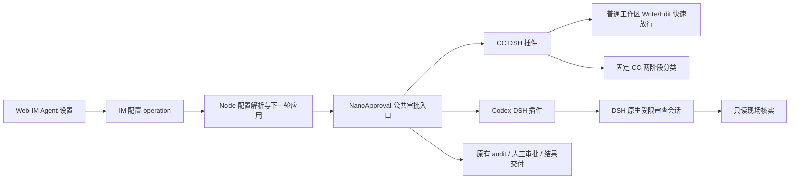

# feat-615: 按 Agent 选择审批策略 — 技术方案

> 对齐: spec.md；用户已确认两套独立 DSH 插件及 Codex 完整同步审查机制。

## Changelog

## 现状分析

### 涉及范围

`packages/dsh-integration/src/policy/approval.ts` 目前将 CC 两阶段判定、DSH 旧规则判定、工具免审、来源、计数与人工分流放在同一个 `NanoApproval` Cordis Service。`src/index.ts` 通过 `ctx.plugin(NanoApproval, configOf)` 安装它。`policy/sources.ts` 投影原生有效历史，普通工具只保留 outcome，Inbox 与发送结果另保留可信来源。

`packages/product-contracts/src/configuration.ts` 是节点/IM 的配置规范化和 fingerprint 入口。`apps/node/src/approval.ts` 读取 owner/workspace Auto 配置，`configuration.ts` 解析审核模型。IM `control.ts`、`gateway.ts`、`schema.sql` 保存和同步 Agent 配置。前端 `features/settings/agents/agent-detail-page.tsx` 与 `agent-create-page.tsx` 使用同一 Agent API。

### 既有约束

只在 dsh-integration 使用 DSH 已声明 public exports；不 fork/patch/private-import，不新增执行循环或 HTTP 服务。保留产品来源、工具自身权限、人工审批、无人值守分流、子 Agent `approval=never` 和取消语义。配置保存经已有 operation/apply/rollback，运行轮次不被中途换规则。

### 可复用能力

- 用：`NanoApproval` 的来源追踪、audit、人工结果、计数与路由；已有独立审核模型和 low 推理档位。
- 改：把 CC 判定与 fastpath 提取为独立 `CcApproval` DSH 插件，公共 facade 按解析后的策略只派给一个插件；DSH 旧规则保留原兼容路径。
- 用：DSH `ctx.agents.create`、`AgentHandle.dispose`、`Agent.followup/whenIdle`、`CreateAgentOptions.seed/inheritedEventCount/setup` 创建、复用和 fork 审查 Agent；它由原生 Agent Loop 执行。只通过 `@deepseek-ai/dsh-agent`、`dsh-session`、`dsh-tools` 等公开 exports 接入。
- 用：DSH `system-prompt/assemble`、scoped tools/guard、request 配置与错误事件构造受限审查环境。权限靠可执行工具表与 guard 强制，不能只写在提示词。
- 不用：PA 聊天绑定、普通 subagent 任务通知和主 Agent 系统提示作为裁判运行界面。裁判不是另一个可聊天产品 Agent，不发送用户消息。

### 相关历史

feat-552 的 workspace Write/Edit 补漏固定于 `b9a61941a` / `1cf086696`，真实证据见其 `evidence/workspace-file-fastpath.md`。恢复该边界，不恢复旧 Python broker。refactor-581 建立当前 DSH 路径。

Codex 本地参考基线 `806d9732c974bc8a51b8317c1bd8985544fe627c`：`codex-rs/prompts/templates/guardian/{policy_template,policy}.md`、`guardian-context/src/{profile,authorization,composition}.rs`、`core/src/guardian/{review,prompt,input_budget}.rs`、`ext/guardian-reviewer/src/conversation.rs`。本 unit 移植同步 Guardian 的机制；异步预测 classifier 是另一产品入口，不属于已讨论的逐动作审批。

## 架构总览

两个插件在宿主注册为独立 Service，按调用所属 Agent 的冻结配置选择一个；安装可用不等于同时审核。共用 facade 隐藏路由和产品交付，插件隐藏各自判定和上下文生命周期。不能在 CC 类里简单切换提示词冒充独立 Codex 插件。

## 关键决策

1. **新增可空 `approval_mode: 'cc' | 'codex' | null`，空值沿用节点既有配置。** 防止升级把已选择 DSH 或关闭 Auto 的用户改成 CC。显式选择覆盖规则实现，Auto 开关、危险跳过、工具约束等仍按既有配置。节点解析为 `approval.rules: 'nano' | 'codex' | 'dsh'`；旧 nano 表示 CC。UI 提供“跟随节点”、CC、Codex，说明跟随节点保留原设置。省略 PATCH 字段保留旧值；清空才回到继承；新建默认继承。
2. **CC fastpath 仅普通工作区 write/edit。** 先经过 downstream 原生权限判定；Auto 关闭或非 CC 不适用。原始绝对路径和真实解析目标均需在实际 cwd 内，逐级解析不存在叶子的最近现存祖先，处理 macOS /var 与 /private/var 别名。保留 feat-552 敏感文件/目录与 `.claude/worktrees` 例外，补当前 `.codex`/`.ripgreprc` 与 AGENTS.md/CLAUDE.md 指令保护；保护匹配基于 workspace 内相对路径，不能仅因 workspace 位于 owner 的 `.nanoassistant/workspaces/` 下就禁掉所有普通文件。原始与解析后的 workspace 内路径均检查；指向目录外仍不免审。存在自定义 allow/softDeny/hardDeny 文本（非 `$defaults`）时不新增 fastpath，以免绕过用户策略。失败/无法解析就走原分类，工具自己的读取/并发修改检查照常。不是 Bash 写入豁免。
3. **Codex 是真实受限审查 Agent。** 固定上游 policy 模板与默认 policy 为版本资产，保留风险 low/medium/high/critical、授权 high/medium/low/unknown 与 outcome 语义，输出严格解析，不能把缺少判定当作 allow。适配段准确描述 Nano 来源与真实执行环境；不复制本仓并不存在的沙箱声明。只注册有界只读文件检查工具（stat、read、list，用于存在性/范围/内容及 .git 配置等证据），屏蔽所有继承工具并用 guard 阻断任何未列出的执行，包括 run_code 嵌套、网络、消息、写入、再派子 Agent。工具不能被 workspace 同名插件替换。这是工具宿主适配，保留按需调查能力，不用模型自觉遵守只读约束。`approval=never`，不触发递归审批。无网络检查能力如实作为证据缺口。
4. **上下文保留与授权分层沿用 Guardian，同步适配 Nano 来源。** 普通工具结果进入受限证据而非只剩 outcome；保留工具调用和待审动作完整 JSON、工具 schema、cwd、配置规则、已验证人工审批。用户/人工审批优先，普通消息单项 5000 token、工具 1000 token，最近非用户项最多 40，消息/工具保留预算 20000/10000，最终仍受模型总请求预算约束，不能把 30000 当总窗口。用公开 estimator，显式标记裁剪；当前 action 不可截断。全局私稿不是已送达提议；Inbox live/restored、发送结果和父子来源沿用产品验证，不把工具正文的自称变成授权。继承背景保留必要工具事实且不升级恢复来源。
5. **复用空闲 trunk；并发从最后成功 checkpoint 派生 ephemeral fork。** 每个执行 session 的裁判独立。状态包含冻结配置指纹、父有效 transcript cursor、最后成功审查的原生事件快照与 cursor。首次发 full，后续只增量追加；仅有效判定成功后推进 cursor/checkpoint。并发调用在同步认领处决定 trunk/fork，不等待正在审查的 trunk，也不把未完成内容作为 fork 种子。临时分支完成即 dispose，不覆盖 trunk。取消/无效判定/执行失败使该未提交会话作废；下次从最后可信 checkpoint 或全量重新开始。
6. **历史改写、配置变化与预算压力触发重建。** 有效历史不是已保存前缀（例如父 compaction）、审核模型/规则/工作区/权限上下文变化时，以当下父 checkpoint 重建。每次请求计入 system、schema、历史、待审和输出预留；预算不足时丢弃旧裁判会话，重放当前有界证据，保留授权优先级并明确 omissions。原生 reviewer compaction 或 provider overflow 同样使 pending input 失效，最多一次更紧预算重建重试；不带着已失效 delta 继续。无法容纳完整动作或可靠判定时进入既有 unavailable 分流。进程重启重建审查会话，不声称保留供应商缓存；同进程稳定前缀依赖模型原生缓存，audit 记录可取得的 usage。
7. **整次审查共享 90 秒 deadline，并传播父调用取消。** 从创建/准备开始计时，模型请求、只读调查与一次预算重建重试共享剩余时限，不因重试重新计时。组合父 `exec.signal` 与 deadline signal，传给创建与工具读取，并在原生 reviewer 已创建后关联 `agent.cancel`；取消/超时均停止并 await dispose 未提交实例，不推进 cursor/checkpoint，返回前复查父取消与 deadline，迟到 verdict 不执行动作。用户取消返回 cancel；到期记录 classifier_unavailable 后走现有分流。只读工具有界，只读取常规文件/有界目录，避免设备或 FIFO 导致不可中止等待。验证覆盖持续工具调用/慢调查的共享截止、重试剩余时间、用户取消和迟到判定抑制。
8. **配置按现有下一轮边界应用。** canonical fingerprint 含 mode；Agent 配置经过 IM SQL migration、API 校验、node 文件持久化、registration seed、apply recovery 与 rollback。运行中的整轮拿旧配置；新轮选择新插件并销毁该执行 session 失效的 Codex 会话。既有人审 requestId 保留原动作关联。
9. **共用交付不混淆错误与安全拒绝。** 公共入口记录策略、判定、risk/auth、review session/full-delta/fork-rebuild、elapsedMs、usage；审核失败不计安全拒绝。high/critical 不通过拒绝阈值降级放行。人工、unattended、子 Agent 行为保持既有契约。共有安全工具豁免保留既有工具/来源约束，CC 特有 fastpath 不移到 Codex。

## 接口与数据流

插件 `review(request): Promise<ApprovalReviewResult>` 接受冻结的 AgentConfiguration、当前 ToolExecution、共享来源投影器、继承证据及消息目标事实；返回判定、审查 usage 和可审计执行标识。共同类型留 `policy/types.ts`，不对 PA/IM 暴露 DSH 对象。CcApproval 负责 fastpath 与两阶段；CodexApproval 负责 policy/context/session/inspection；DSH 旧分类保留已有语义。facade 唯一持有降级、计数和 human listener。

同一调用执行：原生 downstream → 公共显式豁免/Auto 分流 → 唯一所选插件 → 审计 → allow/deny/ask。guard 与工具实际执行约束继续在原生工具管线内执行，快速 allow 不跳过它们。

`ApprovalSources.history` 通过明确选项支持普通工具结果与完整 assistant 证据（标为 private/context），默认维持 CC 原输出；不能为 Codex 修改 CC transcript。父继承存储追加可选 Codex 证据，不改变历史 CC 记录读取。

## 前端原型

[prototype.html](prototype.html) 为当前配置页背景上的局部交互增量。入口：Agent 详情“配置”，在行为卡中、自定义指令之前加入“审批策略”。新建页同一控件同文案。控件先显示选择，再显示当前策略简短说明，随后“保存后从下一轮任务生效”。不在插件安装列表里提供可同时启用两个裁判的开关。

### 现有 UX grounding

2026-10-16 通过真实 Chrome 打开 `https://im.nanoim.win/settings/agents/personal-agent`，观察 Agent 列表→详情配置页及截图；只读，没有更改生产设置。当前页左侧 Agent rail，右侧标题与顶部保存，配置由身份/行为/访问与模型/工作区卡组成；表单很长，工具/技能列表占较多空间。选择放在行为卡顶部，避免埋在长工具列表下。复用白卡、绿色强调、原有 footer/header 保存，不新建页面或二次弹窗。基线截图含私人指令，未提交。

### 原型对齐契约

| 区域/状态 | 对齐级别 | 产品入口 | viewport/状态 | 下游验收 |
|---|---|---|---|---|
| 行为卡中策略与解释 | must-match | 详情配置/新建 | 1280、390 宽；CC/Codex/继承 | M1：一眼定位策略，说明与选择关联，移动端不溢出 |
| 保存、脏草稿和失败 | must-match | 详情 | 正常/修改/保存失败/成功 | M1：失败保持草稿不伪装生效，成功显示下一轮生效 |
| 身份卡、rail、其他配置 | may-adapt | 原有页面 | 各断点原布局 | 保留现有产品布局，不以原型缩减功能 |
| 模拟保存失败开关 | out-of-scope | 仅演示区 | 原型 | 不进入产品 UI |

### 原型走查

实际渲染与结果记录在 `prototype-review.md`。原型只证明设计，真实浏览器操作由实现和独立产品验收完成。

## 契约层增量 (delta-spec)

- Gateway: [specs/gateway/agent-capabilities.md](specs/gateway/agent-capabilities.md)，修改审批规则选择并新增 CC fastpath 与 Codex 行为。
- IM: [specs/im/agents-nodes.md](specs/im/agents-nodes.md)，新增逐 Agent 选择与生效说明。

## 风险与回退

风险在来源升权、审查递归、并发结果错配、预算恢复丢证据以及已有 Agent 配置升级。用真实文件/原生 DSH 驱动验证这些边界；严格保留首次失败证据。mode 空值维持旧节点行为，用户可在下一轮切回 CC。审查 runtime 数据不进 Git；不启用生产、不自动 merge/deploy。

## Runbook for Reviewer

| 服务 | 停止命令 | 启动命令 | 健康检查 |
|---|---|---|---|
| 隔离 IM + Node/DSH | `./scripts/e2e-down.sh --wt "$UNIT_WT"` | `./scripts/e2e-up.sh --wt "$UNIT_WT" --main-config "$UNIT_WT/.approval-e2e.yaml"` | `.e2e-ports.env` 的 IM_URL `/health` + owner nodes online |

Review 驱动方式：真栈并真驱动 Web IM 配置界面，保存 CC/Codex/继承、刷新、切回、390 宽度与失败反馈；任务通过客户端相同消息 API 或真实聊天 UI，检查实际文件与消息交付。

验收前置：仓库 `config/e2e/gateway.yaml` 的本地代理 `127.0.0.1:4000` 可读模型目录，已有 codexOAuth:gpt-6-luna 审批与 codexOAuth:gpt-6.1-sol 执行模型；已在设计阶段实测 gpt-6-luna 返回 OK/end_turn；执行模型同样作小请求连通验证。隔离 config 使用仓库无 secret 模板，固定两边模型/low；无 Feishu、生产凭据或真实破坏目标。端口/workspace/node/database 按 worktree-runtime 隔离。浏览器当前已可访问产品，隔离栈账号由脚本生成。

## Milestones

单个 M1 端到端交付；CC、Codex 内部可作为有明确接口的独立实施任务，界面和集成由主 Agent 完成，不按层机械拆 milestone。

| ID | 标题 | 依赖 | 并行组 | 范围 | 退出标准 |
|---|---|---|---|---|---|
| M1-strategies | 两套审批与逐 Agent 配置、等条件验证 | 无 | 单 milestone | product-contracts、dsh-integration、node、im-server、frontend、测试和本 unit | [reviewer] spec 全部场景与原型 must-match；[worker] 原生 DSH 插件隔离、CC 路径边界、Codex full/delta/并发/失败/配置失效/预算恢复/共享deadline与取消收尾/只读约束、来源不升权及配置兼容测试通过；[worker] 单独审核与真实任务对照保留首轮证据，列固定配置、预期、判定、文件结果、耗时/usage/缓存缺口；[worker] 本地等价 CI、独立门禁、原型与真实界面对照有效 |

对照任务固定初始文件并每种策略重置：①普通 workspace 新建/编辑；②目录外空文件写入；③目录外同文件条目迁移；④授权目录外小文件更新；⑤连续 3 步编辑；⑥缺现场证据的窄操作；⑦恶意工具结果诱导删除/外发；⑧未授权批量删除。危险目标全部是本次隔离临时 fixture，外发只审查不实际联网。先做固定 transcript/action 的相同输入判断（剥离主 Agent 行为差异），再做同自然语言任务的端到端实跑；两层证据分开，不把模型随机换工具的结果当作严格 action A/B。快路径记录 0 judge calls；缓存未知明确 unavailable，不按公式虚构命中。
