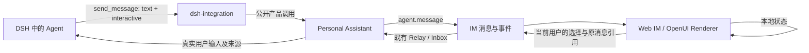

# feat-617: Agent 交互式回复 — 技术方案

> 对齐: [spec.md](spec.md)，2026-10-19；用户授权作者自主选型与设计。

## Changelog

- 2026-10-19：按用户补充，增加 Agent Features 默认启用的 `intelligent_ui` 开关。

## 现状分析

### 涉及范围

- `packages/dsh-integration/src/global-mode.ts` 注册 `send_message`，通过 product bridge 调用产品能力。Global 模式 prose 属于私有草稿；单线程 final prose 可自动交付。
- `packages/personal-assistant/src/global-agent.ts` 负责显式公开消息的目标解析、源上下文核对、publication 幂等和实际发送；`single-thread.ts` 投影普通聊天的回复与工具过程。
- `apps/im-server/src/gateway.ts` 接收 `agent.message`，按可信 node/agent 解析发件人并使用 dispatch log 去重；`messaging.ts` 持有消息、事件、用户身份、relay 入队与历史；`schema.sql` / `db.ts` 持有迁移。
- `src/IM/frontend/src/features/chat/` 的 `MessageBubble`、chat-api/types 与现有实时投影负责正文、附件、操作和输入框。当前 React 19 + Markdown，没有通用交互内容字段。
- `packages/product-contracts` 是跨层产品 DTO 的归属；当前 `RelayInput.message` 只有文本与附件等字段。

### 既有约束

继续遵守 `SPEC.md` 的 DSH 公开 exports、stdio 和包依赖方向。IM 与 Channels 不 import DSH。交互产物必须经过公开交付链；模型私有草稿、工具过程不自动成为公开内容。会话读取、写入、fork、重连与身份必须沿用 current IM 规则。

### 可复用能力

- **用** `send_message`、publication/dispatch idempotency、`Messaging.insertMessage`、事件同步与 relay queue；不新增第二个消息系统或 Agent loop。
- **改** 消息 DTO、持久化、用户消息上下文和前端正文渲染，加入一个可选的交互回复。
- **用** OpenUI `@openuidev/react-lang=1.0.1`、`@openuidev/lang-core=1.0.1`、`@openuidev/react-ui=0.18.1` 的解析器、组件、状态与 Renderer；按确切版本锁定，不 fork 核心、不引入其 chat shell、Gateway 或托管模型服务。
- **不用** 首版 Query/Mutation/toolProvider、任意 HTML/JS、跨回复 `mergeStatements`；这些不是当前核心旅程的必要条件。
- **不用** PA incidents 专用查询/标题/按钮作为协议。feat-616 现有卡片不在本 unit 中迁移。

### 相关历史

feat-584 定义当前会话/身份与消息协作语义；bugfix-606 定义 Web 入口刷新行为；既有 Global Agent 与公开 publication 契约决定交付边界。feat-616 是提出需求的场景，实施与数据模型不作为 feat-617 前置。研究基线、开源成熟度和未验证项见 [选型研究](../../../research/studies/intelligent-ui-open-source-2026-10-19/research.md)。

## 架构总览



OpenUI 负责描述与渲染；Nano 保存公开消息、个人草稿和真实点击，沿原有 Agent 执行链继续任务。

## 关键决策

**1. 采用 OpenUI，做小范围适配，不自行编写 UI 语言。** 首版库包含排版、表格、条形/折线图、单选、多选、输入、滑块及通用继续按钮。复用上游组件视觉，映射 Nano 字体、颜色、圆角与容器宽度。按钮适配用于确保用户看到的操作文字与回传语义一致，不为隐私、行程等业务创建特殊组件。

Catalogue 的唯一维护源放在 `src/IM/frontend/src/features/chat/interactive/catalog.tsx`；构建脚本从所选组件生成序列化 library spec 和模型提示词资产，输出到 `packages/dsh-integration/assets/interactive-ui/`。生成步骤通过显式脚本运行，不在运行时跨包 import 前端代码；CI 验证生成物与源一致。IM 校验器使用随构建生成的同版 library spec（从 product-contracts 的纯数据 export 分发），不加载 React。源目录、生成目标与依赖固定在脚本中，避免手工维护两份组件列表。上游完整库不自动成为模型可用库。

**2. 每条公开消息最多一个独立交互区。** `text` 保留可独立阅读的摘要，原生/外部 channel 继续显示它；Web 依次显示正文和交互区。首版完整校验后一次交付，生成期间沿用现有运行/工具进度。模型无需对简单问题调用交互能力。

**3. 首版动作统一为继续对话。** 注册 `ContinueButton(id, label)`，id/label 必须为静态字符串，按钮只回传实际可见 label 与用户填写值；不接受模型生成的隐藏命令、URL、工具名称或任意 `params.context`。动作 catalog 从校验后的 source 提取并保存。其他控件只调整本地状态。真正的发送/保存由 Agent 在既有业务工具和权限边界内完成；“已提交选择”与“任务已完成”分开展示。

**4. 个人草稿与公开确认分开。** 未提交状态按当前用户与原消息保存，不广播给群成员，也不自动送模型。点击继续后，生成带可读选择摘要的本人消息；此后同一用户的该卡片只读，想改方案可直接发文字，由 Agent 返回新卡片。多用户群中每人各自提交，不能代替其他人选择。

**5. 每次交付内容不可变。** 后续修改生成新消息。可选 `supersedes_message_id` 明确将同一 Agent、同一会话的旧卡片标成“已有更新”；不靠标题猜测。服务器检查提交时是否已被替代；即使仍可提交，也只是新的用户输入，Agent 必须结合当前事实解释，不把旧卡片视为持续有效的执行授权。

**6. 上游适配有明确止点。** M1 开始先做固定版本与实际模型的四类任务验证；出现具体 DSL/Renderer 缺陷先判断是否可用小适配解决。若核心生成可靠性不合格，回 design owner 用同样契约换 json-render，并对实质变化复审，不在实施期悄悄维护两个引擎。

**7. Agent Features 控制能力。** Node capability registry 暴露 `intelligent_ui`（默认 true，关联 send_message），复用 Agent 配置页现有 checkbox 与配置同步。缺失值视为启用。DSH 使用独立 Feature 生命周期挂载 `nano-interactive-replies` 提示，并按当前 Agent 配置过滤历史 preset；PA 显式发布接口在关闭时拒绝带 interactive 的调用，反馈改用文字。关闭不会删除已有卡片、草稿或选择；既有卡片提交仍是普通用户输入，后续回复遵守当前开关。

## 接口与数据流

### 公开回复

扩展 `send_message` 的公开 target/text 分支，允许 `interactive`；内部 `agent_id/message` 分支不接受它。新增产品 DTO 归 `packages/product-contracts/src/interactive.ts`：

```ts
type InteractiveResponse = {
  format: 'openui';
  catalog_version: 'nano-1';
  source: string;
  supersedes_message_id?: string;
};
```

模型提示词给出可用组件、局部状态以及“何时应保持文字”的例子。通过现有随包 skill 承载详细语法，工具说明给出发现入口；生成的 catalog 与 skill 同版本。Agent 可以组合任何已注册组件，不需要按业务场景选预制卡片。

source 上限 64 KiB UTF-8，沿用消息 envelope 总量约束；先 parse/validate 完整源码和 catalog，拒绝未知组件、未完成输入、Query/Mutation、未注册动作及非常量按钮 id/label，不执行任意 JS。校验错误作为工具失败反馈 Agent，可修正后重新发送；未成功校验的 source 不显示给用户。UI 运行错误显示原消息的 text 和“交互暂不可用”，保留普通输入。

PA 的 publication identity 必须包含规范化 interactive（不能仍只比较 target/text）；Node inbox publication、IM dispatch log 的重试内容校验涵盖文本与交互摘要 hash。同 operationId 同内容返回原结果，不同内容返回冲突。held_for_revalidation 不保存公开交互。权限/披露审查必须包含全部 source 的可见内容和默认值，不能只审 text；现有身份与源授权规则不变。

IM 同一事务保存 message + interactive 记录，再广播完整 `message.created`。`message_interactive` 以 message_id 为主键，含 format、catalog_version、source、提取的 action id/label、superseded_by；message JSON 暴露可选 interactive。server 不 import React 或 DSH。schema migration 为增量新增表，历史消息无需改写。

单线程 Agent 同样走显式 send_message 交付卡片；已有 final prose 投影保留。提示词要求卡片内容不要在 final prose 重复生成，验收确认一份交互只出现一次；不为本 unit 重写普通单线程回复的生命周期。Global 模式只公开显式 send_message 的内容。

外部 channel 路由在分发前剥离 interactive，发送 text；不把原始 DSL 或本机路径泄漏到外部客户端。Web/iOS 的摘要文本与消息身份保持一致。

### 用户状态与提交

- `GET /im/v1/conversations/:cid/messages/:mid/interaction-state`：普通登录用户按现有会话 read 权限读取自己的 `{draft_revision, state, submission_message_id}`；不读取别人的草稿。
- `PUT` 同路径：会话 write 权限；body `{expected_draft_revision, state}`，最多 16 KiB。原子 CAS 更新自己的草稿；冲突返回 409，前端保留当前编辑并提示已有另一设备的更改，重新读取后继续，不能静默覆盖。debounce 500ms；UI 不等待保存才能响应。
- `POST /im/v1/conversations/:cid/messages`：复用 createMessage，新增可选 `interaction_reply: {source_message_id, action_id?, state}`；普通打字附带选择时 action_id 省略。使用 `Idempotency-Key`，并按实际 user_id 加前缀隔离 key。source 必须属于 cid、有交互、未被替代；动作必须在保存的 registry 内。服务端从登录身份与原消息取发件人/来源/按钮文字，不信任浏览器提交这些字段。

同一 viewer 对同一 source 只产生一条确认消息：`interaction_submissions(source_message_id, user_id)` 唯一。提交身份保存完整的 `{source_message_id, action_id ?? null, typed_content, canonical_state}`，user_id 从登录态取得；typed_content 按原文比较，state 按规范化 JSON 比较。完整语义相同的重试返回原消息；action、正文或 state 任一不同均返回 409，展示原提交结果并保留本次未提交的正文和状态，提示新的要求可单独发送。存在原提交时，先在会话权限核对后完成上述比较，不因后来卡片被替代而把成功重试误报为新操作。保存确认快照、更新个人草稿为提交态、创建本人消息与 relay 入队在同一事务内完成。沿用现有 relay 持久队列；节点离线显示消息已保存待处理，重试返回原消息，不二次入队。网络失败时不显示成功；客户端以相同 key 查询/重试收敛不确定结果。

公开正文与选择 snapshot 分开保存，映射如下：

| 提交入口 | 请求 | 持久化与公开回显 |
|---|---|---|
| 点击 ContinueButton | `interaction_reply.action_id` 必填，`content` 省略；同时携带 state | content 由服务器取动作 registry 的可见 label；typed_content 为空。选择快照与可读摘要保存在 interaction_reply_json，前端作为该条本人消息的附加选择区展示 |
| 普通输入框带选择 | content 为用户手写原文，action_id 省略；同时携带 state | content 和 typed_content 均原样保存用户原文；服务器生成的选择摘要只进入独立的 interaction_reply_json，不替换、改写或省略原文 |

同时提供 action_id 和非空手写 content 的混合请求返回 422，避免两种语义混用；普通文字路径仍要求非空 content。按钮路径先生成可信 content 再进入既有非空消息校验。保留字段名称、类型、值与 source message id，超大值按明确限制拒绝，不截断后冒充原输入。表单值属于用户输入数据，原卡片内容属于 Agent 生成材料；不能把隐藏模型文字升级成用户指令。

模型输入组装在 PA 层同时覆盖普通 Relay 和 Global Inbox：完整保留持久化 content，在其后追加独立标识的选择上下文（source id、原回复摘要、按钮、field state），来源继续是实际用户及当前会话。语义字段与 text 来自持久快照；不通过 system 通道注入，也不让浏览器指定目标 Agent/系统角色。群聊点击定向唤醒原卡片作者 Agent，仍要求其在群内有效且可用；普通打字附带卡片也按此显式目标处理，避免 mention_only 下无响应。其他 Agent 的旁听仍按既有群策略执行。

例如普通文字请求 `content="先别发送，把语气改得随意一点"`，state 中草稿为“林悦，周六改为 11 点在断桥见”。本人消息首先原样显示“先别发送，把语气改得随意一点”，附加区再显示草稿。普通 Relay 和 Global Inbox 交给模型的用户输入都必须包含这两段，且将前者标为本次手写要求、后者标为所附 Agent 回复的选择数据。相同 state 下把正文换成“发给林悦”属于不同提交，不能返回旧提交成功。W2 窄验证分别检查 REST 持久正文、历史/事件回显、两条 PA 输入路径以及相同 state/不同正文或 action 的 409；不靠原型模拟代替。

前端保存 Renderer 的 opaque state 原值，用 initialState 恢复。选择摘要由适配的表单字段登记（可见 label、field key）生成，服务器只保留 source 中存在的字段与局部变量，不信任隐藏额外字段。schema/表单定义变更通过新卡片处理；同一 source 的 catalog 固定。

普通输入框在用户修改某张卡片后显示一个可取消的“附带选择：标题”条。只有带此条发送时才提交该卡片状态；取消后就是普通文字。提交请求携带当下 state，消除 debounce 尚未落库的竞态。离开再进入恢复最近编辑的尚未提交卡片；已确认的选择存在公开消息中。

### 历史、删除与 fork

消息列表/实时事件共享 interactive 数据；个人草稿只按需 GET，不放进群广播。删除会话或消息时级联删除其 interactive/draft/submission 辅助记录。登出清空前端状态，切换会话不复用同一 Renderer 状态。

fork 将已公开交互 source、确认 snapshot 与摘要复制到新消息并重映射 source/superseded/submission 引用，超出 fork 范围的引用仅保留文字说明；不复制任何用户未提交草稿。复制的旧卡片作为只读历史，显示“来自分支前的记录”；新分支需要继续交互时由 Agent 给出新卡片。原会话删除后 fork 中内容仍可读。

## 前端原型

- 原型：[prototype.html](prototype.html)，仅模拟 UI，不调用后端、不证明 OpenUI 能生成这些内容。
- 目标：用户先读简短建议，再调整选项，看清当前选择，点击继续；聊天仍是主界面。
- 排版：沿用顶栏、会话侧栏、本人浅绿色消息、Agent 浅灰内容和底部输入框；交互在对应 Agent 回复内部。桌面卡片最大 720px；移动端上下排列、按钮整行，输入框常驻。长内容随主消息区滚动，不添加卡片内纵向滚动层。
- 状态：普通、未提交编辑、提交中、已提交、失败重试、已替代、无法渲染；演示控制放在产品区域之外。

### 现有 UX grounding

| 当前产品入口 | 画面与操作基线 | 沿用或改善 | 本次设计 |
|---|---|---|---|
| `/chat/c_04143c1727c6`，feat-616 隔离服务 | 2026-10-19 实际登录查看；1440×1000，顶栏与左栏固定，消息主滚动区，底部输入，PA提醒在消息外 | 保留导航和输入位置，将本次通用交互嵌入对应消息以保留上下文 | 原型同一聊天背景中的行程调整与后续选择消息 |
| Web MessageBubble / global.css | Markdown、附件和本人/Agent 消息层级 | 文字仍是简短入口，卡片只承担调整与选择 | 文本摘要 → 控件 → 当前选择 → 单一主动作 |

### 原型对齐契约

| 区域/状态 | 对齐级别 | 入口 | viewport/状态 | 验收投影 |
|---|---|---|---|---|
| 交互与正文属于同一回复，摘要在前，选择和主动作相邻 | must-match | 聊天消息 | 1440×1000、768×900、390×844；正常/编辑 | M1 R1/W2 |
| 本地调整即时更新；继续后本人选择消息可见；已提交卡片只读 | must-match | 卡片继续/输入附带 | 三种宽度；编辑/提交/失败 | M1 R2/W2 |
| 正文失效仍能阅读，旧卡片不继续执行，输入入口始终可用 | must-match | 历史/异常 | 390×844；替代/降级 | M1 R3/W2 |
| 桌面左右、移动上下的字段排列，适配 Nano tokens | may-adapt | 回复内部 | 上述三种布局已有原型 | M1 R1 |
| 顶栏/会话导航背景及演示状态控制 | out-of-scope | 当前导航保持不变 | 演示栏不是产品入口 | 不新增产品设置 |

### 原型走查

走查记录见 [evidence/prototype-review.md](evidence/prototype-review.md)。原型不代表真实模型、真实状态持久化或产品验收。

## 契约层增量

- [IM 消息 delta](specs/im/conversations-messages.md)：公开交互与选择、身份、回看/fork。
- [Web 体验 delta](specs/im/web-chat-ux.md)：选择、文字继续、错误/移动体验。
- [Gateway 能力 delta](specs/gateway/agent-capabilities.md)：任意 Agent 按需交付交互，外部渠道文字回退。

## 风险与回退

- OpenUI 1.0 刚发布，只有固定版本通过本仓样本才能采用；实际兼容或模型生成问题先在 M1 起点暴露，不先铺完整系统。若换引擎，保留 Nano 消息与选择契约，更新受影响设计并独立复审。
- UI/模型可能误解业务动作。首版 ContinueButton 只有可见 label 与字段，结果先标“已提交”；真实执行完成由 Agent 的实际结果消息说明，不将 UI 回调当业务成功。
- 不提供 toolProvider 或任意 JS/HTML；具体格式限制、资源上限及重复提交检查围绕本需求，不建设通用插件权限平台。
- 暂停新交互生成时，既有 text 继续可读；保留读取旧 catalog 的 renderer，不靠删除历史数据回滚。依赖升级须保留旧版本消息可读或提供明确迁移。

## Runbook for Reviewer

只在 feat-617 自己的 worktree 启动隔离服务，不复用、重建或停止 feat-616 的现场。

| 服务 | 停止 | 启动 | 健康检查 |
|---|---|---|---|
| 本 unit IM + Node + 前端构建 | `./scripts/e2e-down.sh --wt "$PWD"` | 首次 `pnpm install --frozen-lockfile && ./scripts/e2e-up.sh --wt "$PWD"` | source 本 worktree `.e2e-ports.env` 后 `curl -fsS "$IM_URL/health"`，核对 own node ready |

脚本首次启动可能重建测试数据；已有有效现场先核对版本与进程，不盲目重跑。保留数据重启按 `docs/development/worktree-runtime.md` 执行。

**Review 驱动方式**：端到端真栈，真实浏览器桌面/窄桌面/手机尺寸；必须操作行程、草稿、通用提醒三类卡片并继续打字，验证刷新、离线与失败。不能只用 API 或手写 fixture 代替 Agent 生成能力。

**验收前置**：本地脚本的 nano/nano1234 测试账号和独立 node；同一隔离租户经产品注册建立第二个用户与测试群。真实模型配置取现有 config/e2e/gateway.yaml 支持的本机代理，密钥不入库；实施前检查代理与实际模型响应，本轮最小真实请求已得到 `OK/end_turn`，见原型走查记录；未验证候选 DSL 生成。外发任务仅向该隔离栈的第二测试用户发消息；不需真人联系人或生产服务。当前本机已有可用真实模型联调方式与浏览器，具体端口由脚本分配。

## Milestones

| ID | 标题 | 依赖 | 并行组 | 范围 | 退出标准 |
|---|---|---|---|---|---|
| M1-interactive-replies | 任意 Agent 的交互回复完整闭环 | 无；不依赖 feat-616 | 单一 | product-contracts，dsh-integration 公开工具/资产，PA 交付与输入，IM 消息/迁移/relay/fork，Web chat 与窄测试，生成脚本/锁文件 | **[reviewer] R1** 同一真实模型在普通/Global Agent 完成行程调整、草稿修改、通用提醒，简单问题仍用文字；1440/768/390 三种宽度摘要、控件、动作与输入均可辨认可操作。 **[reviewer] R2** 本地操作无需模型；按钮或带选择的文字使 Agent 正确理解实际改动；本人选择消息与业务实际结果分明，重复点击不二次入队。 **[reviewer] R3** 刷新/换设备可读自己的草稿和公开结果；群成员草稿隔离，离线与失败如实，替代/fork 旧卡片只读；外部/原生仍可读摘要。 **[worker] W1** 起点固定 OpenUI 版本，用实际 provider 跑三类交互加纯文字样本并保留成功/失败、输出量、耗时；确认公开 API 与 source validation；不通过时先修订设计。 **[worker] W2** 真实浏览器截图/录屏与原型逐项对照覆盖所有 must-match；Parser/Renderer、消息和提交幂等、身份/草稿隔离、CAS、relay/Inbox 上下文、fork 与 public source 披露审查的窄测试；相关构建、类型、架构契约与 docs-check 通过。 |
