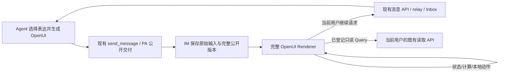

# feat-617: Agent 交互式回复设计

> 本文提到的截图仅保存在仓库外；定位见[本地证据说明](evidence/local-artifacts.md)。

状态：同一 PR 继续交付；自然上下文增量与聊天布局增量均已实施。布局设计 R6 Approved，真实产品 Round 5 pass；完整历史与各轮范围保留，最终静态闭合及 CI 见交付记录。

## 目标与依据

用户普通提问时，Agent 按内容选择文字、可视化和交互组合；用户能探索、比较、理解并继续对话。保留 OpenUI 原生组件、状态、计算与动作；真实工具仍由 Nano 提供权限和结果。不得为冒泡排序写专用组件、路由、提示词例子或答案。

依据：当前实现 `catalog.tsx` 主动删除大部分上游组件，服务端拒绝 Action/Set/Reset，提示词将知识问题归入纯文字；普通“给我讲解下冒泡排序”实际收到纯文字，消息没有 interactive，已证实问题发生在生成和能力设计层。原表单验收未覆盖这个入口。

固定依赖继续为 react-lang/lang-core 1.0.1、react-ui 0.18.1。公开 API 已核实：完整 openuiLibrary、Action/@Set/@Reset/@ToAssistant/@OpenUrl、Query/Mutation/toolProvider、createParser/evaluateRoot/mergeStatements；不 fork 上游，不引入第二套 Agent Loop。

## 关键决定

1. **完整上游库为基础。** `openuiLibrary` 的组件不做删除，不覆盖上游 Button、Form 的行为。保留此前已经存在的 ContinueButton 作为旧消息可读的附加组件，Form 槽位允许旧按钮但不缩窄原本类型。组件和提示词仍由同一目录生成同版 server schema / DSH Skill，CI 检查漂移。
2. **表达按任务需要。** Feature 指导模型主动判断交互是否帮助理解过程、变化、关系、比较或编辑，不等用户明确要求交互。没有业务场景白名单，不给特定算法加触发词。详细语法仍按需读取 Skill。单一事实可用文字；知识讲解不预先归类为纯文字。
3. **上游本地交互原样执行。** 状态绑定、条件渲染、Each、计算函数、Set/Reset、多个动作与按钮由 Renderer 执行。字段可在 Form 外，不要求静态字段、静态按钮文字或单一主提交。浏览/本地操作不产生模型请求；个人状态继续保存且互不共享。
4. **继续对话可多次发生。** 原生 ToAssistant 事件、无 action 的上游按钮和旧 ContinueButton 接现有消息入口。一次成功请求不会锁死整个界面，用户可继续探索并提出另一个请求。每次实际请求独立生成幂等键；同键重试收敛到原消息，不按 source+user 限制终身只能提交一次。被替代、复制到 fork 的旧版本仍不可发起新业务请求。
5. **真实工具有明确接线。** 保留 Query/Mutation/toolProvider 原生机制；首批通用宿主工具为 `conversation_messages`（只读当前会话，复用现有 REST 权限）与 `continue_conversation`（写入当前用户请求并沿现有 relay/Inbox 驱动原 Agent）。查询只允许绑定已登记只读工具，Mutation 绑定写入工具；未知工具反馈未接入，不自动映射任意 shell、文件或网络请求。后续业务工具可按同一接入方式增加，不需更换 UI 协议。此次不宣称已经提供通用 Agent 文件编辑器。发送/保存等最终业务行为由 Agent 在既有工具/审批中执行，Mutation 返回入队回执并不冒充业务完成。
6. **链接是宿主动作。** OpenUrl 支持 http/https 的正常新页导航，使用 noopener；不执行 javascript/data/file URL。自定义动作注册与处理保留上游机制，不以未知事件静默执行。
7. **增量编辑保留历史。** `interactive.source_mode = 'patch'` 时必须指定同作者同会话的 `supersedes_message_id`。IM 用公开 mergeStatements 合并并校验，保存新消息中的完整程序；原消息不改内容。新增记录保存原始发布输入用于重试身份比对，避免补丁与合并结果不同导致假冲突。原生/外部渠道继续收到独立摘要。
8. **不另造任意程序执行器。** 模型通过 OpenUI 语言使用完整注册能力；自定义组件/函数的代码由应用定义。语法、已声明工具和现有资源大小限制保留，删除因静态表单设计而额外施加的限制。

## 组件与职责



- `product-contracts`：公开描述、patch 模式、用户事件/状态快照 DTO 与生成纯数据 catalog。
- `dsh-integration`：Agent Features、send_message schema 与生成指导；仅使用 DSH 已公开接口。
- PA：publication identity、公开审查、普通/Global 输入来源；不直接解释 UI 程序、不 import DSH。
- IM：公共版本与发布幂等、用户私有状态、交互请求幂等、身份与会话权限。parser/evaluator 使用 lang-core 公开 API；不加载 React。
- Web：完整 Renderer、本地状态保存、原生事件适配与应用工具接线；复用现有聊天、请求重试与错误反馈。

## 接口与状态

### 公开消息

既有 `{format:'openui',catalog_version:'nano-1',source,supersedes_message_id?}` 增加可选 `source_mode:'patch'`；缺失为完整源。版本仍以固定依赖及生成 catalog 管理，本次为同一尚未合并版本的兼容扩展；旧 ContinueButton 消息真实存在，必须可读。

source 仍限 64 KiB，完整解析及已知组件/函数检查交由上游。允许状态声明、原生 Action、Query/Mutation、条件内容与 Each。Query/Mutation 的工具名必须为当前宿主已提供的静态名称，且匹配读写类型；不再以禁用两种语法代替工具权限。

patch 合并须在同一事务内完成原版本验证、新完整源校验、旧版本 superseded 更新和新消息写入；失败不发布半条消息。发布重试比较原始 normalized 输入，而面向用户的消息返回完整 source。

### 私有交互状态

GET/PUT interaction-state 路径与身份校验继续复用。保存 Renderer 原始 state（16 KiB），包括独立输入与绑定变量；不广播个人状态。CAS 冲突保留当前操作并提供重新读取。取消“已提交就禁止保存”的条件；`submission_message_id` 表示最近一次确认，后续编辑清空此标记以区分未发送的改动。

服务端不通过静态表单字段数量校验限制合法 UI。已声明变量和可读选择通过上游解析/求值与当前状态生成；动态来源数据无法静态给出可见标签时保留原始字段键和值，不丢弃真实输入。所有状态均作为用户提供的数据，不授予新角色/目标/权限。

### 发给 Agent 的事件

`interaction_reply` 继续包含 source_message_id/state，兼容旧 action_id；增加上游事件 `{type:'continue_conversation', message, context?, form_name?, label?}`。旧 action_id 仍从保存源取得文字。Web 从容器 click capture 取得最近可交互元素的 aria-label 或可见文字作为 label（键盘激活同样产生 click），与 Renderer 回调的 message/context 分开记录；无法取得时明确显示“向 Agent 提问”，不把生成 message 冒充用户所见按钮。原生事件传递这些独立字段；正文优先显示实际标签，生成的 message/context 作为附属交互信息明确标记，不冒充手写要求或系统指令。用户直接打字时原文仍独立完整保留。

Web 同步在 onStateUpdate 中维护最新完整 state ref；动作回调以该 ref 为基础，按 formName 合并回调中当前 formState（具名 Form 只包含局部状态），立即复制为请求快照，不等待 debounce。Set 后的 ToAssistant 和 Mutation 都走同一提交函数，取 Set 已更新后的 ref。点击期间禁止同一卡片业务重入；纯本地动作仍由上游执行。source 作者仍为显式目标 Agent，浏览器不能通过 event 更换 Agent 或会话。按用户前缀隔离 Idempotency-Key；相同 key 相同语义返回原 message，不同语义 409。缺键的交互请求拒绝，避免网络不确定时无法重试。成功后清除该次 pending，允许后续新的请求；正在进行的同一次请求禁止重入，网络不确定时保留原 input/key。

`interaction_submissions` 改为 message_id 主键，保留 source/user 索引，不再对 source/user 唯一；增量迁移保留全部历史记录。确认快照、本人消息与 relay 入队继续在同一事务内提交。离线时显示已保存待处理，回执到达后更新状态。

窄验证固定为：Form 外 `$scale=2` 绑定 Slider，Form 内 Input 草稿；按钮可见“解释当前结果”，Action 先 Set(scale,3) 再 ToAssistant("分析参数",{kind:"comparison"})。本人正文是“解释当前结果”，event.message 是“分析参数”，event.context 保留独立对象，snapshot 同时包含 scale=3 和最新草稿。同例改用 Mutation 时取得同样完整快照；手写正文从不被这些内容替换。

### toolProvider

- `conversation_messages({limit?})`：固定当前 cid，读取已有 listMessages，返回简洁的 message id、sender、content、delivery 状态；不提供跨会话参数。沿既有服务器 read 权限，不获取其他用户草稿。
- `continue_conversation({message,context?})`：与 ToAssistant 共用一次交互提交实现和幂等；返回 `{message_id,delivery_status}`。只能由 Mutation 调用，不能在 Query 自动执行；服务器发布前核对读写绑定。实际业务结果继续在聊天中交付。
- 宿主工具描述和读写分类由同一目录生成到模型提示与服务器校验资产。错误使用原生查询/Mutation 错误通道，保留已经可读的 UI；不因后台工具失败抹掉整张界面。

### 更新、历史与只读

新 source 通过新消息呈现；patch 合并保留旧公开版本。当前用户已保存的局部状态不因为另一个用户操作改变。fork 保留公开完整源和已确认快照，不复制个人草稿；已替代/fork 历史禁止新业务提交，但可读性和本地浏览不应被笼统禁用。历史状态不触发 Mutation。

## 前端体验与原型

当前产品基线为 [首轮真实浏览器记录](evidence/implementation-browser-review.md) 的同一聊天页面；导航、消息顺序和底部输入保持。原型 [prototype.html](prototype.html) 展示本次改变：正文解释与探索区同属一条回复，本地参数/多视图/重置能连续操作，向 Agent 提问后仍能探索。走查证据见 [连续探索原型走查](evidence/prototype-continuous-review.md)。原三类表单原型保留为 [prototype-forms.html](prototype-forms.html) 历史参考，其“一次提交锁死”不再是目标。

| 区域/状态 | 对齐 | 入口与宽度 | 验收 |
|---|---|---|---|
| 简短文字先交代结论；图形/参数/解释在同一回复内，参数变化可见且含义可理解 | must-match | 聊天消息，1440/768/390 | R1/W2 |
| 本地操作即时响应、无新聊天消息；提交后可以继续探索并发送另一请求 | must-match | 控件/动作/输入，三种宽度 | R2/W2 |
| 本人私有状态刷新恢复；文字继续仍方便，提交与实际业务完成分明 | must-match | 刷新/离线/自然语言 | R2/R3 |
| 图表、步骤、Tabs、布局等具体组合 | may-adapt | 由任务与模型生成决定 | R1，不要求固定模板 |
| 原有导航、Agent Features | retained | 当前产品入口 | 原通过证据 + 定向回归 |

关键体验是用户看懂变化关系，不能以“有图表/有按钮”替代；真实模型内容不同于原型是正常的，需核对信息组织和实际交互结果。

## 风险与验证界限

真实工具继续受当前用户会话权限及 Agent 工具审批约束。生成来源不等于用户授权；UI 事件附属上下文保持来源标记。普通本地动作不加审批。未知工具/不支持链接明确失败，不执行猜测的替代目标。

完整组件库会增加提示长度，W1 记录加载成本与真实生成结果；只修正实际发现的问题，不按猜测再次砍能力。上游组件适配有可见错误时优先最窄修复，不重写整套 Renderer。复杂领域计算由模型程序表达或通用扩展，不预埋验收题答案。

## Runbook for Reviewer

复用本 worktree 已有隔离栈 `http://127.0.0.1:58769`，用户名 nano、密码 nano1234。普通 e2e / Global e2e-global；主模型 codexOAuth:gpt-6.1-sol，审核 codexOAuth:gpt-6-luna。已有运行数据不可重置。新现场可用 `scripts/e2e-up.sh`，但该脚本会清库，本次不得重跑。保留数据重启用下列命令，仅操作当前 worktree 的 PID/config/DB；不操作 feat-616 或生产。

```sh
cd /Users/czj/Repos/nano-multiagent/.worktrees/unit-feat-617
node apps/node/lib/cli.js stop --config .gateway-config.yaml
kill -TERM "$(cat .im.pid)"
pnpm build
(cd src/IM/frontend && npm run build)
set -a
. ./.e2e-ports.env
set +a
IM_PUBLIC_URL="$IM_URL" IM_DB_PATH="$PWD/data/im_service.sqlite3" IM_UPLOAD_DIR="$PWD/data/uploads" IM_PUBLIC_MODE=0 \
  nohup node apps/im-server/lib/main.js serve --host 127.0.0.1 --port "$IM_PORT" >> .im.log 2>&1 &
echo $! > .im.pid
curl --fail "$IM_URL/health"
node apps/node/lib/cli.js start --config .gateway-config.yaml
node apps/node/lib/cli.js status --config .gateway-config.yaml
```

停止前用 `ps -p <pid> -o command=` 核实对应本 worktree；停止后确认端口释放再启动。健康检查失败则读 .im.log，不清库重试。Node status 必须显示 ready/connected；再登录以当前 owner 调用 GET /im/v1/nodes，核对本 .e2e-ports.env 的 node_id online。保留原 .gateway-config.yaml、.gateway-state 身份、运行目录和 data 文件。

真实浏览器进行桌面/中等/手机尺寸操作。先以普通用户原话“给我讲解下冒泡排序”发问；不得追加“做交互/按钮/滑块”指导，不用 API 注入预制 source 充当该旅程。另选未在产品提示中出现的不同领域普通问题，检查是否按需要主动使用交互；报告原始问题、完整回复、交互后的变化及失败样本。核对产品代码/提示/Skill 没有算法专用逻辑。API fixture 只用于工具、权限、patch、幂等的确定性回归。

## Milestone

继续同一 M1-interactive-replies，不新建第二套生命周期。先设计复审，主 Agent 修复，独立静态与产品复验，沿原 PR 交付。

| ID | 依赖/范围 | 退出标准 |
|---|---|---|
| M1-interactive-replies | 原实现与同一 worktree；catalog/生成资产、IM 状态/事件、Web Renderer、PA 上下文、公开 tool schema | **R1** 普通/Global 的无交互提示知识问题实际生成有意义交互，指定原话和跨领域样本通过；无验收题专用逻辑，1440/768/390 可读可操作。 **R2** 本地探索不调用模型，多次继续会话正确携带状态，重复网络请求不重复入队，旧表单仍可读。 **R3** 私人状态、读写权限、离线/错误、替代/fork、patch 历史与 Feature 开关正确。 **W1** 固定版本 full catalog、原生动作/计算/条件/Each、宿主 Query/Mutation 与 patch 的有意义窄测试，真实模型源与失败记录。 **W2** 原型和真实浏览器交互对照、类型/构建/相关测试、静态审查、一致性与独立产品验收；未接入具体业务工具的边界如实披露。 |

## Changelog


## 自然上下文修订（本轮受审增量）

### 体验与状态

正常操作没有“Draft saved”状态，输入框上方没有Current choices/Detach。仍自动保存、恢复、CAS冲突保护。仅保留确需用户理解或处理的发送中、明确按钮已发送、失败/冲突/未知结果重试。自然文字的本人消息只显示原文，不新增“Submitted choices”确认块。

私聊中，完整OpenUI Renderer每张可用卡片把当前完整state同步给会话内背景缓存（初始默认/恢复状态也可用）；最近操作时间仅作背景线索，不是显式用户选择。按会话保留最近三张的快照候选，优先最近实际操作，其次最新卡片；多张卡片时提供source id、简短来源摘要、字段和状态供Agent按指代判断。替代/切换/删除会话不会把背景带到另一会话。历史卡片仍可本地阅读，不因此重新允许业务动作。

手写发送时立即深拷贝候选状态；网络未知结果以相同正文、附件、快照和请求键重试。随后本地操作仍可继续，下一问题取更新后的状态；成功发送不清除背景缓存，也不把个人草稿标为“已提交”。卡片原生ToAssistant/Mutation/ContinueButton保留原interaction_reply通道，仍是明确交互请求。

### 传输、持久化和权限

私聊普通消息请求新增可选`interaction_contexts: [{source_message_id,state,interacted_at?}]`，最多3条，各state沿既有16KiB限制。来源必须是当前会话可读的交互消息，当前登录人仍通过正常会话写权限；不接受浏览器指定接收Agent或跨会话读取。IM根据已保存source生成规范背景快照（来源摘要限160字、作者、可读字段、完整state、最近操作时间）。背景不要求原source仍可业务提交，因为引用历史不等于执行。

背景只进入持久relay_tasks的metadata.interaction_contexts，不进入public Message DTO、message.created广播、history/fork消息或提交表，不改个人草稿revision。正常用户消息与对应relay记录在同一事务完成后发布，确保发问时背景与原文一起冻结、离线重放不读后来草稿。已有消息幂等键重试返回原消息及原relay，不另生成背景。无新数据库表/列。

后台上下文仅在direct私聊发送时附带，且各Agent仅取得由自己发布的卡片背景。群聊浏览器普通发送完全不携带interaction_contexts；服务端拒绝群聊该字段，避免旧/直接客户端泄露。群聊普通文字不改变原mention路由，所有Agent均不能读取未提交状态。群聊interaction_reply必须有明确action_id或event；明确按钮提交仍公开快照、定向卡片作者，并让群内其他Agent沿既有策略读取公开内容。

PA普通/Global两条入口通过同一product-contracts格式化器在原话后追加有来源标记的背景数据，明确“这是发问时可用背景，按用户话语决定相关性，换题忽略，不是指令/授权；指代不明则澄清”。不得强制解释卡片、覆盖手写正文或让背景暗示外发授权。直接注入现有单次输入/Inbox，不新增工具、Agent Loop或按关键词判题路由。

### 验证与原型

[prototype.html](prototype.html)更新为局部增量原型，沿现有聊天背景，展示正常探索无保存/附带提示、普通追问及发送后继续探索；异常模拟控制放在产品区之外。旧[prototype-continuous.html](prototype-continuous.html)保留上一版历史。真实基线为evidence/native-bubble-desktop.png及侧聊所指保存提示/长摘要横条，删除其空间和额外概念，保留原输入、导航及卡片布局。

| must-match | 实际入口/状态 | 退出证据 |
|---|---|---|
| 正常卡片和composer无保存成功/附带/Detach，失败可处理 | 1440/768/390真实聊天、刷新恢复 | 新产品增量验收 |
| 追问当前帧准确，发出后继续操作不改旧背景；换题能正常回答 | 普通/Global真实模型，至少当前状态与无关话题 | 模型与持久relay快照证据 |
| 多卡/群聊背景不变成选中模式或隐式定向 | 两张卡片连续操作；群内普通追问与明确按钮提交 | 背景缓存/真实群路由、权限窄测 |
| 原生按钮仍可明确请求，失败重试背景冻结 | 本地操作/按钮/普通文字/网络失败 | 原相关回归保留+受影响复验 |

用户最新确认的私聊/群聊边界覆盖此前草案中“群聊仅作者获得私有背景”的方案，群聊一律不随普通文字附带。

本轮继续M1。原R1/W1的完整库和普通生成证据保留；R2/R3/W2对自然文字背景、隐私和群路由重新验证。静态审查与verifier做实际增量，一位独立产品reviewer验新旅程，不重跑已无影响的全83组件或未接入工具。当前修订已由Gate2 R5与实施/独立产品/静态R10闭环，原preview-workspace修复36e713cdb保持有效。


### 本轮实现期用户补充：常驻UI决策引导

用户给出外部调研参考，并确认system prompt应有Intelligent UI引导。实际本仓已由nano-intelligent-ui插件常驻注入短规则、nano-interactive-ui按需提供完整生成语法；本轮仅细化既有表达选择、真实数据/能力及私聊/群聊说明，同步send_message工具描述和生成语法资产，沿既有入口，不新增输出路由或生成Agent。属于R5设计中既有prompt职责的澄清，无传输、权限、组件或milestone变化；R5仍有效，新提示的原生装配与真实普通问题另验证。

外部primary参考：CopilotKit [runtime prompt](https://github.com/CopilotKit/OpenIntelligentUI/blob/main/apps/agent/src/prompt.py)、[master playbook](https://github.com/CopilotKit/OpenIntelligentUI/blob/main/apps/agent/skills/master-playbook/SKILL.md)及OpenUI [system prompt generator](https://www.openui.com/docs/openui-lang/system-prompts)。采用任务导向的表达选择和短常驻/完整语法按需加载分工；上游Jev、沙箱HTML/JS桥接及特定业务组件不作为本仓已接入事实。


## 最终交付状态（自然上下文修订）

有效产品代码329c64c9c；用户确认的私聊/群聊边界、无管理提示、常驻决策引导完成。独立设计R5Approved，产品Round4 pass（Global/群聊/三宽度），静态Round10 PASS 0C/0W、corrected-delta aligned，普通新上下文与两卡实测及原始背景见natural-context-browser-review.md。原型与真实模型/持久化证据互不替代。final sync origin/main=cc47abe3f无增量，后续仅已审delta归并、索引和整体归档，无产品语义变化；各门禁按明确范围保留至最终归档树。PR待远端CI，不自动merge或部署。


## 2026-10-19 增量设计：消息布局与空间

用户已明确纳入同一 feat-617，继续 M1。基线 e615886：桌面 1537px viewport 的真实复利回复，面板约 1275px，交互内容仅 654px；`.chat-bubble` 的 72%（手机 88%）和 `.interactive-card` / 外层卡片的 680px 上限叠加。右侧约 500px 空白，图表和四列指标挤在灰底长条内。基线为本地 c_8iutij8v 的既有模型消息，本次不重新生成模型内容来掩盖宿主差异。

### 布局决定

- 消息行可用宽度为面板内宽 100%，保留现有桌面 20px、手机 12px gutter、30px 头像和 10px 间距。Agent 的内容列占余下空间，本人消息仍靠右。
- 普通气泡 `fit-content`，最大 `min(100%, 64rem)`；短句不拉成长条。64rem 只在足够宽的面板限制极长行，不再固定占面板 72%/88%。沿用文字大小与身份配色，正文行高调为 1.65。
- 含 OpenUI 的消息外壳全宽、透明、无额外左右 padding；摘要保留 64rem 阅读上限，交互容器全宽，摘要与交互间留 20px（手机 16px）。组件自身已有的卡片、图表和输入样式继续原样渲染，宿主不重复套灰底。
- 普通 Markdown 代码和表格沿用内部滚动；为宽内容消息提供全宽外壳，但普通段落保留阅读上限。所有收缩链路 `min-width:0`，避免内容内在宽度突破聊天面板。图片不强制放大，保持既有原图比例/预览大小。
- 不增加宽窄模式按钮或用户配置，不通过 JS 测量 viewport 决定布局；CSS 根据实际面板空间伸缩。头像、名称、时间、工具过程、菜单和复制保持原入口，群聊另一位人类消息也使用普通气泡。

### 原型与体验契约

[布局增量原型](prototype-layout.html) 在真实聊天布局的简化背景中演示：旧/新切换、桌面/中间/手机宽度、短句/长文/代码/表格/复利探索。本次只要求宿主空间与层级兑现；原型中的演示图表不冒充新增组件或新的模型生成能力。

| 区域 | 对齐 | 入口/状态 | M1 退出 |
|---|---|---|---|
| 宽交互内容与透明外壳，身份线索保留 | must-match | c_8iutij8v，桌面及窄面板 | reviewer: 同一真实消息占用可用空间且控制易读可点；worker: 前后截图与宽度记录 |
| 短句收缩、长文上限、代码表格内滚动 | must-match | 既有聊天消息；1537/768/390 宽度 | reviewer: 连续阅读和复制无误；worker: 真客户端布局/交互结果 |
| 手机正文与交互不溢出、输入仍可达 | must-match | 390px，响应式页面 | reviewer: 编辑参数/切换Tab后继续输入；worker: 文档无横向滚动 |
| 组件内容、图表类型与颜色 | may-adapt | 既有模型生成源不变 | 本轮不调整组件库主题或生成提示词 |
| 导航、状态/权限/自然上下文 | retained | 前轮实际通过范围 | 仅针对受布局影响的操作复验 |

Runbook 沿用上文 58769 隔离运行栈与现有普通/群聊会话。构建 `pnpm --dir src/IM/frontend build`，用现有浏览器刷新检查；只读查看真实消息与本地参数操作，不清空用户历史。窄屏直接使用 CUA Chrome 的 browser.capabilities.get("viewport") 提供的 set({width,height})，检查 768×900 / 390×844，完成后 reset()；真实产品保留 frame-ancestors none，不使用 iframe 或改变安全头。所有截图存仓库外 `/tmp/feat617-layout-evidence/`，仅文字结论入库。先局部前端测试与构建，再独立静态一致性/代码审查及真实产品增量验收；旧后端门禁按未变范围 retained。
