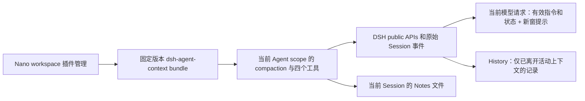

# feat-627: Codex 风格的无摘要上下文换窗 — 技术方案

> 对齐: [spec.md](spec.md)，2026-10-21 已确认范围；设计交付，不代表实现或部署。

## Changelog

- 2026-10-21：按用户追加要求改为所有 Agent 默认启用；固定包进入 Nano 运行依赖，新增一次性 profile 默认迁移与持久停用语义。

## 现状分析

### 涉及范围

- 独立仓库 [Mrchen116/dsh-agent-context](https://github.com/Mrchen116/dsh-agent-context)：在 fork 的 `src/index.ts`、`rollover.ts`、`history.ts`、`notes.ts`、工具/提示模块与测试中实现上下文行为；更新包元数据、bundle patch、发布说明。源代码不进入 Nano。
- Nano：`packages/dsh-integration` 的 workspace 插件接线及针对本包的集成测试；`packages/personal-assistant/assets/skills/nano-plugin-development` 中的安装/使用说明。只在现有接线不足时做最小适配，不新增通用插件框架。
- 本 unit 的技术附录 [prompt-baseline.md](prompt-baseline.md) 固定 Codex 提示词及逐处适配；不新建长期提示词文档。

基线 commit 见 spec 的“现状与依据”。本轮核实 DSH `packages/core/agent/src/runtime-types.ts`、`packages/core/agent-loop/src/{agent,runtime-context}.ts`、`packages/core/system-prompt/src/index.ts`、`packages/boot/plugin-manager/src/install-spec.ts` 与 Nano `workspace-tools.ts`。这些是源码证据，尚无本 feature 的实际模型请求证据。

### 既有约束

DSH 仍是唯一 runtime，只使用已声明 public exports；不能修改 request waterfall 的冻结 messages，也不能 private import `RuntimeContextProjection`。Nano 的 `nano-human` / `nano-system` 来源必须保留；Global Agent 的人类消息通常在 Inbox 工具结果内，不能只找 `user` role。workspace 插件是受信本地代码，沿用现有审批与隔离范围，安装不创造跨 workspace/Agent 读授权。

### 可复用能力

| 现有机制 | 用 / 改 / 不用 | 依据与影响 |
|---|---|---|
| DSH compaction bracket、配对校验、surface replacement、原始事件日志 | 用 | 完整事务与严格缩短校验保留；summary 事件是确定性 checkpoint，不调用模型 |
| 上游 retain-tail、handoff、renderAll(notes)、每 turn 一次 pressure rollover | 改 | 清除普通旧消息；只给笔记路径索引；状态按 window 重置 |
| 上游 Notes 文件存储与原始日志 History | 改 | 增加切片、过滤、稳定引用与完整工具内容；不引入数据库 |
| Nano workspace PluginManager、Agent preset compaction owner、idle barrier | 用 | 配置持久化及同 workspace 影响范围沿用；停用后由 NanoCompaction 恢复默认压缩 |
| 上游 bundle 的 host compaction disable 与 web preset roots | 不用 | Nano 仅挂载 workspace scoped row，不能接管 host 或修改 web roster |
| DSH systemPrompt 的 section/context、agent/pre-step、request-error | 用 | 可持久化提示；pre-step 安全换窗；overflow 只在成功缩短后 retry |

### 相关历史

feat-610 的 workspace 原生插件生命周期、feat-614 的 compaction 引擎委派是接入前提。本 unit 不替换其配置、审批或更新语义。启停与包版本替换仍是两个动作：前者通过 idle barrier 生效，后者可能 `restart-required`。

## 架构总览

由插件持有换窗、Notes、History 和预算策略；Nano 只保持产品来源与 workspace 生命周期。新窗不会自动复制笔记正文、普通聊天 tail 或 handoff；需要细节时由 Agent 显式读取。

## 关键决策

1. **独立仓库 + 固定版本 GitHub Release `.tgz`，不引入 submodule。** 包名为 `dsh-agent-context`；首个改造版本计划 `0.3.0`。Release URL 采用 `https://github.com/Mrchen116/dsh-agent-context/releases/download/v0.3.0/dsh-agent-context-0.3.0.tgz`，此为目标地址，当前尚未发布。版本 tag、来源 commit、资产 SHA-256 与 DSH 兼容版本记在 release 说明。使用 `pnpm pack` 的预构建 npm tarball，而非 GitHub 源码 zip；部署机器不需构建插件。安装前核对 digest，禁止覆盖同名版本资产。Nano `@nano/dsh-integration` 将固定 Release URL 写入运行依赖和 pnpm lock integrity；首次 PR 可固定已验证的 `0.3.0-rc.1` 发布候选，正式版本另行升级，禁止使用未发布地址、`latest` 或浮动 Git 分支。workspace profile 仅保存启停选择，不在首次对话中临时联网安装。
2. **用原生完整 compaction 事务实现真正无 tail。** 替换 system head 后所有可配对的旧 surface 节点，修掉 retain=0 仍保留最后节点的算法。工具批次结束、无未配对 call/result 时才切；保留尚未被本 step 采纳的新输入。checkpoint 是当前有效 runtime context + 窗口元数据和恢复提示，不含过去任务的摘要。
3. **稳定引用复用持久事件，不建 ID 数据库。** `window_id = <session-id>:initial` 或 `<session-id>:<successful-compaction-start-seq>`；`item_id = <event-seq>`，以 `(window_id,item_id)` 定位。序号只用于显示；日志中成功提交的 compaction bracket 是边界。普通压缩也计为边界，防止停用/重新启用后引用混淆。失败/未闭合事务不生成新窗。
4. **工具采用 DSH 扁平 schema。** `notes` / `history` 按 action 分派，`new_context` 无参数，`get_context_remaining` 只读预算与当前引用。后者沿用 Codex guidance 已有的工具名，避免把预算观测塞进 Notes 或 History。
5. **提示词默认逐字沿用固定 Codex 基线。** 英文结构不重写，仅处理寻址、引用、访问范围与一致性语义差异，逐处见 prompt-baseline。参考条目禁用了 token_budget，不能据此宣称线上 Codex 全部模型默认开启；预算数值单独配置。
6. **单个 M1 完成跨仓交付。** fork 内实现和 Nano 接入必须一起验收才能证明用户连续工作；不把发布、接线与效果拆成缺少完整行为的交付阶段。两个仓库各自提交/PR，Nano 证据绑定实际 fork commit、tarball digest 与安装版本。

## 接口与数据流

### 包与生命周期

bundle patch 只插入一行 `id: agent-context`、`name: dsh-agent-context`、`isolate: {compaction: true}`、`config: {modelSurface: "always"}`。scope 只限定事件/工具范围，不能代替 service isolate；这一行显式建立当前 Agent 的 compaction 服务所有权。fork 保留并使用 `modelSurface: "always"`，在 Nano 存在 agentPresets 时也注册四个工具和 guidance；这些注册随该 scoped row 一起启停。不包含 `compaction-basic` disable、agent-presets 改写或 host profile 修改。peer dependencies 对齐 Nano 当前 DSH `0.2.1-alpha.1`；沿用 host package resolver，不能打包另一份 Cordis/DSH service 单例。包中包含编译产物、类型、patch、MIT LICENSE 与上游归属，不携带本机路径和开发脚本依赖。

Nano 默认接线通过现有 WorkspaceExtensions 完成，不引入另一套管理 UI：

- 安装锚点改为 `@nano/dsh-integration/package.json` 的实际路径。该包直接依赖固定 `dsh-agent-context` 和现有 DSH public packages，DSH `createRuntimeResolution` 从此安装依赖图解析共用实例。原生 PluginManager 能发现 installation-owned bundle；Nano inventory 包含该 shipped bundle，即使 `installed=false`，并保持不可 remove、可 set_bundle 启停。
- 初始化 profile 后执行一次明确的默认迁移：保留原 manifest/patch 所有字段，首次将 bundle 加入 `dsh.profile.bundles`，写 `nano.agentContextDefaultInitialized=true` 标记，使用公开 `saveManifest` 原子保存。既有 profile 同样迁移；已有此 bundle 依赖但未启用时视为明确停用并保留。此后绝不因 bundle 缺席而自动重新添加；原生 set_bundle 持久化启停，重启保持。默认包随 Nano 更新，不能用 workspace install 覆盖同名 shipped 包冒充升级。
- 默认 bundle 仍是上述 scoped row。所有产品 Agent 的 preset 复用该挂载，包括 Personal/Global/普通 Agent；子 Agent 继承对应 preset。无 workspace 的 SDK Agent 直接在自身 preset isolate 挂载同一个包，以覆盖工具和测试支持的无 workspace 配置；没有 workspace 时不凭空建立管理 profile。
- `notes/history/new_context/get_context_remaining` 是该上下文机制的基础工具；注册存在时保持可用，不依赖 `plugin_manager` 或业务 allowlist（包括空列表）。停用撤销注册后即消失。其他工具选择、子 Agent 的业务限制及审批保持现有规则。不可把全部 workspace 工具都提升为默认授权。
- 四内部工具的审批在 `NanoApproval` 中使用独立的 `internal_context` 审计来源：先执行现有 downstream 判定，明确 deny/ask 不覆盖；允许的情况下，对仅作用当前 Agent/session 的四工具直接放行，适用于 nano/codex/dsh 规则和 Auto 关闭。业务工具、发送重验、跨会话访问仍走原路径，不通过 dangerouslySkipPermissions 或扩大 alwaysAllowTools 实现。验证实际 dispatch，而非只看 schema。
- 用户沿用 `set_bundle(target: "dsh-agent-context", enabled: boolean)` 和 `list_bundles` 控制；新默认不要求用户调用 `install_bundle`。开发测试可先在 worktree 依赖中使用 pack 候选，最终提交必须是已发布且核对 hash 的固定 URL/lock，不能提交本机链接。

只有 `application=applied` 且该 workspace 中实测工具与 compaction owner 正确才算生效；`failed`、`restart-required` 必须按现有机制显示。停用等待该 workspace Agent idle，释放 scope 的工具、guidance、hooks、compaction service；保留笔记文件与原始日志。其他 workspace 不变化；同 workspace 的所有 Agent 都使用该安装选择，但数据仍按 Agent/session 隔离。更换版本按原生要求重启，不能用 off/on 冒充在线代码升级。

### Notes

数据根复用当前插件的 DSH home 存储机制，并在其下使用 `agent-context/<agent-id>/<session-id>/notes`。home 由当前 host 提供，路径段编码，工具不接受 home、Agent 或 session 参数。整个包不加载其他会话目录；同一 session 重启仍回到同一路径。`/new` 和新 fork session 使用新命名空间，不自动复制笔记。停用不删除；本版不负责迁移上游旧 Notes 文件。

| action | 参数 | 返回及约束 |
|---|---|---|
| list | path_prefix?, limit=20（最大100）, cursor? | 路径、UTF-8 bytes、mtime，按 mtime 降序/路径稳定排序；next_cursor |
| read | path, start_line=1, end_line?, max_chars=12000（最大20000） | 行号从1起且包含两端；正文、next_line / next_offset_chars、truncated；单个超长行也可接续，不静默丢尾 |
| search | query, path_prefix?, limit=20（最大100）, cursor? | 区分大小写字面子串；路径、行号、有界片段与 next_cursor |
| write | path, text | 原子替换；返回 bytes 与路径 |
| append | path, text | 原样追加，不自动补换行；不存在则创建；返回 bytes |

read 超长行接续额外接受 `offset_chars`，与 `start_line` 一起定位。所有字符 offset 按 Unicode code point 计算。单文件上限 1,000,000 UTF-8 bytes。相对路径拒绝绝对路径、空段、`.`、`..` 与越界符号链接。沿用/收敛现有路径校验，不增加虚构 OS sandbox。并发写按同文件串行；成功响应意味着落盘成功，此后 list/read/search 立即可见。不存在、范围不合法、超过大小返回具体工具错误，不返回成功空正文。不自动注入正文；近期路径 hint 最多5条，总计≤4,000 bytes，无文件则省略。

### History 与当前引用

使用同一个日志归一化函数服务 History 和引用索引。遍历当前 session 持久事件与 surface membership：只把已离开活动 surface 的消息开放给 History；排除失败未提交 assistant attempts。用户来源保持原 source；`nano-human` 是直接人类输入，`nano-system` 仍是系统材料。Inbox 结果保持 tool role 及完整嵌套来源，不因包含人类文本变更为顶层 user。

| action | 参数 | 返回 |
|---|---|---|
| list_windows | limit=20（最大100）, cursor?, recent_first=true | 有归档消息的 window_id、ordinal、item_count、next_cursor |
| list_items | window_id?, role?, tool_name?, limit=20（最大100）, cursor?, recent_first=true, max_chars_per_item=1000（最大4000） | window_id、item_id、event type、role、source、tool 名称、摘要片段、next_cursor |
| search | query + list_items 的过滤/分页参数 | 字面区分大小写匹配消息完整归一化文本，返回同样引用和命中片段 |
| read | window_id, item_id, offset_chars=0, limit_chars=12000（最大20000） | 同样元数据、total_chars、content、next_offset_chars、truncated |

归一化文本包含所有文本块、tool-call 的 name/id/原始 arguments、tool-result 全部已持久 payload；无法显示的二进制块保留类型、附件引用和已有元数据，不伪造文本转写。一次事件中多个 tool blocks 保持数组顺序，item_id 不随搜索/分页改变。按 seq 排序，游标包含方向与边界 seq；同参数下可接续且不遗漏长结果后半段。不存在或越界 window/item 返回空查询或明确 not_found；read 活动节点返回 not_archived，绝不跨 session 回退查找。

**切窗前引用可见的公开接缝：** 注册动态 `systemPrompt.context`，每次 assembly 产生 `<context_references>`（最多32条、4,000 bytes，按最新 seq 排列），只含 ID、类型、来源、tool 名称及最多80字符定位片段。它由 DSH 记录为 runtime-context snapshot；不修改已冻结的输入/工具结果，也不滥用 `agent/request`。

本次新采纳的 user message 在 assembly 之后才写日志，所以自动引用最早在下一次 assembly 出现。需要在同一步保存时，Agent 先调用 `get_context_remaining({references_cursor?})`，它在工具执行时读取已持久事件，返回相同的引用分页（不返回全文）以及当前 window_id；以此获得刚采纳用户输入或本批已完成工具结果的 seq。对尚未提交的并行工具结果不虚构 ID，等待下一 step 再记录。引用提示排除自身生成的 runtime/context、预算提醒与 checkpoint，避免自增长。History 仍仅开放离开活动上下文的正文。

预算耗尽 fallback 的 reference snapshot 必须覆盖本 step 之前最新已提交的任务输入/结果；fallback 期间不额外要求调用预算工具。强制 overflow 来不及写笔记时依赖既有笔记与 History，不能承诺模型从未保存的内部推理也可恢复。

### 新窗事务与有效状态重建

1. `new_context({})` 只登记本 session 的 pending，工具响应为 requested，不声称已切成功。工具执行本身不重写 surface；工具 batch 配对完成后，在下一个 `agent/pre-step`（或安全的 turn-stopping）执行。
2. 选择所有可替换的旧 surface 节点（排除 system head）；没有完整可配对范围或不能严格缩短时返回明确失败，不能空转或增加一次成功计数。已 claim 但尚未入日志的本 step 新输入不在替换范围。
3. 开始原生 compaction bracket，使用其实际 start seq 形成新 window_id；构造确定性 checkpoint，记录 reason、前/当前窗、近期 Notes 路径，并带上**重新从 systemPrompt assembly 获取的当前有效 runtime context**，不是复制旧 runtime 消息。提交 summary、replacement、end 并 flush；失败使用 DSH 原生事务语义，不能发布虚假的 completed boundary。
4. 注意 DSH 当前实现先 assemble/project runtime context，后调用 pre-step。插件不能假设切窗后 host 会在同一步再 assemble。插件在切窗前保留本次有效 assembly 的 contexts，在 checkpoint 中物化其当前完整值；仅将本插件的窗口身份/reference 部分替换为新窗值。系统 head 和工具仍由 DSH admission 根据本 step assembly 维护，surface 变更开启新的 request series。成功切窗后，waterfall 必须从 `await next()` 的 `decision.messages` 中剔除宿主在本轮 pre-step 前已生成的旧 `source.kind=runtime-context` 候选（其全部有效内容已在新 checkpoint 重建），保留 claimed 新用户输入和其他合法 notices；不能再把旧窗口身份作为更晚的 snapshot 提交。没有成功切窗时不改动该候选。下一次 assembly 由原生 projection 正常重建 snapshot。新增实现断言：references 本步变化并触发换窗时，新窗第一条真实请求中没有旧 Current window id，也没有丢失本 step 新输入。此处只处理公开 PreStepDecision.messages，不使用 private projection 类，不伪造人类消息。
5. checkpoint 只能含有效控制状态（环境、审批/模式、工具约束等）及恢复导航，不带普通旧消息、Notes 正文、handoff。对动态 context 中夹带旧任务正文的情况，先按来源定位并修正该 provider 的职责；不能直接把完整历史塞进“runtime context”。
6. overflow hook 在同一 request retry 内没有新 pre-step，因此同样需要显式获取并写入完整有效 runtime context；只在 surface 已缩短时返回 retry。新窗若仍因固定系统/工具输入过大而 overflow，返回具体失败，禁止无内容进展的无限换窗。

窗口归属：成功 bracket 之前的新消息属于旧窗，之后属于新窗。早先窗口仍留在 surface 的控制节点按首次写入边界归属；History 可检索性另由 membership 决定。fork 复制历史前缀时以当前 session-id 组成独立引用命名空间，原 session 的引用不得跨读。

### 预算状态机

首次请求前没有持久 request/context/header 时是 bootstrap 状态，不是配置错误：pre-step 暂不发预算提醒、不执行压力换窗，继续由 DSH prepareCall 解析并持久化实际模型上下限；只读预算工具此时明确返回 budget_unavailable / awaiting_first_request，不伪报数值。首个真实 request 仍受 provider overflow 兜底保护；随后所有 step 从有效 header/context 计算预算。已完成 prepareCall 后无合法 C 才是容量配置缺失。DSH 允许合法省略 maxTokens；这与未知 C 分开处理，不改变实际模型请求的输出选项。

有效模型 context window 为 C，测量输入（含 system/tools/runtime）为 T，输出预留为 O。DSH tokenMeter 的默认测量基于已持久 surface/header；pre-step 尚未提交的 claimed 输入与本轮 runtime snapshot 不在其中。pre-step 的 T 用该基数加公开 estimateMessage/header 能力估算的本次待采纳增量（不重复计入已持久节点，header 以本次 assembly 的 tools 替换旧值）；工具中的只读预算明确返回 persisted-surface 测量时点。两者均标记 estimated，实际 provider overflow 仍按兜底路径处理。预算输入上限 H=C−O；fallback buffer B 默认 `min(16384, floor(H*0.15))`；工作上限 W=H−B；reminder 距离 R 默认 `min(6144, floor(W*0.1))`。允许 per-model 精确覆盖 B/R，要求 `0<R<W<H`。O 优先取当前有效请求明确的输出上限（实际 prepareCall 后的 request/header.config.maxTokens；adapterDefaults 仅表示来源）。当 DSH 合法省略 maxTokens 时，O 使用预算策略预留 `min(32768, floor(C*0.25))`，可由 `outputReserveTokens` 全局或 per-model 覆盖；此数值不改 provider 请求、不冒充 provider 的最大输出，`output_reserve_source` 明确为 `policy-estimate`，有明确输出上限时为 `request-maxTokens`。未知真实输出上限时，H 也是预算估计，实际 context overflow 仍由原兜底处理。无合法 C、明确但非法的输出上限/预留配置或固定提示已超过 W 时明确报告配置/上下文无法容纳，不能假报剩余预算。`get_context_remaining` 返回 window_id、remaining=max(0,W−T)、T/W/H、measurement 来源和引用分页，不把估算值说成 provider 精确用量。

- T<W−R：正常推进；每次 Notes/History 输出有界，实际入模总预算仍由 tokenMeter 计算。
- W−R≤T<W：每窗只注入一次 reminder。
- W≤T<H：每窗只注入一次 fallback，提示恰好一次 Notes write/append 后 new_context；仍尊重中止/新用户指令。该限制是模型 guidance，不新增旁路执行策略或授权。
- T≥H 或 provider context overflow：安全边界强制 rollover，保留未完成任务的恢复入口；无缩短则终止并明确失败。

状态按 window_id，而非 turn：同一 turn 可连续换三次及以上。通过已持久的插件 source/summary 标记恢复 reminder/fallback 已发状态，进程重启不重复刷提示；只为尚未提交的 pending 请求保留内存态。切窗后按当前有效模型重新计算预算；不会通过 rollover 修改 Nano 已冻结的 turn 模型配置。fallback buffer 给保存笔记与工具往返留空间，但无法保证突然的超长工具结果一定留有保存机会。

### 权限与错误

恢复内容带原始来源，仅作为证据；不得把 Notes 中的自述、旧审批结果或 Inbox 转引自动升级为当前授权。后续副作用继续走 Nano 原审批/发送重验。此 feature 不修改 PA 审批证据选择。路径越界/不可读、坏记录与安装失败须区分并显示可采取的恢复方式；不默默清空文件，不自动换成另一引擎却声称当前插件成功。

## 契约层增量 (delta-spec)

仅改 gateway 的 [agent-capabilities delta](specs/gateway/agent-capabilities.md)，归入 `docs/specs/gateway/agent-capabilities.md`；现有 workspace 安装/启停契约保持，新增“无摘要换窗后连续工作”和“恢复记录作用域”。IM 无客户端变更，no spec delta。设计阶段不覆盖 current spec。

## 风险与回退

- 模型不及时写 Notes 会影响恢复效果；必须验至少三次换窗的完整任务，不把工具成功当产品成功。无已保存思路时只恢复实际日志，不能编造未执行进度。
- 预算估算/大工具返回可能提前溢出；强制路径验证不循环、来源不丢且失败可见，不承诺恢复所有未记录的思考。
- DSH public API 的 assembly 时序是主要实现风险；固定当前版本并针对正常/overflow 两条真实请求验证有效状态。不能靠内核 patch 补齐。
- 停用恢复原摘要压缩只影响未来操作，不能自动还原已被换窗移出的完整活动对话；原始日志和笔记仍在，重新启用可按需访问。回退旧包要安装原固定版本并遵守 restart-required，不删除工作记录。本设计首次发布不做上游旧格式迁移。

## Runbook for Reviewer

本 unit 不改客户端面。**Review 驱动方式：端到端真栈，可使用 Web IM 客户端实际调用的接口代驱动**（见 `src/IM/frontend/src` 的 API client 与 IM OpenAPI），从真实登录用户发消息到实际收到 Agent 回复，不从 DSH 内部 submit 绕过 PA。Web 页面用于确认收件内容；飞书不作为本单元必需的外部资源。

实施时建立独立 checkout，设 `WT_ROOT` 为该路径，以下均在该 checkout 执行。本轮设计不启动服务。

| 服务 | 停止命令 | 启动命令 | 健康检查 |
|---|---|---|---|
| 隔离 IM + Node（Node 拥有 DSH 子进程） | `./scripts/e2e-down.sh --wt "$WT_ROOT"` | `PATH="/Users/czj/Repos/nano-multiagent/.venv/bin:$PATH" ./scripts/e2e-up.sh --wt "$WT_ROOT"` | source `.e2e-ports.env` 后 `curl -fsS "$IM_URL/openapi.json"`；`pnpm pa status --config "$WT_ROOT/.gateway-config.yaml"` |

验收前先 `pnpm install --frozen-lockfile`、`pnpm build` 和 `pnpm --dir src/IM/frontend build`；沿用 [worktree-runtime](../../../development/worktree-runtime.md) 的端口、账号和清理规则。启动脚本 readiness 不代替行为验收。正常重启执行 `pnpm pa restart --config "$WT_ROOT/.gateway-config.yaml"`，只重启该 Node 并保持其 state/DSH home；不可把重新执行会清空运行数据的 e2e-up 当成重启测试。重启后按该配置的 `pnpm pa status` 核对新 PID，并按 e2e 脚本约定更新本次 `.gateway.pid`，使清理指向本次实例；不得动主实例。

**验收前置：** 本地已有 Node/pnpm、Python `.venv` 和 `config/e2e/gateway.yaml`；模型来源复用该配置的 provider，开跑前用隔离 Agent 一次真实模型请求验证可达性，不输出凭据。包候选来自 fork pack，记录 commit/version/hash，通过 Nano 依赖自动挂载；固定 Release 资产发布后再执行同版本 frozen-lockfile 安装 smoke。两 Agent/两个 workspace 用于验证隔离（现有 e2e/e2e-peer 可复用，必要时仅改隔离 config 副本）。无待审批的生产发布/安装需求。

**具体旅程与证据：** 给 Agent 一个需要查找多份本地材料的任务，材料含首轮约束、后续纠正、超过单次 read 上限且关键值在尾段的工具结果；要求写一个最终报告并只做一次受控外部副作用（在隔离 IM 发送确认消息）。用隔离 bundle config 降低 W 触发至少三次 rollover，任务总输入必须超过三窗，不能只连续空调用 new_context。记录用户原要求/纠正、最终回复、确认消息条数、窗口边界与模型请求；再在保存笔记后正常重启同一 Node/会话，继续核对报告。另走新会话无笔记、越界读取、off/on 和加载失败旅程。默认范围核对新/旧 profile、普通/Global/Personal/子 Agent、空业务 allowlist；在 nano/codex/dsh 的 Auto off 下实测四工具 dispatch 和业务工具仍被拒绝，并验证首次请求前预算为 bootstrap、首个请求后使用有效 C/O；停用后正常重启仍保持，其他 workspace 保持默认启用。实现用 fixture 验证 hard-cap/overflow 确定分支，再至少一次实际长任务经过压力提醒路径；不能以 fixture 冒充真实产品接受。

原始请求/log 留在 worktree 本地且脱敏提取结论；unit 中只提交必要证据摘要与引用，不提交凭据、数据库、原始私人消息。清理本次服务并证明端口/PID 释放。

## Milestones

| ID | 标题 | 依赖 | 并行组 | 范围 | 退出标准 |
|---|---|---|---|---|---|
| M1 | 独立插件改造、Nano 接入与连续任务验收 | 无 | 串行单组 | fork 的 src/tests/package/patch/release；Nano dsh-integration 最小接线与测试、nano-plugin-development 指引、本 unit 与最终 delta 归并 | [reviewer] spec 全部用户场景：至少三次换窗后完成同一任务，最新纠正有效，长结果尾段恢复，副作用只发生一次；正常重启继续、无记录如实处理、越界不泄露、启停/失败反馈正确且其他 workspace 不受影响。[worker] 当前 DSH 公共 API typecheck/build；正常/强制/overflow 请求中无旧 tail、无 Notes 正文、无摘要调用，完整有效状态、工具配对/来源/稳定 ID、预算按窗及重启状态可证；Notes/History 边界和长片段接续测试；prompt golden diff 与每处理由；真实 bundle 安装/owner/off-on/版本与 hash 对账；Nano 最窄相关测试、runtime dependency contract 和 docs-check；两个仓库提交/PR与实际包版本关联。 |
