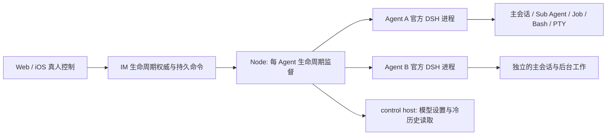

# feat-657: Agent 停用开关 — 技术方案

> 对齐: [spec.md](spec.md)，2026-10-25；状态以 design-review.md 最后完整 Round 为准。

## Changelog

## 现状分析

### 涉及范围

源码基线 b80e6d74d；已 fetch 核实与 origin/main 相同。首次看到的旧 dist 不作为当前 UI 依据，当前画面取证见原型走查。

| 路径 | 当前职责与本次落点 |
|---|---|
| `apps/im-server/src/control.ts`、`gateway.ts`、`messaging.ts`、`task-graphs.ts`、`work.ts`、`schema.sql` | 真人管理鉴权、节点协议、消息路由、任务、工作记录；新增独立生命周期资源和出口门控 |
| `packages/product-contracts`、`packages/channels` | 产品类型和 IM/节点传输；扩展 lifecycle snapshot/command/report，保持不依赖 DSH |
| `apps/node/src/main.ts`、`runtime-partitions.ts`、`model-setup.ts`、`lifecycle.ts`、`node-updater.ts` | 当前普通 Agent 共用 ordinary host；PA 按 binding/epoch 独立 host。ordinary 同时承担模型设置、启动 ready 与配置恢复。本次拆掉产品 Agent 对 ordinary 的共享执行依赖 |
| `packages/dsh-integration/src/client.ts`、`index.ts`、`cron-owners.ts`、`task-execution.ts`、`workflow`、`knowledge` | 官方 DSH 子进程监督、session.cancel、调度和恢复；新增 Agent 范围的 disable teardown 和初始化屏障 |
| `packages/personal-assistant/src/{global-agent,single-thread,heartbeat,task-execution,external,store,inbox,work-sync}.ts` | 输入、恢复、任务触发、交付和持久事实；统一接收生命周期准入，保持 Work 与传输 ACK 可推进 |
| Web Agent 列表/详情/工作视图，iOS `AgentsView`/`AgentConfigView`/`AgentWorkView` | 当前只展示设备 presence；增量展示 Agent 开关与确认状态 |

### 既有约束

- DSH 仅经 dsh-integration 已声明公开 exports；Node 仅 import `@nano/dsh-integration/client`。不 fork、patch 或依赖 private runtime imports，不新增 Agent Loop 或内核 HTTP 服务。
- 每个产品 Agent 一个执行进程，包含其所有主会话和派生执行；Sub Agent 不因此升级为独立产品 Agent。普通、PA 均适用，保留 PA binding/epoch 鉴权边界。
- 用户明确接受 DSH 平台能力边界：不增加强隔离容器/VM；受管范围之外的主动逃逸或外部已提交动作不作已撤销承诺。
- `/stop` 保持当前 session/Task 语义。current specs 在实施验证后才归并，本轮仅写 unit 产物。

### 可复用能力

- 用现有 RuntimePartitions、RuntimeSupervisor、双向 stdio RpcPeer，不建立第二套进程路由。RpcPeer 的独立响应派发允许 stop 不等待普通 handler；外层 Node 控制也不等待 runtime RPC。
- 用 DSH 0.2.1-alpha.1 的 `Agent.cancel`、`whenIdle`、`AgentHandle.dispose`、`subagents.drainContinuableDescendants`；后者只覆盖 continuable，不能当成所有 one-shot/Workflow/knowledge 的停止。
- 用公开 `dsh-jobs` 的 owned `list/kill/wait`、`dsh-terminal` 的 owner close/cleanup，以及 `dsh-subprocess` 的 terminate/waitForExit 和 composition disposal。后台 shell 仅 executor reload 不停止，必须等真正的 owner/subprocess teardown。
- DSH `dsh-subprocess-local` 在 macOS 明确使用较弱的进程组/进程树 fallback；`waitForExit` 只证明其可管理范围。直接 root PID exit 不能证明后台命令停止。不得读取 provider private pid 字段。
- 用 DSH serial `agent/created` 在工厂释放恢复队列前安装清理屏障；用公开 Inbox 操作取消旧 pending 输入，保留历史事件。正常历史查看不创建或恢复 Agent。
- 改 TaskGraphService 既有 pauseExecution 共用的事务逻辑，支持经过真人鉴权的 Agent 全范围暂停；不伪装真人为 Agent actor，不扩大普通 Agent 写图权限。
- 用现有 NodeStore/InboxStore、WorkSync 和 IM Work 分页投影；不将开关状态混入 transport ACK 或删掉工作轨迹。
- Raft 本地 `a98ae003`：`agentOrchestrator.ts` 的 manual stopped admission 和 `agentProcessManager.ts` 的 stop epoch、queued-start 清理可以借鉴；不复制其整套 orchestrator，亦不将其 API 返回视为进程全停证据。

### 相关历史

- feat-635：Task 驱动与 `/stop` 的持久暂停；本次覆盖 Agent 全范围且增加真人恢复资格检查。
- feat-652：Agent 页白色连续内容、紧凑页头与标签导航；原型沿用当前布局，不回退到旧大卡片。
- refactor-655-retire-usage-rollup：Work 增量处理 checkpoint 与传输 ACK 分离；本次迁移保留两者，停用不倒退处理位置。
- feat-654：按需隔离的 daily P/E/Q + PA 验收模板；复用，不接生产 Bot 或生产聊天。

## 架构总览

control host 是零产品 Agent 的现有管理承载，不注册消息执行、Schedule、Heartbeat 或知识整理。它不能成为被停用 Agent 的备用执行入口。Node 的 ready 不再取决于某个产品 Agent 的 PID；全部 Agent 停用时，控制连接、历史查看、模型服务设置仍可用。

## 关键决策

**一个持久开关，分开表达用户意图与实际停止确认。** desired 只有 enabled/disabled；observed 使用 enabling/enabled/stopping/disabled/stop_unconfirmed。节点连通性单独存在。离线提交后显示等待确认，不能仅因服务端写入成功显示 disabled。

**先关准入，再并行终止；控制不等待配置、恢复或任务串行队列。** IM 事务写入停用意图与命令，立即阻断中心入口和产品出口；Node 收到后先同步关闭本地 admission/自动重启并持久化，再发 teardown 与启动监督截止计时。普通工作是否 idle 不影响停用。

**用生命周期 revision 同时作运行代次，不再增加同义计数。** 每次有效 enable/disable 转换递增 revision；每次进程启动另有 processInstanceId，二者共同拒绝迟到结果。旧代次的启动、审批、输入、输出、自动重启与工具调用不可在重新启用后生效。重复同一 desired 的请求幂等；重试停止保持原停用代次。

**独立进程复用现有分区能力，管理能力移到零 Agent control host。** 产品分区 key 为 `agent:<agentId>`，PA key 仍包含 immutable bindingId/epoch。每份独立 DSH_HOME，不共写旧 ordinary 的 native/domain 文件。control host 保留模型凭据事务；每个 enabled 产品进程启动时从其快照初始化，停用进程不为模型广播而被启动。模型设置失败不使所有产品 Agent 自动运行。

**保留上下文，取消执行资格，不把 enable 当 resume。** 停用取消旧队列、旧工作续跑和旧审批；历史按原身份可读。Task 的显式恢复是新的真人控制证据，不能由普通旧聊天、Agent 更新状态或迟到事件代替。

**按 DSH 范围证明停止，不新增强隔离。** 正常 teardown 通过公开资源 owner 并行取消并等待清理；外部 supervisor 在 DSH 不响应时终止该执行进程及可核实的进程树/进程组。无法证明后台清理完成则停留 stop_unconfirmed，继续拒绝新工作，不伪造“已停用”。不为绕过此限制引入自制 PID 扫描守护系统或 VM。

## 接口与数据流

### 1. 生命周期资源与真人权限

新增 `agent_lifecycle`（IM）及 NodeStore 同义应用记录，不复用 profile_version/node_status/Feature 开关。字段：agent_id、desired、revision、request_id、actor_user_id、requested_at、applied_revision、observed、process_instance_id、confirmed_at、error_code/detail。停用范围不存成可被模型指定的 session 列表。

| 接口 | 契约 |
|---|---|
| `GET /im/v1/agents/:agent_id/lifecycle` | 按现有 Agent 可见性返回状态；不向非 owner 暴露 PID、文件路径或私有诊断 |
| `PUT /im/v1/agents/:agent_id/lifecycle` | `{enabled, request_id, expected_revision}`；独立于配置保存，复用 control.ts 真人 owner/space 资格。Agent/node 凭据不能调用。返回持久 snapshot；尚未应用返回 202，已收敛幂等返回 200 |
| `POST .../lifecycle/retry` | 仅 desired=disabled 时重试同一停止代次，不能改变开关；幂等 request_id |
| `agent.lifecycle.apply`（IM→Node） | 可信 agent/node 归属、desired/revision/request_id；重连发送全量 snapshot，不能靠消息顺序猜状态 |
| `agent.lifecycle.report`（Node→IM） | 校验当前 node 连接代次、agent 归属、revision 与 processInstanceId；迟到 report 不覆盖较新的状态 |
| Node→integration `agent.disable` | 单产品分区，无模型可传任意目标的工具；携带 revision，返回受管清理确认/错误；不替代外部监督器截止时间 |

API 使用现有鉴权/事务/用户事件流，不新增 REST 队列服务。普通启用操作遇到 expected_revision 冲突返回 409 并重读；停用遇到冲突由客户端重读最新状态后重发同一“停用”意图，不能自动反转。停止未确认和等待离线停止期间拒绝 enable（409 stop_not_confirmed），必须先确认旧执行清理；按钮也明确禁用。

创建 Agent 初始 enabled/revision=1；旧数据迁移显式生成 enabled 记录。旧版本节点不具备 `agent_lifecycle_v1` capability 时允许记录 disabled 但仅显示停止未确认/需更新节点，IM 不继续路由新工作，绝不假装节点支持强停。生命周期状态不由旧 node registration/profile 回写覆盖。

### 2. 停用事务、队列和出口

IM 在一次事务内持久化 disabled 与新 revision、写可重发控制意图、记真人控制事实，并标记旧 Agent 任务执行资格失效。复用既有 Task pause 事务将该 Agent 的 doing/waiting 工作暂停、清除旧 wait/resume_request；其他未完成 Task 保持业务状态但被相同停用边界冻结，只有新真人明确恢复才可开始。不会暂停属于其他 Agent 的任务。若任务范围较大，先持久化 Agent 级资格屏障，暂停投影可重放完成；不能因遍历图阻塞 stop 指令投递。

每个输入/运行/待交付输出保存生命周期 revision（历史迁移见 deployment-prompt）。IM relay、直接外部 Channel 入站、Node 队列、DSH submit/自动调度在各自接收边界读取同一个状态。入站去重后确定所属代次，不将旧 event 重试重新标成当前代次。中心和本地接收位置使用既有稳定 ID/序号，不能用消息正文日期或时钟先后来判断新旧。

Node 收到停用首先将本地状态置 disabled，取消 supervisor 的 recovery timer/starting promise 的发布资格，停止本 Agent 的 Heartbeat；拒绝任何新的 ensure/submit/tool product call。对已受理但未执行的输入和待发 output 标记 `cancelled_by_disable`，保留原始记录与处理结果，不伪造已发送。已进入外部发送的调用不自动重发，按真实回执或 outcome_unknown 保存。停止确认属于系统控制，不使用已被封禁的 Agent 普通发送通道。

`send_message`、Task 写、Workflow 交付、知识更新通知及所有产品副作用在提交前再次检查 revision，返回稳定 `agent_disabled` / `stale_lifecycle`。停止发生前已提交给外部系统的动作不回滚。文件/Bash 副作用由执行终止限制，不承诺分布式原子撤回。

Work journal、处理 checkpoint 和 transport ACK 继续收敛停止事实及历史，不因 disabled 停止同步或清空 cursor。运行资源未知时展示“被停用中断 / 停止未确认”，不伪造子运行 success。控制记录包含操作者、时间、作用范围、清理结果，不包含 secret。

### 3. 执行停止与监督

`agent.disable` 在进入首个 await 前关闭整个产品 host 的新建/恢复/工具 admission。停 Schedule owner、Task driver、model fallback、session command、Workflow 与 knowledge review；给所有已知主/子 Agent 发 cancel（不保留 pending inbox），关闭 continuable descendant admission，然后 dispose 对应 handles、owned jobs、terminal 和 subprocess composition。取消同时发出，不能先 await 一个卡住的主会话再处理子 Agent/Bash。one-shot 的 holder、Workflow attempt 和知识整理 owner 分别结算，不遗漏非 continuable 后代。

监督器是 Node 侧的 RuntimeSupervisor，先禁止重启，再请求 integration teardown。沿 DSH 已有 TERM→KILL 受管进程清理策略等待，使用一个总监督截止时间（实现初值 5 秒，可测试注入）；到期向该 DSH 进程及停用前可核实的所属进程范围发送强制终止，限制在该 Agent 的执行范围。pid 只作本机运行诊断，不能仅凭可复用 pid 的存在性确认所有权或跨重启杀进程。

成功必须同时具备：该代次不会再接收/恢复工作；integration 的全部受管资源清理确认；DSH 进程退出。强杀后缺少资源确认只得到 stop_unconfirmed，不能将进程 exit 当完整成功。未知资源诊断持久化，重试保留该事实；节点重启不能仅因当前没有 PID 擦除未确认状态。机器重启或可靠资源核实可完成清理确认；实现必须提供可核验依据，不给一个“忽略并成功”的按钮。

性能验收分开记录用户点击→IM 接受、IM 接受→Node 关闭准入、Node 关闭准入→清理确认。使用真实多后代与后台 Bash；停止请求不能等待 LLM 响应或普通队列 drain。5 秒为监督升级阈值，不是远端离线或所有 OS 异常下的成功 SLA。

### 4. 初始化与重新启用

Node 启动先加载本地 lifecycle；control 连接取得 IM 全量最新状态后，才允许启动产品分区和输入恢复。已知 disabled 始终拒绝；无法取得权威状态时保留控制/历史能力并等待连接，不以 cached enabled 启动。运行中的短暂 IM 断线不新增租约停机行为，离线请求保持未确认。重连先应用 lifecycle，再恢复普通 relay、Heartbeat、Task 或输出。

enable 只在上一停用代次已确认后创建新 revision。新进程首先安装 admission barrier，再开放任何原生 create/resume。serial `agent/created` 在恢复队列释放前按产品归属清理旧 pending inbox（包括冷 root/child），flush 并记 `disabledThroughRevision`；禁止旧 child 自动 continuation。生产代码只使用公开 Inbox / Agent API，不编辑原生事件日志或伪造 event。新的真人请求可以复用原 session 的历史上下文，不能因此执行旧队列。

所有旧非终态 Workflow、review、后台 Job 和审批保留中断/取消状态，不在 recover 中重放执行；旧子结果可用于历史展示，不唤醒父会话。恢复具体 Task 需要新的、该 Task 范围的真人操作或可信新真人明确指令；Task 写入口拒绝 Agent 自行解除停用造成的冻结。resume 生成新的运行和审批，不恢复旧进程。

Schedule：停用不删除定义。独立周期 Schedule 在 enable 后重算第一个未来触发点，不补跑 miss；已到期的一次性触发记为跳过；被暂停 Task 引用的 Schedule 同任务冻结，显式恢复该 Task 后重新确认未来计划。Heartbeat 计时从 enable 后重新开始，不能立即以 catch-up 模式唤醒。单独手动“运行旧计划”必须是 enabled 后新的真人明确操作。

### 5. 只读管理、更新和持久化布局

路径为 node home 下 `agents/<stable-agent-key>/`，PA binding/epoch 保留在 key；control host 独立 `control/`。共享 `node.sqlite3`/`global.sqlite3` 保持 Node 单 writer，按 agent/revision 访问；产品 workspace 不搬家。原普通 DSH 的 sessions、Schedule、Nano history/knowledge/workflow/关系投影按归属分迁，详见部署提示词。

停用后 IM Work 已持久记录照常读取。需要冷原生详情时由 control host 的只读观察服务按 Node 验证的 agent/home/session 读取公开 sessionPersistence/sessionQuery；禁止 ensure、resume、加载可执行插件或 Schedule。不能仅为查看历史、catalog、保存普通配置而启动已停用产品进程。需运行时才能完成的插件管理、能力探测等操作明确返回 agent_disabled，保留已有快照；重新启用后再按现有规则应用配置，不偷偷短暂启用。

模型配置在 control host 完成、保存权威快照，广播只到运行中的产品 host；全部停用仍可设置模型。NodeUpdater 只对运行中的 host 准备更新屏障，disabled 不算 unavailable 故障，pending disable 不等待 update barrier；更新/重启后先重读生命周期。节点 ready、健康状态与可用 Agent 数分别报告，不能因一个 Agent 停用把整机标为 offline。

## 前端原型

原型：[prototype.html](prototype.html)。以现有 Agent 详情页、工作标签、列表和 iOS 既有 List Section 为背景，只演示 lifecycle 增量，不连接真实后端。原型外的演示栏用于切换网络/清理结果/身份，不能把模拟开关做进产品设置。

Work 正文、工作记录/原生轨迹切换与现有布局保持不变；不新增主执行、子 Agent 或 Bash 数量统计，也不另做活动列表。旧任务显式恢复复用既有 Tasks 详情的真人“恢复”操作（`task-graphs-page.tsx`），不在 Work 页另造恢复按钮。

用户先认出 Agent 身份，再判断“是否可工作/是否确已停止”，最后操作。设备在线标注保留为次级信息。红色停用是即时操作；启用明确提示旧任务仍暂停。停用操作不属于设置草稿，不需要点击底部保存。

### 现有 UX grounding

| 当前入口 | 已核实基线 | 设计增量 |
|---|---|---|
| Web `/settings/agents/:id` | 紧凑身份页头、发消息、工作/概览/配置等标签，白色连续内容；详情页头在标签切换时保留 | 页头并排增加“停用”及独立状态条，工作页直接可达；不新增整页控制台 |
| Web Agent 列表/侧栏 | 头像、名称、设备归属，presence 表示设备在线 | 增加明确停用状态；目录行提供独立按钮，不能把按钮嵌套在原 row button 内；非 owner 只读 |
| Web 窄屏 | 侧栏隐藏、详情返回按钮与标签横向导航 | 身份与操作可换行，状态解释占整行，不截断“未确认”；停用保持首屏可达 |
| iOS AgentProfile / AgentConfig / AgentWork | 已有独立的 List/Form、身份区、配置项和 Work 控制记录 | 配置首 Section 仅一个“启用 Agent”Toggle；详情身份区、Work 顶部 Section 各仅一个文字行 Button。确认停用后原位变为“重新启用”，失败时变为“重试停止”；控件至少 44pt |

iOS 原型按 `AgentConfigView` 的 Form、`AgentsView.swift` 中 AgentProfileView 的身份/概览/管理 Section、`AgentWorkView` 的状态/上下文/轮次 Section 分页呈现，保留各自导航和相邻内容。演示页选择器在手机区域外。配置页不另放启用/停用按钮；详情和 Work 不再放 Toggle。配置开关失败时保持关闭且不可启用，仅增加重试停止行；状态变化不改名称草稿。产品只显示必要的短状态与操作后果，页面实现规则全部放在产品外。

本轮重新读取现有 Swift 页面并渲染 HTML 原型，未运行原生客户端，不声称完成原生视觉对照或验收。用户已指出原布局混淆页面，因此 M1-W5 需在原生客户端集中走查这三个入口的布局、单一操作与状态换行，不重复全部后端场景。完整 Xcode 与 iOS 26.4 模拟器资源已在本机核实，启动方式见 runbook。

### 原型对齐契约

| 区域/状态 | 对齐级别 | 产品入口 | 必验 viewport/状态 | 下游投影 |
|---|---|---|---|---|
| 身份→设备→开关，停用不等配置保存 | must-match | Web 列表、详情、Work | 1440×1000、390×844、320×740；enabled | M1-R1 / M1-W4 |
| stopping/disabled/offline pending/stop_unconfirmed，禁止未确认时启用 | must-match | Web 共用 lifecycle 状态区 | 上述宽度；正常/离线/失败/重试/非 owner | M1-R2 / M1-W4 |
| enable 后旧任务仍暂停、历史仍可读 | must-match | Web Work/配置 | 390×844、桌面；disabled→enabled | M1-R3 / M1-W4 |
| iOS 三个独立页面，每页一个生命周期主入口、短状态说明；配置开关不与同义按钮共存 | must-match | iOS 详情/配置/Work | 原生控件可适配；正常/停用/失败、动态字体下标签完整、44pt 控件 | M1-W5；共享行为由 M1-R1～R3 验证 |
| 当前其他设置、聊天和轨迹正文 | out-of-scope | 原入口 | 继续当前产品，不由原型假数据重设计 | 相关回归 |

### 原型走查

取证与实际走查记录在 [design-evidence.md](design-evidence.md)，代表性截图引用受保护的本地 evidence 路径；不提交截图缓存、运行日志或测试账号。完成原型走查后才能提交 Gate 2。首张陈旧 dist 截图已作废。截图仅证明对应画面；没有后端实现，不宣称产品通过。

## 契约层增量 (delta-spec)

- [IM agents-nodes](specs/im/agents-nodes.md)：真人开关、确认状态、权限与重新启用。
- [Gateway service-lifecycle](specs/gateway/service-lifecycle.md)：Agent 全范围停止、唤醒阻断、历史保留与重启收敛。
- [Gateway task-graphs](specs/gateway/task-graphs.md)：停用造成的任务冻结仅由真人明确恢复。
- [IM ios-client](specs/im/ios-client.md)：原生既有控件的停用入口与同义状态。
- 实施完成后更新顶层 `SPEC.md` 的部署拓扑为每产品 Agent 独立 DSH host，并链接行为契约；不复制实现细节。

## 风险与回退

- 多进程增加内存和启动开销；仅 enabled Agent 启动、停用释放资源，measure daily 4 Agent 空闲和并发，保留真实数字，不为省内存重新共享执行进程。control host 是单份管理进程。
- 主要风险是遗漏恢复/发送入口与正常 shutdown 的 keepInbox 语义。disable 使用专门 reason/path，普通升级重启保留现有恢复；代次门控不能取消未被停用 Agent 的合法在途工作。
- macOS fallback 和任意自建插件直接 spawn 不具备强隔离；复用 DSH 已有 owner teardown，未能确认清理则明确失败，不为私有插件扫描文件或猜进程归属。插件通过公开 subprocess 能力启动的工作属于受管范围。
- 旧版不认识停用屏障；存在 disabled 数据时不可直接回滚成允许自动运行的旧版本。服务保持停止，先恢复一致的升级前快照并由操作者检查任务/外发结果，避免重复副作用。

## 一次性部署迁移

需要按 [deployment-prompt.md](deployment-prompt.md) 将 ordinary home 的 Agent 持久记录分迁到独立 home，control 凭据和共享产品库保持单一权威。迁移只在已实现版本被授权部署时执行；设计落盘不授权生产操作。不能在普通启动时反复扫描全量历史或运行一次性拆分。

## Runbook for Reviewer

常驻服务为 IM、Node 及其 Agent/control DSH hosts；统一以该任务独立目录运行 daily 模板，禁止使用生产配置。`WT` 为实施 worktree 的绝对路径，`MAIN` 为主仓绝对路径。

| 服务 | 停止 | 启动/构建 | 健康检查 |
|---|---|---|---|
| IM + Node + DSH hosts | `"$MAIN/scripts/e2e-down.sh" --wt "$WT"` | 在实施 worktree `pnpm build`、`npm --prefix src/IM/frontend ci`、`npm --prefix src/IM/frontend run build` 后，`PATH="$MAIN/.venv/bin:$PATH" "$WT/scripts/e2e-up.sh" --profile daily --wt "$WT"` | source `.e2e-ports.env`，`curl -fsS "$IM_URL/openapi.json"`；读取本轮 `.e2e-daily.json` 并核实节点 ready、Agent 配置及 frontend 版本 |

**Review 驱动方式**：真实 Web 入口操作列表/详情/Work 的停用、重试、重新启用。通过真实消息/任务/计划创建受控活动，用后台进度文件持续增长和 Work 记录验证停止；Node/DSH PID 与进程组证据只作为补充。iOS 编译与契约回归，并在原生客户端集中检查三个入口的布局与状态，不重复共享后端旅程。

**验收前置**：daily 模板提供真实 P/E/Q、PA、测试 owner 和模型；本机已成功启动该隔离模板。新增一个 single-thread Agent 与一个无管理权限测试用户；临时目录内使用持续追加文件的无危险 Bash、TERM 忽略进程与嵌套子任务。离线场景只断开该测试节点连接，不关整机网络。无需外部用户、生产 Bot 或付费新资源。外部 Channel 的迟到投递/去重采用既有 adapter 契约加确定性集成测试，群聊/私聊用户体验由真实内置 IM 覆盖。

**iOS 资源与驱动**：按 [iOS README](../../../../src/IM/ios/README.md) 使用 `DEVELOPER_DIR=/Applications/Xcode.app/Contents/Developer`，避免默认 CommandLineTools 选择。本机已核实完整 Xcode、iOS 26.4 runtime 与 iPhone 17 / 17 Pro device type 可用；实施时用 simctl 创建本任务独立 simulator，按 README 的 build/test 入口构建，设置 `NANO_IM_BASE_URL` 为本任务 daily IM 地址，以同一测试 owner 登录。检查 Agent 配置/详情/Work 的正常、停用、失败状态及系统动态字体放大；完成后关闭并删除本任务 simulator，不使用其他任务命名的设备。无需签名账号或外部真机。

## Milestones

一个 M1 交付完整安全闭环；进程隔离、持久开关和重启/队列门控无法作为独立可用开关分批交付，不按后端/UI 横切。

| ID | 标题 | 依赖 | 并行组 | 范围 | 退出标准 |
|---|---|---|---|---|---|
| M1-agent-lifecycle | 独立执行与持久停用闭环 | 无 | 无 | 本文涉及范围、迁移工具、delta 归并与顶层拓扑 | 下列 M1-R1～R4 与 M1-W1～W6 全部满足 |

- **M1-R1 [reviewer]** spec 的入口、空闲停用、全范围停止、其他 Agent 不受影响、权限与设备状态场景通过真实 Web 旅程；身份和操作无需猜测，停用首屏可达。
- **M1-R2 [reviewer]** spec 的所有唤醒入口、重连重启、离线、失败与重试场景兑现；停止未确认与已停用清楚区分，不以绿色在线覆盖停用状态。
- **M1-R3 [reviewer]** enable 后新任务可运行，旧任务/审批/Bash 不重启，历史保留，用户明确恢复只恢复指定任务；原型关键语义成立。
- **M1-R4 [reviewer]** global/single-thread/PA 至少各一次完整停用与新工作恢复；同节点其他 Agent 继续工作；所有 Agent 停用后控制与历史仍可访问。
- **M1-W1 [worker]** narrow contract/integration 覆盖真人权限、并发幂等/CAS、迟到 apply/report/approval/output、stop-vs-start/恢复竞态、冷 inbox 在首次模型调用前清理、旧 Task 真人恢复门控；不新增为文档锚点而写的测试。
- **M1-W2 [worker]** 实际 OS 子进程测试覆盖普通后台 Bash、管道、孙进程、PTY、TERM 忽略升级和主进程卡住；记录准入延迟/清理延迟、全部受管资源结算及其他 Agent 连续性。平台超出 DSH 边界明确列出，不以 root PID exit 伪造 pass。
- **M1-W3 [worker]** 每 Agent 一进程与独立 home、model setup/control-only、update barrier、disabled 冷历史与全部停用状态测试；runtime dependency contract、相关 typecheck/build 通过。
- **M1-W4 [worker]** 真实 Web 1440/390/320 宽度的原型对照证据与实际操作覆盖，列表/详情/Work 入口一致；证据仅按 evidence 规则记录，不提交敏感截图缓存。
- **M1-W5 [worker]** iOS 原生控件绑定、真人权限、pending/failed/disabled 解码和 enable 行为回归及编译通过；在可用原生客户端实际检查配置/详情/Work 每页只有一个生命周期主入口、停止与失败状态短句可读、动态字体换行和 44pt 触控区域，并保留对照证据。未实际走查不得写原生视觉 pass。
- **M1-W6 [worker]** 迁移在副本上验证会话/子树/任务/计划/Workflow/知识记录/Work 游标完整；中断继续和回退通过、无跨 Agent 数据；daily 4 Agent 内存/启动数字与关闭资源释放有记录。完成后归并 specs 与顶层拓扑，不更改 DSH 内部格式。
