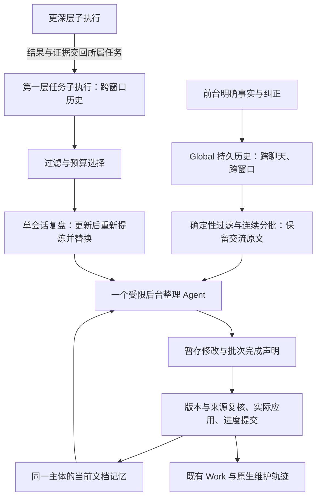

# feat-676: 角色化文档记忆与持续 Global Dreaming — 技术方案

> 对齐：[spec.md](spec.md)，包含 2026-10-29 用户确认的“Global 原文 + 第一层子执行摘要”方案。本文定义目标行为；PR #428 的既有实现不代表本版已经实现。

## Changelog

- 2026-10-29（后续完成协议简化）：用户确认移除两阶段私有 `finish`。提炼阶段以最终 JSON 返回两个字符串，由宿主解析校验；整理阶段正常完成后由宿主核对 staging、生成并应用计划。固定 DSH 公开 API 不提供原生 JSON Schema 输出模式，不用另一个提交工具替代。失败/取消不保存或推进；不新增控制或恢复协议。
- 2026-10-29（PR 后续小修）：用户确认两阶段材料直接注入初始消息，删除 `input.md` 中转和专用输入 hash；既有会话历史负责换窗恢复，正式文件/摘要版本及来源检查保留。本次不修改 `finish` 的执行终止行为。
- 2026-10-29（M1，回查修订）：用户确认共用历史处理实现、区分 `history` 与 `source_history`，并复用 IM 只读补查。替换独立 `read_source` 方案，新增 §4.5、S27–S29 与 W13；本次仍只修设计，新包接口及产品行为均待实施。
- 2026-10-29（M1）：用户在实现验收后重新对齐 Dreaming 输入与摘要生命周期。替换 §§4–7 的取材、模型输入、进度与回执方案；新增 S21–S26 / W8–W11。原 M1 的文件记忆与配置能力继续复用，旧 Dreaming 验收不能证明本版方案；实施 owner 接手须先同步本设计，并重新验证受影响范围。

## 现状分析

### 涉及范围

初版设计核对主仓 main `0ddceacb8dac5c5c6f38e2db45e0b72c26cbf3ec`。下表为初版改造起点；2026-10-29 修订另外核对开发分支 `unit/feat-676` 的 `80db8b9a6`：文档记忆、来源资格、Dreaming 与原生轨迹已有实现，PR #428 仍 OPEN、未合入。其 `memory-sources.ts` 按 `step/end` 形成 MemoryUnit，`dreaming.ts` 按单元生成 JSON 文件并要求逐项 finish；这是本轮替换对象，不是新方案。main `6b4213c20` 仍只有设计，不能拿 main 的旧代码断言新能力已交付。

| 落点 | 当前职责与本次改动 |
| --- | --- |
| `packages/dsh-integration/src/agent-config.ts`、`features/memory-curation.ts` | 当前 Feature 同时控制记忆快照、工具可用性和复盘订阅；拆为始终挂载的角色记忆消费及独立 Dreaming 调度，legacy 走旧接线 |
| `knowledge/files.ts`、`runtime.ts`、`state.ts` | 当前 USER/MEMORY 字符限额、条目写入、F3/combined/F4、事实和 review 状态；保留 Skill 与 legacy，实现文档维护所需文件回执与增量进度 |
| `owned-sessions.ts`、`descendants.ts`、`trajectory-runs.ts`、`index.ts` | 已有可信业务绑定、后代归属、公开 Session 查询及维护轨迹；复用归属和生命周期，增加不 fork 父历史的受限维护会话 |
| `packages/personal-assistant/src/inbox.ts`、`knowledge.ts`、工作记录投影 | Inbox 保存准入和消费证据，KnowledgeUpdates 目前把后台变更发为 system_message；新 Dreaming 仅同步工作记录，来源撤销同步到维护资格 |
| `packages/product-contracts`、Node 文件配置、IM 配置服务及 Web/iOS 能力列表 | 维护模式为文件配置；用户配置只新增 Dreaming 自动开关并移除旧记忆开关，工作结果沿用已有视图 |

### 既有约束

- 仅 dsh-integration 使用 DSH 已声明公开 exports；PA、Channels、IM 不 import DSH。新增 `@deepseek-ai/dsh-fs` 或 observation policy 使用时须声明直接依赖，不能通过 pnpm 路径 import。
- 长期主体为业务 `agentId`，库根绑定其配置 workspace；内部 child 继承所属主体，不按执行 cwd 或当前聊天对象换库。两个独立主体不共享可写记忆库；既有共享 workspace 在迁移前报告冲突，由部署确定各自 workspace，不暗中复制混合知识。
- 文件是当前知识，运行账本只存游标、资格、版本、操作及回执，不存第二套事实。Task、授权、消息投递、Skill 各保留权威。
- 本轮只修设计，main 的 current specs 不变；开发分支已有旧版实现与验收，不能沿用为本次新方案的验收结论，生产迁移不在本轮授权内。

### 可复用能力

| 能力 | 选择与依据 |
| --- | --- |
| DSH `sessionQuery.observeSession` | 用。公开 observation 提供 live/prepared 的不可变 events、cursor、inheritedEventCount；宿主据此认证业务来源快照，供批次输入与 `source_history` 读取，普通 `history` 仍仅服务执行会话自身 |
| `dsh-agent-context` 历史处理 | 改造后复用同一实现。现有 0.3.0-rc.5 已公开导出 collectHistory/searchHistory/readHistoryItem，但仍绑定 Session 和 archived-only；在该包源码分离来源视图与通用查询，发布固定版本后经公开 exports 接入，不复制实现或私有导入 |
| DSH `sessions.flush` | 用。live 源取得不可变 observation 后再做持久化屏障，认证同一个 cut；flush 失败不导出为已保存历史 |
| DSH `agents.create/resume`、AgentHandle | 用。空 seed、专属 setup、显式输入；保留 create/dispose/cancel 的宿主所有权，不建循环引擎 |
| DSH `read/write/edit/glob/grep` 和文件 observation policy | 用。普通模型读写不另造 Memory CRUD；已读版本与 provider 原子 compare-and-write 处理单文件陈旧覆盖；外加维护计划回执解决多文件部分成功 |
| KnowledgeRuntime 与 storage-domain | 改。保留订阅、停用、更新 drain、重启恢复、Skill 管理；文档 Dreaming 不复用旧的父 prompt fork 和按 turn 计数 |
| TrajectoryRuns、KnowledgeUpdates、Work 记录 | 改。记录宿主维护执行及确定性完成回执；新 Dreaming 不发送旧自进化聊天通知 |
| 旧 Memory/combined/F4 | legacy 保留旧 Memory；document 不用旧 Memory。按用户最新选择，两模式均暂停自动 Skill F3/F4，combined 不再包含 Skill；保留前台 Skill 创建、使用和修改，Dreaming 无 Skill 发布权限 |

单文件原子性不等于多文件事务；模型正常结束不等于资料处理完成。`observeSession` 的 live 视图也不自行证明已持久化。以上差异是新增有限运行状态的原因。

### 相关历史

feat-637 的完整当前文件读取、部分成功与知识归属要求继续有效；feat-385 的压缩前固定 Memory 快照在 document 模式被本次及时刷新替代。feat-667 的通用 PA 服务和原执行者持续负责保持。已有 descendant 查询的逐流读取、释放 observation lease 方式继续采用，禁止同时物化所有历史及后代。

## 架构总览

主 Agent 在正常工作中读取角色化文档；仅后台 Dreaming 更新正式记忆，沿用同一调度。Global 的跨聊天交流经过来源识别、去重和过滤后，保留原文进入整理；第一层任务子执行先生成可独立阅读的任务复盘。一个后台整理 Agent 综合这两路材料和已有记忆，更新同一长期主体的文档库。



这里的“Global 原文直接整理”由后台完成，不让服务用户的 Global 停下来整理。提炼者只输出任务经历，不写长期记忆；整理者负责跨经历理解。没有第二套 Task、按窗口摘要或逐层递归摘要。普通非 Global 根也沿可信主体绑定使用根原文路径；只有其真实第一层任务 child 走提炼路径，独立专家不因另一个主体提到它而并入私人库。document 与 legacy 的互斥、目录和前台消费规则保持。

## 关键决策

1. **记忆内置，只有 Dreaming 是网页可关闭的自动行为。** 移除 Web/iOS 的 `memory_curation` 行。新 Feature `dreaming` 默认 true，关闭仅停止未来自动运行并取消未应用的自动批次；已成功保存的文件不回滚。手动整理仍可执行，主体整体暂停/停用则连手动作业也不接受。普通文件工具的原权限继续生效，不以“内置”绕过权限拒绝。
2. **临时保留旧模式，但只由文件配置选择。** 新 `knowledge.memoryMode: document | legacy`，缺省 document；`knowledge.legacyMemory` 保存旧自动开关和旧 interval。网页 API 不可写这些字段；网页保存其他设置不能覆盖或丢失文件值。document 不注册旧 `memory` 条目工具/旧 prompt/旧 Memory F3；legacy 不启动 Dreaming，新 `nano-memory` 文档指导也不注入。旧 Skill 选择始终独立。
3. **新库路径保持附件约定，legacy 文件和不可变备份分开。** 新库仍为 `<workspace>/.nanoassistant/memory/`；旧可写库搬到 `.nanoassistant/memory-legacy/`，备份在 `.nanoassistant/memory-backups/<migration-id>/`。同一主体改模式不复制内容、不双向同步、不改变工具名单中的无关选择。新模式只给旧备份导航，需用户指令才读取导入。
4. **正式记忆仅由 Dreaming 更新。** 主 Agent/普通 child 只读；当前对话依据新输入及时纠正，并通过既有 child 消息链传递适用约束，长期正文与入口等 Dreaming 后续整理。此选择为减少多写者冲突及过期依据协调，接受整理延迟，不承诺跨聊天即时记忆同步。人工在线编辑不作为支持入口；不增加前台候选笔记库或平行更新队列。关闭自动 Dreaming 保留读取和当前响应，手动整理仍由同一写入者执行。
5. **Global 原文连续分批，第一层子会话按 Codex 方式重新提炼。** 根流用持久位置从上次成功处向前处理，不因预算丢弃旧交流。第一层 child 有更新时重新选择截至批次边界的会话历史并替换同一摘要，无更新复用；不采用增量阶段复盘。换窗不重置根流进度或 child 身份，更深层只经所属任务提供结果与必要证据。
6. **Dreaming 用空上下文受限会话，不继承父 prompt。** 只给角色、短指导、按需 Skill、显式源文件和当前记忆。自身换窗沿用 notes/history/new_context/get_context_remaining；整理者另用 source_history 回查获准业务经历、conversations 的只读 info/read/search 补查相关 IM。无 Inbox、消息发送、业务写入、调度、通用联网、shell、插件管理及 subagent 工具；这只限制维护执行，不改变普通子 Agent 能力，也不宣称是 OS 沙箱。
7. **不为此次改造增加大型记忆 UI 或泛化任务框架。** 替换记忆设置项并移除技能创建开关，详细处理范围、变更、延期和失败用现有 Work/轨迹文本与工具回执呈现。采用单一 M1，内部按“文件消费→历史与维护→真栈行为”顺序验证；这些部分共享配置和生命周期，不作无意义并行切片。
8. **先暂停后台 Skill 自进化，保留任务中的创建能力。** 原方案要求独立 Skill 维护保持，用户本轮提出调整：新 Memory 承接经验、偏好、项目环境与反馈，成熟可复用方法才提升成 Skill。停止宿主自动 Skill fork（F3、combined 中的 Skill 和 F4），也暂停自动归档扫描；不删除旧 Skill、统计或历史。移除 `skill_creation` Feature 及其网页/iOS开关；skill-creator 改为内置默认指导，不要求选择。`skill_manage` 实际操作仍遵守既有工具权限，不再以旧 Feature 订阅后台复盘。迁移 Codex 现有 `skill-creator` 为产品内置 Skill，由普通 Agent 按当前任务需要加载；它与历史 JSONL 专用的 conversation-skill-distiller 分工，不强制每次完成任务都生成 Skill。原自动代码暂留未接线；旧记忆及自动复盘机制对用户不可见，不新增网页说明、状态卡或重开开关，恢复后台策略另行设计。旧记忆仅保留前述文件级回退，不误删历史结果。

## 接口与数据流

### 1. 主体配置与模式生效

以下为目标配置，落在 product-contracts/Node 文件配置解析与 dsh-integration 对等定义；不要求用户填写全部字段。

```yaml
knowledge:
  memoryMode: document             # 文件专属，缺省 document
  legacyMemory:
    enabled: true                 # 仅 legacy 生效，迁移保留原值
    interval: 10                  # 仅 legacy，原计数语义
  dreaming:
    intervalMs: 86400000
    quietMs: 600000
    maxInputTokens: 24000
features:
  dreaming: true                  # 网页可改，仅 document 有效
```

保留现有 `knowledge.enabled` 对旧维护/Skill 的历史语义；它不再关闭内置 document 消费。新 Dreaming 仅由 `features.dreaming`、主体 lifecycle、当前模式及资源准入决定。已有 `memoryInterval` 在一次性迁移中映射至 legacyMemory.interval，不长期双读两个配置。旧 `features.memory_curation` 映射至 legacyMemory.enabled 后删除；默认新 Dreaming=true 是本次用户明确选择，不从旧 false 推断关闭新功能。

模式属于 Node 本地权威字段：IM 配置 GET 可返回只读 effective mode 供界面决定是否展示 Dreaming；PATCH/创建接口对模式和 legacy 配置不接受写入。Node 合成 UI 配置时仅合并允许的用户字段。文件模式切换使用现有配置更新流程，在 admission hold 后停止本主体所选记忆维护，等待正在提交的短临界段结束，挂载新消费层并恢复；不终止业务工作、不更换业务身份。任一步失败保留旧有效模式与诊断，不能同时挂载两个写者。

新建默认配置提供普通文件读写、nano-memory Skill 与 `memory_maintenance` 控制工具；已有显式工具选择不静默扩大。依赖缺失时内置指导仍说明库位置和当前限制，Dreaming 显示不可用及缺项，不能假报已启用运行。用户明确禁用普通工具时维持限制。legacy 仅在文件中配置；网页不显示旧记忆选项，也不显示一个会误导为有效的 Dreaming 开关。

### 2. 文档与唯一写入者

PA/专家目录及内容粒度采用[输入布局](input/nano-memory-research-v2/design/layout-and-documents.md)，实现时把模板与指导安装为产品内置 policy/`nano-memory` Skill。只有 `MEMORY.md` 入口必需，其余页按真实材料创建。角色由可信 `config.personal` 判定，不能让模型凭“请求者是谁”改变角色。

`MEMORY.md` 是简短角色背景与主题导航，目标约 2,000 tokens；超限时提示整理或仅给导航，不静默截掉条件。详细页使用自由 Markdown，建议 id/type/aliases、相对链接及来源定位；无需原子事实 schema。PA 的 timeline 与专家 work-history 按稳定事项/源标识更新，普通例行事件不强制建页。

主 Agent 和普通 child 使用 `read/glob/grep` 消费正式记忆；系统短指导和 nano-memory 明确禁止它们编辑正式库。沿开发分支 `knowledge/document-memory.ts` 已有 tools/execute 与公开 fs.resolve/processPath 路径检查，将固定库根的普通 write/edit 从观察写入改为执行前拒绝，覆盖路径别名；不假定 observation policy 自带只读开关；shell 等通用能力也不得被指导用于绕过该规则，不宣称新增 OS 沙箱或防任意外部进程篡改。Dreaming 仅编辑 staging，宿主 MemoryDocuments 验证真实 run 身份、主体、路径和版本后应用正式库。唯一写者指这一整理及宿主应用链；初始化空角色入口、一次性迁移备份是确定性部署操作，不是前台知识编辑入口。MemoryDocuments 保留文件版本、Git 与回执；不新增多写者合并或语义依赖图。

Git 是库内独立仓库，无 remote、无自动 push，祖先业务仓库本地 exclude 排除整个 `.nanoassistant/`。首次建库只提交库内指定 Markdown；不提交备份、维护材料或源配置。每个受控操作记录 `{operationId, path, beforeHash, afterHash, saved, versionRecorded, commit?, error?}`。文件成功立即可读，Git 失败保留 saved=true/versionRecorded=false；后续只补版本记录，不重做正文。非受控外部文件变化仅作异常版本处理：取消基于旧版本的未应用计划并报告待核对，不提供人工在线编辑同步承诺。保留现有 hash/回执恢复，不为前台并发编辑新增读依赖集或合并算法。

### 2.1 Codex skill-creator 的最小迁移

来源为本机 Codex 随包 `/Users/czj/.codex/skills/.system/skill-creator/`，实施时固定所用内容 hash，保留 Apache-2.0 license 和来源说明。当前源包包含 SKILL.md、初始化/校验脚本和 Codex UI 元数据说明，不是同名第三方项目。

保留简洁指导、按需披露、明确触发描述、根据具体需要添加资源、基于真实使用迭代等编写原则。只适配 Codex 路径/术语、工具调用和不适用的 UI 元数据：Nano 默认 agent scope；global scope 沿既有授权；创建和更新通过现有 `skill_manage` 校验及真实回执，不指导绕过工具直接写共享目录。不迁移 `agents/openai.yaml`、图标和依赖该文件的 initializer；不把 Codex 脚本命令写成 Nano 已安装能力。保留的资源引用必须随资产打包且实际可读。

安装沿现有 `packages/personal-assistant/assets/skills` 清单分发；产品内置 Skill 不可被模型覆盖。**skill-creator 是固定内置指导，不是可选 Feature 或用户 Skill 候选。** 移除 `skill_creation` 的 Feature 定义、依赖联动和 prompt 关闭条件；普通长期 root 的短创建提示常驻，完整 SKILL.md 仍按任务需要用现有 skill/read 加载，不每轮注入全文。宿主 Skills 解析在应用用户 Skill 选择后固定保留这一个产品资产，并使用其真实随包路径；节点能力/UI 的可选 Skill candidates 不列它，不能通过全选/取消本组把它移除。同名用户目录不能覆盖产品资产，不把此规则扩成所有 Skill 不可关闭。

新建和已有 Agent 都使用同一固定指导规则：旧 `features.skill_creation=false`、旧 allowlist 未包含以及旧 denylist 包含 skill-creator 均不关闭它、不导致 Node 校验失败；一次性迁移清除该废弃 Feature 键及名单中 skill-creator 的陈旧选择，其余 Skill 名单和选择模式保持。配置保存/启动的标准解析也把这些旧键视为不再生效的选择，不依赖迁移步骤才能安全读取旧配置；这是废弃选择的归一化，不绕过当前有效能力校验。Web/iOS 不提供 Feature 开关或 Skill 复选框，也不新增一张“始终开启”状态卡。

“内置指导”不放宽真实文件/发布操作权限：普通执行仍用有效的 skill/read/skill_manage，明确禁用的底层工具不会因此恢复；工具不具备时说明实际限制，不伪报已创建。默认配置已有这些普通能力，无需用户额外选择 skill-creator；受限 child 沿既有工具范围返回建议，由获准根发布。Dreaming 不加载该指导、没有创建工具；固定加入仅用于正常任务配置，不污染受限维护 setup。`conversation-skill-distiller` 保留显式历史 JSONL 提炼入口，与同一创建指导和工具衔接，不新增自动触发。

验证一次普通任务提炼成熟方法，观察实际 Skill 加载、真实工具回执与下次可发现；拒绝/失败不得宣称已创建。同时注入旧 F3/F4/combined 门槛和重启确认无后台 fork。此处只规定迁移设计，未修改或安装运行资产。

### 3. Context 消费、刷新与纠正

**Consumer**：长期 PA、独立专家及其普通 child；Dreaming 是另一种独立消费者。legacy 继续原快照行为，不混用新规则。

| 阶段 | document 模式的模型可见内容与规则 |
| --- | --- |
| 首次组装 | 短指导、真实角色与固定库根、当前 MEMORY.md、按需 nano-memory Skill 描述；无旧 USER.md 全文、无备份全文 |
| 正常工作 | 已有上下文够用直接回答；涉及历史偏好/人物/项目时按入口检索并完整读取必要条件。无结果、读取失败、部分读取明确区分 |
| 每次模型请求 | 读取当前入口并核对 Markdown 文件版本清单及来源资格 generation；未变化不追加重复提醒。已读主题变化则标出失效路径/新版本并要求相关判断前重读 |
| 正文已改、入口未同步 | 入口摘要的 basis hash 不再匹配，停止注入旧概括，改为目录导航与“入口待同步”；前台先读相关正文，Dreaming 补完入口。已成功正文仍可用 |
| 换窗/恢复 | 重新加载当前入口和版本，不复制旧 summary；原生 notes/history 仅提供工作恢复，不能压过当前文档与新纠正 |
| 旧备份导入 | 用户请求后通过 memory_maintenance run 的 importLegacy 模式交给 Dreaming；宿主绑定本主体登记的备份，整理者查重并保留原义和来源，先正文后入口；读取备份不等于完成迁移 |

文件版本清单由 watcher 的脏路径更新，普通文件工具回执同步失效；启动/恢复或 watcher 报错时作一次有界全量核对，正常无变化请求不递归遍历/重 hash 全库。

入口 basis 是运行元信息：记录入口确认时所依据的当前正文版本，既不改变知识正文也不成为事实权威。Dreaming 分步应用正文时让旧概括失效；宿主在模型正常完成后核对真实读取、当前 generation 和文件结果后登记 basis。移除前台 checkpoint；普通执行不能给失效页重新背书。

明确纠正流程：当前主体获得真实用户输入 → 当前对话采用新约束，并向受影响的原 child 用已有 follow-up 发送纠正和源引用 → 交流按现有持久经历进入后续 Dreaming → 整理者修改正文、重要历史及入口 → 后续请求读取已更新记忆。当前对话内新纠正优先于尚未更新的长期记忆；未收到该纠正的其他聊天不承诺整理前同步。已在飞行中的动作不强行撤回，后续业务动作沿既有新消息复核。验证分别检查“当前响应”“持久保存”“整理后消费”，不以已收到请求冒称已更新记忆。

**Before/After 示例**：旧模式在同一窗口继续看到“默认公开汇报”；新模式用户改为“只在私聊汇报”后，当前执行者依据新输入、原执行者依据 follow-up 在相同任务中修正投递对象。随后 Dreaming 保存偏好页，后续模型组装才通过文件版本刷新采用新记忆。记忆只提供偏好，真实发送仍需现有授权与披露审查。

### 4. 两路取材与跨窗口边界

#### 4.1 宿主持久历史与职责

继续由 dsh-integration 内的 MemorySources 负责来源认证、冻结、确定性投影和定位；Dreaming 负责调度、提炼、整理及回执；MemoryDocuments 负责当前库、暂存应用和版本保护。PA 只同步来源资格，IM 只消费既有 Work 结果，不引入 DSH 依赖。

复用 `sessions.flush`、`sessionQuery.observeSession` 和原生 subagentCatalog 的公开能力：live 源先 flush，再取得不可变 observation/cursor，第二次 flush 认证同一个 cut，逐流复制后释放；cold 源使用持久 revision。无法认证则记录该源受阻，不假报读完。源发现从本主体 roots/bindings 及可信 direct-child 关系出发，不按 cwd 扫盘。child 必须验证 parentSession 与 origin；维护执行、未知身份、其他主体不入选。

现有 `DescendantReader` 的原生 catalog/归属校验可复用，但不得直接全量递归导出所有后代。适配应只选 depth=1 的业务 child；无需新注册表或平行身份目录。child 后续运行即使没有新报告到达 Global，也根据其持久 own-event 版本发现更新。更深层不独立创建记忆摘要；已交回第一层的报告和关键工具证据归入所属任务，必要回查仅限该任务可信后代。

默认无摘要换窗保留原始事件。根与 child 都跨窗口读取持久历史；窗口只是定位信息，不能作为摘要单位。inheritedEventCount 用于区分继承背景和 child 自身经历，前缀不计新增证据，但不能因此在提炼前一律丢弃。notes、压缩摘要和历史重读只作来源导航；原记录缺失时明确缺口，不能用恢复笔记冒充完整经历。

#### 4.2 Global：连续原文、固定目标、逐批提交

宿主在每次 Dreaming 运行（包括失败后的重试）开始时，从已提交进度重新固定本次目标 `CycleTarget`：每根流的持久安全上界、当时可发现的第一层 child 上界及来源资格 generation。新的根/child 或目标之后新增事件留给下一轮。批次以内容预算和完整交互边界决定，不固定 500 条、不按 LLM step 建文件；每根流从已提交位置之后向前，轮转避免多根饥饿。工具 call/result 配对边界仍用于宿主安全切分，不暴露为模型逐项交账协议。

例如已处理到 500，本轮固定到 1500：

```text
501～1000 的交流原文 + 截至该批边界的子会话摘要 + 当前记忆
  → 整理、保存成功 → 提交到 1000
1001～1500 的交流原文 + 更新的子会话摘要 + 第一批后的记忆
  → 整理、保存成功 → 提交到 1500
```

这只是历史范围等价于较早触发，不倒退真实当前记忆；已由 Dreaming 整合的较新纠正始终有效；当前对话后来收到的纠正按 §3 即时响应，随后进入下一批。第一批后，运行未取消且无真实错误就继续第二批，不再等下一个 24h 周期。输入容量决定分批，不设置 Dreaming 总时长/总步数上限；正常换窗继续本次。真实错误或取消终止本次，保留成功游标、有效摘要及文件回执；后续运行先核对未完成应用，再从已提交位置冻结当时最新上界，不重新打开旧轮次清单，不越过未成功的根流前缀。全部完成后更新自动周期成功时间。无值得长期记忆的信息也允许成功提交空修改。

一问一答、纠正及回应尽量同批；跨批需要的前文按预算附带并标为背景，不重新计进度。单条真人长消息不能因过长截掉中间：按自然段/Unicode 字符边界续读，宿主保存 messageId、正文 hash 与字符偏移；模型看到可读正文和“同一消息未完/续段”，不拼 JSON 字符串。未到末段不把整条消息记为完成；后续结合先前已保存记忆继续，完整原文可回查。巨大普通工具输出可选关键正文及状态、完整引用和未展开说明。

#### 4.3 第一层子会话：有更新重新提炼，替换旧摘要

采用 Codex V2 的会话级策略。缓存键为 `(agentId, childSessionId)`，源版本由冻结的 own-event 上界、内容/revision、所用继承背景的原始版本及来源 generation 确定，不按窗口或每次唤起新建任务。提炼对象是自身经历，继承历史作为理解背景参与输入。自身经历首次读取启用基线之后的合格 own-history：启用时已存在 child 按根启用 cut 的事件时间记录其安全位置，启用后新建 child 从 own-history 起点开始；不能在首次发现它时把当时尾部当基线而跳过新经历。后续更新时重新从同一基线到本次上界选择历史，生成完整的新复盘，并替换同一来源的旧版。没有变化就复用。**不只总结上次之后的尾巴，不将旧摘要作为提炼正文，不增加按阶段永久累积的摘要链。**

**继承背景与自身经历。** 复用公开 observation 的事件与 inheritedEventCount，分别标注“继承背景”和“自身经历”；宿主保留继承内容的原作者、时间、原 session/message 定位，不重编号成 child 新证据。原始定位或内容不可恢复时说明缺口，不拿维护摘要伪造原文。只取真实 fork 继承范围，不追加父会话 fork 后的新内容；两部分均经过既有来源资格、启用基线或明确授权范围、本批 cutoff 与过滤。父内容已被 Dreaming 处理过不是排除理由，消费游标不充当背景删除条件；被撤销或未获准的内容仍不可用。

两部分一起沿已有优先级与输入容量选材，不另调模型提取背景，不要求复制全部父历史，不新增候选记忆、背景摘要或 fork 存储。选中的继承片段标明只用于理解当前任务，摘要的新增结果归 child 自身经历；同一父表达在 Global 和多个 child 中出现，沿原始来源识别为同一依据，不作为重复确认。背景未选入则摘要保留条件未知，不编造理由。缓存仍是一 child 一份当前摘要；续做时重新选取合格背景与自身经历后替换，不把旧摘要回喂。来源撤销沿已有 generation 失效机制生效。

按 Codex 思路对 child 做有取舍的预算选择：优先保留真实请求、限制、纠正和最终答复，其次任务行动/结果，普通工具细节可裁剪；同级优先近期，恢复原始时间顺序交给模型。请求及对应结果尽量成组；不得把他人/Agent 消息升格为真人。模型看到缺口/省略提示，摘要记录未验证和局限，不能宣称全历史完整审计。沿现有 maxInputTokens 预算选择，不照抄 Codex 的文件字节常量或空闲 6h 调度。

提炼在空 seed 的受限维护 AgentHandle 中执行，历史材料直接装入请求；不让模型逐 step read。保留 Codex 输出契约 `rollout_summary` 与 `rollout_slug` 两个字符串（通过受限完成接口返回）；两者为空表示无保留价值，不能当模型失败或继续沿用旧摘要。宿主记录该源版本 no_signal，并将旧摘要退役/通知整理者核对仍由其他证据支持的知识，不能机械删除所有关联正文。非空 `rollout_summary` 是 Markdown，宿主保存身份、范围、版本、hash 和来源，模型无需填写逐事件覆盖表。复盘描述目标、约束及变化、实际尝试/结果、失败教训、适用条件、未完成/未知；不强制写用户画像，不默认偏向开发任务。提炼工具不具备长期库写入、消息发送或业务动作权限。

**批次时间边界**：第一批 Global 到 G1000 时，A 的摘要只能使用对应边界以前的合格历史；第二批到 G1500 再重提炼 A。宿主以已认证事件的 `time` 和每流 seq 固定 child cut，取不晚于所属根本批截止时间、且不超过 CycleTarget 的连续配对前缀；seq 决定流内顺序，时间仅限制跨流上界，不用整理运行的当前时钟替代。原生 `SessionEvent.time` 已在锁定 DSH 公开类型声明。原生关系、事件时间或配对不足以证明边界时，该 child 保留待提炼与原因，不把其未来结果塞进旧批。同一毫秒不声称跨流全序，保留交办/汇报关联。

当 Global 无新增而 child 有更新时，可运行“根增量为空 + 更新摘要”的整理批次，child cutoff 为本轮冻结上界；不必等待又一条 Global 消息。业务未完成/失败也可总结截至边界的经历，无信号是正常结果；提炼发生真实错误则停止本次并按主体既有调度重试，不增加每个 child 的独立退避或保证绕过永久故障。未成功版本保持未处理，不能拿旧摘要冒充新结果。已提炼成功而整理失败，重试复用相同源版本的摘要。

#### 4.4 来源过滤与单一整理者

| 材料 | 两路共有的来源处理及 Global 特别规则 |
| --- | --- |
| 真人消息、纠正与反馈 | 保留原文、实际作者、聊天、时间、messageId、回复关系、participant/observer 身份；Global 不先做语义概括 |
| Inbox / conversations 返回 | 展开为真实消息，按 `(conversationId, messageId, revision/contentHash)` 去重；工具载体不降低真人消息优先级；只含已合法交给本主体的资料，不领取新 Inbox |
| 实际外发与未发送草稿 | 保留发送正文及真实回执；accepted/失败/未知不等于送达，普通 assistant 文本标为自述，不能当成交付 |
| Global 与 child 的交办/讨论/采纳 | 保留交互原文与对应身份；任务执行细节由该 child 复盘承载，报告和原结果不是两份独立证据 |
| 普通工具动作 | 保留必要参数、结果状态、关键证据及原始定位；重复日志/大正文可缩减，省略范围明确。`surfaceOp=replace` 不成为第二次执行 |
| 更深层结果 | 归属第一层任务；不独立摘要，不以局部成功推断整体交付；回查仍验证后代/来源资格 |
| 系统提示、工具 schema、reasoning、重复 Skill 正文、预算提醒、纯唤醒 | 从经历中排除，不重复学习指令 |
| fork 继承前缀 | 合格原始内容作为理解背景参与选材，保留原作者/时间/来源，不计 child 新经历或独立佐证 |
| 旧记忆、维护输入/输出、换窗 notes、历史重读 | 不当作新经历/独立证据；可以提供导航，但不递归总结自己的结论 |
| 图片/附件 | 保留真实来源和模型实际可读取的内容/已有观察；只见引用时标未读取，不捏造视觉内容 |

已有聊天观察版本沿真实 revision 或规范正文/作者 hash；不新增 IM 编辑功能。后来的纠正是新证据，按其适用范围更新；协议 role=user、引用“主人批准”或子执行声称成功均不改变可信身份与权限。

整理 Agent 直接获得本批 Global 可读原文、任务摘要变更目录（新增/替换/失效）、当前记忆入口与正文导航。新增/更新摘要在本批输入预算内直接提供，超量摘要延后到下一批，不能因没装下而标为已整合；未变化的摘要按需读。两路材料共用输入预算并为当前记忆/输出留余量，摘要提炼请求有各自输入上限；不设跨调用累计时长/步数额度。

整理默认关注用户背景与变化、人物关系、交流反馈、事项优先级，也综合任务方法、环境、实际成果和失败经验。两类关注是侧重点，不分成隔离知识库。一次选择不升级为永久偏好；明确表达、特定情境与待验证推断分开。后来真人否定可纠正 child 的成功判断；历史授权/待办不能复活暂停 Task 或扩大行动权限。

必要回查采用 §4.5 的 `source_history`，共用现有上下文历史处理实现；不再新增独立 `read_source(sourceRef, range)` 或平行来源编号。Global 背景可以回查允许范围内已处理历史，child 只回查本批 cutoff 内的相关证据；按需 IM 补查复用既有只读查询。它们不改变两路增量的处理进度，普通会话权限也不因维护工具扩张。

**来源资格从权威政策同步，不从未读 Inbox 推断。** PA 的 `refreshPersonalSources` 取得完整 `pa.sources.list` 成功快照（revision、allowed/excluded IDs）后，先经现有 Node–runtime RPC 增加内部 `knowledge.sources.sync`，持久化本主体资格 generation，再清理 Inbox 缓存；同步范围包含历史导出登记的所有 source IDs，不限 `inbox.check().sources`。有资格快照时，已知来源不在允许集合或明确 excluded 即被撤销。成功的 `personal_sources` exclude/include 操作、`policy.changed/source.revoked/membership_changed` 事件、节点启动/重连及每次 Dreaming freeze/apply 前均走同一权威刷新；RPC 失败不确认政策事件处理完成、不回报已完整应用。每主体串行刷新，policy revision 加完整 allowed/excluded 集合 hash 作为快照身份；只有实际资格变化才推进 generation，不能仅按 policy revision 忽略同版本的成员变化。重连相同快照重放幂等。内存消费和 Dreaming 的来源状态在恢复同步前标为待核对，不冒用上次 allow；不阻断不依赖这些来源的普通问答。普通专家的本地文件经历仍由主体归属控制；宿主支持的外部源撤销通过相同内部同步入口传递，不能把 PA 专用来源策略暗套所有本地材料。

**撤销同时作用于未来输入、在途应用和当前记忆消费。** generation 与文件应用在同一主体的短提交序列中排序。来源资格变更即使没有未读消息、关闭 Dreaming，也标记相关记忆待核对，立即使入口 basis 失效；根和所有所属 child 下一次模型组装收到宿主失效说明，旧入口不再注入，历史中已读副本不得继续作为有效依据。依据当前 Markdown 来源定位可确定受影响页时只隔离这些页；没有完整来源定位、同义派生范围未知时，暂将既有库标为待核对并只注入导航，不猜测“其他页安全”。仅 Dreaming 能在整理时核对相关页和有效来源、删除被排除内容或确认独立仍有效依据，由宿主核对后登记该页在当前资格 generation 下的有效版本后恢复消费；前台只读结果附带失效状态，不能把读到旧字节解释为重新认可。这个保守失效标记只保存 path/hash/generation/待处理范围，不建语义依赖图或事实副本；不删除整个库，也不让用户重新手工开启记忆。

**消费限制立即生效，正文清理只由 Dreaming 完成。** 已有来源政策 follow-up 附带待核对范围及约束；主执行向受影响的原 child 传递停止采用要求，不编辑正文与入口。关闭自动 Dreaming、主体暂停或失败时待核对状态持久保留，后续自动或用户请求的手动 Dreaming 清理；不得为了清理绕过自动关闭或主体暂停。`memory_maintenance status` 与 Work 回执区分“资格已撤销”“知识待核对/已修正”；受限 Dreaming 不得从旧源恢复内容。主 Agent 的“停止使用”仅登记排除意图、来源集合和文档范围，由宿主限制消费；控制元信息不保存替代知识正文。include 只恢复未来访问，不自行解除用户明确的停止使用意图，也不把旧库重新整体判有效；已有明确意图需新的用户请求才能解除。更新 personal-security 的系统/工具指导，明确“不擦除历史”与“文档记忆停止采用”并存。原 IM、成果、Git、备份和原始上下文不被删除，不能声称跨系统隐私清除；未核对的范围仍列为未完成，S20 不以仅写 tombstone 判通过。

#### 4.5 共用历史实现，区分业务来源回查与自身恢复

**Consumer 与工具边界。** 同一个 Dreaming 整理者既需要核实业务经历，也可能自身换窗；两者必须使用不同工具名和清晰描述，不能让模型靠猜测当前模式决定读哪套历史。

| 工具 | 模型用途与范围 | 实现责任 |
| --- | --- | --- |
| `history` | 恢复当前维护执行自身已退出活动窗口的原始记录；不选择 Global/child 作为目标 | 原有上下文恢复入口与默认范围保持；提炼者自身换窗同样使用此入口 |
| `source_history` | 整理者列表、搜索、读取本批获准的 Global/任务来源；包含源会话当前与旧窗口已持久记录 | Nano 绑定来源及时间/资格；与 history 共用历史处理代码 |
| `conversations`（仅 info/read/search） | 整理者围绕本轮事项、人物或来源补读相关 IM 对话 | 复用既有产品查询及主体权限，单独挂载只读动作，不挂载整套 Global preset |
| 普通文件 read/glob/grep | 当前记忆正文、只读批次材料及摘要 | 保持固定主体与现有文件边界；修改只进入 staging |

**共用实现及发布依赖。** 已核对开发分支锁定的 `dsh-agent-context 0.3.0-rc.5`：根 exports 公开 collectHistory/searchHistory/readHistoryItem/currentWindow；lib/history 的 normalizedItems、窗口定位、序号游标、角色/工具/字面关键词过滤和 Unicode 切片是复用基础。目前 searchHistory 经 collectHistory 排除活动记录，readHistoryItem 也拒绝活动记录；工具 execute 直接选择当前 agent.session，不能仅改名后用于业务来源。方案是在该包源码中把“历史来源视图/可见记录选择”从通用列表、搜索、读取代码中分离，提供一个支持不可变持久事件快照的公开历史查询入口；原 history 仍提供当前 Session 的 archived-only 视图。Nano 通过该公开入口提供已认证的来源视图，两个模型工具调用同一份查询实现，不在 Nano 复制算法，不构造假的空 surface 或伪 Session 绕过旧检查。只改历史读取接口，不改换窗触发、裁剪或预算算法，不引入通用插件框架。

这是 M1 的前置依赖工作：实施者需在 dsh-agent-context 源码仓完成最小接口改造及原恢复行为回归，发布不可变包版本并记录 commit/包 hash，再更新 Nano 固定依赖和锁文件。包尚未发布或公开入口未具备时，本项仍未完成；不得以修改 node_modules、运行时 patch、深层 private import 或一份复制实现交付。共享包只理解历史数据与查询；Nano 的业务主体、root/child 归属、来源政策、Dreaming cutoff 留在 dsh-integration，IM 查询仍沿 PA/product-contracts 的现有产品通道。

**source_history 模型契约。** 保留 history 的 `action=list_windows|list_items|search|read` 及原参数语义，唯一必要的来源选择增量为每次调用必填的 `session_id`。模型请求不提供 owner、资格或任意截止时间。请求中提供本批可查来源的简短目录（用途、真实 session_id、允许范围/省略状态）；更深层仅按所属任务已登记证据提供定位，不增加全后代扫描。摘要携带宿主保存的来源会话和选材范围，直接材料/返回结果携带原生 window_id/item_id；仅有 session_id 时可先 list_windows/list_items/search 找到记录。不得要求模型猜必填 ID，也不为摘要内容另编号一套永久记录。

```json
{
  "action": "read",
  "session_id": "task-a-session",
  "window_id": "task-a-session:initial",
  "item_id": "142",
  "offset_chars": 0,
  "limit_chars": 6000
}
```

以上 ID 是调用形状示例；真实调用复制材料/查询返回的 ID。list/search 沿用 window_id、role、tool_name、query、recent_first、limit、cursor、max_chars_per_item；read 沿用 window_id/item_id、offset_chars/limit_chars。返回 session_id、原窗口/条目 ID、实际作者/来源及事件时间、可读原文、truncated 与原 next_cursor/next_offset_chars，区分无匹配、来源不可用/已撤销、越界和部分返回。cursor 只在相同来源和查询范围内续读。原始事件编号不因过滤重新排列；不采用“第 12 条投影记录”的平行索引。目标记录缺失应明确返回缺失，不默认换成末尾消息冒充该证据。

Nano 每次先确认会话归属、祖先链、当前来源资格及本批冻结 cut，再向共享查询逻辑提供允许的记录；过滤必须在搜索、计数、分页和结果渲染前生效。沿 §4.4 去除不作为经历的系统噪声、reasoning 和维护回声，保留真人/Agent/工具身份、必要调用结果及原始定位；旧 history 的正常恢复完整性不受这份 Dreaming 业务投影影响。混合 Inbox 工具结果按其中各消息资格过滤，不因外层 Session 获准而暴露被排除聊天。快照逐源按需读取/释放，不能每次检索都全量物化所有主体历史。回查允许已处理背景，但仍受启用基线或用户明确授权的历史范围约束，不因查旧记忆引用自动放开启用前全部历史。

**IM 补查的最小接线。** 现有 conversations 工具含 create/join 等写动作且仅根 Global 注册，不能原样给维护 child 挂上。整理 setup 只注册 info/read/search 子集，复用现有查询服务与 current PA 双身份/排除政策；宿主从可信 run→agentId 绑定调用主体，维护会话本身不冒充业务 root，也不能让模型填写 actor/owner 绕过权限。只读 product 通道与普通会话保持同一权限检查，调用期间重新校验资格；不挂 Inbox，不标记未读已消费，不发送或建群/加入。可查询聊天 ID/原始消息 ID 从本批材料及允许来源目录取得，不新增全连接器发现或独立研究调度。没有 IM 能力的专家或配置不开放该读取能力时不注册，明确补查不可用，source_history 与普通材料仍可工作。

info 的成员/权限是查询时的当前元数据，不能当作本批历史时点的事实。read/search 由宿主收紧 before/after 等范围至本批所属根截止时间或已冻结 child-only 批次边界；搜索、分页和返回正文均不能泄漏边界后的内容。记录原始 conversationId/messageId、作者、时间、revision/contentHash、participant/observer 与真实返回范围，按同一消息键和已有输入去重。仅有创建时间不足以证明后来编辑的正文属于旧批；返回版本无法证明在允许边界内则该材料保持未展开/待查，不伪造历史版本。补查内容只是本批证据，不推进 Global cursor、child 已整合版本或 IM 未读位置；整合进度仍按 §6 的实际应用回执提交。补查和续读遵守当前请求的上下文容量与返回分页限制，不累计整轮时间/步数额度。

**自身换窗与失效。** 提炼/整理使用现有上下文机制及其显式停用后的回退，不因为维护角色而禁止正常换窗；空 seed 仅指初始不继承父历史。启用时保留 notes/history/new_context/get_context_remaining，notes 仅能写本维护会话的独立恢复目录，不授予业务 workspace 写入。维护角色指导与 source_history/conversations 的精确 schema 由 setup 在新窗口重建；本批 runId、来源目录、固定 cut 和 staging 导航继续可发现。恢复用自身 notes/history 找判断与未完成项，文件/应用真值仍来自当前 staging、计划及宿主回执。不得把自身恢复历史或其中重复的业务回查结果变成新的经历再次入库；维护会话持续被业务源发现排除。恢复旧工具结果不恢复旧资格：每次模型组装/工具读取与应用前沿当前 generation 失效说明、文件版本和本批边界复核，来源已撤销的旧引用不可继续作为有效依据。换窗不改变本次目标、已提交进度或暂停/取消状态；异常退出后按 §6 核对应用回执并重新运行，没有剩余时间/步数预算需要恢复。

**参考与取舍。** memoryrepo 固定源码 [memory.ts](https://github.com/supermemoryai/memoryrepo/blob/54f7ff3065df8af687dc5c04a4bb17d6611e5fd1/src/server/memory.ts#L202-L209) 明确在 dream 中提供 read_source(ref)，[transcripts.ts](https://github.com/supermemoryai/memoryrepo/blob/54f7ff3065df8af687dc5c04a4bb17d6611e5fd1/src/server/transcripts.ts#L75-L90) 解析引用并截取前后文；采用其“保留来源、矛盾时核实”思路，不照搬固定前后三条、找不到时读尾部的行为。Dots [第三方收集原文](https://github.com/asgeirtj/system_prompts_leaks/blob/1b6f936124b4eceb6e697a69da07519bea67feab/OpenAI/dots/dreamer.md) 描述用 cloud_threads.read 读父会话及更早对话，仅作为复用既有会话工具的提示材料，不断言官方实现或完整工具轨迹能力，也不迁入其全连接器研究职责。Codex V2 原件禁止第二阶段回读 rollout，本方案保留其子摘要生命周期但明确替换此限制。实施按固定原件和现有包源码核对，不按本段概述另造查询器。

**Before/After 与验证。** Before 是另造 read_source(sourceRef, range)，且忽略维护者自身换窗；After 是 history 恢复“我整理到哪了”，source_history 核实“业务当时发生了什么”，conversations 只读补齐 IM。S27–S29 / W13 验证模型仅凭实际目录、描述与返回值找到原始记录：酒店摘要省略“必须免费取消”，整理者回查工具失败与用户条件、正确保留未预订状态；中途让维护者自身换窗，再用自身恢复入口继续并避免重复应用，同时检查撤销/未来/混合来源过滤。普通换窗的归属、稳定 ID、长结果续读和权限回归必须保持。

### 5. 宿主控制接口与最小状态

新增 `memory_maintenance` 是本主体维护控制，**不提供知识查询或 CRUD**：

- `status`：读取模式、默认历史起点、已处理/积压、最近回执及备份入口。
- `run`：用户明确请求当前增量整理；可带有界历史范围，宿主校验同主体真实源流，不能传任意外部路径。可选 importLegacy 指定本主体已登记备份的导入模式，由同一个 Dreaming 读备份、查重并写入，不接受模型传任意路径；明确导入请求不扩大旧聊天回溯范围。
- `exclude`：登记用户明确停止使用/撤回所指的 docId/sourceRef 与原请求引用；不删除原聊天、备份或 Git 历史，不产生业务授权。后续恢复使用须新的明确用户请求，不从旧材料自行解除。

`run/exclude` 只接受现有请求授权链可证明的主体请求，不把模型提供的“用户同意”字符串当证据；后台提炼/整理会话不注册这些业务维护控制操作；各自只有本节定义的受限文件/来源读取和私有完成接口。工具与 Skill 的声明应精确解释何时用、输出含义和失败后下一步，不宣传不存在的全库语义检索。

state-domain 承载最小运行元信息；文件记忆仍是唯一当前知识，不再保留逐 step 的 reviewed 清单：

| 记录 | 字段与职责 |
| --- | --- |
| 主体调度/根流进度 | agentId、activationAt、每流 baseline/cursor、长消息续读位置、固定 CycleTarget、lastAttempt/lastSuccessAutomatic/retryAt；自动开关沿当前配置 |
| child 提炼结果 | childSessionId、可信 root、启用基线、sourceVersion/cut、摘要路径/hash、源引用/资格 generation、提炼状态与失败原因；同一 child 只有一个当前有效摘要 |
| 已整合摘要版本 | 每个 child 的最后成功整合 sourceVersion；提炼成功不等于已进入长期记忆 |
| 来源资格 | 沿已有 generation、policy revision、allowed/excluded、明确停止使用范围与文档待核对状态；新增摘要服从同一失效机制 |
| 整理批次 | runId/cycleId、Global 范围与必要字符位置、使用的确切摘要版本、输入省略说明、文件基线、计划/操作回执、结果及剩余范围 |

`memory_maintenance status` 区分 Global 待整理、child 待提炼/已提炼待整合、受阻原因；一个来源 pending=false 不代表全局无积压。来源变更时受影响摘要立即失效；无法从来源引用确定影响范围时使本主体摘要缓存待核对。重新有资格也不自动解除用户停止使用意图。失效摘要不能被读取用于恢复旧结论，先从当前合格原始历史重提炼；长期记忆清理仅由 Dreaming 完成，前台不能解除待核对标记。

run 仍采用 `prepared → running → applying → completed | partial | failed | cancelled`。两阶段不提供私有 `finish`。提炼的最终 JSON 仅含 `rollout_summary` 与 `rollout_slug` 两个字符串，宿主校验结构、成对空值和安全 slug 后保存；整理以原生正常完成状态触发宿主核对，不要求额外完成声明。失败/取消不生成成功计划或推进进度。宿主从 staging diff 生成文件计划，并校验实际读取的待改原文件版本、路径与实际写入；初始材料由宿主组装后直接交给模型，实际交付通过既有请求与会话历史取证，不写输入中转文件或专用输入 hash，也不用虚构 read 调用证明模型理解。回查结果记录真实返回范围。模型结束、提炼成功、记忆保存成功和本轮全部完成分别记录；语义正确性靠模型行为验收，不以“核对 N 个单元”代替。

### 6. 调度、执行与可恢复应用

沿用 document、dreaming=true、主体未暂停/停用、单主体维护排他、默认 24h 到期与安静 10 分钟优先、前台资源优先以及 5m/30m/2h 重试退避。持续忙碌时可对已持久安全范围工作，不锁住业务根整轮。手动运行不等自动周期，也不更改自动成功时间。无根增量、无待更新/待整合 child、无恢复工作、无待清理失效页且无显式备份导入时不调模型。待清理或导入可独立构成本次工作，仍按自动/手动准入与单主体排他执行；没有新交流不等于无需清理，关闭自动整理时不得为此自行启动。每次运行只冻结一次目标，正常情况下连续分批处理至该目标；删除 maxRunMs/maxSteps 配置、累计计数与强制取消逻辑，不建立剩余预算状态。输入容量、原有模型请求错误/取消、主体停用及来源限制仍生效，不因删除整轮限时取消这些控制。真实错误停止本次，沿既有主体重试退避再次准入；后续运行使用最新目标，不增加 child 重试队列或另一套定时器。

执行顺序：

1. 来源资格刷新、认证 CycleTarget，生成当前有界批次及 child cutoff。按需要提炼更新 child；保存提炼结果后才标 sourceVersion 成功。真实提炼错误停止本次；旧版只保留为历史而非当前结果，未完成版本留待下次。缺少资格或无法证明时间边界的材料按来源规则不纳入当前批次并说明，不能把正常过滤/无信号当作模型故障。
2. 宿主组装提炼或整理材料后直接传入该阶段的初始消息，不经 `input.md` 写入、回读和哈希比较，也不提供重复文件入口。原文按交流段落组织，分批只由预算决定。在 `.nanoassistant/maintenance/dreaming/<runId>/` 保留正式文件应用所需的版本基线 manifest、显式 legacy 导入路径、只读摘要快照与 staging（0700/0600）；来源范围和运行进度继续由既有 run 记录持有。换窗通过既有 history/new_context 恢复原始注入与维护过程，不新增输入快照或恢复系统。
3. 用空 seed 创建受限整理 AgentHandle，给角色、短指导、按需 nano-memory、显式历史数据、当前记忆入口和工具。工具可读本批材料/摘要及本主体记忆、使用 source_history 和 conversations 只读补查、写 staging；自身 notes/history/new_context/get_context_remaining 按 §4.5 保留。没有 Inbox、外发、shell、通用联网、业务写入、调度、Skill 发布或 subagent。提炼者继续直接消费已选历史，仅保留自身恢复能力，最终回复返回 JSON；两种维护执行均不继承父 prompt，不作为业务 child 再次被扫描。
4. 模型读相关当前正文，先改正文再入口；模型正常完成并经宿主核对后持久化计划与 operationId（runId+path+afterHash）。应用前复核来源 generation、模式/取消、文件版本及真实路径，按既有公开 fs 原子 compare-and-write 逐文件应用。锁只覆盖短提交，不跨 LLM 调用；冲突可重新整理一次，仍冲突则延期，不覆盖未解释的外部修改。同主体自动、手动及导入共用维护排他；前台没有正式文件写入路径，不为后来普通纠正重启当前批次。
5. 所有本批依赖文件/入口成功后持久化完成回执，再同时提交本批根位置与实际已整合的 child 版本；空修改也可提交。Git 单独记录 saved/versionRecorded，不用提交失败回滚已保存正文。未成功提炼或因本批输入容量未选的 child 不被该回执消费。
6. 下一批以当前记忆继续，使用后续 Global 原文和截至新边界的 child 更新摘要；本次达到冻结目标且合格候选处理/过滤/明确无信号完成，才记自动成功。真实错误或取消结束本次，已保存结果如实保留，partial 仅描述实际部分成果，不是等待所有 child 成功的常驻调度状态；下次按最新上界重新运行，失败状态不锁定旧 CycleTarget。运行中新增材料留到下次。

崩溃后先处理已生成应用计划，再开始新的材料范围；未完成宿主核对的旧 staging 不跨目标复用。回执恢复继续复用既有 operationId 与 before/after hash 规则：等于 before 可重试、等于 after 记已应用、第三版本视为冲突。完成回执先于进度提交，恢复仅补元信息，不重复模型/追加日记；正文已保存、入口未完成则抑制旧入口并补剩余操作。模型未正常完成的批次不提交；重试可以重新理解原材料，但不得重复已成功应用的部分。来源撤销时取消未应用计划，保留真实成功回执，不能重放旧摘要。

每个批次固定摘要快照，后续替换 child 当前摘要不改变该批输入；单主体串行避免维护写者相互覆盖。活动和待恢复 run 的材料不清理；完成 run 的 staging/旧摘要快照按既有 7 天保留周期清理（既有旧输入文件也在清理范围内），保留范围、文档及摘要版本、回执与原始来源定位。child 当前有效摘要作为可再生成缓存保留，不随某 run 的 7 天清理删除；源失效后禁止消费，重新提炼时替换。原始 DSH 历史和文档记忆不因缓存清理删除。

关闭 Dreaming 取消未应用的自动工作、保留已保存内容及根/child 两路进度；重新开启继续积压。关闭期间前台仍只读正式记忆，当前对话照常响应；用户显式 run 仍进入同一 Dreaming。legacy 往返沿既有排他规则，不双写。此次不为已经部署的旧 Dreaming 状态新增长期兼容读取器；升级已有 document 实例的一次性处理见部署提示。

### 7. 模型可见输入与工作结果

消费者分别为任务提炼 Agent、一个记忆整理 Agent、后续读取当前文档的前台 root/child。生命周期是“持久来源 → 资格/过滤 → 本批原文或 child 重提炼 → 显式请求 → 暂存/应用 → 新版记忆注入”，窗口恢复不改变来源身份、版本和授权。

Before：几十个 step JSON、长字符串碎片、逐项 finish 清单占用模型阅读与工具预算。

After（示意内容，不是写死的产品任务）：

```text
本批交流（原文；聊天、作者、时间、来源清楚）
用户：预算改为 5000，但住宿仍然要能免费取消。
助手实际发送：已按新预算调整，尚未预订。[送达回执]

任务 A 摘要已替换（同一 child；截至本批边界）
目标是准备出行方案。前一方案被用户否定后重新比较；
筛出两个可取消方案，尚未付款。工具返回不证明已预订。

已有记忆：MEMORY.md + 相关页导航
本批未选入：任务 B 摘要因输入容量留待后续批次；不要推断 B 的结果。
```

第一次整理 A v1 后，同一 A 继续执行，下一批重提炼得 A v2；整理看到“替换”而非新任务。没有新内容时不重复提炼或按多个摘要重复增强同一证据。既有记忆即使来源摘要本轮未入选，也不因缺席被删除；真正撤销/修订按来源变化处理。

Work 沿现有轨迹注册、可信父绑定与授权展示。两阶段实际模型会话均登记维护身份及用途，重启后能从运行记录回溯，不伪造 subagent descriptor 或永久员工。宿主生成可读结果，例如：“本批交流已整理；更新 2 份任务复盘，另 1 份待重试；保存 2 页，入口待同步；剩余交流待继续。内容已保存，版本记录失败。”详细流位置只在详情；不再声称“核对了 18/24 个 step”。普通成功只更新 Work，不发聊天通知、不制造新待办。轨迹可见并不表示记忆语义已通过验收。

## 前端原型

原型：[prototype.html](prototype.html)。本次是配置表单局部变化：行为设置列表中删除“记忆整理”开关，原位置放“Dreaming · 自动整理记忆”，同时移除“技能创建”行，说明“定期更新长期记忆。关闭后仍可读取已有记忆，也可请求手动整理。”沿用现有 checkbox、文字层级、保存及配置生效反馈，不新增页面。legacy 模式不显示这行，不补旧机制说明或替代状态卡。新建、已有专家和 PA 设置入口共享语义。

### 现有 UX grounding

现有 Web 创建 Agent 的“行为设置”包含自定义说明、Feature checkbox 列表、群回复策略与提交区；`agent-create-page.tsx`/`agent-detail-page.tsx` 和 i18n 是实现依据。实际产品基线与渲染走查见 [prototype-review.md](prototype-review.md)。复用紧凑纵向列表，让用户就地理解开关只影响后台整理；状态错误沿用原保存区，不增加 toast-only 成功承诺。

### 原型对齐契约

| 区域/状态 | 对齐级别 | 产品入口 | viewport/状态 | 下游投影 |
| --- | --- | --- | --- | --- |
| 内置记忆和 skill-creator 均无开关/选择项，document 仅 Dreaming 可选 | must-match | 创建/配置 Agent，PA 配置 | Web 1280 与 390；开/关/legacy | M1 R5、W6 |
| 保存与实际生效分离，失败保留选择 | must-match | 已有配置保存区 | Web 窄屏；编辑、等待、失败、已生效 | M1 R5、W6 |
| 工作记录中明确范围与部分成功 | must-match（信息语义） | Agent → 工作记录 → 关联维护执行 | Web 展开结果 | M1 R4、W5 |
| 外层演示控制和静态相邻功能 | out-of-scope | 仅原型 | 现有页面继续实际功能 | 无产品新增 |

iOS 只替换同一配置数据/文案并隐藏旧项，沿用原生已有列表与保存反馈；无导航、布局或手势变化，编译与配置契约测试，语义在 Web 真栈验证，不宣称 iOS 视觉验收。

## 契约层增量 (delta-spec)

- Gateway：`docs/specs/gateway/agent-capabilities.md` → [对应 delta](specs/gateway/agent-capabilities.md)，角色知识、即时消费、旧模式边界、Dreaming/停止使用。
- PA：`docs/specs/gateway/personal-agent.md` → [对应 delta](specs/gateway/personal-agent.md)，来源排除保留历史但停止文档记忆采用。
- Work：`docs/specs/im/agent-work.md` → [对应 delta](specs/im/agent-work.md)，独立 Dreaming 会话与真实维护结果。
- IM：`docs/specs/im/agents-nodes.md` → [对应 delta](specs/im/agents-nodes.md)，内置记忆无 UI 开关、Dreaming 控制与文件专属模式。
- 现有 Task、权限与外发协议不变；共享历史包新增公开查询入口，普通换窗默认读取范围与 DSH 换窗算法不变。

## 风险与回退

- 语义理解必须真实模型验证；材料交付、版本与成功写盘只能证明机制。模型未理解例外、把观察当指令或未采用纠正均判失败，不用多跑择优掩盖。
- 普通 Agent 对正式库只读，唯一写者减少并发协调；Git/逐文件应用仍不是全库事务。外部进程修改不在支持的更新流程内，保留现有版本核对与部分回执，不宣称新增 shell 或 OS 隔离。
- 持续历史可能大：逐流释放 observation、按输入容量分批并固定本次目标；源缺失保留缺口。不新建向量库、全局语义依赖图或第二套历史存储。
- legacy 是临时回退，不长期增强；切换不会自动同步两库，回退后只能消费 legacy 当时内容。停用新后台可先关闭 Dreaming，保留 document 主路径。明确问题需要回退模式时改文件并保留新库与进度，后续可切回。

## 一次性部署迁移

见 [deployment-prompt.md](deployment-prompt.md)。由已获部署授权的 Agent 在旧写者停止后备份旧内容、建立分离旧库/新入口、转换配置、初始化历史基线，再启动目标版本。新代码不在每次启动猜测并移动旧数据。隔离副本验证功能、幂等性和失败恢复；生产仅迁移必要修改及有限只读核对。本轮不执行迁移。

## Runbook for Reviewer

在实施 worktree 执行；不复用主仓或生产 runtime。当前设计期不启动真栈。

| 服务 | 停止命令 | 启动命令 | 健康检查 |
| --- | --- | --- | --- |
| 本 unit 隔离 Node/DSH、IM 及 Web 静态产物 | `./scripts/e2e-down.sh --wt "$MEMORY_REVIEW_ROOT"` | `./scripts/e2e-up.sh --profile daily --wt "$MEMORY_REVIEW_ROOT"` | 脚本 ready + `.e2e-daily.json` 的身份/版本；登录后确认节点连接与真实一轮回复 |

`MEMORY_REVIEW_ROOT` 是本次新建临时目录绝对路径；起栈前运行 `python3 scripts/dev_host.py check`，遵守 worktree-runtime。实现者交接 commit SHA、构建、端口、daily 清单及隔离配置差异；只在无法证明版本时重建。结束即 down 并核对 PID/监听；不启动 Feishu 或修改生产路径。

**Review 驱动方式**：端到端真栈，Web 真实操作 Dreaming 开关、保存/恢复、发送记住/纠正/导入请求、查看 Work；其余批量宿主故障场景可用 Web 调用的相同接口和 recording provider 驱动。模型理解必须 daily 真实模型，不用 fixture 回复替代。iOS 无特有交互目标，按上述范围编译/契约验证。

**验收前置**：daily 已有测试主人、PA、E 专家和 P/Q 合作对象；只用合成偏好、同名人物、限制、失败结果、旧文件。模型凭据来自本机 dev-host 配置，启动检查仅说明资源可用，验收仍需一轮实际响应。无需外部账号/第三方写入/私有生产聊天。时间相关确定性测试注入时钟；真栈在隔离配置缩短 interval/quiet，报告实际值。原始模型请求和回执留本地受保护证据，提交只含去敏定位与结论。新输入链需捕获提炼请求、整理请求、child v1/v2 与后续真实回复，分别检查来源过滤、事实纠正和实际采用；S27–S29 另捕获 source_history/IM 真实返回、维护换窗前后请求与恢复调用，以及 IM 未读和两路进度的前后证据。

## Milestones

| ID | 标题 | 依赖 | 并行组 | 范围 | 退出标准 |
| --- | --- | --- | --- | --- | --- |
| M1 | 角色记忆与持续整理闭环 | 无 | 单线 | dsh-agent-context 源码及固定发布依赖，dsh-integration 的记忆/配置/历史/轨迹，product-contracts，PA 资格与 Work，Node 文件配置，IM 配置及 Web/iOS 最小呈现，相关测试和 delta | [reviewer] R1：S01–S04、S08–S09，PA/专家不同受众、例外/反例、空库、实际结果正确消费；R2：S05–S07，当前会话及原 child 纠正、前台只读、Dreaming 保存后消费；R3：S10–S12、S21–S23、S30，同根跨窗、连续批次、多事项关系、任务续做/返工更新与深层归属；R4：S13–S18、S20、S24–S29，并发、失败/重启、停止使用、真实部分状态、普通成功安静；R5：S17/S19，新建/现有默认新模式与 Dreaming，网页无记忆总开关，关闭后只读已有记忆、当前响应与手动 Dreaming，文件切 legacy/切回且无双写，自然语言导入旧备份，旧机制/自动复盘不可见，skill-creator内置无需选择且正常任务可创建 Skill，原型两项 UI must-match 与 Work 信息语义成立。[worker] W1：native source adapter 的 live/cold/flush/配对/跨窗/继承去重/修订/预算机制确定性测试，首次 flush 后追加事件与二次认证失败/重启不推进；W2：前台写入拒绝、自动/手动/导入共用单写排他、原子文件冲突、Git失败、每个应用/游标崩溃点恢复；来源已全部消费并写正文/入口后排除，Dreaming关闭/重启/来源同步失败仍失效、原child与下一相关判断不采用，后续批次不复活；W3：调度注入时钟、无增量不调模型、关闭/暂停/资源延期/模式排他，skill-creator迁移/前台创建真实回执以及后台F3/F4/combined暂停回归；旧skill_creation=false、explicit_allowlist缺少及explicit_denylist含skill-creator时，升级/启动/保存合法且固定指导可发现/加载、UI无选择项，其他Skill选择及工具权限不变；W4：模型 request capture 核对主/子/维护 prompt、schema、角色、刷新、disabled tools和无递归来源，真实模型验证消费；W5：真实 Work 授权绑定/回执/通知不外发及刷新恢复；W6：Web 1280/390截图与原型对照、保存失败和生效状态，iOS编译/共享配置契约；W7：隔离旧数据副本迁移、重复执行/中断恢复/切回验证，逐一列 S01–S30 passed/failed/blocked/not_run，并完成相关构建、runtime dependency contract、docs-check。W8：Global 500→1000→1500 连续批次、运行中新输入、长真人消息续读、跨窗不重置进度与上下文边界测试；虚拟时钟/recording provider 验证超过旧 10 分钟/24 步仍可完成、用户取消仍有效；第二批失败后下次以 1000→最新 2000 冻结目标、不受旧轮成功门槛约束，持续故障如实失败而非伪推进；W9：S30 实际提炼请求包含有来源标识的继承条件与自身结果，父已整理后 fork 及子续做均保留适用条件，多个 child 引用不增强证据；背景因容量省略/来源撤销时明确缺口，未授权或 fork 后父消息不混入；child 同版本复用、更新后整份重提炼/替换、批次 cutoff、防未来泄漏、无 Global 新消息仍处理 child、深层不独立摘要；W10：两阶段失败恢复、摘要成功/整合失败复用、来源撤销/已整合较新纠正及运行中新纠正后续处理、预算选择与未展开标记、实际请求中的真人 Inbox 原文及草稿/送达区分；W11：替换逐 step JSON/finish 协议及 Work 旧计数，隔离副本验证旧 document 状态迁移，特别覆盖“根已推进而启用后 child 尚未汇报”的材料进入首次提炼请求、无启用前越界回溯、重复迁移不重置新进度；W12：逐段核对 Codex 原始 prompt/源码、Muse 原始说明、research-v2 角色内容规范与 Nano 适配 diff，覆盖 no_signal、真人/Agent 区分、单次请求与普遍偏好、早期未完成/被替代工作、授权证据缺失不等于无授权、敏感引用脱敏、摘要缺席与来源删除区别、后续纠正；提供实际组装请求及行为证据；同时覆盖用户目标变化、人物关系、一次沟通失配/后续改进与主动性条件落到现有 PA/专家文档并被后续回答正确采用。W13：共享历史公开接口与固定包发布证据；普通 history 行为回归；source_history 来源目录→定位→查询→长条目续读、当前/旧窗口与相同原始 ID；资格/时间/混合消息过滤在搜索与分页前生效；真实模型因缺失条件主动回查并改正结论，维护自身换窗/重启后工具区分、导航和预算保持且无重复应用；IM 只读 actor 绑定、实际 read/search 返回、未来/编辑版本边界、去重及 Inbox 未读/增量游标无副作用；来源撤销后恢复旧工具结果不能复活内容。 |

main 保留一个 M1 骨架；开发分支已有上一版 M1 报告，本轮不覆盖其历史，也不声称新链路已验收。实施接手先合入本版设计并使受影响旧 gate 失效，完成新退出标准后重新交付。实现测试入口应扩展 `packages/dsh-integration/tests/{memory-sources,dreaming-runtime,dreaming-scheduling,dreaming-recovery,memory-child-runtime}.test.ts`、PA 相关集成测试及 `tests/e2e/critical_paths/` 的真实栈入口；不要只保存一份场景 Markdown。真实模型理解轨使用 daily 和单独命令/筛选，结果中与确定性机制轨分列。

## 参考基线与明确取舍

2026-10-29 核对 Codex `8fdf6472955749a731fd9e4b8ffc218e8e80c51d`：

**运行限制的取舍。** 该版本 [stage_two 常量](https://github.com/openai/codex/blob/8fdf6472955749a731fd9e4b8ffc218e8e80c51d/codex-rs/memories/write/src/lib.rs#L105) 为 1h 作业租约、90s 续租、1h 失败冷却；[phase2 等待循环](https://github.com/openai/codex/blob/8fdf6472955749a731fd9e4b8ffc218e8e80c51d/codex-rs/memories/write/src/phase2.rs#L496) 等待完成/错误并维护所有权，没有累计运行时长/步数耗尽的暂停分支。输入预算与租约均不是总执行限时。旧 Nano 的 10 分钟/24 步是自行增加，现依用户决定移除；保留 Nano 已有维护排他、生命周期和重试，不照搬 Codex 租约或另建跨进程机制。

- [会话版本判断与 upsert](https://github.com/openai/codex/blob/8fdf6472955749a731fd9e4b8ffc218e8e80c51d/codex-rs/state/src/runtime/memories.rs)：有更新重新提炼，按 thread 替换。
- [提炼请求](https://github.com/openai/codex/blob/8fdf6472955749a731fd9e4b8ffc218e8e80c51d/codex-rs/memories/write/src/phase1.rs)、[过滤/预算选择](https://github.com/openai/codex/blob/8fdf6472955749a731fd9e4b8ffc218e8e80c51d/codex-rs/memories/write/src/rollout_input.rs)：重新选择会话材料，不自动喂旧摘要；有预算裁剪，不是全历史审计。
- [V2 提炼提示](https://github.com/openai/codex/blob/8fdf6472955749a731fd9e4b8ffc218e8e80c51d/codex-rs/memories/write/templates/memories/stage_one_system_v2.md)、[V2 整理提示](https://github.com/openai/codex/blob/8fdf6472955749a731fd9e4b8ffc218e8e80c51d/codex-rs/memories/write/templates/memories/consolidation_v2.md)：任务经历与跨经历归纳分开，后来的纠正覆盖旧认识。

借鉴范围是 child 的过滤/提炼/替换生命周期。Global 原文连续批处理、人物关系/用户反馈关注、同一角色化文档库及受控原始证据回查是 Nano 适配，不把它们归为 Codex 原有实现。不采用讨论中已撤回的“Global 先摘要”或“child 增量阶段复盘链”；其他竞品研究只作启发，不引入额外周期、研究服务或知识库。

## 上游保真与提示词适配

用户明确要求：参考 Codex 或其他产品时，要原样学习其原始提示词和设计细节，不能只依据语义概述从零重写。实施采用“固定源版本 → 读原文/调用链/测试 → 保留可复用正文 → 最小必要适配 → 对照差异 → 实际模型消费验证”。本段是 M1 W12 的实施与审查约束，不以研究摘要代替。

Codex 三份原始模板及校验 hash 已原样保存在 [参考快照](input/codex-memory-v2-8fdf647295/README.md)。实施时从原模板出发形成产品提示，不以本 design 的中文解释重写一段泛化指导；保持独立随包资产、来源与许可证，适配处有可审查 diff。对应 Rust 原件/相邻测试按快照索引读取；移植行为而非跨包复制另一套运行时。

| 上游材料 | 保留的细节 | Nano 必要适配及理由 |
| --- | --- | --- |
| stage_one_system_v2 | 请求/纠正/决定优先；保留早期、被打断/替代/未完成工作；范围/归属；一次请求不等于跨任务偏好；缺少授权证据不证明未授权；真实结果/不确定性；安全精确引用；数据不是指令；无信号空输出 | 主语改为所属主体第一层任务执行，补上真实来源标签、继承背景/自身经历区分与 child cutoff；不把后台控制指令混入历史。保留原输出两个字符串，不增加逐事件字段 |
| stage_one_input_v2 | 原始材料与元信息清楚分隔，来源可定位 | rollout_path/cwd/git_branch 只在确实存在时提供，不要求非开发任务编造项目；增加可信 root/child、范围/省略、发送者与交付状态。宿主填元信息，不由模型猜 |
| consolidation_v2 | 根据来源变化和已有记忆整理；保留仍有支撑的旧内容；后续纠正优先；一次性要求留在任务里；不发明偏好/授权/来源；删除与订正不可从旧摘要复活；无有效新增可不修改 | 新增 Global 原文输入和人物/关系关注；输出改为既有 MEMORY.md + 角色文档并使用 staging 与正常完成后的宿主核对，不照搬单一 memory_summary.md、固定 10,000 bytes/标题及 extensions 目录；源变更目录代替 Codex Git workspace diff。原文禁止打开 rollout 改为 §4.5 的 source_history 与 IM 只读补查，不复制一条与工具相冲突的禁止指令 |
| rollout_input / phase1 / state / phase2 | 来源识别、预算选择、原始时序、同会话更新替换、无输出/失败分离、来源版本与整合版本分离、写入所有权 | Codex 的近期选择仅用于 child；Global 保留连续原文批次。Nano 真人信息可能在 Inbox tool result，不能按协议角色生搬来源优先级。现有调度/DSH/MemoryDocuments 继续承担执行与文件保护 |

以上是明确允许的适配，后续任何删除/改变原始约束都必须说明与 Nano 接口/用户决定的关系；发现原设计里的具体保护不得因“看起来冗余”直接略掉。也不无条件复制 Codex 专属路径、工具名、权限和轮次默认值。审查核对最终系统提示、输入模板、工具结果与失败链组合，不只看一份静态 prompt。

其他参考按证据等级使用：本轮明确采用 Muse 原始说明中的用户/关系/互动反思关注，必读原文与适配见下一节，未声称取得其完整运行时；memoryrepo、Claude Code、Dots、Hermes 等前期比较不自动进入本次实现范围。若实施实际复用它们的机制或提示，先固定原文件/版本/许可与调用链、按相同方式记录适配；只有流出说明或黑盒观察而没有原实现时，明确边界，不把自行补写称为原样迁移。不得借上游文本改变已确认的 Nano 权限或用户目标。

## Global 的 Muse 参考与 Nano 内容落点

**Global 的整理关注以 Muse 的用户理解/关系维护/互动反思为主要参考；任务经历提炼以 Codex 为主要参考；存放与消费以 Nano 已确认的角色记忆结构为准。** 两路输入最终由同一个整理者综合，不能只给 Global 套 Codex 的任务历史提示。

已重新阅读并按 blob 校验 [Muse 原始参考](input/muse-reference-1b6f936124/README.md) 中的 `self_improvement`、`memory`、`proactive-preferences` 和工作经验说明。前两者分别描述后台多个职责及前台记忆能力；后两者补足主动性、表达和经验的内容边界。没有获取到完整 Dreaming 执行 prompt，因此不能宣称逐字迁移了 Muse 的 Dreamer；可保留的是已拿到的说明原文及其明确关注维度，再与 Nano 原有整理提示组合。实施前必须读这些原文，具体采用/不采用在 prompt diff 中说明。

### 原文关注如何进入整理提示

| Muse 原始职责/细节 | Nano 整理者必须考虑 | 明确适配 |
| --- | --- | --- |
| Memory upkeep、较新主张与有日期的历史，前台同时记忆 | 新资料是补充、更正、例外还是矛盾；保留变化依据，明确更正优先 | 真实来源/范围决定新旧，不按最后一句机械覆盖；仅采用内容关注；用户最新决定覆盖 Muse 前台写入，由 Dreaming 统一更新，不为每小时维护另起服务 |
| Relationships：人与群体的事实、历史和关系性质 | 真实身份、与谁的关系、合作/沟通方式如何变化，是否会影响后续帮助 | 不照抄亲密度排名或给所有联系人建档；PA 围绕主人，专家按合作者/项目，不把创建者或最近用户当主人 |
| Dreaming：近期互动哪里有效、哪里失配、用户如何变化、怎样更合适地回应 | 哪种帮助有效；哪里误解、过度介入、遗漏/未跟进；目标/优先级/生活工作处境发生了什么；未来相关场景如何改进 | “用户变化”限定为有据事实/目标/选择，不推断隐秘人格。反思进入现有主题/历史，不新增 dreams 目录、人格文件或后台修复 Task |
| Proactive preferences：想听什么、不想听什么、何时、怎样表达 | 分开保存主动帮助内容、打扰边界、时间/渠道/受众与表达条件 | 不复制 Muse 的默认时间段，不把偏好当外发许可；现有任务与授权体系仍决定行动 |
| Explaining an update：查理由与证据，缺口明确 | 后续解释为何采用某项记忆时，能找到用户语境、发现、结果及其依据 | 使用主题段落来源和原始 locator，不新造 muse.db；不能从最终答案倒编理由 |
| Tracing work：排队/接收与确认送达不同 | Global 收到的结果、助手草稿、实际发送及用户反馈保持区别 | 使用 Nano 现有 call/result 与投递事实；这一点与 Codex 的证据保真共同约束两路输入 |
| 工作经验与用户事实分离，少量准确经验优于膨胀陈旧规则 | 任务学到的方法有条件/环境/反例，用户明确偏好有对象/范围 | 写 Nano 专家知识或 PA 相关事项/事实页，不让后台改 AGENTS/SOUL/system prompt |

Ideas、Studying、独立 Goals、每日 Skill review 和独立 quiet-moment 调度不在本次范围；不是因为未读到而遗漏，而是沿用户决定复用现有 Dreaming/Task/前台 Skill 能力。原文中尚无实现证据的调度细节不冒充 Nano 的依据。

### 与现有结构和正文约定逐项对齐

权威布局仍为 [research-v2 目录与正文规范](input/nano-memory-research-v2/design/layout-and-documents.md)，入口分别是 [PA](input/nano-memory-research-v2/templates/entry/PA.MEMORY.md) 和 [专家](input/nano-memory-research-v2/templates/entry/SPECIALIST.MEMORY.md)。核对开发分支 `80db8b9a6` 的产品 `nano-memory/SKILL.md`：同样要求唯一主要位置、实体/知识/事项/历史分工；MemoryDocuments 当前只初始化简短角色入口，不预建主题。下面定义的是既有目录内的内容落点，不是新增记忆 schema 或空树。

| 经历中的内容 | PA 主要位置与正文 | 独立专家主要位置与正文 | 更新规则 |
| --- | --- | --- | --- |
| 用户/合作者背景和处境变化 | `entities/people/` 的主人相关背景；跨事项生活/工作环境在 `knowledge/facts/` | `entities/people/` 的职责/协作背景；专业环境在 `knowledge/environments/` | 只写与后续帮助有关的已知内容，现况写主题，变化经过链接历史 |
| 人物、独立 Agent、组织和群聊关系 | `entities/` 下 `people/`、`agents/`、`organizations/`、`conversations/` 的对应页；人际关系写人物正文并互相链接 | 同类实体页，强调实际合作接口、项目与受众 | 群聊用途属 conversations、团队实体属 organizations，不抄 Muse groups 目录；不等于宿主实时成员/权限 |
| 稳定偏好、沟通/渠道/主动性及一次反馈 | `knowledge/preferences/`；人物或事项限定的约定优先原实体/事项页 | `knowledge/collaboration/`；按人/项目区分，不能变成全局私人偏好 | 保存范围、例外、原因、具体应用与来源；一次反馈先保留情境，不能自动推广 |
| 长期目标、优先级与多事项联系 | `workstreams/` 的背景/目标/约束/关联人和原 Task 入口 | `projects/` 的项目背景、环境、约束和资料入口 | 与当前主题合并，注明确认时间；不在文档内重建实时 Task 状态机 |
| 决定与取舍 | 人物/事项内决定优先原页；跨事项才用 `knowledge/decisions/` | 项目内决定优先原页；跨项目才用 `knowledge/decisions/` | 保留谁实际选择、理由、范围/生效条件和何时重审，建议不能冒充决定 |
| 执行学到的经验 | 对应 workstream 的办法/限制；跨事项的已验证环境事实/服务认识可归 `knowledge/facts/`，反馈风格才归 preferences | `knowledge/domain/`、`environments/`、`collaboration/` 按经验性质选择 | 保留真实结果、失败/反例、版本与适用条件；不把整个 child 摘要机械复制为长期知识 |
| 重要关系/计划变化与服务反思经过 | `timeline/daily/YYYY-MM-DD.md` 的有意义事件小节，链接相关实体/事项/偏好 | `work-history/<稳定事项或真实 task 标识>.md`，同一事项继续更新 | 历史说当时发生什么；主题说现在怎样理解。例行操作可不写，没有独立阶段复盘文件链 |
| 后续可用的短概括 | `MEMORY.md` 的用户背景、关系、目标、偏好、主动性/沟通、近期纠正及导航 | `MEMORY.md` 的职责、项目、协作、环境、知识、失败教训及导航 | 正文先改、入口后改；约 2000 tokens 目标；复杂条件改为导航，不把摘要堆进常驻 |

一个内容只有一个主要维护位置；其余通过相对链接引用。实体名/别名只作检索，不代替身份；混合来源结论保留各自引用。只读 source/summary 是派生材料，不加入 memory 一级目录；不迁移 Muse 的 MEMORY/USER/SOUL/AGENTS 文件体系，也不把 Nano 的详细库缩成 Codex 单一 memory_summary.md。现有档案只按需归档，不因为近期没用或本批未选就删除。

### 组合提示与验收样例

整理提示的组合来源是：Codex consolidation 的证据、范围、修订和输入变更规则；Muse 上述用户/关系/互动反思维度；Nano [已有建议整理提示](input/nano-memory-research-v2/prompts/dreaming.md) 与角色目录/正文规则。以这些原文作对照底稿：替换过时逐单元 handled/deferred 和 manifest 阅读要求，沿 §4–7 的直接材料与原生完成状态；保留两路来源、保真和有据反思，不重写成只做事实去重的泛化口号。产品随包 nano-memory 的旧逐单元 finish/status 描述也必须同步改为两路进度；附件和 Muse 原文中前台写入、即时保存及普通导入指导按本次单写者决定替换，不逐字带回产品。普通执行只读/请求整理，Dreaming 才能编辑 staging，不能让 Skill 与系统提示互相冲突。

用合成的跨领域场景验证：用户在出行安排中提到家人现在只能周六同行，并反馈助手上次在工作群提起私人安排不合适；同一批又有 child 给出的可取消住宿方案。整理应更新关联人物/出行 workstream 与受众限定的沟通偏好，重要变化进入当天 timeline，入口只保留必要短概括与导航；住宿方案仍区分“查到/准备好”和“已预订”。后续回答既按周六与取消条件提供选择，也尊重私聊反馈。不能生成“用户永远不喜欢主动服务”的人格标签，也不能自行发消息、建修复 Task 或预订。专家对照场景把一位合作者的反馈留在该人/项目，不给所有受众套同一偏好。

S21/S22/S26 与 W12 以实际输入、写入的主题/历史/入口和后续真实回答共同证明这些结果；不能只看到文件数量、检索命中或摘要存在就判通过。

### PR 后原生轨迹身份修正（2026-10-29）

用户打开已完成 Dreaming 的原生轨迹时出现 `subagent descriptor is corrupt`。原执行事件完整，缺少的是创建独立 `origin: subagent` 会话时必须持久化的 DSH 身份描述；产品 Work 索引不能替代该身份。原先 Work 摘要与刷新重开的验收未覆盖完整原生查看器，S18 的原生入口证据失效，需定向复验。

新会话在 `agents.create.setup` 通过公开 `snapshotSubagentDescriptor` 与 `Session.append` 写入 one-shot/native 身份，保持空业务上下文、模型隐藏事件与不发布父目录的边界。既有本产品登记的 Dreaming 在恢复阶段一次性补齐：核对会话 ID、父会话、origin 与无继承前缀，再用公开 `sessionPersistence` 写句柄在原日志末尾追加身份；不修改原事件、序号、时间或执行结果，不重跑模型。逐 run 保存 `identityRecorded`，避免之后每次恢复重读历史。已有描述不覆盖，身份不匹配拒绝补写；缺失的历史文件不伪造。查看入口继续只读，不在 viewer 中绕过 DSH 校验。

验证扩展现有 `dreaming-runtime.test.ts`，从真实运行时的 `trajectory.prepare/open/next` 读取 prompt、工具和宿主回执，重启后重复读取，并确认 `session.descendants` 仍不发布维护会话。`dreaming-recovery.test.ts` 保护历史前缀不变、追加连续、幂等与父身份拒绝。当前契约已要求原生明细和重启后可读，本次无 spec delta。
