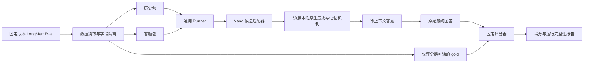

# feat-677: Memory 效果评测 — 技术方案

> 对齐：[spec.md](spec.md) 已确认的 LongMemEval 要求。
>
> 状态：首期与时间回放实现、旧审查记录保留。2026-10-29 用户授权继续修正为同一 Global 多原生窗口；本增量待独立 Gate 2，旧审查不覆盖窗口映射。本轮不追加真实模型调用。父分支同步至 `efaa2bbae3e21f8835fea477b1085c8efb7f0c93`，沿用其正常结束与宿主文件校验。

## Changelog

## 现状分析

### 涉及范围

| 位置 | 当前职责与本次规划 |
|---|---|
| `evals/` | 已有长期评测资产入口，尚无 memory suite；计划增加 `evals/memory/`，保存 LongMemEval 读取、协议、运行编排、评分和报告。 |
| `packages/dsh-integration/` | 唯一 DSH 运行时接入包；Nano 候选适配实现放在此包，负责原生历史物化、当前记忆机制接线和答题环境。 |
| `packages/personal-assistant/src/inbox.ts`、`packages/dsh-integration/src/global-mode.ts` | 当前 Inbox 消息、工具参数和结果的实际格式依据；不把格式知识复制到通用评测框架。 |
| `docs/specs/gateway/agent-capabilities.md` | 当前角色文档记忆、来源约束和 Dreaming 增量处理契约；本评测使用它，不重新定义产品记忆行为。 |

调查基线为本分支 `ebf0df43f5fa82b5d657392ced7bf1b80f5a7e8e`，继承 feat-676 实现。核对了已安装且与本分支声明一致的 DSH `0.2.1-alpha.1` 公开类型；调查时尚未在本 worktree 执行导入验证，后续实施证据见 [progress.md](progress.md)。实际评测必须重新记录受测 commit、依赖锁文件及配置，不能将这份调查基线当成永久绑定。

### 既有约束

- DSH 只从 `packages/dsh-integration` 经公开 exports 接入；评测框架不 import DSH、不自行写其 JSONL 存储、不建立另一套 Agent loop。
- 原始数据、gold、模型日志、运行目录均不提交；评测控制资产与候选 Agent 可读目录隔离。
- 使用独立 Agent 身份、工作目录和 runtime 数据；不连接生产 IM，不向真实会话发送数据集旧回复。
- 用户要求后续修改记忆机制时沿用测试框架。这是接口与测试边界的首要约束，不把当前 Dreaming 实现提升为 benchmark 契约。

### 可复用能力

| 能力 | 用法与边界 |
|---|---|
| DSH `SessionPersistence.create/open`、`SessionHandle.append/flush` | 公开接口支持持久化原生 session 事件，保留历史时间并由后端校验连续序号；当前 Nano 适配器可直接使用，无需 mock 主回复模型。 |
| `MemorySources`、`Dreaming`、`DocumentMemory` | 当前候选版本的真实来源选择、记忆准备和消费路径；只由 Nano 适配器接入，框架不知这些类名和状态结构。 |
| 当前 Inbox 投影与 `send_message` schema | 确定原 user/assistant 如何落入本系统历史，正文不变；导入记录是数据集经历的结构映射，另留来源收据。 |
| LongMemEval 官方 QA evaluator | 沿用题型对应的评分规则和回答输出格式；评分在候选外进行，不把 gold 交给候选。 |

Mastra 的同类做法是先将原历史转换为自身消息结构，再执行真实记忆处理器、保存状态并用于答题；参考与限制见 [spec 的适配证据](spec.md#longmemeval-的具体历史适配证据)。这里复用这种边界，不复制其内容清洗、阈值或 shortcut 配置。

### 相关历史

- [feat-676](../feat-676-role-memory-dreaming/) 是当前候选机制的来源；其后续修改只影响候选版本与适配接线。
- [feat-628](../../feat-628-pa-long-horizon-evaluation/spec.md) 是长期评测目标参考，不假定已有可复用的完整运行器。

## 架构总览

稳定部分围绕 LongMemEval 的输入和最终回答；可变部分围绕被测系统怎样形成、保存和使用记忆。



Runner 只调用候选接口，不加载记忆文件、不读取 Dreaming 状态表，也不判断某个内部游标是否归零。今后记忆机制从离线整理变成摄入时更新、换存储或换检索方法，数据集和 Runner 保持不变。

## 关键决策

**评测系统结果；机制差异作为候选版本变化。** 默认讨论的是“完整历史经过本系统记忆处理后，冷上下文答题怎样”，不是某个内部函数的输出快照。题目得分用于比较，不预设某一版必须达到的准确率；框架通过条件是输入保真、隔离和运行可核实。

**固定一个小接口，由适配器隐藏候选生命周期。** 只定义 `prepare`、`answer`、`close`。`prepare` 表示从历史准备可供后续使用的状态，允许候选在摄入时就完成记忆；不要求每个实现都存在一次“Dreaming”或“总结”动作。不增加通用插件市场、调度服务或任意图式流水线。

**状态是 opaque 引用，不规定记忆介质。** Runner 只保存 `preparedRef` 和摘要收据。引用可以指向文件副本、数据库命名空间或其他候选私有状态。复制、恢复、读取和清理由适配器负责；通用代码不列举 `.nanoassistant`、Markdown、向量集合或游标字段。

**只改变适配接线时不改变测量口径。** 数据集 revision、题集、完整历史规则、问答输入、judge 规则共同确定 `protocol_id`；产品 SHA、适配器版本、记忆/模型配置确定 `candidate_id`。候选可以把原文或片段保存为自己的记忆并正常检索，不强制记忆是摘要或 Markdown；其保留方式与存储成本记入候选说明。Runner 额外提供全历史 prompt、旁路数据库或额外检索服务才是协议变化，不能混入原分数。

**不为本轮强制搭建完整消融矩阵。** 先支持一个指定候选完成同一协议。无记忆、Dreaming 前后或不同机制之间的比较，可以配置多个候选；哪些对照正式执行随预算另定。框架不内置 `dreaming_on/off` 二分，也不因生产实现变化重写 case。

## 接口与数据流

### 1. LongMemEval 数据边界

数据读取器按字段白名单拆包，不把整条原始样本传给候选：

| 包 | 内容 | 可见方 |
|---|---|---|
| `HistoryInput` | opaque case key、按历史日期稳定排序的 sessions；每个 session 的 opaque ID、原日期及解析结果、原始顺序、逐回合 `role/content` | `prepare` |
| `QuestionInput` | opaque query key、原问题、`question_date` | `answer`，仅在准备状态封存后传入 |
| `GoldRecord` | 原 `question_id`、题型、答案、`answer_session_ids`、`has_answer` 等标注 | 数据审计与评分器 |

- 同题所有历史会话、双方消息和干扰信息全部保留；不根据 answer 标注过滤 session、选段、截断长正文或删除 assistant 回合。
- 正文按原字符串保留，不翻译、重写、清洗成事实列表；JSON 编解码不改变字符串值。
- session 按日期排序，同日以数据集原顺序为准；session 内保持回合顺序，不把不规则序列强制配成两两对话。
- 数据集仅提供 session 日期时，保留该精度；不伪造每条消息相差几秒的“原始时间”。无时区日期的解析约定固定在协议中，原始日期字符串始终保留。
- 原问题 ID 可能包含 `_abs` 等信息，不作为候选可见标识；题型、问题日期也不进入 `prepare`。候选使用无标签含义的标识，原 ID 映射留在控制区。
- 历史中的普通文本即使提到某个问题或事实也照实保留；隔离对象是 benchmark 额外标注，而非根据答案改写历史。

数据集选 `longmemeval-cleaned` 的具体文件、revision、SHA-256，并固定 subset ID 清单。建议先用 S 的少量完整样本验证，再决定完整跑量；不得把缩短历史后的结果称为原 S。样本数、模型和 token/费用预算仍待实验配置确定，本轮不启动付费跑量。

### 2. 稳定候选接口

以下是计划中的类型边界，不是当前已存在的 API：

```typescript
interface MemoryCandidate {
  prepare(input: HistoryInput, limits: RunLimits): Promise<PrepareResult>;
  answer(preparedRef: string, query: QuestionInput, limits: RunLimits): Promise<AnswerResult>;
  close(preparedRef: string): Promise<void>;
}

type PrepareResult = {
  status: 'ready' | 'incomplete' | 'failed';
  preparedRef?: string;
  receipt: {
    historyDigest: string;
    importedSessions: number;
    importedMessages: number;
    candidateId: string;
    evidenceRef: string;
  };
  reason?: string;
};

type AnswerResult = {
  status: 'completed' | 'failed';
  text?: string;
  evidenceRef: string;
  reason?: string;
};
```

`RunLimits` 使用正数 `timeoutMs`、`maxModelCalls`、`maxOutputTokens`，最后一项是每次请求的输出上限；调用前限制请求数，每阶段有硬超时，实际输入 token 与费用另行记录，不将事后统计伪称为精确计费硬上限。具体模型、阈值和存储配置放在候选配置中。所有动作记录实际耗时与可获得的模型用量；缺失的用量写 unavailable，不能默认为零。诊断证据可包含候选内部信息，但 Runner 只透传 locator，不据其内部字段分支。

接口语义：

1. `prepare` 创建本题独立主体，摄入完整历史，并让候选按自己的机制完成记忆准备。没有需要运行的后台机制时可以直接完成。`ready` 表示所有输入已完整导入、已触发的处理已成功结束并封存当前记忆；未到期而尚未触发的积压保留在收据，不冒称全部历史已提炼。已触发处理超预算或未完成时返回 `incomplete`，实际执行失败返回 `failed`。
2. `answer` 每次创建新的答题执行上下文，使用同一个已准备状态；不继承摄入会话、compaction 摘要或上一次答题的新状态。它返回候选实际交付的最终回答，不能根据 gold 选择多次回答中的最佳值。
3. `close` 释放本题持有的进程与句柄。失败和超时也要释放；外层 Runner 对超时进程作最终清理。审计产物按 run 保留，不能因 close 删除唯一证据。

稳定类型放在 `packages/product-contracts`，编排、数据和评分在 `evals/memory/`；Nano 实现经 `@nano/dsh-integration/evaluation` 的专用评测入口暴露。该入口只由评测命令加载，不增加生产 RPC、模型工具或生产启动逻辑。适配器加载评测专用 profile 插件，经隔离目录中的本地控制 socket 访问原生持久化和已有 KnowledgeRuntime；正常 profile 不加载该插件。实现位置须遵守依赖约束；通用目录不出现 DSH import。

CLI 默认 `plan`，只读取数据和配置并列出待执行题集，不加载候选运行时、不探测模型、不发 judge 请求。实际 `run` 必须带显式 `--allow-model-calls`、非空题集清单与阶段限额；不默认选择全量。确定性自检独立于真实 run，使用本地 fixture provider。本轮仅运行确定性验证，不使用该真实调用开关；今后真实试跑须另获用户授权，阶段限额不自动提高。

### 3. 当前 Nano 适配方案（可随机制替换）

本节是 **adapter 的当前接线说明**，不属于通用协议和通用测试的固定断言。

2026-10-29 后续同步：用户要求测试更新后的记忆分支，候选基线由 `80db8b9a6` 更新至 `unit/feat-676` 的 `3e9a46030`。原生导入、prepare/answer/close、冷上下文和评分边界保持；准备改为消费新版连续原文批次及其正常 `finish`，保留 `source_history` 和维护自身上下文恢复。候选配置只保留 Dreaming 输入容量，已退役的内部时长/步数由评测外部阶段限额继续约束。LongMemEval 没有子任务轨迹，不额外伪造任务执行或接入 IM 服务。具体可运行入口以 [suite README](../../../../evals/memory/README.md) 为准；以下初版分析中的旧源码观察不代表最新产品实现。此为同一设计允许的 adapter 接线替换，无通用协议或产品需求增量。

#### 原生历史物化

为一题建立一个独立评测 Agent、owner、Global 持久根 session 和主人聊天目标。数据集 session 是原始对话段，每段映射到同一根 session 的一个原生 window，不再注册为多个根或多个聊天目标。第一段属于 initial window，后续段到达时先导入窗口边界再导入该段。根使用 DSH 正常根元数据：不设置 `origin: 'subagent'`，`isSeeded: false`、无继承前缀；不同题彻底隔离。

| 原始材料 | 当前原生映射 | 保真约束 |
|---|---|---|
| user 回合 | `inbox` 的 `tool/call` 与 `tool/result`，结果内 `messages` 保存用户身份、正文、来源和时间 | 当前格式使用 `target`、`sender`、`time`、`content`；PA 主人身份来自该题 fixture 的可信绑定。 |
| assistant 回合 | `send_message` 调用中的 `target/text` 与配对结果 | 正文是助手对用户说过的话；不重复变成私有 assistant 草稿，不冒充另一个用户。 |
| session 日期、回合顺序 | 根 header 为首段日期，event 时间、Inbox 时间及 provenance 保留每段日期；全根 seq/turn/callId 连续唯一 | 段 ID 只是来源标识；source-map 记录段/回合 → 根/window/事件范围/正文 hash。时间精度只到 session，不伪造消息间隔。 |
| 结束边界 | 合法的 `turn/start`、`step/start`、`step/end`、`turn/end` 和对应 callId | 每个可消费单元闭合；只补结构，不补思想过程、业务工具动作或模型用量。 |

导入通过 DSH 公开 `sessionPersistence.create → handle.append → handle.flush → close`，不直接拼物理 JSONL。外部配套 `source-map` 将原 session/turn 定位到原生记录及正文 hash；不把它当成第二份记忆。助手的发送结果只证明“数据集已记载此回复”：记录 imported provenance，不伪造本次 IM 的网络送达证据，也不据回复内容补造搜索、支付等工具成功。

实际 `inbox` 长消息格式含分页片段，适配器须无损映射并经产品选择路径检查能否还原全文。它可以复用产品投影 helper；不得在框架层再维护一套 Inbox schema。

日期必须到达实际记忆消费者，而不只存在磁盘 header。当前 `MemorySources` 保留 event time；Inbox 同时保留原日期的 `time`，每个导入工具结果另包含来源为 imported-history 的段 ID、session 日期与原 turn 位置。原生工具结果的 JSON 支持这些来源字段，选择路径照常保留；assistant-only session 也能获得日期，不改产品来源选择、不添加 benchmark 总结 prompt。集成验证在实际准备请求与读取结果处核实保真。

#### 初始化与实际准备

当前 Dreaming 首次登记会以已有安全结束位置作为 baseline。适配器只创建并持久化一个空根、登记其唯一绑定，然后以首段时间初始化 owner，得到 baseline/cursor=-1。之后追加的所有窗口都沿用同一流和游标；不预建未来窗口/来源，也不在换窗时重新激活或重设 baseline。

本次将“全部追加后手动整理到无积压”替换为一套时间回放。候选仍使用真实来源许可检查、来源选择、原 prompt、维护工具和保存路径；通用 Runner、题目和 judge 不加入 Dreaming 名称或调度算法。`prepare` 只收到历史，不增加未来问题或 `question_date`；回放窗口从首段历史到末段历史，最后仅等待已经启动的工作。

**模块边界与接口。** `Dreaming` 持有实际准入规则。提供包内宿主方法 `useClock(now)`（仅在 owner 初始化前切换为宿主驱动，关闭自动定时/step 回调准入）、`recordActivity(agentId, at)`、`nextAutomaticAt(agentId)` 与 `whenIdle(agentId)`。`tick` 保留真实准入，并返回实际尝试结果供宿主判断成功/失败。正常运行默认继续使用 Date.now、现有 timer 和 step 回调；生产 RPC、模型工具和 DSH 上游不增加时钟控制。`nextAutomaticAt` 复用与 `tick` 相同的周期、静默与重试条件，避免适配器复制 24 小时/10 分钟常量或私改 owner 状态。宿主时钟只替换 Dreaming 的逻辑时间；HTTP、工具、进程截止计时与用量耗时继续使用真实时间，不 monkey-patch 全局 Date 或真实定时器。

`evaluation/history.ts` 提供空根初始化与单窗口追加；`evaluation.ts` 只注册唯一 root binding，来源许可只包含该题主人聊天目标。`evaluation/runtime.ts` 负责按时间串行导入和真实 Dreaming 调度。未来段只在宿主控制输入中等待，不在持久历史、窗口目录或模型请求中出现；source_history 继续受实际冻结前缀及来源许可约束。

**原生窗口导入。** 通过公开 Session/SessionPersistence/compaction 事件契约物化完整 `compaction/start → compaction/summary → user/message(surface replace) → compaction/end` 边界，owner 为 standalone/null。summary/replacement 仅含明确 imported-history 的结构提示，无业务摘要或 Notes、无模型调用；provider/model 标记导入来源，不冒充模型生成或实际 token-pressure 触发。公开 TokenMeter 为替换的活动节点给出启发式 shadow price，不伪造 provider usage。replacement 覆盖上一活动窗口的所有会话节点及此前结构 checkpoint，原始 append-origin 事件完整保留；成功括号由现有 dsh-agent-context History 产生稳定 window ID，Dreaming 现有 source_history 可列窗、检索和按 item 读取旧原文。不是只伪造窗口目录，也不调用会对短对话拒绝的自动压缩阈值策略。这是固定材料的窗口适配，不新增第二套运行时。

**持久化与 live owner。** 不向已加载根旁路追加：第一次到达前根保持冷态；自动周期需要 parent 时才通过现有 OwnedSessions.resolve 加载。周期结束后等待 idle、flush 并 dispose 该隔离评测的 root handle，再通过公开 persistence write handle 追加下一组窗口，关闭写句柄后恢复同一 sessionId。不得新建替代根或重建 Dreaming owner。DSH dispose 触发持久化写者异步 close，因此若 write open 短暂返回公开 SessionAlreadyOwnedError，仅在本次明确的 owner 交接中作有界等待，其他错误立即失败；阶段真实截止继续生效。导入使用 detached Session 进行原生表面校验，不发布历史 tool/result 事件；保存事件时显式使用原始逻辑时间，不改全局 Date。窗口切换时点为后段到达，导入整段完成后统一 recordActivity；原生窗口边界本身不触发 Dreaming。

**回放顺序。** 在相邻会话时间之间，宿主向 `nextAutomaticAt` 给出的准入点跳转并调用真实 `tick`，成功后继续推进。相同时间的所有会话先按原顺序完整追加，再检查该时刻的准入；若新消息恰好撞上周期边界，先记录活动，由真实静默条件决定是否延期。会话内部按原序一次追加，不虚构逐消息间隔。每次已准入 Dreaming 沿产品自己的冻结范围连续分批，宿主等待其结束后再推进模拟时钟，确保后续经历不会泄漏进本轮整理。没有业务模型重演，模拟中各会话在其时间戳原子到达；维护期间逻辑时钟固定，实际处理延迟不转换为额外经历时间。因此这是按原时间间隔驱动的顺序回放，不声称重现前台/后台的真实耗时竞争。

**结束与失败。** 到最后历史时刻后不再跳到下一周期、不调用手动 start、不循环强制清空 backlog；等待当前 active promise，确认无未完成已准入工作并封存。尚未触发的 backlog 允许 `ready` 并如实留在收据；即使尚未到首个周期、记忆仍为空，也封存初始记忆正常冷答题。执行失败或预算耗尽立即停止本题，按原协议返回 failed/incomplete，不通过后续时间跳转自动重试。实际预算计时、取消与子进程清理沿用既有 adapter。

**身份与证据。** 协议版本升级为 2，记录 chronological-session-ingestion、同刻顺序、session-atomic、维护期间逻辑时间暂停、末尾只 drain 已触发工作，以及无时区解释；不保留双模式开关。本轮 candidate 版本升级为 v4，增加 single-global-session / dataset-session-as-native-window / one-owner-conversation 映射身份；通用时间与冷答题协议保持 v2，不改 Runner/题目/judge。旧 v3 多根构造记录仅作诊断，不能当作真实 Global 基线；解析并显式记录 `intervalMs` / `quietMs` / `maxInputTokens`（前两者缺省沿用产品默认）。追加 `timeline.jsonl`，逐条记录逻辑时间、已导入 session 数、自动尝试及其结果、最后冻结的 backlog；每条模型请求额外记录当时模拟时间和已导入会话数。窗口到达事件另记录 rootSessionId/windowId，source-map 提供每段的稳定定位。source-map、原历史与 control/gold 隔离继续保留。真实耗时与逻辑时间分别呈现，旧 bulk-ingestion 分数不与新协议混用。

**Context 消费验证。** 记忆模型只能看到当时已到达的原文和先前已经形成的记忆；后到的纠正只能影响下一次准入。答题继续只有封存记忆和原问题日期，没有准备原历史或维护恢复笔记。改写现有 evaluation runtime 旅程 fixture，使内容依据实际收到的原文更新，去掉预写未来 Paris 的假响应；同一旅程核实早期请求没有后续纠正、中期已读到纠正、末段未到期的新事实未进入记忆、冷答题消费封存值，并保留原有 source_history/换窗恢复/越界拒绝。窗口修订扩展同一真实运行时旅程：只有一个根来源；早期 History 没有未来窗；后续列出多个同根窗口、读取旧窗完整原文；重载后当前 surface 只含最新窗口和结构 checkpoint，旧正文仍可恢复；所有历史时间、单一聊天目标及全根事件/调用身份保持。用小型无到期历史验证准备零模型请求及可封存空记忆。父分支正常结束变更只调整 fixture 的完成响应，产品实现不由本轮改写。现有预算、挂起截止、产品 scheduling、真实 Dreaming 回归保留；通用 Runner 测试只改必要协议身份，不断言某个 Dreaming 批次数。

#### 冷上下文答题

稳定协议要求：答题只得到准备状态经候选正常记忆入口提供的信息；gold、其他题产物、旧活动上下文和框架额外提供的原始数据都不可达。记忆机制自身保存并索引的原文属于合法准备状态，不因它未被摘要就排除。隔离由文件/服务访问边界落实，不能只在 prompt 里要求“不要看”。

对于**当前文档记忆候选**，原始历史 session、Inbox、Dreaming 输入/轨迹与旧窗口恢复入口不是它的记忆产物，因此不开放给答题环境。以后换成以原文索引为核心的机制，由适配器暴露该机制正常的检索入口，沿用同一稳定协议；无需改写题目或把“必须删除原文”设为测试条件。

当前文档记忆适配器需封存页面及使这些页面正确消费所必需的版本、来源许可状态；恢复后走 `DocumentMemory` 的正常装配和按需读取。不能只复制 `MEMORY.md` 而遗漏正文或把原维护输入目录一并开放。具体复制集合与状态迁移由适配器维护，框架不知路径。

答题使用原问题与原 `question_date`；该日期作为任务的时间依据传入，不能以运行机器的今天替代。答题模型与 memory-only 工具边界按配置固定。Global 的最终答复从隔离目标的实际 `send_message` 回执提取，普通模式从正常最终交付提取，禁止拿内部草稿作答案。测试目标只落本地，不接真实聊天。

本 protocol 衡量候选持久记忆带来的后续答题能力。若另加独立于候选记忆机制的历史恢复能力或直接全上下文答题，应另列 protocol 并说明允许的来源，不能混入此分数。

#### 2026-10-30：冷答题与常驻 PA 关系对齐

用户明确要求当前上下文与真实产品一致，并指出这应是 PA 与主人的常驻对话，不能只改显示名字。此修正仍在既有候选接线替换边界内，protocol v2 的冷上下文、时间回放、gold 隔离和评分规则不变。

Nano v5 在封存状态内保存 PA、owner、binding、conversation、Global session 的同一组身份。两阶段保留它们；answer 仅建立新的隔离 runtime/workspace，原 session 标识下没有旧活动内容，不另造 evaluation-question 或 evaluation-answer 身份。答题从正常 GlobalAgent.receive 进入，复用 Inbox、唤醒、消费与私人回复实现；DSH 接入包通过 composition 注入的 product port 调用，PA 不依赖 DSH。单一私聊的本地 transport 只保存本次问答，不暴露准备历史或连接生产 IM；不得将此表述为完整 IM/Node 链路。

答题前同步当前聊天来源资格，保证首轮记忆入口有效；开放随包 nano-memory 及答题自身 Notes/History/换窗，不把模型已能看到且隔离内可安全工作的工具统一拒绝。文件读仍限制为封存记忆和随包技能；准备的维护笔记不带入。原问题日期保留，题号不作为用户消息身份。Dreaming 直接沿产品模型容量规则安排完整首轮输入，正常评测不另设材料上限；外部阶段限额独立记录和执行。

扩展既有 evaluation-runtime 旅程，在真实 provider 请求 seam 核实同一身份、首轮有效入口、标准 Inbox 字段、技能加载、读后消费、当前问答 conversations 查询、答题内换窗恢复及原历史不可达；CLI 继续零默认请求、显式限额并区分 v5 候选。新版原生请求使用确定性 provider 捕获，本轮不追加真实候选或 judge 调用，旧单题记录不改写。长期契约与剩余差异矩阵以 [suite README](../../../../evals/memory/README.md#与真实-pa-的一致性及保留差异) 为准。

### 4. Context 生命周期与隔离验证

| Consumer | 正常可见 | 不可见/不继承 | 验证 |
|---|---|---|---|
| 当前记忆准备模型 | 完整导入历史经本版本来源选择后的材料、既有记忆、正常整理规则 | 未来 question、题型、gold、答案 session 标注 | 捕获实际模型请求，追溯原文、身份、顺序和日期；控制资产不可达。 |
| 答题模型 | 当前问题、问题日期、正常角色规则、准备后的持久记忆入口（可含候选自行保留的原文索引） | 原活动上下文、旁路历史、维护输入、评分结论、上一题 | 检查冷启动首请求与工具可访问范围，并验证确实能按正常入口读到记忆。 |
| 独立 judge | 原问题、答案或 rubric、候选原始回答、官方题型规则 | 不向候选回传评分用来重答 | 固定 prompt/code/model 版本，保存原始 judge 响应。 |

例如，历史“我从 A 搬到了 B”必须仍是该用户在原日期的原话，经候选自己的记忆机制形成状态；不能在导入时变成适配器生成的 `current_city=B`。若题目问旧日期的住址，题目只在 answer 阶段出现，准备阶段不能据此决定保留哪个城市。

### 5. 评分与报告

使用 [LongMemEval 官方 `evaluate_qa.py`](https://github.com/xiaowu0162/LongMemEval/blob/main/src/evaluation/evaluate_qa.py) 的题型规则，回答输出可导出官方 `question_id/hypothesis` 形式。2026-10-29 核对的文件 blob 为 `4732f3772b04a2b9069121ade304e6320494abc2`；执行时冻结实际源码 revision、内容 hash、judge 模型和参数，不能一直追随 main。

通用报告至少列出：

- `protocol_id`、`candidate_id`、数据文件 hash、subset 清单与样本数，完整历史与时间处理规则。
- 总正确数/计划题数、已有效评分题准确率、各题型及 abstention 分项；未完成、适配失败、答题失败、judge 失败分别列数，不从分母悄悄消失。
- 每题的 prepare/answer/score 状态、原始答案、评分及证据 locator；未跑是 `not_run`，未判定不可伪装成错误或成功。
- 准备、答题和 judge 的耗时、可取得的 token 与费用；导入无模型调用时记录事实，不填造 usage。

judge 出错时可对同一已冻结回答重试评分；不能重答择优。候选准备或答题重试保留 attempt，按预先固定的重试规则计入用量；更换模型/配置要生成新 candidate。公开集结果用于可复现回归，不声称排除了模型训练污染。

### 6. 测试边界：测契约，不锁实现

| 层 | 有价值的断言 | 不作为通过条件 |
|---|---|---|
| 数据与评分 | 全历史角色/正文/日期/顺序保真，标注只给 judge；官方题型规则、分母和失败状态正确 | 某题必须由某个记忆摘要命中；根据 gold 挑“有效历史”。 |
| Runner 契约 | 只把历史交给 prepare，ready 后才传问题；失败/超时不当 ready；关闭资源；原始回答不改写 | 调用 Dreaming 几次、哪个 cursor 值、生成几个文件。 |
| 候选一致性 | fresh case 不串题；冷 answer 不继承经历/旧答案；准备状态可正常消费；同一状态支持独立答题 | Markdown 目录、页名、表名、向量索引结构和具体生成措辞。 |
| Nano 适配集成 | 原生导入可被真实产品来源路径读取，完整映射可核对；真实准备和答题链路工作 | mock 掉记忆模型后声称通过模型能力评测；快照锁住 `MemorySources` 私有输出。 |
| 正式 benchmark | 按冻结协议运行并报告实际正确/错误、成本与未完成项 | 用单个 score 阈值证明适配正确，或用单测成功代替模型效果。 |

用两个轻量测试 candidate 验证 Runner 的独立性：一个在摄入时得到私有状态，另一个先收集历史、prepare 结束前生成状态；两者采用不同的 opaque 状态表示，均不暴露 Dreaming。相同 Runner 测试必须通过。这只是协议测试替身，不开发第二套产品记忆系统。

Nano 专属集成测试放在适配器附近，按语义审计导入和实际可见 Context；实现换代时允许接线和局部 fixture 更新。通用测试不因这种变化改预期结果。已有 Dreaming 游标/分页单测留在产品原测试套，本 unit 不把它们复制成评测框架门禁。

## 契约层增量（delta-spec）

- Gateway / PA：**no spec delta**。当前方案增加离线评测入口，沿用产品记忆和消息行为；不增加用户产品 API。若实施时确认来源时间等产品行为需要修正，先明确最窄增量再补对应 delta，不能以评测适配名义隐式改变产品。
- 评测协议：实施时维护在 `evals/memory/README.md` 与协议配置，连同 `evals/README.md` 更新入口；这里保留本 unit 的设计决定，不复制长期操作手册。

## 风险与回退

- 原生存储接口已从公开类型核实，完整事件与产品消费兼容性仍需最小导入试验。适配失败如实报错，不降级成另一个总结器。
- 当前时间投影、来源许可和恢复状态可能影响完整消费；只在 adapter 或确有必要的产品边界修正，通用 protocol 不接受静默丢字段。
- 对历史内容的提炼正确性由真实模型决定；导入完整不等于记忆有用，答案错误应保留供比较。
- 超预算保留 incomplete 和真实产物，不能通过减少历史长度或选择答案会话凑完成。
- 评测入口不被生产加载；回退为停用本候选与删除其隔离环境，保留报告和审计材料，不改生产状态。

## 一次性部署迁移

无。评测使用新建隔离数据，不迁移生产历史。

## Runbook for Reviewer

无本 unit 改动的常驻产品服务。候选运行时是评测命令的受管子进程，退出或失败由适配器和 Runner 回收；不要求启动生产舰队或连接公网 IM。

**Review 驱动方式**：通过 suite CLI 与集成测试运行真实 Nano/DSH 运行时，在 provider 边界提供确定性响应。评测 CLI 是本 unit 的用户入口；导入允许在 adapter 中写原生历史，记忆准备与答题使用实际产品实现。本轮 owner 与独立门禁均不请求真实模型或 judge；此前的一题真实试跑已执行且 incomplete，授权不延续到本轮。无客户端 UI 变化，不生成前端原型。

**验收前置**：本轮使用包含长消息、日期、更新与干扰内容的合成 fixture、确定性 provider、独立可写目录和运行限额。此前真实试跑的题目、数据版本和限额保留在已有证据中，本轮不重跑、不加预算、不换题。实现后在 `evals/memory/README.md` 提供计划、自检、真实运行与查看报告的可复制命令，并说明真实效果未测。

最小走查依次验证：合成完整历史导入收据 → 真实产品机制配合确定性 provider 返回 ready 或如实 incomplete → 新上下文按正常记忆入口答题 → 固定 judge 响应经过官方规则输出报告；再换一个候选配置复用原题集与评分，确认框架没有读候选内部状态。机制通过与真实模型评分在报告中分开。

## Milestones

本 unit 仍为单 M1；本次在原 M1 内追加同一 Global 多窗口修订和受影响门禁，不扩展其他 benchmark，不重跑真实模型。

| ID | 标题 | 依赖 | 并行组 | 范围 | 退出标准 |
|---|---|---|---|---|---|
| M1 | LongMemEval 原生记忆评测闭环 | 无 | — | `evals/memory/`、稳定协议类型、Nano evaluation adapter 及就近集成测试、评测入口文档 | [reviewer] CLI 默认计划零模型请求；确定性 provider 下可以从完整历史得到冷答题、评分及未完成项，真实 run 需显式开启。[worker] 真实运行时的数据/Context 隔离、历史保真、候选协议替换、失败清理和出站请求证据齐全；框架不依赖 DSH、Dreaming 或记忆介质；时间回放只暴露已到达历史、按实际准入整理并保留未触发积压；同一根多窗口具备真实 surface 切换、跨窗原文恢复与重载一致性，无未来空根/空窗；本轮不追加真实模型，旧一题 incomplete 保留其原构造标签。 |

## 本轮边界与后续对齐

本轮实施 LongMemEval 的稳定协议、候选边界和当前 Nano 映射。具体 subset、模型、对照组合与跑量由未来执行配置提供；其他 benchmark 后续讨论。当前授权为已确认的单根多窗口修订及无真实模型验证；先前一道真实试跑已执行且 incomplete，不能沿用其授权自动重跑。不执行全量、不自动重试候选、不部署或连接生产 IM。
