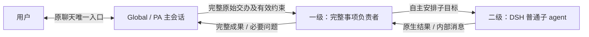

# feat-705: Global 与 PA 的完整事项委派和日常交流 — 技术方案

> 对齐：[当前阶段需求](spec.md)。Task 改造暂缓；本文仅设计主从模式，不表示运行代码已改变。

## Changelog

## 现状分析

### 涉及范围

- `packages/dsh-integration/src/agent-config.ts` 是根及各层 child 的真实装配入口。当前普通 child 不加载根 Persona，但一级、二级都加 `nano-product-identity`、`registerChildGuidance`、来源说明及配置的 Skills；没有完整事项执行者与普通子任务的区别。
- `global-mode.ts` 当前根指导只说 may delegate；普通 child 共用内部执行／回报说明。`child-role.ts` 单独识别 fork，在初始任务末尾补内部角色边界，保留父前缀。
- `capabilities.ts::ToolSelection` 当前按同一产品 Agent 的 toolAllowlist 筛选各层。这是主工具选择影响 child 的 Nano 接线，不是 DSH 强制要求所有层共用根名单。
- `index.ts` 从可信 preset／父会话取得配置并依次 attachAgent、审批、模型、History。`OwnedSessions.resolveManaged` 校验 parent catalog、descriptor、preset、cwd 与 delegationDepth，冷恢复仍调用 DSH 公开 `applyChildComposition`。
- `apps/node/src/capabilities.ts` 投影创建界面的工具默认值；Web／PA 创建和保存均使用已有配置链。新 PA 初始说明在 `apps/im-server/src/personal-agent-defaults.ts`。随包 ongoing-work、proactive-care 指导也受职责调整影响。

### 既有约束

DSH 是唯一运行时，不 fork／patch、不 private import、不新增 Agent Loop。只在 integration 内接入 DSH 公开 exports。Global、PA 同一职责；各级内部会话不获得 Inbox、产品聊天、公开消息或主人代发权限。保留实际来源、审批、workspace、Skill 选择、原生并发与 maxDepth=2。Task driver、图、状态、续推、业务数据、客户端布局均不改。

### 可复用能力与参考差异

| 能力／证据 | 采用方式 |
|---|---|
| DSH base `subagent`，continuable 后台模式 | 主会话直接派完整目标，保留原生 ID、父子目录与恢复；不创建独立 Worker 产品会话 |
| DSH `send_message(agent_id,message)` | 一级向 Global、二级向一级逐级汇报；直接父子通信，不新增 report 工具 |
| DSH child composition／native fork | 普通 spawn 是新子会话，加入父级持有的 preset；fork 原生继承父前缀。保留原生语义 |
| Nano 的角色与工具装配 | 改为按可信角色投影；不再把 Global 根的普通工具名单套给内部工作 agent |
| ProductBridge、Global／PA 宿主检查与审批 | 继续按真实根绑定与 child 身份限制操作，工具可见不等于获得产品入口或新授权 |
| 原生 history、continuable descriptor 与现有工作笔记 | 原执行者接续，必要时记录来源、ID、要求和已交付事实；不新增账本或数据库 |
| Work 与 LLM 请求／回执 | 验证父子范围、实际模型上下文和公开交付，不新增 UI |

参考仓固定为 `dsh-superagent-prototype@6337fc823ce20251c8de8085948165c81aaa701e`：`cordis.patch.yml` 为独立 Worker 会话提供 coding persona、AGENTS、工具等工作基础，并显式让下级用 standard；`sessions.ts::decorate` 只给 Router／Worker 加自定义业务 Prompt，下级仅走 `limitSubagent`。Worker 的自定义段是追加而非完整覆盖；`prompts.ts::promptParts` 组合 shared、worker、沟通／范围／交付、工作方法、handoff 和环境。首条交办含来源原话等事实，过长给读取入口；不复制 Router 历史。

本仓锁定 `DSH 0.2.1-alpha.1` 的 tool-subagent Config **没有**参考仓的 `agentPreset` 配置项。公开 `applyChildComposition` 通过 `agentPresets.composeFrom(child,parent.ctx)` 加入同一 preset 的确切 revision，不复制父 Agent 自身局部角色；因此本设计保留现有 `nano:<agentId>:<revision>` 身份，按角色投影工具和产品指导，不假定存在可直接配置的 standard 子 preset，不升级上游来完成本阶段。

这里的“DSH 默认工作能力”指本仓锁定并实际装载的 DSH 工具／工作指导，而不是恢复宿主已停用的 web_fetch、plugin manager、workflow 等功能。base 的 personaPrefix 当前为空，不声称本仓已装载参考仓的 coding Persona；复用原生 AGENTS、时间、工具说明和委派上下文，一级追加本产品工作职责即可，不复制一份上游完整 Prompt。

### 相关历史

feat-546 的 Global 身份和 Inbox、bugfix-693 的提醒合并，以及 global-child-tools 对普通 child、fork 和恢复的产品边界继续适用。原宽泛委派指导和各层共用 toolAllowlist 是本阶段要调整的现状。此前设计审查中的 fork 专门清理流程已被用户明确排除，不作为本轮目标；保留历史报告，不沿用其结论批准新设计。

## 架构总览

一个完整目标只有一个一级负责者；一级自行调查、分工、整合，Global 继续接用户。一级类似 Super Agent 的 Worker；二级普通 subagent 不另注入 Nano 身份或 Worker 规则。



不引入工单、Task 绑定、独立 Worker 会话或第二套调度。单 M1 实现并验证整个主从旅程。

## 关键决策

**日常直接处理，完整独立事项交给一个后台可接续执行者。** 不按消息、一天、时长或固定工具步数切分。根只核目标覆盖、产物／依据可用性及真实缺口，不重复研究或替一级制定技术方案；缺口交回原执行者。无关事项各自委派；补充、更正、答复回原执行者。

**工具按角色装配，主会话配置不再决定一级的普通执行工具。** 不新建可配置的“一级工具名单”或 UI。工具投影在现有 ConfigurationScopes／ToolSelection 收口，输入为已装载工具与可信会话角色；根的配置继续服务根的目录、预览和执行，不能因给 child 放开工作工具而使根获得未勾选工具。

| 角色 | 工具与配置 |
|---|---|
| Global／PA 主会话 | 保留现有固定产品工具、用户选择及日常执行能力；fork 默认关闭，可手动开启 |
| Global／PA 普通一级 | 以已装载 DSH 默认工作工具为基础，包括 subagent、subagent_fork、内部 send_message 及原生管理工具；不套用根普通工具 allowlist 或根 fork 开关 |
| 普通二级 | 使用 DSH 普通子 agent 工具装配和原生深度／权限限制；不套根普通工具名单，不加产品专用能力 |
| fork | 沿原生继承及返回语义，继续受深度、原生限制与产品权限检查；不作为新的独立根／整项目标负责者 |
| SingleThread 及非本分工 child | 除先前确认的主会话 fork 默认关闭外，保留既有工具和职责规则；Workflow／知识维护等特定子任务范围不被放开 |

工作工具沿实际 DSH 注册集合取得，不复制一份所有默认工具的静态清单。下列产品约束单独保留，不能用“按 DSH”绕过：

- 子会话无产品 Inbox、conversations、personal_sources、send_user_message、公开 target/text send、保存任务执行／历史等根能力。
- 不装载或暴露绕过 Global 面向用户提问、展示或审批计划的入口，也不恢复被宿主禁用的插件管理等能力。问题经原生内部消息逐级回 Global。
- Nano Task／Schedule／Heartbeat 等产品能力不因工作工具放开而新增；已有指定模式与 Feature 权限保持。Goal 三工具仍按既有独立选择和默认关闭规则，不与 fork 绑定。
- 已授权 workspace 扩展、Skill 选择与禁用、来源／审批和 workspace 边界继续有效；不通过原生默认值自动启用被用户禁用的 Skill 或新装插件。

`restrictSelection`、配置预览、History 配置恢复和 capability reservation 必须使用同一角色语义：主会话取消普通工具不撤销一级的 DSH 工作默认能力，也不把一级正在使用该能力误判成根选择不可保存的依赖；真正共享的 Feature、Skill、扩展或权限撤回仍按既有保护生效。占用仍按实际调用记账，不删除或重建子会话。无需公开 role 字段或另存工具名单。

**一级补工作职责，二级普通 subagent 不注入额外身份。** DSH 的工作指导与原生委派机制是底层；Nano 的自定义职责只写在根和一级各自局部 scope，不进入共享 preset 的可继承产品 Prompt。二级不注册 `nano-product-identity`、`nano-global-child`、`nano-inbox-source`、根 Persona、PA／Task／Heartbeat 等产品系统段，不追加“你是某数字人的内部员工”一类身份。权限检查仍由宿主按真实 lineage 执行，不能用删 Prompt 代替访问控制。

**fork 开关只改变主会话可调用工具，不追加流程。** Node 创建目录和 integration 根默认选择均将 subagent_fork 默认关闭；显式名单优先，旧名单不重写，新增／撤回走原生生效规则。只有 Global／PA 根的默认集合变化；此前已确认的新建 SingleThread 主会话也使用这一默认值。一级按 DSH 工作配置可用 fork；不被根的默认关闭集合命中。不改变 Goal 集合或其指导。不开启 fork 专属系统段、主会话清理轮次或取消算法。

**控制、恢复和交付继续用原生机制。** 更正和接续用原 ID 的内部消息；停止沿现有可用的管理机制协调对应范围，受理不冒充已停止，晚到结果不恢复用户已停止的目标。保留各原生工具的取消与返回语义，不新增级联中断、后台 fork 清理流程或守护状态机。原执行者不可恢复则如实交代原因和已有成果，不静默复制任务。普通内部进展不需要父级回复“继续”，也不逐条转给用户。

**用户配置与 Task 不回填。** 新 PA 默认说明及随包 ongoing／proactive 指导与分层一致；不改用户 Persona、同名覆盖 Skill 或旧文件。核心根／一级职责不依赖用户必须启用某个 Skill。Task driver 提醒仍按当前行为处理，不承诺持续推进一级，也不因提醒让根接管调查。

## 初始上下文与生命周期

### 当前与目标

当前普通一级、二级经过同一 Nano child 装配；它们是 DSH 基础加 Nano 身份和指导，并非直接使用上游默认。本设计改成下表。

| Consumer | DSH 基础层 | 本产品追加层 | 初始任务与历史 |
|---|---|---|---|
| Global／PA 根 | 既有运行时、工具、workspace 指导 | 根 Persona、Global 协调／来源／交付，PA 固定边界 | 原主会话历史与 Inbox，保持现状 |
| 普通一级 | 原生工作／工具指导、AGENTS、时间、委派上下文 | 完整事项端到端责任，自主选方法和分工，只向父级汇报／提必要问题；最小产品边界 | 新会话；父级提供完整原话、来源、有效约束及已有成果；不复制根历史或 Persona |
| 普通二级 | DSH 原生子 agent 基础指导、workspace AGENTS、工具和委派上下文 | **无 Nano 身份或 Worker 专用 Prompt** | 新会话；一级传子目标及必要资料，不自动复制一级历史或整份用户事项 |
| fork（二级常见） | DSH 原生父前缀继承 | 保留现有最窄内部角色尾说明及宿主产品权限，不另注入整套角色 | 继承父上下文是 fork 的原生语义；“普通二级不带额外身份”不要求裁改 fork 前缀 |

二级无额外身份不等于无来源：委派来源和原生父子身份仍由 DSH 保存，父级消息不能冒充真人授权。授权、审批上下文继续从可信链取得，不依赖将全量产品指导塞进二级。

一级职责追加样意（正式文案由实施按实际组合收口）：

> You own this complete delegated task. Choose the approach, carry out and verify the work, and organize any necessary subagents. Handle routine choices within the assignment. Ask your parent only for facts, decisions or permissions it must supply. Report the complete outcome and remaining gaps to your parent; user communication belongs to the main Agent.

普通二级不复制这段，不要求它统筹整项工作。DSH 的原生 return mode 仍决定 completion 或 continuable 通信；必要的原生通信指导保留在工具／运行时所属层，不给二级另造 Nano 身份。

### 选择、注入与恢复

角色从宿主可信根绑定、origin、parentSession／delegationDepth 及已有 fork 识别导出，不能由 prompt 或模型传 role 切换。只在 Global／PA 的普通一级注入完整责任；已由 Workflow 等显式配置的 child 保留其特定范围，不仅凭 depth 就升级工作能力。

保留共享 native preset revision 与父子 catalog，产品角色文字留在 Agent 局部 scope；共享 preset 的 prompt 贡献按消费者投影，二级不意外看到 Task、PA、根 Persona 或一级职责。不得只过滤 schema 而仍把不可用工具及产品身份指导送到模型。Skill 发现仍走既有授权 provider，不能把一级自定义业务 Prompt 当作新 Skill 传播给二级。

新建、下一轮配置应用及冷恢复都走同一角色判定和投影；既有普通一级继续其原 ID／目标，既有二级恢复后使用原生上下文，不伪造新身份。旧历史可能保留旧角色文字，当前有效系统指导与工具按新投影组装，不重写历史。fork 保留前缀，不为缓存复用在前缀前新增角色段。

## 接口与数据流

无新增对外 API、工具参数、数据表或业务状态。配置内部的工具／Context 投影隐藏角色判断、原生注册集合、产品例外与更新／恢复处理；调用者仍用已有 ConfigurationScopes、ToolSelection 和 attachAgent，不引入通用代理框架。

1. Global check／read Inbox 的相关完整内容，取得真实作者、来源、原话和约束；提醒不是正文或授权。
2. 需独立执行时向原聊天简短接单，调用原生 subagent。description 是摘要，prompt 提供完整交办与必要事实，不填根自行设计的实施计划。

```json
{"description":"对比两个项目并交付报告","prompt":"用户原始交办：……\n来源和有效约束：……\n已有成果及资料位置：……","run_in_background":true}
```

3. 从实际模型结果 `started subagent <id>` 取得一级 ID，不把宿主内部的 runId／jobId 当作可通信身份。根本轮私有收尾、继续接新请求，不 sleep／wait／list 轮询。
4. 一级在自己的 DSH 工作工具与职责上下文中执行，可原生创建二级；二级仅得到一级传来的子任务及其原生上下文。缺少产品聊天事实等由一级向根协调。
5. 更正／答复调用 `send_message({agent_id:<真实直接 child ID>,message:<原话及说明>})`。一级通过同一原生工具向根回完整成果／必要问题；二级沿原生返回路径回一级。输入受理不是用户收到或事项完成。
6. 根只核对目标覆盖和真实缺口，不足交原执行者；可用结果向正确来源聊天公开交付，按 sent／held_for_revalidation／unknown／error 回执处理。重复完成通知不重复发送成果。

跨轮需要时沿现有工作笔记保存来源、一级 ID、最新要求、等待／停止／已交付事实；不强制派发就建文件，不把运行 ID 写入正式 Memory。主会话的 Inbox／公开发送与子 agent 内部 send_message 使用各自现有 schema，二级无 Nano 身份仍不能调用产品入口。

## 契约层增量 (delta-spec)

- [Global delta](specs/gateway/global-agent.md)：完整事项单一执行责任、日常直接处理、主会话协调交付及原执行者接续。
- [PA delta](specs/gateway/personal-agent.md)：复用同一 Global 分工，既有来源与披露边界不改。
- [能力 delta](specs/gateway/agent-capabilities.md)：主会话与一级工作工具分离，普通二级原生 Context、无额外身份；主会话 fork 默认关闭、一级按 DSH；旧名单、Goal 与权限保持。
- Task、IM 页面无增量，无新前端原型。current specs 待实现验证后归并，本轮不改。

## 验证与退出依据

先在 RuntimeClient 实际组装／原生执行 seam 验证，不把目录默认值或字符串断言视为可用性证据：

- Global／PA 根未选 fork、文件／命令等普通工具时，根仍无这些可调用项；普通一级具有实际 DSH 工作工具、fork 和内部通信，二级为原生工作工具并受深度限制。强制调用也不能取得根产品权限。SingleThread、Workflow／维护 child 的特定范围不扩大。
- 捕获普通一级、普通二级和 fork 的最终 provider 请求：一级有且仅有适用责任，二级没有 Nano 身份、根 Persona／Global／PA／Task 指导和一级职责；原生 AGENTS、委派说明及父级子任务可用。fork 原生前缀／工具保持，不在前缀前补角色。
- 无显式名单、新建 Web／PA／SingleThread、显式 fork 开关、旧保存名单及忙闲更新验证。根关闭 fork 不改变一级；共享 Feature／Skill／扩展撤回仍有效，配置占用检查按真实受影响角色工作。Goal 单项选择与默认关闭不变。
- 保留原一级／二级 ID、descriptor、根 Persona 的隔离旧会话，恢复候选 runtime 后捕获下一请求。验证新角色投影、原 ID 接续、执行要求和来源保持；不重新派一份工作来冒充恢复。
- 通信 fixture 覆盖根接独立输入、补充回原一级、二级结果由一级整合、根公开交付及重复通知去重；停止／明确接续只验现有管理语义与范围、真实失败表达，不新增 fork 专门取消测试体系。

普通 Global、PA 各需一个隔离真实模型自然任务：完整事项交办 → 一级开始后发日常短问 → 补充原事项 → 返回完整成果并交付。观察根未重复调查、补充回原执行者、日常及时承接；需要用户决定时只能通过 Global。二级／fork 的工具与上下文用确定性原生 fixture 保证，不诱导真实模型为验收机械开下级。

证据记录版本、模型／配置、session、实际 provider 请求与工具结果、IM 回执和 locator；协议转换时含 upstream。源码／stub 只能证明接线，不能代替自主分工与用户交付。真实模型、旧会话恢复或权限证据缺失须明确未验证，不宣称通过。

## 风险与回退

根仍保留日常工具，避免重复调查是行为契约，需要实际模型证据；不以硬 router 或守护状态机保证。保留用户 Persona／Skill，冲突先定位实际组合再做最窄修正。角色工具投影改变了旧 allowlist 的继承，需同时验更新、配置占用、审批、冷恢复及非目标 child，不能只跳过一次 restrict。

回退只撤回本阶段角色／工具投影、默认值及随包指导，并正常装载版本；不删除会话、Task、历史或用户配置，不宣称回滚已发生动作。

## 一次性部署迁移

无。节点正常加载新版本，不回填用户 Persona／Skill／名单，不新增历史迁移。设计阶段不部署、不重启生产、不发生产探针。

## Runbook for Reviewer

| 服务 | 停止命令 | 启动命令 | 健康检查 |
|---|---|---|---|
| 本轮隔离 IM + Node／DSH | `./scripts/e2e-down.sh --wt <unit-worktree绝对路径>` | `python3 scripts/dev_host.py check` 后，`./scripts/e2e-up.sh --profile daily --wt <unit-worktree绝对路径>` | 按 `.e2e-ports.env` 请求 `$IM_URL/openapi.json`；`.e2e-daily.json` 完整、隔离节点在线 |

**Review 驱动方式**：不改客户端布局，走端到端真栈；用客户端同一消息、配置及 Work API 驱动自然输入。在现有工具选择界面核根 fork 默认未勾选、手动保存。Work 验父子范围，实际请求验 Context，公开回执验交付，不用直接注入正确步骤代替自然任务。

**验收前置**：实施 owner 提供实际 unit worktree／受审版本；沿 daily 模板的 Global、PA、模型／审核配置及合成资料。必要管理工具在隔离配置选择；不改生产。按 worktree-runtime 现场检查模型与身份准备，ready 不表示旅程通过；复用有效栈，仅清理本轮服务。各验收 Scenario 须有相应产品或确定性边界证据。

## Milestones

| ID | 标题 | 依赖 | 并行组 | 范围 | 退出标准 |
|---|---|---|---|---|---|
| M1-global-delegation | 完整事项负责者与分层工具／上下文 | 无 | 单阶段 | integration 的 agent-config、capabilities、global-mode、child-role；必要的现有配置／历史／capability reservation 接线；Node 工具默认；PA 默认说明；ongoing／proactive Skill；相关测试；三个 Gateway delta | [reviewer] 全部 Scenario：完整事项只有一个一级负责者，根不重复调查、继续日常与独立输入，更正／停止／接续归原事项，Global 唯一用户入口并实际交付。[reviewer] 根 fork 默认关闭、可手动选择且旧名单保持；一级按 DSH 工作，二级由一级自主组织。[worker] 实际 provider 请求证明一级 DSH 基础＋最小职责，普通二级无额外 Nano 身份／业务指导，fork 保留原生继承；根工具配置不误缩一级或反向放开根。[worker] 更新、占用校验、同 ID 冷恢复、Skill／Feature／扩展撤回、Goal 独立选择及审批／产品权限有效，Workflow／SingleThread 等非目标规则保持，原生深度不扩展。[worker] 原生通信 fixture 与 Global／PA 真实模型旅程证据分开；Task driver／动作／数据、客户端布局无变化，相关窄回归与 required CI 通过。 |

窄回归复用 global-child-tools、goal-opt-in、communication-native、llm-attribution、task-child-context、native-human-source、配置占用／预览与 PA 默认说明测试；按角色新增实际请求与执行断言。保留独特旧回归，只调整被本设计明确改变的共享名单／二级身份预期，不写镜像文案测试。测试、真实模型和产品验收均属于实施阶段，本设计不宣称已通过。

## 开放 PR 默认值补充（2026-11-04）

按用户确认，将 `exit_plan_mode` 加入 Node 工具目录和 integration 的默认关闭集合。未配置名单的主会话不下发该工具；显式名单仍是选择来源，无配置迁移。Global／PA 内部执行者原有用户交互工具排除规则不变。DSH 以命令进入 Plan Mode，但本产品未提供相应入口；本轮仅调整工具默认值，不实现 Plan 入口或增加角色提示词。扩展既有 Node capabilities／原生 opt-in 矩阵，核默认、显式选择与 llm/stream 实际 Schema；已有主从自然旅程证据未失效，设置页做针对性独立复验。

## 用户复核后的职责文字精简（2026-11-04）

用户要求一并考虑既有段落，删除没有本产品场景依据的冗长提示。保留完整事项先交一个可接续执行者、日常直接处理、原执行者接更正、主会话供必要事实／决定并交付；合并重复的原文重读／验收要求，不再常驻回执、恢复笔记更新频率、逐次状态处理等细则。一级仅写端到端职责与父级用户入口；二级原生规则不变。PA 新建默认只保留个人助手特有行为与 Skill 入口，不再复制 Global 的整套主从规则；已有用户 Persona 不回填。结构、工具、权限、Task 业务均不变，详细跨轮次操作仍由既有按需 Skill 承担。

这是用户明确要求的文字精简，不据静态 token 下降声称模型行为或延迟改善。保留此前自然任务作为原长版证据；精简版只跑受影响原生 wire／恢复／通信和 PA 创建回归。用户要求停止独立 review 后未重新派审查或产品复验。

## IM 角色身份措辞校正（2026-11-04）

用户指出 `main coordinator and sole user-facing contact` 容易被理解为所有聊天／外部参与者的统筹者。改为对外单一且负责的 Agent：与人和其他 IM Agent 平等协作，对自身接受的工作和沟通负责；worker 仅属其内部执行方式。该身份边界写在根指导开头，去掉重复的外部 Agent 非下属句，不新增对外 router 身份；一级的父级通信边界仍只指内部层级。

## 按消费者装载来源与交互指导（2026-11-04）

- 通用来源说明移除 PA 主人观察协议；原文单独由 personal-security 的个人角色 section 注入，PA 根／一级仍能解释主人和观察关系，普通二级原有过滤有效。一级使用短的委派来源边界，保留原授权范围、撤回／更正和工具／子消息不产生新授权；宿主审核提示与权限逻辑不改。
- GlobalMode 根据可信配置 personal 布尔值投影 Inbox 的 review／message_id 和 conversations 的主人字段说明；普通根不再声明不可用的 PA 复核操作。pa_agent_id 对普通 Global 识别其他 PA 的代表发送仍有意义，保留通用来源归属。
- 通用主指导移除重复 PA 代发和 Heartbeat 协议句。PA 表达规则继续由个人角色 section 提供；Heartbeat quiet 协议只在启用该 Feature 的主会话装载，不注入一级。
- Global／PA 一级的 Intelligent UI 指导只说明按需加载 Skill、准备内容并回传父级，不重复用户聊天、ComposeMessage／ToAssistant 和背景交互流程；SingleThread 及主会话原有交互指导保持。

更新既有 Global／PA HTTP wire 矩阵，直接核各层可见协议字段、根工具 schema 和一级 UI 工作范围；实际模型采样再核全组合。未因本次反馈改造子执行、取消、Task 或审核机制。
