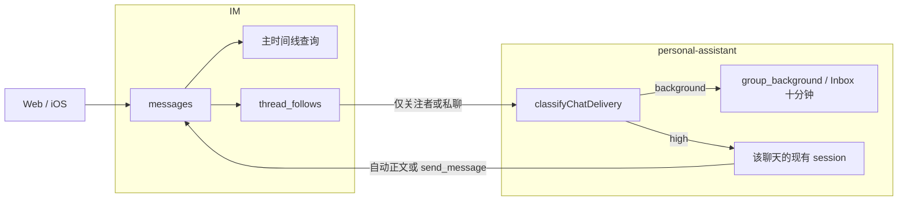
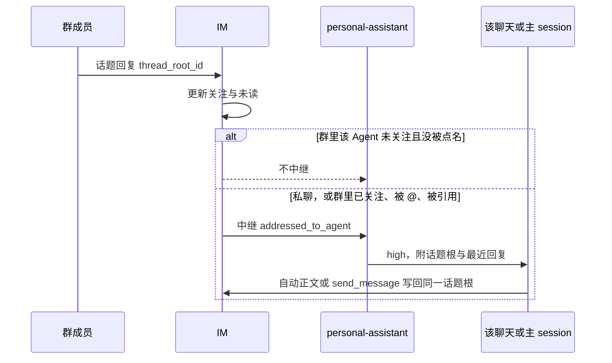

# feat-780: 聊天内话题 — 技术方案

> 对齐: spec.md（`origin/develop` 上的 feat-780 首文档）

## Changelog

- **Agent 工具侧重构（对齐 Raft 收发模型）**：
  - 统一 `target`：Agent 侧主时间线用 `<= 8` 位聊天短 ID（`c_xxxxxx` / `f_xxxxxx`），话题用一等组合地址 `c_xxxxxx:yyyyyyyy`（聊天短 ID + 8 位短根消息 ID），取消 `in_thread_of` 与 `thread_root_message_id` 附加参数；`reply_to_message_id` 继续保持正交（单层引用卡片）。
  - 6 工具拆分：将 IM 产品工具拆为 `inbox`、`send_message`、`read_messages`、`search_messages`、`conversations`（`list`/`info`/`create`/`join`）、`threads`（`list`/`follow`/`unfollow`）。
  - Inbox 按 thread `target` 拆行，不带正文 preview；`held_for_revalidation` 按单个 `target`（话题级）隔离；显式 `send_message` 不做静默目标改写（暂不做错位 Guard）。
  - 话题上下文按需附带：正常跟进只给新消息本身；仅首次进入陌生话题（或压缩后首次回来）附带一次根消息 + 最近回复 + 显式 `truncated` 标记 + 补读提示。
  - `read_messages` 读主时间线时，有回复的根消息带 `thread: { target, reply_count, latest_at }`；读话题时同时返回 `thread_root`；支持仅传 `message_id` 直查单条；`search_messages` 命中话题回复直接返回话题 `target`。
  - Agent `threads(unfollow)` 在话题内留一行人类可见提示（不触发未读/中继）；后续再次被 `@` 或引用自动恢复关注并在消息中附带重关注提醒。
  - 8 位短编号契约：所有需要 Agent 填写的工具原子编号长度均 `<= 8`，并配自动化契约测试守住后续变更。

## 现状分析

### 涉及范围

话题要接进已经存在的一条消息链，而不是再做一套聊天。

- `apps/im-server/src/schema.sql` 与 `db.ts`：`messages` 现有 `reply_to_json`，没有话题根。启动时已用可重复的 `ALTER TABLE` 补列，不另做历史搬迁脚本。
- `apps/im-server/src/messaging.ts`：`replyReference` 只拷贝被点那一条；`deliveryFacts` 在私聊、@、引用到该 Agent 时把 `addressed_to_agent` 设为真。`enqueueRelays` 把群消息交给成员 Agent。
- `apps/im-server/src/message-records.ts`：新消息给除发送者外的参与者 `unread_count+1`。已读水位按 `messages.rowid` 重算，不区分主时间线和别的消息。
- `apps/im-server/src/message-search.ts`：按聊天搜正文，结果没有话题地址。
- `apps/im-server/src/gateway.ts`：中继元数据在引用对象是 Agent 时写入 `reply_to_agent_id`。
- `packages/product-contracts/src/collaboration.ts`：`classifyChatDelivery` 把私聊、@、引用判成 `high`，其余群消息判成 `background`（十分钟，`CHAT_BACKGROUND_DELAY_MS`）。`owner_only` 且不是创建者私聊则 `skip`。
- `packages/personal-assistant/src/single-thread.ts`：`background` 进 `store.bufferGroup`，高优才 `takeGroup` 并提交到该聊天已绑定的一个 session。自动正文用 `turn_start` 发回 `binding.conversationId`，没有话题地址。
- `packages/personal-assistant/src/global-agent.ts` 与 `inbox.ts`：同一条中继以 `high` 立即通知，或以十分钟写入 Inbox。Inbox 的 target 是聊天，不是某一条消息。Global 只有一条主 session。对外发言走 `send_message`。
- `packages/personal-assistant/src/attention.ts`：群里是否算被点名，直接采用 IM 给出的 `addressed_to_agent`。
- `packages/dsh-integration/src/message-arguments.ts`：`send_message` 已有 `target` 与可选 `reply_to_message_id`。外部通道和内部子执行不能带引用。
- `src/IM/frontend` 的消息面板：菜单有「回复」，输入区可取消引用，气泡用单层引用卡片定位原消息。
- `src/IM/ios` 的 `ConversationView`：菜单仍是复制和分支，不渲染 `reply_to`。补齐手机引用回复属于 feat-779，本 unit 不加这个动作。

### 既有约束

- 执行运行时只经 `packages/dsh-integration` 的公开出口。PA、Channels、IM 不 import DSH。节点与运行时仍走现有 stdio，不新增内核 HTTP。
- 不恢复第二套 Agent Loop，也不为话题新建一种 session 类型。`/new` 仍重开该聊天现有的 single_thread session；Global 仍是一条主 session。
- 引用回复保持 feat-730：单层快照、点击定位、不能跨聊天，不能引用系统行或未完成的 Agent 消息。本 unit 不改它的语义。
- 团队协作与仅限本人的收件边界保持 `classifyChatDelivery`。话题只改变「哪些群消息算被点名、哪些根本不入队」。
- 主时间线的普通群消息仍可积压约十分钟。未关注的话题回复不得进入这批积压。
- 飞书影子会话与外部投递第一版不能创建话题。

### 可复用能力

- 用：`messages` 表、`reply_to_json`、现有创建/幂等/附件/实时事件、`mentionedAgents`、`deliveryFacts`、`classifyChatDelivery`、`bufferGroup`、Inbox 的 high/background、`send_message` 的 `target` 与 `reply_to_message_id`、Web 引用卡片与定位。
- 改：主时间线查询排除话题回复；群未读与已读水位把话题回复分开；中继扇出按关注裁剪；自动正文和 `send_message` 能带话题根；模型看到的这一轮标明话题。
- 不用：每条话题一个 DSH session，或每个话题一个 Inbox target。现有绑定以聊天为单位，`/new` 和 Global 主 session 都靠这个边界。话题的隔离是「这条消息写到哪、谁会被叫醒」，不是再开一段记忆。

### 相关历史

- feat-730：Web 与服务端已有单层引用。本设计只增加话题地址，并允许话题里的新消息同时带这个引用。
- feat-774：协作范围取代了旧的「仅被提及 / 回复所有群消息」。话题门控必须建在 `high | background | skip` 上。
- feat-779：设计审查 Round 2 已通过。其 M2 用长按菜单做引用，不在每条气泡下常驻一排按钮。本 unit 用同一个菜单增加「在话题中回复」，保留复制、分支和 779 的引用。两边都改 `ConversationView` 时菜单取并集，不互相删除，也不做成两套入口。779 尚未写进当前 iOS 代码，本 unit 不依赖它先合并。

## 架构总览

一条话题是主时间线上某条人或 Agent 消息的回复集合。根消息留在主时间线。回复行仍是 `messages` 里的普通消息，用话题根指向那一条。人和 Agent 的「关注」决定群里谁增加未读、哪个 Agent 收到中继。中继一旦发出，仍走现在的 high 路径，因此不会掉进十分钟积压。

这张图回答的是：话题不新开服务，未关注的群话题在进入 `classifyChatDelivery` 之前就被留下，所以既不会及时叫醒，也不会变成 background。

## 关键决策

**话题回复与根消息存在同一张 `messages` 表。** 新增可空 `thread_root_id`。空表示主时间线消息；非空表示这条回复属于该根。根必须是同一聊天里、自己的 `thread_root_id` 为空、且发送者是人或 Agent 的已可读消息。系统行、配置分界、未完成 Agent 消息、别的聊天、以及另一条话题回复都不能当根。这样附件、幂等、引用快照、搜索和实时事件都不用第二套消息。

**引用和话题是两个独立字段。** `reply_to_json` 继续只表示「卡片上引用哪一条」。`thread_root_id` 表示「这条消息出现在哪」。主时间线上的「回复」只写引用、不写话题根。话题里的普通发送只写话题根。话题里再引用某一条时两个都写，被引用的消息必须是该根或该话题里的消息。拒绝嵌套话题。

**群里谁收到话题，由 `thread_follows` 决定。** 一行是聊天、话题根、用户。第一条话题回复出现时，根消息的发送者和回复者成为关注者。之后在话题里发送、被 @、或被引用，都会重新关注。人和 Agent 都可以主动关注或取消关注。人取消后不再计未读；Agent 通过 `threads(action="unfollow", target, reason?)` 取消后，话题内留一行人类可见系统提示（不产生未读或中继），普通回复不再唤醒它，直到它再次发言、被 @、被引用或主动 `follow`（因 `@` 或引用重新恢复关注时，向 Agent 附带重关注提示）。仅限本人的 Agent 不会因群话题被写入关注，也不会收到群话题中继。私聊不使用这张表做过滤：对方仍按一条普通私聊新消息收到未读和中继。

**未关注的群话题不进入任何十分钟批。** 人发出的话题回复仍可能走到 `enqueueRelays`，Agent 发出的话题回复还会走到 `gateway.ts` 的 `groupReply`（`chat-streaming.ts` 在 `message_completed` 时，以及 `publishAgent`）。两条都先用同一谓词：仅当该 Agent 正在关注、被 @ 或被引用时才中继，并且这次中继的 `addressed_to_agent` 为真，因此是 `high`，不是 `background`。不满足谓词的不调用 `relayMessage`，进不了 `bufferGroup`，也进不了参与者 Inbox。

PA 观察不经过 `enqueueRelays`。`schema.sql` 的 `personal_observation_event` 在 `conversation_events` 插入后写 `pa_source_events`。话题回复只有在该 PA 正在关注、被 @ 或被引用时才插入；其余话题回复不写观察事件。`recoverPersonalObservations` 摄入这些已插入的事件时标成 high，不得再落成 background。消息本身仍在 IM，有读权限时可以按话题 target 读取。

私聊话题保持现在的 direct/high，不使用关注表过滤。仅限本人在群里仍由 `classifyChatDelivery` 因缺少 `ownerDirect` 而 `skip`，即使谓词误放行也不会进十分钟批；创建者的私聊话题仍是 high。

**不按话题拆 session，但 Agent 工具侧把话题作为一等 `target` 与独立 Inbox 行。** single_thread 继续用 `chatBinding` 的一个聊天 session；Global 与 PA 继续用唯一主 session。在 Agent 工具面（`inbox`、`send_message`、`read_messages`、`search_messages`、`threads`）中，主时间线 target 为 `c_xxxxxx`，话题 target 为 `c_xxxxxx:yyyyyyyy`（均遵守原子编号 `<= 8` 位）。Global/PA 的 Inbox 按 `target` 拆行且不带正文预览，发送前复核（`held_for_revalidation`）按单个 `target` 隔离，主时间线与兄弟话题互不误拦。

**显式 `send_message` 严格按传入 `target` 落点，不做静默改道；SingleThread 自动正文跟本轮话题走。** 显式调用 `send_message(target=...)` 时，传 `c_xxxxxx` 发主时间线，传 `c_xxxxxx:yyyyyyyy` 发对应话题，宿主不静默改写目标。SingleThread 从话题叫醒时，自动正文写进该话题；从主时间线叫醒且本轮已经用 `send_message(target="c_xxxxxx:<request_short_id>")`（或 `current:<request_short_id>`）发进请求话题时，随后的自动正文也进入同一话题，不在主时间线双写。

**6 工具职责分离。** 原 20 参数的 `conversations` 拆分为 `conversations`（`list`/`info`/`create`/`join`）、`read_messages`（历史/单条/前后文/话题）、`search_messages`（检索）、`threads`（`list`/`follow`/`unfollow`），配合既有 `inbox` 与 `send_message`，并在 Global 与 SingleThread System Prompt 中补齐精简 Threads 规范。

**桌面话题在时间线旁边打开，窄屏和 iPhone 推入一层。** 依据是 Web IM「桌面可并排、手机单栏」的原则。主时间线只增加根消息上的话题入口，不把回复插进时间线。iPhone 不加「回复」按钮。

## 接口与数据流

### 数据

`messages.thread_root_id TEXT NULL`，引用 `messages.id`。索引 `(thread_root_id, created_at, id)`。启动时按 `db.ts` 现有方式补列和建表；旧行保持 NULL，未读数字不重算。

`thread_follows(conversation_id, root_message_id, user_id, following INTEGER, unread_count INTEGER, last_read_message_id TEXT)`，主键是三列身份。`following=0` 表示人已取消。Agent 行保持 `following=1`。

主时间线列表、游标和配置分界只扫描 `thread_root_id IS NULL`。话题列表只扫描该根。搜索仍扫全部可读消息，但结果带 `thread_root_id`；客户端据此打开话题而不是把它插进主时间线。fork 只复制主时间线消息；原聊天的话题不搬进新单聊，也不在新单聊里复活。

### 写入

创建消息增加可选 `thread_root_message_id`。校验失败沿用现在的 422/404，不创建半条消息。成功后在同一事务里：

1. 写入消息。群话题则更新关注：根发送者、当前发送者、正文里的 @、引用对象。仅限本人的 Agent 跳过。
2. 未读和列表：私聊仍给其他参与者加聊天未读，并参与现有已读水位。群主时间线消息仍按现在加给所有其他人，并更新 `conversations.last_message_preview`。群话题回复不改写这条全员预览。它只给 `following=1` 且不是发送者的人增加 `thread_follows.unread_count`。列表上的 `unread_count` 等于主时间线水位计数，加上该用户各话题的 `thread_follows.unread_count`。打开主时间线、丢弃消息或按水位重算时，都先算主时间线，再加回这些话题未读，避免一次重算把刚计入的话题未读清掉。水位之前的话题回复也不再被标成已读。打开话题才清该根的 `unread_count`，并把 `last_read_message_id` 设为已看到的最后一条。私聊打开聊天仍按现在的水位清掉，包括话题回复。
3. 回执：`message_receipts` 的收件人与这一条的未读对象相同。群话题只包含当时 `following=1` 的其他人；主时间线和私聊仍按现在的收件范围。已读推进仍只标记这些人。
4. 中继使用上一节的同一谓词，包括 `enqueueRelays` 和 `groupReply`。群话题的元数据包含 `thread_root_message_id`、根消息的发送者与正文摘录、以及这条之前有限条话题回复。`addressed_to_agent` 对这次中继为真。观察事件的插入条件与此相同，但不走中继表。

实时 `message.created` 带 `thread_root_id`。主时间线客户端只更新根上的入口。正在看该话题且视口贴着底部时，新回复出现在末尾；人已经往上翻时，保持当前滚动位置，新回复只加在末尾，不把阅读位置拉走。Web 与 iPhone 同一规则。

外部影子会话和带 `external_source` 的聊天拒绝非空 `thread_root_id` 与 `in_thread_of`，与根校验同一处返回，不只是藏起按钮。

`db.ts` 先执行整份 `schema.sql`。`thread_root_id` 与 `(thread_root_id, created_at, id)` 索引必须在列已经存在之后创建；旧库不能在补列之前执行依赖该列的索引。这仍不是一次性历史搬迁。

fork 在 `conversation-actions.ts` 复制 `SELECT * FROM messages WHERE conversation_id=?`。查询改为只复制 `thread_root_id IS NULL` 的行，新单聊不带话题回复。原聊天的话题不删。

根消息的读取附带 `thread`：回复数、当前用户是否关注、最后一条回复的发送者和一行摘录。没有回复就不带 `thread`。

关注与取消是聊天成员对一个已存在话题根的显式操作。取消只影响自己。再次发送、被 @ 或被引用会把 `following` 设回 1。

### 模型可见信息

消费者是 single_thread 的该聊天 session、Global/PA 的主 session。生命周期只覆盖被中继的那一条：未关注的群话题没有 Inbox 行、没有 group buffer、没有模型输入。

1. **8 位短编号契约**：Agent 可见且需要回填到任何工具参数中的每个原子编号（会话 ID `c_xxxxxx` / `f_xxxxxx`、消息短 ID `3f4b1fd4`、游标 `p_xxxxxx`、用户短 ID `u_xxxxxx` 等）长度均 `<= 8`；话题 target 为组合地址 `c_xxxxxx:3f4b1fd4`。外部通道与内部子执行拒绝话题 target。
2. **Inbox 按话题拆行且无预览**：Global/PA 的 `inbox(check)` 与唤醒通知为主时间线 `c_xxxxxx` 和每个有未读的话题 `c_xxxxxx:3f4b1fd4` 分别生成独立行（话题行含 `parent_target`、群名、未读与 `@` 计数、最新时间，不含正文 preview）。
3. **话题上下文按需附带（零重复 + 显式截断）**：
   - 正常跟进已见过的话题时，`inbox(read)` 和 SingleThread 唤醒只交付新消息本身，不再重复贴根消息或最近回复。
   - 仅当当前 session 首次看到该话题（或压缩后首次回来）时，在页头/消息前附带一次 `thread_context`（根消息摘录 + 最近有限条回复 + 显式 `truncated: boolean` + 提示可用 `read_messages(target="c_xxxxxx:3f4b1fd4")` 读全量）。
   - 若本条回复因 `@` 或引用重新恢复了曾取消关注的话题，附带一次简短重关注提示与 `threads(action="unfollow", target=...)` 出口。
4. **历史与搜索可见性**：
   - `read_messages(target="c_xxxxxx")` 读主时间线（不含话题回复），有回复的根消息附带 `thread: { target: "c_xxxxxx:3f4b1fd4", reply_count, latest_at }`；无回复不带。
   - `read_messages(target="c_xxxxxx:3f4b1fd4")` 读话题回复，并在首页附带 `thread_root`（根消息本身）。
   - `read_messages(message_id="3f4b1fd4")` 允许省略 `target` 直接按短 ID 查单条完整消息及其归属 `target`。
   - `search_messages` 命中话题回复时，`source.target` 直接是 `c_xxxxxx:3f4b1fd4`。
5. **发送与复核**：
   - `send_message(target=...)` 严格按传入 `target` 落点（不再静默改写目标，不再使用 `in_thread_of`）；`reply_to_message_id` 仍只做单层引用卡片，可与话题 target 组合。
   - `held_for_revalidation` 按单个 `target` 隔离：向 `c_xxxxxx:3f4b1fd4` 发送时，只因该话题本身有未读高优消息才暂缓。
6. **System Prompt 引导**：Global 与 SingleThread System Prompt 均包含简短 Threads 规范（复用原 `target`、一句留主时间线 vs 多步用 `c_xxxxxx:<短id>` 进话题、派 worker 保留原话题 `target`、完结或无关闲聊可主动 `threads(action="unfollow")`）。

交互约束：话题正文不能提高权限；引用和话题摘录都是聊天数据。仅限本人不会因为群里被 @ 就收到中继。PA 观察身份不变，未关注话题不构成新交办。`/new` 仍只重开该聊天的 session，不删除已有话题消息。

### 主路径

### 客户端

Web 桌面在现有消息面板右侧打开话题，时间线留在原处。窄屏浏览器和 iPhone 把话题推成一层，带返回。桌面沿用现有悬停/消息菜单，在「回复」旁增加「在话题中回复」，不在每条气泡下再常驻一排按钮。窄屏和 iPhone 使用现有长按菜单，与复制、分支以及 feat-779 的引用并集；iPhone 在 779 落地前菜单里还没有「回复」。话题顶栏在桌面、窄屏和 iPhone 都有关注状态，主时间线的每条消息上没有这个开关。话题内引用沿用现有引用卡片，发送结果仍留在这一层。没有回复时不显示入口。发送失败保留草稿。向上翻阅时新回复不拉动位置。

具体画面和必须对齐的层级见 `prototype.html`。色板和字号适配现有聊天样式，信息层级和操作结果不能改。

## 前端原型

要通过原型判断的设计决定：两个发送动作是否一眼能分开；话题回复是否不占据主时间线；桌面并排与手机推入是否各自能读完并继续回复；关注状态是否在话题里而不是在每一条消息上。

- 原型文件: [prototype.html](prototype.html)
- 用户目标与体验方案：从一条群消息把讨论收进话题，主时间线只留入口。桌面同时看见时间线和话题；窄屏与 iPhone 进入话题后再返回。已有「回复」只在 Web 主时间线出现。
- 用户需要判断的问题：无。版式沿用已确认的「桌面可并排、手机单栏」，不改变首文档里的落点和提醒规则。
- 呈现方式与覆盖范围：现有聊天页背景加上可切换的桌面、窄屏和话题内引用。不实现登录、搜索或设置。
- 交互边界：可切换「回复 / 在话题中回复」、打开话题、关注和取消。消息内容是演示数据。

### 现有 UX grounding

| 当前产品入口 | 画面与操作基线 | 沿用或改善的体验及原因 | 本次设计 |
|---|---|---|---|
| Web 消息面板 | 主列是时间线和底部输入；悬停或菜单有「回复」，输入区出现可取消的引用摘要 | 人已经知道「回复」会留在这条时间线上 | 旁边增加「在话题中回复」，不替换「回复」 |
| Web 桌面聊天 | 会话列表和当前聊天并排 | 原则允许桌面同时看上下文 | 话题作为聊天内的第二列，不新开路由 |
| 窄屏 Web 与 iPhone | 单栏进入聊天；iPhone 菜单是复制和分支 | 手机没有宽度再放一列；iPhone 引用回复另属 feat-779 | 话题整层推入，返回回时间线；iPhone 不画「回复」 |

### 原型对齐契约

| 原型区域 / 状态 | 对齐级别 | 产品入口 | 必验 viewport / 状态 | 下游验收投影 |
|---|---|---|---|---|
| 主时间线上两个动作，话题回复不插入时间线 | must-match | Web 消息菜单与时间线 | 桌面 1100 宽；已有一条话题入口 | M1 `[reviewer]` 两个动作和入口 |
| 桌面话题列与主时间线同时可读 | must-match | Web 聊天页 | 1100 宽，打开话题、继续回复 | M1 `[reviewer]` 桌面阅读 |
| 窄屏从长按菜单推入话题并可返回，顶栏可关注 | must-match | 窄屏 Web | 390 宽，菜单、打开、返回、关注 | M1 `[reviewer]` 窄屏 |
| iPhone 长按菜单进入话题，顶栏可关注，没有气泡下的「回复」 | must-match | iOS 聊天 | 390 宽，菜单与话题层 | M1 `[reviewer]` iPhone |
| 话题顶栏的关注 / 已取消 | must-match | 桌面、窄屏和 iPhone 的话题顶栏 | 两种状态；主时间线消息上没有这个开关 | M1 `[reviewer]` 关注 |
| 话题内单层引用仍留在话题 | must-match | 话题输入 | 引用一条话题消息后发送 | M1 `[reviewer]` 话题内引用 |
| 色板、圆角、精确间距 | may-adapt | 现有消息气泡样式 | 不单独验收像素 | N/A |
| 登录、搜索页、Agent 设置、飞书影子会话 | out-of-scope | 相应现有页面 | 不在原型中 | N/A |

### 原型走查

- 实际渲染与走查范围：用无头浏览器打开 `prototype.html` 的桌面、收起话题、取消关注、390 宽时间线和 390 宽话题。截图在 [prototype-review](prototype-review)。
- 当前产品对照及代表性截图：Web 现况是单列时间线加「回复」；iPhone 菜单没有「回复」。[desktop-thread.png](prototype-review/desktop-thread.png) 同时看见时间线和话题；[phone-timeline.png](prototype-review/phone-timeline.png) 只有「在话题中回复」；[phone-thread.png](prototype-review/phone-thread.png) 推入后主时间线不在这一层。
- 体验判断与修正：入口用回复数而不是把正文再贴进时间线，避免和「不做同时发到聊天」冲突。关注放在话题顶栏，避免每条消息一组开关。
- 未验证项：原型没有接后端。真实产品的滚动、失败保留和未读仍由 M1 验收。

## 本次审查安排

| 必须回答的问题 / 对应目标 | 能力与使用阶段 | 证据方法、范围与已有定位 |
|---|---|---|
| 话题地址、未读和中继是否让未关注的群话题既不出现在主时间线，也不进入十分钟积压 | 架构设计，设计审查 | 本文件的数据与时序；对照 `messaging.ts`、`message-records.ts`、`collaboration.ts`、`single-thread.ts`、`inbox.ts` |
| 模型能否分辨话题、引用和回复地址，并且一句与多步不会双写 | Agent Context，设计审查 | 本文「模型可见信息」的 Before/After；工具字段 `in_thread_of` |
| 两个动作和桌面/手机层级是否让人知道话会去哪 | 前端体验，设计审查 | `prototype.html` 与走查截图 |
| 里程碑能否一次交付 spec 里的人和 Agent 旅程 | 设计审查 | M1 的 reviewer / worker 标准 |

## 契约层增量 (delta-spec)

- IM 会话与消息: [specs/im/conversations-messages.md](specs/im/conversations-messages.md)
- Web 聊天: [specs/im/web-chat-ux.md](specs/im/web-chat-ux.md)
- iOS: [specs/im/ios-client.md](specs/im/ios-client.md)
- 路由与投递: [specs/gateway/routing-delivery.md](specs/gateway/routing-delivery.md)
- Global: [specs/gateway/global-agent.md](specs/gateway/global-agent.md)
- PA 观察: [specs/gateway/personal-agent.md](specs/gateway/personal-agent.md)
- `docs/specs/gateway/agent-capabilities.md`: no spec delta。固定工具集合不变；`in_thread_of` 的消费者行为写在路由与 Global 的 delta。

## 风险与回退

- 模型可能把多步任务只写成一条自动正文，从而留在主时间线。工具说明和宿主「一旦写过话题就不再双写」减少这个口子，但不能代替模型选择。实现时用脚本化路径守住宿主，并用一条真实模型任务看它是否调用 `in_thread_of`。
- 同一 session 仍记得这个聊天里其他话题。回帖地址由宿主按本轮话题根固定，不靠模型记得不要写错地方。
- 主时间线游标如果忘了排除 `thread_root_id`，话题回复会插回时间线或卡住翻页。这是 M1 的必须测试。
- 回退：停止接受非空 `thread_root_id` 与 `in_thread_of`，客户端隐藏入口。已写入的话题行留在库里，不删；隐藏后它们不再出现在主时间线。不需要数据回滚。

## 一次性部署迁移

无。新列为空、新表为空就表示没有话题。不重写旧消息、旧未读或旧 session。不新增 `deployment-prompt.md`。

## Runbook for Reviewer

| 服务 | 停止命令 | 启动命令 | 健康检查 |
|---|---|---|---|
| 隔离的 IM 与 Gateway | `./scripts/e2e-down.sh --wt <绝对工作目录>` | `./scripts/e2e-up.sh --profile daily --wt <绝对工作目录>` | 脚本打印 `e2e stack ready`，且 `curl -sf http://127.0.0.1:$IM_PORT/health` |

**Review 驱动方式**: 人的话题、未读和界面用 daily 栈在 Web 走通。Agent 的一句、多步和未关注不入积压，先用脚本化中继与运行事件，再在同一 daily 栈取一条真实模型请求核对话题块和回帖位置。iPhone 用同一后端；模拟器不可用时界面层级以原型对照和 iOS 视图测试为证，不把缺失的模拟器写成产品失败。

**验收前置**: 无。账号、模型和审核沿用 `config/e2e/daily`，不另要生产凭据或飞书应用。

## Milestones

| ID | 标题 | 依赖 | 并行组 | 范围 | 退出标准 |
|---|---|---|---|---|---|
| M1 | 聊天内话题 | 无 | 无 | `apps/im-server/src/schema.sql`、`db.ts`、`messaging.ts`、`message-records.ts`、`message-search.ts`、`message-input.ts`、`gateway.ts`、`conversation-actions.ts`；`packages/product-contracts/src/chat.ts`；`packages/personal-assistant/src/single-thread.ts`、`global-agent.ts`、`attention.ts`；`packages/dsh-integration/src/message-arguments.ts` 及话题读取的 conversations 投影；`src/IM/frontend` 消息菜单与话题层；`src/IM/ios` 长按菜单与话题层。不改 feat-730 的引用语义，不实现 feat-779 的手机「回复」。 | `[reviewer]` Web 与 iPhone 能把一条消息收成话题，主时间线不出现回复正文，列表预览也不改成话题正文；Web 的「回复」仍留在主时间线；窄屏和 iPhone 从长按菜单进入话题，顶栏能关注和取消；向上翻阅时新回复不拉动位置；话题内引用不离开话题；群里只有关注者得到未读和回执，打开主时间线不清掉还没看的群话题；私聊仍像新消息；取消关注后不再提醒，再回复或被 @ 会恢复；人发的、Agent 发的和 PA 观察到的未关注群话题都不在约十分钟后冒出来；被 @、被引用或已经参与则会及时接上，确认和结果写在请求那条的话题里；一句回答仍在主时间线；仅限本人不会被群话题叫进来；搜索能打开话题里的原文；影子会话不能建话题；分支仍是另一段单聊且不带走话题回复。桌面并排、窄屏和 iPhone 推入符合原型 must-match 的层级。 `[worker]` 覆盖根校验、外部会话拒绝、游标排除、列表未读重算、预览不改写、回执收件人、fork 不复制话题行、`enqueueRelays` 与 `groupReply` 的同一谓词、观察事件不写入未关注话题、`high` 与不入 buffer、`in_thread_of`、自动正文不双写、模型可见话题块只含一次当前消息；并留下 Web 1100 与 390、以及 iPhone 长按菜单、顶栏关注与原型的对照记录。 |
