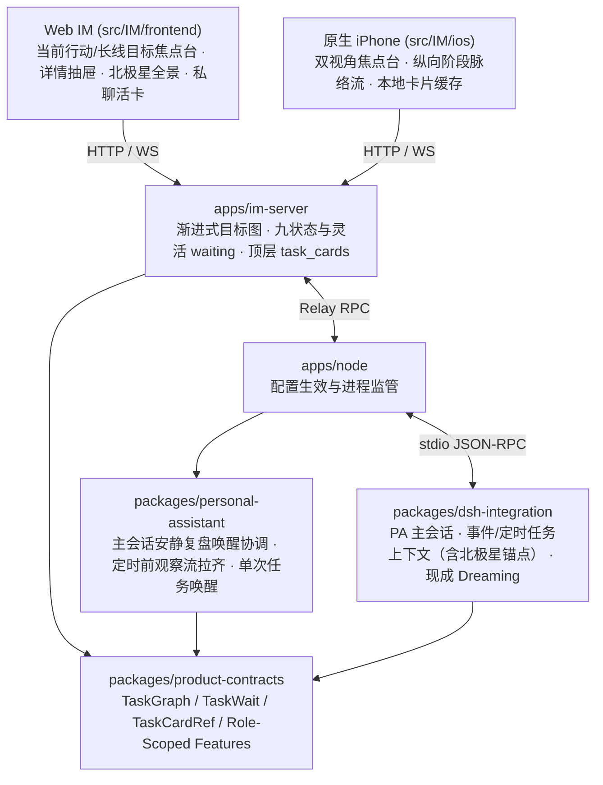
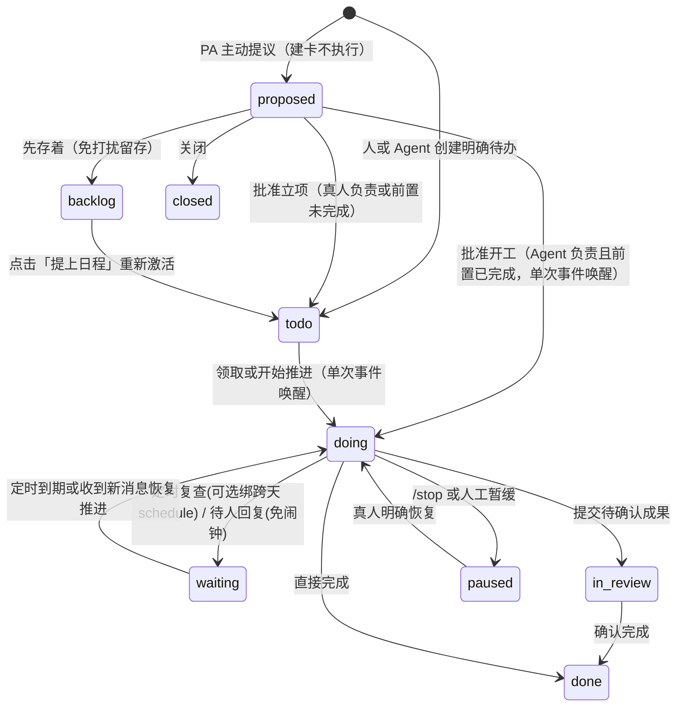
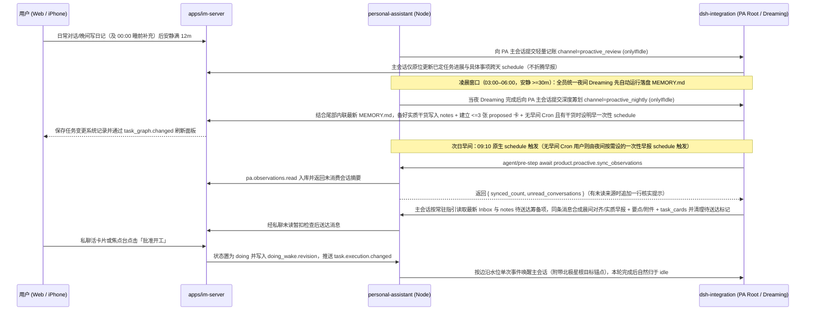

# feat-785: Personal Agent 主动性闭环与渐进式目标图 — 技术方案

> 对齐: [spec.md](spec.md)

## Changelog

## 现状分析

### 涉及范围

- **`packages/product-contracts`**：新增共享 `src/task-graphs.ts` 收敛四端重复定义的任务图节点、九状态、`TaskDoingWake` 边沿戳、按需关联定时器的灵活 `TaskWait` 与 `TaskCardRef`；更新 `src/task-execution.ts`（携带 `doing_wake` 边沿水位、北极星根目标与上级路径，移除 `repair_task_ids` / `repairs`）、`src/knowledge.ts`（将 `DEFAULT_DREAMING_SCHEDULE` 从 24h 滚动间隔升级为全员统一的本地凌晨 `nightlyHour: 3` + `quietMs: 1_800_000`，兼容显式 `intervalMs` 节点文件/测试覆盖）、`src/capabilities.ts`（角色感知的 `FeatureDependency` 与 `proactive_planning` 依赖联动）、`src/configuration.ts`（保持既有 SHA-256 指纹稳定不注入默认键）、`src/chat.ts`（顶层 `ChatMessage.task_cards` 与 `AgentPublication`）、`src/runtime-rpc.ts`（退役 `'task.wait.repair'`，新增 `runtime.timezone` 时区同步、`product.proactive.sync_observations` 请求—响应桥接，以及仅在隔离测试时钟模式下使用的 `runtime.clock.advance`）。
- **`apps/im-server`**：`src/schema.sql` 与 `src/db.ts`（`messages.task_cards_json` 启动期幂等加列）、`src/task-graphs.ts`（单卡根与一步带子图创建、九状态流转、新进 `doing`/改派/恢复写入 `doing_wake` 边沿版本戳、去掉 `waiting <= 1h` 限制并支持可选绑定跨天 `schedule` 或任意负责人无闹钟静默 `waiting`、`waitHealth` 仅对 Agent 负责且带 `schedule_id` 的节点巡检定时器、聚合查询与批量节点读取）、`src/task-notifications.ts`（补齐九种标准状态中文文案，保留 PA 私聊标准任务系统通知以利早期观察与被动 `task_context` 同步）、`src/control-routes.ts`（`GET /im/v1/task-graphs/focus`、`GET /im/v1/task-graphs/nodes`）、`src/message-records.ts`、`src/messaging.ts` 与 `src/personal-actions.ts`（顶层 `task_cards` 持久化、幂等摘要与外发审计）。
- **`packages/personal-assistant`**：`src/global-agent.ts`（所有 `system_notice?.kind === "task_graph"` 任务系统通知统一置 `attention = false, high = false` 仅走被动上下文同步，非 `task_context` 系统通知直接跳过入箱且不计入会话未读计数，杜绝私聊点「先存着/关闭/待办」误走 `Inbox` 唤醒 PA）、`src/inbox.ts` 与 `src/personal-assistant.ts`（复用私聊未读 `held_for_revalidation` 暂扣，并支持外部通道 `task_cards` 走完整 `pa.action.prepare/commit` 审计）、`src/task-execution.ts` 与 `src/schedule-deletions.ts`（按 `(agent_id, graph_id, node_id) -> last_woken_doing_revision` 边沿水位单次唤醒，退役 `scheduleDeleted` / `task.wait.repair` 修复催促循环）、新增轻量 `src/proactive-coordinator.ts`（维护 `last_activity_seq` / `last_reviewed_seq` / `last_nightly_seq` 三水位状态机并支持注入测试逻辑时钟，使用与 `dsh-integration` 完全一致的 `effectiveTimeZone = store.ownerTimezone ?? hostSystemTimeZone`：平时安静满 `12m` 提交轻量记账 `proactive_review`；凌晨窗口 `03:00–06:00` 在当天有新活动且安静满 `30m` 后提交每日一次深度筹划 `proactive_nightly`；`busy: true` 均保留水位重试，处理 `product.proactive.sync_observations` 同步请求）、随包 `assets/skills/{nano-ongoing-work,nano-proactive-care}/SKILL.md`（统一升级为英文指令：将持续事项收敛进单卡与渐进式目标图、解除 `waiting` 必绑闹钟与 `.nanoassistant/ongoing-work.md` 双账本指引，明确平时轻量记账 vs 夜间深度筹划、`<= 3` 张有界 `proposed` 立卡、分寸克制及经 `notes` 顺路交付实质早报的方法论）。
- **`packages/dsh-integration`、`apps/node` 与验收脚本**：`apps/node/src/main.ts`（启动期静态能力校验按 `definitionsForRole(Boolean(agent.personal_agent))` 角色隔离并对未显式持久化 `proactive_planning` 且存量已禁用 `task_graph` 特性/工具的旧 PA 兼容降级不崩进程；在运行时连接建立与收到 `user.timezone` 更新时调用 `runtime.timezone` 将 `store.ownerTimezone ?? hostSystemTimeZone` 同步给子进程，不写入 `canonicalAgentConfiguration` 以保持配置指纹零漂移；仅当显式设置隔离测试本地 Unix Socket `NANO_E2E_LOGICAL_CLOCK_SOCKET` 且非 `IM_PUBLIC_MODE=1` 时挂载单调逻辑时钟 IPC 控制面，不新增任何 HTTP 端口，生产环境零暴露）、`src/knowledge/{dreaming,dreaming-state}.ts`（将所有 Agent 默认自动 `Dreaming` 从 `lastSuccess + 24h` 统一升级为基于 `effectiveTimeZone` 的凌晨 `03:00` 自然日锚点 `lastCompletedCycle` + 无条件 `quiet === true` `30m` 安静门禁 + 冷根会话到期按需 `owned.resolve(sessionId, false)` 水合 + 合盖开盖补跑后锁回 `03:00` 不漂移；新建/评测与升级 `DreamingOwner` 均以 `slotKey(imported?.lastSuccessAutomatic ?? activationAt)` 初始化初始槽位，`nextAutomaticAt` 基于 `this.now()` 单调推进且仅在整轮多批 `execute()` 收口时落盘 `lastCompletedCycle`；整理提示词零改动）、`src/cron-owners.ts`（在隔离逻辑时钟模式下沿 `owner.chain` 在推进窗口临时卸载 `owner.fiber` 释放 `scheduleDomain` 独占句柄，仅通过 `@deepseek-ai/dsh-schedule` 公开导出的 `scheduleDomain` / `renderReminderFraming` / `renderRecurringReminderBatchFraming` / `resolveRecurringOccurrence` 按逻辑时钟触发到期 `schedule`、原子同步写入匹配的 `lastDelivery` 与 `deliveryHistory` 收据及状态后再重挂 `ScheduleService` 保持原生 `ToolSchedule` 可用）、`src/index.ts`（消费 `channel ∈ {"proactive_review", "proactive_nightly"}` 主会话隐藏唤醒并接入 `proactive_planning` 门禁；`proactive_nightly` 在 `dreaming` 开启且当夜 `currentSlotKey` 尚未完成、同时 `owner.failures < 3 && (owner.retryAt ?? 0) < nightWindowEndAt` 时非阻塞返回 `{ accepted: false, busy: true }` 等待标准夜间 `Dreaming` 先行落盘，失败达 3 次或 `retryAt` 越过当日 `06:00` 则直接降级放行，并在 `<proactive-nightly-wake>` 尾部内联更新后的最新 `MEMORY.md`；在 PA 主会话 `source.kind === "schedule"` 进入 `agent/pre-step` 时 `await` 请求 `product.proactive.sync_observations` 并追加轻量收件箱核实提示）、`src/message-arguments.ts`、`src/features/{task-graphs,task-graph-schema}.ts`、`src/task-execution.ts`、`src/personal-agent-defaults.ts`、`apps/node/src/configuration.ts`，以及新增 `scripts/verify_pa_proactivity_24h.py`（基于隔离真栈与逻辑时钟驱动 24 小时 5 关卡真实 LLM 验收剧本）。
- **`src/IM/frontend`**：`src/features/tasks/`（以「当前行动 / 长线目标」双视角焦点台 +「北极星全景图」替换旧五列总览，提供顶部「待你拍板 ⇄ 先存着」并列页签、「进行中」主区、底部「已完结」折叠、严格 9 状态词徽章、「? 状态说明」流转图弹窗、Crewden 胶囊范围/归属会话选择器、按阶段自适应右侧任务详情抽屉及多层子作用域钻取）、`src/features/chat/components/message-pane.tsx`（渲染顶层 `task_cards` 实时同源活卡片）、`src/features/settings/agents/agent-detail-page.tsx`（PA `BehaviorCard` 内单一「主动筹划」开关，沿用统一保存、依赖浮层与离线只读）。
- **`src/IM/ios`**：`NanoIM/Features/Tasks/`（`TasksView.swift` 升级为双视角行动焦点台、「待你拍板 ⇄ 先存着」并列切换、按阶段详情 Sheet 与纵向阶段脉络流；`TaskModels.swift` 兼容未知枚举回退）、`NanoIM/Features/Chat/{ChatModels,ChatStorageController,ChatMessageView}.swift`（本地 SQLite 缓存 `task_cards_json` 并监听任务变更实时刷新卡片）、`NanoIM/Features/Agents/{PersonalAgentManagementView,AgentConfigView}.swift`（一级页展示主动筹划当前状态跳转行，二级运行配置页承载单一开关、依赖联动与统一保存）。

### 外部项目参考溯源与第一性原理取舍

下表完整记录本设计各核心机制所参考的外部项目、源码/文档基线、对方原机制与目的，以及回到本仓第一性原理后的采纳与裁剪结论（供后续回顾与迭代对照）：

| 本仓领域 / 机制 | 参考项目与基线 | 对方原机制与解决的痛点 | 本仓第一性原理取舍（采纳什么 · 砍掉什么） |
|---|---|---|---|
| **1. 日常安静后主会话轻量记账（Track）** | **Linger** (`c8564edc`)<br/>`apps/teamhub/internal/reminder/quiet_wake.go`、`proactive/window.go` (`SourceReview`) | 实时聊天坚持 `Reply first`；房间安静后往 `AnotherMe` **自身主会话**投递隐藏唤醒，只把明确事项与事项级 `Routine` 原位更新好，无 1 小时内急事即静默结束。 | **采纳**主会话自身隐藏唤醒 `proactive_review`（100% 复用主会话上下文与 KV Cache），但**职责严格收敛为确定性事实记账**——不在白天或睡前 23:00/00:00 反复折腾早报或发散立项；**砍掉**孤立短期子会话。 |
| **2. 全员统一凌晨 `Dreaming` + PA 夜间深度筹划（Studying）** | **OpenClaw** (`concepts/dreaming.md` `0 3 * * *`) + **Linger** (`memory/scheduler.ts` 持久日历补跑) + **Meta Muse** (`Studying`) vs **Claude Code** (`autoDream.ts` 24h 滚动) | Claude Code 因 CLI 会关终端才用 24h 滚动（常驻服务照搬会导致白天高峰跑且时间漂移）；OpenClaw 统一在凌晨 `03:00` 整理；Linger 用持久自然日槽位在笔记本开盖时补跑漏夜且不漂移；Muse 睡后围绕 `Goals` 备早报。 | **所有 Agent（PA 与普通团队 Agent）统一升级 `Dreaming` 为「本地凌晨 `03:00` 锚点 + `30m` 安静门禁 + 合盖唤醒补跑且下周期锁回 `03:00`」**（整理提示词 `dreaming-prompts.ts:80-83` 零改动复用）；**PA 直接顺接在自身 `03:00` `Dreaming` 之后跑主会话 `proactive_nightly` 深度筹划**，无需 PA 特判拉起胶水。 |
| **3. 任务执行驱动与 `waiting` 语义** | **Raft** (`5214e34e` `manual/agent-knowledge/{task,reminder}.md`) + **DSH Super-agent** (`6337fc82` `docs/003-execution.md`) + **Claude Code `/goal`** | CLI `/goal` 适合分钟级单目标死磕；而 Raft（Task 与 Reminder 解耦，`idle` 不强拍）、DSH Super-agent（纯 Trigger 事件驱动，`Awaiting answer` 释放槽位零轮询）与 Linger 均不在看板 `in_progress` 上跑空闲自拍死循环。 | **采纳方案 A（事件 + 定时驱动）**：去掉实验性的「只要有 `doing` 就在 `idle` 时连拍 256 轮」及「`waiting` 必须绑 1 小时内闹钟 + 删闹钟修复催促」。任务进入 `doing` 单次唤醒推进；`waiting` 支持按需绑跨天 `schedule`（最长 180 天）或无闹钟静默等人。 |
| **4. 准备材料（参考要点/初稿）承载方式** | **Linger** (`SKILL.md:59-63`, `meetings.md`, `travel.md`) + **Raft** (`attachment.md`, `artifact.md`) vs **Meta Muse** (`1b6f9361`) | Muse 因主界面是卡片流才把草稿塞进卡片；而 IM 形态的 Linger 与 Raft 均**不在任务表加专用草稿字段**——短要点直接写在提醒消息正文里，长材料发普通文档/消息附件。 | **采纳 Linger / Raft 解耦模式，砍掉 `TaskPrepDraft`（`prep_draft`）字段与专用草稿 Sheet**：短提纲直接在聊天消息里给，长文档写工作区文件走现成 `attachments` 发送，保持任务模型纯粹。 |
| **5. 「待拍板」提议态与批准方式** | **DSH Super-agent** (`6337fc82` `docs/002-authorization.md`, `prompts/admission.md`) + **Meta Muse** (`Ideas`) | 对推断出的候选工作先建待审提案而不自动执行；人类在对话中回一句“可以做”属于**模型语义判断**（`semantic judgments, not proof supplied by the schema`），不做服务端自然语言物理验签。 | **采纳** `proposed`（待拍板）候选状态与面板/私聊活卡片一键翻牌。**砍掉**服务端 `403` 伪物理人类消息凭据拦截与 `source_message_id` 改造，靠界面点击或主会话理解主人对话意图自然流转。 |
| **6. 实质干货早报、实时同步与防马后炮** | **Meta Muse** (`Morning Drop`) + **Linger** (`SKILL.md` Step 3) + **Raft** (`task.md` 目标频道 Freshness Hold) | Muse 只推送有实质研究增量的晨间简报与 `Ideas`（拒绝报天气式机械早报）；Linger 发前先核对可变事实；Raft 发送写入仅对**目标会话自身**未读消息做暂扣。 | **只在半夜 `proactive_nightly` 统一决定明早送达**：有固定早间 Cron（如 `09:10`）则顺路合二为一递上；无固定早间 Cron **仅当夜间产出了实质干货或新 `proposed` 卡**才挂明早一次性 `schedule`（无真货零唤醒）。唤醒首步前同步拉取观察流进本地 Inbox，**砍掉**独立早报守护进程、`briefed_at`、`<proactive-focus-snapshot>` 与跨群硬拦截。 |
| **7. 渐进式目标图与双视角焦点界面** | **Linear** (`Triage` + 项目里程碑依赖图) + **Raft** (`backlog` 免催留存) | Linear 用顶层目标树锁住大方向、用候选收件区承接新项；Raft 用 `backlog` 存放“暂不排期、免催促”事项。 | **融合本仓图底座**：保留单卡零摩擦起步与原位展开 `dag`/`explore` 多层目标图；顶栏拆分「当前行动 / 长线目标」双视角，「待你拍板 ⇄ 先存着（`backlog`）」在顶部并列切换，深层子任务全程锚定顶层北极星目标。 |

### 既有约束

- **分层与依赖红线（`SPEC.md`）**：`IM` 仅依赖 `@nano/product-contracts`；`PA` 仅依赖 `product-contracts` 与 `channels`；仅 `dsh-integration` 通过公开 exports 接入 `@deepseek-ai/*`，不引入第二套 Agent Loop 或内核 HTTP 服务（由 `tests/contract/test_runtime_dependency_contract.py` 自动守卫）。
- **正式记忆单写者边界（`feat-676`）**：`<workspace>/.nanoassistant/memory/` 与 `ROLE.md` 对前台主会话保持严格只读，仅夜间 `Dreaming` 可编辑正式记忆仓并提交 Git。
- **上下文缓存前缀不变量（`verify-context-cache-prefix`）**：同一活跃 DSH 会话窗口内，`systemPrompt.section`、工具 schema 与已发送历史消息不得静默改写（`NoSilentPrefixRewrite`）；主会话的安静后复盘唤醒（`<proactive-review-wake>`）作为会话尾部新轮次输入追加，100% 复用主会话既有 KV Cache 前缀。
- **滚动升级指纹稳定**：`canonicalAgentConfiguration` 与 `agentConfigurationFingerprint` 对未显式提交新特性键的存量记录不得改变 SHA-256 指纹；第一期 `proactive_planning` 仅对 PA 生效。

### 可复用能力

- **用并升级调度 — 全员夜间 `Dreaming` 与 `DocumentMemory`（`packages/dsh-integration/src/knowledge/{dreaming,dreaming-state,dreaming-prompts,document-memory}.ts`）**：`dreaming-prompts.ts:80-83` 与 `document-memory.ts` 记忆提炼/注入逻辑保持不变，仅将 `dreaming.ts` 默认触发器从沿自 CLI 的 24h 滚动间隔统一升级为本地凌晨 `03:00` 自然日锚点 + `30m` 安静门禁 + 合盖补跑不漂移。
- **直接零改动复用 — 任务实时同步与私聊未读暂扣（`apps/im-server/src/messaging.ts:653`、`packages/dsh-integration/src/task-context.ts`、`packages/personal-assistant/src/personal-assistant.ts:235`）**：保留 PA 私聊标准任务系统通知后，面板点击与任务更新天然通过 `task_context_index` 与 `task.execution.changed` 实时同步给主会话；私聊未读消息天然触发 `held_for_revalidation`。
- **用并小改 — `apps/im-server/src/task-graphs.ts`（`schema_version: 2`）**：已支持无子节点 `mode: "none"` 原位升级为 `"dag"` 或 `"explore"`；只需放开根节点默认 `mode: "none"`、扩展 `proposed`/`backlog` 九状态与灵活 `waiting` 校验，并新增 `/im/v1/task-graphs/focus` 聚合查询。
- **用并减负 — `TaskExecution` 与 `TaskExecutionDriver`（`packages/personal-assistant/src/task-execution.ts`、`packages/dsh-integration/src/task-execution.ts`）**：去掉 `idle` 时的 256 轮强拍死循环与 `task-wait-repair`，仅在任务新进入 `doing`/改派或关联 `schedule` 到期时注入北极星根目标脉络唤醒一次。
- **用并复用 — 主会话 `onlyIfIdle` 系统唤醒通道（`packages/personal-assistant/src/heartbeat.ts:95-110`）与 `effectiveFeatures`（`packages/product-contracts/src/capabilities.ts`）**：复用 `session.submit({ onlyIfIdle: true })` 投递安静后 `proactive_review` 隐藏唤醒，复用 `effectiveFeatures` 实现零指纹漂移的 PA 默认开启。

### 相关历史

- **`feat-635` / `refactor-673` / `bugfix-678` / `refactor-679`**：建立 `task_graphs` v2、实验性 `doing` 自动续跑与 1 小时 `waiting` 校验及五列看板。本 unit 保留图拓扑、乐观锁与 `/stop` 围栏，按第一性原理将执行简化为事件 + 原生 `schedule` 驱动，并升级为双视角焦点台与北极星全景图。
- **`feat-667` / `feat-676` / `feat-774`**：确立 PA 默认服务指导、角色化文档记忆 `Dreaming` 单写者与 10 分钟观察流合并；本 unit 通过主会话安静复盘将持续跟进与候选提议收敛进渐进式目标图，并在定时唤醒前主动拉齐观察流。

## 架构总览

下图展示本 unit 脱水后的跨包模块边界与调用方向（全部遵守 `SPEC.md` 单向依赖，无新增后台子会话或冗余守护进程）：



## 关键决策

1. **原位演进 `schema_version: 2` 支持「单卡即根、一步成图、多层钻取」，不拆分多套异构任务表。**
   - **理由**：放开根节点 `mode: "none"`（`create` 默认值）并允许 `create` 可选附带初始 `operations`，独立小事与新点子零摩擦成卡；演变为长线目标时直接原位升级为 `"dag"` 或 `"explore"` 并支持多层子容器逐级嵌套钻取，存量 v2 数据 100% 兼容。

2. **扩展九状态生命周期，去掉 `/goal` 式 `doing` 256 轮空闲强拍死循环与 `waiting` 1 小时闹钟监工锁，回归「事件 + 原生 `schedule`」驱动。**
   - **理由**：
     1. 新增候选态 `proposed`（待拍板，建卡不自动执行）与留存态 `backlog`（界面呈现为「先存着」，免催促留存）；不设服务端 `403` 伪物理批准门禁，由界面翻牌或主会话理解主人对话意图自然流转（批准时若负责人为 Agent 且同层无未完成 `dag` 前置依赖则进 `"doing"`，否则进 `"todo"`）。
     2. **边沿触发单次事件唤醒 + 任务通知与收件箱唤醒彻底解耦**：节点每次新进入 `"doing"`、在 `"doing"` 下改派给该 Agent 或由真人解除暂停恢复时，服务端写入递增 `doing_wake: { revision, assignee_id, actor, at }`（离开 `"doing"` 清除）；`TaskExecution` / `TaskExecutionDriver` 按 `(agent_id, graph_id, node_id) -> last_woken_doing_revision` 持久水位仅对尚未消费的 `doing_wake` 跃迁（或因崩溃/网络中断未跑完 `turn/end` 的首次唤醒恢复）发起一次唤醒，且同会话在活跃轮内自行写入的 `-> doing` 当即记为已消费，从而保证同图其他无关卡片编辑、重连 `ensure` 或轮次刚进 `idle` 后的异步通知绝不二次重跑。同时在 `global-agent.ts` 将所有 `system_notice?.kind === "task_graph"` 消息统一设为 `attention = false, high = false`（仅入被动 `task_context_index`，不走 `Inbox` 唤醒），确保主人在私聊点任何卡片的「先存着 / 关闭 / 批准立项」都不会误唤醒 PA。
     3. **`waiting` 松绑与退役 `task.wait.repair`**：`waiting` 仅要求非空 `reason`；带 `schedule_id` 时要求 Agent 负责人并核验未来 180 天内有效原生 `schedule`；省略 `schedule_id` 时允许人或 Agent 负责，不调用 `execution.inspect` 且 `waitHealth` 不标 `invalid`，同步退役跨包 `task.wait.repair` / `scheduleDeleted` 催促链路（删除已绑定的可选 `Schedule` 仅在详情 `wait_health` 如实反映失效，不自动拍醒 Agent）。若指定有效会话真人成员 `asked_user_id`（单聊可自动补全对端真人），呈现在该用户的「待你拍板」列表中。



3. **准备材料与任务体系彻底解耦，聊天消息仅新增轻量顶层 `task_cards` 引用实现跨端同源活卡片。**
   - **理由**：不在 `TaskNode` 上增加专用 `prep_draft` 字段（参考要点直接在聊天正文给出，长文档写工作区文件通过现成 `attachments` 发送）。`ChatMessage` 新增顶层可选 `task_cards?: TaskCardRef[]`（`messages.task_cards_json` 启动期自动加列，纳入幂等摘要、PA 外发审计与 iOS 本地 SQLite 缓存；发往飞书等外部通道时自动退化追加纯文本标题摘要），使私聊气泡内可直接渲染与任务面板同源同步的翻牌卡片。

4. **全员统一凌晨 `03:00` `Dreaming` 日终记忆总结（合盖补跑不漂移），PA 主会话拆分为「平时聊完轻量记账（`proactive_review`）」与「紧随 `Dreaming` 之后的夜间深度筹划备早报（`proactive_nightly`）」，保留私聊任务系统通知作为透明日志。**
   - **理由**：
     1. **全员（PA 与所有普通团队 Agent）统一升级 `Dreaming` 为同一用户/宿主时区的凌晨自然日锚点**：`apps/node` 在连接与收到 `user.timezone` 更新时通过 `runtime.timezone` 将 `effectiveTimeZone = store.ownerTimezone ?? Intl.DateTimeFormat().resolvedOptions().timeZone` 同步至 `dsh-integration`（不进入 `canonicalAgentConfiguration`，确保 `TZ=UTC` 云主机节点也按主人真实本地时区对齐 `03:00` 且零配置指纹漂移）。在未显式配置 `knowledge.dreaming.intervalMs` 时，所有 Agent 的自动 `Dreaming` 统一按 `effectiveTimeZone` 每日 `03:00` 定义自然日周期槽位 `cycleKey`（`[D 03:00, (D+1) 03:00)` 归属槽位 `D`）；新建、评测初始化与存量升级的 `DreamingOwner`（`protocol: 2` 兼容可选字段）均以 `lastCompletedCycle ??= slotKey(imported?.lastSuccessAutomatic ?? activationAt)` 初始化（杜绝白天新建 Agent 首日下午误触发，且保持 `evaluation/runtime.ts` 中 `nextAutomaticAt` 基于 `this.now()` 单调推进）。当跨过当前槽位 `03:00` 锚点且 `lastCompletedCycle !== currentSlotKey`、无条件满足 `quiet === true`（距最近活动满 `30m`，不因工具运行间隙绕过；显式 `intervalMs` 模式保留原行为）且无前台请求时，若绑定根会话尚未在内存水合则按需 `owned.resolve(binding.sessionId, false)` 加载后执行，并在整轮多批 `execute()` 完整收口时（含 `no_eligible_increment` 零模型调用）落盘 `lastCompletedCycle = currentSlotKey`；笔记本半夜合盖错过 `03:00` 时，开盖后在同一槽位空闲安静后自动补跑一次，下一周期仍严格锁回次日 `03:00`。
     2. **PA 三水位防丢防自激状态机**：`proactive-coordinator` 在 `NodeStore` 持久化 `last_activity_seq`（含 `last_activity_at`）、`last_reviewed_seq` 与 `last_nightly_seq`（加 `last_nightly_cycle`）。仅**主人私聊真人消息**与**已准入的主人相关群观察事件**（`pa.observations.read`）推进 `last_activity_seq`；`proactive_review`、`proactive_nightly`、被动 `task_graph` 系统消息及无新真人回复的 `Schedule`/`Heartbeat`/`Dreaming` 绝不推进 `last_activity_seq`（零自激循环）。
     3. **阶段一 · 平时安静后轻量记账（`channel: "proactive_review"`）**：当 `last_activity_seq > last_reviewed_seq` 且距 `last_activity_at` 满静默窗口（默认 `12m`）时，调用 `session.submit({ ..., source: { kind: "system", channel: "proactive_review" }, onlyIfIdle: true })`（仅 `{ accepted: true }` 推进 `last_reviewed_seq`，`busy: true` 保留水位待空闲重试）。该轮采用极简记账 Prompt，**只原位更新已说定的明确任务进展与事项级 `schedule`**（白天发现 1 小时内紧急撞期可简短提醒一句，免打扰时段 `22:00–08:00` 一律静音），不查改明早早报列表、不做重度发散筹划——即使主人 23:00 聊完后 00:00 又补充两句，也只是秒级原位更新状态。
     4. **阶段二 · 紧随凌晨 `03:00` `Dreaming` 之后的主会话夜间深度筹划（`channel: "proactive_nightly"`）**：在 `effectiveTimeZone` 凌晨窗口（`03:00–06:00`，不在白天开盖时补发早报筹划），仅当 `last_activity_seq > last_nightly_seq`、当夜尚未跑过 `proactive_nightly` 且距 `last_activity_at` 已安静满 `30m` 时触发（全天无新活动零唤醒）。由于 `Dreaming` 本身在同一时区 `03:00` 锚点自动运行，`dsh-integration/src/index.ts` 在准入 `proactive_nightly` 时检查：若 `effectiveFeatures.dreaming === true` 且当夜 `currentSlotKey` 的 `Dreaming` 尚未完成，则在 `owner.failures < 3 && (owner.retryAt ?? 0) < nightWindowEndAt`（当日 `06:00`）时立即非阻塞返回 `{ accepted: false, busy: true }` 让标准夜间 `Dreaming` 先行完成；一旦 `Dreaming` 完成、或用户关闭了 `dreaming`、或当夜连续失败达 3 次 / `retryAt` 越过 `06:00`，直接放行 `proactive_nightly`（绝不整晚死等）。准入通过时，宿主读取最新 `MEMORY.md`，若较当前窗口首轮快照有更新则作为 `<updated-formal-memory>` 内联附入 `<proactive-nightly-wake>` 尾部消息（零 `read` 工具依赖且 100% 满足 `NoSilentPrefixRewrite`），主会话统揽全天对话备好次日实质要点或工作区草稿文件、收敛过时旧提议并建立 `<= 3` 张高质量 `proposed` 待拍板卡，半夜绝不调用 `send_message`。`dsh-integration` 对两类唤醒统一接入 `proactive_planning` 的 `capabilities.held`、`usage()` 忙态上报与关闭/停用即时取消链；同时**保留** PA 私聊任务变更系统提示气泡（补齐九态文案且禁触发 `Inbox` 主动唤醒）。

5. **早间实质干货触达仅在夜间筹划轮统一拍板（经固定 `notes` 跨 Compaction 持久交接），纯复用原生 `schedule` 并在唤醒首步前同步 `await` 拉齐观察流。**
   - **理由**：仅在半夜 `proactive_nightly` 结束前统一检查一次主会话原生 `schedule` 列表：若主人已有固定早间 `schedule`（如 `09:10` 晨间计划对齐），不另设闹钟，而是将待早间顺路呈递的实质要点摘要/工作区草稿路径与新立 `TaskCardRef` 同步写入跨自动 Compaction 持久保留的固定根工具 `notes`（`capabilities.ts:60`），配合 `personal-agent-defaults.ts`（`nano-personal-agent`）与 `nano-proactive-care` 常驻指引（无需用户手工修改存量 `09:10` Cron 提示词），在次日早间定时轮同条消息合成计划对齐、要点/附件与 `task_cards` 后清理该待送达 `notes` 条目；若主人未设固定早间 `schedule`，**仅当今晚确实产出了有实质信息量的干货或新 `proposed` 待拍板卡时**，创建一个明早（如 `09:00` 或按主人作息）一次性早报 `schedule` 送达（无实质干货零闹钟、零唤醒）。每当 PA 主会话进入 `source.kind === "schedule"` 的 `agent/pre-step`（以及节点侧 `heartbeat` 唤醒前），`dsh-integration` 先 **`await` 请求—响应 RPC `product.proactive.sync_observations`**（带 5s 超时与离线降级），由节点完成 `recoverPersonalObservations()` 入库并返回当前 `InboxStore` 未消费会话摘要；若存在未读观察/私聊来源（含 `attention=0` 群观察记录），向本轮 `schedule` 输入尾部追加一行轻量核实提示（配合私聊自身 `held_for_revalidation` 暂扣），彻底消除先开跑后入库竞态与马后炮催问。

6. **角色感知的 `proactive_planning` Feature 定义，零存储指纹漂移且统一双端配置页保存与依赖模型。**
   - **理由**：`canonicalAgentConfiguration` 不注入默认布尔键，滚动升级期间存量配置 SHA-256 指纹不变；`FeatureDependency` 增加 `roles: ['personal']`，通过 `definitionsForRole(isPersonal)` 使普通团队 Agent 完全不暴露、不默认开启也不受 `proactive_planning` 依赖约束。Web（`AgentDetailPage` `BehaviorCard`）与 iOS（二级 `AgentConfigView` `运行特性` + 一级 `PersonalAgentManagementView` 只读状态跳转行）统一走乐观锁保存与离线只读锁。

## 接口与数据流

### 1. 共享契约与数据模型（`packages/product-contracts`）

新增 `packages/product-contracts/src/task-graphs.ts` 并更新 `task-execution.ts`、`capabilities.ts`、`chat.ts`、`runtime-rpc.ts`：

```ts
export type TaskMode = "none" | "dag" | "explore";

export type TaskStatus =
  | "proposed"
  | "todo"
  | "doing"
  | "waiting"
  | "in_review"
  | "done"
  | "paused"
  | "backlog"
  | "closed";

export interface TaskProposalMeta {
  rationale: string;
  on_approve: string;
  proposed_for_user_id?: string | null;
}

export interface TaskWait {
  reason: string;
  schedule_id?: string | null;
  owner_agent_id?: string | null;
  session_id?: string | null;
  next_check_at?: string | null; // 提供 schedule_id 时核验 > now 且 <= now + 180d
  question?: string | null;
  asked_user_id?: string | null; // 待指定真人答复/拍板时填写（单聊可自动补全对端真人）
}

export interface TaskDoingWake {
  revision: number;
  assignee_id: string | null;
  actor: { type: "user" | "agent"; id: string };
  at: string;
}

export interface TaskCardRef {
  graph_id: string;
  node_id: string;
}
```

- **`TaskResponsibility` 扩展与运行时 RPC（`task-execution.ts` & `runtime-rpc.ts`）**：`TaskResponsibility` 增加 `doing_wake?: TaskDoingWake | null`、`root_node_id: string`、`root_title: string`、`root_goal_summary: string`（`<= 400` 字符）与 `parent_path: { id: string; title: string; mode: TaskMode }[]`，移除 `repair_task_ids`、`repairs` 及 `runtime-rpc.ts` 的 `'task.wait.repair'`；新增反向请求—响应桥接 `product.proactive.sync_observations({ sessionId, agentId, ownerId }) -> { synced_count: number; unread_conversations: { conversation_id: string; title: string; count: number }[] }`。
- **角色感知 Feature 定义与存量升级兼容（`capabilities.ts`）**：`FeatureDependency` 增加可选 `roles?: ('root' | 'personal')[]`；`proactive_planning` 声明 `roles: ['personal'], default_on: true, requires: { features: ['task_graph'], tools: ['task_graph'], skills: [] }`；导出 `definitionsForRole(isPersonal: boolean)` 并在 `validateCapabilities(draft, catalog)` 缺省 `catalog.features` 时按 `Boolean(draft.personal_agent)` 自动限定角色定义集（保持普通 Agent 零污染）。对未显式写入 `proactive_planning` 键但升级前已显式关闭 `task_graph: false`（或 `tool_allowlist` 排除 `task_graph`）的存量 PA 配置，有效特性解析自动将缺省 `proactive_planning` 降级视为 `false`（且 `apps/node/src/main.ts` 启动校验同 `dreaming` 一致兼容放行未显式声明的新特性），防止滚动升级启动报错。
- **顶层消息字段（`chat.ts`）**：`ChatMessage` 与 `AgentPublication` 增加顶层可选 `task_cards?: TaskCardRef[]`（最多 5 项），纳入 `publicationBody` 排序 JSON 哈希。

### 2. IM 服务端接口、数据库与规则（`apps/im-server`）

- **`messages` 表兼容加列与九态通知文案（`src/schema.sql`、`src/db.ts` & `src/task-notifications.ts`）**：`ensureColumn(db, "messages", "task_cards_json", "TEXT")`；发帖时校验每项 `(graph_id, node_id)` 存在且发送者具备该图所属会话读权限；`task-notifications.ts` 补齐 `{ proposed: "待拍板", todo: "待办", doing: "推进中", waiting: "等待中", in_review: "提交待确认", done: "已完成", paused: "已暂缓", backlog: "先存着", closed: "已关闭" }` 九态文案映射。
- **`POST /im/v1/task-graphs` 与 `POST /im/v1/task-graphs/:graph_id/apply`**：
  - `create` 默认 `mode: "none"`，可选携带初始 `operations` 单事务建图；支持无子节点 `mode: "none"` 原位升级为 `"dag" | "explore"`，保留最多 8 层子容器嵌套；限制单会话未完结 `proposed` 节点上限（如 `<= 15`）防失控堆积。
  - **状态流转与 `doing_wake` 边沿戳**：对 `proposed` 执行批准动作时，若节点 `assignee?.type === "agent"` 且同层无未完成 `dag` 前置依赖则落地为 `"doing"`，否则落地为 `"todo"`。凡节点新进入 `"doing"`、在 `"doing"` 下改派负责人或由真人解除暂停恢复，原子写入 `n.doing_wake = { revision: doc.revision, assignee_id: n.assignee?.type === "agent" ? n.assignee.id : null, actor: identity, at: now }`（离开 `"doing"` 时删除 `doing_wake`）。
  - **灵活 `waiting` 校验与 `waitHealth`**：`prepareWaits` / `executeTransaction` 校验非空 `reason`；若携带 `schedule_id`，要求 `assignee?.type === "agent"` 并经 `execution.inspect` 核验该原生 Schedule 归属当前负责人与根会话且 `now < next_check_at <= now + 180d`；若不携带 `schedule_id`（静默等待真人回复或外部事件），允许人、Agent 或未指派节点直接保存，当填写 `asked_user_id` 时校验其属于 `doc.conversation_id` 有效真人成员（单聊含 `question` 且省略 `asked_user_id` 时自动补全对端真人 ID）。读取详情的 `waitHealth` 仅对 `assignee?.type === "agent" && Boolean(wait?.schedule_id)` 的节点巡检原生定时器，无 `schedule_id` 的静默等待不调用 `inspect` 且不标 `invalid`/`unknown`。
- **`GET /im/v1/task-graphs/focus`、`GET /im/v1/task-graphs/nodes` 与 `GET /im/v1/task-graphs`**：
  - `focus` 返回「与我有关」四组核心列表（每组默认返回前 30 条并附 `next_cursor` 增量加载，支撑顶部「待你拍板 ⇄ 先存着」与「当前行动 ⇄ 长线目标」瞬时切换）：
    - `needs_you`：本人 PA 私聊中的 `proposed` 节点、团队会话中 `proposed_for_user_id === user.id` 的 `proposed` 节点、`status === "waiting" && wait.asked_user_id === user.id` 的待答复节点、以及本人创建或父节点归属本人的 `in_review` 节点；
    - `stashed`：本人 PA 私聊或团队中直接归属本人的 `backlog | paused` 节点；
    - `active`：本人 PA 私聊活跃单卡/叶子事项，及团队会话中直接分配给本人或本人速记未指派的 `doing | waiting | todo` 活跃节点；
    - `goals`：本人 PA 私聊或团队中本人发起/直接负责根节点的未完结多节点目标图概览；
    - `completed`：`done | closed` 归档区与 `completed_count` 计数，展开底部「查看已完结记录」时通过 `GET /im/v1/task-graphs/focus?section=completed` 按相同 `scope` 与全层级规则分页读取。
  - `nodes` 支持客户端按 `TaskCardRef[]` 批量拉取消息内嵌卡片的最新节点摘要（严格按所属会话读权限过滤）。

### 3. 24 小时主动闭环跨模块时序



### 4. Agent Context 设计与缓存前缀保护

- **受影响 Consumers 与生命周期**：
  1. **PA / Global 前台主会话（Root Session）**：
     - **稳定前缀层**：`systemPrompt.section`（`nano-personal-agent`、`nano-task-graphs`）仅含静态规则（其中 `nano-personal-agent` 包含早间定时问候/计划对齐轮自动消费固定工具 `notes` 中夜间待送达筹备项并附带 `task_cards` 的静态指引，存量早间 Cron 无需手工改写提示词）；窗口内联 `MEMORY.md` 与 `ROLE.md` 保持窗口首轮快照不变，严格满足 `NoSilentPrefixRewrite`（`Dreaming` 夜间更新 `.nanoassistant/memory/MEMORY.md` 后，由宿主在组装 `<proactive-nightly-wake>` 尾部消息时直接内联变更后的最新 `MEMORY.md` 正文，不依赖可选 `read` 工具且不重写系统提示词前缀）。
     - **两类尾部追加隐藏唤醒层（`<proactive-review-wake>` 与 `<proactive-nightly-wake>`）及 `notes` 跨换窗交接**：均作为隐藏运行时消息追加到主会话尾部，100% 命中主会话既有 KV Cache 前缀；夜间筹备好的早间待送达摘要与 `TaskCardRef` 同步写入跨 Compaction 持久保留的固定工具 `notes`，防止自动换窗丢失精确卡片引用与文件路径。
  2. **任务事件与定时复查唤醒消费者（`TaskExecutionDriver`）**：
     - 移除 `idle` 无条件自拍醒循环后，仅当存在新进入/新分配的 `doing` 责任或匹配的 `schedule` 检查触发时追加 `task-execution` / `task-reminder` 消息，每项携带 `root_node_id`、`root_title`、`root_goal_summary` 与 `parent_path`。
  3. **PA `Dreaming` 会话**：**无变更（no context change）**，完全沿用现成轨迹提炼与记忆整合输入。

- **模型可见输入 Before / After 对照**：
  - **场景 A：深层子任务事件唤醒或定时复查（`TaskExecutionDriver`）**
    - *Before*：`{"tasks":[{"graph_id":"tg_nano","node_id":"n4","title":"整理首批 10 人邀请文案","status":"doing","conversation_id":"c_pa","relative_url":"/tasks/tg_nano?node=n4"}]}`（且每轮 `idle` 重复注入最多 256 次）
    - *After*：`{"tasks":[{"graph_id":"tg_nano","node_id":"n4","title":"整理首批 10 人邀请文案","status":"doing","root_node_id":"n1","root_title":"把 Nano 打磨成熟并推出去","root_goal_summary":"跑顺主动操心但不越权打扰的闭环，录出 3 分钟真实演示并拿给首批 10 位同路人试用。","parent_path":[{"id":"n1","title":"把 Nano 打磨成熟并推出去","mode":"dag"},{"id":"n3","title":"演示发布阶段","mode":"dag"}],"conversation_id":"c_pa","relative_url":"/tasks/tg_nano?node=n4"}]}`（仅在进入 `doing` 或定时复查时单次唤醒，轮次结束自然 `idle`）
  - **场景 B：平时对话安静后主会话轻量记账块（`<proactive-review-wake>`）**
    ```xml
    <proactive-review-wake local_time="2026-11-25T15:18:00+08:00" quiet_minutes="12" quiet_hours="false">
    guidance: 对话已安静（轻量记账轮）。请仅将上文新增对话/观察中已经明确的事项、进展或自带时间节点的提醒原位更新至私人 task_graph 与原生 schedule；不要在此轮做重度发散筹划或安排明早早报。若 quiet_hours="false" 且发现约 1 小时内即将撞期的紧急事项，可简短提醒一句；否则请勿调用 send_message，直接静默结束本轮。
    </proactive-review-wake>
    ```
  - **场景 C：半夜睡熟后主会话深度筹划与早报准备块（`<proactive-nightly-wake>`）**
    ```xml
    <proactive-nightly-wake local_time="2026-11-26T03:12:00+08:00" quiet_minutes="67" quiet_hours="true">
    <updated-formal-memory>
    ...（若当夜 Dreaming 更新了 MEMORY.md，此处由宿主直接附入最新 MEMORY.md 正文，含最新免提议边界）...
    </updated-formal-memory>
    guidance: 夜间深度筹划轮（每日一次，主人已休息）。1) 严格遵守最新 MEMORY.md 中的沟通分寸与免提议边界；2) 统揽今天的新增对话（含晚间日记与睡前补充）和未完结目标图，围绕北极星长线目标做必要的零副作用查证，为明天要推进的目标梳理有实质信息量的候选要点（长材料可写入工作区文件供明早附带），先关闭已解决/过时的旧提议，再对值得拍板的新构想或前沿下一步建立有界 status="proposed" 待拍板卡（<=3 张）；3) 检查主会话 schedule 列表：若主人已有早间固定定时任务则不另设闹钟，将待早间顺路呈递的要点摘要/文件路径与 TaskCardRef 记入 notes 供明早定时轮合一送达；若无早间定时任务，仅当本轮产出了有实质信息量的准备干货或新 proposed 卡时创建一个明早（如 09:00 或按主人作息）一次性 schedule，无实质新干货绝不设闹钟。当前处于夜间免打扰时段，请勿调用 send_message，直接结束本轮。
    </proactive-nightly-wake>
    ```

### 5. 隔离 E2E 统一逻辑时钟控制与 24 小时真实模型场景验收

主动性闭环的核心成败取决于真实 LLM 在主会话上下文、两类隐藏唤醒 Prompt 与随包 `nano-ongoing-work` / `nano-proactive-care` Skill 协同下的语义判断与克制分寸。若验收时靠把 `12m`/`30m` 静默窗口或凌晨 `03:00` 锚点硬改成几秒钟，既会扭曲作息时段语义，又无法验证跨天 `schedule` 与夜间 `Dreaming -> proactive_nightly -> 09:10 早间触达` 的真实先后关系。为此本方案设计隔离测试专用的统一逻辑时钟推进通道与 5 关卡真实模型验收脚本：

- **A. 仅限隔离 E2E 启用的统一逻辑时钟推进控制（`NANO_E2E_LOGICAL_CLOCK_SOCKET`）**：
  1. **严守架构红线与生产零暴露**：沿用 `packages/dsh-integration/src/evaluation/runtime.ts:81` 的本地 Unix Domain Socket（`node:net` + `RpcPeer`，文件权限 `0600`）模式，仅当 `apps/node` 启动环境显式提供本地路径 `NANO_E2E_LOGICAL_CLOCK_SOCKET`（如 `$WT_ROOT/.e2e-clock.sock`）且 `IM_PUBLIC_MODE !== "1"` 时挂载控制监听；**不新增任何内核或节点 HTTP 服务端口**，生产与常规运行未设置该环境变量时完全走原生 `Date.now()` 与系统定时器，零额外分支开销。
  2. **跨进程单调前推协议（`logicalNow >= Date.now()`）**：测试初始化时将起始逻辑时间锚定在 `T0 >= Date.now()`（如当天或次日即将到来的本地 `23:00`），且 `clock.advance({ targetIso, settle })` 仅允许单调前推（拒绝 `targetMs < logicalNow`）。由于未来待触发时间点始终满足 `scheduledAt > logicalNow >= Date.now()`，`apps/im-server` 的 `now < next_check_at <= now + 180d` 校验零特判自然通过。`apps/node` 在子进程 `initialize` 握手时传入可选 `initialLogicalNowMs`，使 `dsh-integration` 在任何 `DreamingOwner` 初始化前调用现成 `dreaming.useClock(() => logicalNow)`（满足 `dreaming.ts:94` 前置顺序约束），并在每次 `runtime.clock.advance({ nowMs })` 时按时间序协同推进三处状态：
     - **`CronOwners`（纯公开 `@deepseek-ai/dsh-schedule` 导出接口驱动）**：通过 `features/cron.ts` 的 `tools/execute` 拦截在逻辑时钟模式下将模型相对 `after_seconds` 请求折算为基于 `logicalNow` 的 `at` 时间戳，并在新建/更新周期任务若受真实 `Date.now()` 影响使 `scheduledAt <= logicalNow` 时，沿 `owner.chain` 临时卸载 `owner.fiber`（释放 `ScheduleService` 持有的 `scheduleDomain` 独占句柄）用公开 `resolveRecurringOccurrence(record, logicalNow)` 对齐下一触发点后重挂服务；推进至 `nowMs` 时同样沿 `owner.chain` 临时卸载 `owner.fiber` 打开 `scheduleDomain`，扫描 `status === "active" && Date.parse(record.scheduledAt) <= nowMs` 的到期任务（同会话多条到期周期任务按原生规则合并为单条 `renderRecurringReminderBatchFraming`，一次性任务走 `renderReminderFraming`），向绑定根会话投递真实 `source: { kind: "schedule" }` 消息（完整触发生产路径的 `agent/pre-step` `sync_observations` 与 `TaskExecutionDriver` `task-reminder`），同时构造收据 `receipt = { scheduledAt, deliveredAt: new Date(nowMs).toISOString(), messageId: message.id }` **原子同步写入 `lastDelivery: receipt` 与 `deliveryHistory.records` 末尾**（严格满足 `scheduleDomain` Zod `.strict().refine()` 的首尾收据相等不变量），将一次性任务置为 `inactive`、周期任务推进至 `nextScheduledAt`（`> nowMs >= Date.now()`）后关闭域并重新挂载 `ScheduleService`（保证唤醒轮内原生 `schedule_*` 工具完全可用且真实 wall-clock 定时器不会抢跑未来逻辑任务）；`schedule.wait.inspect` 与 `<proactive-*-wake local_time>` 统一读取 `clockNow()`。
     - **`Dreaming`**：对各分区 Agent 执行 `await dreaming.tick(agentId, nowMs)` 与 `await dreaming.whenIdle(agentId)`。
     - **`proactive-coordinator` 与 `Heartbeat`**：共用同一 `() => logicalNow` 时钟源（停用后台轮询 `setInterval`，真人私聊与已准入群观察到达时记录 `last_activity_at = logicalNow`），在 `Dreaming` 收口后执行 `proactive-coordinator.tick(nowMs)`；当 `settle: true` 时等待 PA 根会话、活跃子 Agent、`Dreaming` 与持久层 `flush` 全部归于 `idle` 后再返回。

- **B. 可重复执行的 5 关卡 24 小时真实 LLM 场景验收脚本（`scripts/verify_pa_proactivity_24h.py`）**：
  在 `./scripts/e2e-up.sh --profile daily` 隔离真栈上启动真实模型，全程使用**不夹带任何工具名、状态枚举词或操作提示**的自然真人对话（日期按 `T0` 所在日历动态生成），结合 IM HTTP 接口、工作区产物与 `$nano_llm_logs/session/` 完整请求/响应日志逐关断言「正向主动价值」与「负向克制边界」：
  1. **关卡 1 · 晚间日记与零点改期仅做原位轻量记账**：在逻辑时间 `23:00` 发送混杂「明确近期目标（后天下午前录出 3 分钟 Demo）+ 家庭边界表态（家里老人身体和沟通的事记个背景就行，以后别主动立任务卡或出主意）+ 随口新构想（自媒体多平台 Bot）」的日记 → 推进至 `23:15`（触发 `proactive_review`），断言仅更新明确 Demo 事项及对应跨天 `schedule`、**`proposed` 卡数为 0、新外发聊天消息为 0**；再推进至 `00:05` 发送口头改期（“Demo 改大后天下午前吧”）→ 推进至 `00:20`，断言原位更新既有节点/`schedule`、**无重复建卡且无外发消息**。
  2. **关卡 2 · 凌晨 `03:00` `Dreaming` 沉淀分寸 → `proactive_nightly` 当夜守界备干货**：推进至 `03:05` 触发夜间 `Dreaming`，断言 `.nanoassistant/memory/MEMORY.md` 已写入家庭事务免立卡边界；继续推进至 `03:15` 触发 `proactive_nightly`，核验 `llm_logs` 尾部消息含 `<updated-formal-memory>`，断言仅围绕自媒体 Bot 或 Demo 前沿下一步建立 `1–3` 张写明 `rationale` 与 `on_approve` 的 `proposed` 卡、**家庭事务相关任务卡严格为 0、夜间外发聊天消息严格为 0**，且固定工具 `notes` 已记录早间待顺路呈递的实质要点/草稿引用与 `TaskCardRef`。
  3. **关卡 3 · 早间顺路合一触达与无干货空转夜零唤醒对照**：①存在 `09:10` 晨间计划对齐 Cron 时推进至 `09:10`，断言仅发出**单条**合并消息（既包含具体 Demo 候选镜头实质干货与顶层 `task_cards` 活卡片，又开放询问主人今日计划而不越权代定日程）且清理待送达 `notes`；②对照测试：在无固定早间 Cron 且整日仅有普通寒暄无新目标/新构想的夜晚，**分步停靠**推进至 `23:15`（`proactive_review`）→ `03:05`（`Dreaming`）→ `03:15`（经 `llm_logs` 断言 `proactive_nightly` **已实际运行完成一轮**，且面对纯日常寒暄自主保持 `0` 张新 `proposed` 卡与 `0` 个一次性早报 `schedule`，防止单步跳过凌晨窗口造成假阳性）→ `09:30`（断言早间 `0` 唤醒、`0` 条空洞早报）。
  4. **关卡 4 · 定时唤醒首步前同步观察流消除马后炮**：在已获准观察的团队群由主人账号发出“Demo 三个镜头我刚拍板并录完初版了”，未满 10 分钟合并窗口即推进逻辑时钟触发关联跟进 `schedule`，核验 `llm_logs` 在模型首步前完成 `product.proactive.sync_observations` 并读取最新群观察消息，PA 静默更新/收口对应事项，**不发送过时催问**。
  5. **关卡 5 · 翻牌单次事件开工、北极星锚定与轮次结束自然 `idle`**：对 `proposed` 卡点击批准开工（`-> doing`），核验 `llm_logs` 触发单次 `task-execution` 唤醒且上下文携带顶层北极星 `root_title` 与 `root_goal_summary`，模型产出紧扣顶层目标，轮次完成后根会话保持 `idle`（零重复自拍醒空转）。

## 前端原型

- **要通过原型判断的设计决定**：
  1. 替换旧五列看板后，顶栏「当前行动 / 长线目标」双视角切换、「待你拍板 ⇄ 先存着」顶部并列页签、「进行中」主区、统一 9 状态词徽章与「? 状态说明」流转图解、Crewden 胶囊浮层控件及按阶段自适应的任务详情抽屉是否清晰低摩擦；
  2. 长线目标内页在桌面（阶段/探索脉络流 + 多层子脉络钻取入口 + 右侧同屏任务详情）与手机/iPhone（置顶终局目标 + 可展开前序阶段 + 支持添加/编辑子节点的纵向阶段脊柱流）的自然呈现，以及「无前置单卡批准直入推进中 vs 前置未完新芽批准进入待办」的准确反馈；
  3. PA 私聊保留透明任务系统提示、自然发送准备要点并内嵌顶层 `task_cards` 活卡片双向同步，以及双端 PA「主动筹划」开关与统一保存/依赖联动/离线只读的一致体验。
- **原型文件**：[prototype.html](prototype.html)（走查记录见 [evidence/prototype-walkthrough.md](evidence/prototype-walkthrough.md)）
- **用户目标与体验方案**：
  - **全局任务入口（`/tasks` · iOS `任务` Tab）**：
    - **顶栏双视角与轻快筛选**：主标题旁设「当前行动 / 长线目标」胶囊分段切换，右侧配柔和胶囊下拉（`与我有关` 默认 / `按负责人` / `团队全部`）、带图标搜索胶囊与「`? 状态说明`」入口；下方圆润速记栏内嵌暖色/薄荷胶囊归属会话选择器，回车即记单卡，右侧保留「拆多步目标」入口。
    - **「当前行动」三区布局**：①顶部将 **「待你拍板」** 与 **「先存着」**（`backlog` / `paused`）并列页签切换，支持一键 **「↑ 提上日程」**、**「展开成目标图」** 与 **「关闭」**；②中间 **「进行中」** 聚焦当前活跃事项（子任务带可点击所属目标胶囊）；③底部折叠「查看已完结记录」。切换至「长线目标」视角时，每张目标卡明确展示自身标准状态框、阶段进度条与横向阶段概览条。
    - **统一 9 状态框与按阶段详情抽屉**：所有彩色 `.badge` 严格只显示 9 个标准状态词，等待原因、下次复查时间与负责人置于徽章右侧；点击任意任务卡片滑出右侧详情抽屉（手机端底部 Sheet），按状态自适应呈现「为什么提议 & 批准后怎么做」「当前等待原因」「背景与具体要求」「当前进展与阶段结果」及「前后置阶段」。
  - **北极星全景图（`/tasks/:graphId` · iOS `TaskGraphView`）**：顶部常驻终局目标栏与多层面包屑；含子容器的阶段节点提供「进入子脉络」钻取；前沿 `proposed` 新芽提供「批准立项 / 批准开工 / 先存着 / 关闭」动作；iPhone 端采用可展开前序阶段的纵向阶段脊柱流。
  - **PA 设置页**：Web 在 `AgentDetailPage` 行为设置区、iOS 在二级 `AgentConfigView` 运行特性区承载单一「主动筹划」开关（共用统一「保存」、`task_graph` 依赖轻提示与节点离线只读锁），iOS 一级 `PersonalAgentManagementView` 提供显示当前开关状态的快捷跳转行。
- **交互边界**：支持真实切换「当前行动 / 长线目标」、切换「待你拍板 ⇄ 先存着」并一键提上日程、打开「? 状态说明」流转图、点击任意卡片滑出按阶段详情抽屉、切换范围与归属会话、区分独立单卡批准（进 `doing`）与前置未完新芽批准（进 `todo`）；顶部 `.demo-chrome` 仅作演示控制。

### 现有 UX grounding

| 当前产品入口 | 画面与操作基线 | 沿用或改善的体验及原因 | 本次设计 |
|---|---|---|---|
| Web `/tasks` 总览（`task-progress.tsx:81-105`） | 五列根看板 + 原生下拉框 + 弹窗必选 `dag`/`explore` 及固定详情字段 | **沿用**：归属会话选择、搜索、按负责人筛选与分批加载。**改善**：拆开「当前行动 / 长线目标」视角，把「先存着」提到顶部与「待拍板」并列，统一 9 状态徽章并提供按阶段详情抽屉 | 顶栏双视角焦点台 + 「待你拍板 ⇄ 先存着」并列 + 「进行中」主区 + 「? 状态说明」图解 + 右侧按阶段详情抽屉 |
| Web `/tasks/:graphId` 与 iOS `TaskGraphView`（`task-graphs-page.tsx:34-122`、`TasksView.swift:310-430`） | 多层面包屑钻取、节点编辑与 409 冲突合并已完备，但手机二维画布需缩放平移 | **沿用**：多层 `scope` 钻取、节点详情/编辑、`+ 子节点` 与冲突保护。**改善**：锁定终局目标，手机改为可展开前序的纵向阶段脊柱流 | 桌面阶段/探索流 + 右侧常驻详情；手机纵向阶段脊柱流（支持展开前序、钻取子脉络、添加与编辑节点） |
| Web / iOS PA 私聊消息流（`chat/components/message-pane.tsx:2218`、`ChatMessageView.swift:27`） | 顶层消息字段渲染、文件附件预览与系统通知已成熟 | **沿用**：顶层消息字段、任务变更系统提示气泡与现成文件附件。**改善**：新增 `task_cards` 绑定真实任务节点实现气泡内直接翻牌 | 气泡内嵌同源活任务卡，监听 `task_graph.changed` 双端实时刷新 |
| Web `AgentDetailPage` 与 iOS `PersonalAgentManagementView` + `AgentConfigView` | Web 与 iOS `AgentConfigView` 共用 `AgentConfig` 乐观锁保存、依赖联动与 `ready` 离线只读 | **沿用**：统一保存按钮、Feature 依赖联动浮层与节点离线只读锁。**改善**：iOS 一级页加状态跳转行直达二级页单一开关 | Web `BehaviorCard` 与 iOS `AgentConfigView` 承载单一「主动筹划」开关并走统一保存；iOS 一级页展示当前状态入口行 |

### 原型对齐契约

| 原型区域 / 状态 | 对齐级别 | 产品入口 | 必验 viewport / 状态 | 下游验收投影 |
|---|---|---|---|---|
| 行动焦点台（「当前行动 / 长线目标」双视角、「待你拍板 ⇄ 先存着」顶部并列页签与「提上日程」、「进行中」主区、底部「已完结」折叠、统一 9 状态框、「? 状态说明」弹窗、按阶段右侧详情抽屉/底部 Sheet、Crewden 胶囊控件与零待审安静态） | `must-match` | Web `/tasks`、iOS `任务` Tab | Web `1280` + `390`，iOS `390` | M1 `[reviewer]` ①②；M1 `[worker]` 原型截图对照 |
| 北极星全景图（桌面阶段/探索流 + 子脉络钻取 + 右侧同屏任务详情；前沿新芽含批准/先存着/关闭且区分前置未完进 `todo`） | `must-match` | Web `/tasks/:graphId` | Web `1280` | M1 `[reviewer]` ③；M1 `[worker]` 原型截图对照 |
| 手机窄屏与原生 iPhone 纵向阶段脉络流（置顶终局目标、前序可展开、支持子脉络钻取与添加/编辑节点、无强制二维缩放画布） | `must-match` | Web `/tasks/:graphId`（窄屏）、iOS `TaskGraphView` | Web `390`、iOS `390` | M1 `[reviewer]` ③；M1 `[worker]` Web 窄屏与 iOS Simulator 截图对照 |
| PA 私聊顶层 `task_cards` 同源活任务卡片与任务系统变更记录共存 | `must-match`（Web）/ `may-adapt`（iOS 原生卡片容器） | Web `/chat/:paConvId`、iOS `ConversationView` | Web `1280` + `390`，iOS `390` | M1 `[reviewer]` ④⑤；M1 `[worker]` 双端实测证据 |
| PA「主动筹划」开关、统一保存与依赖联动及所属电脑离线只读态（iOS 一级状态入口 → 二级运行特性单开关） | `must-match`（语义、后果说明、无隐藏依赖死锁与离线只读）/ `may-adapt`（iOS `Form` 原生样式） | Web `/settings/agents/:paId`、iOS `PersonalAgentManagementView` → `AgentConfigView` | Web `1280`、iOS `390` | M1 `[reviewer]` ⑥；M1 `[worker]` 离线/在线与依赖测试 |
| 顶部深色 `.demo-chrome` 演示栏 | `out-of-scope` | — | — | 仅用于静态原型浏览，真实产品不渲染 |

### 原型走查

- **实际渲染与走查范围**：已通过本机 headless Chrome 渲染并目视核查全部 13 个状态（桌面 `1280` 8 张、窄屏 Web 与 iOS `390` 5 张），完整走查与多轮修正记录见 [evidence/prototype-walkthrough.md](evidence/prototype-walkthrough.md)。
- **体验判断与修正摘要**：结合独立审查与用户多轮对齐，已完成：①顶栏拆分「当前行动 / 长线目标」双视角；②「先存着」上移与「待你拍板」顶部并列切换，主区精简为「进行中」，页底仅收折「已完结」；③统一全站彩色徽章严格固定 9 个状态词并补齐单行直排的「? 状态说明」弹窗；④原生下拉升级为 Crewden 胶囊浮层选择器与圆润速记栏；⑤补齐按阶段自适应任务详情抽屉，并按第一性原理移除与任务模型耦合的 `prep_draft` 字段与 `ios-draft` Sheet。
- **未验证项**：真实 LLM 复盘质量、并发 409 逐字段冲突合并与 iOS 真机动态字号/深色模式在 M1 实施与真栈验收中实测。

## 本次审查安排

| 必须回答的问题 / 对应目标 | 能力与使用阶段 | 证据方法、范围与已有定位 |
|---|---|---|
| 跨包边界、九状态流转、事件单次唤醒 `doing`（移除 256 轮强拍循环）、按需跨天/无闹钟 `waiting`、主会话 `proactive_review` 轻量记账与 `proactive_nightly` 夜间深度筹划、定时前观察流同步及配置指纹零漂移是否正确，delta-spec 是否与实现一致 | `change-code-review`（阶段 4 独立代码与契约审查） | 审查完整 unit diff、6 份 delta-spec、窄测试与 `tests/contract/test_runtime_dependency_contract.py` |
| PA 主会话（含 `<proactive-review-wake>` 与 `<proactive-nightly-wake>` 尾部隐藏唤醒）与任务事件/定时唤醒（含北极星根目标脉络）的实际模型输入是否语义清晰且满足缓存前缀不变量 | `agent-context-review` + `verify-context-cache-prefix`（设计期 + 实施后独立审查） | 运行 `.agents/skills/verify-context-cache-prefix/check.py` 与 wire replay 测试；从隔离真栈 `llm_logs` 核查主会话与任务唤醒真实请求正文 |
| 双视角焦点台（含「待你拍板 ⇄ 先存着」、统一 9 状态框、「? 状态说明」与按阶段详情抽屉）、北极星全景图、私聊同源活卡片与 PA 主动开关是否自明协调 | `frontend-experience-review`（设计期原型走查 + 实施后独立体验审查） | 对照 [prototype.html](prototype.html) 与真实隔离栈 Web（`1280` / `390`）及 iOS Simulator 连续操作截图/录屏 |
| 真实用户与真实模型能否跑通「单卡到多层长线图 → 聊完轻量记账 → 半夜全员统一 Dreaming 分寸沉淀 + 主会话夜间深度筹划立卡备早报 → 原生 schedule 早间实质触达（及无干货零唤醒对照）与唤醒前观察流同步 → 双端翻牌单次事件开工」完整闭环 | `product-journey-review`（阶段 4 真实产品入口连续旅程验收） | 基于 `./scripts/e2e-up.sh --profile daily` 隔离真栈 + `NANO_E2E_LOGICAL_CLOCK_SOCKET` 驱动 `scripts/verify_pa_proactivity_24h.py` 5 关卡真实 LLM 24 小时闭环验收，并结合 Web / iOS 真实界面与 `$nano_llm_logs/session/` 核查正向产出与克制边界 |

## 契约层增量 (delta-spec)

归并时 `im/task-graphs.md` 净增 1 条 Requirement（`19 -> 20`），`gateway/task-graphs.md` 净减 1 条（`24 -> 23`，移除 1 小时等待硬上限），`gateway/personal-agent.md` 净增 1 条（`19 -> 20`），`gateway/agent-capabilities.md` 净增 1 条（`64 -> 65`），`im/personal-agent.md`（`8`）与 `im/ios-client.md`（`20`）计数保持不变；归档归并时同步更新 `docs/specs/im/spec.md` 与 `docs/specs/gateway/spec.md` 的 `Canonical Areas` 计数。

| 受影响领域 | Canonical 路径与对应 Delta | 变更摘要 |
|---|---|---|
| IM 任务图、双视角焦点台、按阶段详情、多层全景与顶层 `task_cards` 活卡片 | `docs/specs/im/task-graphs.md` → [specs/im/task-graphs.md](specs/im/task-graphs.md) | ADDED 2 · MODIFIED 6 · REMOVED 1：单卡根与原位成图、九状态流转与通知文案（系统消息不主动唤醒 `Inbox`）、按需跨天或免闹钟 `waiting`、三范围一致联动的「当前行动 / 长线目标」双视角与「待你拍板 ⇄ 先存着」并列焦点台、统一 9 状态框与按阶段详情、北极星全景图、顶层 `task_cards` 活卡片 |
| IM 个人助手设置与离线边界 | `docs/specs/im/personal-agent.md` → [specs/im/personal-agent.md](specs/im/personal-agent.md) | MODIFIED 1：双端 PA 设置页单一「主动筹划」开关、统一保存与依赖联动及所属电脑离线只读保证 |
| 原生 iPhone 客户端体验 | `docs/specs/im/ios-client.md` → [specs/im/ios-client.md](specs/im/ios-client.md) | MODIFIED 2：iPhone 双视角行动焦点台（含「待你拍板 ⇄ 先存着」、搜索/建目标与按阶段详情 Sheet）、纵向阶段脉络流、`task_cards` 本地缓存与同步、一级设置状态入口与二级运行特性单开关联动 |
| Gateway 任务工具、边沿单次驱动与灵活等待 | `docs/specs/gateway/task-graphs.md` → [specs/gateway/task-graphs.md](specs/gateway/task-graphs.md) | ADDED 4 · MODIFIED 10 · REMOVED 5：`create` 默认单卡与一步带子图、去除 `doing` 空闲 256 轮强拍改为按 `doing_wake` 边沿单次唤醒、移除 `waiting <= 1h` 限制并支持可选跨天 `schedule` 或无闹钟静默待人、唤醒注入北极星根目标与上级路径、统一停止围栏/失败屏障与被动通知契约 |
| Gateway PA 主会话两段式静默运转、实质早报与观察流同步 | `docs/specs/gateway/personal-agent.md` → [specs/gateway/personal-agent.md](specs/gateway/personal-agent.md) | ADDED 1 · MODIFIED 2：更新存量「PA 复用完整 Global 执行能力」；定义平时安静后 `proactive_review` 轻量记账、半夜在 `Dreaming` 之后 `proactive_nightly` 深度筹划备早报、准备材料走普通对话/附件解耦、纯原生 `schedule` 实质触达与定时唤醒首步前同步观察流 |
| Gateway 角色感知运行特性与全员统一夜间 `Dreaming` 调度 | `docs/specs/gateway/agent-capabilities.md` → [specs/gateway/agent-capabilities.md](specs/gateway/agent-capabilities.md) | ADDED 1 · MODIFIED 2：仅对 PA 生效且不改存量指纹的 `proactive_planning` Feature；所有 Agent 自动 `Dreaming` 统一升级为本地凌晨 `03:00` 锚点 + `30m` 安静门禁 + 合盖唤醒补跑且下一周期锁回 `03:00` 不漂移；删除 Schedule 不再派发 `waiting` 任务自动修复催促 |
| IM Agent Work / 会话基础 / Web 聊天通用交互 / Gateway Heartbeat-Cron | `docs/specs/im/{agent-work,conversations-messages,web-chat-ux,agents-nodes}.md`、`docs/specs/gateway/heartbeat-cron.md` | **no spec delta**：Work 轨迹、消息附件预览、任务系统通知、Feature 通用依赖框架与 `Dreaming` 内容整理契约均直接复用既有保证 |

## 风险与回退

| 风险 | 影响 | 缓解与回退方案 |
|---|---|---|
| PA 夜间深度筹划产出过多或过时提议 | 待拍板区堆积噪音 | 服务端限制单会话未完结 `proposed <= 15`、提示词约束单夜筹划限产 `<= 3` 张且先清理已解决旧卡，全天无新活动零唤醒；口头划定边界经现成 `Dreaming` 写入 `MEMORY.md` 并在当夜筹划即刻生效；一键关闭 `proactive_planning` 立即停止自动记账与筹划 |
| 去掉 `doing` 空闲 256 轮强拍后长任务提前结束轮次 | 复杂任务需多步完成 | 单轮内模型本即可连续调用数十步工具或委派后台子 Agent，子 Agent 完成事件自动回传唤醒父会话；需跨时段等待时由 Agent 显式设原生 `schedule` |
| 滚动升级期间新旧节点配置指纹或枚举差异 | 配置对账报错或旧 iPhone 解码失败 | `canonicalAgentConfiguration` 不注入默认新键，保持 SHA-256 指纹完全兼容；iOS `TaskModels` 对未知 `status` 实现安全兜底解码单测 |

## 一次性部署迁移

无。

- **SQLite 幂等演进**：`task_graphs.document_json`（`schema_version: 2`）新增枚举与可选字段天然向后兼容；`messages.task_cards_json` 通过 `apps/im-server/src/db.ts` 启动期 `ensureColumn` 自动幂等补齐，无需人工停机脚本或 `deployment-prompt.md`。
- **零配置指纹漂移**：`proactive_planning` 仅在 `effectiveFeatures(..., definitionsForRole(isPersonal))` 层对 PA 默认取 `true`，不改写存量 `agent_config_operations` 或 `gateway.yaml` 指纹，支持平滑滚动发布。

## Runbook for Reviewer

| 服务 | 停止命令 | 启动命令 | 健康检查 |
|---|---|---|---|
| 隔离 IM 中心、Node、DSH 子进程与同源 Web UI | `./scripts/e2e-down.sh --wt "$WT_ROOT"` | `PATH="$NANO_MAIN_ROOT/.venv/bin:$PATH" ./scripts/e2e-up.sh --profile daily --wt "$WT_ROOT"` | `source "$WT_ROOT/.e2e-ports.env" && curl -fsS "$IM_URL/im/v1/health"` 返回 200，且 `pnpm pa status --config "$WT_ROOT/.gateway-config.yaml"` 显示在线 |
| 原生 iPhone 客户端（Simulator） | 测试结束按 UDID 关闭并删除本轮新建模拟器 | `xcodebuild -project src/IM/ios/NanoIM.xcodeproj -scheme NanoIM -destination 'platform=iOS Simulator,name=iPhone 16' build` 并安装指向本轮 `$IM_URL` | 登录测试账号 `nano` / `nano1234`，会话列表与「任务」Tab 正常加载本轮隔离服务数据 |

**Review 驱动方式**：
1. **Web（`1280`/`390`）与渐进式目标图及事件驱动执行实测**：验证默认「与我有关」范围下的「当前行动 / 长线目标」切换、顶部「待你拍板 ⇄ 先存着」并列切换与一键提上日程、「进行中」主区、统一 9 状态徽章与「? 状态说明」弹窗、按阶段右侧详情抽屉、切换「按负责人 / 团队全部」、速记栏切归属会话新建单卡与原位展开多层 `dag`/`explore` 目标图；验证跨天 `waiting`（关联未来数天 `schedule`）与无闹钟 `waiting`（等待真人回复）均正常保存，且 `doing` 任务在轮次结束后自然归于 `idle` 不发生 256 轮连拍。
2. **真实 LLM 24 小时主动闭环 5 关卡实测（隔离逻辑时钟驱动）**：在隔离栈启用 `NANO_E2E_LOGICAL_CLOCK_SOCKET="$WT_ROOT/.e2e-clock.sock"` 运行 `python3 scripts/verify_pa_proactivity_24h.py --wt "$WT_ROOT"`（无工具/状态暗示的自然真人剧本），逐关验证并核查 `$nano_llm_logs/session/`：
   - *关卡 1–2（平时轻量记账 vs 凌晨 `Dreaming` + `proactive_nightly` 守界备干货）*：`23:00` 日记与 `00:05` 改期在安静满 `12m` 后仅由 `proactive_review` 原位更新明确目标与跨天 `schedule`（0 张 `proposed` 卡、0 条外发消息）；推进至 `03:05` `Dreaming` 将家庭事务免立卡边界写入 `MEMORY.md`，`03:15` `proactive_nightly` 读取 `<updated-formal-memory>` 后仅围绕自媒体 Bot / Demo 下一步建立 `1–3` 张 `proposed` 卡（家庭事务 0 卡、夜间 0 外发消息，待早间送达项记入 `notes`）。
   - *关卡 3–5（早间实质协同/零干货静默对照、观察流同步防马后炮、北极星单次开工）*：`09:10` 晨间 Cron 发出单条合并消息（实质候选镜头要点 + 顶层 `task_cards` 活卡片 + 开放对齐今日计划而不代定日程），且无早间 Cron 空转夜分步停靠 `03:05` → `03:15`（确认 `proactive_nightly` 实际运行一轮后自主保持 0 卡 0 一次性闹钟）→ `09:30`（早间 0 唤醒）；观察群先行发完完成消息后触发定时检查，首步前 `sync_observations` 同步入库并静默收口不发过时催问；批准 `proposed` 卡触发带北极星根目标的单次 `doing` 唤醒，轮次结束后稳定保持 `idle`。
3. **原生 iPhone Simulator 实测**：验证双视角行动焦点台、纵向阶段脉络流（展开前序、钻取子脉络、`+ 子节点`、按阶段详情/编辑 Sheet）、私聊 `task_cards` 冷启动缓存与跨端实时同步，以及一级设置状态跳转行 → 二级运行特性单开关保存/依赖轻提示/节点离线只读锁。结束后执行 `./scripts/e2e-down.sh --wt "$WT_ROOT"` 并核实资源全部回收。

**验收前置**：本机已通过 `python3 scripts/dev_host.py check` 确认可用模型源与 `llm_logs`，具备 Chrome 与 Xcode / iOS Simulator，无外部第三方凭据前置。

## Milestones

| ID | 标题 | 依赖 | 并行组 | 范围 | 退出标准 |
|---|---|---|---|---|---|
| M1 | 实现渐进式目标图、PA 主会话主动闭环与 Web/iPhone 双端体验 | — | A | `packages/product-contracts`、`apps/im-server`、`packages/personal-assistant`、`packages/dsh-integration`、`apps/node`、`src/IM/frontend`、`src/IM/ios`、相关单测与 E2E | **`[reviewer]`** ①**渐进式目标图、事件单次驱动与灵活等待**：支持私人与团队群零摩擦新建单卡并原位展开为多层嵌套 `dag`/`explore` 目标图，存量 v2 图无损兼容；任务进入 `doing` 单次事件唤醒且轮次结束自然 `idle`（无 256 轮空闲强拍）；跨天 `schedule` 绑定的 `waiting` 与无闹钟待人 `waiting` 均正常保存且无自动修复催促风暴；深层子任务在界面与唤醒上下文中始终携带顶层北极星目标。②**双视角焦点台、顶部「先存着」与按阶段详情（对齐原型 `must-match`）**：Web（`1280`/`390`）与 iPhone 默认进入「与我有关」范围，支持「当前行动 / 长线目标」切换、顶部「待你拍板 ⇄ 先存着」并列切换（一键「提上日程」与展开成目标图）、「进行中」主区、底部「已完结」折叠、严格 9 状态词徽章、「? 状态说明」流转图解、按阶段详情抽屉/Sheet 及切换「按负责人 / 团队全部 / 本群任务」。③**北极星全景图（对齐原型 `must-match`）**：Web 桌面支持阶段/探索流、多层子脉络钻取与同屏详情，前沿新芽提供批准/先存着/关闭且准确区分前置未完进 `todo` 与前置就绪进 `doing`；窄屏 Web 与 iPhone 纵向阶段脉络流支持展开前序、钻取子脉络与添加/编辑子节点。④**PA 主会话两段式静默运转、透明通知与顶层 `task_cards` 活卡片**：平时聊完安静后由主会话 `proactive_review` 轻量记账，睡眠时段在现成 `Dreaming` 之后由主会话 `proactive_nightly` 执行每日一次深度筹划与 `proposed` 立卡（无新活动零唤醒，夜间不主动发聊天消息，保留任务系统提示气泡）；私聊 `task_cards` 活卡片、焦点台与对话同意三处状态实时同步，iPhone 离线冷启动保留已缓存卡片。⑤**全员统一夜间 `Dreaming`、原生 `schedule` 实质早报触达与唤醒前观察流同步（24 小时真实 LLM 5 关卡实测）**：通过隔离逻辑时钟跑通无暗示自然真人 24 小时剧本——所有 Agent 自动 `Dreaming` 统一锚定凌晨 `03:00`（合盖开盖补跑后下一周期仍锁回 `03:00`），`23:00` 日记与 `00:05` 改期仅做原位记账不早产提案，口头免立卡边界经当夜 `03:00` `Dreaming` 写入 `MEMORY.md` 并在紧随其后的 PA `proactive_nightly` 中即刻遵守（家庭边界话题 0 立卡、夜间 0 外发消息）；有早间 `schedule` 时同条消息顺路呈递实质要点/附件与活卡片且不代定计划，无早间 `schedule` 时有实质干货才挂一次性早报 `schedule`（空转夜 0 闹钟 0 唤醒）；定时唤醒首步前同步观察流进本地 Inbox 消除过时催问。⑥**PA 主动开关与离线/依赖一致性**：仅 PA 暴露「主动筹划」开关（普通 Agent 不受影响），Web 与 iOS 沿用统一保存、任务图依赖提示与节点离线只读锁。<br/>**`[worker]`** ①全包窄测试、TS 构建与 `pytest tests/contract/test_runtime_dependency_contract.py` 全绿；②服务端与宿主单测覆盖：单卡根 `mode: "none"` 创建与原位升级、九状态流转与 `task-notifications.ts` 九态文案（前置阻塞批准进 `todo` / 无阻塞 Agent 负责进 `doing`）、跨天 `schedule`（`> 1h`）与任意负责人无 `schedule` 的静默 `waiting` 合法保存且 `waitHealth` 不标 `invalid`、`TaskExecutionDriver` 按 `doing_wake.revision` 边沿水位单次唤醒（轮次结束进入 `idle`、同图无关节点编辑、重连 `ensure` 及同轮自写 `-> doing` 均不重复唤醒）、`task_graph` 系统通知不触发 `Inbox` 主动唤醒、`CanonicalAgentConfiguration` 指纹零变化、`definitionsForRole(false)` 不含 `proactive_planning` 且存量禁用 `task_graph` 的普通 Agent 与旧 PA 启动校验零报错；③`dsh-integration` 与 `personal-assistant` 集成测试覆盖：`runtime.timezone` 跨进程同步（`TZ=UTC` 节点下仍按 `ownerTimezone` 对齐凌晨 `03:00`）、全员 `Dreaming` 凌晨 `03:00` 自然日锚点 + 无条件 `30m` 安静门禁 + 冷根会话到期按需水合 + 白天新建主体首日不误跑 + 笔记本跨夜合盖开盖补跑后锁回 `03:00` 不漂移（兼容显式 `intervalMs` 与 `evaluation/runtime.ts`）、三水位 `proactive-coordinator`（主人私聊与已准入群观察推进水位、平时 `proactive_review` 轻量记账、凌晨 `03:00–06:00` 等待当夜标准 `Dreaming` 完成或 `failures >= 3` / `retryAt >= 06:00` 降级放行后顺接执行同夜单次 `proactive_nightly` 并内联更新 `MEMORY.md`、与 `dreaming` 开关解耦、固定工具 `notes` 跨 Compaction 保存早间待送达筹备项、`busy: true` 保留水位重试、自身回合与系统通知不自激重入、关闭 `proactive_planning` 即拦截/取消两类唤醒）、`schedule` `agent/pre-step` `await` `product.proactive.sync_observations` 同步入库并提示未读来源、顶层 `task_cards` 外部通道纯文本退化，以及 `NANO_E2E_LOGICAL_CLOCK_SOCKET` 隔离单调时钟推进（未开启与 `IM_PUBLIC_MODE=1` 拒绝挂载、到期一次性/周期 `schedule` 精确触发一次并同步维护 `lastDelivery`/`deliveryHistory` 收据使 `ScheduleService` 重挂零校验异常）；④`.agents/skills/verify-context-cache-prefix/check.py`、wire replay 与隔离真栈 `scripts/verify_pa_proactivity_24h.py` 5 关卡真实 LLM 验收全部通过，在 `M1/evidence/` 保存 5 关卡断言结果与 `$nano_llm_logs/session/` 关键轮次真实请求/响应核对记录；⑤Web build/test、Xcode iPhone Simulator build/test（含 `TaskModels` 未知 `status` 兜底解码单测与 `ChatStorageController` `task_cards_json` 缓存单测）通过，保存双端真实截图与 `prototype.html` 对照记入 `M1/evidence/`；⑥执行 `./scripts/e2e-down.sh` 并核实端口、进程与模拟器全部回收。 |
