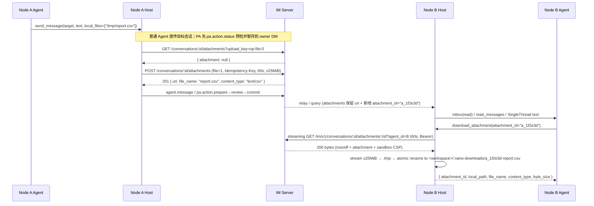

# feat-786: 通用文件附件上传与跨节点 Agent 下载 — 技术方案

> 对齐: spec.md v2

## Changelog

## 现状分析

### 涉及范围

- `packages/product-contracts/src/chat.ts`、`capabilities.ts`：定义共享的光栅位图判定 `isRasterImageMime`（`image/png | image/jpeg | image/gif | image/webp`），修正引用预览文案的位图判断；将 `download_attachment` 加入 `fixedTools`（Global/PA 根角色）。
- `apps/im-server/src/media.ts`、`server.ts`：扩展 `/im/v1/uploads` 与新增 Gateway 幂等文件路由 `POST/GET /im/v1/conversations/:conversation_id/attachments`（`file=1`、`Idempotency-Key`、保留 `file:` 命名空间）；单文件上限分层（位图 `10 MiB`、通用文件 `25 MiB`）；下载侧统一加安全头；`server.ts` 放宽 `requestTimeout` 至 `65000ms` 以匹配 60s 流式上传/下载窗口。
- `apps/im-server/src/personal-actions.ts`、`personal-images.ts`、`work.ts`：`personal-actions.ts` 区分静态位图（`image: true`）、可审阅 UTF-8 文本类附件（`text` 字段，严格 UTF-8 + 无 NUL + `≤ 256 KiB`）与不可审阅文件（`file: true`，发往非主人群一律 `409 attachment_content_review_unavailable`），预检 `pa.action.status` 兼容 `prepare_attachment` / `prepare_screenshot`；`personal-images.ts` 与 `work.ts` 均改用 `isRasterImageMime`。
- `apps/node/src/im-http.ts`、`screenshot-upload.ts`、`file-transfer.ts`（新增）、`main.ts`：`im-http.ts` 支持可选 `timeoutMs`（控制 RPC 默认 10s，上传传 60s）；新增 `uploadAttachment`（幂等上传通用文件 `≤ 25 MiB`）与 `downloadAttachment`（独立二进制流式 `fetch`，60s 超时、`≤ 25 MiB` 硬上限、原子落盘至 `<workspace>/.nano-downloads/` 或 `<nodeHome>/downloads/<agentId>/`）；`main.ts` 将 `uploadAttachment` 与 `downloadAttachment` 统一注入 `GlobalAgent`（SingleThread 与 Global 的全部 `product.call` 均经 `GlobalAgent.call()` 分发）。
- `packages/personal-assistant/src/tool-references.ts`、`screenshot-delivery.ts`、`presentation.ts`、`inbox.ts`、`single-thread.ts`、`global-agent.ts`、`personal-assistant.ts`：
  - `tool-references.ts` 新增 `attachment` 短引用（`a_xxxxxx`，`≤ 8` 字符），在投影结果中**保留原 `url` 并新增 `attachment_id`**；
  - `screenshot-delivery.ts` 扩展支持 `local_files`，并保持确定性顺序 `[...attachments, ...local_images, ...local_files]`（合计 `≤ 5`）；
  - `presentation.ts` 脱敏 `local_files`（同 `local_images`，仅显示计数 `file_count`，绝不泄露绝对路径到过程卡片）；
  - `global-agent.ts` 在根主 Agent 守卫下路由 `download_attachment`，并在 `screenshotReceipt` / `recoverPublications` 中同步支持 `local_files`；
  - `personal-assistant.ts` 让 PA `local_files` 复用 `pa.action.status` 预检 + 暂存上传到 `config.personal!.conversationId` + 披露审核后 commit 复制的完整链路（拒绝 `incident_ref` / `owner` 代发 / `external:`）；
  - `single-thread.ts` 兼容非图片附件（以带 `attachment_id` 的文本提示入站，不再抛 `Unsupported image media type`），并为原生图片附件附带短 `attachment_id` 标签。
- `packages/dsh-integration/src/message-arguments.ts`、`global-mode.ts`、`agent-config.ts`、`capabilities.ts`、`personal-security.ts`、`policy/approval.ts`、`evaluation/runtime.ts`：
  - `message-arguments.ts` 新增 `local_files`（1–5 绝对路径，合计 `≤ 5`）；
  - `global-mode.ts` 注册 `download_attachment`，并在 `agent_id/message` 内部消息中排除 `local_files`，`inbox.image` 过滤改用 `isRasterImageMime`；
  - `capabilities.ts` 在子 Agent `disabled` 列表与 Global scope-local 过滤列表加入 `download_attachment`；
  - `personal-security.ts` 将 `personalReviewImages` 改用 `isRasterImageMime`，同步 L224 提示词以覆盖 `local_files`/`local_images`，**保持 L143 输入审查对非主人附件的 fail-closed 边界不变**；
  - `policy/approval.ts` 将 `local_files` 纳入与 `local_images` 相同的私有审批防绕过保护，将 `download_attachment` 加入 `safeTools`（不进入 `policy/sources.ts` `hostResults`）；核对 `evaluation/runtime.ts` 评测放行列表。
- `src/IM/frontend/src/features/chat/attachments/attachment-chip.tsx`、`interactive/interactive-card.tsx`、`components/conversation-tool-card.tsx`、`components/message-pane.tsx`、`i18n/{en,zh}.json`：统一用 `isRasterImageMime` 收口位图判断（防止 `.svg` 在消息气泡、卡片或 Work 工具卡片被 `` 内联渲染），更新超限提示文案为通用文件语义。

### 既有约束

- 严格遵守 `AGENTS.md` 架构红线：`apps/node` 仅通过 `@nano/dsh-integration/client` 通信；PA/Channels/IM 不 import DSH；共享契约放入 `packages/product-contracts`。
- 所有 Agent 需在工具参数中回传的原子 ID 必须满足 `MAX_AGENT_ID_LENGTH = 8`（`packages/personal-assistant/src/tool-references.ts`）。
- 会话附件访问权限由 IM Server `ctx.messaging.access(...)` 权威判定；PA 向非主人会话写入强制经披露审核（`apps/im-server/src/messaging.ts:120-125`）；PA 参与群非主人消息含附件的输入审查保持 fail-closed（`packages/dsh-integration/src/personal-security.ts:143`）。
- 非光栅位图或潜在可执行文件（如 `.html`、`.svg`）不得在主站域 inline 渲染。

### 可复用能力

- `apps/im-server/src/media.ts` 已具备流式写盘（`0o600` 临时文件原子 rename）、SHA-256 摘要、`attachment_storage` 预占/失败回收、单用户 `1 GiB` / 全服务 `10 GiB` 配额、每分钟 `30` 次限流与单用户并发 `2` 路控制：直接复用并扩展。
- `apps/im-server/src/messaging.ts:publicationAttachments` 与 `personal-actions.ts:264-271` 已支持 `/im/v1/conversations/:id/(images|attachments)/:rid` 的关联与跨会话复制：直接复用。
- `packages/personal-assistant/src/screenshot-delivery.ts` 与 `apps/node/src/screenshot-upload.ts` 已有先查回执再上传、同路径去重与不确定回执恢复模型：直接复用到 `local_files`。
- `packages/personal-assistant/src/tool-references.ts` 已有 SQLite 持久 `<= 8` 字符映射表：直接扩展 `attachment` kind（前缀 `a_`）。

### 相关历史

- `feat-762-agent-node-awareness`（已通过 PR #546 合入 `codex/feat-780`）：引入执行节点身份与群成员节点查询，但跨机非图片文件仍需人工绕路。
- `feat-780-chat-topics`（PR #541 基线）：确立 `<= 8` 字符原子 ID 契约与 6 工具拆分。
- `unit/feat-721-agent-attachments` 曾探索隔离 HTML 预览，不在本 unit 范围。

## 架构总览

```mermaid
flowchart LR
  subgraph NodeA["发送方节点 (Node A)"]
    AgentA["Agent (Global / PA / SingleThread)"]
    UploadA["apps/node: uploadAttachment / uploadScreenshot\n(PA 先暂存到 owner DM; 普通 Agent 直传目标会话)"]
    AgentA -->|"send_message(local_files / local_images)"| UploadA
  end

  subgraph IM["IM Server (apps/im-server)"]
    Media["media.ts (requestTimeout 65s)\nPOST /conversations/:id/attachments (file=1, ≤25MiB)\nPOST /uploads (≤25MiB)\nGET /conversations/:id/(images|attachments)/:rid\n(nosniff + attachment + sandbox CSP)"]
    Msg["messaging.ts / personal-actions.ts\n消息入库 + 成员鉴权 + PA 严格 UTF-8 文本披露门禁"]
    Media --> Msg
  end

  subgraph NodeB["接收方节点 (Node B)"]
    Ref["ToolReferences\n保留 url + 新增 a_xxxxxx (≤8 chars)"]
    DownB["GlobalAgent.call → apps/node: downloadAttachment\n流式写 .tmp → 原子覆盖 <workspace>/.nano-downloads/"]
    AgentB["Agent (Global / PA / SingleThread)"]
    Ref --> AgentB
    AgentB -->|"download_attachment(attachment_id='a_xxxxxx')"| DownB
  end

  UploadA -->|"Idempotent POST (60s) + Bearer"| Media
  Msg -->|"Relay / Query (url + attachment_id)"| Ref
  DownB -->|"Authorized streaming GET (60s) + Bearer"| Media
```

Before：Agent 仅支持 `send_message(local_images)` 发送静态位图；`/im/v1/uploads` 白名单仅 8 种 MIME 且上限 `10 MiB`；下载缺少 `nosniff`/`sandbox CSP`；PA 与前端多处 `startsWith('image/')` 粗判断会把 `.svg` 当位图处理；SingleThread 收到非图附件直接抛错；无受保护附件下载工具。  
After：通用附件上传放开至 `25 MiB`（位图保持 `10 MiB` + 魔数校验），下载强制三联安全头；`send_message(local_files)` 与 `download_attachment(attachment_id)` 形成跨机文件收发闭环；PA 完整走暂存上传与严格 UTF-8 文本披露审阅，过程卡片绝不泄露本机绝对路径；全部 `image/*` 粗判断收口为 `isRasterImageMime`。

## 关键决策

1. **上传参考 Raft 放开格式，下载强制三联安全头；位图判定统一收口为 `isRasterImageMime`。**
   - 理由：跨节点 Agent 协作高频涉及 `.csv`、`.yaml`、`.log`、`.patch`、`.zip`、`.tar.gz`、`.docx`、`.xlsx` 与源码文件；XSS 风险源于浏览器在主站域直接渲染，因此对非 4 种安全光栅位图（`image/png`、`image/jpeg`、`image/gif`、`image/webp`）一律强制 `Content-Disposition: attachment; filename="<ascii>"; filename*=UTF-8''<utf8>`（`<ascii>` 剔除 `"`、`\`、`\r`、`\n` 及控制字符）+ `X-Content-Type-Options: nosniff` + `Content-Security-Policy: default-src 'none'; sandbox`。
   - 所有光栅位图判断统一使用 `packages/product-contracts/src/chat.ts` 导出的 `isRasterImageMime`，同步替换 `media.ts`、`work.ts`、`personal-images.ts`、`personal-actions.ts`、`inbox.ts`、`single-thread.ts`、`global-mode.ts`、`personal-security.ts`、`chat.ts`、`attachment-chip.tsx`、`interactive-card.tsx`、`conversation-tool-card.tsx`、`message-pane.tsx`。

2. **单文件上限分层与大文件传输超时同步放宽。**
   - 理由：位图保持 `10 MiB`（静图发图 `≤ 4096×4096`），通用文件上限 `25 MiB`，拒绝 0 字节；配额（单人 `1 GiB`、全服 `10 GiB`）、限流（`30/min`、并发 `2`）、单条消息总附件数 `≤ 5` 不变。
   - 同步修正超时链路：`apps/im-server/src/server.ts` 的 Fastify `requestTimeout` 从 `15000ms` 调至 `65000ms`（匹配 `media.ts` 已有 60s 流式超时）；`apps/node/src/im-http.ts` 支持可选 `timeoutMs`（默认仍 10s，上传传 60s）；`downloadAttachment` 使用独立二进制流式 `fetch` + `AbortSignal.timeout(60000)`，不经 JSON `requestIm`。

3. **发送端 `send_message(local_files)` 复用 `local_images` 全链路（含 PA 暂存、顺序、脱敏与回执）。**
   - 合并顺序固定为 **`[...attachments, ...local_images, ...local_files]`**（总计 `≤ 5`），确保互动卡片 1-based `AttachmentImage` 下标不被 `local_files` 偏移；内部 `agent_id/message` 发送明确禁止 `local_files`。
   - **PA 暂存与披露边界**：PA 发 `local_files` 时沿用 `local_images` 路径——先校验非 `incident_ref` / 非 `owner` 代发 / 非 `external:`，非主人目标先经 `pa.action.status({ prepare_attachment: true })`（服务端同时兼容 `prepare_screenshot`）预检写权限，再上传暂存到 `config.personal!.conversationId`；`personal-actions.ts` 对可审阅文本 MIME（`text/plain`、`text/markdown`、`text/csv`、`text/tab-separated-values`、`application/json`、`text/yaml`、`application/yaml`、`text/xml`、`application/xml`）强制要求 `byte_size <= 256 KiB`、不含 NUL 字节且通过 `TextDecoder('utf-8', { fatal: true })` 严格解码，才生成 `{ text }` 快照进入披露审核；真实静态位图生成 `{ image: true }` 快照；其余非文本或超大文件标为 `{ file: true }`（不再误标 `image: true`），发往非主人会话直接 `409 attachment_content_review_unavailable`，发往主人私聊则正常直发。
   - **脱敏与回执**：`presentation.ts` 将 `local_files` 与 `local_images` 一同脱敏为 `{ image_count?, file_count? }`，绝不向群过程卡片暴露本机路径；`global-agent.ts` 的 `screenshotReceipt` 与 `recoverPublications` 同步支持 `local_files`；`approval.ts` 将 `local_files` 纳入与 `local_images` 同等的私有审批防绕过保护。

4. **接收端 `download_attachment(attachment_id)` 单入口路由、权限收口与受控落盘。**
   - **能力与子 Agent 隔离**：`download_attachment` 加入 `product-contracts/src/capabilities.ts` 的 `fixedTools`（Global/PA 根角色）、`dsh-integration/src/capabilities.ts` 的 Global scope-local 过滤列表与子 Agent `disabled` 列表、`global-agent.ts:691` 的根会话守卫以及 `approval.ts` 的 `safeTools`（不进 `policy/sources.ts` `hostResults`）；SingleThread 模式下跟随默认工具目录及显式 `toolAllowlist` 语义（与 `conversations`/`read_messages` 一致）。
   - **保留 `url` + 新增 `attachment_id`**：`ToolReferences` 新增 `attachment` kind（`a_xxxxxx`，`≤ 8` 字符），所有 `inbox(read)`、`read_messages`、`search_messages` 附件对象**保留原 `url` 同时附加 `attachment_id`**，零破坏 `inbox.imageSources`、`global-mode.ts`、Work UI 与 PA 附件转发；非原生 `/im/v1/conversations/...` URL（如 `external:`）不生成原生下载引用，直接返回明确错误。
   - **SingleThread 入站**：非光栅附件转为带 `attachment_id` 的文本提示，不再抛 `Unsupported image media type`；原生光栅图片保留内联图片块并在其前附简洁 `[Image attachment_id=<a_xxxxxx> (<file_name>)]` 标签，使 SingleThread 需要脚本/OCR 处理时也能下载原图。
   - **受控落盘与幂等覆盖**：`GlobalAgent.call()` 统一调用 `apps/node` 注入的 `downloadAttachment`，流式校验 `≤ 25 MiB` 写入临时文件再原子重命名为 `<workspace>/.nano-downloads/<attachment_id>-<sanitized_name>`（无 workspace 时落盘 `<nodeHome>/downloads/<agentId>/`），重复下载同一 `attachment_id` 幂等覆盖同一路径，不留半截文件、不接受外部任意写路径。
   - **PA 输入审查边界不变**：维持 `personal-security.ts:143` 对 PA 参与群非主人附件的 fail-closed 输入审查基线，不在此 unit 放宽防注入门禁。

## 接口与数据流

### IM Server 媒体路由（`apps/im-server/src/media.ts`）

- `POST /im/v1/uploads`（人类上传）与 `POST /im/v1/conversations/:conversation_id/attachments`（Gateway 幂等上传）：
  - `isFileRoute = path.endsWith('/attachments')`：强制 `p.kind === 'gateway'`、`q.file === '1'`、必填 `Idempotency-Key`、`file_name`、`agent_id`、`lifecycle_revision`，使用保留命名空间 `file:${agentId}:${suppliedKey}`；非 `file=1` 路径拒绝以 `file:` 开头的 key。
  - 配套 `GET /im/v1/conversations/:conversation_id/attachments?agent_id=...&lifecycle_revision=...&upload_key=...`（Gateway 写权限 + 生命周期校验，查询 `file:${agentId}:${upload_key}`）。
  - MIME 归一化：优先合法非 `application/octet-stream` 的声明 MIME，否则按常见扩展名表映射（`.csv`、`.tsv`、`.pdf`、`.txt`、`.md`、`.json`、`.yaml`/`.yml`、`.xml`、`.zip`、`.gz`、`.tar`、`.tgz`、`.log`、`.patch`/`.diff`、`.html`/`.htm`、`.svg`、`.py`/`.ts`/`.js`/`.sh`/`.sql`、`.docx`/`.xlsx`/`.pptx`、常见音视频与图片），仍未知则落 `application/octet-stream`。声明为 `IMAGES` 之一时必验 magic bytes，不符返回 `415 image content does not match content type`。
  - 大小上限：`isImage || IMAGES.has(mime)` → `10 MiB`；其他通用文件 → `25 MiB`；0 字节 → `400 empty attachment`。
- `GET /im/v1/conversations/:conversation_id/(images|attachments)/:id`：
  - 始终返回 `Cache-Control: private, no-store`、`X-Content-Type-Options: nosniff`。
  - 当 `!isRasterImageMime(resource.content_type)` 时，额外返回 `Content-Disposition: attachment; filename="<ascii>"; filename*=UTF-8''<utf8>`（ASCII 安全清理）与 `Content-Security-Policy: default-src 'none'; sandbox`。

### Agent 上下文与工具契约（Agent Context Engineering）

- **Consumer**：Global、PA、SingleThread 根主 Agent（子 Agent 显式禁用）。
- **Context Lifecycle**：
  - **Before**：非图片附件仅显示 70+ 字符 `url` 且无下载工具；SingleThread 收到非图附件抛错；`personal-security.ts:224` 仍宣称无上传工具。
  - **After**：
    - `inbox(read)`、`read_messages`、`search_messages` 的每条原生附件保留 `url` 并新增 `attachment_id`（`a_xxxxxx`，`≤ 8` 字符）；
    - SingleThread 非图附件渲染为带 `attachment_id` 的文本提示，原生图片附件保留内联图片并附带 `attachment_id` 标签；
    - `send_message` 新增 `local_files?: string[]`（1–5 绝对路径，总计 ≤ 5，顺序 `attachments → local_images → local_files`，支持 `receipt_of`）；
    - 新增工具 `download_attachment({ attachment_id: string })` → `{ attachment_id, local_path, file_name, content_type, byte_size }`；
    - 同步更新 `agent-config.ts`（`nano-product-identity`）与 `personal-security.ts:224` 提示词，不新增系统段、不破坏前缀缓存。
- **Interactions**：与 `feat-780` 的 `inbox(read)` 预算及 `read_messages` 消费同步正交（含附件消息不被 `read_messages` 静默消费）；与 `feat-762` 执行节点识别协同。
- **Validation**：`id-length-contract.test.ts`（校验 `attachment_id <= 8`）、`fork-prefix-provider.test.ts`（校验前缀稳定性与提示词）、`capabilities.test.ts`（校验子 Agent 隔离与 `fixedTools`）、`presentation.test.ts`（校验 `local_files` 脱敏）、`single-thread.test.ts`、`global-agent.test.ts`、`personal-assistant.test.ts`、`media.test.ts`、`media-quota.test.ts`、`personal-disclosure.test.ts` 及跨节点端到端测试。

## 本次审查安排

| 必须回答的问题 / 对应目标 | 能力与使用阶段 | 证据方法、范围与已有定位 |
|---|---|---|
| 需求覆盖、生产接线、安全边界与 delta-spec 闭合 | `change-design-reviewer`（Gate 2） | 独立核对 `spec.md`、`design.md` 与实际生产代码接线 |
| IM 媒体限额、安全头、幂等、PA 暂存/UTF-8 披露、路径脱敏与下载隔离 | `change-code-review`（实施后） | 覆盖 `media.test.ts`、`media-quota.test.ts`、`personal-disclosure.test.ts`、`file-transfer.test.ts`、`presentation.test.ts` 与完整 diff |
| Agent 工具面、能力隔离、`url`+`attachment_id` 共存、SingleThread 入站与前缀缓存 | `agent-context-review`（实施后） | 覆盖 `id-length-contract.test.ts`、`capabilities.test.ts`、`global-agent.test.ts`、`single-thread.test.ts`、`fork-prefix-provider.test.ts` 与前端位图单测 |
| 真实服务端 + Node 跨 Agent 文件上传→接收→下载→读取逐字节闭环 | 真实 HTTP 集成测试 + 隔离验栈（实施后） | 覆盖 `.csv`/`.zip`/`.svg`/`.html`/超限/权限撤销/重复下载，并回收临时资源 |

## 契约层增量 (delta-spec)

- `im`: `docs/specs/im/conversations-messages.md`
  - MODIFIED `### Requirement: IM 托管聊天附件按当前会话读取资格授权`：放开通用文件上传（单文件 `25 MiB`、光栅位图保持 `10 MiB` 与魔数校验、未知扩展名归一化为 `application/octet-stream`），明确非光栅位图下载强制携带 `Content-Disposition: attachment`（含 ASCII 安全回退文件名）、`X-Content-Type-Options: nosniff` 与 `Content-Security-Policy: default-src 'none'; sandbox`，补充 Gateway 幂等文件上传/查询接口保证；保留会话成员权限、剪贴板纠偏、fork 隔离与旧 `/im/uploads` 禁用 Scenario。
  - MODIFIED `### Requirement: 上传与实时资源具有累计边界`：同步单文件上限分层（通用文件 `25 MiB` / 位图 `10 MiB`），明确草稿上传 `415` 失败反馈适用于声称为位图但字节头不匹配或图片接口收到非位图（未知非图扩展名按 `application/octet-stream` 正常上传，不再报不支持格式）。
- `gateway`: `docs/specs/gateway/routing-delivery.md`
  - MODIFIED `### Requirement: 当前会话的 Agent 图片回复具有统一交付语义`：扩展 `send_message` 支持 `local_files`（单文件 `≤ 25 MiB`，与已有附件、`local_images` 按 `attachments → local_images → local_files` 顺序合计 `≤ 5` 个，保留幂等回执、过程卡片路径脱敏与审批边界）。
  - MODIFIED `### Requirement: 群聊 Agent 理解本地文件所在的执行环境`：同步跨节点发送与接收引导（图片经 `local_images`、通用文件经 `local_files`、接收后经 `download_attachment` 下载）。
  - ADDED `### Requirement: Agent 可通过短标识下载受保护会话附件`：定义 `download_attachment(attachment_id)` 的实时鉴权、受控目录原子落盘与 SingleThread 非图/图片附件入站兼容。
- `gateway`: `docs/specs/gateway/global-agent.md`
  - MODIFIED `### Requirement: Global 主 Agent 专属产品聊天工具`：将 `download_attachment` 纳入根主 Agent 聊天工具面与子 Agent 隔离边界。
  - MODIFIED `### Requirement: Global 的话题按一等 target 独立收发，未关注的话题不进 Inbox`（及短 ID 投影条款）：明确原生附件保留 `url` 同时附加 `≤ 8` 字符 `attachment_id`（`a_xxxxxx`）。
- `gateway`: `docs/specs/gateway/personal-agent.md`
  - MODIFIED `### Requirement: 披露审核实际消费待发图片`：扩展外发披露审核消费可审阅的 UTF-8 文本类附件（严格 UTF-8、无 NUL、`≤ 256 KiB`），非文本/超大文件发往非主人会话继续 fail-closed 拒绝（`409`），发往主人私聊支持任意通用文件；输入审查对非主人附件的 fail-closed 边界不变。

## 风险与回退

- **风险 1**：大文件（`25 MiB`）流式上传/下载超时或占内存。缓解：`server.ts` 放宽 `requestTimeout` 至 `65s`，`im-http.ts` 与 `downloadAttachment` 均使用 60s 超时与流式落盘 + 字节硬上限 + 失败删临时文件。
- **风险 2**：文件名注入或路径穿越。缓解：下载响应头 ASCII fallback 剔除引号/反斜杠/换行/控制字符；Node 下载强制 `basename` 清理、加 `attachment_id` 前缀并严格限制在受控 `.nano-downloads/` 目录内原子覆盖。
- **风险 3**：`.svg` 或 `.html` 在 Web 端（气泡、卡片或 Work 工具卡片）被内联渲染。缓解：服务端强制 `attachment` + `nosniff` + `sandbox CSP`，全链路（含 `conversation-tool-card.tsx`）统一使用 `isRasterImageMime`。
- **回退**：独立分支 `codex/feat-786-on-780`，不改数据库表结构，可整分支回退无迁移残留。

## 一次性部署迁移

无。复用现有 `message_images`、`attachment_storage` 和 `tool_references` 表结构，无需数据库或磁盘迁移。

## Runbook for Reviewer

| 服务 | 停止命令 | 启动命令 | 健康检查 |
|---|---|---|---|
| IM Server + Node（隔离测试栈） | `./scripts/e2e-down.sh --wt <worktree-runtime>` | `./scripts/e2e-up.sh --profile daily --wt <worktree-runtime>` | `curl -sf http://127.0.0.1:<im_port>/healthz` |

**Review 驱动方式**: 后端/PA/DSH/Node/Web 单元与集成测试，配合真实 `createServer` HTTP 与跨 Agent 上传→下载端到端集成测试。

**验收前置**: 无（复用本地 Node/pnpm 测试环境）。

## Milestones

| ID | 标题 | 依赖 | 并行组 | 范围 | 退出标准 |
|---|---|---|---|---|---|
| M1 | 通用文件附件上传、安全下载与 Agent 收发闭环 | 无 | A | `packages/product-contracts`, `apps/im-server`, `apps/node`, `packages/personal-assistant`, `packages/dsh-integration`, `src/IM/frontend`, `docs/specs` | `[reviewer]` 1) 常见非图文件（`.csv`/`.zip`/`.yaml`/`.svg`/`.html`/未知扩展名 ≤25MiB）可上传并在有权成员间逐字节下载，无权访问被拒；2) 非位图下载必带 `attachment`（安全 ASCII 文件名）+`nosniff`+`sandbox CSP`，Web 气泡/卡片/Work 视图均不内联渲染 SVG；3) 空文件、>25MiB 文件、>10MiB 图片及伪造图片被拒且释放配额；4) Global/PA/SingleThread 根 Agent 可通过 `send_message(local_files)` 发送文件（不泄露本机路径、支持 `receipt_of`）并通过 `download_attachment(a_xxxxxx)` 幂等下载到受控目录，子 Agent 无法调用，SingleThread 收到非图附件不崩溃且图片带 `attachment_id`；5) PA 向主人可发通用文件、向非主人群经暂存+严格 UTF-8 文本披露审阅（≤256KiB）放行文本并拒绝不可审阅二进制，输入审查 fail-closed 不变。 `[worker]` 1) `pnpm build`、`pnpm typecheck`、`./scripts/docs-check`、`test_runtime_dependency_contract.py` 全绿；2) 新增/更新覆盖全部上述场景的后端/Node/PA/DSH/Web Vitest 全绿；3) 完成独立 `change-code-review` 与 `agent-context-review` 并归档 unit。 |
