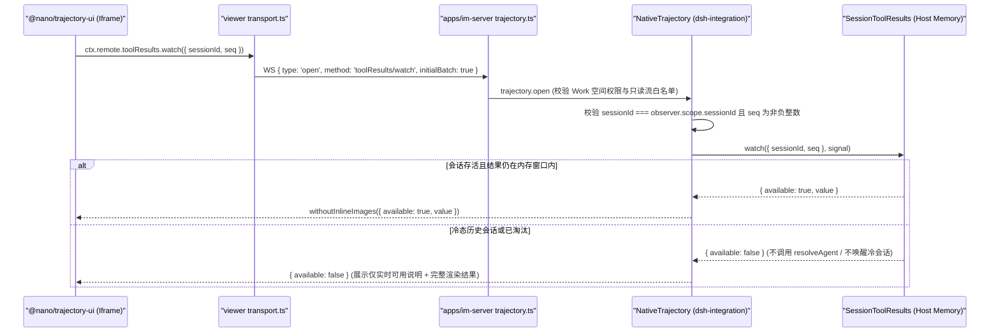

# feat-787: 升级 DSH 0.2.2 内核与配套组件并融合新能力 — 技术方案

> 对齐: [spec.md](spec.md)

## Changelog

- **Round 1 修订**：采纳 Gate 2 `R1-C1`～`R1-C5`、`R1-W1`～`R1-W4` 及 `R1-R1`～`R1-R2` 全部审查意见，并补充 `dsh-schedule@0.2.2-rc.5` v2 接口适配：禁用 `dsh-base` 默认 `web-search-deepseek`/`web-deepseek-api` 并由 `NanoWeb` 单一驱动互斥 `available()`/`ready()` 与代理路由；修正 `apply_patch` 移动字段为 `operation.moveTo` 并补齐 `approval.ts`/`cc.ts`/`codex.ts` 的 `workingDirectory` 注入；移除 `OwnedSessions.activateChild`，子会话中断恢复改经公开 `ctx.subagents.prompt` 并在 `sources.ts` 归类为 `system_source`；明确 `dsh-agent-context@0.3.0-rc.12` 与手动 `systemPrompt.assemble` 调用方的 `tools.resolve` `toolSet` 生命周期；闭合 `ModelPolicy` `{ prepend: true }` 注册顺序与非冻结子会话路由级联、`CapabilityState` 对 `cordis_inspect_*` 的撤回占用锁、`TrajectoryView.locate()` 子调用展开及窄抽屉验收、以及 `CronOwners`/`features/cron.ts` 对 `ScheduleService` v2 的无缝桥接。

## 现状分析

### 涉及范围

- **依赖锁定与打包裁剪**：`pnpm-workspace.yaml`、`packages/dsh-integration/package.json`、`packages/trajectory-ui/package.json`、`packages/dsh-trajectory-viewer/package.json`、`scripts/build-windows-archives.py`、`SPEC.md`（L9 版本声明与 L51 删除契约回归），以及本项目的独立配套仓 `Mrchen116/dsh-agent-context`（当前锁定 `0.3.0-rc.11` tarball）。当前全部 `@deepseek-ai/*` 锁在 `0.2.1-alpha.1`（Cordis `4.0.5-alpha.1`、Schemastery `3.18.5-alpha.1`、`zod@4.6.5`）。
- **运行时宿主与配置装配**（`packages/dsh-integration/`）：
  - `cordis.patch.yml`、`src/client.ts`、`src/index.ts`：定义 `nano` profile 启停项、进程握手版本、能力预览与调度管理桥接。
  - `src/model-policy.ts`、`src/model-fallback.ts`、`src/compaction.ts`、`src/policy/review-session.ts`、`src/knowledge/dreaming-agent.ts`：管理模型路由选择、备用链切换、聚焦压缩及独立审核/维护会话请求构建。当前通过 `agent/request` 在步骤已进入请求期后覆写 `provider`/`model`/`reasoningEffort`，并在 `agent/pre-step` 手写 `model-selection` 提示。
  - `src/agent-config.ts`、`src/capabilities.ts`、`src/capability-state.ts`、`src/workspace-tools.ts`、`src/plugin-development.ts`：管理预设挂载、工具白名单、能力撤回占用锁、空列表降级（调用已移除的 `ctx.tools.presentAs('native')`）、`fs-observation-policy` 文案替换，以及继承 `EntryTree.write()` 的 `WorkspaceTree`。
  - `src/policy/approval.ts`、`src/policy/cc.ts`、`src/policy/codex.ts`、`src/policy/file-approval.ts`、`src/policy/sources.ts`：执行自动审批、普通文件快速放行与来源归属；当前仅识别 `write`/`edit` 且直接用 `agent.session.header.cwd` 解析相对路径。
  - `src/web.ts`、`src/model-setup.ts`：注册 `searxng`/`brave`/`duckduckgo` 搜索提供方与模型连接凭据。
  - `src/owned-sessions.ts`、`src/history.ts`、`src/interrupted-work.ts`、`src/agent-deletion.ts`、`src/agent-deletion-derived.ts`：管理受管根会话激活（含已废弃 `ResumeAgentOptions.parentAgent` 的旧 `activateChild`）、普通对话 fork（当前依赖 `header.parentSession` 识别新建分支）、子会话中断恢复（当前导入已移除的 `@deepseek-ai/dsh-subagent/internal`）与永久删除计划。
  - `src/cron-owners.ts`、`src/features/cron.ts`（及 `packages/product-contracts/src/runtime-rpc-schedule.ts`）：桥接 `@deepseek-ai/dsh-schedule`（`0.2.2-rc.5` 升至 domain v2，`target` 取代顶层 `sessionId`，`edit` 取代 `update`/`delete`，且 `@deepseek-ai/dsh-tool-schedule` 改为注册 `schedule_view`/`schedule_edit` 及多会话 target）。
- **原生轨迹只读桥接与前端分叉**：`apps/im-server/src/trajectory.ts`、`packages/dsh-integration/src/trajectory.ts`、`packages/dsh-trajectory-viewer/{build.mjs,src/boot.jsx,src/transport.ts}`、`packages/trajectory-ui/`（含 `upstream.json`、`src/client/*`）。当前只读方法白名单尚未放行 `0.2.2` 新增的实时工具原始结果观察流 `toolResults/watch`，`boot.jsx` 亦未挂载 `@deepseek-ai/dsh-client-ui-trajectory/remote`。

### 既有约束

- 严格遵守 `AGENTS.md` 与 `SPEC.md` 边界：仅 `packages/dsh-integration`、`packages/trajectory-ui` 与 `packages/dsh-trajectory-viewer` 导入 `@deepseek-ai/*` 已声明的公开 `exports`，由 `tests/contract/test_runtime_dependency_contract.py` 强制校验；禁止运行时补丁、跨包相对路径或第二套 Agent Loop。
- CI 与生产节点基于 Node 24（CI 当前运行 `24.22.1`），目标版本必须兼容该运行时，不引入 `0.2.3-alpha` 对更高 Node 次版本的强制要求。
- 存量 Agent 已持久化的显式 `tool_allowlist`（含 Cron 六工具名 `schedule_create/list/update/delete/run/history`）不能在升级时被破坏或被默认工具集静默扩宽（`docs/specs/gateway/agent-capabilities.md`）；Cron 任务仍在创建它的主会话到期执行（`docs/specs/gateway/heartbeat-cron.md`）；只读轨迹查看器不得唤醒冷会话或绕过 IM 聊天图片访问鉴权（`docs/specs/im/agent-work.md`）。
- 在途未实施的 `feat-770-ordinary-agent-ptc` 不并入本 unit；本次升级必须保持现有普通会话默认 `native` 执行与 `NanoWorkflowEngine` 的 `per-call` PTC 语义不变。

### 可复用能力

| 能力 | 处理 | 原因 |
|---|---|---|
| `@deepseek-ai/dsh-agent` 的 `agent.model` + `installModelSelection` | 用（替代手写胶水） | `0.2.2` 在 `preStep` 固定步骤路由并禁止 `agent/request` 改写 `provider`/`model`/`reasoningEffort`；复用原生选择器与切换提示可消除请求期覆写冲突 |
| `@deepseek-ai/dsh-working-directory` 服务 | 用（禁用其模型工具） | `dsh-tool-fs`/`bash`/`fs-search`/`skill` 统一依赖 `ctx.workingDirectory`；保留服务可使 `header.cwd` 保持不可变并把当前目录移入用户上下文以稳定系统提示词前缀，禁用 `tool-working-directory` 即可阻断任意 `cd` |
| `@deepseek-ai/dsh-fs-patch`（`parsePatch`） | 用 | 与 `dsh-tool-fs` 的 `apply_patch` 共用同一公开解析器校验补丁全部源路径（`operation.path`）与重命名目标（`operation.moveTo`），杜绝审批器与执行器解析分叉 |
| `@deepseek-ai/dsh-cordis-host-runner` + `@deepseek-ai/dsh-tool-cordis` | 用（只读子集） | 复用官方 `cordisInspect` 注册表与 `cordis_inspect_list`/`cordis_inspect_query` 工具，不挂载动态定义/运行工具，由 `ToolSelection` 与 `CapabilityState` 绑定 `plugin_manager` 授权 |
| `@deepseek-ai/dsh-web-deepseek-api`（`mapSearchResponse` / 常量） | 在 `NanoWeb` 内受控接入 | 禁用 `dsh-base` 默认恒真 `available()` 的两个 DeepSeek 搜索插件，由 `NanoWeb` 单一注册互斥搜索源、复用 `proxyRouteFor` 代理路由、禁发 `ori_question`，并在无凭据时平滑回退 `duckduckgo` |
| `@deepseek-ai/dsh-subagent` 公开 `prompt` | 用（替代 `/internal` 与 `activateChild`） | `0.2.2-rc.5` 移除了 `@deepseek-ai/dsh-subagent/internal` 与 `ResumeAgentOptions.parentAgent`；公开 `ctx.subagents.prompt` 在 `SubagentManager.resident` 内冷恢复子会话、原样投递正文且不触发 `isHumanSource`，配合 `sources.ts` 的 `rpcId` 识别保持系统来源隔离 |
| `@deepseek-ai/dsh-schedule` v2 `ScheduleService` | 保留服务、自持 6 工具面 | 复用 v2 存储（自动兼容 v1 记录）与定时器引擎，在 `features/cron.ts` 维持绑定当前主会话的 6 个既有 `schedule_*` 工具名与语义 |
| `@deepseek-ai/dsh-client-ui-trajectory` 的 `SessionToolResults` | 用 | 宿主挂载内存态结果观察服务，经 `NativeTrajectory` 只读流与 `withoutInlineImages` 脱敏桥接驼峰 `toolResults/watch` |
| `dsh-base` 的 `tool-result-pruner` 与 `image-offload` | 用 | 直接沿用 `dsh-base` 默认挂载的零模型调用工具输出裁剪与超限图片卸载重试，由升级后的 `dsh-agent-context@0.3.0-rc.12` 协同计量 |

### 相关历史

- `feat-589` 与 `bugfix-712`：在 `@nano/trajectory-ui` 建立了父子执行范围选区导航（`navigation-model.ts`、`use-run-navigation.ts`）与向上分页补载防丢节点逻辑；本次将 `@nano/trajectory-ui` 同步至 `0.2.2-rc.5` 时完整保留这两块增量，并让 `locate()` 同步展开嵌套子调用折叠。
- `feat-676` 与 `refactor-679`：引入 `dsh-agent-context`（确定性换窗与 `notes`/`history`/`new_context`/`get_context_remaining`）及上下文缓存前缀规范；本次升级需同步发布适配 `0.2.2` `tools.resolve`、`PromptPresentation` 与 `RuntimeContextProjection` 的 `dsh-agent-context@0.3.0-rc.12`。
- `feat-770`（设计提案，未实施）：规划普通执行 Agent 与 Dreaming 整合默认切换 PTC；已与用户确认留待本 unit 合入后再基于 `0.2.2` 的 `tool-executor-ptc` 推进。
- `feat-778`：落地 `LocalWorkers`（`delegate_worker` 支持本机 DSH / Codex CLI / Claude Code 多轮追问、停止与 Agent Work 投影），因此本次明确不启用上游单轮实验性 `subagent_oar` 与原生 `AgentTeam`。

## 架构总览

升级后整体进程拓扑与包职责保持不变：Node 仍通过 `@nano/dsh-integration/client` 监管受管 DSH `0.2.2-rc.5` 子进程，产品层不接触 DSH 对象；仅在 `packages/dsh-integration`、`dsh-agent-context` 与隔离轨迹查看器包内完成 `0.2.2` 原生机制替换与新能力受控暴露。

```mermaid
flowchart LR
  subgraph IM["IM 中心与 Web 查看器"]
    IMTraj["apps/im-server\n只读方法白名单 (+toolResults/watch)"]
    Viewer["@nano/dsh-trajectory-viewer + @nano/trajectory-ui (0.2.2-rc.5)\n挂载 trajectory/remote · 子调用折叠 / 原始结果双视图 / 范围导航"]
  end
  subgraph Node["用户节点"]
    NodeApp["apps/node + personal-assistant\n配置权威 / 恢复协调 / 安装包裁剪"]
  end
  subgraph DSH["受管 DSH 0.2.2-rc.5 进程 (@nano/dsh-integration)"]
    Patch["nano profile & cordis.patch.yml\n启用 apply_patch / working-directory / cordisInspect\n禁用 tool-working-directory / agent-team / 默认 web-*deepseek*\n固定 ptc-runtime: per-call"]
    Model["ModelPolicy + dsh-agent-context@0.3.0-rc.12\n步骤前 agent.model.select + 子会话级联\ntools.resolve + <system-reminder> 协同"]
    Policy["NanoApproval / CC / Codex + file-approval\nworkingDirectory 相对路径解析\nheader.cwd 边界根 + parsePatch (path & moveTo)\ncordis_inspect_* 随 plugin_manager 联动与撤回锁"]
    Web["NanoWeb 单一搜索注册表\nSearXNG/Brave → 官方 DeepSeek 脱敏搜索 → DuckDuckGo"]
    SubCron["Subagent & Cron 适配\nsubagents.prompt 原样恢复 + system_source 归属\nScheduleService v2 + 主会话 6 工具桥接"]
    TrajHost["NativeTrajectory + SessionToolResults\ntoolResults/watch 只读流 + withoutInlineImages"]
  end
  Viewer <-->|MessagePort / WS| IMTraj
  IMTraj <-->|专用轨迹 WS| NodeApp
  NodeApp <-->|stdio RPC| DSH
```

- **Before**：锁在 `0.2.1-alpha.1`；模型路由靠 `agent/request` 事后改写；`dsh-agent-context@0.3.0-rc.11` 锁死旧 peer 且依赖 `system-prompt/assemble` 回调携带 `tools`；无 `apply_patch` 与运行时自省；文件免审直接按 `header.cwd` 拼相对路径；默认无 SearXNG 时直连易触发验证码的 DuckDuckGo；子会话冷恢复包含绕过 `SubagentManager` 的 `activateChild` 与已移除的 `/internal` 导入；轨迹查看器缺少子调用批量折叠与实时原始结果视图。
- **After**：升级至 `0.2.2-rc.5` 与 `dsh-agent-context@0.3.0-rc.12`；路由在步骤准备前经 `agent.model.select()` 原生固定并同步非冻结子会话；`dsh-agent-context` 与手动组装点统一通过 `tools.resolve` 获取准确工具预算并复用 `<system-reminder>` 快照；默认提供 `apply_patch` 并以 `workingDirectory` + `header.cwd` + `parsePatch`（含 `moveTo`）严守免审边界；`cordis_inspect_list`/`cordis_inspect_query` 随 `plugin_manager` 联动启停与占用保护；`NanoWeb` 单一接管搜索选择链且禁发 `ori_question`；子会话统一由 `SubagentManager` 驻留恢复且恢复提示保持 `system_source` 隔离；轨迹查看器同步 `0.2.2-rc.5` 全部检查能力并保留 Nano 范围导航。

## 关键决策

### 1. 锁定 DSH `0.2.2-rc.5` 与配套依赖栈，同步适配发布 `dsh-agent-context@0.3.0-rc.12`

**将本仓全部 `@deepseek-ai/*` 依赖统一升级至 `0.2.2-rc.5`（`@deepseek-ai/cordis@~4.1.0`、`@deepseek-ai/cordis-plugin-loader@~1.1.0`、`@deepseek-ai/cordis-plugin-include@~1.1.0`、`@deepseek-ai/schemastery@~3.19.0`、`zod@4.6.6`），并将 `Mrchen116/dsh-agent-context` 升级发布为 `0.3.0-rc.12` 后接入。**

- **理由**：`0.2.2-rc.5` 是当前 `0.2.2` 系列最新候选稳定包，完整包含本次对齐的能力且各包 `engines` 均为 `>=22.19`（兼容 CI Node `24.22.1`）；`dsh-storage-domain`、`dsh-commands`、`dsh-schedule` 与 `dsh-client-ui-trajectory` 在 `0.2.2-rc.5` 均使用 `zod@4.6.6`，同步升级 `pnpm-workspace.yaml` 的 `overrides` 与 `allowBuilds`（`@deepseek-ai/dsh-subprocess-local@0.2.2-rc.5`）可保持类型词表单一。`dsh-agent-context` 作为本项目自持主滚窗引擎，必须同步升级 `peerDependencies` 并修复 `0.2.2` `system-prompt/assemble` 移除回调 `tools` 导致的工具 Schema Token 归零问题及裸文本 `runtime-context` 重复快照问题。
- **拒绝备选**：直接升至 `0.2.3-alpha.2`（强制 Node `>=24.22.3 || >=26.13.1`，会破坏现有 CI 与部分部署节点环境，且属未收口 alpha 分支）；仅在 Nano 侧用 `pnpm.overrides` 强压 `dsh-agent-context@0.3.0-rc.11` 的旧 peer（会导致默认开启上下文管理的全部会话把工具 Schema Token 误算为 `0`）。
- **风险**：跨仓发布 `dsh-agent-context` 需先在该独立仓完成单测与 GitHub Release tarball 构建，再更新本仓 lockfile。

### 2. 迁移至步骤前 `agent.model.select()`、对齐 `pre-step` 包装顺序并级联非冻结子会话

**在 `OwnedSessions`、`ModelPolicy`、`ReviewSession` 与 `Dreaming` 中改为在会话创建/恢复及空闲边界通过 `AgentOptions` 与按需 `agent.model.select()` 设定模型和推理档位，在注册 `ModelPolicy` 撤回过滤之后再挂载原生 `installModelSelection(agent.ctx)`，并在父路由变更时级联同步非冻结子会话，仅保留 `agent/request` 处理 `maxTokens` 上限。**

- **理由**：
  1. `0.2.2-rc.5` 的 `ReactLoopAgent.preStep()` 在组装提示词和解析条件工具前即读取 `agent.model.current()`（缺失直接抛错），并在 `prepareRequest()` 强校验 `agent/request` 不得篡改 `provider`、`model` 或 `reasoningEffort`。
  2. Cordis 中后注册的 `{ prepend: true }` 监听器包裹先注册的监听器：先注册 `ModelPolicy` 的 `agent/pre-step`（过滤已撤回回退消息及残留 `model-selection` 提示，空集直接返回 `{ kind: 'reject' }`），再调用 `installModelSelection(agent.ctx)`，可确保撤回轮次在内层即被拒绝，不会被外层追加 `[model changed: ...]` 误唤醒空转请求。
  3. `syncRoute(agent)` 仅在目标路由与 `agent.model.current()` 实际不等价（`!sameModelSelection`）时才调用 `agent.model.select()`，避免新建空白会话或冷恢复时重复写入冗余 `model/selection` 事件；同时当父会话发生配置更新、`/effort` 调整或 `ModelFallback` 粘性切换时，同步更新所有 `!childConfig.modelRouteFrozen` 的存活子会话（空闲子会话立即同步，运行中子会话在 `whenIdle()` 边界同步），保持动态路由继承不退化。
- **拒绝备选**：在 `agent/pre-step` 回调内临时调 `agent.model.select()`（此时 `preStep` 已用旧 `selection` 完成 `tools.resolve` 与 `systemPrompt.assemble`，会导致本步工具条件与请求模型错位）。

### 3. 启用 `working-directory` 服务、禁用 `tool-working-directory` 工具，并打通全链路审批路径基准

**保留 `dsh-base` 的 `working-directory` 服务，在 `cordis.patch.yml` 禁用 `tool-working-directory`；在 `NanoApproval`、`CcApproval`、`CodexApproval` 统一注入 `workingDirectory`，文件审批器以 `ctx.workingDirectory.get(session)` 解析相对路径，同时始终以不可变的 `session.header.cwd` 作为工作区免审边界根。**

- **理由**：`0.2.2` 的文件、搜索、Bash 与 Skill 服务均通过 `ctx.workingDirectory` 读取当前目录，并将目录文本从系统提示词迁入用户侧 `runtime-context` 以保护 KV Cache 前缀，同时支持目录意外删除后的自愈回退。禁用面向模型的 `working_directory` 工具（配合 `dsh-base` 默认禁用的 `fs-observation-policy`）可阻止模型切入外部目录或吸入工作区外 `AGENTS.md`；而在 `approval.ts`、`cc.ts`、`codex.ts` 与 `file-approval.ts` 全链路区分「相对路径解析基准（`effectiveCwd`）」与「授权根（`workspaceRoot = header.cwd`）」，可消除相对路径解析错位与依赖漏注隐患。
- **拒绝备选**：连同底层 `working-directory` 服务一并禁用（会导致 `dsh-tool-fs`、`dsh-tool-bash`、`dsh-subagent` 等依赖 `workingDirectory` 注入的核心插件无法启动）；放开 `working_directory` 模型工具（违反固定工作区安全边界）。

### 4. 默认启用 `apply_patch`，复用 `@deepseek-ai/dsh-fs-patch` 校验全部源路径与 `moveTo` 目标

**在 `cordis.patch.yml` 为 `tool-fs` 开启 `applyPatch: true`，将 `apply_patch` 纳入 `workspaceFileAllowed`（CC Auto）与 `codexFileAllowed`（Codex Auto），使用 `@deepseek-ai/dsh-fs-patch` 的 `parsePatch` 逐一核验每条补丁操作的 `operation.path` 与 `update` 分支可选的 `operation.moveTo`。**

- **理由**：`dsh-base@0.2.2-rc.5` 默认将 `tool-fs.config.applyPatch` 设为 `false`，需在 Nano 层显式打开。开启后，`apply_patch` 自动进入节点默认开启工具集与 Global 一级原生 worker 独立工具集，存量显式 `tool_allowlist` 则遵守不静默扩宽契约。复用官方公开包 `@deepseek-ai/dsh-fs-patch` 解析补丁，确保新增、更新、删除源路径（`operation.path`）及重命名目标路径（`operation.moveTo`）全部通过与 `write`/`edit` 完全一致的物理路径、符号链接、非常规文件及受保护目录（`.git`、`.nanoassistant`、`AGENTS.md` 等）检查；任何空补丁、语法错误、沙箱提权字段或越界项均闭合回退至完整审核/人工确认。
- **拒绝备选**：用正则粗略提取文件路径（可能与 `dsh-tool-fs` 真实解析器存在边界差异而被构造文本绕过）。

### 5. 只读运行时自省随 `plugin_manager` 全链路联动，关闭原生 `AgentTeam` 与 `subagent_oar`

**宿主挂载 `@deepseek-ai/dsh-cordis-host-runner` 与 `@deepseek-ai/dsh-tool-cordis/host` 提供只读注册表，`ToolSelection`、`CapabilityState` 与 `NanoApproval` 协同使 `cordis_inspect_list` 与 `cordis_inspect_query` 仅在允许角色的主会话启用 `plugin_manager` 时放行、免分类审核且随 `plugin_manager` 撤回原子锁住，不在普通工具目录暴露独立勾选项；同时禁用 `agent-team`、`tool-agent-team`，不挂载 `subagent_oar`。**

- **理由**：`@deepseek-ai/dsh-tool-cordis@0.2.2-rc.5` 注册 `cordis_inspect_list` 与 `cordis_inspect_query` 两项只读工具（`Config.listConfigs` 仅投影静态 Schemastery Schema 与包目录，不暴露运行态配置值或凭据）。将其纳入 `userEntryTools`（阻断内部子执行者经 `independentTool` 越权获取）、`NanoApproval` `safeTools`（只读免审）及 `CapabilityState` 撤回目标集（在线关闭 `plugin_manager` 时同步检查并锁住在途/新发 `cordis_inspect_*` 调用），并同步修订 `gateway/agent-capabilities` 中显式白名单封闭集条款，可实现权限、热更新与契约文档完全闭合。关闭 `AgentTeam` 与不挂载单轮 `subagent_oar`，避免与 Nano `task_graph` 及 `LocalWorkers`（`delegate_worker`）双轨冲突。
- **拒绝备选**：将 `cordis_inspect_*` 放入普通 `default_on` 工具目录（向无关会话暴露内部组件树，且存量显式白名单插件开发者无法自动获得）。

### 6. 显式固定 `ptc-runtime` 为 `per-call`、清理废弃 `presentAs` 并统一手动组装的 `toolSet` 解析

**在 `cordis.patch.yml` 显式声明 `ptc-runtime: { executionMode: 'per-call' }` 防配置漂移，保持 `tool-executor-native` 启用、`tool-executor-ptc` 禁用；清理已移除的 `ctx.tools.presentAs('native')`，并在所有手动调用 `ctx.systemPrompt.assemble` 的入口统一先执行 `ctx.tools.resolve` 传入 `toolSet` 并在 `finally` 释放。**

- **理由**：`@deepseek-ai/dsh-ptc-runtime-node@0.2.2-rc.5` 新增了可选的 `'persistent-in-memory'` 与 `'vm-script'` 执行模式（Schema 默认仍为 `'per-call'`），在 `cordis.patch.yml` 显式固定 `executionMode: per-call` 可防止后续层覆盖导致 `NanoWorkflowEngine` 跨运行残留状态。同时，`0.2.2` 将工具执行器拆分为插件（`tool-executor-ptc` 已禁用，`tools.restrict({ allow: [] })` 足以收敛空工具集），并要求 `ctx.systemPrompt.assemble` 接收 `ctx.tools.resolve({ agent, modelSelection, signal })` 产出的 `toolSet` 以执行 `when` 准入判定（如 `web_search` 与 `read_image`），统一补齐可确保 `dsh-agent-context`、能力预览与 `Dreaming` 测算出的提示词和工具集与真实模型步完全一致。
- **拒绝备选**：在手动 `systemPrompt.assemble` 处省略 `toolSet`（会导致不满足 `when` 条件的工具及其系统提示词混入组装结果，扭曲 Token 预算与前缀核查）。

### 7. 禁用 `dsh-base` 默认 DeepSeek 搜索插件，由 `NanoWeb` 单一驱动互斥搜索选择链

**在 `cordis.patch.yml` 禁用 `dsh-base` 默认挂载的 `web-search-deepseek` 与 `web-deepseek-api`；由 `NanoWeb` 单一注册 `'searxng'`、`'brave'`、脱敏 `'deepseek-search-api'` 与兜底 `'duckduckgo'`，以互斥 `available()`/`ready()` 及 `proxyRouteFor` 实现 `DSH_WEB_SEARCH_PROVIDER` > `SEARXNG_URL` > `BRAVE_API_KEY` > 官方 DeepSeek 凭据 > `duckduckgo`，且绝不外发 `ori_question` 或第三方代理密钥。**

- **理由**：上游 `dsh-base` 默认挂载的 `web-search-deepseek` 与 `web-deepseek-api` 的同步 `available()` 均恒返 `true`；若不禁用，未显式配置 `searchProvider` 时 `WebRuntime.selectSearchProvider` 必优先命中 `'deepseek-search-api'`，不仅与 `NanoWeb` 同名注册冲突（`WEB_DUPLICATE_PROVIDER`）或遮蔽 Nano 的 `llm-pi-ai` 凭据与代理配置，更会在无 DeepSeek 凭据时令 `tool-web` 的 `when: ctx.web.searchReady(...)` 返回 `false`，导致模型侧 `web_search` 工具直接消失而无法回退 `duckduckgo`。禁用上游两插件后，由 `NanoWeb` 维护同步凭据快照并在未显式指定提供方时保证同一时刻恰有一个最优搜索源 `available() === true`（`ready()` 一致为真），既彻底消除 `WEB_PROVIDER_AMBIGUOUS` 与 `web_search` 消失问题，又确保经 `proxyRouteFor` 直连 `https://api.deepseek.com/v1/tools/search` 的请求体仅含 `{ query, count }`（不含 `ori_question`）且严格校验官方 `api.deepseek.com` 主机名。
- **拒绝备选**：保留 `dsh-base` 的 `web-deepseek-api` 并仅改 `sendOriginalQuestion: false`（无凭据时 `searchReady` 返回 `false` 会隐藏 `web_search` 阻断 `duckduckgo` 回退，且无法读取 Nano `llm-pi-ai` 官方 DeepSeek 密钥或走 `proxyRouteFor`）。

### 8. 统一由 `SubagentManager` 承载子会话冷恢复、适配 `ScheduleService` v2 与打通只读 `toolResults/watch`

**删除绕过 `SubagentManager` 的 `OwnedSessions.activateChild`，子会话中断恢复改调公开 `ctx.subagents.prompt` 并在 `ApprovalSources` 中按 `rpcId` 保持 `system_source` 归属；普通对话 fork 改按 `AsyncLocalStorage` 与 `isSeeded` 归属；`CronOwners`/`features/cron.ts` 适配 `ScheduleService` v2 同时保持主会话 6 工具契约；轨迹三端打通驼峰 `toolResults/watch` 只读脱敏流并合入 `0.2.2-rc.5` UI。**

- **理由**：
  1. **子会话单一驻留与来源隔离**：`0.2.2-rc.5` 删除了 `ResumeAgentOptions.parentAgent` 且要求子会话必须在 `SubagentManager.resident` 中拥有激活记录才能使用 `send_message`/`subagent`/`list_agents` 及向父会话投递完成通知；若改用 `ctx.subagents.sendMessage` 恢复中断子会话，又会拼接 `"Agent lead sent a message: "` 前缀并将来源标为 `agent-message`（触发 `sources.ts` 误抬升为 `direct-parent`）。移除 `activateChild` 后，统一使用公开方法 `ctx.subagents.prompt({ childSessionId, requestId: 'nano-runtime-recovery:...', delivery: 'steer', content }, signal)`：它在 `SubagentManager.resident` 内冷恢复目标子会话、原样投递恢复提示文本、生成的 `{ kind: 'user', rpcId }` 在 `input-source.ts` 中 `isHumanSource === false`，并在 `sources.ts` 识别 `nano-runtime-*` `rpcId` 归入 `system_source`（`origin: { kind: 'nano-system' }`），完整保持授权隔离与回传链路。
  2. **无 `parentSession` 普通分支**：`OwnedSessions.fork` 对齐 `0.2.2` 不再写入 `header.parentSession`，`NativeHistory.configuration` 凭 `creating && isSeeded && origin !== 'subagent'` 落盘 `forks`，`SessionDeletion` 经 `bindings` + `ownedLinks`（兼容旧 `parentSession`）闭合清理。
  3. **Cron v2 无感适配**：`@deepseek-ai/dsh-schedule@0.2.2-rc.5` 升级至 domain v2（原生兼容读取 v1 `sessionId` 记录），但 `@deepseek-ai/dsh-tool-schedule` 改为了 `schedule_view`/`schedule_edit` 与新建独立会话 target；`CronOwners` 与 `scheduleHandlers` 对接 v2 `ScheduleService` 方法，而 `features/cron.ts` 继续向模型提供绑定当前主会话的 `schedule_create/list/update/delete/run/history` 六工具，确保已保存 `tool_allowlist`、`task_graph` 等待检查与主会话执行契约零破坏。
  4. **轨迹 `toolResults/watch` 同步**：宿主挂载 `SessionToolResults`、查看器 `boot.jsx` 挂载 `@deepseek-ai/dsh-client-ui-trajectory/remote`，并在 `transport.ts`、`apps/im-server/src/trajectory.ts`、`packages/dsh-integration/src/trajectory.ts` 放行驼峰 `'toolResults/watch'` 且经 `withoutInlineImages` 脱敏。
- **拒绝备选**：改调 `ctx.subagents.sendMessage` 恢复中断子会话（伪造父消息前缀并污染 `direct-parent` 审批信任级）；直接暴露 `0.2.2` 默认 `dsh-tool-schedule`（破坏存量 `schedule_update`/`schedule_delete` 白名单并产生脱离产品绑定的野生会话）。

## 接口与数据流

### 1. 依赖、配置补丁与插件树接口更新

- **版本与构建白名单**：
  - `pnpm-workspace.yaml`：`"@deepseek-ai/dsh-subprocess-local@0.2.2-rc.5": true`；`overrides` 中 `"@deepseek-ai/dsh-storage-domain>zod": "4.6.6"`。
  - `packages/dsh-integration/package.json`、`packages/trajectory-ui/package.json`、`packages/dsh-trajectory-viewer/package.json`：全部 `@deepseek-ai/dsh*` 升至 `0.2.2-rc.5`（补充 `@deepseek-ai/dsh-fs-patch`、`@deepseek-ai/dsh-cordis-host-runner`、`@deepseek-ai/dsh-tool-cordis`、`@deepseek-ai/dsh-web-deepseek-api`、`@deepseek-ai/dsh-client-ui-trajectory`、`@deepseek-ai/dsh-working-directory`），`@deepseek-ai/cordis` 升至 `~4.1.0`，`zod` 升至 `4.6.6`，`dsh-agent-context` 指向新发布的 `0.3.0-rc.12` tarball。
  - `WorkspaceTree`（`packages/dsh-integration/src/workspace-tools.ts`）：配合 `@deepseek-ai/cordis-plugin-loader@1.1.0` 将 `override write(): void {}` 更新为 `override commit(): void {}`。
  - `NanoRuntime` 握手、架构文档与查看器版本常量（`packages/dsh-integration/src/index.ts`、`packages/dsh-trajectory-viewer/build.mjs`、`packages/dsh-trajectory-viewer/src/boot.jsx`、`SPEC.md:9`）：统一由 `0.2.1-alpha.1` 更新为 `0.2.2-rc.5`；移除 `agent-config.ts` 中针对已默认禁用的 `fs-observation-policy` 提示词字符串替换。
  - `scripts/build-windows-archives.py`：对照 `@deepseek-ai/dsh@0.2.2-rc.5` 的 CLI 依赖图更新 `ALTERNATE_CLI_PACKAGES`，剔除 `nano` profile 不使用的独立模式与实验性扩展包（如 `@deepseek-ai/dsh-cua-bundle`、`@deepseek-ai/dsh-deepseek-chat-import`、`@deepseek-ai/dsh-personalized-recommendations`、`@deepseek-ai/dsh-client-ui-cordis`、`@deepseek-ai/dsh-cordis-client-runner`、`@deepseek-ai/dsh-client-ui-agent-preset` 及新增 `@deepseek-ai/dsh-experimental-*`），防止 Windows 安装包体积膨胀。
- **宿主 `cordis.patch.yml` 与 `prepareProfile`**：
  - `packages/dsh-integration/cordis.patch.yml`：
    - 配置 `tool-fs: { applyPatch: true }`、`ptc-runtime: { executionMode: 'per-call' }`、`tool-web: { fetch: false, searchTimeoutMs: 60000 }`；
    - 禁用 `tool-working-directory`、`agent-team`、`tool-agent-team`、`web-search-deepseek`、`web-deepseek-api`（连同原有 `compaction-basic`、`session-projection-cache`、`session-title-llm`、`skill-filesystem`、`tool-plugin-manager`、`tool-workflow`、`workflow-ptc`、`session-telemetry-otel`）；
    - 插入宿主级 `@deepseek-ai/dsh-cordis-host-runner`、`@deepseek-ai/dsh-tool-cordis/host`、`@deepseek-ai/dsh-tool-cordis`（由 `ToolSelection` 按会话权限裁剪）与 `@deepseek-ai/dsh-client-ui-trajectory`（`SessionToolResults`）。
  - `packages/dsh-integration/src/client.ts`（`prepareProfile`）：仅当存在显式 `DSH_WEB_SEARCH_PROVIDER`、`SEARXNG_URL` 或 `BRAVE_API_KEY` 时向 profile patch 写入固定的 `web.config.searchProvider`；未显式指定时留空，由 `NanoWeb` 按互斥 `available()` 自动选中官方 DeepSeek 搜索源或 `duckduckgo`。

### 2. 模型选择、`dsh-agent-context`、手动提示词组装与 Context 生命周期

- **`ModelPolicy` 路由同步与监听器顺序**：
  1. `OwnedSessions` 创建根会话或普通分支时传入初始 `agentOptions: { provider, model, reasoningEffort, maxTokens }`。
  2. `ModelPolicy.attach(agent, config)`：
     - 先调用 `syncRoute(agent)`：计算有效路由 `desired = route(agent)`，仅当与 `agent.model.current()` 不等价（`provider`、`model` 或 `reasoningEffort` 不同）时调用 `agent.model.select(...)`，避免新建空白会话或路由未变的冷恢复产生冗余 `model/selection` 持久事件；
     - **先注册** `ModelPolicy` 自身的 `agent/pre-step`（`{ prepend: true }`）：执行 `fallback.checkpoint()`，通过 `fallback.allowed(agent, decision.messages).filter(m => m.source.kind !== 'model-selection')` 过滤已撤回消息，若原始 `decision.messages.length > 0` 而过滤后为空则立即返回 `{ kind: 'reject' }`；
     - **后调用** `installModelSelection(agent.ctx)`（使其位于 `ModelPolicy` 外层：内层返回 `reject` 时外层直接短路，绝不向撤回轮次追加 `[model changed: ...]`）；
     - `system-prompt/assemble` 继续向模板变量注入当前 `modelSelection.provider` / `modelSelection.model`；`agent/request` 仅按子会话/配置语义补充 `maxTokens`。
  3. **父子动态路由级联**：当父会话因 `ModelPolicy.changed`、`/effort` 命令（`runMaintenance` 内）或 `ModelFallback`（候选切换 / `sticky` 落定 / 撤回 `selected`）发生路由变化时，`syncRoute` 同步遍历 `this.configs` 中归属同一树且 `!childConfig.modelRouteFrozen` 的存活子会话（空闲子会话立即 `select`，运行中子会话在 `whenIdle()` 后同步），保持子会话对父会话粘性回退与推理档位的动态继承。
- **统一 `tools.resolve` + `systemPrompt.assemble` 辅助**：
  - 在 `dsh-agent-context@0.3.0-rc.12`（`agent/pre-step`）、`packages/dsh-integration/src/index.ts`（`session.capabilities` L492 与 `preview` L526）及 `packages/dsh-integration/src/knowledge/dreaming-agent.ts`（L121）四处手动组装入口统一采用真实模型步协议：先读取 `modelSelection = agent.model.current()`，调用 `const toolSet = await ctx.tools.resolve({ agent, modelSelection, signal })`，在 `try { return await ctx.systemPrompt.assemble({ scope: agent, modelSelection, toolSet, signal }); } finally { toolSet.dispose(); }` 中完成组装（`NanoCompaction` 继承的 `BasicCompactionEngine@0.2.2-rc.5` 已原生按此协议组装），确保带 `when` 准入条件的工具在预算测算与能力预览中与真实请求完全一致。
- **`dsh-agent-context@0.3.0-rc.12` 适配要点**：
  1. 升级 `peerDependencies` 至 `@deepseek-ai/*@0.2.2-rc.5`、`@deepseek-ai/cordis@~4.1.0`、`@deepseek-ai/schemastery@~3.19.0`；移除 `system-prompt/assemble` 回调缓存，改为在 `agent/pre-step` 经上述 `tools.resolve` + `systemPrompt.assemble` 获取完整 `assembly.tools`，使 `header(agent, assembly)` 准确计入全部可见工具 Schema Token；当 `modelSelection` 与 `session.requestContext()` 模型不一致时通过 `ctx.llm.resolveModelInfo(modelSelection.provider, modelSelection.model, signal)` 读取新模型 `contextWindow`，实现「大窗切小窗」首步请求前确定性换窗。
  2. `budget()` 计算 `systemDelta` 时扣除当前 `surface` 上全部存活 `system` 消息 token（避免 `in-history` 增量 `system/message` 重复计入）；移除换窗后手写的裸文本 `appendRuntimeSnapshot`，交由 `0.2.2` `ReactLoopAgent.step()` 内置的 `RuntimeContextProjection` 在检测到旧快照被 `commitRollover` 遮蔽后自动生成单份 `<system-reminder>` 快照。
- **Context 生命周期与模型可见变化（Agent Context Engineering）**：

| Consumer | 变更面（Before → After） | 选择、交付时点与保留/失效规则 | 与既有能力的交互及验证方式 |
|---|---|---|---|
| 主会话及各级 DSH 子会话执行模型 | 1) 系统提示词不再内联静态目录行与冗余 `fs-observation-policy` 说明，当前有效目录由 `working-directory` 作为 `runtime-context` section 提供并包裹在 `<system-reminder>` 中按需增量更新； 2) 支持 `in-history` 更新的模型路由在技能/配置微调时追加增量 `system/message` 而非重写首节点； 3) 默认新增 `apply_patch` 工具声明；仅启用 `plugin_manager` 的主会话额外看到 `cordis_inspect_list` / `cordis_inspect_query`；Cron 仍呈现既有 6 个 `schedule_*` 工具； 4) 切模型提示统一采用原生 `installModelSelection` 文本；子会话断点恢复提示经 `subagents.prompt` 原样送达，不拼接伪造的 `"Agent lead sent a message: "` 前缀； 5) 超大旧工具输出在超预算前原地修剪保留首尾，图片超限时最早图片替换为带附件 ID 的只读占位。 | - `apply_patch` 随 `tool-fs` 静态注册，`cordis_inspect_*` 随 `plugin_manager` 同步启停且不泄漏给内部子执行者；`web_search` 在 `duckduckgo` 兜底就绪时始终保持可见； - `runtime-context` 仅在结构化 `sections` 实际变化或换窗遮蔽旧快照后才追加新消息，无变化轮次零额外注入； - 换窗（`commitRollover`）将首节点外的历史消息与中间 `system/message` 整体归档，下一请求以 `startsRequestSeries: true` 重置首节点系统提示词并补发单份 `<system-reminder>` 运行快照。 | - 与 `MEMORY.md` 窗口级首页快照、Skill 按需加载及 `notes`/`history` 完全兼容；被 `tool-result-pruner` 修剪前已落盘的早期窗口事件仍可经 `history` 回查； - 实施阶段须抓取受控/真实请求执行 `agent-context-review` 与 `verify-context-cache-prefix`：核查首轮/续轮与子会话缓存前缀一致性、`dsh-agent-context` 非零工具 Schema Token 计量、单份 `<system-reminder>` 快照、无未授权工具泄漏及子会话恢复提示无伪造父消息前缀。 |
| CC / Codex Auto 独立审核模型 | 1) 待审动作新增 `apply_patch`（仅越界、受保护或无法确认免审时才进入审核器），`action.cwd` 经 `workingDirectory.get` 反映会话真实有效目录； 2) 子会话经 `subagents.prompt` 投递的 `nano-runtime-*` 恢复/调度变更消息在 `sources.ts` 中归入 `system_source`（`origin: { kind: 'nano-system' }`），绝不抬升为 `direct-parent`； 3) `ReviewSession` 迁移至 `agent.model.select()`，保持只读检查工具与固定 `nano-guardian` 提示词不变。 | 审核器仅在免审快速路径未命中时收到完整待审参数与有效历史证据；工作区内普通 `apply_patch`（含合法 `moveTo`）直接免审，不消耗审核上下文。 | 保持既有证据边界与被压缩历史不重放规则；单测覆盖 `apply_patch` `moveTo` 越界进入审核器及子会话恢复提示挂载 `system_source` 安全说明。 |

### 3. 文件补丁审批、只读运行时自省与网页搜索数据流

- **`file-approval.ts`、`approval.ts`、`cc.ts`、`codex.ts` 路径与补丁校验**：
  - `NanoApproval.inject`、`CcApproval.inject`、`CodexApproval.inject` 均补充 `'workingDirectory'`；调用点统一构造 `{ workspaceRoot: cwd, effectiveCwd: ctx.workingDirectory.get(agent.session) ?? cwd }`（`CodexApproval` 的 `action.cwd` 同步使用 `effectiveCwd`）。
  - `file-approval.ts` 提取目标路径集 `extractTargetPaths(name, args)`：
    - `write` / `edit`：单路径 `[args.file_path]`；
    - `apply_patch`：校验 `typeof args.input === 'string' && args.input.trim().length > 0`，调用 `@deepseek-ai/dsh-fs-patch` 的 `parsePatch(args.input)`；若抛 `PatchParseError` 或 `operations.length === 0` 返回空集（免审返回 `false`，回退正式审核）；否则收集每条操作的 `operation.path` 以及 `operation.kind === 'update' && operation.moveTo !== undefined` 时的 **`operation.moveTo`**，保留原始拼写以供 Codex 的 `..` 段检查。
  - 对路径集中**每一个**路径：以 `resolve(effectiveCwd, rawPath)` 解析目标绝对路径，再以不可变的 `workspaceRoot`（Codex 另含系统临时目录）核验词法路径、真实物理路径、符号链接、非常规文件与受保护目录/文件；全部通过且原生工具实例匹配才返回 `true`。
- **`cordis_inspect_list` / `cordis_inspect_query` 全链路门禁**：
  - `packages/dsh-integration/src/capabilities.ts`：定义 `export const cordisInspectTools = ['cordis_inspect_list', 'cordis_inspect_query'] as const`，加入 `userEntryTools`（阻止 Global/PA 内部子执行者经 `independentTool` 获取）；`ToolSelection.selection()` 仅在配置含工作区且有效启用 `plugin_manager`（`allow === undefined` 或 `allow.includes('plugin_manager')`）的非子执行者会话中并入 `cordisInspectTools`；`ToolSelection.catalog()` 与 `apps/node/src/capabilities.ts` 将其从独立可选工具目录中过滤。
  - `packages/dsh-integration/src/capability-state.ts`：`CapabilityState.prepare` 在计算 `beforeTools` / `afterTools` 时传入 `[...(catalog.tools ?? []), ...cordisInspectTools]`，且 `CapabilityState.begin` 在 `plugin_manager` 处于 `held` 状态时同步拒绝新的 `cordis_inspect_*` 调用，保证在线关闭 `plugin_manager` 时原子排空在途自省调用。
  - `packages/dsh-integration/src/policy/approval.ts` 与 `src/plugin-development.ts`：将 `cordisInspectTools` 加入 `safeTools` 免分类审核，并在插件开发指导中说明用法。
- **`NanoWeb` 单一互斥搜索注册表**：
  - `cordis.patch.yml` 禁用 `web-search-deepseek` 与 `web-deepseek-api`；`NanoWeb`（`packages/dsh-integration/src/web.ts`）注入 `['web', 'tools', 'systemPrompt', 'llm', 'nanoModels', 'credentials', 'settings']`，并与 `NativeModelSetup` 联动维护同步方法 `hasOfficialDeepSeekCredential()`（初始化及每次模型凭据变更后刷新：检查 `process.env.DEEPSEEK_API_KEY`、`ctx.credentials` 中原生 DeepSeek 记录、以及 `llm-pi-ai` `providers` 中 `baseURL` 解析后 `hostname === 'api.deepseek.com'` 或默认官方端点且对应 `recordKeyFor(provider)` 存在非空 API Key 的记录；自定义第三方代理域名一律排除）。
  - 注册四个搜索提供方：
    1. `'searxng'`：`available: () => !!env.SEARXNG_URL`；
    2. `'brave'`：`available: () => !!env.BRAVE_API_KEY`；
    3. `'deepseek-search-api'`：`available: () => env.DSH_WEB_SEARCH_PROVIDER === 'deepseek-search-api' || (!env.SEARXNG_URL && !env.BRAVE_API_KEY && hasOfficialDeepSeekCredential())`，`ready: async () => (await resolveOfficialDeepSeekToken()) !== undefined`，`search` 遵守 5 QPS 限速并经 `proxyRouteFor` + `proxyFetch` 向 `https://api.deepseek.com/v1/tools/search` 发送仅含 `{ query, count }` 的 JSON 请求（**绝不发送 `ori_question`**），使用 `@deepseek-ai/dsh-web-deepseek-api` 公开导出的 `mapSearchResponse` 解析响应；
    4. `'duckduckgo'`：`available: () => env.DSH_WEB_SEARCH_PROVIDER === 'duckduckgo' || (!env.SEARXNG_URL && !env.BRAVE_API_KEY && !hasOfficialDeepSeekCredential())`。
  - 未配置 `DSH_WEB_SEARCH_PROVIDER` 时，任一环境状态下 `WebRuntime` 均恰好看到唯一预期搜索源 `available() === true` 且 `searchReady() === true`：模型侧 `web_search` 永不因缺少 DeepSeek 凭据而意外消失，且零 `WEB_PROVIDER_AMBIGUOUS` 冲突。

### 4. 子会话恢复、普通分支、Cron v2 适配与只读轨迹实时原始结果链路

- **子会话单一 `SubagentManager` 驻留恢复与来源归属**：
  - `packages/dsh-integration/src/owned-sessions.ts`：删除 `activateChild`（移除已废弃的 `ResumeAgentOptions.parentAgent` 调用，杜绝在 `SubagentManager.resident` 之外直接 `ctx.agents.resume` 子会话）；`OwnedSessionController.resolveAgent(id)` 对非绑定的 `origin === 'subagent'` 会话仅返回已在 `ctx.agents` 驻留的实例，冷态子会话返回与上游一致的 `RemoteError('session/agent-busy', ...)`（轨迹只读 RPC 均走 `sessionQuery` 不触发 `resolveAgent`，Cron 亦禁止子会话目标）；`resolveManaged` 校验子会话族谱归属并激活根会话后返回 `{ agent: liveChild, root }`。
  - `packages/dsh-integration/src/interrupted-work.ts`：移除 `@deepseek-ai/dsh-subagent/internal` 导入；按父先子后顺序对需要恢复的可接续子会话构造稳定 `requestId = "nano-runtime-recovery:${row.id}:${row.cut?.seq ?? row.head}"`（若目标日志已有 `source.rpcId === requestId` 则幂等跳过），调用公开 `await this.ctx.subagents.prompt({ childSessionId: SessionId(row.id), requestId, delivery: 'steer', content: [{ type: 'text', text: text(row.id, !!row.cut) }] }, signal)`，随后校验 `this.ctx.agents.get(SessionId(row.id))` 已进入 `SubagentManager` 驻留并执行 `sessions.flush`。`index.ts` 中针对历史遗留子会话的 `schedule.deleted.notify` 冷投递同样通过 `requestId = "nano-runtime-schedule-change:" + inputId` 走 `ctx.subagents.prompt`。
  - `packages/dsh-integration/src/policy/sources.ts`：识别 `source.kind === 'user' && 'rpcId' in source && typeof source.rpcId === 'string' && source.rpcId.startsWith('nano-runtime-')`：排除在子会话 `initialId` 与 `parent` 判定之外（`input-source.ts` 中因缺少 `actorId/channel/messageId` 已满足 `isHumanSource === false`），将其归入 `system_source` 安全指导并投影为 `origin: { kind: 'nano-system', channel: ..., messageId: source.rpcId }`，防止恢复提示被当成父 Agent 或真人新授权。
- **无 `parentSession` 普通分支与删除闭合**：
  - `OwnedSessions.fork` 创建分支会话时设置 `meta: { cwd: binding.cwd, isSeeded: true, agentPreset: preset }`（不再写 `parentSession`）并传入源会话当前有效路由作为 `agentOptions`；`NativeHistory.configuration` 以 `creating && agent.session.header.isSeeded && agent.session.header.origin !== 'subagent'` 识别新建普通分支落盘 `forks`；`SessionDeletion` 经 `bindings` + `ownedLinks`（兼容存量 `header.parentSession`）完整覆盖清理。
- **`CronOwners`、`scheduleHandlers` 与 `features/cron.ts` 对 `dsh-schedule` v2 适配**：
  - `cron-owners.ts` 与 `index.ts`（`scheduleHandlers`）：适配 `ScheduleService@0.2.2-rc.5` v2 接口与存储模型——从 `task.target`（`target.kind === 'session' ? target.sessionId : ...`）读取归属 `sessionId`，将 `'paused' | 'ended'` 映射为产品契约的 `'inactive'`；`create` 组装 `{ title, prompt, timing, target: { kind: 'session', sessionId } }` 调 `service.create(req, sessionId)`，`list` 按 `target.sessionId === sessionId` 过滤返回记录，`update`/`delete` 转换乐观锁与变更字段调 `service.edit(..., sessionId)`，`history` 校验归属后调 `service.history({ id, limit })`；`packages/product-contracts/src/runtime-rpc-schedule.ts` 兼容可选 `rrule` 规则字段。
  - `features/cron.ts`：不再直接挂载改名并开放独立新建会话 target 的 `@deepseek-ai/dsh-tool-schedule`，改为在隔离 `schedule` 作用域上直接注册绑定当前主会话（`target: { kind: 'session', sessionId: agent.session.id }`，且 `delegationDepthOf(agent) > 0` 返回 `subagent_session`）的 `schedule_create`、`schedule_list`、`schedule_update`、`schedule_delete`（继续走 `nanoProduct.call('schedule.delete', ...)`）、`schedule_run`、`schedule_history` 六项工具及定时授权提示段落，保持既有 `tool_allowlist` 与主会话到期契约零变化。
- **轨迹查看器 `0.2.2-rc.5` 同步与 `toolResults/watch` 时序**：
  - `@nano/trajectory-ui`：同步 `@deepseek-ai/dsh-client-ui-trajectory@0.2.2-rc.5` 组件、词条与 `upstream.json`，将 `@deepseek-ai/dsh-tools/types` 改为 `@deepseek-ai/dsh-tools`；在 `TrajectoryView.tsx` 向 `TrajectoryToolbar` 补齐新增必填属性 `allSubCallsCollapsed` / `onToggleAllSubCalls` 与 `watchToolResult` 注入，保留 `navigation-model.ts`、`use-run-navigation.ts` 与 `bugfix-712` 历史前插逻辑，并在定制跳转 `locate(end)` 中同步清空 `setCollapsedSubCalls(EMPTY_SUBCALL_IDS)` 确保嵌套子调用内的范围边界记录自动展开滚入视口。
  - `@nano/dsh-trajectory-viewer`、`apps/im-server`、`packages/dsh-integration`：`boot.jsx` 导入并 `await ctx.remote.$mount(..., [sessionRemote, commandsRemote, subagentRemote, trajectoryRemote])` 挂载 `@deepseek-ai/dsh-client-ui-trajectory/remote`（同步登记到 `tests/contract/test_runtime_dependency_contract.py`）；`transport.ts`、`apps/im-server/src/trajectory.ts` 与 `packages/dsh-integration/src/trajectory.ts` 三处只读流白名单统一放行驼峰 `'toolResults/watch'`，`NativeTrajectory.open` 对每帧 `{ available: true, value }` 执行 `withoutInlineImages` 脱敏。

## 本次审查安排

本次轨迹 UI 改动直接同步上游官方 `0.2.2-rc.5` 原生折叠控件与详情双视图并保留既有范围导航，无新增自定义页面布局或待对齐视觉取舍，按原型边界规则不生成冗余 `prototype.html`。

| 必须回答的问题 / 对应目标 | 能力与使用阶段 | 证据方法、范围与已有定位 |
|---|---|---|
| 1. 公开依赖导出边界、路由前移与子会话级联、文件补丁全路径免审、子会话 `SubagentManager` 恢复与来源隔离、Cron v2 桥接、受管删除契约及只读轨迹脱敏是否严密闭合且无回归？ | `codebase-design`（设计自检）、`change-design-reviewer`（Gate 2）、`change-code-review`（实施交付） | 运行 `pytest tests/contract/test_runtime_dependency_contract.py`、`pnpm build && pnpm typecheck`；覆盖 `model-policy`（撤回轮次不误唤醒、非冻结子会话继承）、`file-approval`/`approval`/`cc`/`codex`（含 `apply_patch` 越界/符号链接/`moveTo`/受保护文件）、`capabilities`/`capability-state`（`cordis_inspect_*` 联动、子会话隔离与撤回锁）、`web`（无凭据回退 `duckduckgo`、`ori_question` 缺席、第三方代理隔离与 `proxyRouteFor`）、`history`/`agent-deletion`（受管日志布局、写租约与缓存清理契约）、`interrupted-work`/`sources`（`subagents.prompt` 驻留恢复与 `system_source` 归属）、`cron` 及 `trajectory`（`toolResults/watch` + `withoutInlineImages`）单测 |
| 2. 升级 `0.2.2` 与 `dsh-agent-context@0.3.0-rc.12` 后，当轮模型实际收到的系统提示词、`<system-reminder>` 运行上下文、工具声明、Schema Token 预算、压力修剪与缓存前缀是否语义清晰、无重复且缓存稳定？ | `agent-context-review`（设计检查与实施核验）+ `verify-context-cache-prefix`（实施核验） | 抓取受控及真实模型出站请求与会话日志：核对首轮/续轮与子会话缓存前缀字节一致性、`dsh-agent-context` 与能力预览经 `tools.resolve` 计入真实工具 Schema Token、换窗与切小窗模型后的单份 `<system-reminder>` 快照、子会话恢复提示无伪造父前缀、超大工具输出修剪后经 `history` 回查原件 |
| 3. 真实产品入口中日常对话、多文件补丁、网页检索以及 Web Agent Work 原生轨迹的新增交互（子调用折叠、存活原始结果双视图、冷态降级提示、范围跳转展开子调用、桌面与右侧窄抽屉排布）是否顺畅可用？ | `frontend-experience-review` + `product-journey-review`（实施验收） | 在 worktree 隔离真栈（`./scripts/e2e-up.sh --profile daily`）走查代表性对话与 Web Agent Work 原生轨迹（同时覆盖桌面宽视口与 IM Work 右侧常规窄抽屉宽度，确认 4 折叠按钮工具栏与详情双态切换无截断挤压，范围定位自动展开嵌套子调用），保存真实截图与脱敏证据 |

## 契约层增量 (delta-spec)

- `gateway/agent-capabilities`：[docs/specs/gateway/agent-capabilities.md](../../specs/gateway/agent-capabilities.md) → [specs/gateway/agent-capabilities.md](specs/gateway/agent-capabilities.md)（MODIFIED `Agent 可在 workspace 自助安装原生工具` 与 `Agent 工具集 SHALL 按工具选择兑现，Feature 保证完整依赖` 两条，同步纳入 `cordis_inspect_list`/`cordis_inspect_query` 随 `plugin_manager` 联动及显式白名单封闭集规则；ADDED `apply_patch` 默认提供与固定边界、脱敏复用官方 DeepSeek 搜索凭据、长对话输出修剪/图片卸载与切小窗预压缩三条 Requirement）。
- `gateway/tool-approval`：[docs/specs/gateway/tool-approval.md](../../specs/gateway/tool-approval.md) → [specs/gateway/tool-approval.md](specs/gateway/tool-approval.md)（MODIFIED `Codex Auto` 与 `CC Auto` 普通文件编辑免审条款，纳入 `apply_patch` 全路径及 `moveTo` 校验并明确相对路径解析基准与不可变工作区授权根分离）。
- `im/agent-work`：[docs/specs/im/agent-work.md](../../specs/im/agent-work.md) → [specs/im/agent-work.md](specs/im/agent-work.md)（MODIFIED `Work 提供工作记录与原生轨迹两种查看方式`，补充子调用独立/批量折叠、存活会话只读脱敏实时工具原始结果双视图与冷态降级说明、流式/重试/工具报错原文呈现）。
- `跨包架构文档`：实施归并时同步将 [SPEC.md](../../../SPEC.md) L9 中锁定的当前 DSH 版本号由 `0.2.1-alpha.1` 更新为 `0.2.2-rc.5`（并按 `SPEC.md:51` 重新跑通受管日志布局、租约与缓存清理契约测试），同步 `tests/contract/test_runtime_dependency_contract.py` 中隔离轨迹查看器对 `@deepseek-ai/dsh-client-ui-trajectory/remote` 的公开导入声明。
- `gateway/service-lifecycle`、`gateway/global-agent`、`gateway/heartbeat-cron`、`im/agents-nodes`、`channels`、`product-contracts`：`no spec delta`——现有停用/删除隔离、中断自动续跑、Cron 主会话 6 工具及到期语义、节点能力透传与不自动扩宽显式白名单的外部契约保持不变，本次为底层 `0.2.2` 机制适配。

## 风险与回退

- **跨仓组件构建顺序风险**：`packages/dsh-integration` 依赖 `Mrchen116/dsh-agent-context` 的发布 tarball。实施时先在独立 `dsh-agent-context` checkout 完成 `0.2.2-rc.5` 适配、全量 vitest 与 GitHub Release 发布，再更新本仓 `package.json` 与 `pnpm-lock.yaml`。
- **前后端轨迹查看器版本一致性**：`@nano/dsh-trajectory-viewer` 在 `boot.jsx` 严格校验宿主 `TRAJECTORY_VERSION`；单里程碑同步升级 `dsh-integration` 与 `dsh-trajectory-viewer` 并重新构建前端静态资源即可保持一致，若节点与静态资源版本不一致会给出既有明确提示而非静默错乱。
- **回退方案**：`SESSION_FORMAT_VERSION` 仍为 `4`、`$DSH_HOME/.credentials.yaml` 仍为 `version: 1`、普通无 `parentSession` 分支仍是合法 v4 JSONL 会话（若需回退且期间新建了 `scheduleDomain` v2 记录，仅受影响的新增定时任务需按回退版本处理，未编辑的存量 v1 任务原样不动）；紧急回滚只需整体回退本 unit 提交并重启 Node（`prepareProfile` 自动重写回旧版 `nano` profile），无需回滚用户聊天会话文件或 IM 数据库。

## 一次性部署迁移

无。经核实 `0.2.2-rc.5` 源码：会话持久化仍为 `SESSION_FORMAT_VERSION = 4` 的 JSONL 布局，凭据存储仍为 `DOCUMENT_VERSION = 1`，`scheduleDomain` v2 声明 `compatibleVersions: [1]` 原生无感读取既有 v1 定时任务记录，`prepareProfile` 在每次 Node 启动时自动刷新 `$DSH_HOME/profiles/nano/` 的符号链接与 `cordis.patch.yml`，工作区 `dsh-agent-context` 通过 `installAnchor` 自动解析到新锁定的版本，存量 IM 数据库与 `gateway.yaml` 无需任何一次性脚本或人工数据迁移。

## Runbook for Reviewer

设计审查阶段无常驻服务。实施验收阶段涉及本 worktree 隔离的 IM 服务与 Node/DSH 进程：

| 服务 | 停止命令 | 启动命令 | 健康检查 |
|---|---|---|---|
| 隔离 E2E 栈（IM + Node/DSH `0.2.2-rc.5`） | `./scripts/e2e-down.sh` | `./scripts/e2e-up.sh --profile daily` | 脚本退出码为 0，核对 `.e2e-ports.env` 分配的隔离端口 `GET /health` 返回 200 且进程对应当前受审 worktree/commit（严禁触碰生产端口） |

**Review 驱动方式**:
1. 先运行依赖边界、构建与定向单测：`pytest tests/contract/test_runtime_dependency_contract.py && pnpm build && pnpm typecheck` 及 `packages/dsh-integration`（含 `agent-deletion` 受管删除/写租约/缓存清理、`model-policy`、`file-approval`、`capabilities`、`web`、`interrupted-work`、`cron`、`trajectory`）、`packages/product-contracts`、`packages/trajectory-ui`、`apps/im-server` 相关 vitest 用例。
2. 启动隔离真栈后，通过真实模型或受控桩验证日常对话、切小窗模型、`apply_patch`（含 `moveTo`）审批、脱敏网页搜索与 `duckduckgo` 回退、Cron 主会话任务管理及 `verify-context-cache-prefix` 缓存前缀检查；在真实浏览器打开隔离 Web IM 的 Agent Work 原生轨迹（分别在桌面宽屏与右侧常规窄抽屉宽度下核查工具栏密度），实际操作子调用独立/批量折叠、搜索自动展开、存活会话工具原始结果/渲染结果对照、冷态会话降级说明及父子范围定位自动展开子调用，验收完毕执行 `./scripts/e2e-down.sh` 回收全部临时进程与目录。

**验收前置**:
- 本机环境通过 `python3 scripts/dev_host.py check`（Node 24+、`pnpm@11.7.0`）；
- `Mrchen116/dsh-agent-context` 仓库推送与 Release 权限（实施阶段发布 `0.3.0-rc.12` tarball 使用）；
- 真实模型与网页搜索联调使用 `dev_host.py` 声明的本机 E2E 模型凭据；若当前主机缺少真实官方 DeepSeek Key，脱敏搜索请求体与路由选择在集成测试中用本地受控 HTTP 端点完整核验，并将真实远端搜索标记为环境限制而非伪造通过。

## Milestones

采用默认单 `M1`：`pnpm-lock.yaml`、`test_runtime_dependency_contract.py`、全局 `typecheck` 及轨迹查看器 `TRAJECTORY_VERSION` 门禁要求 `dsh-integration`、`trajectory-ui` 与 `dsh-trajectory-viewer` 在同一锁文件下原子升级，拆分为多个里程碑会导致中间态无法通过全仓构建或轨迹查看器版本校验。

| ID | 标题 | 依赖 | 并行组 | 范围 | 退出标准 |
|---|---|---|---|---|---|
| M1-dsh-022-upgrade | 升级 DSH 0.2.2-rc.5 与 dsh-agent-context 并融合新工具、搜索与轨迹能力 | 无 | A | `Mrchen116/dsh-agent-context`（发布 `0.3.0-rc.12`）；本仓 `pnpm-workspace.yaml`、`pnpm-lock.yaml`、`packages/product-contracts/src/runtime-rpc-schedule.ts`、`packages/dsh-integration/`、`packages/trajectory-ui/`、`packages/dsh-trajectory-viewer/`、`apps/im-server/src/trajectory.ts`、`apps/node/src/capabilities.ts`、`scripts/build-windows-archives.py`、`tests/contract/test_runtime_dependency_contract.py`、`SPEC.md` 及对应 `docs/specs/` 归并 | `[reviewer]` `spec.md` 四大 Requirement 场景全部成立：升级后既有对话/分支/子会话中断恢复（保持 `system_source` 归属与回传链路）/Cron 安排/备用模型切换与子会话继承/小窗过渡/超大输出与多图对话连续可用且可经 `history` 回查；`apply_patch` 默认提供且遵守工作区免审与越界/`moveTo`/受保护拦截，`cordis_inspect_list`/`cordis_inspect_query` 仅随 `plugin_manager` 开放且撤回原子锁住，`working_directory`/原生 `AgentTeam`/`subagent_oar` 不暴露；未配独立搜索源但有官方 DeepSeek 凭据时完成不带 `ori_question` 的脱敏搜索，无凭据时 `web_search` 保持可见并平滑回退 `duckduckgo`；Web Agent Work 原生轨迹在桌面与右侧窄抽屉视口下支持子调用独立/批量折叠、搜索与范围定位自动展开、存活会话实时原始结果/渲染结果脱敏对照、冷态降级提示及流式/重试/报错原文展示。 `[worker]` `dsh-agent-context@0.3.0-rc.12` 单测通过并发布接入；全仓 `pnpm build`、`pnpm typecheck`、`pytest tests/contract/test_runtime_dependency_contract.py`、`./scripts/docs-check` 及新增/受影响单测（含 `agent-deletion` 受管日志布局/租约/缓存清理回归）全部通过；Windows 打包裁剪脚本校验无新增无关 CLI bundle 混入；完成 `agent-context-review` 与 `verify-context-cache-prefix` 缓存前缀核验、真实浏览器宽窄视口轨迹走查取证、delta-spec 与 `SPEC.md` 归并及隔离环境回收。 |
