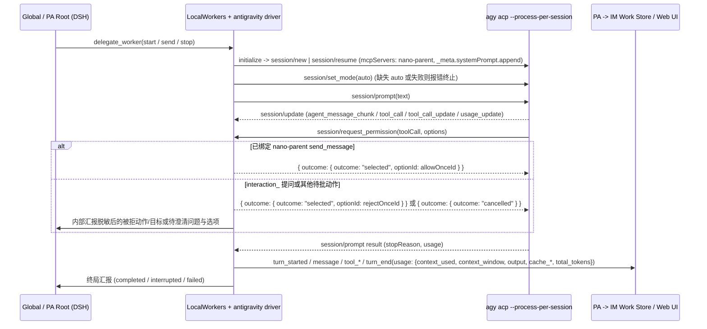

# feat-788: 本机 Global worker 支持 Antigravity CLI — 技术方案

> 对齐: spec.md v1

## Changelog

## 现状分析

### 涉及范围

- `packages/product-contracts/src/worker-runtimes.ts`、`src/work-event-codec.ts`（`src/index.ts` 已包含 `export * from './worker-runtimes.js'`）：定义 `cliWorkerRuntimes` / `workerRuntimes` / `WorkerRuntime` 以及 Work 事件 `worker_state` 与 `turn_end.usage` 的运行时校验。当前 `work-event-codec.ts` 硬编码了 `['dsh', 'codex', 'claude']`；对 `turn_end.payload.usage` 已放行 `context_used`、`context_window`、`output`、`cache_read_tokens`、`cache_total_input_tokens` 与 `total_tokens`，并要求每个已出现子字段均为有限非空 `number`。
- `apps/node/src/configuration.ts`：校验 `gateway.worker_runtime` 并注入 `AgentConfiguration.workerRuntime`（当前硬编码允许 `dsh`、`codex`、`claude`）。
- `packages/dsh-integration/src/local-workers/`（`cli-process.ts`、`drivers.ts`、`work-details.ts`、`manager.ts`）：负责启动本机外部 CLI 子进程、绑定 `workerReportBridge` 父子内部 MCP `send_message`、拦截待授权动作、归一化过程明细与轮次用量。当前 `manager.ts` 的存储 schema 硬编码 `z.enum(['dsh', 'codex', 'claude'])`（注：`LocalWorkers.publishTurns` 产出的 `worker_state.turn_usage` 仅用于无 `detail` 明细的原生 `dsh` 子会话，外部 CLI 仅通过 `turn_end` 明细事件传递统计）；`work-details.ts` 的 `WorkerTurnDetails.end` 仅接收 `total: number | null`，未透传上下文窗口和细分 token。
- `packages/personal-assistant/src/inbox.ts`：`deletionSessionIds` 从待清理原生 DSH 会话集合中排除外部 CLI worker，当前 SQL 硬编码 `IN ('codex','claude')`。
- `apps/im-server/src/work-records.ts`：校验 `scope === 'worker'` 会话是否允许写入过程明细事件（当前硬编码 `['codex','claude']`），并在 `turn_end` 持久化 `turn.usage`（已原生支持 `context_used`、`context_window`、`output`、`cache_read_tokens`、`cache_total_input_tokens`、`total_tokens` 并直接通过 `updateWorkLifetimeUsage` 更新派工关系图的累计 `agent_work_lifetime_usage`）。
- `src/IM/frontend/src/features/settings/agents/agent-work-api.ts`、`agent-work-panel.tsx`：维护 `workerRuntimeNames` 显示名映射及 `externalWorker` 判定（禁用 DSH 原生轨迹 iframe、展示持久化 Work 明细）。`agent-work-presenters.tsx` 中的 `WorkUsage` 与 iOS `AgentWorkView.swift` 已完整支持展示 `context_used / context_window` 进度条、百分比、本轮输出、缓存命中与本轮总 token。
- `SPEC.md`、`AGENTS.md`、`docs/operations/gateway.md`：记录一级外部 worker 允许的本机 CLI 范围与配置说明。

### 既有约束

- 遵循 `AGENTS.md` 与 `tests/contract/test_runtime_dependency_contract.py`：仅 `packages/dsh-integration` 管理执行运行时与本机一级 CLI worker，`apps/node` 仅通过 `@nano/dsh-integration/client` 通信。同时严格遵守跨包非对称导入白名单：`packages/product-contracts/src/` 内部仅用相对路径 `./worker-runtimes.js`；后端包（`apps/node`、`packages/dsh-integration`、`packages/personal-assistant`、`apps/im-server`）仅从根入口 `@nano/product-contracts` 导入；Web 前端（`src/IM/frontend/src/`）仅从子路径 `@nano/product-contracts/worker-runtimes` 导入。
- 外部 worker 保持与 Nano 长期记忆解耦（不注入 `MEMORY.md` 或记忆工具，Dreaming 与 `source_history` 通过 `nanoWorkers.isWorker` 排除全部一级 worker）。
- 外部 worker 仅通过绑定的 `nano-parent` MCP `send_message` 向所属父 Global 会话回报，不持有 IM 凭据或公开聊天工具；未获准动作不得挂起等待人工卡片或使用 `--dangerously-skip-permissions` 越权放行。
- 遵循 `docs/specs/im/response-metrics.md` 与 `work-event-codec.ts`：未报告的统计子字段必须省略（`undefined`，严禁写入 `null` 或把缺失缓存计数伪造为 `0`）。

### 可复用能力

- **直接复用**：`LocalWorkers`（`manager.ts`）的持久状态表、冷启动中断恢复与去重汇报、`workerReportBridge`（`report-bridge.ts`）的本地 Unix socket stdio MCP 桥、`GlobalAgent.projectRootPage` 的 `workerChanges` 同步、`apps/im-server` 的 `agent_work_turns` / `agent_work_lifetime_usage` 存储以及前端 `WorkUsage` 组件。
- **扩展修改**：
  - 将各包分散硬编码的 `['codex', 'claude']` / `['dsh', 'codex', 'claude']` 按各包合法导入路径统一收敛到 `cliWorkerRuntimes` / `workerRuntimes`。
  - 扩展 `CliProcess` 支持：(1) 进程级环境变量覆盖/删除（`Record<string, string | undefined>`）；(2) `JSON.parse` 前的 `onStdoutLine` 钩子以识别非 JSON 未登录提示；(3) `resolve` 保留结构化错误对象（含 JSON-RPC `code`）；(4) 进程树退出后的 `onCleanup` 钩子以可靠清理专属 `TMPDIR`。
  - 扩展 `WorkerTurnDetails`：`toolStart` 摘要提取兼容 Antigravity PascalCase 字段（`toolSummary`、`CommandLine`、`Path`）；`end` 接受 `number | WorkUsage | null`（兼容既有 `codex` / `claude` 传数值总量的调用，外部 CLI 继续只经 `turn_end.payload.usage` 单一路径上报统计，不写 `worker_state.turn_usage`）。
  - 在 `drivers.ts` 新增基于标准 ACP（stdio JSON-RPC 2.0）的 `antigravity` 驱动。
- **不采用**：不引入 `@botiverse/oar` 或 `effect-acp` 第三方重依赖；不采用 Raft 旧版管道 `agy --print` 或 `--dangerously-skip-permissions`。

### 相关历史

- `feat-778-local-worker-runtimes`：建立 `gateway.worker_runtime`、`delegate_worker`、`LocalWorkers`、`codex` / `claude` 驱动、持久化 Work 明细及长期记忆解耦基线。本 unit 在不改变既有职责划分的前提下将 `antigravity` 纳入同一体系，并打通外部 worker 轮次的上下文窗口统计展示。

## 架构总览

整体模块边界保持不变：`NodeConfiguration` 解析 `gateway.worker_runtime: 'antigravity'` 并传给 `dsh-integration`；`LocalWorkers` 在 `drivers.ts` 中通过 `agy acp --process-per-session` 启动受管子进程，经 stdio JSON-RPC 驱动会话创建/恢复、强制切换 `auto` 模式、权限拦截、流式工具与文本投影以及轮次上下文/Token 采集，生成的 `RuntimeWorkerDetail`（含 `turn_end.payload.usage`）沿既有 `PA -> IM Server -> Web IM Work` 链路落库、更新累计 token 并呈现上下文占用。本次无新增视觉布局或交互形态（复用既有框架标签与 `WorkUsage` 统计面板），无需前端原型文件。



## 关键决策

1. **统一以 `antigravity` 作为配置与协议枚举值，UI 显示名为 `Antigravity`，按各包合法边界共享枚举常量**
   - **理由**：与 `claude`（CLI 为 `claude`，UI 为 `Claude Code`）命名层次一致，且与 T3 Code / Raft 的 runtime 标识统一。按 `test_runtime_dependency_contract.py` 白名单分别在包内（`./worker-runtimes.js`）、后端（`@nano/product-contracts`）和前端（`@nano/product-contracts/worker-runtimes`）消费同一份 `cliWorkerRuntimes` / `workerRuntimes`，消除 `apps/node`、`work-event-codec.ts`、`manager.ts`、`inbox.ts`、`work-records.ts`、`agent-work-panel.tsx` 的手写枚举分叉。
   - **拒绝备选**：跨前后端混用同一子路径或继续手写数组——前者违反仓库依赖契约测试，后者易在删除清理或 Work 明细准入中遗漏。

2. **使用 `agy acp --process-per-session` + `session/resume` 常驻会话协议，隔离清理 `TMPDIR` 并净化登录与浏览器环境变量**
   - **理由**：本机实测 `agy 1.5.16` 支持 ACP `sessionCapabilities.resume`（不重放历史工具调用，且接受最新 `mcpServers` 重新绑定本次 `workerReportBridge` 的临时 Unix socket）。启动环境剔除 `SSH_CLIENT` / `SSH_CONNECTION` / `SSH_TTY`（保证 SSH 启动的 Gateway 仍读取宿主机系统登录态而非空文件凭据）及 `BROWSER`（配合绝不调用 ACP `authenticate`，杜绝无人值守节点在未登录时弹出系统浏览器挂起），同时设置 `AGY_CLI_DISABLE_AUTO_UPDATE=true`、`NO_COLOR=1`。针对 PyInstaller 每次启动解压约 1 GB 的特性，为每次进程启动分配专属 `TMPDIR`（Windows 同步设 `TEMP`/`TMP`）并在 `CliProcess` 退出清理钩子中删除。
   - **风险与缓释**：恢复已有 `sessionId` 时若目标 `agy` 未声明 `sessionCapabilities.resume` 或 `session/resume` 返回错误，直接抛出明确错误交回父 Global，绝不静默新建空白会话。

3. **强制启用原生 `auto` 模式（缺失则报错终止），并按标准 ACP `session/request_permission` 结构与工具缓存完成白名单放行和脱敏拒批**
   - **理由**：实测 `agy 1.5.16` 在 `session/new` 和 `session/resume` 后 `currentModeId` 均回到 `default` 且 `availableModes` 含 `auto`。由于 Nano 外部 worker 宿主无状态拒绝除 `nano-parent` 外的全部审批请求，依赖 CLI 自身 Auto 分类器在同会话收到后续补充授权后重新判定，因此新建与恢复后均必须确认 `availableModes` 包含 `auto` 且 `session/set_mode({ sessionId, modeId: 'auto' })` 成功；否则立即关闭进程并报错交回父 Global（与 `claude` 驱动一致，绝不静默回退 `default` 造成死锁）。
   - **权限帧与工具识别**：ACP 允许 `session/request_permission` 的 `params.toolCall` 仅携带 `toolCallId` 而省略 `title` / `kind` / `rawInput`，驱动先合并前序 `tool_call` / `tool_call_update` 跟踪缓存后再判定：
     - 仅当合并后 `kind !== 'execute'`、`rawInput` 不含 `CommandLine` / `command_line` / `commandLine` / `command` 字段，且 `title` 匹配 `/^Run mcp_nano-parent_send_message\??$/`（或匹配 `/^MCP Tool send_message\??$/` 且 `rawInput.ServerName === 'nano-parent' && rawInput.ToolName === 'send_message'`）时，从 `params.options` 查找 `kind === 'allow_once'`（次选 `'allow_always'`）的 `optionId`，回复 `{ outcome: { outcome: 'selected', optionId } }`（无匹配项则 `{ outcome: { outcome: 'cancelled' } }`）。
     - 当 `toolCallId.startsWith('interaction_')`（原生提问工具）时，回复 `{ outcome: { outcome: 'cancelled' } }`，并将问题标题与 `params.options` 的选项文本通过 `events.report` 上报父 Global。
     - 其余所有请求从 `params.options` 查找 `kind === 'reject_once'` 的 `optionId`，有则回复 `{ outcome: { outcome: 'selected', optionId } }`，无则回复 `{ outcome: { outcome: 'cancelled' } }`，并用扩展支持 PascalCase 路径/命令字段的 `actionTarget` 脱敏参数及 `locations` 后上报父 Global。`clientCapabilities` 固定声明 `fs: { readTextFile: false, writeTextFile: false }, terminal: false`。

4. **处理运行中二次 `session/prompt` steer 早结语义，仅经 `turn_end.payload.usage` 单路径上报严格非空、缺省省略的上下文与 Token 统计**
   - **理由**：在 `agy acp`（≥ 1.5.0）中，运行中再次发送 `session/prompt` 会直接 steer 当前循环并使前序挂起请求提前返回，最终结果落在最后一个在途 `session/prompt` 响应上。驱动按活跃轮次维护在途请求集合与最新请求 ID：中途追加仅记录同轮用户消息并累加提前结算请求已产生的输入/输出/缓存计数，仅当最后一个在途 `session/prompt` 结算时才调用 `events.end`（且将 `stopReason === 'cancelled'` 映射为 `'interrupted'`、将 `'refusal'` 或 `'error'` 映射为 `'failed'`），避免 `LocalWorkers.onEnd` 在 steer 中途误关活跃进程，也不会把配额耗尽（`refusal`）误报为成功。
   - **统计口径与单路径落库**：外部 CLI worker 不写入 `worker_state.turn_usage`（该字段专供无 `detail` 明细的原生 `dsh` 子会话），统一只通过 `WorkerTurnDetails.end` 写入 `turn_end.payload.usage`，由 `apps/im-server/src/work-records.ts` 自动落库单轮 `turn.usage` 并通过 `updateWorkLifetimeUsage` 累加派工关系图的 `total_tokens`。子字段遵循严格可选非负整数规则（缺失一律省略为 `undefined`，严禁 `null`）：
     - `context_used` / `context_window`：仅取本轮最后一次有效 `usage_update` 的非负整数 `used` 与正整数 `size`（跨 steer 不累加）。
     - `output` / `total_tokens`：对本轮已结算的 `session/prompt` 响应，若均含合法非负整数 `inputTokens` 与 `outputTokens`，累加 `totalInput += inputTokens + (cachedReadTokens ?? 0)`、`totalOutput += outputTokens`，写入 `output: totalOutput` 与 `total_tokens: totalInput + totalOutput`。
     - `cache_read_tokens` / `cache_total_input_tokens`：仅当本轮**全部**已结算 `session/prompt` 均显式返回非负整数 `cachedReadTokens` 时才填入 `cache_read_tokens` 与 `cache_total_input_tokens: totalInput`，绝不将未报告缓存伪造为 `0 (0%)`。

## 接口与数据流

### 契约与配置接口

- `packages/product-contracts/src/worker-runtimes.ts`（`src/index.ts` 保持既有 `export * from './worker-runtimes.js'`）：
  ```ts
  export const cliWorkerRuntimes = ['codex', 'claude', 'antigravity'] as const;
  export const workerRuntimes = ['dsh', ...cliWorkerRuntimes] as const;
  export type WorkerRuntime = (typeof workerRuntimes)[number];
  ```
  导入路径按包严格区分：
  - `packages/product-contracts/src/work-event-codec.ts`：导入 `'./worker-runtimes.js'` 的 `workerRuntimes`。
  - `apps/node/src/configuration.ts`、`packages/dsh-integration/src/local-workers/manager.ts`、`packages/personal-assistant/src/inbox.ts`、`apps/im-server/src/work-records.ts`：从 `'@nano/product-contracts'` 导入 `workerRuntimes` / `cliWorkerRuntimes`。
  - `src/IM/frontend/src/features/settings/agents/agent-work-api.ts`、`agent-work-panel.tsx`：从 `'@nano/product-contracts/worker-runtimes'` 导入 `cliWorkerRuntimes` 与 `type WorkerRuntime`，`workerRuntimeNames` 补齐 `antigravity: "Antigravity"`。
- `apps/node/src/configuration.ts`：非法 `gateway.worker_runtime` 报错 `'gateway.worker_runtime must be dsh, codex, claude, or antigravity'`。
- `packages/dsh-integration/src/local-workers/work-details.ts` & `drivers.ts`：
  - `WorkerTurnDetails.end(state: string, usage: number | WorkUsage | null = null, error?: string)`：传入 `number` 时生成 `{ total_tokens: usage }`，传入非空 `WorkUsage` 对象时过滤掉 `undefined` 键后写入 `turn_end.payload.usage`（无有效键或为 `null` 时省略 `usage`）。
  - `TurnEvents.end(id: string, state: CliEndState, text: string, usage: number | WorkUsage | null = null)`：原样传给 `this.details.end(state, usage, text)`，`onEnd(id, state, text)` 签名保持不变。

### ACP 协议状态与事件映射（`cli-process.ts` & `drivers.ts`）

- **`CliProcess` 扩展（`cli-process.ts`）**：
  - 构造函数新增可选配置 `{ env?: Record<string, string | undefined>; onStdoutLine?: (line: string) => Error | undefined; onCleanup?: () => Promise<void> }`。
  - 环境变量基于 `nativeCliEnvironment()` 应用 `env`（值为 `undefined` 时删除对应键）。
  - stdout 逐行读取时先调用 `onStdoutLine?.(line)`：对 `antigravity`，若行匹配未登录引导（如 `Open the following link to authenticate`），立即返回明确的未登录 `Error('Antigravity CLI is not signed in on this machine')` 并关闭进程，避免落入 `JSON.parse` 报 `SyntaxError`。
  - `resolve(id, result, error?: string | { code?: number; message?: string })` 保留错误 `code`（如 `-32000` 或含 `"No browser is available here"` / `"not logged in"` 的消息），统一归一化为可读的未登录错误。
  - `close()` 在 `terminateRuntimeTree` 与进程 `close` 事件完成后执行 `onCleanup?.()`（删除当次 `mkdtemp` 创建的专属 `TMPDIR`）。
- **握手与会话建立（`drivers.ts`）**：
  1. 创建专属临时目录 `runtimeTmpDir`，启动 `agy acp --process-per-session`（`cwd = options.cwd`，环境剔除 `SSH_CLIENT`/`SSH_CONNECTION`/`SSH_TTY`/`BROWSER`，设置 `TMPDIR`/`TEMP`/`TMP`、`AGY_CLI_DISABLE_AUTO_UPDATE='true'`、`NO_COLOR='1'`、`PYTHONUNBUFFERED='1'`）。绝不调用 ACP `authenticate`。
  2. 发送 `initialize`（`protocolVersion: 1`，`clientInfo: { name: 'nano_worker', title: 'Nano worker', version: '1' }`，`clientCapabilities: { fs: { readTextFile: false, writeTextFile: false }, terminal: false }`）。检查 `agentCapabilities._meta?.antigravity?.systemPrompt?.append === true`：支持则构造 `_meta = { antigravity: { systemPrompt: { append: options.instructions } } }`；若旧版不支持且为新建会话，仅在首条发往 wire 的 `session/prompt` 文本前以分隔符拼接 `options.instructions`，写入 `events.details.message(id, 'user', text)` 的展示记录仍只保留原始任务文本 `text`。
  3. 将 `options.mcp` 转为 ACP `McpServerStdio`：`[{ name: 'nano-parent', command: options.mcp.command, args: options.mcp.args, env: Object.entries(options.mcp.env).map(([name, value]) => ({ name, value })) }]`。
  4. 无 `options.sessionId` 时调用 `session/new`；有 `options.sessionId` 时调用 `session/resume`（若未声明 `sessionCapabilities.resume` 或返回的 `sessionId` 不一致或请求报错，直接抛错关闭，不静默新建会话）。读取 `configOptions` 中 `id === 'model'` 的 `currentValue` 作为初始 `model`。
  5. 校验返回的 `modes?.availableModes` 包含 `'auto'` 并调用 `session/set_mode({ sessionId, modeId: 'auto' })`；缺失 `'auto'` 或切换失败时关闭进程并抛出明确错误。
- **流式通知、工具配对与停止**：
  - `agent_message_chunk`：按顺序拼接文本分片；在遇到 `tool_call` 或本轮结算前，将已缓冲的非空助手段落作为一条完整 `assistant` 消息写入 `WorkerTurnDetails`。
  - `tool_call` / `tool_call_update`：按 `toolCallId` 维护 `{ name, title, kind, rawInput }` 缓存。首次见到 `toolCallId` 时从 `update.name ?? update.toolName ?? normalizeTitle(update.title) ?? update.kind ?? 'tool'`（其中 `normalizeTitle` 去掉首帧 `Run ` / `Running ` 前缀与末尾 `?`）派生非空 `name` 并触发 `toolStart(callId, name, rawInput)`；后续帧补全或更新 `rawInput` 时刷新缓存；状态进入 `completed` / `failed` / `cancelled` 时，解包 `content` 或 `rawOutput`（剥离 `{ type: 'image', data }` 与 `data:image/...` 内联 base64 数据并对超长文本做 16,000 字符有界截断），调用 `toolEnd(callId, cached.name, sanitizedOutput, status !== 'completed', { reason: status === 'cancelled' ? 'interrupted' : undefined, args: cached.args })` 回写完整参数。
  - `usage_update`：记录有效非负整数 `used` 为 `context_used`，正整数 `size` 为 `context_window`。
  - `config_option_update`：若 `id === 'model'` 且 `currentValue` 非空，更新当前 `model`。
  - `send(text)` 与 `stop()`：单次输入超过 185,000 UTF-8 字节时提前报错拒绝。`stop()` 发送 `{ jsonrpc: '2.0', method: 'session/cancel', params: { sessionId } }` 通知并有界等待在途轮次以 `interrupted` 结束，随后关闭进程并回收专属 `TMPDIR`。

### 模型可见上下文与边界（Agent Context）

- **Consumer 1 — Global / PA Root**：`delegate_worker` 工具签名、系统提示词与回传前缀保持不变。Antigravity 被拒动作（合并前序 `toolCallId` 缓存并脱敏文件正文后的命令/路径/原因）或 `interaction_` 提问（问题与选项列表）经既有 `onReport` 以 `Worker <label> (<workerId>): ...` 注入父会话，遵循 `inboxSourceInstructions` 的非用户授权边界。
- **Consumer 2 — Antigravity Worker**：
  - **Context Lifecycle**：新建与每次 `session/resume` 均通过 `_meta.antigravity.systemPrompt.append` 注入 `LocalWorkers` 固定角色说明（`instructions`），保留工作区仓库规则，不注入 Nano `MEMORY.md`、记忆目录或产品聊天工具；仅挂载 `nano-parent` 的 `send_message` MCP 工具并由宿主权限白名单自动放行。
  - **Interactions & Validation**：`LocalWorkers` 将 `runtime: 'antigravity'` 记录在 `nano_local_workers` 表，`isWorker(workerId)` 返回 `true`，因此 `DescendantReader`、`Trajectory` 与 `MemorySources` 自动将其排除在原生子轨迹暴露、Dreaming 提炼及 `source_history` 回查之外；`personal-assistant` 删除清理（`inbox.ts`）将其归为外部 worker，不误送 DSH 原生会话删除。

## 本次审查安排

| 必须回答的问题 / 对应目标 | 能力与使用阶段 | 证据方法、范围与已有定位 |
|---|---|---|
| 配置、ACP 生命周期、Auto 强校验、权限帧与工具缓存合并、steer 早结、单路径非空统计、`TMPDIR` 回收与跨包导入契约是否正确闭合 | `change-code-review`（实施后独立代码与最终 delta 校对） | 窄单测（`apps/node/tests/configuration.test.ts`、`packages/dsh-integration/tests/local-worker-conformance.test.ts`、`local-worker-drivers.test.ts`、`local-worker-manager.test.ts`、`packages/personal-assistant/tests/inbox.test.ts`、`apps/im-server/tests/e2e/work-summaries.test.ts`、`src/IM/frontend/src/features/settings/agents/agent-work-panel.test.tsx`）+ `tests/contract/test_runtime_dependency_contract.py` + 本机真实 `agy 1.5.16` 派工/续做/停止与上下文 Token 验证 |
| Antigravity worker 与父 Global 的角色提示、MCP 白名单放行、权限拒绝/提问脱敏回报与长期记忆隔离是否无越界 | `agent-context-review`（设计自检与实现审查并入代码审查） | 核验真实 `agy 1.5.16` 握手与会话恢复帧（`_meta.antigravity.systemPrompt.append`、`mcpServers`、`auto` 模式、无模型覆盖）、`nano-parent` `send_message` 直通与越界/提问回报格式，以及 `isWorker` / Dreaming 排除测试 |

## 契约层增量 (delta-spec)

- `gateway` (`global-agent`): `docs/specs/gateway/global-agent.md` → [specs/gateway/global-agent.md](specs/gateway/global-agent.md)（在机器级一级派工框架中增加 Antigravity CLI）。
- `gateway` (`tool-approval`): `docs/specs/gateway/tool-approval.md` → [specs/gateway/tool-approval.md](specs/gateway/tool-approval.md)（明确外部 CLI worker 在框架 Auto 下放行已绑定父级通信工具，并拦截其他待定权限请求与交互式提问交回原 Global）。
- `gateway` (`agent-capabilities` / `service-lifecycle`): `no spec delta`（现行条款已以“外部 worker / 本机 CLI”统称记忆隔离与节点进程回收，无需重复枚举具体 CLI 名）。
- `im` (`agent-work`): `docs/specs/im/agent-work.md` → [specs/im/agent-work.md](specs/im/agent-work.md)（在派工关系与工作记录框架中纳入 Antigravity，并明确外部 worker 报告上下文窗口与细分 token 时的轮次统计展示）。
- `im` (`ios-client` / `response-metrics`): `no spec delta`（iOS 客户端与统计指标口径已原生消费服务端字符串与可选 `WorkUsage` 字段，缺失缓存不作零命中处理保持不变）。

## 风险与回退

- **风险 1：`agy` PyInstaller 临时解压占盘**：每次激活解压约 1 GB；若进程异常退出未清理会堆积磁盘。**缓释**：在 `CliProcess.close` 清理钩子与 `openCliWorker` 初始化失败路径统一 `rm -rf` 专属 `TMPDIR`。
- **风险 2：`agy` 旧版本或受限账号不支持 `auto` 模式或 `session/resume`**：若静默降级会导致后续续派死锁或丢失原会话。**缓释**：握手阶段严格校验 `sessionCapabilities.resume`（续做时）与 `availableModes` 中的 `auto` 并确认 `session/set_mode('auto')` 成功，不满足时立即关闭进程并向父 Global 返回明确原因。
- **回退方案**：将本机 `gateway.worker_runtime` 改回 `dsh`、`codex` 或 `claude` 并重启 Gateway，新委派立即切回原框架；已记录的 Antigravity 历史 Work 记录保留只读可查。

## 一次性部署迁移

无。默认 `gateway.worker_runtime` 仍为 `dsh`，既有节点配置、SQLite 表结构与历史 Work 记录均前向兼容，无需一次性数据或配置迁移。

## Runbook for Reviewer

| 服务 | 停止命令 | 启动命令 | 健康检查 |
|---|---|---|---|
| 隔离 E2E 栈（仅真实全栈联调需要；协议与单测无需常驻服务） | `./scripts/e2e-down.sh --wt "$PWD"` | `./scripts/e2e-up.sh --profile daily --wt "$PWD"` | `python3 scripts/dev_host.py check` 与 `.e2e-daily.json` 中 IM `/healthz` 200 |

**Review 驱动方式**: 先核对窄测试、契约测试与 `scripts/docs-check`；结合本机真实 `agy`（`agy --version`）在独立临时工作区对 `openCliWorker({ runtime: 'antigravity', ... })` 执行真实派工、`nano-parent` 内部消息、原会话续做、停止及 Work 轮次上下文/Token 核验，验证结束后确认临时进程与专属 `TMPDIR` 已全部回收。

**验收前置**: 本机 `PATH` 可解析已登录的 `agy` CLI（`which agy && agy --version`，当前开发机为 `/Users/czj/.local/bin/agy` `1.5.16`）。

## Milestones

| ID | 标题 | 依赖 | 并行组 | 范围 | 退出标准 |
|---|---|---|---|---|---|
| M1-antigravity-worker | 本机 Antigravity 一级 worker 与上下文 Token 展示 | 无 | G1 | `packages/product-contracts`、`apps/node`、`packages/dsh-integration`、`packages/personal-assistant`、`apps/im-server`、`src/IM/frontend`、`SPEC.md`、`AGENTS.md`、`docs/operations/gateway.md` 及对应测试 | [reviewer] 配置 `gateway.worker_runtime: antigravity` 后，新派工使用本机 `agy` 登录账号与默认模型完成交办、同会话续做与停止；未获准动作或交互提问不挂起、不放行并交回父 Global；Web IM Work 活动弹窗、派工关系与工作记录正确显示 `Antigravity` 框架、过程明细、累计 token 以及轮次上下文已用/窗口上限、输出和缓存命中统计；长期记忆保持解耦。[worker] 枚举收敛、ACP 握手/续做/steer 早结/取消/拒绝、Auto 强校验、权限与提问缓存合并脱敏、单路径非空统计、`TMPDIR` 回收及 Work 上下文统计有窄测试覆盖并通过；完成本机真实 `agy 1.5.16` 实测取证并记录到 unit 证据；`test_runtime_dependency_contract.py` 与受影响包构建/测试全绿。 |
