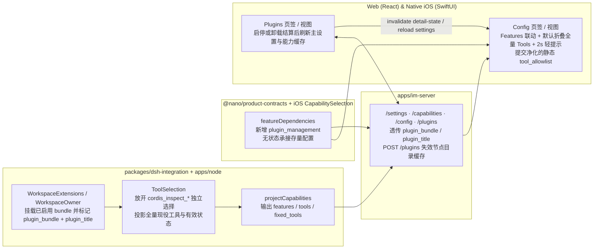
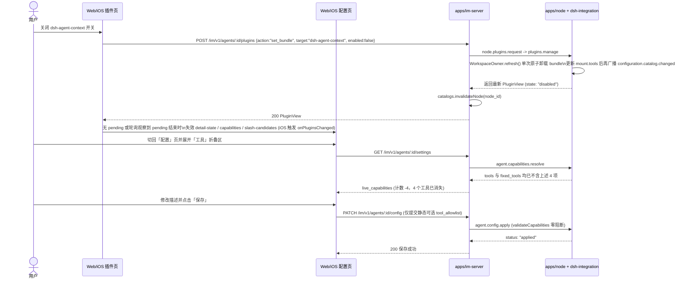

# feat-791: 插件开发管理特性收编与全量工具及插件缓存联动 — 技术方案

> 对齐: spec.md v1

## Changelog

## 现状分析

### 涉及范围

- [packages/product-contracts/src/capabilities.ts](../../../packages/product-contracts/src/capabilities.ts)：浏览器与服务端共享的运行特性依赖表（`featureDependencies`）、候选配置校验（`validateCapabilities`）、单步点击联动（`changeCapability`）、模式固定工具（`fixedTools`）与阻断结构（`CapabilityBlock`）。
- [packages/dsh-integration/src/capabilities.ts](../../../packages/dsh-integration/src/capabilities.ts)、[capability-state.ts](../../../packages/dsh-integration/src/capability-state.ts)、[workspace-tools.ts](../../../packages/dsh-integration/src/workspace-tools.ts)、[plugin-development.ts](../../../packages/dsh-integration/src/plugin-development.ts)：DSH 原生工具目录投影、运行时有效工具集过滤（`ToolSelection`）、能力撤回占用预留（`CapabilityState`）、工作区插件树挂载与工具来源归属（`WorkspaceExtensions` / `WorkspaceOwner`），以及公开插件 API 边界说明（`describePluginApi`）。
- [apps/node/src/capabilities.ts](../../../apps/node/src/capabilities.ts)：将 DSH 实时工具与技能目录投影为上报 IM 的节点/Agent 能力快照（`projectCapabilities`）。
- [apps/im-server/src/agent-creation.ts](../../../apps/im-server/src/agent-creation.ts)、[agent-settings.ts](../../../apps/im-server/src/agent-settings.ts)、[control.ts](../../../apps/im-server/src/control.ts)、[control-routes.ts](../../../apps/im-server/src/control-routes.ts)：能力目录字段透传（`allowlistOptions`）、配置展示投影（`configurationDisplay`）、新建 Agent 默认特性展开及配置更新校验。
- [src/IM/frontend/src/features/settings/agents/pill-selector.tsx](../../../src/IM/frontend/src/features/settings/agents/pill-selector.tsx)、[capability-editor.tsx](../../../src/IM/frontend/src/features/settings/agents/capability-editor.tsx)、[agent-detail-page.tsx](../../../src/IM/frontend/src/features/settings/agents/agent-detail-page.tsx)、[agent-create-page.tsx](../../../src/IM/frontend/src/features/settings/agents/agent-create-page.tsx)、[agent-plugins-panel.tsx](../../../src/IM/frontend/src/features/settings/agents/agent-plugins-panel.tsx)、[im-agent-config-api.ts](../../../src/IM/frontend/src/features/settings/agents/im-agent-config-api.ts) 及 [zh.json](../../../src/IM/frontend/src/i18n/zh.json)、[en.json](../../../src/IM/frontend/src/i18n/en.json)：Web 助手新建/详情配置页的工具默认折叠区、100% 现役工具展示、2 秒自动淡出轻提示、静态 `tool_allowlist` 净化及插件变更后的跨分区缓存同步。
- [src/IM/ios/NanoIM/Features/Agents/CapabilitySelection.swift](../../../src/IM/ios/NanoIM/Features/Agents/CapabilitySelection.swift)、[AgentModels.swift](../../../src/IM/ios/NanoIM/Features/Agents/AgentModels.swift)、[AgentConfigView.swift](../../../src/IM/ios/NanoIM/Features/Agents/AgentConfigView.swift)、[AgentPluginsView.swift](../../../src/IM/ios/NanoIM/Features/Agents/AgentPluginsView.swift)：原生 iOS 端特性依赖联动、全量工具展示与计数、插件工具轻提示、静态 `tool_allowlist` 提交净荷及插件启停/卸载后的能力重读。
- [packages/personal-assistant/assets/skills/nanoassistant-docs/references/skills-tools-memory.md](../../../packages/personal-assistant/assets/skills/nanoassistant-docs/references/skills-tools-memory.md)、[scripts/e2e_catalog.py](../../../scripts/e2e_catalog.py)：PA 随包产品说明书的能力表述同步，以及隔离 E2E 目录同步脚本去除 `fixed_tools` 混写。

### 既有约束

- **运行时依赖红线（[AGENTS.md](../../../AGENTS.md)、[SPEC.md](../../../SPEC.md)）**：仅 `packages/dsh-integration` 通过 DSH 公开 exports（`@deepseek-ai/cordis`、`@deepseek-ai/cordis-plugin-loader`、`@deepseek-ai/dsh-plugin-manager`、`@deepseek-ai/dsh-tools`）读取工作区 bundle 与工具 schema，禁止 private import 或 monkey-patch 服务；`packages/product-contracts` 保持纯浏览器安全实现。
- **节点启动校验与配置指纹稳定**：[apps/node/src/main.ts](../../../apps/node/src/main.ts) 在节点启动时对全部存量 Agent 执行 `validateCapabilities` 并在阻断时直接报错退出；配置操作恢复与电脑端一键更新依赖 `canonicalAgentConfiguration` / `candidateFingerprint` 稳定，不能依赖手工改库或启动期隐式改写配置文件。
- **共享工作区授权与子会话缓存前缀边界（[agent-capabilities.md](../../../docs/specs/gateway/agent-capabilities.md)）**：显式空 `tool_allowlist` 或未启用 `plugin_manager` 的受限 Agent 在共享工作区中不得自动获得自装工作区插件的业务工具调用权；普通 `subagent` 与 Global 一级执行者始终排除 `plugin_manager` 与 `cordis_inspect_*`；`subagent_fork` 必须与父根会话保持完全一致的工具声明集合与顺序，不得破坏提示词缓存前缀。
- **双端统一轻提示交互（`feat-645`）**：受保护项被点击关闭时保持原态且不跳动，操作锚点附近弹出约 2 秒自动淡出的无按钮独立浮层轻提示，重复点击延长同一提示而不堆叠，工具胶囊旁不加额外依赖归属标注。

### 可复用能力

- **复用并扩展**：`@nano/product-contracts/capabilities` 与 iOS `CapabilitySelection.swift` 的声明式依赖图、校验及单步变更函数；Web `CapabilityToast`（[capability-editor.tsx](../../../src/IM/frontend/src/features/settings/agents/capability-editor.tsx)）与 iOS `.capabilityToast` 浮层提示管道（扩展阻断码与文案参数，不另建提示组件）。
- **改造**：`WorkspaceOwner.refresh`（[workspace-tools.ts](../../../packages/dsh-integration/src/workspace-tools.ts)）在既有 `pluginManager.listBundles()` 与 `EntryTree` 刷新周期内补齐工作区工具到所属已启用 bundle 名称及本地化标题的映射；Web `PillSelector`（[pill-selector.tsx](../../../src/IM/frontend/src/features/settings/agents/pill-selector.tsx)）在保持既有胶囊视觉与 `aria-pressed` 语义的基础上增加默认折叠摘要头，并移除 `source_group !== "workspace"` 硬过滤；`AgentPluginsPanel` 与 iOS `AgentPluginsView` 补齐变更落地后的主能力缓存刷新。
- **不采用**：不为已停用插件做未加载源码静态扫描猜工具名；不在静态 `tool_allowlist` 之上叠加插件内子工具黑名单；不新增 Goal 或 Workflow 运行特性。

### 相关历史

- `feat-610`：建立工作区 DSH 插件安装与「插件」页，将工作区工具标为 `source_group: 'workspace'` 并在 Web `PillSelector` 中过滤隐藏，防止动态工具名写入静态白名单。
- `feat-645`：建立运行特性依赖联动、保存边界阻断、关闭特性后允许单开底层工具且不反开特性，以及 Web/iOS 一致的 2 秒自动淡出轻提示。
- `feat-661`：默认启用内置工作区插件 `dsh-agent-context`（注册 `notes`、`history`、`new_context`、`get_context_remaining`）并归入 `fixedTools`；但编辑端将 `fixed_tools` 并入了提交的 `tool_allowlist`，导致在「插件」页关闭 `dsh-agent-context` 后既未刷新「配置」页主查询，又使四个工具在重读后落入 `missingTools` 红字报错并锁死保存按钮（iOS 残留“已保存，目录未报告”）。
- `feat-787`：升级 DSH 0.2.2 并接入 `cordis_inspect_list` / `cordis_inspect_query`，当时将其从可选工具目录滤除并硬绑在 `plugin_manager` 开关背后，造成用户无法在全量工具中看到它们、也难以从人话特性层管理“插件开发与自省”完整能力。

## 架构总览

本方案把助手能力设置收敛为职责清晰、数据同源的三层，并打通「插件」页与「配置」页的实时缓存闭环：

1. **运行特性层（Features）**：新增默认开启的 `plugin_management`（「插件开发与管理」），统一联动 `plugin_manager`、`cordis_inspect_list`、`cordis_inspect_query` 三个工具与 `nano-plugin-development` 技能。
2. **插件包生命周期层（Plugins）**：继续承载系统内置可选插件（`dsh-agent-context`，不可卸载但可启停）与工作区自装插件（可启停、可卸载）；插件停用或卸载落地后立即触发节点与前端主能力缓存失效。
3. **全量现役工具层（Tools）**：Web 与原生 iOS 默认收起并展示现役启用计数；展开后 100% 呈现当前运行时中实际挂载的全部工具（普通可选工具、`cordis_inspect_*`、模式固定工具、已启用插件提供的工具），已关闭插件的工具随运行时卸载即时消失；持久化的 `tool_allowlist` 严格只保存静态可选工具名。



上图展示了工作区插件工具归属元数据、运行特性依赖推导与跨分区缓存失效在运行时、IM 服务与双端设置界面之间的单向真值流向。

## 关键决策

### D1：**仅新增 `plugin_management`（「插件开发与管理」）运行特性，并在 DSH 与 Node 两级目录中将 `cordis_inspect_list` / `cordis_inspect_query` 还原为标准可选工具。**

- **理由**：用户日常需要的是“是否允许助手自行开发和管理工作区插件”这一人话级开关，而展开底层工具列表时又要求看到 100% 真实可配置与现役工具。将 `plugin_management` 声明为 `default_on: true`、`requires: { features: [], tools: ['plugin_manager', 'cordis_inspect_list', 'cordis_inspect_query'], skills: ['nano-plugin-development'] }`，同时打通全链路解耦：
  1. 在 [packages/dsh-integration/src/capabilities.ts](../../../packages/dsh-integration/src/capabilities.ts) 移除 `ToolSelection.catalog()` 对 `cordisInspectSet` 的过滤，将 `allowsCordisInspect(config, agent)` 收缩为纯工作区与角色门禁（`Boolean(config.workspace) && !(agent && (isOrdinaryChild(agent) || globalWorkRole(agent, config)))`），使根会话与 `subagent_fork` 按 `ToolSelection.selection()` 的有效工具选择决定是否开放每项检查工具；
  2. 在 [apps/node/src/capabilities.ts](../../../apps/node/src/capabilities.ts) `projectCapabilities` 第 50 行移除硬编码的 `'cordis_inspect_list'`、`'cordis_inspect_query'` 过滤（仅过滤 `'memory'`，二者 `default_on: true`）；
  3. 在 [packages/dsh-integration/src/capability-state.ts](../../../packages/dsh-integration/src/capability-state.ts) 移除 `pluginManagerHeld` 连带挂起判断（直接复用 `targets` 对实际被撤回工具名的挂起保护），并将 `prepare()` 中的特性对比切换为 `effectiveCapabilityFeatures`；
  4. 在 [packages/dsh-integration/src/plugin-development.ts](../../../packages/dsh-integration/src/plugin-development.ts) 将 `describe_api(topic: 'service')` 文案更新为“当 `cordis_inspect_list` 与 `cordis_inspect_query` 已启用时可用于只读检查”。按用户明确裁决，Goal 与 Workflow 保持原状，不新增其他 Feature。
- **拒绝备选**：继续在目录中隐藏 `cordis_inspect_*`（违反全量工具透明原则，也无法在关闭特性后单独启用只读检查）；或把 `cordis_inspect_*` 做成「插件」页条目（它们是宿主内置只读工具而非可独立启停的工作区插件包，放进插件页会混淆插件包生命周期与工具权限）。
- **风险**：解耦后需确保独立启用 `cordis_inspect_list` 时只放行该工具而不误放行 `cordis_inspect_query` 或 `plugin_manager`，由 `dsh-integration` 集成测试逐项断言。

### D2：**以全链路闭合的无状态推导平滑承接升级前存量 Agent 配置，不改写磁盘配置、不改变 CAS 指纹、无需一次性部署迁移。**

- **理由**：升级前已落盘的存量 Agent 配置中 `features.plugin_management` 为 `undefined`，且显式 `tool_allowlist` 不含此前被隐藏的 `cordis_inspect_list` / `cordis_inspect_query`。为避免局部编辑阻断、受限助手开关误亮、预览报错或无工作区启动崩溃，在 `@nano/product-contracts/capabilities`、运行时 `ToolSelection` 与 iOS `CapabilitySelection.swift` 统一实现闭合的纯函数 `effectiveCapabilityFeatures(draft, definitions, catalog?)` 与 `effectiveSelectedTools(draft, catalog?)`：
  1. **完整前置核验**：当 `draft.features?.plugin_management === undefined` 时，仅在同时满足以下三项条件时将有效 `plugin_management` 推导为 `true`，否则推导为 `false`：
     - `plugin_manager` 处于选中态（`draft.tool_allowlist === undefined || draft.tool_allowlist.includes('plugin_manager')`）；
     - `nano-plugin-development` 在当前 `skills_selection_mode`（完整覆盖 `default_discovery`、`explicit_denylist` 与 `explicit_allowlist`）下处于有效选中态；
     - 若传入了在线 `catalog`（如 `main.ts` 启动校验、`configuration.preview`、`configuration.prepare`），`plugin_manager`、`cordis_inspect_list`、`cordis_inspect_query` 与 `nano-plugin-development` 在该 `catalog` 中均实际存在（保证无 `workspace` 的配置自动落为 `false` 而不触发 `capability_unavailable` 崩溃）。
  2. **隐式伴随工具与编辑物化同步**：当 `draft.features?.plugin_management === undefined` 且存量配置允许 `plugin_manager`（且传入 `catalog` 时检查工具可用）时，`effectiveSelectedTools(draft, catalog)` 自动并入 `cordis_inspect_list` 与 `cordis_inspect_query`。在 `changeCapability()`（`product-contracts` 与 iOS `CapabilitySelection.swift`）把 `next.features` 物化为显式布尔字典的同时，必须用 `effectiveSelectedTools(draft, catalog)` 初始化 `next.tool_allowlist`——确保存量助手点击**任意无关工具/Skill/Feature** 时，`cordis_inspect_*` 同步落入显式草稿列表，`validateCapabilities(next, catalog)` 零误报。
  3. **展示与提示词预览同源**：Web `resolveEffectiveFeatures`（`agent-detail-page.tsx` / `agent-create-page.tsx`）、iOS `AgentConfigView.swift` 特性开关绑定、IM `configurationDisplay`（`apps/im-server/src/agent-settings.ts`）以及双端 `prompt-preview` 请求负载统一调用 `effectiveCapabilityFeatures` 与 `effectiveSelectedTools`，杜绝受限存量助手（`tool_allowlist: ['read']`）误亮开关或预览报 400/RPC 错误。
- **拒绝备选**：通过 `deployment-prompt.md` 或节点启动迁移批量改写 SQLite 与 `config.yaml`（电脑端自更新无人工部署 Agent 介入，且改写 `config.yaml` 会导致 IM 与 Node 间的 `candidateFingerprint` 失配）。
- **风险**：Web、Node/IM 契约包与 iOS Swift 端的存量承接条件必须完全同构；通过契约单测与双端单测锁定默认助手、受限白名单助手、`explicit_allowlist` 未含开发 Skill 助手及无 `workspace` 助手四类样本。

### D3：**Web 工具区改为默认折叠并显示启用计数，双端展开后展示当前已启用运行时的 100% 现役工具。**

- **理由**：日常管理主要操作上方的运行特性开关，默认折叠底层工具区可避免数十个英文函数名淹没配置首屏，同时与原生 iOS 既有的 `DisclosureGroup("工具 · ...")` 保持一致。展开后移除 Web `PillSelector` 中 `opt.source_group !== "workspace"` 的隐藏过滤，如实展示当前运行时全部现役工具（普通可选工具、`cordis_inspect_*`、模式固定工具、当前已启用插件提供的工具）。处于关闭状态的插件已从工作区 `EntryTree` 卸载，运行时不再持有其工具注册，因此其工具立即从全量列表与启用计数中消失，提供清晰的停用反馈。
- **拒绝备选**：保留已停用插件的历史工具名置灰展示（插件未加载时无法可靠静态预知动态注册的工具名，缓存旧快照会在插件代码修改或卸载后制造虚假状态）。
- **风险**：现有的 Web 组件单测和 E2E 若直接点击工具胶囊（如 `pill-selector-tools`），在默认折叠后需先展开折叠头；同步更新受影响的配置页单测并在组件上保留语义化 `aria-expanded` 折叠按钮。

### D4：**保持单次原子插件树挂载并在刷新期标注工具所属插件包，点击插件工具时复用 2 秒自动淡出轻提示指引前往「插件」页。**

- **理由**：用户在全量工具列表中看到 `notes` 或 `roll_dice` 时，若点击无法关闭却没有明确原因会产生困惑，若直接提示笼统的“基础能力”又掩盖了可以在「插件」页关闭的事实。`WorkspaceOwner.refresh()` 保持单次原子 `mount.tree.root.update(structuredClone(mountedRows))`（避免拆分 `root.update` 破坏跨插件 `inject` 服务依赖或重复挂载副作用），结合 `pluginManager.listBundles()` 做确定性归属：
  1. 内置 `dsh-agent-context` 的四项 `contextTools` 精确映射至该 bundle 的 `{ plugin_bundle, plugin_title }`；
  2. 当工作区仅启用 1 个自装插件时，其余工作区工具直接映射至该插件；当工作区启用多个自装插件时，由 `install_bundle` / `set_bundle(..., true)` 在激活前后记录新增工具差集并持久化至工作区插件目录内的 Nano 侧车索引 `nano-tool-owners.json`（停用/卸载时同步清理，进程重启后仍可精确命中；若存在未经管理接口手改落盘且无法区分的多插件工具，则不填 `plugin_title`，轻提示优雅降级为通用文案“此工具由已启用的工作区插件提供，请在「插件」页关闭”）。
  在 `CapabilityBlock.code` 中扩展 `'provided_by_plugin'` 与 `'plugin_requires_manager'`，完全复用 Web `CapabilityToast` 与 iOS `.capabilityToast` 的 2 秒自动淡出浮层机制，保持胶囊不跳动、工具旁零额外角标噪声。
- **拒绝备选**：逐个 bundle 多次调用 `mount.tree.root.update` 测差集（会触发跨插件 `inject` 中间态 `Missing service` 审计失败）；或允许在工具区单独关停插件子工具（违反 `spec.md` 非目标）。
- **风险**：侧车索引文件仅置于 `.nanoassistant/dsh-plugins/nano-tool-owners.json`（避开 `WorkspaceOwner` 监听的 `package.json` 与 `cordis.patch.yml`），读写容错且绝不影响插件实际加载。

### D5：**按当前 Agent 生效模式精确净化静态 `tool_allowlist`，并对称归一化脏状态基线与双端 `fixedTools` 映射。**

- **理由**：注意 `send_message` 仅在 `work_mode === 'global'` 时属于模式固定工具，而在 `single_thread` 普通模式下属于 `intelligent_ui` 必需的可选静态工具——若无区分地剔除“所有模式固定工具”会直接破坏普通模式 Agent 的消息能力与依赖校验。因此静态白名单净化函数 `sanitizeStaticToolAllowlist(tools, workMode, role, workspaceToolNames)` 严格定义为：
  1. **按当前模式与角色精准剥离**：仅剔除当前 Agent 自身模式与角色的固定工具 `fixedTools(workMode, role, false)`（`global` 含 `inbox`、`conversations`、`read_messages`、`search_messages`、`threads`、`send_message`、`download_attachment`、`delegate_worker`，且 `role === 'personal'` 追加 `personal_sources`、`send_user_message`；`single_thread` 为空集，完整保留 `send_message`）、四项 `contextTools`（`notes`、`history`、`new_context`、`get_context_remaining`）以及当前目录中 `source_group === 'workspace'` 的工具；在新建助手页（唯一可切换 `work_mode` 处）从 `global` 切为 `single_thread` 时，自动对当前已开启 Feature 重跑依赖闭包补齐 `send_message`。
  2. **脏状态对比基线对称归一化**：对 Web `AgentDetailPage` 的初始 `draft` 与 `baseConfig.current` / `sameEditableConfig`、以及 iOS `AgentConfigView` 的 `draft`、`dirty` 对比基线（`baseline`）与第 349 行“已保存，目录未报告”过滤列表统一套用 `sanitizeStaticToolAllowlist`，确保历史混入了 `notes` 或 `inbox` 的存量 Agent 打开配置页或从插件页返回时**不会误判为未保存草稿（`dirty = false`）**、不报缺失工具，并在下次用户真实编辑保存时自然落盘净化；真正未知的静态工具名仍正常提示目录缺失。
  3. **补齐双端本地 `fixedTools` 角色映射**：Web `capabilityCatalog(caps, mode, personal)` 按 `personal ? 'personal' : 'root'` 计算兜底 `fixed_tools`；iOS `CapabilitySelection.swift` 与 `AgentModels.swift` 同步补齐 `download_attachment` 及 `personal` 专属固定工具，与 `@nano/product-contracts/capabilities` 严格一比一对齐。
- **拒绝备选**：在 `missingTools` 中无差别忽略一切未知工具名（会掩盖节点降级导致的真实静态工具缺失）；或仅净化 `draft` 而不净化 `baseline`（会导致存量 Agent 打开即弹出未保存离开确认框）。
- **风险**：无（已在创建模式切换、存量脏状态与单会话 `send_message` 三个边界完全闭合）。

### D6：**消除 `WorkspaceOwner` 卸载广播早发竞态，并在「插件」页即时结算与异步等待结算两条路径上同步失效主能力缓存。**

- **理由**：实查代码发现两处时序竞态：① [packages/dsh-integration/src/workspace-tools.ts](../../../packages/dsh-integration/src/workspace-tools.ts) 第 311–315 行在 `await this.host.hmr.runExclusive(() => this.refresh())` 更新内存 `mount.tools` **之前**就调用了 `this.changed(agentId, true)`，若前端收到通知立即重拉，IM 的 5 分钟 `CatalogReads` 缓存会把卸载前的旧工具列表重新缓存；② 当 Agent 忙碌时，`plugins.manage` 先返回 `pending: { phase: 'waiting' }`，等空闲后才真正执行卸载。因此双端与运行时协同收口：
  1. 在 `WorkspaceOwner.execute()` 中，将 `for (const mount of this.mounts) this.changed(mount.config.agentId, true)` 移至 `await this.host.hmr.runExclusive(() => this.refresh())` 完成 `mount.tools` 更新**之后**（提前返回的 `restart-required` 分支单独保留通知）；同时在 [apps/node/src/main.ts](../../../apps/node/src/main.ts) `node.plugins.request` 中仅当返回结果无 `pending` 时立即调用 `publishCatalogChange()`（有 `pending` 时由后台结算完成后的 `configuration.catalog.changed` 通知精确触发）；
  2. Web `AgentPluginsPanel` 在 mutation 返回且无 `pending` 时，**以及**轮询观察到 `data.pending` 从非空变为 `undefined` 时，同步失效 `['settings', 'agents']`、`['agent-capabilities']` 与 `['chat', 'slash-candidates']`；
  3. 原生 iOS `AgentConfigView` 向 `AgentPluginsView` 传入 `onPluginsChanged` 回调，在即时完成及轮询 `pending` 结束时触发父视图重读 `/settings`（保留未保存草稿字段并按 D5 净化工具基线）。
- **拒绝备选**：仅在 `mutation.onSettled` 失效一次缓存（无法覆盖 `waiting -> applied` 异步结算，也会撞上 `refresh()` 完成前的旧快照）。
- **风险**：需为 `WorkspaceOwner` 卸载后目录读取顺序及前端 `pending -> undefined` 跳变补齐确定性单测。

## 接口与数据流

### 1. 契约与目录字段增量

1. **`@nano/product-contracts/capabilities`（及 iOS `CapabilitySelection.swift` 镜像）**：
   - `featureDependencies` 新增：
     ```ts
     {
       key: 'plugin_management',
       default_on: true,
       requires: {
         features: [],
         tools: ['plugin_manager', 'cordis_inspect_list', 'cordis_inspect_query'],
         skills: ['nano-plugin-development'],
       },
     }
     ```
   - `CapabilityBlock` 扩展插件工具提示码：
     ```ts
     export interface CapabilityBlock {
       code:
         | 'required_by_feature'
         | 'fixed_capability'
         | 'provided_by_plugin'
         | 'plugin_requires_manager'
         | 'active_tasks'
         | 'active_schedules'
         | 'capability_busy'
         | 'capability_unavailable';
       target: CapabilityTarget;
       required_by?: string[];
       plugin?: string;
     }
     ```
   - `CapabilityCatalog` 可选携带 `plugin_tools?: Record<string, { bundle: string; title: string | Record<string, string>; enabled: boolean }>`（或由客户端在点击 `source_group === 'workspace'` 胶囊时生成对应 `CapabilityBlock` 交给同一套 `show()` / `capabilityToast` 渲染），使已启用插件提供的工具在被点击关闭时返回 `code: 'provided_by_plugin'`（优先级高于 `fixed_capability`，因此 `dsh-agent-context` 的 `notes` 等工具提示“由插件提供，请在「插件」页关闭”而非不可关闭的模式固定工具）；若工作区安装了自装插件但当前 Agent 草稿已关闭 `plugin_manager`，该工具显示为未开启态，点击时返回 `code: 'plugin_requires_manager'` 说明需先开启「插件开发与管理」或 `plugin_manager` 才能调用该工作区插件工具。
   - 新增纯辅助函数 `effectiveCapabilityFeatures(draft, definitions, catalog?)`、`effectiveSelectedTools(draft, catalog?)` 与 `sanitizeStaticToolAllowlist(tools, workMode, role, workspaceToolNames)`，统一封装 D2 的存量无状态承接规则（含 `explicit_allowlist` / `explicit_denylist` 技能判定与 `catalog` 可用性守卫）和 D5 的按模式静态白名单净化，供 `validateCapabilities`、`changeCapability`（初始化 `next.features` 与 `next.tool_allowlist`）、`configurationDisplay`、双端草稿渲染与脏状态对比基线、`prompt-preview` 请求净荷以及运行时 `ToolSelection.selection` 共同调用。

2. **能力目录工具项透传（`dsh-integration` → `apps/node` → `apps/im-server` → Web / iOS）**：
   - `WorkspaceExtensions` 新增 `toolMetadata(agentId: string): Map<string, { plugin_bundle: string; plugin_title: PluginText }>`，由 `ToolSelection.catalog(agent)` 合并到 `source_group: 'workspace'` 工具条目：
     ```ts
     {
       name: string;
       description: string;
       default_on: boolean;
       source_group?: 'workspace' | null;
       enabled?: boolean;
       plugin_bundle?: string | null;
       plugin_title?: string | Record<string, string> | null;
     }
     ```
   - `apps/node/src/capabilities.ts` 的 `projectCapabilities`：仅过滤 `'memory'`（不再过滤 `'cordis_inspect_list'` 与 `'cordis_inspect_query'`，二者 `default_on: true`），并原样保留工作区工具的 `plugin_bundle` 与 `plugin_title`。
   - `apps/im-server/src/agent-creation.ts` 的 `allowlistOptions`：校验并透传可选的 `plugin_bundle`（非空字符串）与 `plugin_title`（字符串或语言键值字典）。

3. **全量工具展示与启用计数规则（Web & iOS 一致）**：
   - 可见工具全集 `visibleTools` = `capabilities.tools`（排除 `'memory'`）并上未出现在 `capabilities.tools` 中的当前模式静态 `fixedTools`（如离线或最小目录场景）及真实缺失的已存静态工具名。
   - 单项有效开启判定 `isToolOn(opt)`：
     - 若 `opt.source_group === 'workspace'`：当 `fixedTools.includes(opt.name)`（如已启用的 `dsh-agent-context` 四工具）时为 `true`；否则为 `draftAllowsPluginManager(draft) && opt.enabled !== false`；
     - 若为普通/固定工具：`fixedTools.includes(opt.name) || effectiveSelectedTools(draft).includes(opt.name)`。
   - 折叠头计数摘要直接统计 `visibleTools.filter(isToolOn).length`（Web 显示启用数/总现役数，iOS `DisclosureGroup` 显示 `工具 · <启用数>`），确保在「插件」页关停 `dsh-agent-context` 或自装插件后，列表项与折叠头计数同步减少。

### 2. 核心跨模块时序（插件停用与配置页联动）



上图展示了在「插件」页关闭系统内置可选插件后，无需刷新页面即可在「配置」页立即观察到全量工具列表与计数收敛、且保存其它配置不再被污染白名单阻塞的完整链路。

### 3. 双端界面与交互细节（免独立原型说明）

按前端体验规范，本次不新建新页面或复杂新布局：Web 完全复用既有 `Access` 卡片、`PillSelector` 胶囊样式（`oklch` 选中青色/未选浅灰胶囊）与 `CapabilityToast` 浮层，iOS 完全复用 `AgentConfigView` 既有的 `DisclosureGroup`、`Toggle` 与 `.capabilityToast`，因此不额外生成静态 HTML 或 SwiftUI 原型，直接固化以下交互契约：

- **运行特性区（Features）**：
  - Web `BehaviorCard` / `CreateBehaviorCard` 与 iOS `运行特性` 折叠组新增「插件开发与管理」（英文 `Plugin development & management`），帮助说明为“允许助手在当前工作区创建、安装、启停插件并只读检查宿主运行时契约”（英文 `Allow the assistant to author, install, and manage workspace plugins and inspect host runtime contracts read-only`）。
- **工具折叠区（Tools）**：
  - Web `PillSelector` 增加 `collapsible?: boolean` 与 `defaultExpanded?: boolean`（在助手新建页与详情配置页均设为 `collapsible={true}`、`defaultExpanded={false}`）：头部容器采用水平 flex 布局，左侧为独立的折叠切换 `<button type="button" aria-expanded={expanded}>`（含标签、箭头与等宽计数徽标如 `21 / 26`），右侧仅在传入 `labelAction` 时并列渲染兄弟 `<button type="button">`（「管理插件 →」，严禁按钮嵌套按钮；390px 窄屏下自动换行不挤压热区，`AgentCreatePage` 不传 `labelAction` 故不渲染该跳转）；展开后渲染全量工具胶囊组。
  - iOS `AgentConfigView` 保持 `DisclosureGroup` 默认收起，标题计数改为使用上述 `visibleTools.filter(isToolOn).count`，列表内渲染全部现役工具（含 `source_group == "workspace"` 工具），工具旁不增加任何归属副标题或角标。
- **2 秒自动淡出轻提示文案（中英双端一致）**：
  - 点击被已开启 Feature 保护的工具/技能：`请先关闭「{{feature}}」` / `Turn off “{{feature}}” first`（既有）。
  - 点击已启用插件提供的工具（`provided_by_plugin`）：已知所属插件名时提示 `此工具由插件「{{plugin}}」提供，请在「插件」页关闭` / `Provided by plugin “{{plugin}}”. Turn it off in Plugins`；极端手改多插件未命中索引时降级为 `此工具由已启用的工作区插件提供，请在「插件」页关闭` / `Provided by an enabled workspace plugin. Turn it off in Plugins`。
  - 点击因当前草稿关闭 `plugin_manager` 而处于未激活态的工作区自装插件工具（`plugin_requires_manager`）：`此工具由插件「{{plugin}}」提供，需先开启「插件开发与管理」或 plugin_manager` / `Provided by plugin “{{plugin}}”. Enable Plugin development & management or plugin_manager first`（未知插件名时省略包名）。
  - 点击模式基础固定工具（`fixed_capability`）：`这是当前模式的基础能力，不能关闭` / `This capability is required by the current mode`（既有）。

### 4. Agent Context 影响与缓存前缀保证

- **Consumer**：`single_thread` / `global` / `personal` 根会话、`subagent_fork` 显式分叉子会话、普通 `subagent` 子会话与 Global 一级执行者（`delegate_worker`）。
- **Context Lifecycle 与 Before / After**：
  - **Before**：`cordis_inspect_list` 与 `cordis_inspect_query` 在 `ToolSelection` 中硬绑定于 `plugin_manager`，无法独立开启或单独关闭；`describePluginApi('service')` 硬编码提示“当 `plugin_manager` 开启时可使用 `cordis_inspect_*`”。
  - **After**：
    1. 开启「插件开发与管理」时，根会话在下一轮获得 `plugin_manager`、`cordis_inspect_list`、`cordis_inspect_query` 工具声明与 `nano-plugin-development` Skill 目录项；关闭该特性且未单开依赖项时，下一轮完整移除上述三项工具声明与该 Skill 目录项（历史已发生的工具调用记录保留可读，不自动重放已禁用 Skill 正文）。
    2. 关闭「插件开发与管理」后单独勾选 `cordis_inspect_list`（或 `cordis_inspect_query`）时，根会话仅注入所选的只读检查工具声明，不恢复 `plugin_manager` 或 `nano-plugin-development`；`describePluginApi('service')` 改为表述“当 `cordis_inspect_list` 与 `cordis_inspect_query` 已启用时可用于只读检查”，消除工具声明与工具返回说明之间的幻觉矛盾。
    3. `subagent_fork` 子会话与父根会话共享同一 `AgentConfiguration` 及角色判定，无论 `cordis_inspect_*` 来自特性联动、存量承接还是单工具勾选，父子工具声明集合与顺序 100% 一致，严格保持提示词缓存前缀可复用；普通 `subagent` 与 Global 一级 worker 继续排除 `plugin_manager` 与 `cordis_inspect_*`。
    4. 在「插件」页关闭 `dsh-agent-context` 后，`notes`、`history`、`new_context`、`get_context_remaining` 从根会话与子会话同步卸载，后续上下文压力自动回退原生摘要压缩，既有会话历史与已存记录不丢失。
- **Validation**：通过 `packages/dsh-integration` 集成测试校验根会话、`subagent_fork`、普通 `subagent` 及存量配置在开启特性、关闭特性、单开 `cordis_inspect_list`、关停 `dsh-agent-context` 四种状态下的实际下发工具 schema 列表与调用授权，并在隔离真栈验收端到端配置切换。

## 本次审查安排

| 必须回答的问题 / 对应目标 | 能力与使用阶段 | 证据方法、范围与已有定位 |
|---|---|---|
| 设计是否完整覆盖首文档全部场景、存量升级零迁移兼容及跨包边界？ | `change-design-reviewer`（Gate 2 设计评审） | 审查 [spec.md](spec.md)、本文档及两份 delta-spec，核对存量 `features.plugin_management === undefined` 各类样本、架构红线与退出标准可测性 |
| 特性开关、单开 `cordis_inspect_*`、关停 `dsh-agent-context` 与 `subagent_fork` 是否保证模型可见工具/Skill 一致且不破坏缓存前缀？ | `agent-context-review`（设计自检 + 实现审查） | 核对 [packages/dsh-integration/src/capabilities.ts](../../../packages/dsh-integration/src/capabilities.ts)、[plugin-development.ts](../../../packages/dsh-integration/src/plugin-development.ts) 及集成测试中根会话 / `subagent_fork` / 普通子会话的实际下发 `tools` schema 与 Skill 目录 |
| 默认折叠工具区、展开全量现役工具、2 秒轻提示与跨页签切换插件在桌面/窄屏下是否清晰顺手、无跳动或保存锁死？ | `frontend-experience-review` + `product-journey-review`（里程碑验收） | 在隔离 E2E 真栈通过真实浏览器（含桌面宽屏与 390px 窄屏）连续走查新建/编辑助手、切换「插件开发与管理」、展开全量工具点击插件工具/固定工具、去「插件」页关停再重开 `dsh-agent-context` 及自装插件并回「配置」页保存；iOS 通过 Swift 单测与 `xcodebuild` 编译校验共享状态机与视图绑定 |
| 跨包代码 diff、静态白名单净化、缓存失效时机与最终 delta-spec 是否无回归与契约漂移？ | `change-code-review`（里程碑代码与契约审查） | 审查全部受影响包的单元测试、契约守卫（`test_runtime_dependency_contract.py`、`docs_check.py`）与最终 delta-spec 条款 |

## 契约层增量 (delta-spec)

- `gateway`：[docs/specs/gateway/agent-capabilities.md](../../../docs/specs/gateway/agent-capabilities.md) → [specs/gateway/agent-capabilities.md](specs/gateway/agent-capabilities.md)（修改 `Agent 可在 workspace 自助安装原生工具`、`Agent 工具集 SHALL 按工具选择兑现，Feature 保证完整依赖`、`Feature SHALL 保证完整依赖并与独立工具行为分离` 三项 Requirement，纳入 `plugin_management` 特性依赖、`cordis_inspect_*` 独立可选与存量配置平滑承接、以及工作区工具插件包归属上报）。
- `im`：[docs/specs/im/agents-nodes.md](../../../docs/specs/im/agents-nodes.md) → [specs/im/agents-nodes.md](specs/im/agents-nodes.md)（修改 `设置 detail 页工具勾选态按存储真值渲染`、`Agent 配置页展示 workspace 自动工具的实际可用状态`、`Web 与 iOS SHALL 使用一致的 Feature 依赖联动与轻提示` 三项 Requirement，纳入工具区默认折叠、展开展示 100% 现役工具、插件工具 2 秒轻提示、静态白名单净化与插件变更实时缓存联动）。
- `personal-assistant` / `channels`：`no spec delta`（仅同步随包说明书文案以反映新特性名，不改变 PA 路由投递、记忆或外部渠道契约）。

## 风险与回退

- **存量污染白名单兼容风险**：已有线上或本地测试库的 `agents.tool_allowlist_json` 可能已存有 `notes`、`history`、`new_context`、`get_context_remaining` 或 `inbox` 等固定工具名。通过 D5 在校验缺失目录时排除已知固定工具/`contextTools` 并在下次编辑保存时自动剥离，确保升级即刻可读可存、无需手工修库。
- **插件忙碌异步结算竞态**：当助手正在执行任务时用户在「插件」页点击停用，`set_bundle` 进入 `waiting` 阶段。通过 D6 同时监听立即完成与轮询 `pending -> undefined` 跳变触发缓存失效，避免提前读取旧目录。
- **回退方案**：本单元无数据库表结构变更、无配置文件破坏性迁移。若需回退，直接回滚本单元代码提交并重启 `im-server` 与 `node`（重新构建前端产物）；升级后已保存过的显式 `tool_allowlist` 仅包含标准静态工具名，旧版代码读取时可通过既有 `effectiveFeatures` 忽略未知的 `plugin_management` 键而正常启动。

## 一次性部署迁移

无

## Runbook for Reviewer

| 服务 | 停止命令 | 启动命令 | 健康检查 |
|---|---|---|---|
| 隔离 E2E 栈（`im-server` + `node` Gateway + Web 前端构建产物） | `./scripts/e2e-down.sh` | `pnpm --dir src/IM/frontend build && ./scripts/e2e-up.sh` | `source ./.e2e-ports.env && curl -fsS "$IM_URL/openapi.json" >/dev/null && pnpm pa status --config ./.gateway-config.yaml` |

**Review 驱动方式**：
1. 在隔离 worktree 构建前端并启动 `./scripts/e2e-up.sh` 真栈（`source ./.e2e-ports.env` 获取 `$IM_URL`，默认测试登录账号为 `nano` / `nano1234`），通过真实浏览器访问隔离 Web IM，按首文档三大用户场景在桌面端与 390px 窄屏完成连续交互验收（含存量默认助手与存量受限助手承接、新建/编辑默认折叠工具区与兄弟按钮焦点检查、展开核对 100% 现役工具与计数、「插件开发与管理」开关联动、开启期间受保护轻提示、关闭后单开 `cordis_inspect_list` 真调生效、点击插件工具与固定工具 2 秒轻提示、在「插件」页关停/重开 `dsh-agent-context` 与安装/停用/卸载工作区自建插件后切回「配置」页免刷新同步、无误判 `dirty` 且修改其他字段正常保存）。
2. 原生 iOS 端执行 `xcodebuild -project src/IM/ios/NanoIM.xcodeproj -scheme NanoIM -destination 'platform=iOS Simulator,name=iPhone 16' test`（设备名按本机 `xcrun simctl list devices available` 可用模拟器选择）验证 `CapabilitySelection`、存量承接、按模式静态白名单净化与插件变更回调单测及编译通过；如需观察原生折叠组与轻提示画面，可在同一模拟器连接本地隔离 IM 栈进入 `AgentConfigView` → `AgentPluginsView` 复验。验收结束后执行 `./scripts/e2e-down.sh` 回收临时进程与端口。

**验收前置**：无（隔离 E2E 真栈自带本地工作区插件安装环境与种子账号，本机 Xcode Simulator 可直接运行 `NanoIMTests`，不依赖外部第三方账号或真机硬件）。

## Milestones

| ID | 标题 | 依赖 | 并行组 | 范围 | 退出标准 |
|---|---|---|---|---|---|
| `M1-plugin-tool-settings` | 插件开发管理特性收编、全量现役工具展示与插件缓存实时联动 | 无 | `G1` | `packages/product-contracts/src/capabilities.ts`, `packages/dsh-integration/src/{capabilities,capability-state,workspace-tools,plugin-development}.ts`, `apps/node/src/{capabilities,main}.ts`, `apps/im-server/src/{agent-creation,agent-settings}.ts`, `src/IM/frontend/src/features/settings/agents/{pill-selector,capability-editor,agent-detail-page,agent-create-page,agent-plugins-panel,im-agent-config-api}.tsx`, `src/IM/frontend/src/i18n/{zh,en}.json`, `src/IM/ios/NanoIM/Features/Agents/{CapabilitySelection,AgentModels,AgentConfigView,AgentPluginsView}.swift`, `packages/personal-assistant/assets/skills/nanoassistant-docs/references/skills-tools-memory.md`, `scripts/e2e_catalog.py` 及对应单测/集成测试 | `[reviewer]` 1. 新建与编辑助手「配置」页提供默认开启的「插件开发与管理」特性（且未新增其他特性），开启时联动启用 `plugin_manager`、`cordis_inspect_list`、`cordis_inspect_query` 与 `nano-plugin-development`，开启期间点击依赖项保持开启并弹 2 秒自动淡出轻提示（工具旁无归属角标），关闭后撤回非共享依赖且支持单独勾选 `cordis_inspect_list` 实际生效而不反开特性；存量允许 `plugin_manager` 的助手平滑保持该特性开启、局部编辑任意无关能力与提示词预览均不报错，存量显式排除 `plugin_manager` 的受限助手在配置页与离线快照中均保持该特性关闭且不扩权。<br>`[reviewer]` 2. Web 新建与编辑页工具列表默认折叠并显示启用计数（折叠触发按钮与详情页「管理插件 →」互为兄弟节点、新建页不渲染插件跳转），桌面与 390px 窄屏下展开后完整呈现当前已启用运行时的 100% 现役工具（含普通工具、`cordis_inspect_*`、模式固定工具、`dsh-agent-context` 四工具与已启用自装插件工具）；点击已启用插件工具或模式固定工具保持原态并弹出对应 2 秒自动淡出轻提示。<br>`[reviewer]` 3. 在「插件」页关停再重开 `dsh-agent-context`，以及安装、停用或卸载自建工作区工具插件（含忙碌等待结算场景）后，直接切回「配置」页免刷新即可看到对应工具从全量列表与计数中即时增减，历史混入固定/上下文工具的存量助手打开不误报未保存草稿、无目录缺失红字报错，普通模式助手保留 `send_message` 可正常保存。<br>`[worker]` 1. `product-contracts`、`dsh-integration`、`apps/node`、`apps/im-server` 与 Web 前端相关单测/集成测试全绿，覆盖存量配置四类承接样本（默认、受限白名单、`explicit_allowlist` 缺开发 Skill、无 `workspace`）、根会话与 `subagent_fork` 工具声明一致性、普通子会话排除 `cordis_inspect_*`、单次原子挂载下的多插件工具归属、`refresh()` 完成后再广播目录变更、按当前模式净化静态 `tool_allowlist`（保留非 `global` 的 `send_message`）及 `pending -> undefined` 缓存失效。<br>`[worker]` 2. 原生 iOS `NanoIMTests` 相关单测通过且 Simulator `xcodebuild` 构建零错误；`test_runtime_dependency_contract.py` 与 `scripts/docs_check.py` 通过；保存隔离真栈浏览器关键状态截图与旅程验证证据。 |
