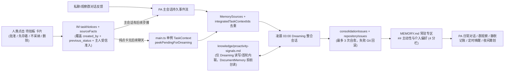
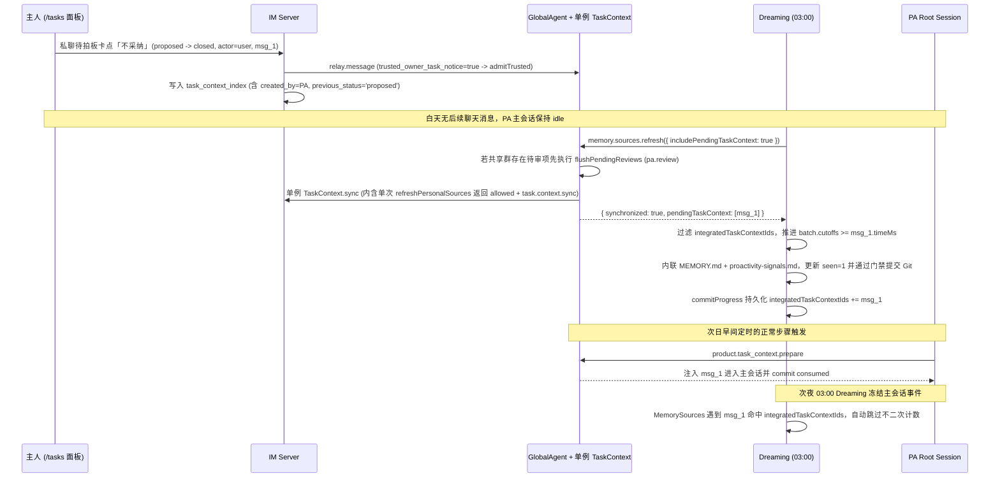

# feat-793: Personal Agent 主动性记忆偏好校准与反馈演化闭环 — 技术方案

> 对齐: [spec.md](spec.md)

## Changelog

## 现状分析

### 涉及范围

| 落点 | 当前职责与本次改动 |
| --- | --- |
| `apps/im-server/src/task-notifications.ts`、`apps/im-server/src/task-graphs.ts`、`apps/im-server/src/personal-agent.ts` 及对应测试 | 生成任务图变更系统提示、`attention_actor_ids`（决定哪些 Agent 进入 `task_context_index`）及 PA 来源准入事实。现行逻辑仅在 `done`/`in_review` 时加入 `created_by`、未区分人类裁决与 PA 自身夜间过期清理（`actor.kind === 'agent'`）、删除与状态变更未完整保留 `previous_status`，且主人在专属私聊点击卡片产生的 `sender_type: 'system'` 任务通知在节点侧因非 `is_owner` 卡在 `review_state = 'pending'`。本次补齐人类裁决 `proposed` 节点对 `created_by` 的通知与文案区分、全分支保留 `previous_status`、排除 Agent 自关旧提议的伪负反馈，并在 `admitSource` 中仅对主人专属私聊内由主人本人触发的 `task_graph` 系统通知返回独立的 `trusted_owner_task_notice: true`（保持 `is_owner` 严格仅限 `sender_type === 'user'` 真人消息，并在 `directOwnerMessage` 显式校验 `sender_type === 'user'`，绝不扩大 `ownerMessage` 授权或跳过共享群第三方标题安全审核） |
| `apps/node/src/main.ts`、`evals/memory/nano-product.ts`、`packages/personal-assistant/src/{personal-assistant.ts,task-context.ts,global-agent.ts}` | 真实节点与记忆评测组装入口、中心 `task_context_index` 同步及 `memory.sources.refresh` 处理。现行 `main.ts` 与 `evals/memory/nano-product.ts` 中 `GlobalAgent` 与单例 `TaskContext` 分离构造未互持引用。本次将同一单例 `TaskContext` 通过 `attachTaskContext` 接入 `GlobalAgent`；在 `GlobalAgent` 处理首轮 `memory.sources.refresh({ includePendingTaskContext: true })` 时先执行 `flushPendingReviews` 结算共享参与群待审任务通知，再调用 `TaskContext.peekPendingForDreaming`（复用 `TaskContext.sync` 内部单次 `refreshPersonalSources` 取得最新 `allowed` 会话集合并过滤返回未消费条目，不重复发 `pa.sources`），而 `verifyCurrent` 收尾复核传 `false` 仅做来源资格同步 |
| `packages/dsh-integration/src/knowledge/{memory-sources.ts,memory-source-view.ts,memory-trajectory.ts,dreaming.ts,dreaming-state.ts,dreaming-history.ts}` | 冻结主会话与一级子执行经历并驱动夜间 `Dreaming`。现行逻辑将 `channel: 'task-context'` 过滤丢弃；本次在已记录轨迹中无条件保留 `task-context`（不按实时会话允许列表删改历史轨迹，仅按 `DreamingOwner.integratedTaskContextIds` 跳过已由梦前预取整合过的 `messageId`），对纯 `pendingTaskContext` 批次推进有效时间截点 `cutoff` 并支持容量分片，同时在 PA `Dreaming.renderInput` 中内联现有 `knowledge/proactivity-signals.md` 供超期清理与跨夜计数 |
| `packages/dsh-integration/src/knowledge/{memory-documents.ts,dreaming-agent.ts,document-memory.ts}` | 管理 `.nanoassistant/memory/` Git 仓、窗口级 `MEMORY.md` 快照、前台只读守卫与整合后自愈回滚闭环。本次为新建 PA 记忆库预置 `## 主动性与介入偏好` 骨架，在 `DocumentMemory` 工具守卫中拦截前台 Agent 读取 `knowledge/proactivity-signals.md`，并在整合完成收尾处新增 `consolidationIssues()`（PA 专区骨架、禁止首页引用观察池、观察池顶层列表格式与 `<=20` 条/`<=4000` 码元上限、支持 URI 解码与 `/im/v1/` 豁免的相对死链检查、标准一级目录门禁） |
| `packages/dsh-integration/src/knowledge/dreaming-prompts.ts`、`packages/dsh-integration/src/personal-agent-defaults.ts`、`packages/personal-assistant/src/proactive-coordinator.ts`、`packages/personal-assistant/assets/skills/{nano-memory,nano-proactive-care}/SKILL.md` | 定义 `Dreaming` 两阶段提示词、PA 默认系统指引、主动唤醒提示与内置方法论 Skill。本次升级 PA 提炼与整合提示（四档常驻结构、`proactivity-signals.md` 顶层列表规范、仅采信人类 `actor.type === 'user'` 反馈、三条防误判归因护栏、首页防截断优先级），并在主动唤醒中声明个性化安静时段优先遵守 `MEMORY.md` |

### 既有约束

- 严格遵守跨包架构边界：主执行运行时仅由 `packages/dsh-integration` 通过已声明的 DSH 公开 exports（及 `mdast-util-from-markdown`）接入；`packages/personal-assistant` 与 `apps/im-server` 不依赖 DSH。
- 正式记忆仓（`<workspace>/.nanoassistant/memory/`）保持 `Dreaming` 单一写者原则：PA 主会话与普通子执行只读，不通过 `write/edit/bash` 或 `notes` 变相构造第二套持久偏好写通道。
- 主会话 `MEMORY.md` 保持每上下文窗口起始快照机制以维护系统提示词前缀与 KV Cache 稳定；`proactive_nightly` 继续沿用尾部 `<updated-formal-memory>` 注入当夜刚更新的 `MEMORY.md`；已经记录入会话的执行轨迹不按实时会话来源设置删改。
- 不在本单元处理长驻会话 `compact-checkpoint` 无摘要硬切换窗后的白天通用记忆衔接（已单独立项为 Issue `#557`），不阻塞主对话回合。

### 可复用能力

| 能力 | 选择与依据 |
| --- | --- |
| `MemoryDocuments` + `dreaming-agent.ts` 三次同会话修复与 `rollbackBatch` | **改（扩展整合校验与修复提示）**。现成整合收尾循环已在 `Dreaming` 提交 Git 后检查问题并最多打回同一维护会话修复 3 次、仍失败则回滚至起始提交；直接在此处挂载 `consolidationIssues()` 并泛化修复提示文案，无需另起校验 Agent |
| `mdast-util-from-markdown`（已在 `memory-documents.ts` 引入） | **用**。直接基于 Markdown AST 检查标题层级、观察池顶层列表项结构与数量、以及仓内相对 `.md` 链接，避免脆弱正则误伤代码块内文本 |
| 单例 `TaskContext` + `memory.sources.refresh`（`apps/node/src/main.ts` 既有接线） | **改（接线单例并区分首轮预取与收尾复核）**。将 `main.ts` 唯一 `TaskContext` 实例接入 `GlobalAgent`；`Dreaming.execute` 首轮调用 `memory.sources.refresh({ includePendingTaskContext: true })` 时经 `TaskContext.sync` 串行锁一次性完成来源资格刷新与未消费 `task-context` 预取，收尾 `verifyCurrent` 调用 `{}` 仅刷新来源资格，零并发游标竞争、零重复 RPC |
| `ProactiveCoordinator` `<updated-formal-memory>` 注入 | **用**。已生效主动性偏好全量常驻在 `MEMORY.md` 的 `## 主动性与介入偏好` 专区后，凌晨 `Dreaming` 刚写完的偏好自动随 `<updated-formal-memory>` 进入当夜 `proactive_nightly` |

### 相关历史

- `feat-676`（角色化文档记忆与持续 Global Dreaming）：确立 `.nanoassistant/memory/` Git 文档库、窗口级 `MEMORY.md` 8,000 UTF-16 码元快照、两阶段 `Dreaming` 与同会话 Git 修复回滚机制；本单元沿用其单写者、轨迹不删改与批次进度契约。
- `feat-785`（PA 主动性闭环与渐进式目标图，本分支基线）：引入 `proposed` 待拍板卡、`backlog` 先存着、全员凌晨 `03:00` 锚点 `Dreaming` 及紧随其后的 `proactive_nightly`；本单元补齐其主动性记忆常驻结构与用户反馈演化闭环，完成后合回 `unit/feat-785-pa-proactivity`。

## 架构总览

本方案在保持 `.nanoassistant/memory/` 纯 Markdown Git 仓与 `Dreaming` 单写者不变的前提下，打通「聊天表态 + 任务面板人类拍板 → 夜间 `Dreaming` 抗噪归因 → 常驻 `MEMORY.md` 四档校准 / 后台 `proactivity-signals.md` 观察池物理隔离 → 全天主动决策消费」的完整闭环：

- **Before**：PA `MEMORY.md` 无固定主动性结构，`task-context` 在 `MemorySources` 被过滤，`assignee` 为主人时的 `proposed` 拒卡不进 PA 索引，主人点卡产生的 `system` 通知在节点侧卡在 `review_state='pending'` 导致纯点卡无聊天无法在凌晨被拉取，PA 夜间自关过期提议卡无人类/Agent 区分，单次反馈无抗噪缓冲也无落盘结构门禁。
- **After**：人类在聊天与任务面板上的裁决按精确一次语义进入夜间 `Dreaming`（排除 Agent 自清理操作）；单次隐式信号以顶层列表项记入 `knowledge/proactivity-signals.md`（前台工具层硬拦截读取），满 `>= 2` 次同向信号或显式立规矩写入常驻 `MEMORY.md` 四档专区，并经 AST 结构、死链与容量门禁校验后落盘。

## 关键决策

1. **已生效主动性偏好直接常驻在 `MEMORY.md` 固定专区，不引入 `@路径` 动态内联语法。**
   - 理由：正向主动触发无外部唤醒词，必须每轮常驻；`MEMORY.md` 现有 8,000 UTF-16 码元上限足以容纳 600–1,200 字的完整四档偏好，且直接复用现有窗口快照与 `proactive_nightly` 的 `<updated-formal-memory>` 注入，避免 `@路径` 展开带来的真实长度不可控、循环引用与误删整块丢失风险。复杂项目背景与备料细则通过普通相对链接在触发后按需 `read`。
2. **单次隐式反馈物理隔离在 `knowledge/proactivity-signals.md`：前台工具层拒读 + 首页禁链 + `Dreaming` 首轮内联可见。**
   - 理由：在 `DocumentMemory` 的 `tools/execute` 钩子拒绝非维护会话 `read("knowledge/proactivity-signals.md")` 并在落盘门禁禁止 `MEMORY.md` 引用该文件，从物理上下文上杜绝单次拒绝污染 PA 注意力；同时在 PA `Dreaming.renderInput` 中内联已存在的 `proactivity-signals.md`，确保即使当晚只有普通对话也能稳定感知并清理超 21 天的孤立样本。
3. **打通主人专属私聊任务通知免审准入 + 共享群先审后取 + 单例 `TaskContext` 梦前预取与 `messageId` 跨夜去重，不伪造主会话空跑回合、不扩大系统消息权限。**
   - 理由：保持 `is_owner` 严格仅限 `sender_type === 'user'` 真人消息（防系统通知冒充 `ownerMessage` 真人指令），仅通过独立字段 `trusted_owner_task_notice` 让主人专属私聊内的主人点卡通知直接 `admitTrusted`，而共享参与群中可能含他人拟定标题的任务通知仍经 `GlobalAgent.flushPendingReviews` 走 `pa.review` 安全过审；由 `main.ts` 与 `evals/memory/nano-product.ts` 接线的唯一 `TaskContext` 实例在 `Dreaming` 首轮刷新时同步并返回 `allowed` 范围内的未消费条目、推进纯预取批次 `cutoff`，通过 `DreamingOwner.integratedTaskContextIds` 保证次日主会话注入同一消息后不二次计数。
4. **结构与卫生检查拆分为「整合完成门禁（`consolidationIssues`）」，与空闲检测用的物理/入口检查（`repositoryIssues`）解耦。**
   - 理由：保留 `repositoryIssues()` 原有物理脏文件与 `MEMORY.md` 缺失/超长触发语义不变；将 PA 专区骨架、观察池列表结构与条数上限、相对死链及一级目录白名单放在整合会话结束提交后的校验闭环中执行，既确保每次 `Dreaming` 写盘都受严格约束，又避免无新消息的安静夜晚对存量旧 `MEMORY.md` 产生空唤醒。

## 接口与数据流

### 1. 任务面板反馈通知、人类/Agent 区分与主人来源准入（`apps/im-server`）

1. **区分人类裁决与 Agent 自身维护（`task-notifications.ts` & `task-graphs.ts`）**：
   - `taskNotices` 接收可选操作者身份 `actor?: { kind?: 'user' | 'agent'; id?: string }`（`task-graphs.ts:758` 传入当前已鉴权 `actor`；缺省兼容纯单测调用）。
   - **全分支保留 `previous_status`**：无论是节点状态变化、字段更新还是节点删除（`!n`），只要 `old` 存在或 `n` 存在，均在 `metadata` 中写入 `previous_status: old?.status ?? null` 与 `status: n?.status ?? null`（删除时 `status: null`）。
   - **提议人通知与状态文案**：
     - 当 `old?.status === 'proposed'` 且操作者**不是**该提议卡创建者 Agent 自身（即人类裁决或其他主体操作，`!(actor?.kind === 'agent' && actor.id === (n ?? old).created_by?.id)`）：无论节点被删除（`!n`）还是状态改变（`old.status !== n.status`），均调用 `add((n ?? old).created_by)` 将提议创建者纳入 `attention_actor_ids`（进入 `task_context_index`）；状态文案明确标注人类裁决语义（保留九种标准状态词子串）：`closed -> '未采纳（已关闭）'`、`backlog -> '暂存待定（先存着）'`、`todo -> '已批准（待办）'`、`doing -> '已批准（推进中）'`（其余状态为 `'从待拍板转为' + status[n.status]`），删除为 `'待拍板提议已删除，原入口已失效'`。
     - 当 `old?.status === 'proposed'` 且由创建该卡的 Agent 自身关闭/删除（如 PA 在 `proactive_nightly` 清理过时提议，`actor?.kind === 'agent' && actor.id === (n ?? old).created_by?.id`）：状态文案保持中性 `'过期提议已收起（已关闭）'`（不标为「未采纳」），且不额外将自身加入 `attention_actor_ids` 制造回环噪音。
2. **主人专属私聊任务系统通知独立免审准入（`apps/im-server/src/personal-agent.ts` & `packages/personal-assistant/src/{personal-assistant.ts,global-agent.ts}`）**：
   - **严守真人 `is_owner` 边界**：`PersonalAgentService.sourceFacts`（`personal-agent.ts:145`）维持 `is_owner` 仅在 `message.sender_type === 'user'` 时可为真，并在 `directOwnerMessage`（`personal-agent.ts:171`）显式守卫 `message.sender_type === 'user'`，确保系统消息永远不能通过 `ownerMessage` 冒充 `pa.sources` / `pa.agent.creation` 的真人指令凭证，也不影响共享群 `pa.incident` 安全上报与 `messageEvidence` 的 `sender.is_owner` 语义。
   - **独立 `trusted_owner_task_notice` 准入标记**：在 `sourceFacts` / `admitSource` 中新增独立布尔字段 `trusted_owner_task_notice: true`，**仅当** `message.sender_type === 'system'`、无外部 `sender_source_id`、`!this.representedBy(message.id)`、会话属于主人专属私聊 `this.ownerConversation(b, message.conversation_id)`（不存在第三方成员构造标题注入的可能），且 `system_notice` 满足 `kind === 'task_graph' && actor?.type === 'user' && actor?.id === b.owner_user_id && message.sender_user_id === b.owner_user_id` 时置为 `true`。
   - `PersonalAssistant.source()` 先清除不可信残留标记，再将服务端认证的 `trusted_owner_task_notice === true` 映射为 `input.metadata.personal_trusted_task_notice = true`；`GlobalAgent.ingestAdmitted`（`global-agent.ts:422, 446`）对 `personal_is_owner === true || personal_trusted_task_notice === true` 执行 `this.personal.admitTrusted` 直接置入 `review_state = 'admitted'`，而共享参与群中的所有任务系统通知继续留在 `review_state = 'pending'`，由 `pa.review` 正常审核他人拟定的任务标题。

### 2. 单例接线、梦前未消费预取、批次 `cutoff` 与跨夜去重（`apps/node` & `evals` & `personal-assistant` & `dsh-integration`）

1. **真实节点与评测组装的单例 `TaskContext` 接线及职责分工**：
   - `apps/node/src/main.ts` 与 `evals/memory/nano-product.ts`（不触碰 `packages/dsh-integration/src/evaluation.ts`，严守 `dsh-integration` 不依赖 `personal-assistant` 的红线）：在构造单例 `taskContext` 后调用 `globalProduct.attachTaskContext(taskContext)`，共享全进程唯一 `TaskContext` 串行锁 `syncing`；
   - 明确 `GlobalAgent` 与 `TaskContext` 的协作接口：
     1) `GlobalAgent.refreshPersonalSources(config)` 更新为返回 `Promise<ReadonlySet<string>>`（经中心确认的最新 `allowed` 会话集合），并缓存该主体最近一次同步的 `allowed` 集合供 `prepareSystemContext` 后读取；
     2) 当 `GlobalAgent.execute` 收到 `memory.sources.refresh({ includePendingTaskContext: true })` 且已挂载 `taskContext` 时：**由 `GlobalAgent` 先检查 `inbox.reviews.pendingConversations(agentId)`**，非空则调用 `await this.flushPendingReviews(personalConfig, binding)` 使共享参与群中待审的任务通知经过正常 `pa.review` 结算（被拒注入标题自动进入 `rejected` 不入预取）；
     3) 随后 `GlobalAgent` 调用 `await this.taskContext.peekPendingForDreaming({ agentId: personalConfig.agentId, sessionId: binding.sessionId, ownerId: this.options.ownerId })`：`TaskContext.peekPendingForDreaming` 内部调用 `await this.sync(agentId)`（其首行触发 `refreshSources(agentId)` 即单次 `refreshPersonalSources`，零重复 `pa.sources` 请求），再从 `inbox.prepareSystemContext(agentId, sessionId)`（仅返回 `review_state = 'admitted'` 条目）筛选未撤销且 `store.systemContextInput(agentId, inputId)?.state !== 'consumed'` 的候选；`GlobalAgent` 用刚刷新的 `allowed` 会话集合过滤后随 `{ synchronized: true, pendingTaskContext }` 返回（不修改 `system_context_inputs` 状态，不影响后续主会话 `TaskContextDriver` 注入）；
   - `Dreaming.refreshSources(parent, config, signal, includePending = false)`：仅在 `Dreaming.execute` 批次冻结前传 `includePending = true`；收尾 `Dreaming.verifyCurrent` 传 `false`，仅执行 `refreshPersonalSources` 复核来源资格，不做多余 `task.context.sync`。
2. **主会话已记录轨迹放行与纯预取批次 `cutoff`/容量处理**：
   - `memory-source-view.ts` 新增 `isTaskContext(source)`（`source.kind === 'nano-system' && source.channel === 'task-context'`），在 `qualifiedEvents` 与 `sourceConversations` 中保留（遵循“已记录的执行轨迹不按实时会话来源删改”原则，`source_history` 与 `MemorySources` 保持一致）；
   - `memory-trajectory.ts` 将 `isTaskContext(source)` 渲染为 `label: 'task context'`；
   - `MemorySources.freeze` 接受 `excludeTaskContextIds?: ReadonlySet<string>`：对 `isTaskContext(source)` 仅在命中 `excludeTaskContextIds` 时计入 `filtered` 跳过（跨夜精确一次去重），其余正常选入；
   - 在 `Dreaming.execute` 中：过滤掉已在 `owner.integratedTaskContextIds` 或本批 `batch.units` 已包含的 `messageId` 后，若剩余 `pendingTaskContext` 非空：
     - 将其 `conversationId` 并入 `batch.conversations`，并将 `batch.cutoffs[parent.id]` 推进至 `Math.max(batch.cutoffs[parent.id] ?? 0, owner.activationAt, ...selectedPending.map(item => item.timeMs))`，确保 `dreaming-history.ts` 的 `conversations` 回查时间窗合法且覆盖点卡发生时刻；
     - 在首轮容量测量循环中：若 `batch.units` 为空而仅 `pendingTaskContext` 超出 `capacity.limit`，按条缩减本批纳入的 `pendingTaskContext` 前缀（至少保留 1 条，剩余留给同轮 `while(true)` 下一批），不抛空单元异常；
     - 仅在本批 Git 提交与门禁全部通过后的 `commitProgress` 中，将本批实际纳入的 `pendingTaskContext` `messageId` 追加至 `owner.integratedTaskContextIds`（保留最新 512 条有界队列）。

### 3. 常驻专区、观察池物理隔离与落盘门禁（`memory-documents.ts`、`document-memory.ts`、`dreaming-agent.ts`）

1. **PA 初始 `MEMORY.md` 模板（`MemoryDocuments.open`）**：
   当 `role === 'personal'` 且 `MEMORY.md` 尚不存在时，初始化包含 `# Personal memory`、`## 主动性与介入偏好`（`暂无已确认的主动性偏好。`）与 `## Topics`（`No topics saved yet.`）。
2. **前台工具层防串层守卫（`DocumentMemory`，`document-memory.ts`）**：
   - 在 `tools/execute` 钩子中：除既有拒绝非 `Dreaming` 会话 `write/edit` 正式记忆仓外，当 `config.personal` 为真且前台主会话或子执行调用 `read` 访问规范化路径 `<memoryRoot>/knowledge/proactivity-signals.md` 时，直接抛出明确拒绝错误（引导使用 `MEMORY.md` 中已确认的主动性偏好）；
   - 在 `nano_document_memory`（`config.personal` 分支）常驻短指导中写明：已确认的主动性分寸常驻于 `MEMORY.md`，`knowledge/proactivity-signals.md` 仅供离线 `Dreaming` 维护，日常与主动唤醒切勿读取或检索该文件。
3. **`Dreaming` 首轮观察池内联（`Dreaming.renderInput`）**：
   - 当 `config.personal` 为真且 `<memoryRoot>/knowledge/proactivity-signals.md` 常规文件存在时，`renderInput` 直接附带其当前正文（计入首轮 `capacity.measure` 预算），使 `Dreaming` 在无新点卡的普通夜晚也能检查并清理超 21 天的孤立观察项。
4. **整合完成结构与卫生门禁（`MemoryDocuments.consolidationIssues()`，在 `dreaming-agent.ts` 与 `repositoryIssues()` 合并校验，并泛化修复提示文案）**：
   - **一级目录规范检查**：`.nanoassistant/memory/` 根下子目录仅允许角色标准集合（`personal`：`entities`、`knowledge`、`workstreams`、`timeline`；`expert`：`entities`、`knowledge`、`projects`、`work-history`）。
   - **PA `MEMORY.md` 主动性骨架与禁链检查**（仅 `role === 'personal'`）：
     - 基于 `fromMarkdown` AST 校验存在唯一一个二级标题 `主动性与介入偏好`（或英文对等标题 `Proactive & Intervention Preferences`）；
     - 该二级章节内若存在子标题，仅允许三级标题（`###`）且名称属于标准四分栏集合：`积极盯紧与提前备料`、`低打扰挂卡与静默跟进`、`免打扰禁区`、`触达时机与汇总方式`（或英文对等四栏 `Proactive Follow-Through & Preparation`、`Low-Intrusion Proposals & Silent Tracking`、`No-Intrusion Boundaries`、`Timing & Delivery Cadence`），禁止重复子栏、四级及以上标题或自创标题；
     - 遍历 `MEMORY.md` 全部链接与原始文本，严禁包含 `proactivity-signals.md`。
   - **`knowledge/proactivity-signals.md` 格式、容量与条数上限**（当该文件存在时）：
     - 长度 `<= 4,000` UTF-16 码元；
     - 除一级/二级文档标题与可选 HTML 注释/空态短句外，待观察类别必须以**顶层无序/有序列表项**表达（禁止在文件内使用 `###` 及以下子标题或散文段落堆叠绕过条数统计），且顶层列表项总数 `<= 20` 条。
   - **仓内相对 Markdown 死链拦截**：
     - 遍历仓内常规 `.md` 文件的 AST `link` 节点：跳过带通用外部协议 scheme（`/^[a-zA-Z][a-zA-Z0-9+.-]*:/`，如 `http:`、`https:`、`mailto:`）、纯 `#fragment`、以及应用内绝对路由（`/tasks/...`、`/im/v1/...`）；
     - 对其余相对路径先剥离 `#fragment` 与 `?query`，执行安全 `decodeURIComponent`（非法百分号编码直接报格式错误），校验解析路径位于记忆仓根内、以 `.md` 结尾且对应常规文件存在（不允许在记忆仓内写其他未知 `/` 绝对路径或悬空相对链接）。

### 4. Agent Context 设计与生命周期核查

- **Consumer**：
  1. **PA 主会话（及其 fork 子执行）**：通过 `DocumentMemory` 消费窗口起始快照中的 `MEMORY.md`（含完整四档主动性专区），在 `proactive_nightly` 轮额外消费尾部 `<updated-formal-memory>`；`DocumentMemory` 工具层硬拦截读取 `knowledge/proactivity-signals.md`。
  2. **Dreaming 提炼者（Stage 1）**：消费一级任务子会话历史，PA 场景下保留人类对主动跟进、候选提议与汇报时机的明确表态及原始适用范围。
  3. **Dreaming 整合者（Stage 2）**：首轮同时看到本批主会话轨迹（含 `[task context]`）、未消费预取项（`## Unconsumed task context updates`）、一级摘要、当前 `MEMORY.md` 以及已存在的 `knowledge/proactivity-signals.md` 全文。
- **Context Lifecycle & Before/After**：
  - **日常对话与观察群唤醒**：依据常驻「积极盯紧与提前备料」主动核实提醒（触发后顺相对链接 `read` 背景页），对「免打扰禁区」保持零提卡零建议；当轮显式纠正立即优先于旧快照。
  - **白天静默记账（`proactive_review`）**：保持纯确定性原位记账与约 1 小时内紧急冲突简短提醒，遵守常驻免打扰禁区与个性化安静时段（`MEMORY.md` 优先于默认 `22:00–08:00`），不在该轮发散生成 `proposed` 卡或普通群观察提醒。
  - **凌晨 `Dreaming` → `proactive_nightly`**：`03:00` `Dreaming` 消化全天对话与人类点卡反馈（忽略 `actor.type === 'agent'` 自清理），单次隐式信号入 `proactivity-signals.md` 顶层列表、清理超 21 天孤立项，满 2 次或显式规矩晋升入 `MEMORY.md` 并经 `consolidationIssues()` 校验提交；紧随其后的 `proactive_nightly` 通过 `<updated-formal-memory>` 立即应用最新四档边界。
- **Interactions（防冲突与归因护栏）**：
  - `dreaming-prompts.ts` 与 `nano-memory/SKILL.md` 写死三条护栏：① 内容/业务好恶评价进主题知识页，不作打扰偏好；② 嫌时间太晚仅更新「触达时机与汇总方式」，不将事项列入禁区；③ **仅采信人类/主人（`actor.type === "user"`）**针对 `proposed` 提议卡（`previous_status: "proposed"`）或 PA 自发提醒的反应，常规 `todo/doing` 完结关闭及 Agent 自身过期清理（`actor.type === "agent"`）绝不计入负反馈。
  - `MEMORY.md` 接近 8,000 码元预算时，优先下沉项目与人物细节，保留完整主动性条件。
- **Validation**：
  - 单元与集成测试覆盖主人点卡实时 `relay.message` → `admitTrusted` → 凌晨 `peekPendingForDreaming` → `Dreaming` 整合输入 → 次日主会话步骤注入 → 次夜 `integratedTaskContextIds` 跳过全链路；
  - 单测覆盖 PA 自关 `proposed` 卡不产生「未采纳」及不污染观察池、`consolidationIssues()` 各分支拦截与 3 次失败回滚、`DocumentMemory` 拦截前台 `read("knowledge/proactivity-signals.md")`；
  - 隔离栈真实 LLM 跨天验证并核查请求日志前缀稳定性与落盘文件。

## 本次审查安排

| 必须回答的问题 / 对应目标 | 能力与使用阶段 | 证据方法、范围与已有定位 |
| --- | --- | --- |
| 任务通知人类/Agent 区分、主人通知受信准入、`main.ts` 单例接线、梦前预取 `cutoff` 与跨夜去重、前台读拦截与 AST 门禁是否正确无回归 | `change-code-review`（Stage 4） | 审查 `apps/im-server`、`apps/node`、`packages/personal-assistant`、`packages/dsh-integration` diff 及全量相关单测/契约测试 |
| PA 主会话与 `Dreaming` 两阶段模型实际看到的上下文是否满足常驻触发、观察池物理隔离、超期清理可见性与归因护栏，且不破坏系统提示前缀缓存 | `agent-context-review`（Gate 2 设计模式 + Stage 4 实现审查） | 核查组装后的 `MEMORY.md` 常驻段落、`DocumentMemory` 读拦截、`proactive_nightly` `<updated-formal-memory>`、`Dreaming` 首轮输入（含 `proactivity-signals.md` 内联）及真实 LLM 日志 |
| 真实服务下「纯点卡不发消息 → 凌晨 `Dreaming` 一次进观察池不封杀 → 二次同向点拒晋升 `MEMORY.md` → 后续夜间筹划守界（且 PA 自关旧卡不自激误封）」闭环是否兑现 | 隔离栈端到端剧本验证（M1 实施与 Stage 4 核验） | 复用逻辑时钟隔离环境执行跨天真实模型端到端验证，留存记忆仓 Git 提交历史、`MEMORY.md`、`proactivity-signals.md` 与 LLM 日志定位 |

## 契约层增量 (delta-spec)

- `gateway/agent-capabilities`: `docs/changes/feat-793-pa-proactive-memory/specs/gateway/agent-capabilities.md`（修改 `角色化文档记忆可及时消费且不扩大权限` 与 `Dreaming 按交流与任务经历组织记忆`，纳入 PA `MEMORY.md` 四档常驻专区、前台工具层拒读 `proactivity-signals.md`、`Dreaming` 首轮观察池内联与快慢双速演化、`task-context` 轨迹保留与精确一次预取去重、整合完成结构与死链卫生门禁，并保留既有 `repositoryIssues()` 空源修复触发语义）
- `gateway/personal-agent`: `docs/changes/feat-793-pa-proactive-memory/specs/gateway/personal-agent.md`（修改 `PA 主动筹划执行主会话平时轻量记账、夜间深度筹划、实质早报触达与唤醒前观察流同步`，区分日常对话/观察轮的正向校准行动与 `proactive_review` 静默记账边界，优先遵守 `MEMORY.md` 个性化安静时段且不读取后台观察池）
- `im/task-graphs`: `docs/changes/feat-793-pa-proactive-memory/specs/im/task-graphs.md`（修改 `任务协作通知使用所属会话的一条系统消息`，补齐人类裁决或删除 `proposed` 待拍板节点时对创建者 `created_by` 的通知覆盖、全分支 `previous_status` 元数据保留，以及与 Agent 自身过期收起操作的中性区分）
- `im` 其余 area、`gateway` 其余 area、`channels`、`product-contracts`: `no spec delta`（未新增跨包外部协议包结构或前端视图，各包 `Canonical Areas` 的 Requirement 总数不变）

## 风险与回退

- **存量 PA 记忆库首次运行 `Dreaming` 的兼容平滑性**：存量工作区旧 `MEMORY.md` 可能尚无 `## 主动性与介入偏好` 标题。`repositoryIssues()` 保持既有物理与长度检查不变，不会在无新消息夜晚空唤醒；下一次有正常增量的 `Dreaming` 整合在提示词与 `consolidationIssues()` 引导下原地补齐章节，极端失败由 `rollbackBatch` 安全回滚至起始提交。
- **回退方案**：本单元不改变 SQLite 表结构或 Git 仓库底层格式；如需回退，直接还原提交即可，已写入 `.nanoassistant/memory/` 的标准 Markdown 页面仍完全合法可读。

## 一次性部署迁移

无。新建 PA 工作区在初始化时自动生成带 `## 主动性与介入偏好` 骨架的 `MEMORY.md`，存量 PA 工作区在下一次正常 `Dreaming` 整合中原地补齐章节，无需停机或人工历史迁移脚本。

## Runbook for Reviewer

| 服务 | 停止命令 | 启动命令 | 健康检查 |
| --- | --- | --- | --- |
| 隔离 E2E 全栈（IM Server + Gateway/PA） | `./scripts/e2e-down.sh` | `./scripts/e2e-up.sh --profile daily` | `curl -fsS "http://127.0.0.1:$(jq -r .im_port .e2e-daily.json)/health"` |

**Review 驱动方式**:
1. 先运行针对性单测与运行时集成测试（`apps/im-server` 任务通知与 PA 来源准入测试、`packages/personal-assistant` 单例 `TaskContext` 梦前预取与去重测试、`packages/dsh-integration` 前台读拦截、记忆文档门禁与 `Dreaming` 闭环测试）验证确定性边界与异常自愈回滚；
2. 通过隔离环境逻辑时钟推进剧本验证真实 LLM 下「纯点击 `proposed` 卡无后续聊天 → 凌晨 `Dreaming` 记入 `knowledge/proactivity-signals.md`（`seen=1`）且不误伤次日同类提议 → 第 2 次同向点击后晋升入 `MEMORY.md` `## 主动性与介入偏好` → 后续 `proactive_nightly` 严格守界」及「显式立规矩直通、时段抱怨不封杀事项、PA 自关旧提议卡不污染观察池」完整链路（不干扰原 `feat-785` 工作树正在保留供用户查看的 `/tmp/nano-feat785-tryout` 实例）。

**验收前置**: 本机已按 `python3 scripts/dev_host.py check` 配妥隔离 E2E 模型代理与 `llm_logs` 目录。

## Milestones

| ID | 标题 | 依赖 | 并行组 | 范围 | 退出标准 |
| --- | --- | --- | --- | --- | --- |
| M1 | PA 主动性常驻校准、任务反馈回流与抗噪 Dreaming 门禁闭环 | 无 | G1 | `apps/im-server/src/{task-notifications.ts,task-graphs.ts,personal-agent.ts}`, `apps/node/src/main.ts`, `evals/memory/nano-product.ts`, `packages/personal-assistant/src/{personal-assistant.ts,task-context.ts,global-agent.ts,proactive-coordinator.ts}`, `packages/personal-assistant/assets/skills/{nano-memory,nano-proactive-care}/SKILL.md`, `packages/dsh-integration/src/{personal-agent-defaults.ts,knowledge/document-memory.ts,knowledge/memory-documents.ts,knowledge/memory-sources.ts,knowledge/memory-source-view.ts,knowledge/memory-trajectory.ts,knowledge/dreaming.ts,knowledge/dreaming-state.ts,knowledge/dreaming-agent.ts,knowledge/dreaming-prompts.ts}`, `packages/dsh-integration/tests/fixtures/evaluation.ts` 及对应测试 | `[reviewer]` 兑现 `spec.md` 全部 5 项 Requirement：1) PA `MEMORY.md` 常驻四档「主动性与介入偏好」，无唤醒词可触发正向主动并顺链接查详情、低打扰挂卡不单发打断、禁区零提卡零消息、篇幅紧张时完整保留主动性条件；2) 任务页纯点击 `待拍板` 卡（含负责人为用户本人、无后续聊天）的批准/先存着/不采纳准确进入夜间 `Dreaming`；3) 单次隐式拒绝仅入 `knowledge/proactivity-signals.md` 不封杀同类提议，满 2 次同向反馈晋升进 `MEMORY.md` 并结清观察项，显式立规矩一次直通，反向反馈与超期孤立样本可平滑修正清理；4) 准确解耦时段抱怨、内容好恶评价、常规 `todo/doing` 结项及 PA 夜间自关旧提议卡；5) 落盘校验拦截缺失专区、非法子栏、首页链接观察池、观察池格式/条数超限、相对死链与非标一级目录并驱动当轮自愈或回滚。 `[worker]` 1) `spec.md` Q1 四处回流断点及 Gate 2 关键链路逐项有自动化测试覆盖（含主人专属私聊点卡 `trusted_owner_task_notice` 免审准入同时严保 `is_owner`/`ownerMessage` 真人指令边界与共享群 `pa.review` 审核、`main.ts` 与 `evals/memory/nano-product.ts` 单例 `TaskContext` 接线与无重复 `pa.sources`、`task-notifications` 人类裁决 vs Agent 自关区分与全分支 `previous_status`、纯点卡批次 `cutoff` 合法性与次日主会话注入后的 `integratedTaskContextIds` 跨夜不重复计数）；2) `DocumentMemory` 拦截前台 `read("knowledge/proactivity-signals.md")`、`Dreaming.renderInput` 内联现有观察池、以及 `consolidationIssues()` 全部分支（PA 骨架、防串层链接拦截、顶层列表格式与 `<=20` 条/`<=4000` 码元上限、URI 解码与 `/im/v1/` 豁免的相对死链、一级目录白名单及 3 次失败 Git 回滚）单测全绿；3) 既有 `dsh-integration`、`personal-assistant`、`im-server`、`node` 相关套件、`test_runtime_dependency_contract.py`、`./scripts/docs-check` 全绿，并附隔离环境真实 LLM 跨天验证证据与回收记录。 |
