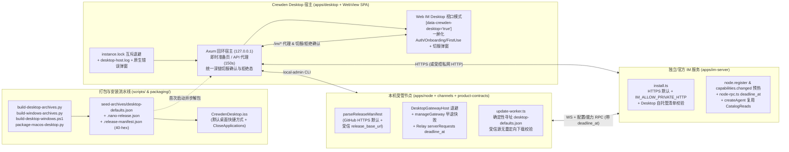
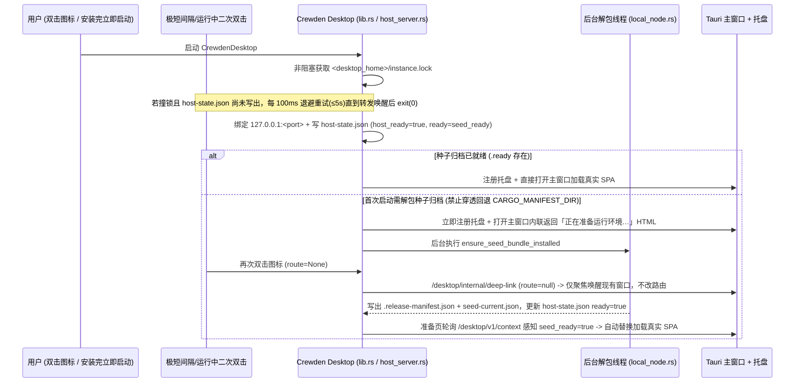
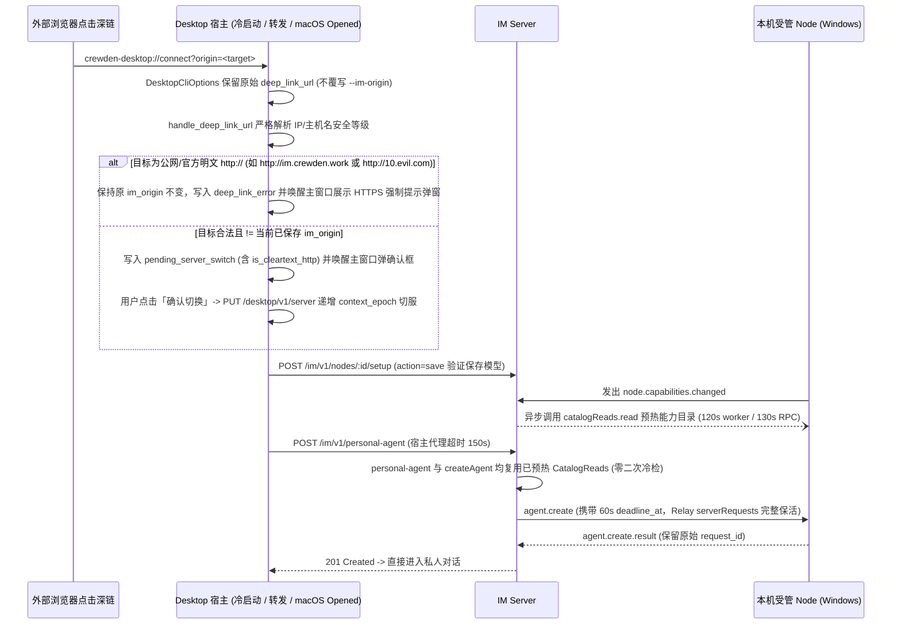

# feat-799 Technical Design: Crewden Desktop 打包运行加固、一屏化引导体验与受控私有化部署

## Overview

### 问题定性与收敛结构

基于对 Windows 11 + 独立 IM 真实部署反馈的全链路核查，本单元收敛四组相互耦合的工程与体验缺口：

1. **发行打包、安装器与受管节点启动确定性故障（Issue 1、Issue 2、周边 1A/1B + Windows 快捷方式）**：
   - `scripts/build-desktop-archives.py`、`scripts/build-desktop-windows.ps1`、`scripts/package-macos-desktop.py` 与 `scripts/build-windows-archives.py` 将 `--source-commit` 原样写入 `.release-manifest.json` 与 `.nano-release.json`，传入短 SHA 时在运行期被 `parseReleaseManifest`（严格要求 40 位 hex）拒绝；同时 `build-desktop-windows.ps1` 用占位文件构造内嵌 `seed-archives/manifest.desktop-win32-x64.json` 的 `installer` 字段而未区分内嵌种子清单与外部发布清单语义。
   - `scripts/build-desktop-archives.py` 与 `scripts/build-windows-archives.py` 的 `build_graph()` 仅把 `node_modules/.pnpm/node_modules/<name>` 中恰好指向 `visited` 节点的顶层软链拷入 `p/node_modules/`。当锁文件中存在多版本（如 `zod@4.6.5` 与 `zod@4.6.6`）且 `@deepseek-ai/dsh-web` 未在自身 `package.json` 声明 `zod` 时，`p/node_modules/zod`（以及 `fast-uri`、`http-proxy-agent`、`parse5`、`undici-types`）缺失，导致 Node ESM 沿 realpath 向上查找失败，`dsh-web` 的 `typert` 模块激活报错，而 `packaging/windows/smoke.mjs` 未对激活告警做失败断言。
   - 当本机 `apps/node` 因清单或配置无效在启动初期确定性退出时，`DesktopGatewayHost.cs` 的 `Serve` 循环无延迟立即重启刷爆 `gateway.log`，同时 `apps/node/src/lifecycle.ts` 的 `manageGateway` 盲等 120 秒才报 `Gateway startup timed out`。
   - `packaging/desktop/windows/CrewdenDesktop.iss` 仅创建开始菜单快捷方式，缺少默认勾选的「创建桌面快捷方式」选项及覆盖安装前的运行实例关闭联动。

2. **首次启动空白等待、并发写冲突、静默闪退与无路由唤醒误跳（Issue 8 + 周边）**：
   - `apps/desktop/src/lib.rs` 在绑定回环服务、写出 `host-state.json` 及创建托盘/主窗口**之前**同步执行 `ensure_seed_bundle_installed`（解压约 76MB 归档并运行 `layout.mjs`，Windows 首次耗时 15~45 秒）。在此期间既无窗口也无托盘，且二次双击快捷方式因 `host-state.json` 尚未生成而并发写 `cache/` 触发 Windows `os error 32` 静默退出。
   - `apps/desktop/src/main.rs` 启用了 `#![cfg_attr(target_os = "windows", windows_subsystem = "windows")]`，致命启动错误仅 `eprintln!` 导致用户完全不可见。
   - `forward_to_running_instance` 与 `handle_internal_deep_link` 在无深链路由的普通图标重开（`cli.initial_route == None`）时默认回退到 `"/chat"`，强制把停留在 `/login` 或 `/onboarding` 的用户跳走。

3. **Windows 冷启动能力检查多层超时断层、二次冷检与创建错误映射（Issue 3 + 周边 3A/3B/3C）**：
   - Windows Defender / NTFS 下首次拉起 `RuntimeClient` 检查子进程加载 500+ 包常超过 `inspectionTimeouts(true)` 的 `30_000ms`（实测 `30454ms` 被杀，导致 `CatalogReads` 无法写入 5 分钟缓存）。
   - 同一创建链路还存在四处断层：
     a) `apps/im-server/src/node-rpc.ts` 对非 inspection 命令（`agent.create`、`agent.config.apply`、`agent.config.operation.status`、`node.setup.request`）硬编码 `10_000ms` 且未附带 `deadline_at`，导致节点侧 `packages/channels/src/index.ts:306-309` 在 `10s` 后释放 `serverRequests` 并将迟到回包的 `request_id` 重写为随机 UUID；
     b) `apps/desktop/src/host_server.rs` 的 `http_client` 硬编码 `60s` 超时；
     c) `POST /im/v1/personal-agent` 先查能力，随后 `createAgent`（`apps/im-server/src/agent-creation.ts:161-166`）在 `skills === undefined` 时绕过 `CatalogReads` 直接发第二次 `node.capabilities.resolve` 再拉起第二个冷检子进程；且引导第 2 步完成模型保存发出 `node.capabilities.changed` 后未后台预热 `CatalogReads`；
     d) 前端 `onboarding-page.tsx` 将落库前离线/能力异常与落库后 `config_apply_pending` 混报为同一笼统错误。

4. **官方/公网严格 HTTPS 边界、独立 IM 私有化部署闭环与桌面一屏化体验（Issue 4~7 + 桌面视口改造）**：
   - 官方服务与公网地址必须保持严格 `https://`（仅本机回环开发地址例外），并在拦截不安全公网 `http://` 唤起时给出明确界面提示。
   - 独立 IM 私有化部署需要：服务端显式私网 HTTP 开关（`IM_ALLOW_PRIVATE_HTTP=1`）放行自包含 Desktop 客户端下载/唤起材料（不暴露依赖公网的必败脚本/轻量安装器）、安装包/构建预设默认 IM 地址与受信自托管发布源基地址（打通 `update-worker.ts` 下载协议与跨守护进程寻址），以及覆盖冷启动、Windows 转发与 macOS `RunEvent::Opened` 的跨服 `crewden-desktop://connect` 强制应用内用户确认（含明文 HTTP 风险警示）。
   - 桌面客户端下 `/login`、`/register`、`OnboardingWelcome`、`OnboardingPage` 与 `FirstUseWelcome` 需收敛为 `1280×840` 与 `1280×720` 下零外层整页滚动的原生桌面视口布局。

### 目标与非目标

- **目标**：在不破坏 `AGENTS.md` / `SPEC.md` 运行时依赖红线与官方公网 HTTPS 安全基线的前提下，一次性闭环上述打包校验、依赖完整性、首次启动即时反馈与单实例互斥、Windows 冷启动检查与创建超时/预热链路、受控私有化部署与自托管受管更新、外部唤起切服确认与拒绝反馈，以及桌面端认证/引导/空态欢迎页面一屏化布局。
- **非目标**：不对官方域名（`im.crewden.work` / `*.crewden.work`）或任意公网非私网主机（含运营商级 CGNAT `100.64.0.0/10`）放开明文 `http://`；不在离线私网模式下伪称依赖公网 `nodejs.org`/GitHub 的 `install.sh` 或 `Crewden-Setup-x64.exe` 可用；不修改宿主机系统级网络栈或防火墙策略；不重做普通浏览器 `/about` 着陆页或原生 iOS 客户端布局。
- **Agent Context 影响判断**：本单元不涉及模型可见提示词、工具 schema、上下文注入、会话压缩或恢复链路变更，无 Agent Context 影响。

---

## Architecture



### 模块职责与依赖边界

| 模块路径 | 职责边界 | 架构红线核对 |
|---|---|---|
| `packages/product-contracts/src/{node-update.ts,configuration-rpc.ts,node-rpc.ts}` | 定义发布清单校验契约（默认 GitHub Release HTTPS + 显式受信 `release_base_url`）、严格私网/回环主机分类函数、Windows 检查超时预算及配置 RPC `deadline_at` 字段。 | 纯 TypeScript 契约，零运行时与外部依赖。 |
| `packages/channels/src/index.ts` | 按服务端请求携带的 `deadline_at` 保活 `serverRequests` 中的 `request_id`（上限对齐 `inspectionTimeouts(true).rpcMs`），消除 >10s 配置/创建回包被重写 `request_id` 的缺陷。 | 仅依赖 `@nano/product-contracts`。 |
| `scripts/*` & `packaging/` | 构建期将 `--source-commit` 归一化为 40 位 hex；补齐 `p/node_modules/*` 多版本兜底软链与 `dsh-web -> zod` 边；生成 `desktop-defaults.json` 与 `.nano-release.json`；`CrewdenDesktop.iss` 增加默认勾选 `desktopicon` 与 `CloseApplications`；更新 `smoke.ps1` 与 `smoke.mjs`。 | 仅构建与安装脚本，零 `@deepseek-ai/*` 运行时 patch。 |
| `apps/node/src/{release.ts,lifecycle.ts,local-admin.ts,update-worker.ts}` & `DesktopGatewayHost.cs` | 从 `<versionRoot>/.nano-release.json` 与 `<desktop_home>/desktop-defaults.json` 确定性加载受信源完成校验与无重定向受控下载；守护进程对快速崩溃退避并由 `manageGateway` 秒级快败返回 `gateway.log` 首因。 | 仅通过 `@nano/dsh-integration/client` 管理运行时子进程。 |
| `apps/im-server/src/{install.ts,server.ts,node-rpc.ts,gateway.ts,onboarding.ts,agent-creation.ts,personal-agent.ts}` | 默认严格 HTTPS；`IM_ALLOW_PRIVATE_HTTP=1` / `IM_RELEASE_BASE_URL` 下仅开放已自包含闭环的 `desktop_*` 材料；为 Windows 配置/创建 RPC 附带 `60_000ms` `deadline_at`；在已配模型的 `node.register` 与 `node.capabilities.changed` 后台预热 `CatalogReads`，并在 `personal-agent.ts` 与 `createAgent` 全程复用缓存。 | IM 不 import DSH，不中转安装包字节流。 |
| `apps/desktop/src/{main.rs,lib.rs,config.rs,local_node.rs,host_server.rs,tray.rs}` | `instance.lock` 单实例互斥与短窗退避唤醒；立即起回环宿主与准备页并异步解包（阻断未解包态向 `CARGO_MANIFEST_DIR` 穿透）；复验持久化 `im_origin`；统一收敛冷启动/转发/macOS `Opened` 深链为跨服确认或明文拒绝提示。 | 纯 Rust/Tauri 宿主，不触碰 DSH。 |
| `src/IM/frontend/src/{desktop/*,features/auth/*,features/onboarding/*,features/settings/models/*,features/home/*}` | 挂载 `data-crewden-desktop="true"` 实现认证、欢迎、三步向导（含第 2 步固定底栏主按钮与第 3 步紧凑布局）及 `FirstUseWelcome` 一屏化；原地展开服务编辑栏（含取消与私网 HTTP 提示）；全局渲染跨服确认与被拒提示弹窗。 | IM 前端仅依赖 `@nano/product-contracts`。 |

---

## Data Flow

### 1. 首次启动即时进度窗口、单实例锁退避唤醒与异步解包链路



### 2. 全入口深链安全校验、跨服确认与 Windows 个人助手创建预热链路



---

## Interface & Schema

### 1. 网络地址严格解析与分层安全边界（Rust 宿主、`product-contracts`、`im-server`、`frontend` 统一）

严禁使用域名前缀正则匹配私网地址（防止 `http://10.evil.com` 绕过），三端统一按**字面量 IP 解析 + 精确主机后缀白名单**判定：

- **主机分类函数 `classifyOriginSecurity(rawUrl)` / `classify_im_origin(raw)`**：
  1. 解析绝对 URL，要求协议为 `https:` 或 `http:`，无 `username`/`password`/`search`/`hash`，且存在合法 `host`。
  2. **官方保留域名保护**：若 `hostname === "crewden.work"` 或 `hostname.endsWith(".crewden.work")`，仅允许 `https:`；任何 `http:` 一律判为 `RejectedPublicHttp`。
  3. **Loopback 回环**：`hostname === "localhost"`、IPv6 字面量 `::1`，或严格 4 段十进制 `0..=255` IPv4 字面量属于 `127.0.0.0/8` -> 允许 `http:`（类别 `LoopbackHttp`）。
  4. **Private Network 内网私网**：
     - 严格 4 段十进制 `0..=255` IPv4 字面量属于 RFC1918：`10.0.0.0/8`、`172.16.0.0/12`（第二段 `16..=31`）、`192.168.0.0/16`；
     - 严格 IPv6 字面量属于 RFC4193 唯一本地地址 `fc00::/7` 或链路本地 `fe80::/10`；
     - mDNS 局域网后缀：`hostname.endsWith(".local")`（至少含一个非空前缀标签）。
     - *注*：运营商级 CGNAT `100.64.0.0/10` 与任意单标签/公网域名**不纳入**默认明文私网白名单（Tailscale 组网推荐使用 `https://*.ts.net` TLS 证书，或使用内网子网路由）。
  5. 其余所有主机名若使用 `http:` 一律判为 `RejectedPublicHttp`；使用 `https:` 判为 `Https`。

- **各端准入与配置复验**：
  - **Desktop 宿主**：
    - `normalize_im_origin` 拒绝 `RejectedPublicHttp`；`load_or_init_host_config` 从磁盘读取已有 `host-config.json` 时必须再次调用 `normalize_im_origin` 复验——若历史配置非法，自动回退至默认预设源（`default_im_origin`）并写入 `desktop-host.log` 告警。
    - `DesktopCliOptions::parse_from` 将显式 `--im-origin <url>`（开发/运维命令行覆盖）与位置参数 `crewden-desktop://...`（外部协议唤起，原样存入 `opts.deep_link_url`）彻底分离：冷启动、Windows 第二实例转发（`/desktop/internal/deep-link`）与 macOS `RunEvent::Opened` 统一调用 `handle_deep_link_url(&state, raw_url)`。若目标为 `RejectedPublicHttp` 或格式非法，写入 `state.deep_link_error` 并唤醒主窗口展示明确拦截提示；若目标合法且与当前 `im_origin` 不同，写入 `state.pending_server_switch` 唤醒主窗口等待用户确认。
  - **IM 服务端（`apps/im-server/src/install.ts` & `server.ts`）**：
    - 新增 `ServerOptions.allowPrivateHttp?: boolean`（环境变量 `IM_ALLOW_PRIVATE_HTTP=1`）与 `ServerOptions.releaseBaseUrl?: string`（环境变量 `IM_RELEASE_BASE_URL`）。
    - `allowsDesktopConnectOrigin(originUrl, allowPrivateHttp)`：默认仅允许 `Https` 与 `LoopbackHttp`；仅当 `allowPrivateHttp === true` 时额外允许 `PrivateHttp`。
    - **安装入口可用性诚实边界**：`desktop_win32_x64` 与 `desktop_darwin_arm64` 为自包含离线包，在 `allowsDesktopConnectOrigin` 通过且对应清单校验通过时点亮下载与唤起入口；而依赖公网 HTTPS 与官方 GitHub Release 的 `windows_x64`（`Crewden-Setup-x64.exe`）仅在 `originUrl.protocol === 'https:' && !manifest.release_base_url` 时返回对象（否则为 `null`），Unix 脚本入口 `available` 仅在 `manifest.json` 存在且 `!manifest.release_base_url` 时为 `true`（否则为 `false`，且 `/install.sh` 返回 `503`），杜绝向内网用户展示必败命令。

---

### 2. 发布清单受信源、跨进程寻址与打包加固契约

#### 2.1 `packages/product-contracts/src/node-update.ts`

```ts
export interface ReleaseMetadata {
  version: string;
  source_commit?: string;
  sha256: string;
  download_url: string;
  release_base_url?: string;
  node_major: 24;
  pnpm_version: '11.7.0';
  updater_protocol?: number;
  data_epoch?: number;
  release_notes?: string;
}

export interface ParseReleaseManifestOptions {
  trustedReleaseBaseUrls?: readonly string[];
  allowPrivateHttpReleaseBase?: boolean;
  embeddedSeed?: boolean;
}

export function parseReleaseManifest(
  input: unknown,
  options?: ParseReleaseManifestOptions,
): ReleaseManifest | null;
```

- 默认无 `trustedReleaseBaseUrls` 时，严格要求 `download_url` 匹配 `https://github.com/Mrchen116/nano-multiagent/releases/download/${tag}/` 且无未授权 `release_base_url`。
- 当传入 `trustedReleaseBaseUrls` 且清单的 `release_base_url` 归一化（末尾带 `/`）后精确命中其中一项时，校验该基地址满足 `Https`、`LoopbackHttp` 或（当 `allowPrivateHttpReleaseBase === true` 时）`PrivateHttp`，并校验 `download_url` 与 `installer.download_url` 均由该基地址拼接固定文件名（`embeddedSeed: true` 仅用于内嵌 `seed-archives/manifest.desktop-*.json` 的种子校验，仍严格校验 40 位 `source_commit`、`version` 与 64 位 `sha256` 描述符摘要）。

#### 2.2 `desktop-defaults.json` 与 `.release-manifest.json` 跨守护进程确定性寻址

- 构建期在 `seed-archives/desktop-defaults.json` 与 `<app_archive>/.nano-release.json` 同时写入受信配置（`default_im_origin`、`trusted_release_base_url`、`allow_private_http_release_base`）；`ensure_seed_bundle_installed` 将 `desktop-defaults.json` 同步落盘至 `<desktop_home>/desktop-defaults.json`，并将解包后的种子清单写入 **`<versionRoot>/.release-manifest.json`**（保留前导点，严格对齐 `release.ts:15`、`local_node.rs:234` 与 `update-worker.ts:227`）。
- **跨进程寻址规则（不依赖脆弱的进程环境变量继承）**：
  - 在 `apps/node/src/release.ts` 新增 `loadTrustedReleaseOptions(root = releaseRoot)`：依次读取 `<root>/.nano-release.json` 与桌面受管目录层级推导出的 `resolve(process.env.CREWDEN_DESKTOP_HOME ?? resolve(root, '../..'), 'desktop-defaults.json')`。无论进程由 `local-admin`、Windows 计划任务（`DesktopGatewayHost.exe`）还是 macOS `launchd` / `NodeUpdater` 分离 `spawn` 拉起，都能从自身安装路径确定性读取同一份受信发布源配置。
- **`apps/node/src/update-worker.ts` 下载协议与防重定向边界**：
  - `curlProtoArgs(url, trustedOptions)`：
    - 默认官方 HTTPS 或受信 HTTPS 源：`['--proto', '=https', '--proto-redir', '=https']`；
    - 匹配 `NANO_LOOPBACK_RELEASE_ORIGIN` / 回环 `http://` 源，或匹配 `trustedOptions` 中已显式授权的私网 `http://` 源：`['--proto', '=http,https', '--max-redirs', '0']`（严禁明文 HTTP 源发生跨主机/跨协议 30x 重定向），并在下载后强制执行 64 位 SHA-256 摘要比对。

#### 2.3 构建期 SHA 归一化、运行时依赖图闭合与 Windows 安装器

- `scripts/build-desktop-archives.py`、`scripts/build-windows-archives.py`、`scripts/build-desktop-windows.ps1`、`scripts/package-macos-desktop.py`：
  - 统一通过 `git rev-parse --verify <rev>^{commit}` 将 `--source-commit` 归一化为 40 位小写 hex，失败立即非零退出。
  - 在 `build_graph()` 中：对 `visited` 中所有包名补齐确定性 `p/node_modules/<pkg_name>` 兜底软链（解决多版本 `zod`、`fast-uri`、`http-proxy-agent`、`parse5`、`undici-types` 未提升问题），并为 `@deepseek-ai/dsh-web` 显式补入 `zod` 的 `package_links` 边；在 `packaging/windows/smoke.mjs` 增加 `dsh-web` 加载 `zod` 及零 `did not activate` / `failed to register` 断言。
- `packaging/desktop/windows/CrewdenDesktop.iss` & `smoke.ps1`：
  - 增加 `CloseApplications=yes`、`AppMutex=CrewdenDesktopAppMutex` 以及默认勾选的 `[Tasks] Name: "desktopicon"; Description: "创建桌面快捷方式(&D)"`；
  - 更新 `packaging/desktop/windows/smoke.ps1`：等待 `host-state.json` 中 `ready == true`（代表宿主与种子解包双就绪），并分别验证默认安装生成桌面快捷方式与 `/MERGETASKS=!desktopicon` 不生成桌面快捷方式。

---

### 3. 节点崩溃快败与 Windows 创建超时/预热/错误契约

#### 3.1 节点确定性崩溃退避与 `manageGateway` 快败

- `packaging/desktop/windows/DesktopGatewayHost.cs`：子进程存活 `< 5s` 退出时按 `1s -> 2s -> 5s -> 15s` 退避，不再零间隔死循环刷屏。
- `apps/node/src/lifecycle.ts`（`waitReady` / `manageGateway`）：轮询等待 `.gateway-state.json` 期间若检测到后台子进程已退出（非存活），立即停止 120s 等待，读取 `gateway.log` 末尾首条具体错误消息抛出，使 `/desktop/v1/local-node/connect` 在 1~3s 内向界面返回可读故障原因。

#### 3.2 超时预算、Relay `deadline_at` 保活与单次预热复用

- `packages/product-contracts/src/configuration-rpc.ts`：
  - 保持非 Windows `inspectionTimeouts(false)` 为 `{ workerMs: 7_000, nodeMs: 8_000, rpcMs: 9_000 }` 不变；
  - 将 Windows `inspectionTimeouts(true)` 调整为 `{ workerMs: 120_000, nodeMs: 125_000, rpcMs: 130_000 }`。
- `apps/im-server/src/node-rpc.ts` & `packages/channels/src/index.ts`：
  - Windows 受管节点上的 `agent.create`、`agent.config.apply`、`agent.config.operation.status` 与 `node.setup.request` 超时设为 `60_000ms`（能力解析保持 `130_000ms`），且 `node-rpc.ts` 对上述命令统一写入 `payload.deadline_at = Date.now() + timeoutMs`；
  - `packages/channels/src/index.ts:306-309` 识别 `deadline_at` 将 `serverRequests` 中的 `request_id` 保活至该截止时间（上限 `130_000ms`），确保 `10s~60s` 内完成的 `agent.create.result` 原样保留 `request_id`；若期间节点断连，`NodeRpc.disconnect` 仍立即快败拒绝等待者。
- `apps/desktop/src/host_server.rs`：`http_client` 超时调整为 `150s`（高于 `130s` RPC 上限）。
- **消除二次冷检与精准预热**：
  - `apps/im-server/src/agent-creation.ts:161-166`：当 `skills === undefined` 时改为复用 `CatalogReads`（通过共享的 `readNodeCapabilitiesRaw(ctx, id, owner)`，命中 `CatalogReads` 5 分钟缓存或合并单飞 in-flight 请求），彻底消除 `POST /im/v1/personal-agent` 先调 `readNodeCreationCapabilities` 再在 `createAgent` 内绕过缓存拉起第二个 `ConfigurationInspector` 子进程的问题。
  - 在 `apps/im-server/src/gateway.ts` 中：当收到 `node.capabilities.changed`（第 2 步保存模型后立即由节点发出）或 `node.register` ACK 时，异步非阻塞触发 `void readNodeCreationCapabilities(ctx, c.node_id, c.owner_id).catch(() => {})` 写入 `CatalogReads`（未配模型时节点秒回空列表不耗时，配完模型后立即后台预热完整目录并支持第 3 步单飞复用）。
- **创建错误码对齐（不破坏 `ConfigOperations` 持久恢复契约）**：
  - 落库前（`personal-agent.ts`）：节点未连接返回 `503 { code: "node_offline", message: ... }`；能力目录读取超时返回 `504 { code: "node_capabilities_timeout", message: ... }`；能力不可用返回 `502 { code: "node_capabilities_unavailable", message: ... }`；
  - 落库后（`control.ts` `ops.create`）：保持既有 `503 { code: "config_apply_pending", message: "Configuration application is still being confirmed." }` 不变；
  - 前端 `onboarding-page.tsx` 完整保留草稿与幂等 `operationId`，按 `node_offline`、`node_capabilities_timeout` / `node_capabilities_unavailable`、`config_apply_pending`（或网络超时）分别展示三条明确中文/英文操作提示。

---

### 4. Desktop 宿主状态接口与首启解包隔离

```ts
export interface PendingServerSwitch {
  target_origin: string;
  is_cleartext_http: boolean;
}

export interface DesktopHostContextResponse {
  im_origin: string;
  context_epoch: number;
  platform: "darwin-arm64" | "win32-x64";
  seed_ready: boolean;
  seed_error?: string | null;
  host_log_path?: string;
  pending_server_switch?: PendingServerSwitch | null;
  deep_link_error?: string | null;
}
```

- `host-state.json`：`ready` 字段仅在回环服务已绑定**且** `seed_ready == true` 时置为 `true`（同时携带 `host_ready: true`、`seed_ready: bool`），既保证 `forward_to_running_instance` 在解包期毫秒级可用，又与 `smoke.ps1` 的 `state.ready == true` 语义完全兼容。
- `resolve_active_bundle`：当存在随包 `seed-archives/` 目录且未显式传入 `--dev-repo-root` / `CREWDEN_DEV_REPO_ROOT` 时，**禁止**回退到编译期 `CARGO_MANIFEST_DIR`；在 `seed_ready == false` 期间，`handle_static_or_spa` 直接返回内联零外部依赖的「正在准备运行环境… / 失败重试」HTML，`/desktop/v1/local-node/*` 返回 `503 { code: "seed_preparing", detail: "Local runtime is still preparing" }`。
- 新增 `POST /desktop/v1/server/pending/dismiss`（清除 `pending_server_switch` 与 `deep_link_error`）与 `POST /desktop/v1/seed/retry`（重试解包）。

---

### 5. Desktop 一屏化视口布局规格（`src/IM/frontend`）

通过 `html[data-crewden-desktop="true"]` + `@media (min-width: 768px)` 精确作用域化，Web 浏览器 `/about` 与窄屏 `<768px` 保持原样：

1. **顶栏与品牌路由收敛**：
   - `ProductHeader` 在 Desktop 模式下高度收敛为 `min-height: 52px`，左上角品牌标识导航目标改为 `user ? '/chat' : '/login'`（不再跳往 `/about`）；`PublicHomePage({ restoreSession: true })` 在 `isDesktopClient() && hydrated && !user` 时重定向至 `/login`。
2. **认证双栏页（`/login`、`/register`、`/membership`）与 `DesktopServerBar`**：
   - `.crew-account` 设为 `height: 100%; overflow: hidden; display: flex; flex-direction: column;`，`.crew-account-main` 设为 `flex: 1; min-height: 0; margin: 0 auto; padding: 6px 0 18px; display: flex; align-items: center; justify-content: center;`。
   - **左侧 `AuthScene` 紧凑比例（防 `720px` 裁剪）**：`.crew-account-story` 内边距缩至 `24px 28px`，`h2` 字号 `26px`、下边距 `10px`，`.crew-account-illustration` 内边距缩至 `14px 2px 10px`，`.crew-account-note` 内边距 `12px 14px`，`.crew-account-connection` 高度 `24px`，`.crew-account-result` 上边距 `12px`、内边距 `12px 14px`，使左侧自然总高约 `470px`（远小于 `720px` 视口下卡片可用高 `644px`）。
   - **右侧表单与 `DesktopServerBar`**：`.crew-account-form-region` 设 `padding: 24px 32px; min-height: 0; overflow-y: auto;`；`DesktopServerBar` 点击「切换服务」时**原地替换**为编辑卡片（包含输入框、`取消`、`保存切换` 按钮；当当前已连接或输入地址为私网 `http://` 时显示内网未加密提示条，输入公网 `http://` 时原位报错阻断）。在 `1280×840` 与 `1280×720` 下登录展开编辑态与注册页均无需滚动。
3. **首次引导欢迎页（`OnboardingWelcome`）**：
   - `.onboarding-welcome` 设为 `flex: 1; min-height: 0; margin: 0 auto; padding: 6px 0 18px; gap: 44px; align-items: center;`，收敛 `h1`（`30px`）、准备项间距与右侧预览卡内边距（`22px`），在 `1280×840` 与 `1280×720` 下零滚动。
4. **首次引导三步向导（`OnboardingPage` + `ModelServicesPanel`）**：
   - 顶部 `.onboarding-intro` 收敛为单行紧凑标题栏（`margin-bottom: 10px`，`h1` `20px` 与副文案同行）；`.onboarding-layout` 设为 `flex: 1; min-height: 0; grid-template-columns: 260px minmax(0, 1fr);`。
   - 左侧 `<aside>` 内边距缩至 `20px`，步骤项 `padding: 10px 0`，`.onboarding-note` 置底（总高 `< 420px`，不溢出 `720px`）。
   - 右侧 `.onboarding-card` 拆分为 `flex: 1; min-height: 0; overflow-y: auto` 的 `.onboarding-card-body` 与固定底栏 `.onboarding-footer`。
   - **第 2 步主操作固定可见**：`ModelServicesPanel` 在首次引导编辑态（`firstConnection && draft`）下为 `<form>` 绑定稳定 `id="onboarding-model-form"` 并通过 `onPrimaryActionChange` 将主提交动作（「验证并继续 / 正在验证…」）提升渲染至固定 `.onboarding-footer`（隐藏 `<form>` 内部重复的 `.model-footer-first`），保证展开自定义 API 多字段时仅表单体内部滚动，底部「← 返回」与「验证并继续」始终固定在视口内可见。
   - **第 3 步结构去重与紧凑双列**：在 Desktop 模式下隐藏与 `AvatarPicker` 重复的 `.onboarding-identity-preview`（对齐窄屏已有去重策略），将「助手名称」与「默认协作范围」排为紧凑双列栅格，并将 `AvatarPicker` 预览区高度收敛至 `56px`，确保第 3 步初态在 `1280×720` 下零内外滚动一屏直达。
5. **聊天空态欢迎页（`FirstUseWelcome`）**：
   - 在 Desktop 模式下（`≥768px`），`.first-use` 设为 `display: flex; align-items: center; overflow-y: auto;`，`.first-use-inner` 内边距缩至 `20px 32px 16px`，将 `AssistantPortrait`（`48px`）与 `.first-use-heading` 标题导语改为水平紧凑排布（`margin-bottom: 18px`，`h1` `24px`），`.first-use-layout` 间距 `32px`，`.first-use-setup` 内边距 `20px 22px`，列表项 `padding: 10px 0`，`.first-use-example` `padding: 11px 0`，`.first-use-footer` `margin-top: 14px`，总高约 `540px`，在 `1280×840` 与 `1280×720` 下完整一屏呈现无滚动条。

---

## Prototype Projections

交互原型文件：[prototype.html](prototype.html)（纯净产品视口截图存放在 `design-evidence/`，支持 `?clean=1` 隐藏所有原型演示浮层）。

| 原型场景 (`?scene=`) | 投射等级 | 必须一致的设计承诺 (`must-match`) | 允许实现期微调 (`illustrative`) |
|---|---|---|---|
| `splash`（首次准备运行环境窗口） | `must-match` | 启动后立即呈现品牌标识、「正在准备运行环境…」标题、无需命令行说明与进度条；`?error=1` 失败态展示错误原因、重试按钮与 `desktop-host.log` 路径。 | 进度条动画细节。 |
| `login` & `register`（桌面一屏化认证页） | `must-match` | `52px` 紧凑顶栏、双栏卡片在 `1280×840` 与 `1280×720` 下零外层滚动且左侧 `AuthScene` 不裁剪；`DesktopServerBar` 点击切换时原地替换为含 `取消` + `保存切换` 的编辑卡，私网 `http://` 展示未加密提示条，公网 `http://` 报错拦截。 | 左侧复用真实 `AuthScene` 插画 SVG。 |
| `switch-confirm`（外部唤起切服确认与公网 HTTP 拦截弹窗） | `must-match` | 跨服唤起展示当前服务与目标服务对比 + 私网 `http://` 琥珀色未加密风险横幅 + 保留原服务/确认切换按钮；公网明文 `http://` 唤起展示拒绝原因弹窗且不切换服务。 | 遮罩透明度细节。 |
| `onboarding-welcome`、`onboarding-wizard` & `first-use`（首次引导与空态欢迎一屏化） | `must-match` | 欢迎页、三步向导初态及 `FirstUseWelcome` 在 `1280×840` 与 `1280×720` 下外层 `scrollHeight <= clientHeight`；第 2 步展开自定义 API 多字段时仅 `.onboarding-card-body` 内滚而底部「返回 + 验证并继续」固定可见；第 3 步紧凑双列无重复预览卡。 | 角色头像列表复用真实 24 款 `AvatarPicker`。 |

---

## Design Decisions & Trade-offs

1. **为什么把回环服务与主窗口启动前移到种子归档解包之前，并通过 `host-state.json` 的 `ready = seed_ready` 对齐冒烟契约？**
   - `start_host_server` 纯 Rust 绑定回环端口仅需毫秒级，配合 `instance.lock` 非阻塞互斥 + 短窗退避轮询，彻底消除了首启 15~45 秒空白期与双击并发写 `cache/` 的 `os error 32`；同时将 `host-state.json` 的 `ready` 保持为「宿主与种子归档双就绪」，既不影响 `forward_to_running_instance`（按 `/desktop/internal/status` HTTP 200 判断存活），又完全兼容 `smoke.ps1` 的就绪断言。
2. **为什么私有化 `IM_ALLOW_PRIVATE_HTTP=1` / 自托管 `IM_RELEASE_BASE_URL` 仅点亮 `desktop_*` 而不暴露未闭环的 `windows_x64` 与 `install.sh`？**
   - `Crewden-Desktop` 安装包已内嵌完整 Node 24.22.1 与全部锁定的依赖包，天然具备纯内网离线安装与自托管更新能力；而 `install.sh` 运行期强依赖公网 `nodejs.org`、npm registry 与 GitHub，轻量 `Crewden-Setup-x64.exe` 也硬编码 GitHub HTTPS。如实将不满足当前部署前提的入口标为不可用，遵循产品「绝不提供必败安装链接或命令」原则，且不额外维护两套冗余离线打包器。
3. **为什么通过 `node-rpc.ts` 传递 `deadline_at` 对齐 `packages/channels` 的 `serverRequests` 保活窗口？**
   - 节点侧 `RelayClient` 默认仅保留服务端 `request_id` 10 秒以防内存泄漏，超时后回包会被当作节点主动新请求改写 `request_id`。显式随慢配置命令下发 `deadline_at`，在不放宽普通消息 10 秒 ACK 约束的前提下精确打通了 Windows 慢速 `agent.create` / `agent.config.apply` 回包关联。

---

## Risks & Edge Cases

- **冷启动前几毫秒极速双击图标**：第二进程在 `instance.lock` 非阻塞加锁失败但 `host-state.json` 尚未写完时，执行 `100ms × 50` 退避轮询等待第一进程完成回环端口绑定后调用 `/desktop/internal/deep-link` 聚焦窗口并 `exit(0)`，绝不误弹致命错误框。
- **构建机/源码环境验证首启准备页**：当检测到随包 `seed-archives/` 且未显式指定 `--dev-repo-root` 时，`resolve_active_bundle` 阻断向 `CARGO_MANIFEST_DIR` 的回退，避免读取源码 `dist/` 掩盖未解包态。
- **历史 `host-config.json` 含不安全公网 `http://`**：启动加载时复验失败自动回退至安全预设源并记录日志，防止旧配置绕过 HTTPS 边界。

---

## 一次性部署迁移

无。

---

## Runbook for Reviewer

1. **查看交互原型与视口走查截图**：
   - 浏览器打开 `docs/changes/feat-799-desktop-hardening-private-deploy/prototype.html`（或附加 `?scene=splash|login|switch-confirm|register|onboarding-welcome|onboarding-wizard|first-use&clean=1`），核查 `design-evidence/` 下 `1280×840` 与 `1280×720` 截图。
2. **自动化单测、契约与文档门禁**：
   ```bash
   cd /Users/czj/.t3/worktrees/nano-multiagent/unit-feat-799-desktop-h-fc757246e440f3fe
   pnpm build && pnpm typecheck && pnpm test
   cargo test --manifest-path apps/desktop/Cargo.toml
   (cd src/IM/frontend && npx tsc -b && npm run test)
   pytest -m "not e2e" -q
   ./scripts/docs-check
   ```
3. **Worktree 隔离真实前端与 Desktop 宿主体验验收（遵循 `docs/development/worktree-runtime.md`）**：
   ```bash
   cd /Users/czj/.t3/worktrees/nano-multiagent/unit-feat-799-desktop-h-fc757246e440f3fe
   # 1) 构建前后端与轨迹查看器本地产物（验收完毕后清理 src/IM/frontend/dist）
   pnpm build
   npm --prefix src/IM/frontend run build

   # 2) 在独立临时目录启动隔离 IM 服务（测试默认严格 HTTPS/回环模式，或加 IM_ALLOW_PRIVATE_HTTP=1 验证内网模式）
   ISO_ROOT="$(mktemp -d /tmp/feat799-e2e.XXXXXX)"
   IM_PORT=18911
   IM_DB_PATH="$ISO_ROOT/im.sqlite3" IM_UPLOAD_DIR="$ISO_ROOT/uploads" \
     IM_PUBLIC_URL="http://127.0.0.1:$IM_PORT" \
     node apps/im-server/lib/main.js --host 127.0.0.1 --port "$IM_PORT" >"$ISO_ROOT/im.log" 2>&1 &
   IM_PID=$!
   curl -fsS "http://127.0.0.1:$IM_PORT/im/v1/public/install" | head -c 200

   # 3) 启动隔离 Crewden Desktop 回环宿主（完全隔离于个人 ~/.nanoassistant 与 Application Support）
   cargo run --manifest-path apps/desktop/Cargo.toml -- \
     --isolated-root "$ISO_ROOT/desktop-iso" \
     --im-origin "http://127.0.0.1:$IM_PORT" \
     --dev-repo-root "$PWD" \
     --headless-host >"$ISO_ROOT/host.log" 2>&1 &
   HOST_PID=$!
   # 从 $ISO_ROOT/desktop-iso/desktop/host-state.json 读取绑定 port 与 boot_nonce，
   # 用 Playwright 在 1280x840、1280x720 与移动端 390x844 打开 http://127.0.0.1:<port>/desktop/bootstrap?nonce=<nonce>&next=/login 实测全链路

   # 4) 验收结束后完整回收隔离进程、临时目录与本地构建产物
   kill "$HOST_PID" "$IM_PID" 2>/dev/null || true
   rm -rf "$ISO_ROOT" src/IM/frontend/dist
   ```

---

## Milestones

### M1: Crewden Desktop 打包运行加固、一屏化视口改造与受控私有化部署

- **范围**：完成打包脚本提交号归一化、运行时依赖图多版本兜底与 `dsh-web -> zod` 补链、Windows 安装器默认桌面快捷方式与升级关停联动、本机节点确定性崩溃退避与快败、Desktop 首次启动即时准备窗口与单实例互斥退避及原生错误日志弹窗、无路由唤醒原页面保持、Windows 能力检查与配置/创建 RPC 跨层超时及 `deadline_at` 对齐与单次预热复用、官方/公网严格 HTTPS 与独立 IM 受控私网 HTTP / 预设地址 / 受信自托管受管更新、跨服深链确认与公网明文唤起拒绝提示，以及桌面客户端认证、首次引导与聊天空态欢迎页的一屏化布局改造。
- **准出标准**：
  - `[worker]` 构建脚本传入短 SHA 自动解析为 40 位 hex 并产出合法 `.release-manifest.json`（保留前导点）与 `.nano-release.json`，无效提交或非法基地址非零报错；`build_graph()` 为全部已访问包补齐确定性 `p/node_modules/<name>` 链接与 `dsh-web -> zod` 边，`packaging/windows/smoke.mjs` 断言无 `typert` 未激活告警；`CrewdenDesktop.iss` 含默认勾选 `desktopicon` 与 `CloseApplications=yes`，`smoke.ps1` 覆盖验证。
  - `[worker]` `DesktopGatewayHost.cs` 与 `manageGateway` 对启动即退出的节点执行退避并在数秒内返回 `gateway.log` 具体原因；`inspectionTimeouts(true)`（`120s/125s/130s`，非 Windows 保持 `7s/8s/9s`）、`node-rpc.ts` + `packages/channels` 的 `deadline_at` 保活（`60s`）与 `host_server.rs` 代理超时（`150s`）完整对齐；`node.register` 与 `node.capabilities.changed` 后台预热 `CatalogReads`，`personal-agent.ts` 与 `createAgent` 复用缓存零二次冷检，前后端区分展示 `node_offline`、`node_capabilities_unavailable`/`timeout` 与 `config_apply_pending`。
  - `[worker]` `apps/desktop` 通过 `instance.lock`（含毫秒级撞锁退避唤醒）在解包前启动回环宿主与准备页（阻断未解包态向 `CARGO_MANIFEST_DIR` 穿透）、记录 `desktop-host.log` 并触发原生致命错误弹窗、无路由重开保持原页面。
  - `[worker]` 三端按严格 IP 字面量与 `.local` 白名单拒绝公网及官方域名明文 `http://`（含持久化配置启动复验，以及收到公网明文 `http://` 唤起时唤醒主窗口明确提示必须使用 `https://` 且不切服）；`IM_ALLOW_PRIVATE_HTTP=1` 仅开放自包含 `desktop_*` 入口而不暴露必败脚本/轻量安装器；`desktop-defaults.json` 与 `update-worker.ts` 完成内网预设默认 IM 地址及自托管发布源的应用内受管更新端到端闭环（不回退官方源、禁止明文跨源重定向）；冷启动、Windows 转发与 macOS `RunEvent::Opened` 的跨服 `crewden-desktop://connect` 唤起均强制经用户弹窗确认。
  - `[reviewer]` 按 Runbook 在隔离环境以 `1280×840` 与 `1280×720` 视口实测渲染真实前端应用：`/login`（含原地展开服务编辑栏及取消/私网提示）、`/register`、`OnboardingWelcome`、`OnboardingPage` 三步初态及 `FirstUseWelcome` 外层容器均满足 `scrollHeight <= clientHeight` 无整页滚动条；引导第 2 步展开自定义 API 多字段时仅 `.onboarding-card-body` 内滚且底部「返回 + 验证并继续」按钮始终固定可见；窄屏 `390×844` 与普通浏览器 `/about` 无回归；全量测试、`./scripts/docs-check` 与架构依赖契约全部绿灯。
