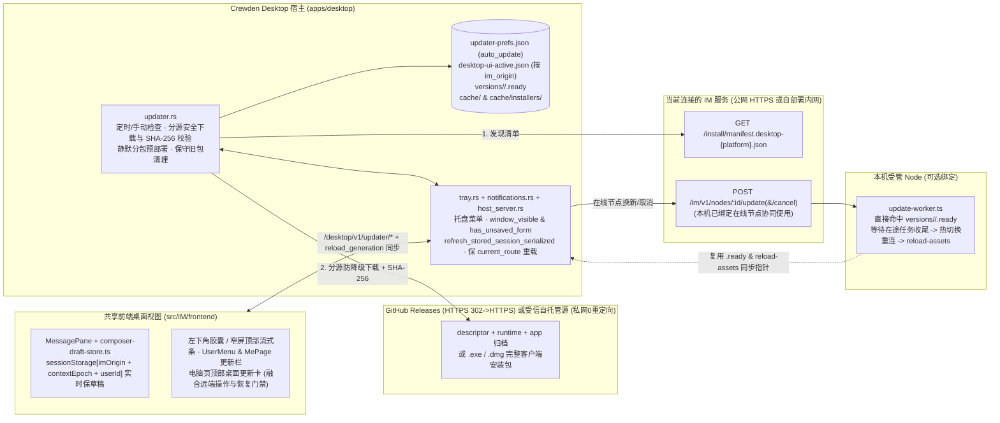
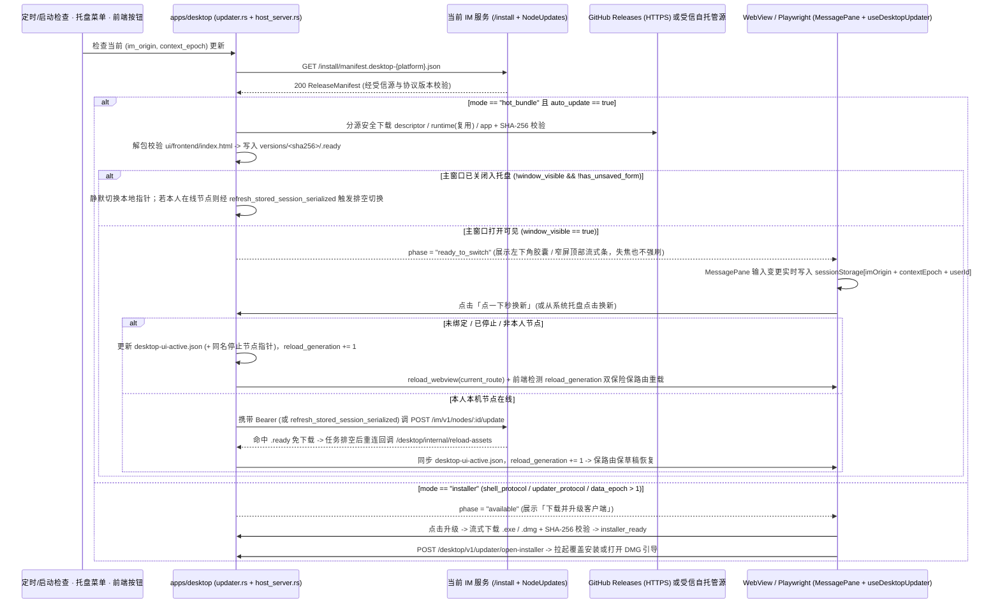

# feat-821: Crewden Desktop 无感自动更新与一键换新体验 — 技术方案

> 对齐: spec.md v1

## Changelog

## 现状分析

### 涉及范围

- **`packages/product-contracts/src/{node-update.ts,desktop-local.ts}`**：
  - `node-update.ts:149-151, 160-164, 225-226, 237-240` 将桌面发布清单（`desktop-darwin-arm64.json`、`desktop-win32-x64.json`）的 `shell_protocol`、`updater_protocol` 与 `data_epoch` 硬编码锁死为字面量 `1`；一旦未来外层 Tauri 壳演进至 `shell_protocol: 2`（或协议代数升级），`apps/im-server`（`/install/manifest.desktop-*.json`）与现网 `v1` 客户端调用 `parseReleaseManifest` 时都会直接返回 `null`（视作未发布清单），无法进入平滑安装包升级引导。
  - `desktop-local.ts` 定义 Desktop 回环宿主与前端共享契约，当前尚无桌面端独立更新状态、偏好与安装包引导类型。
- **`apps/node/src/{local-admin.ts,update-worker.ts}`**：
  - `update-worker.ts:193-200`（`prepareDesktopUpdate`）已具备「若 `<desktop_home>/versions/<target.sha256>/.ready` 存在且 `.release-manifest.json` 校验匹配，则直接复用免重复下载」的能力，但仅在已绑定在线本机节点收到服务端 `node.update` 指令时被动触发。
  - `local-admin.ts:233`（`inspectLocalNode`）在 `ownership === 'managed_stopped'` 时因 `rawState` 为空而将 `version` 回退为 `'source'`，未从 `.desktop-active.json` 读取真实受管版本号。
- **`apps/desktop/src/{lib.rs,config.rs,local_node.rs,notifications.rs,host_server.rs,tray.rs,updater.rs(新增)}`**：
  - 当前 Rust 宿主无主动清单轮询、无「自动保持最新」持久化偏好、无未绑定/纯聊天模式下的独立 UI 版本指针，也无外层客户端安装包（`.exe` / `.dmg`）下载校验与拉起能力；`HostSharedState.http_client`（`host_server.rs:375`）全局配置了 `Policy::none()`（不可直接用于必返 `302` 跳转 `objects.githubusercontent.com` 的官方 GitHub Releases 资产下载）；
  - `WindowAttentionState`（`notifications.rs:27-30`）与 `AttentionBody`（`host_server.rs:721-724`）仅维护 `visible_and_focused`（窗口失焦即变为 `false`）与 `current_route`，尚未区分「主窗口仍打开可见但失焦」与「主窗口已关闭隐藏至托盘（`!window_visible`）」，也尚无表单脏状态字段 `has_unsaved_form`；
  - `tray.rs:368-386`（`TauriUiCoordinator::reload_webview`）在 `route == None` 时硬编码跳回 `"/chat"`，丢失用户当前所在会话或业务子路由；`--headless-host` 下的 `NoopUiBridge::reload_webview` 为空实现；系统托盘菜单无「检查更新 / 一键换新 / 自动保持最新」入口。
- **`src/IM/frontend/src/`（Web IM 与 Crewden Desktop 共享前端）**：
  - `features/chat/components/message-pane.tsx:529-560, 766-796` 仅在 SPA 切换会话或 React 组件卸载时将主会话的 `draft`、`draftMentions`、`replyTo` 写入 `composer-draft-store.ts`（而 `window.location.replace(...)` 整页热重载不会触发 React unmount 清理），且 `composer-draft-store.ts` 仅存于内存 `Map`、`desktopScopedKey`（`desktop-context.ts:177-180`）仅拼接 `imOrigin` 未包含 `contextEpoch`；
  - `app/shell/{app-shell.tsx,user-menu.tsx}` 与窄屏个人页 `features/me/me-page.tsx` 无左下角非阻塞新版就绪胶囊、窄屏流式提示条及桌面版本更新状态盒；
  - `features/settings/nodes/{nodes-page.tsx,node-update-panel.tsx}` 与 `desktop/desktop-local-computer-card.tsx` 仅在「已绑定本机节点」卡片内渲染运维向的 `NodeUpdatePanel`（且在 `reason === 'incompatible'` 时生硬提示版本不兼容），未绑定本机节点的纯聊天桌面用户无更新入口。

### 既有约束

- **运行时与跨包依赖边界**（`AGENTS.md` / `SPEC.md`）：`apps/desktop` 不导入 DSH；`src/IM/frontend` 仅依赖 `@nano/product-contracts`；不经 `apps/im-server` 业务进程中转安装包字节流。
- **官方/公网 HTTPS 与自部署受信发布源红线**（[`docs/specs/im/desktop-client.md`](../../specs/im/desktop-client.md)、`feat-799`）：
  - 官方/公网默认仅信任 `https://github.com/Mrchen116/nano-multiagent/releases/download/<tag>/`，下载客户端须允许 GitHub Releases 等 `https:// -> https://` 安全 CDN 重定向并严禁 `https:// -> http://` 协议降级重定向；
  - 自部署 IM 仅信任与 `<desktop_home>/desktop-defaults.json`、`<versionRoot>/.nano-release.json`（或测试显式 `NANO_LOOPBACK_RELEASE_ORIGIN`）匹配的受信 `release_base_url`，明文私网 `http://` 源严格禁止任何重定向（`0` 跳），且所有归档与安装包落盘后必须通过 64 位 SHA-256 与字节大小校验。
- **多服务与多账号隔离**（[`docs/specs/im/auth-tenancy.md`](../../specs/im/auth-tenancy.md)）：
  - 切换 `im_origin`（`apply_server_switch`）时立即取消旧 `(im_origin, context_epoch)` 的在途下载任务，桌面更新检查与当前激活 UI 版本按 `im_origin` 独立隔离，绝不跨服串用；
  - 当本机已存在归属其他账号的受管节点（`foreign_owner`）时，当前纯聊天登录用户的桌面界面更新不得篡改他人的 `connections/<hash>/.desktop-active.json` 或重启他人后台节点；
  - 桌面端跨热重载持久化的聊天输入草稿必须按 `imOrigin`、`contextEpoch` 与 `userId` 三元组作用域存放在会话级 `sessionStorage`，退出登录、切换账号、`401` 凭据吊销（递增 `context_epoch`）或切换服务时立即失效并清理。
- **产品语言与视觉克制原则**（[`docs/product/web-im-principles.md`](../../product/web-im-principles.md)、[`docs/development/frontend-experience.md`](../../development/frontend-experience.md)）：面向年轻化商业产品定位，彻底隐藏 `SHA-256`、`shell_protocol`、`incompatible`、`relay_gated` 等工程词汇；后台准备零模态弹窗，前台就绪胶囊绝不遮挡聊天消息阅读区与底部输入框，窗口可见但暂时失焦时绝不突然刷新页面冲掉未保存配置草稿。

### 可复用能力

- **IM 服务端桌面发布清单端点**（`apps/im-server/src/install.ts`）：**直接复用**。`GET /install/manifest.desktop-darwin-arm64.json` 与 `GET /install/manifest.desktop-win32-x64.json` 已支持官方 GitHub Release 清单与 `IM_RELEASE_BASE_URL` / `IM_ALLOW_PRIVATE_HTTP` 自托管清单校验输出，无需新增服务端端点。
- **本机在线节点安全排空与热切换链路**（`apps/im-server/src/node-updates.ts` + `apps/node/src/{node-updater.ts,update-worker.ts}`）：**协同复用**。`NodeUpdates` 已具备 `shell_protocol >= 1` 注册校验、在途任务排空门禁（`waiting` + `relay_gated`）、切换前可取消、新进程健康重连核验与失败回退，且 `prepareDesktopUpdate` 已支持直接命中 `<desktop_home>/versions/<sha256>/.ready` 免二次下载。
- **Desktop 宿主串行会话刷新、分包缓存与种子指针推进**（`apps/desktop/src/{host_server,local_node}.rs`）：**扩展复用**。复用 `refresh_stored_session_serialized`（`host_server.rs:1905`）使系统托盘、`--background` 常驻与后台自动换新在无前端请求头时也能安全换取 `access_token` 协同在线节点更新；复用既有 `cache/`、`runtimes/<runtime_sha256>`、`versions/<sha256>/.ready`（内含 `ui/frontend/index.html` 与 `ui/trajectory/index.html`）及 `reconcile_ready_seed_bundle` 推进机制。
- **窗口路由与注意力通道**（`apps/desktop/src/{notifications,tray,host_server}.rs`、`src/IM/frontend/src/app/shell/app-shell.tsx`）：**扩展复用**。在既有 `current_route` 与 `visible_and_focused` 基础上补充 `window_visible`（仅 `w.hide()` 关窗入托盘或 `--background` 无窗口时为 `false`）与前端上报的 `has_unsaved_form`，精准支撑保路由重载与真正后台空闲无感换新。

### 相关历史

- **`feat-758`**：建立受管节点自更新状态机（`NodeUpdates` + `update-worker.ts`）与在途任务安全排空回退机制。
- **`feat-790`**：引入 Crewden Desktop（Tauri v2 + 分包 `runtime`/`app`/`ui/` 热更新目录 + `host-state.json` WebView 重载令牌）。
- **`feat-799`**：落地受控私有化部署受信源（`desktop-defaults.json`、`IM_RELEASE_BASE_URL`、`IM_ALLOW_PRIVATE_HTTP`）、Windows Inno Setup `CloseApplications=yes` 覆盖安装配置与桌面一屏化视觉基线。

## 五端对齐矩阵

| 平台 | 处置方式 | 受影响范围与理由 | 下游验证投影 |
|---|---|---|---|
| `Web` | `native-sync` | `packages/product-contracts` 放宽桌面清单协议号并新增桌面更新契约；`src/IM/frontend` 新增桌面左下角灵动换新胶囊与窄屏流式提示条、`UserMenu` 与窄屏 `MePage` 更新栏、`/settings/nodes` 顶部桌面更新卡（融合远端 `NodeUpdateOperation` 与恢复门禁）、`MessagePane` + `composer-draft-store` 实时 `sessionStorage` 草稿保态及未保存表单注意力上报，并优化远端桌面节点跨壳升级文案 | `product-contracts` + 前端 Vitest 单测 + 隔离真栈 Chromium 多视口走查 |
| `Desktop (macOS)` | `native-sync` | `apps/desktop` 新增 `updater.rs`（后台发现、分源防降级 HTTPS 重定向 / 私网零重定向校验下载、静默分包预部署、保守缓存清理、`updater-prefs.json`、`desktop-ui-active.json`、安全启动/隐藏空闲自动换新与回退、`.dmg` 下载校验与一键打开引导）、`notifications.rs` / `tray.rs` / `host_server.rs` 托盘菜单与保路由重载 | `cargo test` + 隔离真栈 `crewden-desktop` 热切换、任务排空与 `.dmg` 升级端到端验证 |
| `Desktop (Windows)` | `native-sync` | 与 macOS 共享 `apps/desktop/src/{updater,notifications,tray,host_server,local_node}.rs` 全部能力，并针对 `desktop-win32-x64` 支持 Windows `tar.exe` / Junction 分包预部署与一键拉起已校验 `Crewden-Desktop-Setup-x64.exe` 平滑覆盖安装 | `cargo test`（含 `win32-x64` 清单、HTTPS 重定向防降级、安装器拉起命令与路径校验单测）+ 跨平台构建契约 |
| `iOS` | `platform-exempt` | 原生 iPhone 客户端通过 IPA / AltStore / App 分发渠道独立演进，不消费 Desktop Tauri 回环宿主更新接口，也不受桌面分包协议影响 | `pnpm check:ios-runtime` 确认共享契约零破坏 |
| `Node (macOS / Windows / Linux)` | `native-sync` | `apps/node/src/local-admin.ts` 修复 `managed_stopped` 状态下读取 `.desktop-active.json` 真实 `version`；`apps/node/src/update-worker.ts` 对齐 `CURRENT_DESKTOP_SHELL_PROTOCOL` 常量并与宿主预部署的 `.ready` 目录零拷贝协同 | `apps/node` 单测（`desktop-local-admin.test.ts` + `update-worker` 测试） |

## 架构总览

修改前，桌面端更新完全依附于「已绑定且在线的本机节点」由用户在设置页手动点击触发，未绑定纯聊天客户端无法发现更新，热重载会丢路由与当前会话正在输入的草稿，且 `shell_protocol` 演进会被契约层直接拒绝或报生硬的不兼容错误。

修改后，`apps/desktop` 内置独立的 `DesktopUpdater` 状态机：直接向当前 `im_origin` 轮询/按需拉取平台发布清单，经官方 HTTPS（允许安全 CDN 重定向、拒绝明文降级）或自部署受信源（私网明文零重定向）下载并 SHA-256 校验后，在默认开启的「自动保持最新」下静默将热更新分包预部署至 `<desktop_home>/versions/<sha256>/.ready`。未绑定/已停止/非本人节点走宿主毫秒级本地指针切换，已绑定在线节点复用 `refresh_stored_session_serialized` 与预部署 `.ready` 目录走 `NodeUpdates` 安全任务排空切换，外层壳升级（`shell_protocol > 1`）则无缝转为应用内校验下载 `.exe`/`.dmg` 并一键拉起安装引导。

## 关键决策

1. **由 Desktop Rust 宿主独立持有版本发现、分源防降级下载、静默预部署与双向对齐的 `desktop-ui-active.json` 按服务指针**
   - **理由**：纯聊天未绑定（`unbound`）、已手动停止（`managed_stopped`）或本机归属他人（`foreign_owner`）的桌面用户没有在线 `NodeUpdater` 连接。由 `apps/desktop/src/updater.rs` 使用独立下载客户端（`https://` 源通过自定义 `redirect::Policy` 允许 `<= 10` 跳纯 `https://` 重定向以兼容 GitHub Releases `302 -> objects.githubusercontent.com` 并严拒 `https -> http` 降级；受信明文私网 `http://` 源严格 `Policy::none()` 零重定向）将分包静默解包至 `<desktop_home>/versions/<sha256>/.ready`（校验 `ui/frontend/index.html` 与 `.release-manifest.json`）：
     - `unbound` 或 `foreign_owner` 时仅更新 `desktop-ui-active.json.origins[im_origin]`（绝不触碰他人 `.desktop-active.json`）；
     - 本机同 owner `managed_stopped` 时同步更新 `.desktop-active.json`（保留 `user_stopped: true`）与 `desktop-ui-active.json`；
     - 本机同 owner `managed_online` 时（无论由前端按钮、系统托盘菜单、`--background` 常驻还是后台自动换新触发），统一在宿主侧经前端 `Bearer` 或 `refresh_stored_session_serialized` 获取有效 `access_token` 调用 `POST /im/v1/nodes/:id/update`，`update-worker.ts` 命中 `.ready` 零重复下载并在切换或回退后回调 `/desktop/internal/reload-assets`，宿主将该同 owner `.desktop-active.json` 反向同步回 `desktop-ui-active.json`（含 Web 远端发起的更新与回退）；
     - `apply_server_switch` 切服时立即中止旧 `(im_origin, context_epoch)` 的在途下载任务并检查新服务；新安装包落地触发 `reconcile_ready_seed_bundle` 时同步推进 `desktop-ui-active.json` 并保守清理无引用的旧缓存归档。
   - **拒绝备选**：复用 `HostSharedState.http_client` 的全局 `Policy::none()`（会导致公网官方 GitHub Releases `302` 下载 100% 失败）；强制纯聊天用户先注册后台隐藏节点才能更新。

2. **精准区分「主窗口可见但失焦」与「主窗口关闭隐藏至托盘（`!window_visible`）」，配合 `has_unsaved_form` 与安全启动回退实现真正零打扰的「自动保持最新」**
   - **理由**：用户在主窗口打开时切到浏览器复制 API Key 或配对日常 Chrome 会导致窗口失焦（`visible_and_focused == false`），若此时自动重载会造成屏幕可见窗口突兀跳变并冲掉未保存配置表单。在 `WindowAttentionState` 显式拆分 `window_visible: bool`（仅 `w.hide()` 隐藏入托盘或 `--background` 无窗口时为 `false`）与前端经 `/desktop/v1/attention` 上报的 `has_unsaved_form: bool`：
     - 主窗口打开可见（`window_visible == true`，无论聚焦与否）：绝不自动刷新页面，仅在左下角呈现轻量换新胶囊；
     - 主窗口隐藏在后台（`!window_visible && !has_unsaved_form`）：无运行中本机任务时自动平滑完成换新；
     - 下次启动时：若检测到同 owner 本机节点已在后台在线运行（如存活守护进程），不直接覆写 `.desktop-active.json` 触发硬 `restart`，而是交由 `NodeUpdates` 排空切换；若本机节点尚未运行，记录 `previous_bundle` 后推进指针，一旦 `supervise_node` 首次 `start` 新版本失败，立即自动回退 `.desktop-active.json` 与 `desktop-ui-active.json` 至 `previous_bundle` 重启恢复，并标记 `error_code = "switch_rolled_back"`（对该故障 `sha256` 停止自动重推直至用户手动重试）。
   - **拒绝备选**：用 `!visible_and_focused` / `!document.hasFocus()` 判定空闲（会在切窗口复制配置时误刷新可见页面）；启动时无条件覆写 `.desktop-active.json`（会硬重启存活节点中断任务且启动失败无回退）。

3. **打通 `MessagePane` 实时草稿同步、`(imOrigin, contextEpoch, userId)` 三元组 `sessionStorage` 隔离与宿主+前端双保险保路由重载**
   - **理由**：`MessagePane` 原先仅在切换会话或 React unmount 时写入 `composer-draft-store`，`window.location.replace(...)` 不会运行 unmount 清理。在 Desktop 模式下让 `MessagePane` 在 `draft` / `draftMentions` / `replyTo` 变更时实时（含 `pagehide`/`beforeunload` 同步刷盘）写入 `composer-draft-store`，并以 `crewden:composer-drafts::${imOrigin}::${contextEpoch}::${userId}` 键实时镜像至 `window.sessionStorage`：热更新重载不递增 `context_epoch` 故草稿 100% 原地水合；退出登录、`401` 吊销（`clear_auth_session_for_origin` 递增 `context_epoch`）或切服（`apply_server_switch` 递增 `context_epoch`）时旧草稿立即隔离并清除。同时在 `DesktopUpdaterSnapshot` 暴露 `active_ui_sha256` 与 `reload_generation`，既由 `TauriUiCoordinator::reload_webview(None)` 读取 `current_route` 重载，也支持 `--headless-host`（`NoopUiBridge`）下前端检测到 `reload_generation` 推进后主动执行保路由重载。
   - **拒绝备选**：仅改 `composer-draft-store.ts` 而不改 `MessagePane`（主聊天窗口正在输入的草稿重载后必丢）；使用不含 `context_epoch` 的键（会话 `401` 吊销后存在残留风险）。

4. **放宽 `parseReleaseManifest` 支持桌面协议代数演进，将跨壳升级无缝转化为三端一致的应用内下载校验与安装引导**
   - **理由**：在 `@nano/product-contracts` 导出 `CURRENT_DESKTOP_SHELL_PROTOCOL = 1`，允许桌面清单声明整数 `shell_protocol >= 1`、`updater_protocol >= 1`、`data_epoch >= 1`（`hot_bundle` 与 `update-worker.ts` 仍严格要求三者均等于当前客户端支持值 `1`，任一大于 `1` 时由 `updater.rs` 归类为 `mode = "installer"`）。在左下角胶囊、窄屏顶部流式条、`UserMenu`、窄屏 `MePage` 与 `/settings/nodes` 统一呈现零黑话下载校验进度与平台打开引导（含 macOS 未公证分发的温和首次打开说明），并在 `DesktopClientUpdateCard` 中完整融合本机节点的远端 `NodeUpdateOperation` 与 `recovery_required` 一键重启恢复。
   - **拒绝备选**：保留 `node-update.ts` 对协议号 `=== 1` 的硬编码拦截（未来跨壳清单在服务端与客户端均会返回 `null`）。

5. **保持单里程碑 `M1-desktop-seamless-updates` 端到端原子交付**
   - **理由**：契约、Rust 宿主状态机、托盘菜单与前端全入口共享同一套 `/desktop/v1/updater/*` 快照与验证闭环，单里程碑原子交付避免中间断裂态。

## 接口与数据流

### 1. 发布清单契约演进与版本判定（`packages/product-contracts` & `apps/node`）

- **`packages/product-contracts/src/node-update.ts`**：
  - 导出 `export const CURRENT_DESKTOP_SHELL_PROTOCOL = 1;`；
  - 对 `desktop-darwin-arm64.json` 与 `desktop-win32-x64.json` 分支，允许 `shell_protocol: number`、`updater_protocol: number`、`data_epoch: number` 为正安全整数 `>= 1`（`nano-node.tgz` 与 `windows-x64.json` 保持既有严格校验不变）。
- **`apps/node/src/{update-worker.ts,local-admin.ts}`**：
  - `update-worker.ts` 严格校验 `target.shell_protocol === CURRENT_DESKTOP_SHELL_PROTOCOL && target.updater_protocol === 1 && target.data_epoch === 1` 后方可执行分包热切换；
  - `local-admin.ts` 在 `inspectLocalNode` 中当 `rawState` 为空且 `.desktop-active.json` 含有效 `version` 时返回真实受管版本号。
- **目标版本新旧与模式判定**：
  - 源码开发态（`bundle.kind == "source"` 且无测试种子目录）上报 `phase = "source_mode"`；
  - 若 `target.shell_protocol < CURRENT_DESKTOP_SHELL_PROTOCOL`、`target.updater_protocol < 1`、`target.data_epoch < 1`，或标准 `X.Y.Z` 语义版本 `compareSemver(target.version, current.version) < 0`，判定为 `up_to_date`，禁止静默降级；
  - 若 `target.sha256 == current.sha256 && target.version == current.version && target.shell_protocol == CURRENT_DESKTOP_SHELL_PROTOCOL && target.updater_protocol == 1 && target.data_epoch == 1`，判定为 `up_to_date`；
  - 其余合法更新：当 `target.shell_protocol == CURRENT_DESKTOP_SHELL_PROTOCOL && target.updater_protocol == 1 && target.data_epoch == 1` 时为 `mode = "hot_bundle"`，任一大于 `1` 时为 `mode = "installer"`。

### 2. Desktop 回环宿主更新状态机、重定向策略与 API（`apps/desktop`）

- **分源下载 HTTP 客户端（`updater.rs`）**：
  - 针对初始 `https://` URL：构建专用 `reqwest::Client`，配置 `redirect::Policy::custom` 最多跟随 `10` 次重定向，每一跳强制校验 `attempt.url().scheme() == "https"` 且无 `username`/`password`，任何跳往 `http://` 或超限的重定向立即 `attempt.error(...)` 中止；
  - 针对受信明文私网 `http://` URL（或 `NANO_LOOPBACK_RELEASE_ORIGIN`）：配置 `redirect::Policy::none()`（`0` 重定向）；
  - 所有落盘文件先流式写入 `.part` 临时文件，边读边算 `Sha256` 并检查取消令牌（如用户取消或 `apply_server_switch` 切换了 `(im_origin, context_epoch)`），字节数与 64 位 SHA-256 完全匹配后方原子 `rename` 为正式缓存文件。
- **持久化文件、UI 束校验与保守缓存清理（`<desktop_home>/`，权限 `0600`）**：
  - `updater-prefs.json`：`{ "auto_update": true }`；
  - `desktop-ui-active.json`：`{ "origins": { "<im_origin>": { "version": "1.4.0", "sha256": "...", "version_root": "...", "updated_at_epoch": 1760000000 } }, "just_updated": { "<im_origin>": "1.4.0" }, "rollback_blocked": { "<im_origin>": "<failed_sha256>" } }`；
  - **UI 与节点束解析及双向同步**：
    - `verify_ready_ui_version_root(root)` 校验 `<root>/.ready`、`<root>/.release-manifest.json` 与 **`<root>/ui/frontend/index.html`** 均存在（损坏则自动剔除失效指针）；
    - `handle_static_or_spa` 与宿主上下文使用 `resolve_active_ui_bundle(paths, im_origin)`：优先读 `desktop-ui-active.json.origins[im_origin]`，其次读 `connections/<origin_hash>/.desktop-active.json`，最后回退 `seed-current.json`；
    - `resolve_active_bundle(paths, im_origin)`：优先读 `.desktop-active.json`，未绑定时继承 `desktop-ui-active.json.origins[im_origin]`（使纯聊天换新后再绑定本机节点时直接运行新版），最后回退 `seed-current.json`；
    - `/desktop/internal/reload-assets` 被回调时：若当前 `im_origin` 的 `.desktop-active.json` 归属当前登录/存储会话 owner（非 `foreign_owner`），将其 `version`/`sha256`/`version_root` 同步写入 `desktop-ui-active.json.origins[im_origin]`，递增 `reload_generation` 并调用 `ui_bridge.reload_webview(None)`；
    - **保守缓存清理**：每次热切换成功或 `reconcile_ready_seed_bundle` 推进后，扫描 `cache/` 与 `cache/installers/`，保留 `seed-current.json`、`desktop-ui-active.json`、所有 `connections/*/.desktop-active.json` 与 `.desktop-switch.json` 所引用的 `sha256`/`runtime_sha256` 及当前最新目标包，异步删除其余陈旧归档与历史安装包。

- **回环 HTTP 接口（受 `verify_capability_guard` 回环同源与能力 Cookie 保护）**：

| 方法与路径 | 用途 | 请求体 / 鉴权 | 响应 / 行为 |
|---|---|---|---|
| `GET /desktop/v1/updater` | 读取当前桌面端版本、偏好与实时更新快照 | 无 | 返回 `DesktopUpdaterSnapshot`（含 `active_ui_sha256` 与 `reload_generation`） |
| `POST /desktop/v1/updater/check` | 手动或切服后立即检查当前 `im_origin` 桌面清单 | `{ "manual": boolean }` | 拉取并校验清单；即使 `auto_update == true`，手动触发仍刷新真实状态供界面即时反馈；有可用 `hot_bundle` 且 `auto_update == true` 时启动后台预下载 |
| `PUT /desktop/v1/updater/preferences` | 切换「自动保持最新」持久化开关 | `{ "auto_update": boolean }` | 落盘 `updater-prefs.json`、同步系统托盘勾选态；关闭时中止后台自动预下载，开启且有可用热更新时启动静默准备 |
| `POST /desktop/v1/updater/apply` | 一键执行热切换，或下载客户端安装包 | 可选 `Authorization: Bearer`（缺省自动走 `refresh_stored_session_serialized`） | `hot_bundle`：`unbound`/`managed_stopped`/`foreign_owner` 原子切本地指针、记 `just_updated`、递增 `reload_generation` 并重载；本人 `managed_online` 调 `POST {im_origin}/im/v1/nodes/:id/update`（命中 `.ready`，有任务进 `waiting_for_tasks`）。`installer`：流式校验下载 `.exe`/`.dmg` 至 `installer_ready` |
| `POST /desktop/v1/updater/cancel` | 取消下载或取消等待任务收尾的换新 | 可选 `Authorization: Bearer`（缺省自动走 `refresh_stored_session_serialized`） | 中止在途下载流，或调用 `POST {im_origin}/im/v1/nodes/:id/update/cancel` 回到 `ready_to_switch` |
| `POST /desktop/v1/updater/open-installer` | 拉起已校验的客户端安装包 | 无 | 复验安装包 SHA-256 后：Windows 启动安装器进程，macOS 调用 `open <dmg>`（`CREWDEN_SUPPRESS_OS_OPEN=1` 下仅追加记录至 `open-actions.jsonl`） |
| `POST /desktop/v1/updater/dismiss` | 收起「已换新」确认条或暂存胶囊折叠态 | `{ "kind": "just_updated" \| "capsule" }` | 清除当前 `im_origin` 的 `just_updated` 或折叠当前目标版本浮层（导航轨微章、`UserMenu`、`MePage` 与电脑页仍保留可点） |
| `POST /desktop/v1/attention` | 上报当前路由与未保存表单脏状态 | `{ "current_route": string, "has_unsaved_form"?: boolean }` | 更新 `WindowAttentionState` 的 `current_route` 与 `has_unsaved_form` |

### 3. 系统托盘、表单保护、草稿保态与全视口前端衔接

- **系统托盘与注意力采集（`apps/desktop/src/{tray,notifications}.rs` & `src/IM/frontend`）**：
  - `TauriUiCoordinator` 在窗口初始化、显示唤醒与 `WindowEvent::CloseRequested`（`w.hide()`）时精确维护 `window_visible: bool`（`Focused(false)` 仅改 `visible_and_focused = false`，绝不将 `window_visible` 置为 `false`）；
  - 新增轻量前端 Hook `useDesktopUnsavedForm(isDirty)`，接入 `AgentCreatePage`、`AgentDetailPage`、`DesktopLocalComputerCard`（本机配置与日常 Chrome 配对输入）、`ModelServicesPage`、`AccountPage` 与 `OnboardingPage`，汇总上报 `has_unsaved_form` 至 `/desktop/v1/attention`；
  - 托盘菜单新增动作项（`检查更新…` / `换新至 v{ver} ✨` / `升级客户端 v{ver}…`）与勾选框 `自动保持最新`；托盘直接点击换新时在宿主内调用同一 `apply_update` 函数（在线节点自动走 `refresh_stored_session_serialized`）。
- **主会话与话题输入框草稿跨热重载保态（`message-pane.tsx` & `composer-draft-store.ts`）**：
  - `MessagePane` 在 Desktop 模式下监听 `draft`、`draftMentions`、`replyTo` 变化实时调用 `writeComposerSnapshot`，并注册 `window` `pagehide` / `beforeunload` 同步刷盘兜底；
  - `composer-draft-store.ts` 在 Desktop 模式下将快照序列化至 `window.sessionStorage["crewden:composer-drafts::" + imOrigin + "::" + contextEpoch + "::" + userId]`（排除不可序列化的本地上传临时句柄），启动/建表时自动水合，并在启动时清理任何不匹配当前 `(imOrigin, contextEpoch)` 的陈旧草稿键，在 `forgetComposerConversation`、`forgetComposerUser` 与退登时即时删除。
- **全视口组件与远端节点状态融合（`src/IM/frontend/src/`）**：
  - `desktop/use-desktop-updater.ts`：订阅 `/desktop/v1/updater`，并在本机节点归属当前用户时融合 `nodes` 查询中的 `matchedNode?.update`（承接由其他设备网页端发起的在途 `NodeUpdateOperation` 进度/取消，以及 `reason === "recovery_required"` 时的一键重启本机运行环境恢复入口）；同时对比初始 `reload_generation` / `active_ui_sha256`，一旦递增且宿主尚未完成导航（如 `--headless-host`），立即执行保路由缓存穿透 `window.location.replace(...)`；
  - `desktop/desktop-update-pill.tsx`：桌面宽屏（`>= 768px`）渲染 `88px` 导航轨微章 + `248px` 右侧浮层卡片（打开 `UserMenu` 或位于 `/settings/nodes` 时自动收起浮层）；窄窗口（`< 768px`）渲染主内容区顶部流式横条，完整覆盖 `ready_to_switch`、`waiting_for_tasks`（含取消按钮）、`installer`（下载/打开动作）、`failed`（含重试）与 `just_updated`（位于 `/settings/nodes` 或 `/me` 时自动避让防重）；
  - `app/shell/user-menu.tsx` 与窄屏 `features/me/me-page.tsx`：复用同一紧凑更新状态盒组件（展示当前版本、状态副文案、单主动作按钮、macOS 未公证 `.dmg` 引导及「自动保持最新」Switch）；
  - `desktop/desktop-client-update-card.tsx`：置顶挂载于 `/settings/nodes`（覆盖未绑定纯聊天态、本机停止态、非本人节点态、在线绑定态及 `recovery_required` 恢复态），移除 `DesktopLocalComputerCard` 内重复的 `NodeUpdatePanel`；保留远端电脑卡片的 `NodeUpdatePanel` 并将其跨壳文案更新为友好引导。

### 4. Agent Context 影响评估

本单元仅涉及桌面客户端宿主、安装包清单校验与人类前端交互层，不修改任何模型系统提示词、工具定义、消息中继载荷或轨迹恢复契约，对 Agent Context 零影响。

## 前端原型

- **要通过原型判断的设计决定**：
  1. 左下角新版就绪胶囊的尺寸与锚点位置：确认 `88px` 导航轨微章 + 右侧 `248px` 浮层卡片在 `1280×840` 与 `1280×720` 标准桌面窗口下严格收束在 `268px` 会话侧栏列内，**零像素侵入右侧聊天消息流、回复引用条与输入框**；且在 `< 768px` 窄窗口下自动转为顶部流式提示条，覆盖就绪、等待任务收尾（可取消）、安装包升级与弱网重试全状态，既不压首条消息也不挡输入框；
  2. 多入口主次协同与窄屏个人页覆盖：打开左下角 `UserMenu`、进入窄屏底栏「我（`/me`）」或进入「电脑（`/settings/nodes`）」页面时自动收起浮层/流式条，且 `MePage` 与 `UserMenu` 提供一致的版本检查与「自动保持最新」控制；
  3. 纯聊天未绑定模式与外层客户端安装包（`.exe` / `.dmg`）升级的自然语言闭环：确认未绑定本机节点时「电脑」页置顶呈现桌面端更新卡，且胶囊、`UserMenu`/`MePage` 与电脑页三处在点击升级客户端后均呈现清晰的安装包就绪动作与平台指引（含 macOS 未公证版本的「系统设置 → 隐私与安全性 → 仍要打开」温和说明）。
- **原型入口**：[prototype.html](prototype.html)（支持 `?view=chat | menu | computers-unbound | computers-bound | me`、`?phase=ready_to_switch | waiting_for_tasks | installer | up_to_date | failed`、`?platform=darwin-arm64 | win32-x64`、`?dist=unnotarized | developer-id-notarized`、`?installer_ready=1`、`?notes=1` 及 `?clean=1`）。
- **用户目标与体验方案**：延续 Crewden 暖奶油黄（`--im-butter`）+ 明亮紫（`--im-accent`）的品牌轻快调性。日常使用中后台静默备好新包，左下角轻轻亮起微章与一句话卡片，用户瞄一眼亮点或直接点「点一下秒换新」，几秒后回到原会话继续刚才写了一半的句子；主动管理时，个人菜单（及窄屏 `/me`）、系统托盘与「电脑」页提供一致的版本状态与「自动保持最新」开关。
- **用户需要判断的问题**：左下角胶囊与窄屏流式条是否轻盈醒目且不挡聊天打字、宽窄屏各入口的信息密度与用词是否亲切自明、客户端大版本安装包升级是否消除了生硬报错感。
- **呈现方式与覆盖范围**：现有 `AppShell` 聊天主界面 + `UserMenu` 弹层 + 窄屏 `MePage`（`/me`）+ `/settings/nodes`（未绑定纯聊天态 / 已绑定节点态）+ 全更新阶段连续交互切换。
- **交互边界**：顶部深色条明确标注 `仅演示控制台`（切换视图与更新阶段）；下方产品画布内支持真实点击展开亮点、点击「点一下秒换新」体验保留草稿与引用条的原位换新、取消等待任务、在三处入口点击「升级客户端」切换至安装包就绪与 `.dmg`/`.exe` 指引、开关「自动保持最新」及切换底栏「我」。

### 现有 UX grounding

| 当前产品入口 | 画面与操作基线 | 沿用或改善的体验及原因 | 本次设计 |
|---|---|---|---|
| 主壳层左栏与窄屏底栏（[`app-shell.tsx`](../../../src/IM/frontend/src/app/shell/app-shell.tsx)、[`app-shell.css`](../../../src/IM/frontend/src/app/shell/app-shell.css)） | 桌面 `88px` 浅紫灰导航轨（顶部圆角方形奶油黄品牌标 + 4 个主导航项 + 底部圆形用户头像）；`< 768px` 切换为底部标签栏；当前无任何桌面更新提示位 | 沿用 `88px` 导航轨左下角视觉锚点，避免顶部全宽横幅挤压聊天视野或右下角浮窗遮挡发送按钮 | 在底部头像正上方增设 `68px` 宽奶油黄新版微章，展开 `248px` 卡片落于会话列表列内；`< 768px` 转为顶部流式紧凑条（覆盖就绪、等任务取消、安装包与重试） |
| 左下角个人菜单与窄屏个人页（[`user-menu.tsx`](../../../src/IM/frontend/src/app/shell/user-menu.tsx)、[`me-page.tsx`](../../../src/IM/frontend/src/features/me/me-page.tsx)） | 宽屏点击头像弹出 `292px` 圆角菜单，窄屏 `< 768px` 经底栏「我」进入 `MePage`；两者当前均无客户端版本与检查更新入口 | 沿用宽窄屏各自的个人主入口，确保窗口缩窄至 `380px..767px` 时也不丢失手动检查与开关控制 | 在 `UserMenu` 与桌面模式 `MePage` 身份头下方复用紧凑更新状态盒：显示当前版本与状态、单动作按钮、安装包引导及「自动保持最新」开关 |
| 电脑设置页（[`nodes-page.tsx`](../../../src/IM/frontend/src/features/settings/nodes/nodes-page.tsx)、[`desktop-local-computer-card.tsx`](../../../src/IM/frontend/src/desktop/desktop-local-computer-card.tsx)、[`node-update-panel.tsx`](../../../src/IM/frontend/src/features/settings/nodes/node-update-panel.tsx)） | 未绑定本机节点时仅显示绑定引导卡，无客户端更新入口；已绑定时将本机节点从普通列表过滤并仅在 `DesktopLocalComputerCard` 内渲染偏工程化的 `NodeUpdatePanel` | 解决纯聊天桌面用户无处更新的断层，消除生硬报错词汇，同时保留远端触发更新与中断恢复的可控性 | Desktop 模式下在 `/settings/nodes` 顶部独立呈现 `Crewden 桌面端` 更新卡片（覆盖未绑定、已绑定及远端操作/`recovery_required` 恢复），移除本机卡内重复的旧面板 |
| 主会话与话题输入框草稿（[`message-pane.tsx`](../../../src/IM/frontend/src/features/chat/components/message-pane.tsx)、[`composer-draft-store.ts`](../../../src/IM/frontend/src/features/chat/components/composer-draft-store.ts)） | 主会话仅在切会话或卸载时写入内存 `Map`，整页 `location.replace` 重载后当前会话未发文字与引用全部丢失 | 将「切换路由不丢草稿」完整延伸至「热更新整页重载不丢草稿」，消除用户点换新前的顾虑 | Desktop 模式下 `MessagePane` 实时写入 `composer-draft-store` 并按 `(imOrigin, contextEpoch, userId)` 镜像至 `sessionStorage`，重载后原封不动恢复 |

### 原型对齐契约

| 原型区域 / 状态 | 对齐级别 | 产品入口 | 必验 viewport / 状态 | 下游验收投影 |
|---|---|---|---|---|
| 左下角导航轨新版微章 + `248px` 非阻塞换新胶囊及 `< 768px` 顶部流式条（就绪态、亮点展开态、在途任务等待可取消态、安装包态、弱网重试态、换新完成态） | `must-match` | Desktop 主界面 `AppShell`（`/chat`、`/people`、`/tasks` 等路由） | `1280×840`、`1280×720` 与 `420×680`（中英文）；确认不遮挡右侧消息气泡与聊天输入框草稿，打开 `UserMenu` 或进入 `/settings/nodes`、`/me` 时自动避让 | M1 `[reviewer]` #1, #2, #3, `[worker]` #3 |
| `UserMenu` 与窄屏 `MePage`（`/me`）桌面端紧凑更新状态盒及「自动保持最新」持久化开关 | `must-match` | Desktop 左下角个人菜单（`>= 768px`）与底栏 `/me` 页（`< 768px`） | `1280×840` 与 `420×680`；覆盖「已是最新 ✓」、「等待任务收尾取消」、「新版秒换新」、「安装包升级就绪」、「弱网重试」及「自动保持最新」跨重启生效 | M1 `[reviewer]` #1, #3, #4, `[worker]` #2, #3 |
| `/settings/nodes` 顶部「Crewden 桌面端」版本与自动更新管理卡（覆盖未绑定纯聊天态、已绑定态、远端在途更新与恢复门禁） | `must-match` | Desktop `/settings/nodes`（`电脑` 页） | `1280×840` 与 `420×680`；验证纯聊天未绑定独立更新、本机已绑定联动更新及全界面零哈希/协议黑话 | M1 `[reviewer]` #1, #2, #3, `[worker]` #2, #3 |
| 外层桌面客户端安装包（`.exe` / `.dmg`）三入口一致下载进度与平台安装引导（含 macOS 未公证首次打开提示） | `must-match` | Desktop 胶囊/窄屏条、`UserMenu`/`MePage` 与 `/settings/nodes` 更新卡 | `1280×840` 与 `420×680`；覆盖 `shell_protocol > 1` 无「不兼容」报错、下载校验进度、macOS 打开 `.dmg` + 拖入 `Applications` + 未公证首次打开说明（及 Windows 覆盖升级文案） | M1 `[reviewer]` #4, `[worker]` #1, #3 |
| 系统托盘原生菜单更新项与勾选框 | `may-adapt` | macOS 菜单栏 / Windows 系统托盘原生菜单（`tray.rs`） | 原生 OS 菜单文本项（`检查更新…` / `换新至 vX.Y.Z ✨` + `自动保持最新` 勾选），支持托盘直接触发换新并与前端实时同步 | M1 `[reviewer]` #3, `[worker]` #1 |
| 原型顶部深色「仅演示控制台」切换栏 | `out-of-scope` | 仅存在于 `prototype.html` 演示外层 | 真实产品无此控制栏，状态完全由真实 `im-server` 发布清单与 `updater.rs` 驱动 | N/A |

### 原型走查

- **实际渲染与走查范围**：通过 Playwright Chromium（`2x` Retina）实际渲染并逐张目视走查了 `1280×840`（聊天主界面新版就绪 + 亮点展开、个人菜单展开、电脑页未绑定纯聊天模式、电脑页与胶囊 `.dmg` 升级完成含未公证提示）、`1280×720`（点击秒换新后原会话 + 输入框草稿/回复引用完整保留的绿色完成态）以及 `420×680` 窄窗口（聊天态顶部流式条就绪、等待任务收尾带取消按钮、以及窄屏 `/me` 个人页更新状态盒），全部页面 `console.error` 与 `pageerror` 为 0。
- **当前产品对照及代表性截图**：干净模式（`?clean=1`）走查截图保存在会话产物目录 `/Users/czj/.t3/userdata/providers/antigravity/ac0a3dfd6dddb20962cecff6ee5fe65e19d3923be20e52c5ab52ff877f7e4c32/antigravity-acp/brain/8a89f2cb-23a4-43ff-8b0e-da3d14eee4cc/screenshots/proto/`。
- **体验判断与修正**：
  1. **宽屏胶囊收束于侧栏列内**：浮层宽度定为 `248px`（`98px..346px < 356px`），完全落在 `268px` 会话列表列内，右侧当前会话阅读流与输入框视野 100% 留白；
  2. **窄屏全状态顶部流式条与 `/me` 个人页补齐**：将 `< 768px` 提示改为会话头上方流式紧凑横条，补齐 `waiting_for_tasks`（含「取消换新」按钮）、`installer` 与 `failed` 状态，并在窄屏 `/me` 页挂载同等紧凑更新状态盒，消除窄窗口操作盲区；
  3. **多入口安装包就绪联动与未公证温和指引**：打通 `UserMenu`、`MePage` 与 `/settings/nodes` 点击升级后的就绪引导变化，并在 macOS 未公证分发下补充「系统设置 → 隐私与安全性 → 仍要打开」一句话提示。
- **未验证项**：真实回环宿主进程对分包归档的解包热重载、`MessagePane` 跨 `location.replace` 草稿恢复及在线节点在途任务排空将在阶段 3 实施后通过隔离真栈端到端实测并截图存证。

## 本次审查安排

| 审查编组 | 必须回答的问题 / 对应目标 | 能力与使用阶段 | 证据方法、范围与共享定位 |
|---|---|---|---|
| 编组 1：代码契约、安全校验与真实桌面体验联合审查 | 1. `parseReleaseManifest` 协议号放宽、`updater.rs` 分源重定向策略（HTTPS 防降级重定向 vs 私网 HTTP 零重定向）与 SHA-256 校验、`desktop-ui-active.json` 按 `im_origin` 隔离与 `/desktop/internal/reload-assets` 双向同步、`apply_server_switch` 取消旧任务、`!window_visible && !has_unsaved_form` 后台判断及启动失败自动回退是否严密闭合； 2. `MessagePane` 实时写入与 `(imOrigin, contextEpoch, userId)` 作用域 `sessionStorage` 是否确保热切换 100% 保留当前路由、主会话/话题未发草稿与回复引用，并在退登/`401`/切服时干净清理； 3. 真实渲染的左下角胶囊、窄屏流式条、`UserMenu`、窄屏 `/me`、`/settings/nodes`（纯聊天未绑定 + 已绑定在途任务排空/取消 + 恢复态）、客户端安装包升级引导及弱网重试界面在 `1280×840`、`1280×720` 与 `420×680`（中英文）下是否轻快自明、零黑话并完整兑现原型 `must-match` 契约 | `change-code-review` + `frontend-experience-review`（实施完成后的独立审查阶段，由同一独立子代理共享隔离 Desktop + IM 真栈现场一次完成，避免重复起栈） | 审查完整 git diff、Rust/Node/Frontend 单测结果，并直接按下方 `Runbook for Reviewer` 命令在隔离 `im-server` + `crewden-desktop --headless-host` 栈与 Playwright 真实浏览器上复核交互与截图，结论记入 `review.md` |

## 契约层增量 (delta-spec)

- **IM 包入口**：[specs/im/spec.md](specs/im/spec.md)（更新 `Desktop Client` 覆盖摘要，纳入公网与自部署一体化版本发现、纯聊天与已绑定双态桌面更新、默认自动保持最新与保路由/保草稿一键秒换新及外层客户端安装包升级引导，Requirements 计数保持 `6`）。
- **IM Desktop Client**：[specs/im/desktop-client.md](specs/im/desktop-client.md)（`MODIFIED` `Desktop 客户端保持系统登录自启、菜单栏或系统托盘常驻与受管更新`，细化默认「自动保持最新」静默准备、`!window_visible` 空闲/启动平滑应用、开启/关闭态一致的手动检查反馈、按服务与 `foreign_owner` 隔离、纯聊天未绑定独立更新、保路由与输入草稿热切换、启动失败自动回退及外层宿主安装包校验下载与平台升级引导）。
- **IM Agents and Nodes**：[specs/im/agents-nodes.md](specs/im/agents-nodes.md)（`MODIFIED` `电脑端更新由 owner 主动发起并显示真实结果`，明确 Web 远端管理保持显式手动发起，而 Crewden Desktop 本机内支持用户可开关的「自动保持最新」及跨壳升级的自然语言客户端引导）。
- **Gateway / Personal Assistant / Channels**：`no spec delta`。依据：本机节点受管更新底层 RPC 与 `relay_gated` 消息排空语义完全沿用 `docs/specs/gateway/service-lifecycle.md` 既有保证，未新增或改变跨网关协议。

## 风险与回退

- **公网 CDN 重定向与降级攻击风险**：`https://` 下载专用客户端仅放行每跳均为 `https://` 且无凭据的有限重定向，既兼容 GitHub Releases `302 -> objects.githubusercontent.com` 又阻断 `https -> http` 降级；私网明文源保持零重定向，且最终字节必须通过 64 位 SHA-256 核验。
- **弱网中断、损坏归档或启动新包异常**：所有分包与安装包均流式校验通过后原子落盘，最后写 `.ready`；启动期推进指针前记录 `previous_bundle`，若新版本首次启动失败自动回退双指针并恢复原版本；切出窗口失焦时保持 `window_visible == true` 不触发自动刷新，保护用户未保存表单。
- **回退方案**：代码层可直接回滚本单元提交；运行期新增的 `updater-prefs.json`、`desktop-ui-active.json` 与 `cache/installers/` 均为独立增量文件，旧版本宿主忽略即可无损回退至 `seed-current.json` / `.desktop-active.json`。

## 一次性部署迁移

无（公网与自部署 IM 服务端已具备 `/install/manifest.desktop-*.json` 发布能力，新增桌面宿主偏好与 UI 指针文件在客户端首次启动时按默认值自动生成）。

## Runbook for Reviewer

| 服务 | 停止命令 | 启动命令 | 健康检查 |
|---|---|---|---|
| 隔离 IM 服务 + 独立回环发布源 HTTP | `[ -f "$E2E_ROOT/im.pid" ] && kill "$(cat "$E2E_ROOT/im.pid")" 2>/dev/null; [ -f "$E2E_ROOT/cdn.pid" ] && kill "$(cat "$E2E_ROOT/cdn.pid")" 2>/dev/null; rm -rf "$E2E_ROOT"` | `export E2E_ROOT="$(mktemp -d /tmp/feat821-stack.XXXXXX)" && mkdir -p "$E2E_ROOT/releases" "$E2E_ROOT/cdn" "$E2E_ROOT/desktop-home" && python3 -m http.server "$CDN_PORT" --bind 127.0.0.1 --directory "$E2E_ROOT/cdn" >"$E2E_ROOT/cdn.log" 2>&1 & echo $! >"$E2E_ROOT/cdn.pid" && IM_DB_PATH="$E2E_ROOT/im.db" IM_NODE_RELEASE_DIR="$E2E_ROOT/releases" IM_PUBLIC_URL="http://127.0.0.1:$IM_PORT" IM_RELEASE_BASE_URL="http://127.0.0.1:$CDN_PORT/" node apps/im-server/lib/main.js --port "$IM_PORT" >"$E2E_ROOT/im.log" 2>&1 & echo $! >"$E2E_ROOT/im.pid"` | `curl -fsS "http://127.0.0.1:$IM_PORT/healthz"` |
| 隔离 Crewden Desktop 回环宿主 | `[ -f "$E2E_ROOT/desktop.pid" ] && kill "$(cat "$E2E_ROOT/desktop.pid")" 2>/dev/null` | `NANO_LOOPBACK_RELEASE_ORIGIN="http://127.0.0.1:$CDN_PORT" CREWDEN_SUPPRESS_OS_OPEN=1 cargo run --manifest-path apps/desktop/Cargo.toml -- --headless-host --isolated-root "$E2E_ROOT/desktop-home" --seed-archives-dir "$E2E_ROOT/seed-v132" --im-origin "http://127.0.0.1:$IM_PORT" >"$E2E_ROOT/desktop.log" 2>&1 & echo $! >"$E2E_ROOT/desktop.pid"` | `STATE_JSON="$E2E_ROOT/desktop-home/desktop/host-state.json" && curl -fsS -H "x-crewden-reload-token: $(jq -r .reload_token "$STATE_JSON")" "http://127.0.0.1:$(jq -r .port "$STATE_JSON")/desktop/internal/status"` |

**Review 驱动方式**：
1. 自动化测试与静态门禁：`pnpm build && pnpm typecheck && pnpm check:client-contracts && pnpm check:ios-runtime && pnpm --filter @nano/product-contracts test && pnpm --filter @nano/im-server test && pnpm --filter @nano/node test && (cd src/IM/frontend && npx tsc -b && npm test && npm run build) && cargo test --manifest-path apps/desktop/Cargo.toml && ./scripts/docs-check`。
2. 真实浏览器 + Desktop 宿主连续旅程核验（在 `1280×840`、`1280×720` 与 `420×680` 中英文视口下，亦可直接运行阶段 3 提供的自包含沙箱驱动复现并检查 `M1-desktop-seamless-updates/evidence/verification.md`）：
   - **旅程 A（纯聊天未绑定自动静默准备 + 秒换新保路由保草稿）**：启动搭载 `v1.3.2` 种子的隔离栈，登录进入具体会话并在 `MessagePane` 输入文字草稿、`@` 提及与回复引用（不切换会话）；在 `$E2E_ROOT/releases` 发布 `v1.4.0`（`shell_protocol: 1`），验证后台静默准备完成、左下角胶囊（及 `420×680` 顶部流式条）不遮挡输入框，点击「点一下秒换新」后经 `reload_generation` 自动重载回到同一会话且未发送草稿与引用 100% 保留；
   - **旅程 B（已绑定在线节点在途任务等待排空与切换前取消）**：绑定本机节点并构造 `active_tasks > 0` 在途任务，触发换新后验证界面进入「等待任务收尾后自动换新」并可点击「取消本次换新」退回 `ready_to_switch`，再次触发后待任务完成自动切换上线并同步 UI；
   - **旅程 C（多入口控制、偏好持久化与异常重试）**：在 `UserMenu`、窄屏 `/me` 与 `/settings/nodes` 验证手动「检查更新」（含开启态下「已是最新版本 ✓」即时反馈）、关闭「自动保持最新」跨重启持久不自动下载、以及发布源不可达时的自然语言提示与一键「重试」；
   - **旅程 D（跨壳 `shell_protocol: 2` 客户端安装包升级引导）**：发布 `v2.0.0`（`shell_protocol: 2`），验证零「不兼容」报错、流式下载校验进度、完成后展示平台专属指引（含 macOS 未公证打开说明）并写入 `open-actions.jsonl`。

**验收前置**：本机具备 Node.js 24+、pnpm、Rust/Cargo 工具链与 Python Playwright Chromium（`python3 scripts/dev_host.py check` 均已就绪，无需外部公网账号或签名证书）。

## Milestones

| ID | 标题 | 依赖 | 并行组 | 范围 | 退出标准 |
|---|---|---|---|---|---|
| `M1-desktop-seamless-updates` | Crewden Desktop 无感自动更新、保态秒换新与客户端安装包升级闭环 | 无 | G1 | `packages/product-contracts/src/{node-update,desktop-local}.ts`, `packages/product-contracts/tests/**`, `apps/node/src/{local-admin,update-worker}.ts`, `apps/node/tests/**`, `apps/desktop/src/{lib,config,local_node,notifications,host_server,tray,updater,generated_contracts}.rs`, `src/IM/frontend/src/**` | - `[reviewer]` **#1 公网与自部署独立发现、默认静默准备与纯聊天模式更新**：Desktop 在连接官方 HTTPS（兼容 GitHub Releases `302` 重定向）或受信自部署 IM 时（无论本机节点未绑定、已手动停止、归属他人或已绑定在线），默认开启「自动保持最新」并在后台静默下载核验新版本而不弹出模态打断；窗口可见但失焦时不自动刷新冲掉未保存配置；关闭开关后跨重启不再自动下载/切换，切服后取消旧任务并按服务独立隔离且不篡改他人节点。 - `[reviewer]` **#2 秒换新保路由/保输入草稿、在途任务安全排空与失败回退**：前台点击左下角胶囊、窄屏流式条、`UserMenu`、窄屏 `/me`、系统托盘或「电脑」页换新后，数秒内平滑切换至新版本并自动回到原页面路由，当前打开的主会话与话题输入框未发送文字草稿、`@` 提及、回复引用、登录态与本机工作区完整保留（退登/`401`/切服后清除草稿）；本机存在运行中助手任务时温和提示等待任务收尾后自动换新并支持切换前取消；主窗口关闭入托盘空闲或下次安全启动时自动启用已就绪热更新，启动异常自动回退原可用版本。 - `[reviewer]` **#3 全视口多入口一致交互、远端操作承接与零黑话恢复**：`1280×840`、`1280×720` 与 `420×680`（中英文）下胶囊与窄屏条不遮挡消息流与输入框，打开 `UserMenu` 或进入 `/settings/nodes`、`/me` 时自动避让；`DesktopClientUpdateCard` 完整承接远端发起的本机更新与 `recovery_required` 一键重启恢复；手动检查在开启/关闭自动更新下均即时反馈「已是最新」、「暂未发布桌面包」、「准备中」或「下载失败重试」，无裸露哈希或协议术语。 - `[reviewer]` **#4 外层客户端安装包（`.exe` / `.dmg`）无缝下载升级引导**：当目标清单升级 `shell_protocol > 1`（或协议代数演进）时，界面不展示不兼容报错或命令行指令，而是应用内校验下载对应平台安装包并展示实时进度，完成后提供 Windows 一键覆盖升级或 macOS 一键打开 `.dmg` 拖拽替换及未公证首次打开指引。 - `[worker]` **#1 契约、Node 与 Rust 宿主单测全绿**：补齐 `product-contracts`（桌面协议号 `>= 1` 校验与生成契约同步）、`apps/node`（`managed_stopped` 版本读取与 `.ready` 复用）及 `apps/desktop`（`302 -> https` 放行与 `302 -> http` 降级拒绝、私网零重定向、SHA-256 校验、`updater-prefs.json`、`desktop-ui-active.json` 校验 `ui/frontend/index.html` 与 `reload-assets` 双向同步、`apply_server_switch` 取消、`!window_visible && !has_unsaved_form`、启动失败回退、保守缓存清理、`CREWDEN_SUPPRESS_OS_OPEN=1` 拉起记录）单测并全部通过。 - `[worker]` **#2 前端实时草稿保态与全入口组件单测及构建全绿**：补齐 `MessagePane` + `composer-draft-store` Desktop 实时同步与 `(imOrigin, contextEpoch, userId)` 隔离清理、`useDesktopUnsavedForm`、`DesktopUpdatePill`（宽屏+窄屏全状态）、`UserMenu` + `MePage` 更新盒、`DesktopClientUpdateCard`（未绑定、已绑定、远端在途与 `recovery_required`）Vitest 测试，通过 `tsc -b`、`vite build`、`pnpm check:client-contracts` 与 `pnpm check:ios-runtime`。 - `[worker]` **#3 隔离真栈端到端实测与原型对照证据**：在隔离 `im-server` + `crewden-desktop` 真栈上完成纯聊天秒换新保主会话实时草稿与路由、已绑定在线节点在途任务 `waiting` 与取消/排空切换、及 `shell_protocol: 2` 安装包下载引导的多视口真实浏览器交互截图，逐项对照原型 `must-match` 行并将复现记录写入 `M1-desktop-seamless-updates/evidence/verification.md`。 |

## 实施调整

首次提供更新 API 的宿主使用 shell 协议 2。已有协议 1 客户端从当前 IM 的桌面安装入口覆盖升级一次，以后同代分包可以热切换。正式发布器核对描述文件与清单的协议代数，并把发布亮点写入桌面清单。上方设计期 runbook 使用的协议 1、2 两组样例，在最终验收中分别对应 2、3。

启动时只读取当前服务上一次公布的目标，内容寻址目录只供复用。初次提供新界面时，宿主保留上一份 UI 指针，收到新页面挂载确认后才显示成功。30 秒后仍未收到确认则恢复上一界面。已绑定电脑的更新继续跟踪节点的实际操作，直到节点报告终态。
