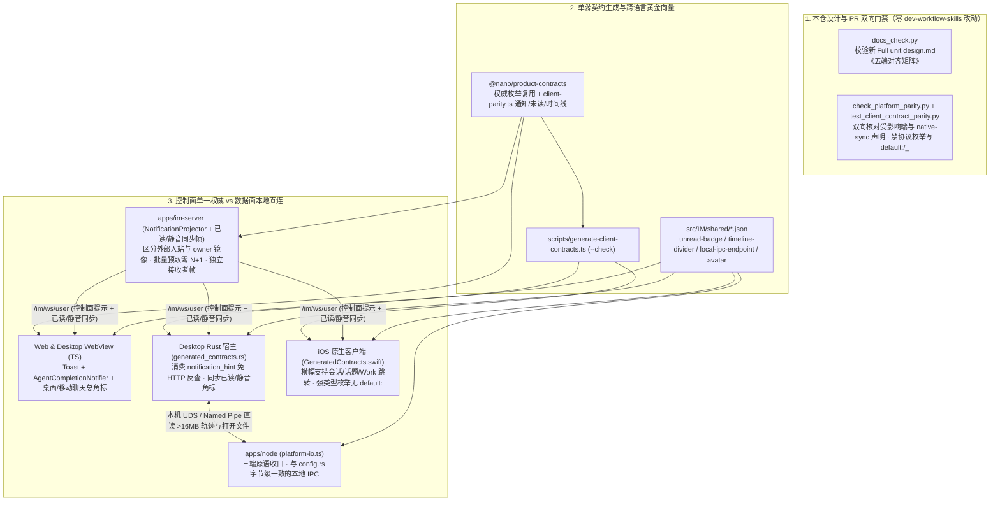
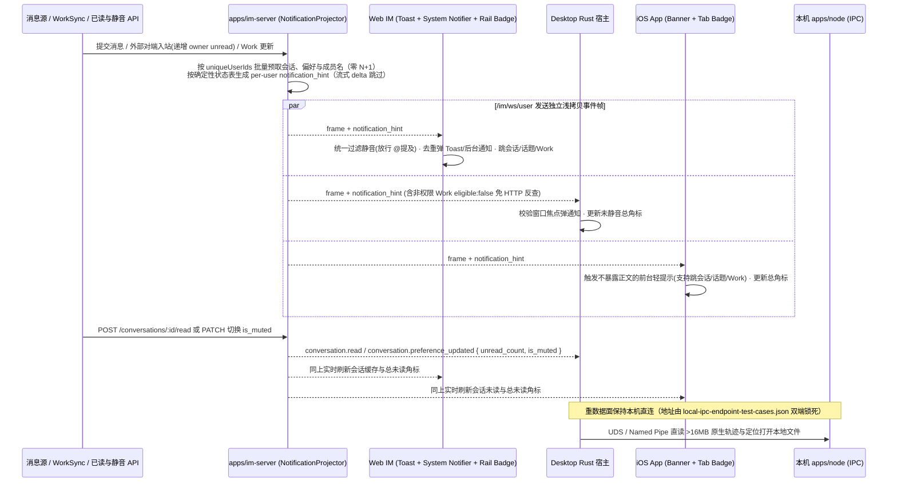

# refactor-800: 五端体验与行为一致性防漏体系 — 技术方案

> 对齐: [motivation.md](motivation.md) v1

## Changelog

## 现状分析

### 涉及范围

- **本仓流程文档与静态对称门禁**：[`docs/development/change-workflow.md`](../../development/change-workflow.md)、[`docs/development/frontend-experience.md`](../../development/frontend-experience.md)、[`scripts/docs_check.py`](../../../scripts/docs_check.py)，以及新增 `scripts/check_platform_parity.py` 与 `tests/contract/test_client_contract_parity.py`。在本仓内部闭环校验设计阶段的《五端对齐矩阵》声明、PR 跨端修改双向对称性与客户端协议枚举穷尽处理，完全不修改外部通用独立库 `dev-workflow-skills`。
- **CI 快慢分层与三系统窄测试接线**：[`.github/workflows/ci.yml`](../../../.github/workflows/ci.yml)、[`.github/workflows/desktop-candidate.yml`](../../../.github/workflows/desktop-candidate.yml) 与 [`src/IM/ios/scripts/build.sh`](../../../src/IM/ios/scripts/build.sh)。在刚合入的 `bugfix-802`（独立归档快检、后端双分片并行与 `iOS ${{ matrix.task }}` 并行矩阵）基线上，将 `develop` 纳入主干 `push` 触发，由 `ios_changes` 动态计算并行矩阵任务列表（纯共享契约/向量跑 `unit-test`、常规 UI PR 跑单路 `test`、主干 `push` 或构建配置变更并行跑 `["test", "archive"]`），并在 Linux / macOS / Windows 并行任务挂载节点系统适配窄测试。
- **单一契约源与跨语言生成底座**：在 [`packages/product-contracts`](../../../packages/product-contracts/package.json) 既有子模块保留枚举权威定义，新增 `src/client-parity.ts` 汇总元数据并定义跨端通知指令与未读/时间线纯函数（仅导出新符号避免 `src/index.ts` `TS2308` 重复导出冲突）；新增 `scripts/generate-client-contracts.ts`（支持 `--check`），生成 `src/IM/ios/NanoIM/Client/GeneratedContracts.swift` 与 `apps/desktop/src/generated_contracts.rs`。
- **控制面通知与未读收拢先行样板（核实源码定位到 5 处真实跨端缺陷）**：
  1. **外部渠道镜像消息混淆“对端入站”与“owner 外发”，且入站未读恒为 `0`**：[`apps/im-server/src/messaging.ts`](../../../apps/im-server/src/messaging.ts) 将飞书/微信外部对端入站消息与账号 owner 本人在飞书/微信外发的镜像消息（见 [`schema.sql`](../../../apps/im-server/src/schema.sql) `owner_direct_agent_messages` 及 `agent_channels` 的 `owner_open_id` / `owner_user_id`）均写为 `sender_user_id = ownerId, sender_type = 'user'`。导致 Desktop [`notifications.rs`](../../../apps/desktop/src/notifications.rs) 与 iOS [`ChatStore.swift`](../../../src/IM/ios/NanoIM/Features/Chat/ChatStore.swift) 因 `sender_user_id == self_user_id` 丢弃全部外部对端提醒；同时 `message-records.ts` 与 `threads.ts` 按 `user_id != sender` 计算未读，使外部对端入站消息在 SQLite 中的 `unread_count` 恒为 `0`。
  2. **Work 待决权限更新引发 Desktop 高频 HTTP 反查且 Web/iOS 缺口**：[`apps/im-server/src/work.ts`](../../../apps/im-server/src/work.ts) `notifyUpdated()` 仅广播 `{ agent_id, revision }`，迫使 Desktop [`notifications.rs`](../../../apps/desktop/src/notifications.rs) 对每一帧 `agent.work.updated` 额外发起 `GET /im/v1/agents` 与 `GET /im/v1/agents/:id/work` HTTP 轮询；而 Web 与 iOS 尚未消费 `permission.request`（`chat_permission`）与本人管理助手 `waiting_permission`（`work_permission`）提醒及跳转路由。
  3. **`im-server` 双发事件、缺省载荷与 iOS 真人横幅失效**：`Messaging.publishAgent` 对单次显式发布连发 `message.created(completed)` 与仅含 `{ content, token_usage }` 的精简 `message.completed`；`WorkerPermissionCards` 在建卡与结案时分别双发事件；且 `im-server` 普通真人发言只发 `message.created` 不发 `message.sent`，导致现网 iOS `ChatStore.swift` 过滤掉了全部普通真人消息的前台横幅。
  4. **静音、已读同步与全局未读角标三端打架**：Desktop 全局角标排除了 `is_muted` 会话，但因 `im-server` 从未发出 `notifications.rs` 所监听的 `conversation.read` / `conversation.preference_updated`，读完纯 Agent 回复或切换静音后 Desktop 托盘/Dock 角标卡住不更新；Web [`app-shell.tsx`](../../../src/IM/frontend/src/app/shell/app-shell.tsx) 桌面视口禁用了未读查询、移动端在 `聊天` 与 `我` 重复渲染且未排除 `is_muted`，[`use-global-message-toast.ts`](../../../src/IM/frontend/src/features/chat/hooks/use-global-message-toast.ts) 还在静音过滤前把事件送入后台 [`agent-completion-notifier.tsx`](../../../src/IM/frontend/src/features/notifications/agent-completion-notifier.tsx)（丢失 `?thread=` 并在静音群误弹系统通知）；iOS [`NanoIMApp.swift`](../../../src/IM/ios/NanoIM/App/NanoIMApp.swift) 未排除 `is_muted` 且未放行静音群内的 `@提及`。
  5. **时间分隔宿主时区耦合与枚举裸字符串 `default:`**：Web [`message-pane.tsx`](../../../src/IM/frontend/src/features/chat/components/message-pane.tsx) 依赖宿主时区 `toDateString()`；iOS [`TaskPresentation.swift`](../../../src/IM/ios/NanoIM/Features/Tasks/TaskPresentation.swift) 与 [`AgentLifecycleView.swift`](../../../src/IM/ios/NanoIM/Features/Agents/AgentLifecycleView.swift) 对共享状态枚举使用裸 `String` + `default:`。
- **跨端共享黄金测试向量与本机节点适配收口**：扩展 `src/IM/shared/` 新增 `unread-badge-test-cases.json`、`timeline-divider-test-cases.json` 与 `local-ipc-endpoint-test-cases.json`（在 `src/IM/ios/Tests/` 建立相对符号链接接入 `NanoIMTests`），更新 [`tests/contract/test_runtime_dependency_contract.py`](../../../tests/contract/test_runtime_dependency_contract.py) 放行 `src/IM/shared/*.json` 静态数据读取；新增 `apps/node/src/platform-io.ts` 与 `apps/node/tests/platform-conformance.test.ts`。

### 既有约束

- **跨包依赖与运行时红线**：遵循 [`SPEC.md`](../../../SPEC.md) 与 [`tests/contract/test_runtime_dependency_contract.py`](../../../tests/contract/test_runtime_dependency_contract.py)，TS 包之间仅通过 `@nano/product-contracts` 共享与运行时无关的类型与纯函数；iOS 与 Desktop Rust 通过生成的原生类型与 `src/IM/shared/*.json` 静态向量对齐。
- **通用技能库解耦红线**：不修改外部独立库 `dev-workflow-skills`，所有五端声明与门禁只落在本仓内。
- **控制面零 N+1 查询、无串号广播与数据面直连零退化**：`Gateway.broadcast` 与 `Gateway.replay` 必须按唯一接收者与唯一会话批量预取 SQLite 数据（固定常数次查询），按每个接收者构造独立浅拷贝信封（严禁原地修改共享 `frame` 对象造成跨用户串号）；`message.delta`、`thinking.segment`、`tool_call.*`、`reply_process.*`、`run.heartbeat` 零新增字段；`apps/node` 的 `localNodeBridgeEndpoint` 必须与 [`apps/desktop/src/config.rs`](../../../apps/desktop/src/config.rs) `local_node_bridge_endpoint` 保持字节级一致，确保 >16MB 本机原生轨迹与工作区文件直读零回退。
- **存量单测固件与渐进升级兼容**：保留 Desktop 既有通知类别字符串 `'chat_permission'` 与 `'work_permission'`；当单测手工传入不含 `notification_hint` 的合成事件帧（如 `ChatStateTests.swift`、`use-global-message-toast.test.tsx`、`notifications.rs` 存量单测）时，客户端降级分支继续保持既有断言通过。
- **无 Agent Context 变更与无新增独立页面**：不触碰模型可见上下文生命周期，不新增独立视觉页面或复杂布局，无需 `prototype.html`。

### 可复用能力

- **直接复用**：
  - [`scripts/generate-ios-interactive.ts`](../../../scripts/generate-ios-interactive.ts) 的 `--check` 零漂移校验模式；
  - [`scripts/check_change_unit_archived.py`](../../../scripts/check_change_unit_archived.py) 的 `UNIT_BRANCH` 与活跃/`archive/` 目录定位逻辑；
  - `src/IM/ios/Tests/avatar-test-cases.json -> ../../shared/avatar-test-cases.json` 经 Xcode `PBXFileSystemSynchronizedRootGroup` 自动打入 `NanoIMTests` bundle 的符号链接模式；
  - [`scripts/build-desktop-windows.ps1`](../../../scripts/build-desktop-windows.ps1) 已内置执行的 Windows 宿主 `cargo test`。
- **扩展改造**：
  - [`apps/im-server/src/gateway.ts`](../../../apps/im-server/src/gateway.ts)、[`messaging.ts`](../../../apps/im-server/src/messaging.ts)、[`message-records.ts`](../../../apps/im-server/src/message-records.ts)、[`threads.ts`](../../../apps/im-server/src/threads.ts) 与 [`work.ts`](../../../apps/im-server/src/work.ts)：补齐外部对端入站与 owner 外发镜像判定及未读递增、补发 `conversation.read` / `conversation.preference_updated` 用户同步帧，并接入批量预取的 `NotificationProjector`。
  - [`src/IM/ios/scripts/build.sh`](../../../src/IM/ios/scripts/build.sh)：新增 `unit-test`（`-only-testing:NanoIMTests`）并支持 `NANO_IOS_SKIP_WEB_BUILD=1` 避免同 Job 重复编译前端交互资源。

### 相关历史

- **[feat-790](../archive/feat-790-desktop-client/design.md)** 与 **[feat-794](../archive/feat-794-wechat-channel/design.md)**：分别引入了 Desktop Rust 后台通知守护与微信外部镜像会话，暴露出多端各自解析 `/im/ws/user` 在群话题、外部镜像、Work 待决权限与已读/静音角标同步上的系统性分叉。
- **[refactor-783](../archive/refactor-783-shared-rpc-contracts/motivation.md)**：建立了 `@nano/product-contracts` 双端穷举契约范式，本 unit 将其拓展至 TS / Swift / Rust 客户端协议枚举与多平台门禁。

## 架构总览

本方案通过「本仓双向对称门禁 → 单源跨语言契约生成与枚举穷尽校验 → 服务端控制面批量投射 + 本地共享黄金向量 → 零增时分层 CI」四层协同消除漏端与体验分叉：

## 五端对齐矩阵

| 平台 | 处置方式 | 受影响范围与理由 | 下游验证投影 |
|---|---|---|---|
| `Web` | `native-sync` | `src/IM/frontend` 接入 `notification_hint`（打通 `InAppToast` 与后台 `AgentCompletionNotifier` 的静音/`@提及`/话题与 Work 路由跳转）、桌面左侧栏与移动底部 `聊天` 统一未静音总角标，以及带显式时区的时间分隔向量 | M1 `[reviewer]` ①②、`[worker]` ②③ |
| `Desktop (macOS)` | `native-sync` | 主窗口复用 `src/IM/frontend`；`apps/desktop` 接入 `generated_contracts.rs`、`notification_hint`（抑制非权限 `Work` 更新的 HTTP 反查）、`conversation.read` / `conversation.preference_updated` 角标同步及 IPC 地址对等向量 | M1 `[reviewer]` ①②、`[worker]` ②③④ |
| `Desktop (Windows)` | `native-sync` | 与 macOS 共享 `apps/desktop` 代码，复用 `build-desktop-windows.ps1` 既有 `cargo test` 并在 `desktop-candidate.yml` 补挂 `apps/node` 平台窄测试 | M1 `[reviewer]` ①③、`[worker]` ②③④ |
| `iOS` | `native-sync` | `src/IM/ios` 接入 `GeneratedContracts.swift`、`notification_hint`（修复普通真人与外部对端消息横幅，支持定位聊天/话题/助手 Work 且默认不暴露正文）、未静音总角标与符号链接黄金向量；拆分 `unit-test` 快检 | M1 `[reviewer]` ①④、`[worker]` ①②③④ |
| `Node (macOS / Windows / Linux)` | `native-sync` | `apps/node/src/platform-io.ts` 收拢三系统文件同步、私有目录权限、路径包含、启动纪元与字节级对等的 `localNodeBridgeEndpoint`；Linux 沿用“后台 Node + Web IM”产品边界 | M1 `[reviewer]` ③④、`[worker]` ④ |

## 关键决策

1. **在本仓实现双向《五端对齐矩阵》与 PR 对称门禁，完全不触碰通用 `dev-workflow-skills` 独立库。**
   - *理由*：在 [`docs/development/change-workflow.md`](../../development/change-workflow.md) 与 [`docs/development/frontend-experience.md`](../../development/frontend-experience.md) 定义五端矩阵规范，由 [`scripts/docs_check.py`](../../../scripts/docs_check.py) 对新 Full `design.md`（白名单豁免本 unit 前已存在的 13 份未归档历史草稿）强制检查 5 个平台行与枚举值（`shared` | `native-sync` | `platform-exempt`）。`scripts/check_platform_parity.py` 执行**双向对称核验**：① 凡矩阵声明为 `native-sync` 的平台，在非纯文档 PR 中必须包含该平台路径的实际改动；② 凡 PR 触及共享契约、共享测试向量、`im-server` 客户端接口/事件或 `src/IM/frontend/src/**` 共享业务时，所有受影响客户端平台（`Web`、`Desktop`、`iOS`）均须有对应代码改动，或在关联活跃/`archive/` unit 矩阵（无 unit 小修则为 `Platform-Parity-Exempt:`）中具备显式 `shared` / `platform-exempt` 依据。
   - *拒绝备选*：仅单向检查 `src/IM/ios/**` 是否为空（会漏放“改了契约和 iOS 却忘改 Desktop/Web”或“标了 `native-sync` 却漏写代码”）。
   - *风险*：设计期仅提交 `docs/**` 时尚无业务代码 diff；`check_platform_parity.py` 识别纯 `docs/**` 变更仅做矩阵合法性校验，进入代码提交后才激活双向文件覆盖断言。

2. **复用 `@nano/product-contracts` 既有权威类型单源生成 Swift 与 Rust 枚举，并按枚举匹配块粒度禁止默认通配兜底。**
   - *理由*：`agent-lifecycle.ts`、`collaboration.ts`、`task-graphs.ts`、`worker-runtimes.js` 与 `chat.ts` 继续作为各自类型的唯一导出源（避免 `src/index.ts` `TS2308` 重复导出冲突），`client-parity.ts` 仅导入这些权威常量元组供 `scripts/generate-client-contracts.ts` 生成 `GeneratedContracts.swift` 与 `generated_contracts.rs`，并保留既有通知类别值 `'chat_permission'` 与 `'work_permission'` 以兼容存量测试。生成代码以 `WireEnum<Known>` / `#[serde(other)]` 在反序列化边界吸收未来未知值，而内部 `Known` 枚举供业务层穷举；`test_client_contract_parity.py` 按花括号平衡提取针对生成协议枚举的 `switch` / `match` 块，精确禁止其中的 `default:` 与 `_ =>`，不误伤同文件内的普通本地 UI 控制流。
   - *拒绝备选*：全文无差别正则禁用 `default:`（会误伤与跨端协议无关的 HTTP 状态码或本地视图分支）。
   - *风险*：新增共享状态模块若忘记纳入生成器清单将失去跨端编译期保护；`test_client_contract_parity.py` 同时校验 `client-parity.ts` 登记集合覆盖核心共享状态模块。

3. **在 `apps/im-server` 统一判定外部渠道对端入站与双事件幂等 `notification_hint`，补齐已读/静音用户同步帧，彻底消除 Desktop HTTP 反查风暴与广播串号。**
   - *理由*：
     - **区分外部对端入站与 owner 本人外发镜像**：新增服务端统一谓词 `isExternalOwnerMirrorMessage`（核对 `owner_direct_agent_messages` 及绑定 `agent_channels` 的飞书 `owner_open_id` / 微信 `owner_user_id`）。仅当外部镜像会话消息属于**对端入站**时，在 `message-records.ts` 递增 owner 参与者的 `unread_count`（并在 `threads.ts` `listUnread` 与消息撤回处使用同一谓词保持水位计算一致）且标记 `eligible: true`；owner 本人在飞书/微信发出的镜像消息不计未读且 `eligible: false`。
     - **全覆盖 `agent.work.updated` 抑制 HTTP 轮询**：`Work.notifyUpdated` 从 `this.records`（活跃 `global_main` 会话 + 最新 `agent_work_turns.execution` + `gateway.isOnline(node)`）与 `agent_profiles` 读取真实 `main_execution`、`display_name`、`owner_id`，对**所有** `agent.work.updated` 帧附带 `notification_hint`（非 `waiting_permission` 或非 owner 管理时 `eligible: false`），使 Desktop `notifications.rs` 见到 `notification_hint` 即直接跳过 `GET /im/v1/agents` 与 `GET /im/v1/agents/:id/work` 反查；待决权限的 `dedupe_key` 锚定为 `work-perm:${agentId}:${mainSessionId}:${turnId}`，既防止子任务追加刷屏，又不吞掉下一轮新权限请求。
     - **批量预取零 N+1 与独立接收者帧**：重构 `Gateway.broadcast` 按 `uniqueUserIds` 与涉及会话一次性批量预取参与者 `is_muted`、`unread_count`、会话 `type/title/external_source` 及提及成员名，为每个接收者序列化独立浅拷贝 `{ ...frame, notification_hint }`，绝不污染共享 `frame` 对象。
     - **实时同步已读与静音变更**：在 `POST /im/v1/conversations/:id/read` 与 `PATCH /im/v1/conversations/:id`（修改 `is_muted` / `is_pinned` 时）向操作者本人的 `/im/ws/user` 连接投递 `conversation.read` 与 `conversation.preference_updated`（携带最新 `unread_count` 与 `is_muted`），直接打通 Desktop Rust 既有监听分支与 Web/iOS 缓存刷新。
   - *拒绝备选*：只在 `waiting_permission` 时附带 `notification_hint`（99% 的普通 Work 更新仍会触发 Desktop HTTP 反查）。
   - *风险*：`publishAgent` 与 `WorkerPermissionCards` 存在同消息连发多帧；通过下方确定性事件映射表与跨事件共享 `dedupe_key`（`message:${messageId}` / `perm:${requestId}`）保证三端最多提醒一次。

4. **打通 Web（含后台系统通知与桌面导航栏）、Desktop、iOS 三端提醒跳转与共享黄金测试向量。**
   - *理由*：
     - Web `InAppToast` 与后台 `AgentCompletionNotifier` 统一消费通过 `notification_hint`（静音且非 `@提及` 一律拦截）产出的候选并导航至 `target_route`（保留 `/chat/:id?thread=:root` 与 `/settings/agents/:id?view=work`）；`app-shell.tsx` 放开桌面视口会话列表订阅，在桌面左侧栏 `聊天` 与移动底部 `聊天` 统一渲染排除静音会话后的 `shell-chat-unread`，移除移动端 `我` Tab 上的重复未读角标。
     - iOS `ChatStore` 与 `ChatBanner` 扩展目标路由枚举（会话 / 群话题 / 助手 Work），消费 `notification_hint`（修复普通真人 `message.created` 与外部对端入站横幅，支持 `chat_permission` 与本人管理助手 `work_permission` 横幅定位，且严格保持横幅默认不暴露正文的隐私契约）。
     - 在 `src/IM/shared/` 落地 `unread-badge-test-cases.json`、`timeline-divider-test-cases.json` 与 `local-ipc-endpoint-test-cases.json`（并在 `src/IM/ios/Tests/` 建立指向 `../../shared/*.json` 的受跟踪相对符号链接），使 TS、Swift、Rust 共跑同一套标准答案。
   - *拒绝备选*：保持 iOS 仅支持跳普通聊天页或保持 Web 桌面左侧栏无未读总角标（与首文档三端一致验收要求冲突）。
   - *风险*：桌面视口开启 `app-shell.tsx` 的 `conversations` 查询与聊天页本身共用同一 TanStack Query key `["chat", "conversations"]`，不会产生重复请求，在非聊天页（如任务/设置页）则补齐了实时未读角标感知。

5. **精细化 CI 触发与 `apps/node` 字节级对等平台适配，兼顾主干 `develop` 归档保障与零重复测试耗时。**
   - *理由*：
     - [`.github/workflows/ci.yml`](../../../.github/workflows/ci.yml) 将 `push.branches` 更新为 `[main, develop]`，保证合入 `develop` 主干时必跑完整 `Release device archive`。
     - 在 `bugfix-802` 并行 `iOS ${{ matrix.task }}` 矩阵基础上由 `ios_changes` 动态下发 `tasks`：当 `ui_required == 'true'`（修改了 `src/IM/ios/NanoIM/**`、`UITests/**` 或共享交互 UI）时下发 `test` 单次跑完 `NanoIMTests` + `NanoIMUITests`；当仅修改共享契约或 `src/IM/shared/**`（`unit_required == 'true' && ui_required == 'false'`）时下发 `unit-test`（约 2~3 分钟）；仅当 `archive_required == 'true'`（主干 `push` 或修改 `NanoIM.xcodeproj` / `Config` / `scripts/build.sh` / `ci.yml`）时并行追加 `archive` 任务，避免常规 PR 空转第二台 macOS runner。
     - `desktop-candidate.yml` 的 `windows-x64` 直接复用 `build-desktop-windows.ps1` 内已执行的 `cargo test`（不重复执行第二遍），仅增挂 `<10s` 的 `apps/node/tests/platform-conformance.test.ts`；`apps/node/src/platform-io.ts` 中的 `localNodeBridgeEndpoint` 严格保持与 `apps/desktop/src/config.rs:294` 相同的路径哈希截断与 96 字节回退规则，由 `local-ipc-endpoint-test-cases.json` 在 Node 与 Rust 双端同时断言。
   - *拒绝备选*：iOS 代码变更时串行分跑 `unit-test` 再跑 `ui-test`（会多出一次 `xcodebuild` 启动与模拟器准备开销）。
   - *风险*：无。

## 接口与数据流

### 1. 控制面通知投射、已读/静音同步与本地数据面直连时序

### 2. `NotificationProjector` 确定性事件映射与幂等 `dedupe_key` 表

| `/im/ws/user` 事件与条件 | `eligible` | `kind` | `dedupe_key` 与特殊处理 |
|---|---|---|---|
| `message.delta` / `thinking.segment` / `tool_call.*` / `reply_process.*` / `run.heartbeat` | 不附带 `notification_hint` | — | $O(1)$ 直接跳过，零查询、零字节增量 |
| 任意消息事件且 `sender_type === 'system'` 或 `system_notice != null` | `false` | — | 系统通知消息永不触发弹窗提醒 |
| `message.created`（`sender_type === 'user'`）：普通本人消息、飞书/微信 **owner 外发镜像**（`isExternalOwnerMirrorMessage`）、或本人触发的 PA 代发（`pa_agent_id != null && sender_user_id === viewerId`） | `false` | — | 彻底杜绝微信/飞书本人发消息误弹自发提醒 |
| `message.created`（`sender_type === 'user'`）或历史兼容 `message.sent`：其他真人、飞书/微信**外部对端入站**、或他人 PA 代发，且通过 `thread_notify_user_ids` 检查 | `true` | 命中 `<mention target_id="viewer">` 为 `'mention'`，否则 `'human_message'` | `message:${messageId}`；修复现网 iOS 因无 `message.sent` 漏弹普通真人横幅及外部对端漏弹问题 |
| `message.created`（`sender_type === 'agent'`）：处于流式生成中（`delivery_status === 'running'`）或携带权限卡载体（`permission_requests.length > 0`） | `false` | — | 流式占位等待完成时再提醒；权限卡交由紧随其后的 `permission.request` 提醒，避免双弹 |
| `message.created`（`sender_type === 'agent'` 且 `delivery_status === 'completed'`，如 `publishAgent` 卡片/图文直发） | `true`（受话题关注约束） | `'message_completed'` | `message:${messageId}`；完整提取 `sender_name`、剥离 `<mention>` 后的 `preview_text`、`has_interactive_card` 与 `attachment_name` |
| `message.completed`：`delivery_status === 'failed'` 或属于已决议的 `WorkerPermissionCards` 卡（`permission_requests` 非空） | `false` | — | 失败回复与审批结案回写绝不误弹“回复完成” |
| `message.completed`：正常 Agent 回复完成（若像 `publishAgent` 第二帧缺少 `sender`/`interactive` 字段，从批量预取消息行补齐） | `true`（受话题关注约束） | `'message_completed'` | **复用同一 `message:${messageId}`**，使 `publishAgent` 连发 `created(completed)` + `completed` 天然幂等只弹一次，同时携带最新 `conversation_unread` |
| `permission.request`：`status === 'pending'` 且通过话题关注受众检查 | `true` | `'chat_permission'` | `perm:${requestId}`；`target_route` 指向会话或对应 `?thread=` |
| `agent.work.updated`：`main_execution === 'waiting_permission'` 且 `profile.owner_id === viewer.owner_id` 且节点在线 | `true` | `'work_permission'` | `work-perm:${agentId}:${mainSessionId}:${activeTurnId}`；`target_route = "/settings/agents/${agentId}?view=work"` |
| `agent.work.updated`：其余所有运行中/空闲/离线或非本人管理的更新帧 | `false` | — | **显式下发 `eligible: false`**，使 Desktop `notifications.rs` 直接跳过 HTTP `GET /work` 反查 |

- **端侧统一抑制规则**：当 `notification_hint` 存在时，仅当 `eligible === true && !replayed && (!is_muted || mentions_viewer || kind === 'work_permission')` 且当前窗口未聚焦正在浏览该目标路由、且 `dedupe_key` 未消费过时触发提醒。

### 3. 单源跨语言契约生成与共享黄金向量

- **`packages/product-contracts/src/client-parity.ts`（不重定义已有导出类型，消除 `TS2308`）**：
  - 从 `./task-graphs.js`、`./agent-lifecycle.js`、`./collaboration.js`、`./worker-runtimes.js`、`./chat.js` 导入既有权威常量/类型组装 `CLIENT_CONTRACT_ENUMS`，并新增导出 `USER_NOTIFICATION_KINDS`（`'human_message' | 'mention' | 'message_completed' | 'chat_permission' | 'work_permission'`）、`UserStreamNotificationHint`、`computeUnreadBadgeTotal` 与 `timelineDividerMessageIds`。
  - `scripts/generate-client-contracts.ts`（`--check`）生成 `src/IM/ios/NanoIM/Client/GeneratedContracts.swift` 与 `apps/desktop/src/generated_contracts.rs`。
- **三份跨语言黄金向量（`src/IM/shared/` + `src/IM/ios/Tests/` 相对符号链接）**：
  1. `unread-badge-test-cases.json`：验证 `rowUnread` 与排除 `is_muted` 后的全局 `badgeTotal` 在 Web Vitest、Desktop Rust `cargo test`、iOS `NanoIMTests`（经 `src/IM/ios/Tests/unread-badge-test-cases.json -> ../../shared/unread-badge-test-cases.json`）三端一致。
  2. `timeline-divider-test-cases.json`：验证显式 `timezone` 下自然日切换、`>= 300_000ms` 间隔、毫秒小数时间戳及系统通知/配置边界不重置间隔在 Web Vitest（含属性测试随机序列检验）与 iOS `NanoIMTests`（经同名相对符号链接）一致。
  3. `local-ipc-endpoint-test-cases.json`：锁定 Windows 小写路径 `SHA-256[..24]` Named Pipe、POSIX `<= 96` UTF-8 字节 `.desktop-node.sock` 与超长 `TMPDIR` `SHA-256[..20]` 回退规则在 `apps/node/src/platform-io.ts` 与 `apps/desktop/src/config.rs` 字节级一致。

## 本次审查安排

| 必须回答的问题 / 对应目标 | 能力与使用阶段 | 证据方法、范围与已有定位 |
|---|---|---|
| 设计是否闭合修复外部镜像自发误弹/入站零未读、双事件幂等、已读/静音角标同步、双向漏端门禁与 `TS2308`/IPC 对等隐患 | Gate 2 `change-design-reviewer` | 独立核实 Round 1 全部问题的设计修订、3 份 `specs/im/*.md` delta-spec 与生产代码接线落点 |
| `Gateway.broadcast` / `replay` 是否固定常数次 SQL 且无跨接收者对象污染，`agent.work.updated` 是否消除 Desktop HTTP 轮询，常规 PR CI 是否零增时 | 实施自检与 Stage 4 `performance-review` + `change-code-review` | SQLite 查询计数断言（多接收者广播与大批量回放）、Desktop 收到非权限 `agent.work.updated` 零 HTTP 请求单测、`message.delta` 零新增字段断言及 `ci.yml` 分支条件核验 |
| Web（含后台通知与桌面左侧栏）、Desktop（macOS / Windows）、iOS 与三系统 Node 是否通过全部生成契约与共享黄金向量 | Stage 4 `change-code-review` + 跨端测试套件 | 实跑 `./scripts/docs-check`、`check_platform_parity.py`、`pnpm check:client-contracts`、`pnpm test`、前端 `vitest`、`cargo test`、`build.sh unit-test` 与 `pytest -m "not e2e"` |

## 契约层增量 (delta-spec)

- **IM — Web Chat UX**：修改 [`docs/specs/im/web-chat-ux.md`](../../specs/im/web-chat-ux.md) 的 `Web 应用内新消息提醒按会话类型标识来源`（见 [`specs/im/web-chat-ux.md`](specs/im/web-chat-ux.md)，覆盖静音抑制与 `@提及` 例外、外部渠道对端入站与 owner 外发区分、会话待决权限与本人管理助手 Work 待决权限提醒及话题/Work 跳转、后台系统通知同步遵守静音/路由规则，以及桌面与移动端聊天导航入口统一展示未静音总未读数）。
- **IM — iOS Client**：修改 [`docs/specs/im/ios-client.md`](../../specs/im/ios-client.md) 的 `前台提醒与后台限制明确`（见 [`specs/im/ios-client.md`](specs/im/ios-client.md)，对齐真人/外部渠道对端入站/静音 `@提及`/待决权限与本人管理助手 Work 待决权限的前台轻提示资格及聊天/话题/Work 跳转定位，保持默认不暴露正文，且底部聊天入口总角标仅汇总未静音会话）。
- **IM — Desktop Client**：修改 [`docs/specs/im/desktop-client.md`](../../specs/im/desktop-client.md) 的 `Desktop 主窗口保持既有 IM 业务权限、原生通知直达与按服务及账号隔离`（见 [`specs/im/desktop-client.md`](specs/im/desktop-client.md)，明确区分外部对端入站与 owner 外发镜像，覆盖已读与静音变更后的实时总未读角标同步及助手 Work `waiting_permission` 通知）。
- **Gateway (`apps/node`)**：`no spec delta`（[`docs/specs/gateway/service-lifecycle.md`](../../specs/gateway/service-lifecycle.md) 既有对外契约不变）。

## 风险与回退

- **存量单测合成事件兼容风险**：`notifications.rs`、`use-global-message-toast.test.tsx` 与 `ChatStateTests.swift` 存在不含 `notification_hint` 的合成测试事件；保留 `'chat_permission'` / `'work_permission'` 原名并在 `notification_hint` 缺省时回退本地纯函数，确保存量测试不破。
- **跨端门禁对纯文档提交或小修误伤风险**：`check_platform_parity.py` 放行纯 `docs/**` 阶段性提交，并对非 unit 小修支持显式 `Platform-Parity-Exempt:` 理由；出问题时可独立回退门禁脚本接线。
- **本机轨迹 IPC 兼容性风险**：`local-ipc-endpoint-test-cases.json` 强制锁死 Node 与 Desktop Rust 的地址生成结果，确保已安装环境与热切换零断连。

## 一次性部署迁移

无。所有新增事件与 `notification_hint` 字段均为向后兼容增量，无数据库破坏性迁移或生产手工操作。

## Runbook for Reviewer

| 服务 | 停止命令 | 启动命令 | 健康检查 |
|---|---|---|---|
| 隔离验收栈（仅在需手工观察实时 WS 事件时按需启动；常规契约与多端向量验证无需常驻服务） | `./scripts/e2e-down.sh --wt "$PWD"` | `./scripts/e2e-up.sh --wt "$PWD"` | `curl -fsS "http://127.0.0.1:$(jq -r .im_port .e2e-runtime/state.json)/healthz"` |

**Review 驱动方式**:
1. 本仓文档、五端矩阵与双向 PR 对称门禁验证：`./scripts/docs-check && python3 scripts/check_platform_parity.py --self-test && pytest tests/contract/ -q`
2. 单源跨语言契约生成与类型检查：`pnpm check:client-contracts && pnpm build && pnpm typecheck`
3. 后端通知投射（含外部入站 vs owner 镜像未读递增、双事件幂等、已读/静音同步帧、广播固定常数次 SQL、流式帧零膨胀）与 Node 平台适配验证：`pnpm test`
4. Web 前端共享向量、Toast/后台通知静音与路由跳转、桌面与移动导航总未读角标验证：`npm --prefix src/IM/frontend run test`
5. Desktop Rust 生成契约、免 HTTP 反查通知消费、已读/静音实时角标同步与本地 IPC 地址对等向量验证：`cargo test --manifest-path apps/desktop/Cargo.toml`
6. 原生 iOS 快速契约与共享黄金向量门禁验证（验证完毕按规范关闭新建模拟器）：`NANO_IOS_SIMULATOR_ID=<udid> ./src/IM/ios/scripts/build.sh unit-test`

**验收前置**: 无（全部检查与测试均可在当前开发机离线确定性运行）。

## Milestones

| ID | 标题 | 依赖 | 并行组 | 范围 | 退出标准 |
|---|---|---|---|---|---|
| `M1-platform-parity-foundation` | 五端双向防漏门禁、跨语言生成契约、控制面通知/未读收拢与共享黄金向量闭环 | 无 | G1 | `docs/development/`、`scripts/`、`tests/contract/`、`.github/workflows/`、`packages/product-contracts/`、`src/IM/shared/`、`apps/im-server/`、`apps/desktop/`、`src/IM/frontend/`、`src/IM/ios/`、`apps/node/` | `[reviewer]` ① 同一事件流（普通真人与 Agent 消息、`publishAgent` 双事件、静音会话与静音 `@提及`、群话题关注/未关注、飞书/微信外部对端入站 vs owner 本人外发镜像、会话待决权限 `chat_permission`、本人管理助手 `work_permission`、标记已读与切换静音）在 Web（含后台通知与桌面/移动导航栏）、Desktop 与 iOS 产生一致的提醒资格、点击直达目标（聊天 / 对应话题 / 助手 Work）与实时同步的未静音全局总未读角标，且 iOS 前台横幅继续默认不暴露正文；② Desktop 本机原生轨迹与工作区文件直读保持字节级兼容零回退，非待决权限的 `agent.work.updated` 不再触发 Desktop HTTP 反查，`message.delta` 零新增字段且广播/回放无 N+1 查询或跨接收者污染；③ `apps/node` 在各系统保持原有生命周期与本地管道行为；④ 双向漏端 PR（含漏改 iOS/Desktop/Web 或 `native-sync` 未兑现）被门禁准确阻断，合规豁免正常放行，`develop`/`main` 主干保留真机归档而常规开发 PR 免除重复编译。 `[worker]` ① `./scripts/docs-check`、`check_platform_parity.py` 双向自测与 `pytest -m "not e2e"` 全绿；② `pnpm check:client-contracts && pnpm build && pnpm typecheck` 零冲突通过，`test_client_contract_parity.py` 确认已接入协议枚举匹配块零 `default:`/`_ =>`；③ `unread-badge-test-cases.json`、`timeline-divider-test-cases.json` 与 `local-ipc-endpoint-test-cases.json` 在对应 TS `vitest`、Desktop `cargo test`、iOS `NanoIMTests` 与 Node `platform-conformance.test.ts` 全部实跑通过；④ `ci.yml`（含 `develop` 主干归档触发与单次全量/快检切换）及 `desktop-candidate.yml` 配置核验通过，回收验证创建的临时模拟器资源。 |
