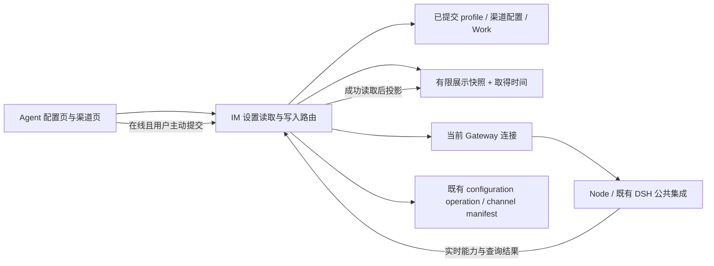

# bugfix-644: Agent 配置页与外部渠道统一离线行为 — 技术方案

> 对齐：[incident.md](incident.md) R1–R11。方案基线：main `59ca15b2a85b56674cffe2b0284d485d14ff79ea`。当前为设计产物，尚未实施。

## Changelog

## 现状分析

### 涉及范围

| 位置 | 当前职责及本次落点 |
|---|---|
| `apps/im-server/src/control.ts` | 配置 profile、可恢复 configuration operation、能力／插件／统计／心跳／定时任务 RPC 路由。增加面向设置页的读取响应，停止用假能力和空数组表达离线；配置新写入增加在线检查。 |
| `apps/im-server/src/schema.sql` | 新增设置页展示快照表；原 profile 与 operation 保持权威。 |
| `apps/im-server/src/agent-settings.ts`（新增） | 仅负责设置页快照投影／读写、当前 Agent 绑定校验和设置操作的在线前置检查；不承担运行执行或通用缓存。 |
| `apps/im-server/src/channels.ts` | 已有 desired、observed、manifest revision 和 removal receipt。保留这些机制，拒绝新增离线变更。 |
| `apps/im-server/src/personal-agent.ts` | PA 配置页的改名、来源范围调整和解除联系人限制。相同操作入口增加节点前置检查；不改聊天内风险保护与屏蔽流程。 |
| `src/IM/frontend/src/features/settings/agents/` | 详情页、API、状态事件消费者、Features／工具／Skills／模型／插件／渠道分区。统一展示来源和可操作性，保留草稿，更新恢复路径。 |
| `src/IM/frontend/src/features/personal-agent/` | 配置页内两类独立即时提交控件接入只读条件。 |
| `src/IM/frontend/src/i18n/{zh,en}.json` | 区分离线、刷新中、读取失败、最后确认、未取得和提交结果待确认。 |

### 既有约束

- 遵循 [SPEC](../../../SPEC.md) 的依赖边界：IM 不读节点文件、不 import DSH；本 unit 不改变 Node 与 DSH 的 stdio 接入或建立第二套运行循环。
- [配置与节点契约](../../specs/im/agents-nodes.md) 的 profile 乐观锁、Gateway apply receipt、渠道 manifest 和删除回执继续使用。离线禁用不能删掉历史 pending 操作或把它们伪装成失败。
- 节点失联只是 IM 无法联系它。不能因此声称本地任务／飞书连接已停止，也不能主动停止其自治。
- 授权始终依据当前身份、Agent owner、space、节点绑定，快照不提供权限或能力凭证。继承值和目录缺失不能变成新的保存值。
- 现有 iOS 调用 `/capabilities`、`/config`、`/plugins`、`/cron/jobs` 等接口；不把这些在线成功响应替换为另一形状。共享写入接口增加明确离线拒绝，在线字段与 receipt 契约保持兼容。

### 可复用能力

| 能力 | 使用方式 |
|---|---|
| `agent_profiles` | 继续保存配置；离线直接读已提交 profile，不复制整份配置作为新的可写权威。 |
| `ConfigOperations.serialized / recover / commit` | 继续处理已接受配置操作、ACK 丢失、CAS 和补偿。新增只读 operation 摘要，不让 pending 阻断整页最后确认配置的读取。 |
| `Gateway.nodes / valid / request` | 用当前 socket 与绑定验证可达性。已有 `isOnline` 仅检查 Map，设置写入需额外检查 socket OPEN 和绑定有效，不以数据库的 online 字样代替实际连接。 |
| owner user-stream、React Query、`authFetch` 的 AbortSignal | 复用状态通知与请求取消；恢复时取消旧请求、使相关查询失效并重新取数，不新增后台同步服务。 |
| 渠道资源与 removal receipt | 已能跨浏览器保存配置及最后上报状态；直接使用，不重复存入设置快照表。 |
| Work 持久记录与 `node_connection_state` | 直接复用。`Work.summary` 已将离线运行中状态转为 unknown；保留已同步过程与阅读入口，不增加第二份工作历史。 |
| 现有 profile／channel revision | 恢复时识别草稿基线变化，不自动把草稿绑定到新版本后覆盖保存。 |

### 相关历史

- [feat-514](../archive/feat-514-model-reasoning-effort/design.md)：模型推理能力与 configuration operation。沿用在线校验和 receipt，修正离线时缺 descriptor 的误判。
- [bugfix-585](../archive/bugfix-585-node-connection-recovery/incident.md)：真实在线状态与旧连接隔离；本次扩展 UI 消费，不能退回仅更新角标。
- [refactor-470](../archive/refactor-470-managed-channel-composition/design.md)：托管渠道 desired／observed 生命周期。只收紧新变更的接收条件，历史 manifest 仍按原机制恢复。
- [feat-614](../archive/feat-614-workspace-plugin-development/design.md)：插件操作有独立生命周期和 pending 视图；不能用主表单保存状态替代插件结果。
- 当前 worktree-runtime 文档仍包含已过时的 Python 服务例子、`openapi.json` 健康检查和 down 后删除 config 的说明。本设计按实际 TS 脚本与 `/health` 编写 runbook；不顺带修订无关运维文档。

## 架构总览

从用户视角，一页始终有三类不同信息：已保存配置、最后确认的节点展示信息、当前可操作性。第一类来自现有持久配置，第二类来自成功实时读取后保留的有限快照，第三类必须重新确认当前连接和相关查询；三者不能互相冒充。



快照只支持阅读。运行配置校验与操作接收不从快照取能力，不增加离线编辑队列。

## 关键决策

### D1：按需保存展示快照，不持久化完整可选能力目录

用户已授权“你来设计就行”。选择在线打开配置或分区时更新；复用按需 RPC，不新增后台定时采集或上线后全量扫描。另一浏览器可读取同一 IM 中的最后成功结果，首次升级没有快照则明确未取得。

仅保存配置展示所需的名称、分组、已确认状态和少量相关元数据，以及已访问分区的任务／插件／统计投影。不保存完整模型候选目录、推理档位目录或未经配置的工具候选；不新增节点文件正文的持久同步。拒绝仅存浏览器缓存，因为无法满足跨浏览器；拒绝持久化整份 capability response，因为容易再次把历史目录当作当前可选范围。

### D2：核心配置使用一个设置读取入口，分区按需独立读取

新增 `GET /im/v1/agents/:agent_id/settings`，稳定返回已提交配置、展示快照、当前连接、实时能力（仅成功时）及既有配置操作摘要。离线不调用会抛 pending 的旧 `/config?source=mirror` 作为整页前置，避免已有 pending 导致页面只剩加载或错误壳。

插件、cron、usage 使用有限枚举的 `GET /im/v1/agents/:agent_id/settings/sections/:section`。复用既有 RPC 及安全投影，不复制节点业务实现。旧在线接口形状保留给现有客户端；Web 设置页改用带时效语义的入口。渠道和 Work 已有持久读取路径，继续使用。

### D3：离线为全页只读，恢复和读取失败按实际依赖开放

全局连接条件为 offline／unknown 时，所有配置写入和执行入口关闭，阅读、展开、搜索、取消、主动放弃草稿及重新读取仍可用。online 只意味着可以开始刷新，不直接解锁。

主配置需要当前 profile、有效能力和无未确认 configuration operation；插件操作需要当前插件结果及无 pending；渠道需要当前资源版本和无相应未确认操作；PA 范围／联系人操作需要当前 policy／联系人状态；cron 删除需要当前列表。统计失败不阻塞模型或渠道。配置表单的名称和描述随主表单一起只读，不新增离线保存分支。

### D4：新写入检查当前连接，已接受操作继续恢复

在身份与资源归属检查之后、任何新候选／revision／回执写入之前检查当前有效连接。明确离线时返回 `409 {code:"agent_node_offline", message:...}`，无新增配置或渠道变更。节点更新等已有 unavailable gate 保留其自己的原因，不统称离线。

已接受操作的 `recover`、Gateway 状态回报和 manifest 自动收敛不经过“新写入”拒绝分支。连接检查后立即断开属于在途操作的不确定性，沿用既有结果确认机制，不承诺网络检查能提供跨机原子性。

### D5：草稿与读取结果分离，不用刷新隐式修改保存内容

保留 `baseConfig`（开始编辑的已提交版本）、`draft`、`latestConfig`；尚未编辑时可以随刷新更新，已编辑时只更新最新服务端信息。版本变化提示冲突，禁止用新版本号偷偷提交旧草稿。发生版本冲突时保留草稿，阻止其覆盖新版本；用户沿用现有“放弃修改”载入最新配置后重新编辑，不新增字段合并流程。

从网络读取的能力变化不写入草稿、不补模型默认强度、不清空工具／Skill。只在用户主动切换模型等动作时沿用现有联动规则。无实时能力时不运行 stale 校验；恢复后有完整当前目录才显示真实失效项。

### D6：一个 M1 交付完整体验

快照、读取响应、提交检查和前端恢复状态是一条用户旅程，不能独立交付其中一层而宣称 bug 已修复。默认单 milestone，保留窄测试与 Full 独立产品验收；不按文件数拆分。

## 接口与数据流

### 1. 快照职责与保存范围

`agent-settings.ts` 提供具体的 `readSettingsSnapshot(ctx, profile, section)`、`writeSettingsSnapshot(ctx, profile, section, data, capturedAt)` 和 `requireSettingsNodeOnline(ctx, profile)`；调用者仍负责现有 owner／space 认证及 RPC。快照模块隐藏绑定匹配、持久化及只读展示投影，不扩成可配置缓存框架或新的 Agent 配置服务。

新增表 `agent_settings_snapshots`，每个 Agent 每种 section 保留一份成功结果：`agent_id, section, owner_id, node_id, node_epoch, workspace_root, profile_version, captured_at, data_json`，主键 `(agent_id, section)`，引用 Agent profile 并在删除时级联清除。允许的 section 仅 `configuration | plugins | cron | usage`。`schema.sql` 的幂等建表覆盖新旧库；没有历史数据回填或 TTL 过期清空。

读取前核对当前资源归属；owner、node、绑定 epoch、workspace 不匹配的快照不可使用。在线 RPC 完成后再核对授权、当前连接对象和读取开始时的配置版本；若中途断线／重绑／版本变化，不把该结果写成当前数据。失败不覆盖上一次成功结果；成功的真实空结果可以保存。已离线时不遍历节点文件、不发起写操作。

| section | 保留的展示投影 | 不保留／权威来源 |
|---|---|---|
| configuration | 已配置主／备用模型的显示名；继承模型的最后解析结果；已配置或已解析强度的显示值和来源；Feature key、文案 key、最后确认的启用状态及来源；配置工具名称与描述；按选择模式算出的最后启用 Skills、显式允许／排除条目及来源分组 | profile 中的原始配置继续直接读取；不保存完整模型候选／档位目录；不根据缺失目录猜默认策略 |
| plugins | 插件 name、展示名称、版本、描述、entry 名称、enabled/state，以及既有 pending 的安全摘要 | 不保存自由格式异常栈或任意插件日志；详细实时诊断仍在线读取。workspace 来自受权 profile |
| cron | 任务 id、名称、用户可见 instruction、schedule、enabled/delete_after_run（既有列表字段） | 不读取任意节点文件；不复制执行日志或运行循环 |
| usage | 既有统计接口已公开的 Skill 名称、来源、状态、计数、时间、趋势、health 和安全记录引用 | 不存原始 Skill 正文、调用参数或私密提示词 |
| channels / Work / PA policy | 不新增快照；直接读取既有持久资源、状态及时间 | 原权限、凭据保护、Work 归属、policy revision 保持权威 |
| HEARTBEAT.md / prompt preview | 已打开页面内保留最后成功内容及取得时间；断线后可继续阅读，重新获取／生成禁用 | 不在本 unit 将文件或生成后的提示词正文持久复制到 IM。新浏览器没有取得内容时明确“暂时无法获取”，不能显示为空文件 |

configuration 投影使用既有 Skills 模式规则，不能把 denylist 当允许列表。所有已配置名称都保留，包括已不在目录的名称；只有实时目录能判定该项目前是否支持。Feature 显式值来自 profile，未显式值只可按成功目录的 default_on 投影并标注来源。审批策略未有节点解析结果时显示“跟随节点”，不猜测 CC 或 Codex。

快照 `profile_version` 与当前已提交配置不同时，保留可用的名称／说明等展示信息，但不把旧的派生启用状态当成新配置的有效结果：显示当前显式配置，并注明对应默认／发现结果尚未按当前配置确认。快照不是配置备份，不能据它回写 profile。

### 2. 设置读取响应

核心响应示意（类型名为设计约定，字段语义必须保留）：

```ts
type SettingsRead<T> = {
  source: 'current' | 'last_known' | 'unavailable';
  captured_at: string | null;
  data: T | null;
  error: { code: string; message: string } | null;
};
type AgentSettings = {
  config: AgentConfig;                 // 已提交 profile，绝不合并未提交候选
  node: { node_id: string; state: 'online' | 'offline' | 'unknown' };
  display: SettingsRead<ConfigurationDisplay>;
  live_capabilities: AgentCapabilities | null;
  pending_operation: { operation_id: string; status: 'pending' | 'gateway_applied' } | null;
  ready: boolean;                     // 本次在线读取并确认成功，非快照推断
};
```

- `/settings` 离线仍返回 200、已提交 profile、已有 snapshot 和 pending 摘要；不向客户端泄露 operation 的候选 JSON 或凭据。没有 snapshot 时 `data:null/source:unavailable`。
- 在线读取先处理既有 configuration operation；未确认时仍返回旧的已提交 profile 与摘要，`ready:false`，不伪称保存成功。没有 pending 时调用现有 capability RPC；取到有效结果后生成展示快照，并仅在该响应中携带完整 `live_capabilities`。
- 当前连接、profile 版本或授权在 await 后变化时不置 `ready:true`。权限失败按 401/403/404 正常返回，绝不降级成可见的旧快照。
- `/settings/sections/{plugins|cron|usage}` 返回同类 `SettingsRead<T>`，在线成功为 current，失败保留 last_known 并区分 offline／timeout／read_failed。`[]` 只表示成功读取的空列表；`null` 表示没有取得结果。
- 旧 `/capabilities` 仍是 live-only；旧 `/cron/jobs` 在线仍是数组，离线／超时改为明确的不可用错误而非 `[]`，删除在离线返回不可用而非伪 404。既有 iOS JSON 解码不变；错误路径用现有错误展示验证。
- 旧 heartbeat／prompt-preview 只读接口继续使用。Web 不再把 `node_online:false` 的空 content 覆盖页面已取得的文件；在线超时与离线分别展示，`prompt-preview` 草稿内容不进入持久 snapshot。
- 所有设置读取响应禁止 HTTP 共享缓存；已有认证与租户规则照常执行。

### 3. 写入边界与已提交结果

| 操作入口 | 新请求的检查位置 | 不确定结果／既有操作恢复 |
|---|---|---|
| Agent PATCH config、PA 改名 | 现有 serialized 内，处理已有 op 后、insert 新 op 前检查当前连接 | 既有 operation ID、status、receipt 和 CAS／补偿；读取页持续展示已提交配置与待确认摘要 |
| 渠道新增／编辑／启停／删除 | 路由先完成 owner／Agent／channel 访问检查，再检查连接，之后执行当前同步事务；不在离线时 bump revision、封装新密钥或创建删除回执 | 已提交 desired／manifest／removal receipt 保留，读取或 Gateway 回报确认结果 |
| 渠道重连／删除重试 | 授权后、发送或记录新操作前检查当前连接 | 重试不创造第二份 removal；重连结果以新上报连接状态确认，不能看到历史 connected 就当重连完成 |
| 插件写入、cron 删除 | RPC 前检查当前连接；只读获取允许返回快照 | 插件通过既有 pending／当前插件列表确认；cron 删除通过重新读取当前列表确认是否仍存在 |
| PA policy、解除联系人限制 | 现有主人／绑定检查后，写入 policy 或删除限制之前检查连接 | 在线修改继续在 IM 立即生效；不修改聊天内拒收／风险处理等不属于设置页的保护入口 |

`requireSettingsNodeOnline` 检查当前 socket OPEN、绑定有效与既有节点更新 gate，不改变全仓 `isOnline` 语义。检查必须发生在变更前；Node/DSH 仍使用自己的实际能力验证。UI 防重复点击和按钮禁用不是服务端条件的替代。

新请求明确在离线时到达：返回 `agent_node_offline`，没有新操作。已通过检查并被接受、随后断线：保持既有 accepted/pending 事实，前端禁止重复动作并重新读取确认。HTTP 超时或响应丢失不能直接标成功，也不能自动再次发送写请求。

主配置依赖 durable operation。渠道依赖 provider 唯一性、channel revision、manifest 与 removal receipt：新增响应丢失后先列出资源，不再直接重做新增；编辑／启停以原 revision 和最新资源判断已接受或冲突；删除读取 removal／资源确认。插件和 cron 若无法证明某次动作已执行，只报告最新状态或“结果无法确认”，用户核对后才可发起新的明确动作，不伪造精确 receipt。页面保留不含密钥的 action kind、target、提交前 revision／时间作为结果核对上下文；未提交的渠道密钥只在当前表单内存中保留，不进入 sessionStorage 或快照。

### 4. 前端读取、状态与草稿

新增局部 hook `useAgentSettingsState(agentId)`，封装该页 query key、连接条件与当前读取结果。各分区接收 `readOnly/reason` 或相应 query 状态，不自行从空 options 推断 offline。统一 key 前缀 `['settings','agents',agentId]`，现有插件／cron／usage 的 query 移入此前缀，渠道沿用它现有的同前缀 key；Work 保持独立。

| 状态 | 展示 | 操作 |
|---|---|---|
| offline / unknown | 最后确认内容／已保存配置；未知时说明尚未确认连接 | 配置与节点操作禁用；阅读、取消和检查连接可用 |
| reconnecting / refreshing | 已连接，正在更新；保留旧内容和草稿 | 对应区域未完成刷新前禁用 |
| ready | 当前配置及当前目录 | 按既有权限、pending、校验和 dirty 条件开放 |
| read_failed | 保留最后确认内容，显示本区域读取失败 | 受影响区域禁用并可重试；独立区域不受牵连 |
| operation_pending | 已提交结果待确认，与未保存草稿分别显示 | 同一操作及与之冲突的变更禁用；继续读取确认 |

收到 `agent.status_changed` 或 user-stream recovery：先取消旧设置查询（消费 AbortSignal），同步置依赖区域为需要刷新；离线立即只读，上线重取核心与当前可见分区。恢复前缓存的 `current` 不能直接使控件可用。切到其他分区时重新取得其当前信息。断线期间到达的旧 HTTP 响应不能覆盖新状态；取消及新的查询代次共同保证这一点。user-stream 尚未恢复时，即使角标残留 online，也先视为连接未确认。

主表单使用显式 `baseConfig/draft/latestConfig`，dirty 比较不包含实时 presence，不用能力目录归一化把 `null` 自动写成默认强度。收到新版本但已有草稿时保留 base revision 与输入，沿用现有表单错误提示位置说明“配置已在其他地方更新，草稿已保留，请放弃修改载入最新配置后重新编辑”，保存保持禁用；用户可以阅读和复制草稿，再使用现有“放弃修改”载入最新配置与 revision 并重新编辑。该动作不得在 latestConfig 尚未成功取得时声称已载入最新值。普通放弃当前未提交修改在离线时仍可用，只恢复已确认的本地 base，不解除未解决的版本冲突。

按用户 2026-10-23 最新要求撤销此前设计的字段对照／选择性合并面板和“保留我的修改”新动作。能力变化仍只使用现有模型／强度字段错误位置；不新增通用差异编辑器。模型和强度继续在原有两个连续字段中作为同一草稿保留，不改为新双列控件或另加保存值对照区。恢复与冲突提示是本次需要的反馈，不能借此调整正常在线页面的信息组织。

渠道向导、确认框、PA 即时设置和插件操作都接收状态变化；不可通过已打开弹窗继续提交。取消／关闭仍可用。新增渠道的 secret 不因掉线主动擦除当前输入，也不做跨刷新持久化。UI 每次 handler 提交前再检查可操作性，状态通知落后时由服务端拒绝。

## 前端原型

- 原型：[prototype.html](prototype.html)。样式快照：[prototype-current.css](prototype-current.css)。两者均为设计演示，不改产品源码、不连接真实后端。
- **用户补充边界（2026-10-23）**：“全部沿用现有界面，只改这次需要的离线行为。”本节替代 Round 1/2 中允许“精简／合并页面背景”的做法，原型不再自画配置页。
- 原型主体直接提取当前真实 Web 页面渲染的 DOM 与 CSS，以隔离 E2E Agent 为示例；节点名和工作区路径替换为示例值。通道卡片／编辑框由现有组件配合纯示例只读响应渲染，未保存真实凭据或连接机器人。模板不包含认证数据、产品运行脚本或 API 请求。
- 保留桌面／移动现有框架、卡片、字段、分区顺序、按钮名称、Skills 来源分组和选中样式、模型／强度的原有排列，以及手机通道底部弹层。未改的在线行为仍以真实产品为准；静态原型不复制全部业务操作。
- 仅增加必要离线／刷新／读取失败／未知／待确认提示，以及控件可操作性与草稿保留。提示复用现有卡片、帮助文字与按钮样式；正常在线时不新增解释标签。

### 逐项范围核对

| 原型旧偏离 | 现有界面依据 | 本轮处理 |
|---|---|---|
| Skill 名称后缀“· 已禁用”、新的配置规则摘要和计数排列 | `agent-detail-page.tsx` 的 PillSelector；原有灰／绿色、来源分组、分组计数 | 删除自加后缀和摘要，直接使用原有分组／选中态。离线仅禁用交互；未取得完整名单时才显示必要不可获取提示。 |
| 合并为“身份与职责”“能力与模型”，移动 Features／工具／Skills，删减描述等字段 | 现有 Identity、BehaviorCard、Access & Model、Workspace & Runtime 及条件心跳／cron 卡片 | 恢复现有卡片与顺序，保持字段、帮助文字和条件呈现；不借 bugfix 重排页面。 |
| 重排标签、加入普通 Agent 的“工作记录”，替换“打开聊天” | `AgentDetailPage` 实际导航与 header/footer | 恢复“概览／配置／通道／技能／插件／会话”；Global 的工作入口继续按现有条件存在，不给普通 Agent 新建入口。 |
| 自画渠道详情、添加不存在的渠道名称字段、把密钥 keep/replace 合为留空规则 | `AgentChannelsPanel`、ConnectionCard、ChannelDialog、ConfirmationDialog | 使用真实卡片与向导结构，保留 provider picker、App ID、保留／替换密钥、确认文字、移动底部弹层；只接离线禁用和提示。 |
| 模型与强度改为双列只读块，并附加另一组保存值 | 现有 default-model / reasoning 连续下拉字段 | 原控件保留所选值并 disabled；草稿仍在原字段，不新造控件或比较区。 |
| 自画统计、插件和工作记录卡片 | 当前各分区组件 | 使用现有读取分区的呈现；不提供虚构记录／插件管理布局。复杂未演示流程由原组件继续承担。 |
| 字段差异对照与“保留我的修改”合并流程 | 现有表单错误提示及“放弃修改” | 删除新面板和合并动作。恢复冲突仅保留草稿、说明冲突、阻止覆盖，用户沿用放弃修改载入最新配置后重新编辑。 |
| 自定页头高度、宽度、字重、圆角和手机导航方式 | 现有产品样式和桌面／手机 DOM | 提取当前渲染样式；唯一额外布局为产品区域外的演示栏，不作为实施设计。 |

### 原型对齐契约

| 区域／状态 | 级别 | 入口／viewport | 退出标准 |
|---|---|---|---|
| 正常在线框架、配置卡片与字段顺序、Skills 分组／颜色和原标签 | must-match | 配置；1440×1000、390×844 | M1-U1 / M1-W3：除离线相关变化外与现有产品一致，不照搬旧原型重排。 |
| 离线／刷新提示、已保存值和草稿、模型／强度在原字段保留 | must-match | 配置；1440×1000、390×844、768×1024 | M1-U1/U3 / M1-W3：只读但可阅读，恢复不自动提交、不换值，相关读取完成才解锁。 |
| 原有通道卡片、添加／编辑／确认流程与手机底部弹层 | must-match | 通道；桌面／手机，已有／无通道、编辑中掉线 | M1-U2 / M1-W3：控件结构沿用现有界面，断线后全部提交禁用，取消及已有信息仍可读。 |
| 未取得节点信息和版本冲突的必要反馈 | must-match | 原对应分区及现有错误提示位置；桌面／手机 | M1-U1/U3 / M1-W3：未知不当空，冲突不覆盖新版本，不引入新的差异合并产品流程。 |
| 未改变的完整在线业务、PA 专属完整字段、Global 工作内部轨迹、跨页面导航 | out-of-scope（原型交互） | 现有产品入口 | 不重新设计或删除这些入口；实施时在既有组件接入同一只读契约，M1 真实验收仍覆盖 incident 全范围。 |

### 本轮走查与证据

本轮使用现有真实页面的桌面／手机 DOM、CSS 和字段顺序作基线；示例通道只替换读取数据以渲染现有组件，未触发真实渠道保存。浏览器核对：

- [真实桌面基线](design-evidence/r3-current-desktop.png)、[真实手机基线](design-evidence/r3-current-mobile.png)。
- [原界面离线桌面](design-evidence/r3-offline-desktop.png)、[原界面离线手机](design-evidence/r3-offline-mobile.png)：相同身份／行为卡片和字段，只有顶部必要状态说明和 disabled 条件变化。
- [原有 Skills 与模型](design-evidence/r3-original-skills-model.png)：来源组、计数、原工具名称／灰绿色与模型字段顺序保留，没有“已禁用”后缀，也无新配对面板。
- [原通道手机](design-evidence/r3-channel-mobile.png)、[原编辑底部弹层掉线](design-evidence/r3-original-dialog-mobile.png)：仍是 App ID 与原 keep/replace 选择，无渠道名称字段；已输入 App ID 保留、提交禁用、取消可用。

实际完成名称／模型／强度编辑→掉线→刷新中→在线，验证原字段中的草稿保留且未自动提交。切换分区和桌面／手机宽度也不丢草稿。版本冲突使用现有错误／放弃入口处理，不再以 Round 2 差异面板为验收样板。旧 `prototype-*.png`、`r2-*.png` 等证据仅保留历史追溯，由上述 R3 证据替代，不作为当前视觉或交互要求。

## 契约层增量（delta-spec）

- [IM agents-nodes delta](specs/im/agents-nodes.md)：增加统一设置页状态／读取保证；修改配置写入、节点能力与展示快照边界、节点文件／cron 读取及渠道离线写入语义。
- [IM personal-agent delta](specs/im/personal-agent.md)：PA 配置页来源范围和解除限制遵循同一离线只读条件，在线即时效果和聊天内风险保护保持不变。
- Gateway runtime／外部渠道执行契约不改变，无 Gateway delta。产品长期原则无需改写；其具体离线体验落实于 IM current specs。

## 风险与回退

- 首次升级没有快照：显示已保存配置和尚未取得提示，不能制造默认或空结果；在线实际读取后建立快照。不能为了初始好看读取用户机器文件。
- 快照过时：永远显示来源与时间，只读使用；默认／发现结果与 profile 版本不一致时不冒充当前生效状态。失败不清空旧数据。
- 服务端入口不一致：用路由级测试覆盖配置、渠道、插件、cron、PA，而非只测一个按钮。所有鉴权失败保持拒绝，快照不能泄露到其他账号或新绑定。
- 渠道旧 pending：继续沿用恢复流程，不在迁移时批量删除／取消，避免配置与本机执行状态分叉。
- iOS：在线 wire shape 保持；新增离线拒绝和 cron 的明确不可用错误需契约测试覆盖，明确断言 `agent_node_offline` 的 409 不被现有 `AgentConfigView` 归类为配置版本冲突：按业务 code 展示节点不可达，再处理真正的 version conflict；必要时修正已有错误绑定，不增加本轮原生 UI 改版。
- 回退为代码版本回退，新增快照表可保留但不被旧版本使用；不回滚业务 profile／manifest／receipt，不删除用户配置。正式回退意味着旧离线体验恢复，必须如实说明。

## Runbook for Reviewer

**Review 驱动方式**：真实 IM＋Node＋DSH＋Web，必须操作实际配置、模型、Features／工具／Skills、插件及渠道界面。接口用于准备受控测试数据、核对提交边界与已有 receipt，不能用 mock 页面替代可见结果；原型演示控制不进入真实产品。

**验收前置**：仓库受审版本构建、项目 `.venv`、浏览器。`config/e2e/gateway.yaml` 提供普通与 Global Agent、可调模型；通过真实 PA 创建流程建立 PA。模型不需要产生付费回复即可验设置；配置目录由真实 Node/DSH 解析。

渠道使用专用私有 `~/.config/nano-multiagent/feishu-e2e.env` 和非 default Lark profile，设计期已只读核对配置文件权限为 0600，并经 `_profile_status/_require_test_profile` 验证 App/Bot 身份一致；未打印身份或密钥、未发消息。实施验收时重新验证，使用 `e2e-up.sh --feishu` 自带身份检查与 listener lock，不与生产 Bot 争抢连接。页面新增／编辑可由测试操作者填写专用凭据，不写进证据。这里只验管理生命周期，不要求对他人发消息。

```bash
# 在受审 checkout；RUNTIME_ROOT 为本 unit 新建的临时目录，不能指向用户主实例。
REPO_ROOT="$(git rev-parse --show-toplevel)"
RUNTIME_ROOT="$(mktemp -d /tmp/nano-bugfix-644-review.XXXXXX)"
VITE_PORT="$("$REPO_ROOT/scripts/free-ports.sh" 1)"
pnpm build
IM_BROWSER_ORIGINS="http://127.0.0.1:$VITE_PORT" \
PATH="/Users/czj/Repos/nano-multiagent/.venv/bin:$PATH" \
  "$REPO_ROOT/scripts/e2e-up.sh" --wt "$RUNTIME_ROOT" --feishu
source "$RUNTIME_ROOT/.e2e-ports.env"
curl -fsS "$IM_URL/health"
cd "$REPO_ROOT/src/IM/frontend"
VITE_IM_PROXY_TARGET="$IM_URL" npm run dev -- --host 127.0.0.1 --port "$VITE_PORT" --strictPort
```

| 服务 | 停止命令 | 启动／恢复命令 | 健康检查 |
|---|---|---|---|
| 隔离完整栈 | `"$REPO_ROOT/scripts/e2e-down.sh" --wt "$RUNTIME_ROOT"` | 上述 `e2e-up.sh`；重建会清空该隔离 IM 数据，不能用它模拟一次恢复 | `$IM_URL/health`、登录后节点列表、实际能力读取 |
| 仅隔离 Node（模拟掉线） | `node "$REPO_ROOT/apps/node/lib/cli.js" stop --config "$RUNTIME_ROOT/.gateway-config.yaml"` | `node "$REPO_ROOT/apps/node/lib/cli.js" start --config "$RUNTIME_ROOT/.gateway-config.yaml"` | 节点状态广播＋当前能力取得成功，不只看 PID |
| Vite | 启动终端 Ctrl-C | 上述 `npm run dev`，复用同一隔离 IM URL | 浏览器真实登录与配置路由 |

登录使用脚本实际创建的 `nano / nano1234`，只适用于隔离环境。真实路由为 `/settings/agents/e2e`、`/settings/agents/e2e-global` 及创建出的 PA 路由。验证顺序：在线取数→打开渠道编辑→只停 Node→观察只读和草稿→刷新／独立浏览器验证最后确认信息→恢复 Node→确认刷新后才开放→手动保存；再覆盖缺快照、目录变化、并发配置和历史 pending。

R5 的“失联不代表本地停止”另用仅断开本次隔离 Relay 连接的受控网络实验验证，不能仅通过 stop Node 证明；测试控制只用于切断连接，不注入假业务响应。R7 ACK 丢失、请求延迟、旧响应到达用已有 RPC/HTTP 边界测试做确定性覆盖，并在真实 UI 查看 pending／草稿结果。无外部凭据时不得把渠道生命周期验收写成通过。

退出时只关闭本任务浏览器 session 与 Vite，执行 down 并确认本次端口释放。当前 down 脚本会保留隔离 config／key／runtime 供排查；这些包含私有资料，只留在临时目录且不提交，不依赖文档中旧的“自动删除”描述。

## Milestones

| ID | 标题 | 依赖 | 并行组 | 范围 | 退出标准 |
|---|---|---|---|---|---|
| M1-offline-settings | 配置与渠道完整离线旅程 | 无 | 单独交付 | 上述 IM 读取／快照／写入路由、前端设置与 PA 控件、i18n、相关测试及 spec 归并 | [reviewer] M1-U1：R1/R2/R3/R5，离线、刷新和另一浏览器仍可读懂配置，未知不假为空，最后状态不冒充实时。 [reviewer] M1-U2：R4/R7/R8，渠道和全部变更入口一致禁用，历史 pending 不丢，结果真实。 [reviewer] M1-U3：R6/R9/R10/R11，草稿保留、先刷新后解锁、真实冲突可处理，手动保存及渠道在线生命周期可用。 [worker] M1-W1：路由测试证明当前连接前置、无新离线副作用、鉴权／绑定隔离、成功空与未知区分、快照只读；原 operation／manifest 恢复回归通过。 [worker] M1-W2：前端测试覆盖各分区及弹窗、查询取消与迟到响应、版本变化和草稿、独立分区失败；在线能力缺失不补默认。 [worker] M1-W3：按 must-match 提供真实浏览器代表性截图与原型对照，覆盖桌面／手机及中等宽度；模型／强度配对、可读性、渠道状态分层与草稿交互成立。 [worker] M1-W4：相关类型检查、构建、docs-check 与当前 CI 等价检查通过；delta 按最终实现归并，旧能力失败可写／渠道离线新建 pending 用例修正。 |

只建 `M1-offline-settings/.gitkeep`，不预填实施任务、进展或通过记录。Gate 2 独立审查通过后交 `change-orchestrator-simple`；本设计不是实施完成声明。
