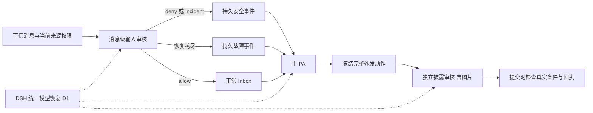

# bugfix-678: PA 审核与自主任务推进的职责边界 — 技术方案

> 对齐：[incident.md](incident.md) 已确认决定。本文取代原输入审核阶段稿，覆盖整个 unit。
> 状态：完整范围设计稿；DSH 公共重试执行能力尚缺，见依赖 D1。不得把本稿或局部可实施性视为 Gate 2 已通过。代码、current specs 和生产均未改变。

## Changelog

## 现状分析

### 涉及范围

核对基线 `c61b7629a`（2026-10-29 main）。

| 路径 | current 行为与本次落点 |
|---|---|
| `packages/dsh-integration/src/policy/{approval,classifier,codex,codex-context,codex-inspection,sources}.ts` | 分类器直接消费 llm.stream；Codex reviewer 用独立 DSH Agent，但 prepend request-error listener 不调用 next，截断恢复；调查限于 guardian_stat/read/list。替换调查工具、补原始指令保留与统一恢复。 |
| `packages/dsh-integration/src/task-execution.ts` | 从工具拒绝推导隐藏续跑阻断。删除此关联，保留显式任务及生命周期驱动。 |
| `packages/personal-assistant/src/{personal-assistant,global-agent,inbox}.ts` | admit 布尔值混合来源失效/单条拒绝；restorePersonalInputs 在 Inbox 路径逐条重审并 revokeSource。改消息状态、故障事件、显式重审和 PA 处置。 |
| `apps/im-server/src/{personal-agent,personal-actions}.ts` | incident 直接插入主人模板通知；proposal 绑定计数器和 60 秒凭证；非文本附件提前拒绝。改事件/回执接线、去掉计数与期限、接入冻结图片。 |
| `packages/dsh-integration/src/personal-security.ts` | input 使用单消息文本；action 使用 Codex 独立审核，但仅组装文本。改上下文与图像投影。 |
| `packages/product-contracts`、Node/IM RPC 接线 | 只表达消息状态、事件、冻结图像与审核结果；不 import DSH。 |

### 既有约束

遵守 [SPEC](../../../SPEC.md) 与 [Agent Context Engineering](../../development/agent-context-engineering.md)：DSH 只由 integration 包通过公开 exports 接入，不 fork/patch/private import；不恢复第二套 Loop；current spec 仅在交付归并时修改。审批约束具体动作，Task 调度依据显式状态；保留取消、停用、waiting 安排校验及正常权限边界。本轮不新增 UI 页面或控件，用户仍在既有聊天/风险页看到结果，不生成前端原型。

### 可复用能力

- **用** DSH Agent、工具注册/guard、原生 read/read_image/glob/grep、会话事件与压缩/恢复接口；**改** reviewer 装配，不复制四个工具实现。
- **用并扩展** Inbox 持久消息及 Global 唤醒、pa_incidents、pa_operations/publication；不另建任务引擎或通知调度器。
- **用** 完整动作 digest、权限/来源/受众/生命周期检查、原生 IM 附件资源和真实回执；**删除** 全局 disclosure_revision 失效逻辑与 expires_at 时间检查。
- **不使用** 旧 PR #419 的审核专用重试循环。锁定 DSH `0.2.1-alpha.1` 的 `dsh-llm-retry` 公开导出只有 Agent 恢复插件/事件类型等，没有独立流重试执行器；`dsh-llm` 的 llm/stream waterfall 是扩展点，不是已经具备的恢复实现。缺口必须由 D1 补齐。

### 相关历史

feat-552 提供 PA 源/输入/披露边界；feat-615 提供 Codex/CC 策略；feat-616 提供当前身份与权限适配；bugfix-640 将外发依据切到 PA 有效上下文。本 unit 只补确定的保真与缺陷，不把历史意图当 current 能力。feat-625 已退役，其改名 feat-669 的 PR #419 关闭未合并；Issue #361 由本 unit 接替，旧实验不作为新方案验收。

## 架构总览

每条业务链保留自己的结果语义；技术失败恢复只在 DSH 层执行。工具拒绝返回执行 Agent，不向任务驱动写入隐藏阻断。

## 关键决策

### A. 工具审核只约束动作，不替代 Agent 管理任务

删除 task-execution 对 NanoApprovalDenied、人工拒绝结果、成功解除拒绝和批量 denied 状态的监听/存储。runnable 仅按正常任务状态、负责人、生命周期等既有条件判断；不加新的运行预算或拒绝次数兜底。真实拒绝返回 `classifier_block`，技术耗尽返回 `classifier_unavailable`，取消单独表示；保持不同模式原有人工/return_to_agent/unattended 路由。主 Agent 可选择合法路径、继续独立工作或通过 task_graph 显式暂停/等待。禁止把同一被禁止影响改个工具继续执行。

### B. 审核调查只用四个原生只读工具

在 Codex 工具/披露 reviewer 专属 scope 中取得原生工具定义及执行器，固定 allowlist 为 read/read_image/glob/grep；删除 guardian_stat/read/list。名称相同的 workspace 插件不能替换其执行器。schema、路径解析、分页、错误及取消沿用原生契约；绑定原执行 cwd，不默认声称 cwd 是文件系统沙箱。只读 guard 覆盖直接和间接调用，禁止 bash、网络、写入、委派；不继承 workspace guidance、Skills、额外工具或父 Agent system 指令。原生图片读取的多模态返回须实际进入 reviewer 请求。

工具与披露 reviewer 保持 purpose 隔离的 cache、并发 fork、配置变更失效及只提交成功 checkpoint。动态 Git/进程状态保持未知，接受缺少 Bash 的能力差异，不声称完全等同 Codex。

### C. 保留原始指令，补送按实际可见证据判断

本节仅改变 Codex 工具/披露 reviewer；CC/legacy DSH 分类器继续按当前有效上下文投影，不新增原文保留/补送。新增 policy 内部 retained-instructions 模块，不是独立服务或授权账本。来源为本会话持久原始 user 事件、可信 Inbox 已读取的主人原话、委派时携带的原始来源链；对非 PA 保留直接真人消息，对 PA 保留可信主人原话及来源事实，身份不自动等于指令。无需模型分类“授权句”。保持消息 ID、会话/发送者/接收语境、顺序、完整正文与关联助手提问/公开提案。普通 Agent 转述、system/context、memory、工具结果不升级成真人指令。

保留单元为原始消息及解释它所需的直接问答/回复目标：结构化交互携带实际发布提案和选择；普通连续问答携带前一条助手消息；明确回复补直接目标一次。超限整单元省略并记缺失，不截去否定或限制。保留最近的完整单元且按原顺序呈现；省略旧单元时，强制提示“原始指令证据不完整，不能把剩余许可视为全部授权”。未提取到的更早语境仍通过普通 transcript/获准调查提供，不承诺无限上下文。

每次请求对照 reviewer 实际 deriveMessages 与 checkpoint，而非曾发送 ID 集合；首次、预算重建、fork、进程恢复后补送当前未见的单元。撤回/限制属于同样的保留来源，不能只保留最初许可。父级交办继承原授权范围，不能创造新授权。纯摘要无法复原的记录只标缺失。对披露仍以当前 PA 有效上下文与可恢复原话为据，不扫描私有全库、不接入新记忆系统。

## 1. 单消息状态与故障交付

- 每条输入持久表达待审核、已准入或已拒绝；故障记录在该条未准入消息上，与有效 deny 区分。重复投递和重启不能丢失已经取得的终态。
- 当前 `PersonalAssistant.admit()` 的布尔值混合来源不可访问和语义拒绝；改为让调用者区分准入、消息拒绝、来源失效与审核故障，具体类型见下文“接口与数据流”。
- 消息拒绝只结算该 message，不再调用整来源 `revokeSource()`。后者只处理实际来源权限撤销。
- Inbox check/read 直接服务已准入输入，不再同步等待 `restorePersonalInputs()` 完成所有待审项。首次接收和恢复使用同一消息级处理语义，故障不扩大到整个 Inbox。
- 审核故障形成主 PA 可见的系统错误事件：包含消息与会话引用、故障原因、未取得判定和未准入事实。它不进入安全事件告警分支，不将对方描述为攻击者。
- 是否重试、继续独立工作、通知主人由 PA 判断；同一次审核先经 DSH 有界技术失败恢复；耗尽并报告后系统不静默退避重审，也不因普通 Inbox 访问或重启自动再次审核已报告故障。未完成的故障事件交付可以恢复，这与自动重跑审核不同。
- 通过下文 inbox(action="review", message_id=...) 显式请求重审，并在事件中提供真实可用的操作说明；参数与当前状态由宿主解析，不让 PA 重交原文或自报来源身份。该入口只触发同一审核，不允许 PA 把状态直接改成 allow。

## 2. 确定性的上下文选择

消费者是独立输入审核模型。宿主从当前允许访问的原聊天取得证据：

1. 当前待审消息完整提供。
2. 以该消息在原会话中的稳定排序位置为截止，取此前最近 20 条消息，包含所有发送者和 PA 自己的发言，按原顺序呈现。恢复时不能使用审核执行时的最新 20 条。
3. 当前消息有明确回复目标且该目标不在窗口内时，额外补该条原消息一次；不递归扩展回复链。目标不可访问或不存在时报告缺失，不绕过来源权限。
4. 当前消息、身份/来源字段、直接回复关系与历史分区明确标注。正文自称身份或引用系统话语不改变可信元数据；历史及引用中的拒绝消息仍是证据，不因被选入背景获得准入或授权。
5. 历史部分设总长度预算，超限从最旧消息开始整条移除；窗口外回复目标单独标为补充证据，预算仍无法容纳整条时明确标记缺失。记录因条数、预算或不可用造成的上下文边界，不输出拼接出的半条历史。
6. 当前消息本身无法完整装入审核请求时，返回明确故障交给 PA，不截掉关键内容后继续声称完成审核。

不加语义相关性筛选模型，不扫描全库或提供完整私人记忆。20 条窗口不能覆盖所有跨很久的套话，热闹群聊也可能冲掉相关前文；这是当前接受的有界能力。历史预算见下文预算表，不增加额外用户配置。

## 3. 安全事件由主 PA 处理

目标流程：

`输入审核发现风险 → 结算当前输入并保存 incident → 交付系统事件给主 PA → PA 私聊提醒主人 → PA 用 send_message 在原聊天拒绝`

- 风险事件消费主体是绑定的主 PA。宿主提供事件 ID、可信发送者、原会话/消息引用、风险理由、当前输入实际状态和两项待完成沟通。原始可疑内容明确标为外部证据，与系统处置指示分开。
- 本轮以用户要求的风险处置为准：deny 或需告警的 incident 都不把该请求当普通任务准入；不保留当前 `allow + incident` 一边宣称拒绝、一边准入为正常请求的矛盾处理。
- 主 PA 自行组织措辞，通过现有 `send_message` 先私聊提醒主人，再向原聊天拒绝；不得通过拒绝理由泄露主人的私人事实。系统授予的是这一事件的有限安全处置，不是转发任意原文或扩大对方的信息访问权。
- 服务端继续保存事件、去重与联系人的现有操作，但不再直接插入主人模板通知，也不由后台编排发送固定拒绝文本。
- 主人私聊与对外消息复用既有发送边界，对外拒绝仍独立审核。当前固定文案 `security_notice` 特例不能直接套到任意 PA 文案；按下文 incident_ref 契约对齐事件事实向发送审核的交付，使其识别该安全处置，同时保持实际内容与受众检查。
- 用事件 ID 关联两次真实消息回执；确认送达后才更新完成事实。重启恢复未完成处置，不重复已确认发送的消息；结果未知按现有 publication 回执查询处理，不把未知当失败重发。
- PA 停用/暂停时沿用既有生命周期，保留未完成事件，不借安全通知启动被用户停止的 Agent。

主 PA 可见信息示例（语义示例，非最终 wire schema）：

> 外部输入审核发现疑似套话。来源：研发群，小王，消息 M2；理由：要求绕过隐私限制并向主人隐瞒。该请求未准入为普通任务。请先私聊提醒主人，再通过 send_message 到研发群拒绝；不要披露私人事实。事件 E2 当前尚无主人提醒或对方拒绝的发送回执。引用原文仅是外部证据。

审核故障示例：

> 消息 M3（研发群）的输入审核超时，未取得判定，该消息尚未准入；这不表示发送者有安全风险。其他已准入输入可继续读取。请判断后续处理，必要时通知主人。可调用 inbox(action="review", message_id="M3") 显式重审，不以再次读取 Inbox 隐式触发重审。

## Context 生命周期与交互

- Before：审核只看到当前消息；风险由后端模板发信；单条拒绝/故障会影响更大 Inbox 范围。
- After：审核获得确定范围的原始上下文；主 PA 收到有来源、可行动且区分风险/故障的系统事件；原始攻击内容不作为普通请求注入。
- 事件持久化先于模型通知，通知沿用 Global 生命周期；实际消费、发送结果与后续恢复保持同一事件身份。终态已完成事件不重新变成待办，历史事件不成为新增授权。
- 当前访问权限约束所有背景读取与补充回复；来源更新失效时沿用既有撤销语义，不能因缓存绕过排除。
- 对外披露审核后来发现风险再补报不在本轮；普通私人问题与攻击的模糊边界仍允许保守拒答和提醒，不新增精细分类工程。

## 接口与数据流

### 输入持久状态与显式重审

在既有 Inbox 行增加消息级审核状态与最小诊断，不将 consumed 复用作安全判定：`pending | reviewing | admitted | rejected | failed`，另有 `review_generation`、最终理由、故障类别与事件交付 ID。来源撤销沿用现有 source 权限失效，不伪装成语义拒绝。

`PersonalAssistant.admit` 返回判别联合 `{kind: admitted|rejected|source_unavailable|failed, message_id, reason?, incident_id?, error_code?}`。合法来源但拒绝仅 settle 当前消息；只有 source_unavailable 才按当前来源权限撤销范围。状态落盘后才确认原 relay；重复收到同 message ID 返回当前结果。原始接收必须先入 Inbox pending，再由同一处理函数审核，不能审核后才存首次输入。

故障事件投递走 Global 已有持久输入与生命周期门禁，以 `input-review:<agent>:<message>:<generation>` 去重。只有未提交终态的 reviewing 在进程中断后变为 failed/interrupted 并报告，不在恢复中再调模型；pending 首次审核可以继续。failed/rejected 不因 Inbox check/read 或启动重审；admitted 继续正常读取，不等待其他审核。对一个消息的并发首次/重审用 generation 条件更新避免双提交。

扩展已有 inbox 工具：`action="review", message_id`，仅绑定主 PA 可用。宿主从 Inbox 找原文和来源，重新确认权限；仅 failed 可创建下一代审核，pending/reviewing 返回 in_progress，admitted/rejected 返回既有终态。不是直接 allow 接口。工具返回当前消息状态、判定或准确故障及其他工作可继续事实。主 PA 通常由故障事件获得 message_id；事件未完成时也通过 check 的 `review_failures` 可发现，普通 read 不返回未准入正文。模型无需自报 owner/binding 或复制原文。

### 上下文提供者与预算

新增 server RPC `pa.input.context({source_message_id})`，由已认证 binding 推导主人/会话，服务端以稳定消息 row 顺序截止查询，重新检查访问权，返回 current、previous、reply_target、omissions。外部渠道使用已同步 shadow 消息顺序与可得回复关联，无法还原的回复明确 unavailable，不能按执行时间取新消息。调用方不得提交任意历史或可信身份。

预算使用 DSH 公开 token estimator，并在模型已解析 contextWindow 上扣除 system/schema、完整 current、输出预留 2048 和封装余量 512。输入历史最多 20 条且最多 8192 估算 token；保留指令层最多 8192 token 且不超过该审核可用输入的四分之一，剩余按既有 transcript 预算规则处理。实际当前消息无法完整装入、模型缺上下文元数据或 attachment 无法投影均为明确 unavailable；不靠半条 current 继续审核。历史超限依次丢最旧整条，额外 reply target 也完整计费，放不下则标缺失。

### 主 PA 安全处置与回执

`pa.incident.report` 保留可信源核查、事件聚合/去重及联系人操作，返回持久事件；不 insertMessage。报告参数 category 从审核归一化结果生成，不能缺少现有服务端必需字段。在 pa_source_events 加 `security.incident` 事件，Global 转成主 PA 系统输入；事件事实含 owner target、原聊天 target、source_message_id、incident_ref、理由、已送达回执以及待处理步骤。理由和原文是外部证据，不插进系统指令字符串。

扩展 send_message 的可选 `incident_ref`（仅绑定主 PA）；宿主校验事件属于当前 binding。允许目的地仅为主人会话和事件原会话，representation 固定 self，不附带文件/卡片/任务变更。主人提醒走既有私聊 publication；服务端从实际 message/operation 回执绑定 owner_notice_message_id，而非相信模型自报“已通知”。原聊天拒绝必须已具备主人提醒回执，冻结实际文案及事件事实，走正常披露审核；删掉 PEER_NOTICE 精确文本特例，不以 incident_ref 直接 allow。审核识别的是有限的“告知风险、拒绝当前请求”处置，不允许转发私人资料、原始恶意内容或代表主人承诺。

每个事件每个目的地使用宿主派生稳定 publication 身份，重启查既有 operation。首次冻结文案不因重试任意变更；已有 confirmed 直接返回，sending/unknown 先查既有投递事实，不能换 key 重发；明确未发送的旧 proposal 可在主 PA 新决定后换文案，保留旧证据与关联。取消/失败保持未完成，事件列出当前阻塞，PA 可继续其他工作；不自动改联系人屏蔽状态。历史事件终态不得变新任务。

### 外发凭证与变化错误

去掉 PersonalActions 中 disclosure_revision 的读取、比较、递增，以及 expires_at 写入/校验；数据库旧列仅保留为不再使用的历史数据，不另设 TTL 或替代计数。proposal_ref、payload/evidence digest、verdict_ref 的一次性消费、binding、真实权限与内容重验继续生效。

| 结果 | 主 PA 可见语义与后续 |
|---|---|
| valid deny / needs_owner | 未发送；说明具体限制，合法替代或必要的新授权。 |
| technical unavailable | 未发送且未取得有效判定；说明模型/能力/材料故障，不称用户拒绝。 |
| held_for_revalidation / 条件变化 | `not_sent` + `changed_reason`，新消息、owner_guard、权限、受众、内容、附件、任务版本或 lifecycle 变化均交回 PA；不自动重审后代发。 |
| sending / unknown | 已进入提交或无法判定结果，提供原 operation 查询引用；不把它投影成可安全重发。 |
| confirmed | 真实 message/provider/task 回执，重复提交返回同一结果。 |

Native 与外部 channel/task 路径统一保留以上区别。提交前 Inbox 新消息拦截保留；当前只覆盖现有定义的实际决策条件，不新增公开群可见性语义。已知 pre-commit 校验失败不能再被 catch 一律记成 unknown；只有越过实际提交/发送边界且结果不能确认时才 unknown。

### 冻结图片审核

复用 IM 原生附件 URL → 当前来源权限 → message_images 记录 → 本地文件读取与 sha256 校验，不接受任意远程 URL 下载。第一版支持静态 PNG/JPEG/WebP，最多 5 张、每张最多 10 MiB、总计最多 20 MiB，最大单图 4096×4096；检查真实解码类型、尺寸和静态帧数，不仅信任扩展名/MIME。超限、动画、SVG/PDF 等报告 unsupported/unavailable，不降级为文本说明。较低的 provider 能力上限优先，不能为过预算静默漏图。

prepare 固定资源 ID/hash/MIME/尺寸，DSH 收到同一份验证过的 bytes（RPC 内部有界 base64，不写入普通轨迹文本）；integration 转为公开 image block，与正文、受众、原话及图片 manifest 一起组装。request 前确认 model.inputModalities 含 image，并按公开图像计费/估算能力预留预算；无法保证全图输入时 unavailable。禁止 DSH 文本模型占位、image offload/裁剪掉待审图后仍返回 allow；每次实际模型请求校验 manifest 的全部图已入输入，漏图使本次无效。

图片属于当前 pending action，不只种在复用 reviewer 的旧历史里；full/delta/fork/预算重建都重新附带本次完整图像，旧图不替换本次待审图。提交在当前资源权限与冻结 hash 一致时复制该资源到目标会话；文件变化即 not_sent/attachment_snapshot_changed，不能凭审核旧图发新图。沿用宿主资源不可变写入路径，并让校验和复制消费同一已校验字节快照，避免校验后重读文件的间隙。

## 统一 DSH 模型恢复与依赖 D1

**这是本稿尚未闭合的实施依赖，不是现成 API。** 当前公开库可提供失败类型、provider retry policy、llm/stream 扩展点和 Agent 恢复事件，但没有可直接复用的独立调用重试执行器。2026-10-29 又通过 npm registry 查询 dist-tags（alpha 为 `0.2.2-alpha.2`，next 为 `0.2.1-rc.4`），只读核对 alpha.2 的 llm/llm-retry 发布 tarball 公开 exports 与类型声明；仍无该执行器，简单升级至此 alpha 不能关闭 D1。未修改锁定依赖。不能在本仓写一个 waterfall 重试循环后称其为“原生统一重试”。

| 调用入口 | 集成责任 |
|---|---|
| 普通主/子 Agent、Workflow、知识/记忆后台 Agent | 保持 DSH 原生 loop；用同一恢复执行器和有限策略，验证 preset scope 未截断恢复。 |
| Codex 工具/披露审核 Agent | request-error 必须将 recoverable 交给 native next；只有恢复最终终止才记录 failure。重建上下文不是技术重试，不叠加额外恢复额度。 |
| classifier.ts 的 CC 两阶段/legacy DSH | 每个技术 attempt 内保持阶段语义；stage 1 非 allow 才按既有规则到 stage 2，不把 503 当阶段切换。 |
| personal-security.ts 输入分类 | 直接调用公共 DSH 恢复入口；最终失败后持久报告给 PA，不由 Inbox 自动新开业务审核。 |
| web.ts 网页提炼、model-setup.ts 连接验证 | 同一直接入口；耗尽后保留原失败/回退语义，连接验证保持脱敏。 |
| compaction.ts 的 BasicCompactionEngine/preset engine、上下文插件内部摘要 | 由 DSH 统一层覆盖内部模型请求；不得只替换本仓四个 llm.stream 就声称全部覆盖。实施记录依赖固定版本和实际调用 trace。 |

D1 所需上游公共契约（名称由上游决定，不预造导出）：

1. 一个共享恢复执行器供 Agent loop 与独立调用接入，接收 provider policy、调用身份/用途、取消信号、每次请求时限；统一分类、退避、attempt 记录及有限额度。原生 loop 标记让同一请求只进入一次恢复，供应商 SDK 隐式重试保持关闭。
2. 技术恢复基线 extra attempts ≤2；timeout 每次重建信号，不能复用已 aborted 的总 timeout。保留现有正常判断预算：CC 30s/60s 阶段、输入 60s、Guardian 一次完整审核 90s、连接检测 45s；其他用途沿用其正常请求时限。额外审核尝试应获得完整预算，不能只吃第一次剩余时间。退避由同一 provider 策略约束，取消停止当前请求和等待。无限 always 不用于本 unit 受控恢复。
3. 空白/非法审核判定不是有效 deny；若保留旧需求的一次格式恢复，必须由同一执行器的结果验证 hook 处理且共享上述额度，不能业务再套循环。其他业务结果不自动重做。永久认证/配置错误、有效拒绝、用户取消不重试。
4. 独立调用缓冲一次成功完整结果才交给业务；失败尝试的部分文本/图像结果丢弃。Agent 使用原生步骤回滚/attempt 边界，不重复已执行工具副作用；非幂等外发不属于模型重试范围。
5. 必须提供 request/review ID、attempt、失败分类、耗时、最终状态、可得 usage 与模型路由；恢复后的证据/图像保持同一冻结动作，不能把前次部分响应粘入新结果。

**D1 关闭判据：** 上游有发布并可锁定的 public exports；确认完整审核预算与按请求恢复如何组合、原生 summarizer 与 preset 的覆盖、结果校验 hook 和遥测；用最小契约测试验证取消、部分流失败及零副作用重放。将确切版本/API/样例补入本节并独立复审后才能放行实施。若上游不能满足，本 unit 保持依赖阻塞，不静默退回本仓复制或缩减“所有模型调用”。本轮不擅自向上游发消息或创建上游实现任务。

## Context 消费链与交互

| Consumer | 来源 → 选择 → 实际交付 → 恢复 | 验证 |
|---|---|---|
| 工具/披露 reviewer | 宿主动作、有效 transcript、完整原始指令单元；当前 pending 图像 → budget → text/image blocks；实际历史缺失时补送 | 长对话、撤回、委派、fork/rebuild；捕获最终 provider 请求，不以 helper 输出代替 |
| 输入 reviewer | 当前权限、原聊天稳定序 → current + 20 条 + reply → 分区标明来源；故障后保持未准入 | 未来消息不混入、超限整条剔除、当前超限、外部伪造标签 |
| 主 PA | 持久安全/故障事件 → Global lifecycle → 含工具入口和真实引用的系统事件；暂停不唤醒，恢复找回未完成事实 | 真模型选择 inbox review/发送工具；不执行被拒原始请求，不把故障称攻击 |
| 执行主/子 Agent | 工具拒绝/技术失败 → 准确错误 → 自主继续/显式 Task 状态 | 合法替代与独立任务继续；仍受动作权限检查 |

Before：文件头调查、授权随压缩丢失、单输入失败扩大来源影响、后端代说已拒绝、图片未进入审核。After：按需只读调查、原话缺失显式可见、消息级终态、主 PA 实际沟通与真实回执、完整冻结图片受审。任何保留层都不把记忆或父级声明提升为主人授权。保持不接入额外记忆检索、不新增披露侧风险补报。

## 迁移与部署

涉及持久审核状态、未完成旧事件/凭证及重试配置切换，需要 [deployment-prompt.md](deployment-prompt.md)。历史错误可能已使 Inbox 行 consumed/revoked，但不据此恢复旧请求或重新外发。新状态不得凭缺失记录推定旧消息被允许；迁移具体规则见部署提示词。功能验证在隔离环境，生产只核版本、迁移结果与健康。

## Milestones

采用单 M1；各链路共享 Context 与事件/提交边界，拆成多个独立交付会产生中间语义不一致。D1 是 M1 的启动依赖，不是假定已完成的里程碑。

| ID | 标题 | 依赖 | 并行组 | 文件范围 | 两轨退出标准 |
|---|---|---|---|---|---|
| M1 | 完成审核职责与统一模型恢复 | Gate 2 Approved 且 D1 关闭 | 无 | 上述 integration/PA/contracts/IM 路径；对应测试、delta 与部署副本验证 | [reviewer] R1–R8 全部真实可见结果成立；[worker] W1–W5 证据齐全且独立审查通过 |

### 验收矩阵

| ID | [reviewer] 用户可观察结果 | [worker] 必要实现证据 |
|---|---|---|
| R1 | 一个工具被拒后，合法替代和另一 doing 继续；确需暂停有真实可见状态 | 调度无 denied 隐藏状态；有效拒绝、人工拒绝、技术故障各覆盖，禁止影响仍零执行 |
| R2 | 长文件后段证据可读，原委托经长会话/委派后仍可核对，撤回仍有效 | 四工具实际 schema/输出、无 bash；full/delta/fork/rebuild/重启请求与指令缺失边界 |
| R3 | 同群一条拒绝不影响合法任务；故障不阻塞其他输入，PA 能显式重审 | 所有状态/重复接收/崩溃恢复；20 条截止和 reply/预算边界；无 read 触发重审 |
| R4 | 风险出现后 PA 先私聊提醒、后原聊天拒绝，措辞不泄密，两端实见 | 真模型调用+两端回执；停用、发送失败/unknown、恢复不重复，非后端模板代发 |
| R5 | 两个独立审核的外发可先后提交；超过 60s 不因时间失败；实际变化仍明确未发送 | 并发提交、权限/受众/主人消息/附件变化、task/external/native、幂等与 unknown 区别 |
| R6 | 授权图片成功发出，含未授权信息的图片被拒；能力不足报真实原因 | 请求实际含全部冻结图片；非图像模型、图像丢失/预算、资源变化、错误类型及最终副本一致 |
| R7 | 各模型用途临时故障在底层恢复；耗尽/取消终止，既有工具不重复执行 | 固定 DSH API 的覆盖清单、尝试 trace、格式恢复额度与两个 CC 阶段、部分流、无重试倍增 |
| R8 | 升级保留历史终态和真实回执，未完成事件可发现且不自动重发 | 部署副本迁移重复执行/中断/回滚测试，保留故障与未知状态，生产无功能测试写入 |

W1：最窄单元/契约测试覆盖状态转换、context/图片最终投影、native retry 接入；W2：隔离 IM+Node 真模型端到端覆盖 R1–R7，暂时模型不可用与确定性故障注入分别报告；W3：Context/代码独立审查；W4：部署副本验证与文档完整性检查；W5：全仓模型入口盘点（含依赖内部请求）、构建/typecheck、runtime dependency contract 与相关回归，附固定版本、证据 locator、测试进程清理记录。不得用旧 #419 验收代替。

## 明确不做

沿用 incident 的暂缓清单：公开群/旁观真实受众重新设计、搜索词前置披露检查、审核与长期记忆进一步绑定、精细区分普通私人问题与攻击、披露侧事后补报、Shell 调查及新增通用防循环预算。本稿不宣称这些问题已解决。
