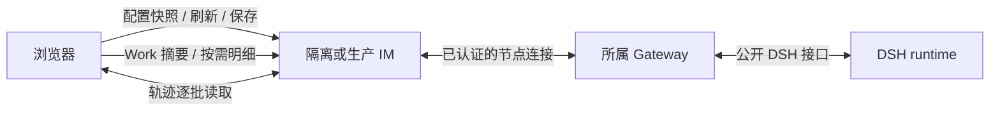

# bugfix-704: Agent 页面快速稳定加载 — 技术方案

> 对齐: [incident.md](incident.md)；本文件为先前设计提案。用户选择快修后，实际实现、与提案的差异、真实网络证据及未达目标见 [快修记录](fast-mode-evidence.md)，不能将本提案视为已经实现或通过验收。

## Changelog

## 现状分析

### 涉及范围

Web Agent 详情的配置状态、Work 列表和原生轨迹宿主；IM Work 查询及轨迹中转；Node 到 DSH 的轨迹流；必要的共享产品契约。iOS Work 使用现有接口，不能被 Web 首页优化破坏。

### 既有约束

配置操作需要在线身份、最新版本、有效能力及 operation 确认；最后确认值不能冒充当前值。Work 与原生轨迹必须保持完整历史、权限、定位与断线语义；生产和测试的 IM、节点身份、数据和运行目录隔离。DSH 仅依赖声明的公开 exports，不修改 DSH 或直接读取其私有存储作为产品方案。

### 可复用能力

配置已有 `SettingsRead`、profile version、operation 保护与草稿保留；Work 已有会话/轮次/过程分页；轨迹已有有界批次、取消、generation fence 与 viewer 的顺序解码。沿用这些机制，修改读取粒度、取消与流控制。既有 `/work` 完整响应保留给现有 iOS 和旧客户端，不把其 payload 偷换为摘要。

### 相关历史

`feat-676` 的 Work 及原生轨迹 current spec、`bugfix-644-agent-offline-settings` 的离线只读、`refactor-682-agent-catalog-lifecycle` 的检查隔离与五分钟缓存仍然成立。历史记录不等于已在任何测试环境部署。

## 架构总览

三条页面读取各自有明确生命周期。Work 只在用户查看明细时传大正文；轨迹按需推进并有界保留；配置把可展示、可编辑和可提交分开，不能把一次普通后台读取等同于状态失效。

## 关键决策

1. **配置后台刷新保留已确认草稿与编辑，保存时重新确认。** 同一认证用户、Agent、node connection epoch、profile version 的已确认状态可在普通刷新期间显示并编辑；后台进行中状态轻量显示，不禁用既有字段。保存前合并等待正在进行的确认并校验最新版本与依赖；确认失败、连接/权限变化、pending operation 或冲突时禁止提交并保留草稿。离线/身份变化必须立即撤销可写资格；不得用过期目录授权保存。无已确认信息时不猜可编辑值。避免同状态事件或普通焦点切换取消有效确认/反复触发昂贵检查；真实 reconnect、权限或配置变化仍严格 fence。预览读取与整页编辑锁分离；查询错误可明确重试。
2. **工作列表和完整明细分层读取，不破坏旧客户端。** 为 Web 新增独立摘要读取（推荐 `GET /im/v1/agents/:agent_id/work?view=summary`，缺省仍保留原完整响应），主/子轮次摘要返回真实身份、时间、状态、工具数量/更多标识、所需导航与统计，不携带大输入/输出。展开轮次才读取其首批过程；展开具体工具才读取其完整 payload，详情按权限检查且不截断；已有 items 分页和历史顺序保持。新摘要/详情形状作为明确的契约增量，不用空字符串冒充完整内容。更新时仅刷新受影响的摘要和当前展开内容，合并通知；仅在工作记录可见时安排兜底刷新，原生轨迹视图保留轻量执行身份刷新。每个查询把 AbortSignal 传至真实 fetch；同一语义读取 single-flight，旧身份或已取消结果不能覆盖新结果。刷新保留展开、焦点、位置；正常网络慢不制造无界并发。
3. **轨迹队列按消费进度背压，不对正常在途批次执行五秒失败。** 在现有私有 adapter 中严格有界队列和并发；snapshot 分片继续按序发送，普通等待下一次拉取/在途网络传输不因为固定五秒杀掉整条流。live follow 的无损暂停尚未证实：缓冲满时停止该观察，明确向用户显示读取中断和重试，保留已显示内容，不宣称自动连续恢复；重新读取以新 snapshot 为新边界，历史通过既有 page 读取，不能证明连续的区间明确提示可能缺失。瞬态 assistant stream、generation 变化和无可验证序号时不伪造完整性。客户端离开、取消、权限撤销立即释放；未进行 next 的观察在 60 秒后释放并显示可重试中断（从无在途请求时起计，不计正在发送的批次），内存受原有批次和字节上限约束。回收的仅是观察，不终止执行。不得以无限缓冲、无限等待或静默丢事件满足性能。
4. **分段诊断只记时间和大小。** 每次测试带匿名关联 ID，在浏览器、IM、Gateway、DSH adapter 记录准备、open、首批生成、排队、发送/接收、解码及可见的单调时长、字节数、状态、错误与是否取消；不得记录 ticket、cookie、正文、工具参数、prompt、附件或真实 workspace 路径。生成时间与端到端耗时分别表示；跨机器时间不同步时使用本机单调时钟加关联 ID，不相减不同主机时间戳。诊断可关闭且有界，仅用于本 unit 测试。

## 接口与数据流

- `GET /work` 原行为与 iOS 保持；Web 显式 `?view=summary`，返回原 Work 顶层状态、关联执行、用量和 turn 元数据，turn 不嵌入 items；同时提供与既有 before_turn 相同的轮次游标，以及真实 tool_count、has_items。子 session 的 turns 同样支持 summary 模式。展开轮次时对现有 items 地址显式 `?view=summary&after_seq=...`：返回 `{items, next_cursor}`，每项提供 `item_id, seq, kind, observed_at, revision` 与限定大小的类型标题、状态和来源摘要，按既有 seq 独占游标顺序分页，`next_cursor: null` 表示结束；不含完整正文或工具输入输出。控制项也用相同轻量形状并可按需读取。展开任一项（包括非工具正文）调用同一 Agent/session/turn 路径下 `/items/:item_id`，得到现有完整 `WorkItemView` 原始 payload，不截断。空列表为空数组；未知/失效项返回 404，权限拒绝沿用当前不可访问语义，非法游标 400；取消不显示伪造的空内容。旧客户端缺省路由和响应完全不变。摘要与详情在相同 Agent、session、turn 的服务端权限校验后读取，明细版本变化时重取；契约测试覆盖所有 item kind、未知扩展字段、分页、权限、取消及状态变更。
- 配置后台候选只在 generation、identity、node epoch 与 profile version 仍匹配时接纳。用户继续编辑时不覆盖草稿；保存必须通过服务端已有 operation/version 校验，并在候选未知/过期/断线时等待或报错。冲突使用现有恢复路径，不自动覆盖。
- `trajectory.open/next/abort` 保持现有 read-only carrier 接口。单批与总缓冲仍受约束。慢读取、snapshot 分片、实时 burst、断开、中断提示和手动重读的次序与边界由测例覆盖；未证明连续性的重读不可显示为无缝恢复。

## 页面行为

按用户要求保持现有页面布局，不制作或验收界面原型。只验证与故障直接相关的真实交互：后台刷新时可编辑、离线与冲突时保存受保护；Work 按需读取且能展开原文；轨迹正常加载、故障时不伪报完整，并保留可读内容。

## 契约层增量 (delta-spec)

- [配置页增量](specs/im/agents-nodes.md) → `docs/specs/im/agents-nodes.md`
- [Work 与轨迹增量](specs/im/agent-work.md) → `docs/specs/im/agent-work.md`

不改变模型所见 Prompt、工具选择、会话输入、Memory 或 History 生命周期；本次仅改变人类只读查看与配置草稿读取/提交时序，故不触发完整 Context 审查。实现若改变 Agent 消费链须重新评估。

## 隔离真实网络验收

测试用独立 Mini 高位端口 IM、独立数据库/JWT/账号、构建的受测版本及只含合成数据的独立 Air Gateway、DSH home、workspace、node identity。浏览器和 Gateway 均走 Mini 测试 IM 的同一个隔离 HTTPS/WSS 入口；优先单独临时 Cloudflare 隧道/测试域名，不能改现有生产 tunnel、DNS、IM 配置或进程。若只能通过 Tailscale/SSH 隧道则记录为跨机替代，**不能**当公网 Cloudflare 路径通过，公网验收保持未完成。`e2e-up.sh` 默认同机，需要专用隔离跨机启动/清理脚本；不能声称现有脚本已支持该拓扑。所有 listener 限制作用域，仅接入测试数据；记录端口、进程身份及 cleanup，测前测后核对生产进程和配置。

2026-11-03 首次 SSH 超时，重试连通；Mac mini 有 Node v22.22.0 和 cloudflared 2026.10.4。本次 Tailscale 探测暂经香港 DERP 中继。已在 Mini 启动仅返回固定测试文字的临时本机 HTTP listener，经独立 Cloudflare Quick Tunnel 从 Air 请求成功（HTTP 200，单次 1.461 s），随后关闭 listener 和 tunnel；仅证明临时公网 HTTP 链路可用，未验证 WSS、IM、节点注册或实际业务性能。尚未建立隔离 IM 或采集本方案的网络样本，不能把历史生产诊断数据当作候选版本的验收结果。

数据基于现场规模合成：至少 20 轮、100 条工具明细、单项至少 339 KB、合计至少 3.8 MB；另覆盖多批大 snapshot 与 live burst。比较相同数据、同一路径的 baseline 和 candidate；每种冷启动至少 10 次、暖访问至少 10 次，报告全部样本、p50/p95、失败率、payload、并发和分段日志。冷/暖定义、浏览器缓存、线路、版本、时间段、代理/Tunnel 与节点负载均记录。建议验收目标（待测量验证，不是已测成绩）：正常网络 p95 配置首次可读 ≤3 s、已确认状态后台重访交互 ≤1 s、Work 摘要 ≤3 s、轨迹首批可检查 ≤5 s；所有场景无无界并发、无正常慢读 `slow_consumer`、无丢记录。对照基线改善比例与绝对目标同时给出；若线路自身不能满足目标，分别展示各段并记录未达标，不调整标准充数。施加至少 6 s 客户端停顿、连续 live burst 和网络短断/恢复，核对完整顺序与资源上限；持续慢消费者最终可恢复或明确中断，不无限缓存。

## 风险与回退

Work 轻量协议必须保留旧客户端的完整返回；延迟详情不应改变权限、统计或来源。轨迹暂停原生流的能力未知，不假定背压能无限持续；在设计验证前不能宣布无损恢复。客户端候选使用必须防止离线/版本变化后的过期写入。回退代码和静态资源需按同一版本组合，保留原有数据库格式与真实历史；不得回滚或覆盖用户数据。

## 一次性部署迁移

无；新接口与现有数据共存，无持久数据迁移。真实生产部署不在本设计授权范围。

## Runbook for Reviewer

**Review 驱动方式**：隔离端到端真栈，实际 Web 浏览器走配置、Work 摘要及明细、主/子轨迹、断线与恢复；不以 API 替代可见交互。iOS 不改界面，但保留既有 API 契约测试。

**验收前置**：Mini 测试目录、空闲高位端口、Air 隔离 Gateway 和有效测试 HTTPS/WSS 入口。具体验证与启动清理脚本属于 M1 交付；当前尚未具备，不能以单机 `e2e-up` 声称公网验收。

| 服务 | 停止命令 | 启动命令 | 健康检查 |
|---|---|---|---|
| 跨机隔离 IM、Gateway、临时测试入口 | M1 提供的对称 down 命令，校验 PID 与目录 | M1 提供的跨机 up 命令，不复用生产配置 | 同版本、测试身份、HTTP/WSS、监听与进程身份；测试后核对退出 |

## Milestones

单 M1：三条路径共享网络和浏览器负载，需在同一版本、同一实际拓扑下交叉验证，拆层交付不能证明最终体验。

| ID | 标题 | 依赖 | 并行组 | 范围 | 退出标准 |
|---|---|---|---|---|---|
| M1 | 快速稳定加载 | 无 | A | Web Agent 详情、IM Work、Node/DSH adapter、contracts、隔离跨机验收 | [reviewer] 真实页面的配置、Work 和轨迹路径，完整明细/权限/中断提示成立，网络门槛及样本结果可核；[worker] 新旧接口兼容、取消/事件风暴与有界并发、配置版本/离线/未确认、防丢草稿、轨迹分片/慢读/事件顺序/断线恢复边界/清理测试通过；双机公开路径基线与候选证据、日志脱敏、进程清理和生产未改动核对齐全。 |
