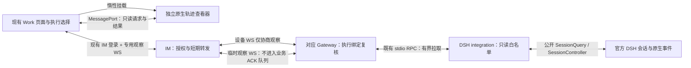
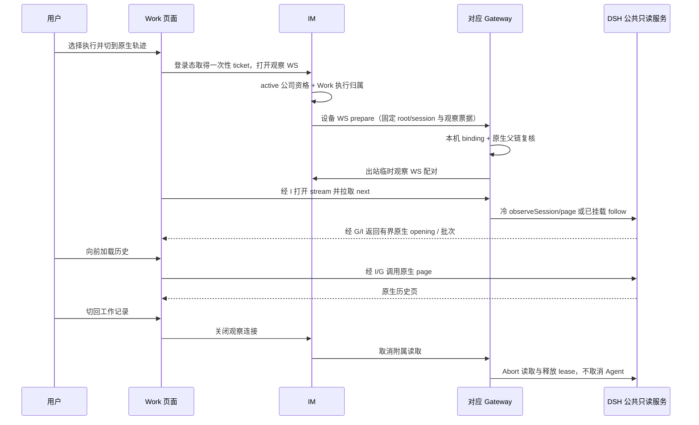

# feat-583：Work 按需查看 DSH 原生执行轨迹 — 技术方案

> 对齐：[spec.md](spec.md)。仅设计，尚未实施；current spec 不在此阶段改写。

## Changelog

## 现状分析

### 涉及范围

| 当前入口 | 当前职责与本次落点 |
|---|---|
| [AgentWorkPanel](../../../src/IM/frontend/src/features/settings/agents/agent-work-panel.tsx)、[Work API](../../../src/IM/frontend/src/features/settings/agents/agent-work-api.ts) | 主轮次、关联执行、已保存的过程记录；增加查看方式切换和原生视图容器，保留现有记录呈现。 |
| [IM Work](../../../apps/im-server/src/work.ts) | `agent_work_sessions` 已登记 root Agent、节点、主／子会话及父关系；沿用共享查看鉴权和精确执行查找。 |
| [Gateway relay](../../../apps/im-server/src/gateway.ts)、[Node 装配](../../../apps/node/src/main.ts) | 设备认证、双向 WS 和连接代际；通过设备连接建立临时观察连接，观察数据与业务 ACK 队列隔离。 |
| [Runtime integration](../../../packages/dsh-integration/src/index.ts) | 已持有官方 `SessionController`；新增受固定产品 scope 限制的读取服务。 |
| [Work projection](../../../packages/personal-assistant/src/work-projection.ts)、[NodeStore](../../../packages/personal-assistant/src/store.ts) | 当前投影仅保留业务轮次、消息、工具和统计；Node 本地保留完整原生事件。原生视图直接使用 DSH 的读接口，不从业务投影还原。 |
| 新增 `packages/dsh-trajectory-viewer` | 浏览器专用的原生 DSH 客户端装配与只读 transport；构建为独立静态查看器，不提供服务器、Agent 或配置入口。 |

现场基线为迁移 checkout `587387240`；页面为 `/settings/agents/e2eGlobal8753771b?view=work`。实际查看确认已有 3 个主轮次、1 个关联子执行，能展开工具和结果，尚无原生轨迹切换。调研期间未修改或重启测试服务。

### 既有约束

- [SPEC.md](../../../SPEC.md)：IM 不依赖 DSH，Node 不开放 Agent 业务监听端口；PA 通过 `RuntimePort` 使用运行时，官方 DSH 不打补丁、不复制源码、不导入私有实现。
- [Agent Work current](../../specs/im/agent-work.md)：active 公司成员可以查看他人的全局 Work；owner 管理边界、原聊天及受保护附件访问规则不变。
- 原始轨迹保留在 Gateway／DSH 侧；IM 不新增原始轨迹表、搜索索引或全文后台同步。
- 只读查询不能调用现有 `session.ensure`、integration 的 `agent()` 或 `resolveAgent()` 来恢复／激活 Agent，更不能提交输入。离开查看器只取消观察，不取消任务。

### 可复用能力

| 能力与已核来源 | 采用方式 |
|---|---|
| 官方 `@deepseek-ai/dsh-api-session-controller` 公开 `SessionController.page/follow/inspect/projections/control/attachment`，锁定 `0.2.1-alpha.1`；官方 `dsh-session-query` 的 `observeSession` | `page` 与 `observeSession` 非激活读取；`follow` 仅用于已挂载会话。普通 cold `follow` 会在 opening 后激活 Agent，不能直接用于只读冷历史。 |
| 官方 `@deepseek-ai/dsh-client-ui-trajectory/client` 的 `apply/inject` | 加载官方插件，在 `conversation.view` 注册的 `trajectory` 项上呈现；不导入内部 `TrajectoryView.tsx`，不重写时间条、工具检查器或 JSON／代码渲染。 |
| 官方 `dsh-client-modules/client` 的 `ClientModuleSystem`；`dsh-client-connection/client` 的 `ClientTransportHooks.rpc`、`ClientConnectionRpc.call/open` | 使用官方客户端模块装配和自定义物理载体入口，数据经父页面转发；不实现另一套 native event decoder、compact stream settlement 或 cursor 算法。 |
| 官方 Session Controller 客户端、`ui-conversation`、`ui-session`、renderer、locale、theme/primitives 及其声明依赖 | 复用真实 Session binding、历史分页、实时流与渲染服务；仅装配原生轨迹所需客户端图，不启动聊天输入、审批、文件管理或配置 UI。 |
| Work 的 `main_session_id/other_executions`、`Work.session(root,id)`，Node 的 global binding 与原生会话父链 | 浏览器选择、中心授权和节点复核分别使用现有真实身份，不从工具文案或标题猜测会话。 |
| 现有 `auth/ws-ticket`、鉴权会话状态、IM ↔ Gateway 设备 WS、stdio RPC request | 复用身份与设备代际；设备 WS 只协商临时观察，原生数据经独立连接及有界 RPC 拉取，不用 notification 推流。 |

原生包的 `/client` 是交给官方模块加载器的 closure-factory bundle，并非可直接放进现有 React 页面的独立组件。原生前端以 React 18 构建，Nano 前端当前使用 React 19；两者的样式和运行时装配需要隔离。原生来源核对基线为 DSH checkout `5badb15009`，以及本仓实际安装的同版本发布包。公开入口、依赖清单和 transport hook 已核对；完整嵌入渲染仍是 M1 的实现验证项，不能把文档原型当作已完成接入。

### 相关历史

- [refactor-581 R06](../archive/refactor-581-dsh-personal-assistant/capability-plugin-map.md)：原生 renderer 不会自动进入 Nano 客户端，需做接入和产品呈现。
- feat-554／feat-572 已形成当前 Work 的共享查看、主／子关系、分页和离线回看契约；此处保留现有业务记录。
- [#331](https://github.com/Mrchen116/nano-multiagent/issues/331) 独立追踪“心跳超时误撤权且假在线”。新视图依据实际通道结果显示可用性，不等待该 bug 修复才识别读取失败，也不在本 unit 顺带修复它。

## 架构总览

用户在现有 Work 顶部选择“工作记录 / 原生轨迹”。工作记录继续读 IM 已保存的业务投影；原生轨迹仅在被选择时，为当前主／关联执行打开一条只读观察连接。



原生渲染发生在浏览器；Gateway 现场提供数据。观察链不经过 LLM，不创建执行，不进入 Inbox，不生成 Work journal 或聊天消息。

## 关键决策

### D1：在 Work 内切换，同一执行使用两种查看方式

现有详情页标签保持不变。Work 卡片下增加分段切换；原生模式的公共工具条提供“当前执行”选择，默认主执行。如果用户从关联执行入口进入，则使用该 session。现有子轨迹卡片增加“查看原生轨迹”操作，复用真实关联 ID。

URL 采用 `?view=work&work_view=trajectory&execution=<session_id>`；缺省仍为工作记录。`execution` 仅是导航标识，每次访问均做服务器鉴权。切回记录保留现有展开和滚动位置；原生视图只保存当前 tab 内的显示选择，不持久保存原始内容。切换执行时先清空旧画面和销毁旧 scope，再挂载新 scope。

实施接线：父页面按账号 revision 与执行保留数字滚动位置、最早已读 seq、原生行 key 和详情 tab ID；重新进入时通过官方 `loadThrough` 恢复历史窗口，再恢复阅读位置。该 bookmark 不包含原始记录正文或图片。官方浏览器偏好在 opaque iframe 中使用仅当前 iframe 生命周期的内存 Storage，避免访问 origin storage，也不添加 `allow-same-origin`。

### D2：原生 UI 使用独立、只读的浏览器容器

`packages/dsh-trajectory-viewer` 构建固定版本的官方客户端模块图，在 `iframe sandbox="allow-scripts"` 中运行。父页面通过一个绑定该 iframe 的 `MessageChannel` 提供数据 transport，iframe 不取得 IM token、Gateway 凭据或任意网络转发能力；boot 只接收固定 scope、语言与主题。

该包的产品接口仅为静态 viewer 入口和一份浏览器 transport 契约。框架装配、原生版本校验、Session binding、原生 `conversation.view` 挂载、取消和 Blob URL 清理均隐藏在该包内部。采用官方 `ClientModuleSystem` 和公开 plugin exports，不复制其源码或用 `src/*` 绕过公开入口；静态资源来自锁定的 npm 包，不加载节点 workspace 中任意插件前端。

这是 [SPEC.md](../../../SPEC.md) 依赖规则的一项**明确、窄范围增量**：`dsh-integration` 继续独占 DSH **Host/runtime** 依赖；新 viewer 仅可依赖已声明、已锁定的官方 **browser/client** 公开入口。IM server、PA、Node 和现有 frontend 业务组件仍不直接 import DSH。M1 同步修改架构契约测试覆盖这个浏览器边界，不把例外扩展成所有前端均可导入 Host SDK。

### D2.1：轨迹主体直接采用官方信息模型与交互

用户已否定初版手写摘要原型。原生区域不重新定义记录、字段或检查器；`ui-trajectory` 自己注册 message / request-header / assistant / tool / compaction definitions，经 `uiConversation.binding(session).target('trajectory')` 组装，再交给官方 `TrajectoryView`。Nano 不从现有 `projectWorkEvent` 反推原生记录，该业务投影丢弃了系统／开发者上下文、完整 request header 与 stream 时序。

核对源码 `5badb15009` 后，必须保留以下能力（发布包锁定为 `0.2.1-alpha.1`，桌面参考截图不作为其版本相同的声明）：

| 能力 | 官方实现与数据来源 | 接入约束 |
|---|---|---|
| 时长、轮次、调用、搜索 | `TrajectoryToolbar`、`TrajectoryView`、`timeline` | 保留四个原生控件；时长是等宽／真实耗时切换，轮次与调用分别折叠对应层级。 |
| 输入／模型／工具三轨与记录联动 | `TrajectoryTimeline`、`timeline.laneFor` | 点击选择、区间聚焦、缩放／平移沿用官方；不能裁掉输入轨或把时间条当装饰。 |
| 系统提示词、用户、上下文、助手、工具、压缩 | trajectory 自有 definitions / snapshot builder / layout | 不裁剪到最后一轮，不合并掉上下文注入或仅工具调用的助手行；保留轮次、步骤、请求边界及嵌套调用关系。 |
| 系统提示词与当时工具目录 | `request/header` + `system/message`，request-header definition | 保留变更 diff 和当时完整工具目录；不能以最新 registry 填补历史。 |
| 类型化检查器 | `TrajectoryTable.detailTabs` | 系统：提示词／工具／变更；消息：概述／预览／原始／来源；工具：概述／参数或代码／结果／Schema／计时；请求：概述／选项／用量／计时。按官方适用字段显示，未知保持未知。 |
| Schema 与请求统计 | snapshot builder 的 `callSchemas`、assistant definition 的持久 stream/usage | Schema 绑定当时请求头和 callId；保留 TTFT、生成时长、吞吐量、cache/reasoning tokens 等已报告事实。 |
| 分页、虚拟化、滚动与流式内容 | 官方 Session event window 与 TrajectoryView/Table | 向前分页保留选中记录，向上阅读暂停尾部跟随；实时 partial 与最终消息由原生结算。 |
| 附件与响应式检查器 | `ui-attachment` 的 `conversation.trajectory.images`；官方 Table CSS | browser 模块图显式包含附件插件，字节仍走 D5；保留桌面分栏伸缩、关闭和窄屏覆盖检查器。 |

viewer 有确定可用高度，主体填满容器，不再包一层低密度摘要卡片。只读宿主没有 composer，设置公开 CSS 变量 `--dsh-composer-height: 0px`，避免官方默认 composer 留白挤占内容。颜色、字体、角色标签、表格密度和检查器内部布局使用官方主题；Nano 仅控制容器尺寸、外层导航和读取状态。图片 slot、语言包和 theme/primitives 是装配的一部分，不能以“插件已加载”代替这些依赖生效。

### D3：复用官方客户端会话与流处理，只替换载体和访问范围

通过官方 `ClientTransportHooks.rpc` 提供 `ClientConnectionRpc.call/open`。官方 Session Controller 客户端继续拥有分页窗口、原生 `SessionEventStream`、紧凑流和临时 Assistant 内容的结算；官方 `ui-conversation` 与 trajectory 插件继续拥有投影和呈现。

读取白名单分为两类：

| 类别 | 允许的官方方法 | 范围约束 |
|---|---|---|
| 轨迹正文 | `session/page`、`session/follow`、`session/attachment` | 仅绑定执行；`follow` 由 integration 按下述冷／已挂载路径适配，page 使用 opening 的真实 cut；attachment 额外经过 D5。 |
| 装配所需只读元数据 | `session/list`、`session/projections`、`session/control` | list／control 结果仅包含所选执行；不得把 Host 全量目录或其他会话元数据返回查看者。 |

Connection 的 readiness 由只读 carrier 提供。它不注册原生审批 waterfall、不把查看者登记为 Host 操作者、不转发任意 Host Remote events；Session 的控制快照只作为显示事实。上传依赖提供明确拒绝的只读 face，不发送上传请求。所有 `prompt/create/fork/cancel/rename/command/selectModel/updateQueue`、文件打开、设置、skills 和未知方法，在 transport 和 integration 白名单处拒绝；不依靠“按钮已隐藏”。

Meta list 使用所选执行的公开 `inspect/projections` 组装单行 native summary，避免调用 Host 全量 list；control 从官方只读 control iterable 过滤固定 session。`SessionAddress` 由 integration 根据已验证的原生身份构造，浏览器不能提交或切换它。

**只读 follow 适配**归 integration 一个模块所有，不把冷历史差异传给 IM 或业务前端：

- **冷会话**：用公开 `sessionQuery.observeSession` 保留不可变 cut 的 lease，取其 `header/cursor/projections`；用官方 `page({address, throughSeq:cut.cursor, ...原生请求窗口})` 取得 `records/hasMore`。将这些公开值组装成公开 `SessionFollowFrame.snapshot`；header 为原生 header，projection baseline 与 cut 一致。确认尚未挂载的冷会话没有进行中 Assistant stream，opt-in baseline 为 `{revision:0}`。不读取整份 `observation.events`，不复制分页、surface 或 compact stream 算法。
- **已挂载会话**：捕获 `ctx.sessions.get(sessionId)` 的真实 Session，打开官方 `follow`，保留官方 Assistant baseline 与后续原生帧。取得第一帧后、继续消费 iterator 前复核 registry 仍指向该 Session；不满足则调用 iterator 的 `return()` 关闭 opening，不继续到可能发生的 prepared promotion，重新选择冷路径。Session disposal 同样关闭该 iterator。
- **冷转已挂载**：打开冷读取前安装公共 Session／Agent availability 监听，再复核一次挂载状态，避免错过正常业务启动。冷 opening 后被动等待；当正常产品路径挂载目标时，让 viewer 的官方 carrier 开启新物理 generation，重新取得完整 opening。不得在同一物理流发送第二个 snapshot。查看者离开即释放 lease、监听和 iterator；不建立后台轮询或主动激活路径。

这里新增的仅是公开 DTO 的冷 opening 和读取生命周期适配；原生客户端仍独占 event 解码、分页拼接、cursor 校验、临时内容结算及新 generation 合并。普通 cold 主会话不能因一个“只读”方法名而放行官方 follow。

### D4：由 IM 和 Gateway 分别验证产品归属

IM 验证 active 公司资格、当前全局 Agent 和 `Work.session(agentId,sessionId)` 登记关系，取出记录中的真实 node；**不要求查看者等于 Agent owner**。Gateway 验证 node／owner／epoch 及自身 global binding，再通过公开会话读取确认目标是该 root 或其真实后代。原生 child 的 parent 和 address 取自 DSH，不能只信浏览器或 IM 附带的 parent 值。

认证会话、节点连接、观察连接分别拥有独立代际。原生 frame 只送回发起观察的 socket，不广播为公司事件，不写入 `conversation_events` 或 Work journal。未知或不属于该 Agent 的执行返回 404，节点无实际连接返回 503，DSH 不可用返回明确读取错误。

### D5：附件读数保留原聊天权限，不能借原生副本绕过

原生 `attachmentId` 证明某会话引用图片，不等于证明当前真人有权读取原聊天附件。新增 Nano 附件来源记录，仅保存 `(session_id, attachment_id) → 原消息/聊天/媒体标识或 workspace 产物来源`，不保存副本字节。记录点在现有 `admitPromptContent` 的输入准入和 global Inbox 图片准入；源身份来自已验证的 RelayInput／Inbox read，不接受模型补写。

请求图片时，Gateway 先返回可信来源描述而不是字节。IM 对来自聊天的附件复用现有媒体授权规则，通过后才发起 native attachment 读取；workspace 产物要求该 attachment 被所选原生会话引用，并按 Work 查看资格读取。来源缺失或无法证明时显示元数据与“无法验证附件访问权限”，不发送 native 副本或预览字节。已有历史记录可依据已保存的 input／Inbox read 精确补出来源；不能证明的保持不可预览，不用文件路径或内容相似度猜测。

原始记录里的附件元数据继续可检查。带内预览字节必须在服务器通过同一授权后才提供，不能仅在浏览器隐藏图片。附件权限在每次读数时复核；退出登录或账号变化清除 iframe、缓存和 Blob URL。

### D6：观察生命周期与 Agent 执行完全分开

- 工作记录模式不装载 viewer bundle、不打开 native follower；进入原生模式才加载资源并开连接。首次使用官方最近窗口，向前加载沿用原生分页预算，不整库下载。
- 一个 viewer generation 只观察一个执行。返回记录、切换执行、离开页面或登出时关闭 MessagePort、浏览器 socket、临时节点观察 socket、Gateway observer 和 integration AbortController；只取消读取、lease 与 availability 监听。
- 专用 WS 的鉴权失效、账号停用沿用当前认证状态检查并关闭观察；Node 的 relay 断开、DSH 子进程退出同样取消其所属 followers。关闭消息丢失时，父连接断开清理所有附属观察，不增加永久后台 watcher 或定时任务。
- 连接中断后，已加载画面标记“更新已中断”；数据留在当前查看器内供检查。恢复连接采用官方新 opening baseline 与客户端原生合并逻辑，不伪造 `afterSeq` 参数或重放任务。离开视图即丢弃内容；重新进入重新向 Gateway 读取。
- 观察数据使用独立临时 socket，不调用 `WebRelayConnection.request`，不排入业务 `active` ACK 队列；IM 的观察 route 也不进入设备 socket 的 `processing/queued`。设备连接只承担建立和撤销观察，正常消息与心跳不等待浏览器消费。
- runtime 不发送连续 `trajectory.frame` notifications。每个 native stream 只有一个在途 `trajectory.next` RPC；integration 泵持续消费原生 iterator，最多缓存两个批次，每批包含有序原生帧且编码后不超过 1 MiB。队列已满又有下一帧、单帧超限，或待发送批次 5 秒未被取走，立即 abort 该 stream 并释放 observer。空闲等待不算积压，长拉取 20 秒返回空批次让客户端继续等待，不把闲置历史误报为断线。
- viewer 交给原生客户端消费一批后才请求下一批；Node 只转发该次拉取的有限结果，IM 不等待浏览器消费才处理设备业务。观察 socket 写入前检查单帧大小和 `bufferedAmount`，超过 1 MiB 预算仅关闭该 observer 的两端 socket，不关闭设备连接。所有观察响应在发送前验证大小；保留设备原有 2 MiB 安全上限，不建立大对象分片或完整轨迹裁剪协议。

### D7：原生统计保留原生口径

Work 的逻辑轮次可能聚合备用模型尝试，原生视图显示真实 DSH 轮次、步骤和请求；两者不强行一一合并。时间、TTFT、token、缓存、压缩和中断以原生已记录事实为准；未报告显示原生未知态，活动记录不虚构耗时。继承前缀按官方 child address 读取和呈现，不把父执行伪造成子执行的新工作。

## 接口与数据流

### 浏览器与 IM

保留现有 Work HTTP API。新增专用观察 WS：

```text
GET /im/ws/agent-trajectory?ticket=<现有一次性 WS ticket>&agent_id=<A>&session_id=<S>
```

连接建立时，IM 按 D4 绑定 scope 并分配 `observer_id`。后续消息不能改变 scope。carrier 消息为 `call / open / next / abort`，包括本连接内 `request_id`、被白名单允许的只读操作和参数；返回 `result / batch / end / error`。`open` 可以承载 native follow 与只读 control；`next` 是固定 stream 的消费信用，不接受新地址。MessagePort 复用同样的相关 ID，父页面负责现有登录恢复和 ticket 获取，viewer 负责原生类型和客户端服务，并在内部把 batch 恢复为官方 `ClientConnectionRpc.open` 所需的 AsyncIterable。

父页面只接受绑定 iframe 通过已转移 MessagePort 发来的消息，不设全局任意 `postMessage` RPC。URL 中的 Agent／执行来自页面选择；服务器绑定后的 root/session/node/epoch 不可由后续请求覆盖。`request_id` 与 `observer_id` 只做瞬时关联，不成为 durable operation 或用户授权凭据。

### IM、Node 与 runtime

`product-contracts` 新增仅含 JSON 值与产品身份的 `TrajectoryScope` 和 `TrajectoryCarrierFrame`，不 import DSH 类型。native payload 对 IM、PA 和 Node 为不透明 JSON；只有 viewer 与 integration 理解锁定的 DSH native 版本。

```text
设备 WS：IM → Node trajectory.prepare / trajectory.close（只有建立与撤销）
临时观察 WS：call / open / next / abort → result / batch / end / error
Node → integration：trajectory.open / trajectory.call / trajectory.next / trajectory.abort / trajectory.close
integration → Node：对应 JSON-RPC 有限 response，不持续发送原生 frame notifications
```

IM 在现有已认证设备 WS 上发送 `trajectory.prepare`，附带固定 scope 与一次性观察票据。Node 只向自身已配置的 IM 地址打开出站 `/im/ws/node-trajectory`，不开放业务监听端口；票据仅用于一次配对，60 秒失效，绑定 `observer_id` 和当前设备 Connection/owner/epoch，不取得其他产品操作权。该 socket 不执行 `node.register`，不替换设备连接或改变在线状态。浏览器观察关闭、票据过期、设备代际变化或 relay 断开均撤销配对；临时连接不能独立于原设备授权存活。

每个 Node frame 都带 `observer_id/request_id`；IM 接收时验证它属于配对的节点观察 socket 及原设备 Connection，旧连接迟到结果丢弃。integration 以 `(observer_id, native_stream_id)` 持有有界队列和 AbortController，在 `close`、relay 断开和 runtime shutdown 时回收。runtime 返回原生版本握手；与 viewer 锁定版本不匹配时显示“不支持的轨迹版本”，不猜测解码、不加载旧兼容 renderer。

`trajectory.open` 先完成绑定与只读 inspect，绝不调用 integration 的 `agent()`；按 D3 决定公开冷 opening 或已挂载 follow。两条路径都提供真实 cut 的 header、cursor、records、hasMore、projections 和 Assistant baseline；page 使用该 cut 与 before cursor。载体只做批次边界，保持每个原生帧原值与顺序，IM 不解释 event.seq。流建立后的 pull/队列上限按 D6 执行，不将浏览器消费等待交给设备 ACK 或 stdio writer。

### 一次查看的主流程



### 错误和资源归属

| 情况 | 用户看到 | 清理责任 |
|---|---|---|
| 无主执行／无关联执行 | “暂无可查看的执行” | 前端不打开观察。 |
| Agent／session 不属于授权 Work | “该执行不可访问” | IM 404；不向 Node 读取。 |
| 节点无实际连接 | “节点离线，原生轨迹暂不可读取” | IM 503；保留返回工作记录操作。 |
| native 记录缺失、版本不匹配或响应过大 | 明确对应错误，可返回工作记录 | integration／viewer 终止本次读取；不激活或新建会话。 |
| 读取中断／慢客户端 | “更新已中断，当前为已加载记录” | 该 observer 取消；原生客户端在新 generation 修复。 |
| 登录失效、账号变化、停用 | 清除轨迹，返回当前认证流程 | IM 关闭授权会话下所有 observers；父页面销毁 iframe 和内容。 |

## 前端原型

原型：[prototype.html](prototype.html)。最小呈现范围仅为新增的 Nano 宿主：Work 切换、执行选择、读取状态和容器尺寸。原生内部既有组件不再仿制；其信息／交互以 D2.1 源码依据、用户参考截图和实际官方组件渲染为 must-match。原型不接 Gateway，不充当原生接入验证。

初版原型的外层 Work 切换曾经走查，但用户已指出轨迹主体缺失信息；该次主体视觉结论失效。修订版删除误导性的手写轨迹，只审新增宿主。用户明确以最终实现后的测试服务验收：M1 必须提供官方插件实际渲染、真实会话和逐项控件操作证据。截图仅留本机 `output/feat-583-design/`，不提交运行截图。

### 现有 UX grounding

| 当前入口／组件 | 继承的 UX | 增量 |
|---|---|---|
| Agent 详情页 | Agent 名称／在线标记、Work/Overview/Config 等标签、现有背景与卡片层级 | 保留外层，切换仅进入 Work 内部。 |
| Work 主／子记录 | 主轮次最新在前、关联执行可以展开、已有展开和滚动状态 | 记录模式原样保留；关联执行增加原生入口。 |
| 手机 Work | 现有窄屏内容和底部导航，不要求同时并排主／子栏 | 执行选择与查看方式置顶；原生检查器窄屏在同区内切换。 |

### 原型对齐契约

| 区域／状态 | 对齐级别 | 真实入口 | 必验 viewport／状态 | M1 退出标准 |
|---|---|---|---|---|
| 原页内的记录／原生切换与执行选择 | must-match | Agent Work | 1280×900、390×844；主、子切换与返回 | V1 / E1 |
| 首次加载、空执行、离线、连接中断和重试 | must-match | 原生容器 | 两种 viewport；状态有文字说明 | V2 / E2 |
| 时长／轮次／调用／搜索、三轨联动、完整记录及类型化检查器 | must-match | 官方 trajectory 插槽，详见 D2.1 | 两种 viewport；完整输入、工具 Schema、历史与实时；逐控件操作 | V3 / E3 |
| 官方角色颜色、紧凑表格、可关闭伸缩检查器和响应式布局 | must-match（原生） | 锁定官方 renderer | 不用 Nano 摘要样式覆盖；容器尺寸可随 Work 自适应 | V3 / E3 |
| 示例时间、token、请求正文和原型状态控制条 | out-of-scope | 原型演示 | 真实产品显示读数；不出现“模拟离线”等控制 | E1 / E3 |

## 契约层增量（delta-spec）

- IM Work：[`specs/im/agent-work.md`](specs/im/agent-work.md)，新增两种查看方式、实时节点读取及只读权限场景。
- Gateway relay：[`specs/gateway/relay-protocol.md`](specs/gateway/relay-protocol.md)，新增精确执行只读观察、生命周期和来源约束。
- 顶层架构：M1 按 D2 同步修改 `SPEC.md` 的浏览器 adapter 归属及依赖规则；本设计阶段不覆盖 current。

## 风险与回退

最大的接入风险是原生客户端装配而非按钮。M1 必须先用锁定发布包完成一个真实冷会话的原生嵌入：官方 plugin/public exports、分页、原生实时流、locale／theme 和销毁均成立后，再完成产品入口。发现必须 private import 或 fork 才能工作时回到设计修订，不能改成手写相似时间线后声称原生复用。

独立 iframe 保持 React／样式隔离；版本握手拒绝失配。native payload 和用户正文不进入新的诊断日志；日志仅记录 observer、scope、阶段、错误码和已脱敏关闭原因。来源无法证明的历史图片不可预览是明确限制，不能偷偷放宽聊天附件权限。

回退仅撤去原生切换与其静态资源／观察入口，保留原 Work 数据、聊天和 native 日志。没有新增需迁移或删除的 IM 原始轨迹库。#331 恢复机制不属于本 unit。

## Runbook for Reviewer

本次设计原型仅需要临时静态服务器；不停止用户正在测试的 `final-review` 栈。实施验收另用独立 `--wt` runtime，隔离端口、数据库、workspace、配置、node identity，禁止复用生产或用户当前测试的节点。

```bash
# 在实施 checkout，设置其绝对路径为 WT_ROOT；只操作本 unit 自己的 runtime。
export TRAJECTORY_E2E_ROOT="$WT_ROOT/.dsh-runtime/feat-583-review"
mkdir -p "$TRAJECTORY_E2E_ROOT"
./scripts/e2e-up.sh --wt "$TRAJECTORY_E2E_ROOT"
source "$TRAJECTORY_E2E_ROOT/.e2e-ports.env"
curl -fsS "$IM_URL/health"
pnpm pa status --config "$TRAJECTORY_E2E_ROOT/.gateway-config.yaml"
# 本 unit 验收结束才停止自己的栈；保留证据和原生日志。
./scripts/e2e-down.sh --wt "$TRAJECTORY_E2E_ROOT"
```

| 服务 | 构建／启动 | 停止 | 健康与一致性 |
|---|---|---|---|
| 本 unit 的 IM + Node/DSH | 根目录 `pnpm build`，再执行上述 `e2e-up.sh`；viewer 静态构建必须纳入前端产物 | 上述 `e2e-down.sh` | `/health`、真实设备连接与新心跳；实际 native opening 返回受审版本。 |
| Web 前端与 viewer 静态资源 | 由当前 IM 同源提供构建产物，`IM_FRONTEND_DIST_DIR` 指向实施 checkout 的绝对 dist 路径 | 随本 unit IM 关闭 | 登录页和 viewer 脚本 HTTP 200；无跳转到未启动的 dev server。 |

**Review 驱动方式**：端到端真实 Web 客户端，逐项走 spec 的 Scenario；后端替身不能代替原生组件、实际 Gateway 与真实 DSH 记录。已有保存记录可用于历史回看，实时新增旅程使用隔离 fixture 模型和可控工具生成真实 DSH 事件；需要验证真实 LLM 时使用仓库既有 LLM 联调资源，不能把 fixture 成功描述成真实 LLM 验收。

**验收前置**：仓库的 `config/e2e/gateway.yaml`、`scripts/e2e-up.sh` 和 `apps/im-server/tests/e2e/helpers.ts` 提供隔离身份／绑定流程；测试创建 active owner、另一个 active 非 owner、pending／suspended 成员，以及两个不同 Agent 的真实 main/child 会话。测试附件由这些身份在各自聊天上传生成，不依赖私人文件或外部账号。离线与重连只控制本 unit 的测试连接。桌面和手机浏览器 viewport 足够，不需要物理 iPhone 或飞书凭据。现有 `final-review` 页面仅是设计 grounding，不是未来验收环境。

## Milestones

只有一个完整纵向切片；不按 API／数据／UI 切多个实施阶段。

| ID | 标题 | 依赖 | 并行组 | 范围 | 退出标准 |
|---|---|---|---|---|---|
| M1 | Work 按需原生轨迹 | refactor-581 | — | viewer browser 包；frontend Work 容器；IM/Node 瞬时只读通道；integration 公开读取与附件来源；产品契约与架构测试 | V1–V3、E1–E5 全部成立。 |

- **V1 [reviewer]**：R1、R2、R3.1；桌面／手机从真实 Work 进入主／子原生视图再返回，选择和阅读位置正确，不产生任务或聊天副作用；覆盖原型第一项 must-match。
- **V2 [reviewer]**：R4、R1.2、R5；空态、离线、中断、恢复、非 owner 查看、未授权执行与退出账号均真实可辨认；覆盖原型第二项 must-match。
- **V3 [reviewer]**：R3.2–R3.5；逐项操作“时长、轮次、调用、搜索”、三轨与选中联动；系统／上下文／仅工具调用助手／工具／请求／压缩及类型化检查器对应真实日志；历史分页、实时更新、Schema、提示词／目录、用量／计时、窄屏与关闭／伸缩均按 D2.1 核对，不只判断外形类似。
- **E1 [worker]**：原有 Work 定向回归通过；未选原生模式时没有 viewer 资源／原始轨迹请求；保存桌面／手机真实截图及原型对照，原型控制条不进入产品。
- **E2 [worker]**：测试 observer 的启动、取消、账号变化、节点／runtime 断开和迟到响应；真实持久 cold 主会话在查看、分页及断开前后，registry 中都没有新增 Session/Agent owner、没有模型或工具调用。覆盖读取时 disposal、正常业务冷转挂载的新 generation、离开后 follower/lease/监听归零；Agent 未被取消或重投，已保存 Work 仍可读取。截图覆盖 must-match 状态。
- **E3 [worker]**：使用实际发布的原生客户端插件／Host API 和合成持久会话，验证 packed/compact Assistant、surface replacement、compaction、tool、取消、分页及 native 统计；记录包版本／public exports、实际原生渲染截图和 D2.1 完整能力对照；验证 ui-attachment slot、当时 Schema、来源、原始内容、系统变化与全部工具条控件。禁止 private imports、源码复制和备用手写 renderer。
- **E4 [worker]**：真实 IM ↔ Node ↔ DSH 定向测试覆盖 scope 复核、跨 Agent 拒绝、只读 whitelist、非 owner 合法查看、停用、原聊天附件授权与无来源图片拒绝；只读取不会启动模型或工具。
- **E5 [worker]**：新增 viewer 的公开依赖检查、React／样式隔离与整仓构建；执行受影响 contract tests、frontend 定向测试、docs-check 和 diff-check。暂停真实浏览器观察消费并持续生成 native 帧，证明 runtime 队列有界、只终止该 observer；同时正常业务帧／心跳继续交付、设备 socket 仍存活。覆盖单帧过大、观察票据越界／重用／失效及设备换代，证明不会进入设备 ACK 队列或触发其积压关闭。归并 delta 与 D2 的架构规则后再进入代码审查／产品验收。

用户最终体验栈在验收完成后保持运行，记录 URL、隔离账号、node identity、PID/cwd、构建版本和清理命令。用户要求回来直接查看，因此不在最终交付前停止这套验收栈；其他临时 probe／fixture 进程照常清理。
