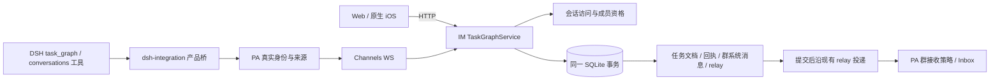
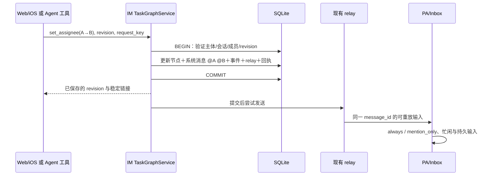

# feat-584：任务分层进度视图与归属权限 — 技术方案

> 对齐：[spec.md](spec.md) 已收口需求（含 Q33：保留现有 `/stop`，不做持久停止）。设计已通过独立 Gate 2（Round 3：Approved，0 CRITICAL / 0 WARNING）。此阶段不修改产品代码。

## Changelog

## 现状分析

### 涉及范围

| 生产接线 | 当前职责与本次影响 |
|---|---|
| `apps/im-server/src/task-graphs.ts` → `TaskGraphService.execute` | HTTP 仅开放查询，Gateway WS `task_graph.command` 开放 Agent 修改；整图 JSON、revision、request_key 回执、层级/依赖校验、来源投影均在此。增加真人写入、节点身份、会话 ACL 和通知。 |
| `apps/im-server/src/messaging.ts`、`conversation-actions.ts`、`media.ts`、`gateway.ts`、`work.ts` | 会话成员校验、历史/附件、群治理、WS 事件/relay 重放、Agent 会话查询；公开群不能只改任务接口，必须统一这里的读写资格。 |
| `apps/im-server/src/schema.sql`、`db.ts` | SQLite 是任务与聊天事实源；当前 `openDatabase` 只有建表，并不会给旧表自动加列。升级必须显式执行本 unit 的一次性迁移。 |
| `packages/personal-assistant/src/global-agent.ts`、`single-thread.ts`、`inbox.ts`、`attention.ts` | 固定真实 Agent/会话来源，调用 IM；global 持久 Inbox + 空闲唤醒，single_thread 持久输入 + DSH followup；群接收策略在 `needsAttention`。 |
| `packages/dsh-integration/src/features/task-graphs.ts`、`task-graph-schema.ts`、`global-mode.ts` | task_graph / conversations 的 DSH 公开工具注册与引导。改声明与产品桥接，不加入任务执行循环。 |
| Web `src/IM/frontend/src/features/tasks/`、群创建/设置、聊天 API/cache | 当前任务只读，桌面为目标列表＋画布＋详情，窄屏详情为 sheet；增加分层进度、成员/负责人选择、写操作和公开群访问入口。 |
| iOS `src/IM/ios/NanoIM/Features/Tasks/`、Chat、Client | 原生任务模型与图布局已有，增加 SwiftUI 状态分组、详情/编辑表单与相同群治理入口。 |

### 既有约束

- 保持 AGENTS.md 中的包依赖边界；只有 dsh-integration 导入已声明依赖的 DSH 公开 exports。PA、Channels、IM 不导入 DSH；apps/node 继续通过 client 管理 stdio 子进程。
- 任务结构仍有 500 节点／1000 依赖／8 层／2 MiB 的现有限制；不用此 unit 扩大容量或引入第二种图结构。
- 既有 `tg_*` / `n*` 短 ID、深链、revision 原子性、重试回执、明确删除授权及来源附件保护继续有效。
- 公司资格、Agent 管理归属与会话成员身份是不同条件。Agent 使用真实 `agent_id`，不借管理员 owner 的权限。
- 任务是协作记录；父子状态、Agent 执行和任务状态分离。通知可以按消息策略产生后续输入，但不是依赖调度。

### 可复用能力

| 能力 | 用法与必要补齐 |
|---|---|
| 整图事务＋revision＋mutation receipt | **沿用**。在事务中加权限、任务消息与 relay 入队；不拆为双写节点投影。 |
| `conversation_participants` 与 Agent 的 IM user 记录 | **沿用**成员与 mention 映射；抽取统一会话访问函数，区分 `read` 与 `write`，避免公开可读意外放开发言/上传。 |
| `messages`、`conversation_events`、`relay_tasks` | **改造复用**持久投递。当前 `sendMessage` 会边写边发、离线报 503；任务通知需要同步入库与提交后发送两个阶段。不新增通知表或通用事件总线。 |
| 当前有效 mention 标签 | **沿用** `<mention type="user" target_id="IM用户ID"/>`，从真实成员映射生成 `mentioned_agent_ids`，不靠展示名匹配。 |
| `needsAttention` / Inbox / `session.submit(followup)` | **沿用** idle/busy 和群策略。`/stop` 目前仅 `session.cancel`，没有持久 stopped 状态；不能声称现状已满足持续抑制唤醒。本次保持现状，见 D5。 |
| 图布局、面包屑、来源投影、原生图布局 | **沿用**。状态分组直接使用同一层 children；直属状态计数为读取派生值，不写第二份进度。 |
| 现有公司管理员 | **沿用**真人 `is_company_admin`；不新增任务管理员、群管理员、验收人。 |

### 相关历史

- [feat-569](../archive/feat-569-task-graphs-mvp/spec.md) 建立计划/探索嵌套和记录与执行分离，本设计保留。
- [feat-572](../archive/feat-572-public-im-protection/spec.md) 采用公司共享任务与跨群活动；本次明确替换访问范围，保留跨群同一事实和活动入口。
- [bugfix-580](../bugfix-580-task-delete-permission/incident.md) 的统一工具删除授权已反映在 current task specs；本次不重新增加用户口令或强制重复确认。
- 当前代码已是 TypeScript IM + PA + DSH。旧操作文档仍有 Python Gateway 示例，runbook 以当前 `scripts/e2e-up.sh` 的 TypeScript 入口为准。

## 架构总览

任务仍由 IM 唯一持有。Web/iOS 经 HTTP，Agent 经现有 PA → Channels → IM WS，全部进入同一个任务服务。UI 能力标志只是展示依据，写入仍由服务端重新判断。



图中的 relay 只递送协作消息；何时处理输入继续由 PA 与 DSH 现有接口承接，不遍历 DAG 开工。

## 关键决策

### D1：整图 JSON 继续作为任务事实源，会话归属放图级，创建者和负责人放节点级

增加 `task_graphs.conversation_id`，一棵树只能属于一个会话；子节点不能覆写。`last_chat_id` 和 `task_node_chat_activity` 仅表示讨论/活动，不能充当 ACL。节点 `created_by` 在创建时取真实 actor，`assignee` 默认为空，可人可 Agent。

负责人跨层查询通过 SQLite `json_each(document_json,'$.nodes')` 在**先受 ACL 限制的图**中展开，按匹配节点分页；当前每图有限，不新增节点表、搜索服务或可漂移的投影。读取时计算直属状态数。未来出现实际性能证据再考虑索引化，不预先维护两套事实。

### D2：一个会话访问边界同时服务任务、消息、附件和 Agent 查询

新增 IM 内部 `conversation-access.ts`（或同等归属的模块），统一 `read / write / join / changeVisibility / dissolve`。公开群非成员可读但不能写；普通列表仍是已加入会话，发现入口单独列可加入公开群，避免公开群自动充满聊天侧栏。

成员表不因查看被写入。切换公开/私密要求当前成员且真人公司管理员；只允许 Agent 加入自己，不把“Agent 自行加入”实现成“用户能强拉别人管理的 Agent”。新建内置群显式写 `public` 默认；外部影子会话是既有 channel 镜像，不是内置新建群入口，保持原成员可见，避免同步外部聊天时意外公开。

### D3：任务变更与群系统消息同事务，投递复用 relay

既有消息模块拆出私有的“持久化消息＋事件＋relay 行”和“提交后发送”。任务服务调用前者，与任务/回执一起提交；提交后尝试发送。节点离线只影响投递，不把已保存任务报告为失败。断线重连继续重放未完成 relay，并在重放前复核目标仍是当前可收消息的成员。

同一请求回执不再产生第二条消息。单节点一次变更产生一条合并的系统消息，若同次修改既改负责人又进入完成等状态，合并描述并取 @ 并集；批量修改多个节点，每个真实变化节点各一条，不能把通知压成无法辨认的“更新了 N 项”。没有变化不发消息。只发 spec 通知表列出的事件；编辑标题、普通重新打开、删除不额外加 @。

### D4：群解散保留会话壳、成员快照和历史，关闭未完成任务

对群使用 `dissolved_at`，不再物理删除会话；事务内将所属图的未完成节点设为 `closed`，原 `done/closed` 不变，图 revision 递增。成员集合与 visibility 冻结，作为历史 ACL；之后仍要求公司资格有效。所有成员/可见范围/内容写入以及 Agent 新投递停止。常规聊天侧栏移除解散群，任务详情提供“已解散群历史”只读入口。

这一生命周期操作不逐节点发任务完成/关闭通知、不触发一串 Agent 执行，避免把一次解散重新解释成群内交办。事务中撤销尚未派发的相关 relay；已在 Agent 上运行的工作不以此强杀，后续读取/写入由当前会话资格拒绝。私聊原生命周期不改。

### D5：保留 `/stop` 取消当前执行，不增加持久停止

用户已明确确认：保留 Nano 语义，Raft 式持久停止暂不做。single_thread 与 global 的 `/stop` 继续调用 `session.cancel` 取消当前执行；后续有效任务消息按普通群接收策略处理，无需真人消息先恢复。不增加 PA stopped 位、恢复入口或新生命周期。

Raft 参考区分：其手动停止是整个 Agent 的持久停用，普通消息不能唤醒，需显式 start；SOS 用于协作跑偏时停住并输入纠正意见。这解释了该功能的用途，但不成为本 unit 的目标或实现依赖。

### D6：一个 M1 交付整条协作旅程

权限、消息投递、Web/iOS/Agent 是同一数据变更的消费者，单独上线任何横切层都不能满足已确认体验；当前没有独立交付需求，保持一个 M1，不人为按后端/前端拆并行里程碑。

## 接口与数据流

### 1. 数据与身份

```ts
type TaskActorRef = { type: 'user' | 'agent'; id: string };
type TaskStatus = 'todo' | 'doing' | 'in_review' | 'done' | 'paused' | 'closed';
// task_graphs 表：保留原字段，增加 conversation_id（迁移完成后必填）。
// graph document schema_version = 2；旧版一次性迁移，不运行时双格式回退。
interface TaskNodeIdentity {
  created_by: TaskActorRef; // immutable，真实创建者
  assignee: TaskActorRef | null;
}
// 会话：visibility 'public'|'private'，仅 group 生效；dissolved_at nullable。
// 读取投影（不持久化）：
interface TaskNodeAccess {
  can_edit: boolean;
  can_delete: boolean;
  can_claim: boolean;
}
```

图 `owner_id` 保留原账号/管理来源信息，不参与任务权限。Agent ref 持久化 `agent_id`，不存模型自报展示名；响应解析名称/IM user_id 供客户端展示与 mention，失活身份保留历史标识但不能成为新分配对象。`created_by` 不通过普通 patch 修改；服务端拒绝伪造，创建后不可改写。`updated_by` 保持兼容展示并补稳定 `updated_by_actor`；已有 provenance 保留，按来源会话 ACL 投影，不变成第三种角色。

`task_graph_mutation_receipts` 加所属会话字段用于删图后的回执资格复核。创建幂等 hash 包含固定归属；编辑的讨论来源沿用首次落库来源语义。每次重放回执先核当前调用主体和所属会话读写资格，不能因旧 key 绕过退群或可见范围收紧。

### 2. 服务接口

核心继续为 `TaskGraphService.execute(verifiedActor, action, args)`；服务隐藏身份解析、权限、事务、revision、结构校验、通知生成和回执。HTTP/WS handler 只构造已验证 actor，不自行实现节点规则。

| 入口 | 增量 |
|---|---|
| `GET /im/v1/task-graphs` / `task_graph list` | 原根任务查询保持；增加 `assignee_type,assignee_id` 成对筛选；有筛选时返回跨层 node 摘要（graph_id,node_id,scope_id,parent_path,conversation,title,status,creator,assignee），total/cursor 以匹配节点为单位。稳定排序 `(updated_at,graph_id,node_id)`，cursor 绑定完整筛选与调用主体，每页重新应用当前 ACL。 |
| `GET /im/v1/task-graphs/:graph_id` / `get` | 保留 scope/all；返回所属会话摘要、节点身份、can_* 与直属状态数。不可访问返回既有 not_found_or_forbidden，不泄漏标题/数量。 |
| `POST /im/v1/task-graphs` / `create` | 真人也可写；必需所属 `conversation_id`、title、mode、request_key；可选 root assignee。当前群内创建预填，会话外 UI 必须选择有写入资格的会话。 |
| `POST /im/v1/task-graphs/:graph_id/apply` / `apply` | 保留 base_revision/request_key/operations/change_note；增加 `set_assignee(node_id,assignee|null)`、`claim_task(node_id)`；add_task 可带 assignee；update_task 只改原可编辑内容及六状态。 |
| `DELETE /im/v1/task-graphs/:graph_id` / `delete` | 正文带 base_revision/request_key、可选 node_id 与 discussion conversation；删除目标创建者或已入群的真人公司管理员可删整子树。回执保留删除 ID、revision 和原所属会话，不保存被删除正文副本。 |
| `GET /im/v1/conversations/:id/task-activity` | 同时要求可读当前活动群及源任务所属会话；不可读项完全过滤。B 群关联不构成独立权限或任务复制。 |

`claim_task`：调用主体自己领取，未分配或已分配给自己才能成功，并设为 `doing`；别人负责则返回 `already_assigned`。对 done → doing 沿用返工原因约束。改派本身不改状态；仅分配给自己不等于领取。非成员 assignee 返回 `assignee_not_member`，不得自动入群。

删除先验证目标节点权限一次，再删除整子树与悬挂关系/活动关联；不逐后代授权，已有删除范围/DSH 权限流程保持。普通 apply 不隐式扩展为子树状态操作；明确“整棵子树”由调用方展开有限批次操作，仍保留 done 节点，超过原 batch 限制需要重新读取分批执行并如实报告，不偷偷扩大限制。

主要错误保持现有结构：`not_found_or_forbidden`、`version_conflict`、`invalid_graph`、`request_key_reused`；增加明确可恢复的 `conversation_required`、`assignee_not_member`、`already_assigned`、`conversation_dissolved`。Web/iOS 遇冲突保留用户编辑文本并提供重新读取；不能自动覆盖较新图。

### 3. 群访问与工具承接

| 操作 | 服务与资格 |
|---|---|
| 浏览公开群 | `GET /im/v1/conversations?scope=public` 用于发现；默认已加入列表不变。详情/消息/受保护附件按统一 read 策略；匿名、pending、suspended 不可读。 |
| 新建 | 既有 POST conversations 增加 visibility，内置 group 默认 public，direct 固定参与者。新建 Agent 群以真实 Agent 为创建者且自己入群。 |
| 自行加入 | `POST /im/v1/conversations/:id/join`，调用主体加入自身，公开且未解散才允许；重复调用幂等，不代替普通邀请规则。 |
| 改可见范围 | 既有 PATCH conversations 增加 visibility；服务器要求已入群的真人公司管理员。Agent 无管理员例外。 |
| 解散 | 既有 DELETE 群入口与创建者资格保持，改为 D4 软解散；所有任务/消息查询用历史只读投影。 |
| Agent 工具 | 扩展现有 `conversations` 增加 `create`、`join`，list 加 scope；沿 `nanoProduct → PA → conversation.query → IM` 接线。读分发与写分发在 IM 按 action 路由同一会话服务，不让 `work.ts` 再实现一套群治理。 |

Agent `task_graph create` 的 `target` 决定固定所属会话；single_thread 可使用可信绑定会话。global 或无绑定来源必须显式提供已存在 target；来源无法解析明确失败，不猜最近 Inbox、不自动建私聊容器。apply/delete 的 target 仍仅是讨论来源，缺省也可在具有所属会话资格时修改，不能迁移归属。外部 channel 有真实影子会话时使用该映射，无映射不能伪造归属。

Agent conversations 查询目前在 PA 有 root 限制；本 unit 保留，不让 internal child 因工具参数自报身份自行加入群。任务工具子调用仍沿既有绑定与授权流程，并使用真实注册 PA Agent 身份记账。

公开→私密/移出成员后，服务端每次读写、WS 重放、attachment read、Agent conversation query、relay 重投均重新应用 ACL；Web/iOS 清除当前对象缓存并重读，不把旧缓存作为授权成功。已实际交付的历史消息无法撤回，不宣称权限收紧会删除 Agent 已经读过的上下文。公开访客不自动订阅全公司 WS；打开页面沿现有主动读/刷新机制更新，加入后进入原成员消息流。

### 4. 一次改派如何落到 Agent



系统消息类型为 `system`，显示实际修改者但不伪装真人发言；使用稳定任务链接。任务标题/描述中的标签按文本转义，只有服务端生成的合法成员标签成为有效 @。系统通知本身不是新的真人删除授权。投递候选是所属会话当前有效 Agent 成员；`always` 可处理未 @ 通知，`mention_only` 未命中只保存背景/Inbox，不能仅向 assignee 特供输入而跳过现有群策略。

收件人按提交前/后的真实变化生成：首次分配 new，改派 old+new，取消 old；暂缓/关闭只取直属子节点已分配的 Agent；in_review/done 取当前节点创建者＋直属父负责人。逐消息按身份去重，已退出成员只保留变化事实里的名称，不产生有效 @ 或重新加入。根没有父负责人。创建时指定负责人等价首次分配；领取作为实际负责人变化使用同一通知，不另发第二条“开始”通知。迁移静默，不产生业务通知。

`relay_tasks` 以稳定 message_id + agent_id 去重，发出后未收回执仍可按现有机制重投；PA/DSH 的稳定 inputId 抑制重复消费。任务消息入库提交之前不得广播。提交后通知错误不撤销任务，不把写入失败和通知暂未处理混在一起；回执“已保存”不显示成 Agent“已开工”。

### 5. 状态与读取视图

- schema v2 将 dropped 换为 closed，增加 in_review。探索选项沿用校验，closed 不能仍被指定为已选方向；关闭已选方向时同一批次显式清除选择，禁止悄悄丢掉选择理由。
- 完成情况按待办、进行中、待确认、已完成、已关闭五组；`paused` 与 `todo` 同列，卡片仍显示真实状态，顶部直属状态计数继续区分六状态。
- 结构图与完成情况共享 scope_id 和选中 node；切换仅改呈现，不写图。进度只统计直属 children，深层任务出现在所属层，父状态独立。
- 全局负责人筛选返回每个直接匹配节点，父/子同时符合均显示；点击用 graph_id + scope_id + node_id 进入既有深链。
- 既有目标列表默认仍读根任务；每层默认沿用结构图，原型首次直接展示“完成情况”便于评审增量，不作为强制改变用户默认页的要求。

### 6. 一次性迁移

依 [migration-guidance.md](migration-guidance.md) 由部署 Agent 先取证、备份、产出可核对映射，再停写并转换。新增列、旧群 private、图 schema v2、dropped→closed、节点 creator/assignee/固定归属在同次升级窗口完成。无原始创建证据的具体项交用户，不把最新修改人填成创建者。

迁移程序由实施阶段提供 unit 对应的 dry-run/apply/verify 入口；不得在本设计稿提供猜测生产数据的 SQL。正常启动只接受最终格式；迁移前旧数据不得在新公开规则下短暂运行。部署前完成备份恢复演练及 counts/IDs/结构/results 对比。回退是停写并恢复同一时点 DB＋旧服务版本，不能让旧代码读取已迁移 v2 或同时运行双版本写入。

## 前端原型

- 文件：[prototype.html](prototype.html)。用户需要判断的是：完成情况是否与当前层对应，编辑/改派是否自然，群内系统消息能否回到任务，权限状态是否清楚。
- 范围：现有页面背景＋可连续操作增量。顶部 Chat/Tasks、任务侧栏、面包屑和手机 sheet 沿用；桌面详情按 Q35 改为选中后展开；Agents、普通搜索/聊天是背景，不接后端；结构连线仅示意，真实产品仍使用现有布局算法。
- 可操作：分层进入/返回、结构/完成切换、跨层负责人筛选、创建/编辑/领取/改派/删除、新建群表单、群范围切换、公开访客加入、解散后的任务历史、系统消息回链。身份切换只在独立“演示状态”里。

### 现有 UX grounding

| 当前产品入口 | 当前画面与样式依据 | 继承与增量 |
|---|---|---|
| `/tasks/:id` | [基线截图](evidence/baseline-desktop.png)：2026-10-12 用当前 Web 组件、合成 API 数据实际渲染；截图顶部断线提示来自未连接后端，不是产品验收。样式来自 `task-graphs.css` / `styles/global.css`。 | 保留列表/中心内容/详情的职责分区和 teal token，按 Q35 将列表收紧、详情按需展开；新增 scope 工具条切换、卡片负责人/直属状态数、详情编辑。Q35 后收紧控件与留白，详情改为按需展开。 |
| 手机任务页 | 现有 CSS 767px 断点、TasksView.swift 原生列表/图/详情导航；本轮没有启动原生 App 取得当前截图。 | 窄屏完成情况按五组纵向排列（暂缓并入待办，卡片保留状态），详情 sheet 与原入口保持；HTML 手机画面仅表达信息与操作语义，不是 SwiftUI 实现或原生视觉已验证的证明。 |
| 群创建/设置与任务活动 | 当前 `new-group-modal.tsx` / `group-settings.tsx` / `group-task-panel.tsx`；原型仅呈现本次可见范围、加入和任务消息相关增量。 | 不新增一级导航；公开群发现嵌入现有新会话/群入口，任务详情回所属群，解散历史只读。 |

### 原型对齐契约

| 编号与区域 | 级别 | 真实入口 / 必验状态 | 下游投影 |
|---|---|---|---|
| P1 分层进度 | must-match | Web Tasks、iOS Tasks；根/第二层/探索、1440/1024/390，六状态、五组（暂缓并入待办）、直属数、面包屑 | R1、W3 |
| P2 基础操作 | must-match | 任务详情及创建/编辑 sheet；未分配/已分配、改派、返工原因、删除子树范围、冲突恢复 | R2、W1/W3 |
| P3 负责人汇总 | must-match | 全局任务列表负责人筛选，深层节点＋群/父路径，不含无权内容 | R3、W1/W3 |
| P4 群权限与历史 | must-match | 群新建默认公开、访客加入、管理员切换、解散历史；窄屏表单 | R4、W2/W3 |
| P5 系统消息交接 | must-match | 所属群一条系统消息、有效 @、任务回链；改派/向下通知/结果反馈 | R5、W2/W3 |
| 响应式与原生控件 | may-adapt | 桌面五列、窄屏五组；暂缓并入待办，状态仍独立；SwiftUI 可用原生 sheet/picker，层级与可达操作不变 | R1/R2/R4、W3 |
| 示例依赖线/身份控制/普通聊天/搜索 | out-of-scope | 连线回到现有图布局，身份演示不进入产品，搜索/聊天保留既有能力 | 不新造此类实现 |

Q35 视觉修订：筛选使用紧凑菜单，列只保留轻量标题/计数及卡片，不以大片背景撑高；当前层标题旁保留“详情”入口，根任务与任一层均可直接打开；详情按需展开，编辑与更多操作集中，删除放在次级菜单。冲突演示由独立演示区触发，保存失败保留草稿，读取最新内容后由用户明确重试，不自动覆盖。

### 原型走查

走查记录与代表截图将记录于 [evidence/visual-review.md](evidence/visual-review.md)。仅实际看过的画面记为已验证；原生真栈、冲突与后端权限由 M1 验收，不能以本原型替代。

## 契约层增量 (delta-spec)

本 unit 的 `specs/` 已形成以下 delta，current 文件暂不修改：

- `docs/specs/im/task-graphs.md`：会话 ACL、节点身份、真人/Agent 维护、分层进度/负责人汇总、通知、群解散；保留图结构、revision 等未改契约。
- `docs/specs/im/conversations-messages.md`：公开/私密、自己入群、范围变更、软解散与消息/附件读写资格；保留其他群治理。
- `docs/specs/im/agent-work.md`：Work 本身可见规则不变，来源公开群/附件使用当前会话读取资格。
- `docs/specs/im/auth-tenancy.md`：现有“聊天全按成员关系读”改为公开群可读、私密/私聊仍限定成员；管理配置边界保持。
- `docs/specs/gateway/task-graphs.md`：从公司共享改为真实主体＋所属会话、领取/负责人、六状态及通知与执行分离。
- `docs/specs/gateway/routing-delivery.md`：任务系统消息的有效 @ 与 existing attention；明确后续任务通知遵循现有 `/stop` 取消当前轮的边界，不扩展为持久停止。
- `docs/specs/im/ios-client.md` 已要求原生业务权限一致，不重复登记同一规则；具体任务与群 delta 同时适用于 Web/iOS。

## 风险与回退

- **公开群不是仅任务开关**：必须覆盖详情/消息/附件/Agent 查询，读写不能复用一个“有权限”布尔值。禁止顺带公开外部影子会话。
- **提交成功但投递延迟**：事务中持久 relay，返回任务事实；在线发送与重连复投均用稳定输入标识。禁止写后发消息失败时重做改派。
- **成员变更后旧数据**：所有查询含 count/cursor/activity/source projection 都用当前 ACL；任务消息不携带越权来源正文，原客户端清缓存行为保留并扩展。
- **旧数据缺创建者/唯一群**：不能自动推断补假事实；部署 guidance 的映射与核对是上线前置，不增加长期兼容层。
- **单图并发**：仍是整图 revision；用户保留草稿、重新读取后明确重试。没有证据要求节点级版本或自动合并。

## Runbook for Reviewer

**Review 驱动方式**：端到端真栈。Web 用真实浏览器、iOS 用真实 SwiftUI App 接同一隔离 IM；Agent 通知必须穿过真实 PA＋公开 DSH，不以 HTTP 回执或合成原型证明 Agent 已收到/开始工作。

```bash
REPO_ROOT=/Users/czj/Repos/nano-multiagent # 实施时换为受审 checkout
WT_ROOT=$(mktemp -d /tmp/nano-feat584-e2e.XXXXXX)
export PATH="$REPO_ROOT/.venv/bin:$PATH"
cd "$REPO_ROOT"
pnpm install --frozen-lockfile
pnpm build
(cd src/IM/frontend && npm ci && npm run build)
./scripts/e2e-up.sh --wt "$WT_ROOT"
source "$WT_ROOT/.e2e-ports.env"
curl -f "$IM_URL/health"
```

| 服务 | 停止 | 启动 | 健康/入口 |
|---|---|---|---|
| 隔离 TypeScript IM＋Node/DSH | `./scripts/e2e-down.sh --wt "$WT_ROOT"` | 上述 e2e-up | IM `/health`＋owner 对齐 node online、日志里实际 cwd/SHA；DSH 是 stdio，无内核 HTTP |
| Vite（需要开发 UI 时） | 停止本次前台 Vite，或记录并停止其专属 PID | `VITE_IM_PROXY_TARGET="$IM_URL" npm --prefix src/IM/frontend run dev -- --host 127.0.0.1 --port "$VITE_PORT" --strictPort`，`VITE_PORT` 用 free-ports.sh 分配 | 打开该端口真实 Tasks/Chat |
| 原生 iOS | 停止此次测试启动的 App/模拟器，不操作用户手机 | `NANO_IOS_BUILD_ROOT="$WT_ROOT/ios" ./src/IM/ios/scripts/build.sh build`；用已安装模拟器运行，将 base URL 配为 IM_URL | Tasks/Chat 实际 UI、请求日志及服务数据一致 |

**验收前置**（2026-10-12 已核）：仓库有无 secret E2E config（本地 4000 LLM proxy `/health` 返回 200），完整 `/Applications/Xcode.app` 与 iOS 26.4 模拟器可用。当前 shell 默认 developer dir 没有 simctl，命令必须指定 `DEVELOPER_DIR=/Applications/Xcode.app/Contents/Developer`。build/test 与首次模型调用在实施验收时重新验证，设计期不伪称已通过。

测试身份由隔离 `init_admin` 创建管理员与普通 active 成员，两个隔离 Agent（always、mention_only）使用专用 workspace/node identity；借鉴 `apps/im-server/tests/e2e/helpers.ts` 的身份 fixture，禁止改生产账号。另设非成员、pending/suspended、Agent owner 不同的组合。无需飞书真实群、外部测试租户或新账户凭据；外部影子会话边界用隔离 mirror 请求验证。本次不变更签名/媒体/VoiceOver 机制，已有真机未验项不冒称由模拟器补齐。

验证后 e2e-down、停止本次 Vite；核对 PID/监听消失，删除本次 secret/config；日志/DB/运行截图缓存不提交。unit 仅保存必要裁剪后的验收证据及说明。

## Milestones

| ID | 标题 | 依赖 | 并行组 | 文件范围 | 退出标准 |
|---|---|---|---|---|---|
| M1 | 会话内任务协作完整交付 | 无 | serial | IM 任务/会话/消息/数据库；product-contracts；PA attention/Inbox；dsh-integration 工具声明；Web Tasks/Chat；原生 iOS Tasks/Chat/Client；一次性迁移与本 unit delta | [reviewer] R1–R5；[worker] W1–W4，详见下表。 |

| 编号 | 可核对的退出标准 |
|---|---|
| R1 | [reviewer] 在 Web 和 iOS 真页面逐层切换结构/完成情况，六状态与直属数正确，探索关闭不算完成，父状态不自动改变。P1。 |
| R2 | [reviewer] 真人创建根/子任务、领取、编辑结果/状态、改派；Agent 工具做对应动作，两端同一事实；创建者固定；不同创建者的整子树删除范围清楚且权限正确，冲突不丢草稿。P2。 |
| R3 | [reviewer] 负责人跨层筛选含父子匹配、群/路径，打开正确 scope；私密任务不因已知链接、B群活动、管理员身份或旧缓存被读出。P3。 |
| R4 | [reviewer] 新建公开/私密、公开访客读→加入→写、私密拒绝加入、已入群管理员双向切换；解散后 unfinished 关闭、done 保留、历史按原范围只读。Web/iOS/Agent 同规则。P4。 |
| R5 | [reviewer] 改派双方 @、父暂停只 @ 直属 Agent、结果 @ 创建者及父负责人；群只出现一条对应消息且回链正确。always/mention_only、busy/idle/offline 重连、`/stop` 取消当前轮与后续有效通知通过真实 PA/DSH 验证，不把分配当开工。P5。 |
| W1 | [worker] SQLite 真库服务边界测试：ACL 的 read/write/delete、假 actor、creator 不可覆写、assignee 成员资格、claim 竞争、schema/结构、revision、幂等回执和跨层分页；保留原 DAG/explore 回归。 |
| W2 | [worker] 消息与任务事务故障/重试、同消息重复 relay、离线与权限撤回后重连、系统有效 @、群软解散数据保持；PA 两模式最窄相关测试＋真实锁定 DSH 联调。 |
| W3 | [worker] Web build/typecheck/Vitest 与 iOS build/tests；留下 P1–P5 真实客户端对照证据，桌面1440、中间1024、窄屏390，原型与实物区别明确。原生模拟器不冒充物理设备。 |
| W4 | [worker] 迁移 dry-run/apply/verify 和备份恢复演练保留 ID、关系、结果，旧群 private、无通知洪泛；runtime dependency contract、docs-check 和 diff-check；只合并本 delta 对应 current 条目。 |
