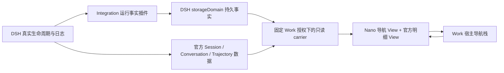

# feat-589：沿着委派检查一次执行

## 设计状态与决定

首文档：[spec.md](spec.md)。用户于 2026-10-13 确认“找得到、看得准、回得去”的目标，授权 Agent 决定技术方案并继续实现。本设计选择一个 M1 完成完整旅程；不修改 DSH 仓库，不升级或修改锁定的官方 bundle。

**方案：Nano 提供运行事实插件和轨迹导航视图插件，复用 DSH 官方轨迹数据，保留原版官方明细视图。** 新视图拥有发起点、受控范围、记录选择及缩放；宿主拥有父子导航栈。运行范围选择的视觉沿用原生的输入／模型／工具三行概览和区间高亮。没有调用官方组件私有 state，也不声称把官方明细视图的内部时间线设成了相同区间。

插件能力与锁定版本边界见 [plugin-investigation.md](plugin-investigation.md)。独立只读分析也确认：`conversation.view` 可正式贡献新 id；`useTrajectory` 和 Conversation target 可复用；官方内部 Inspector 没有独立公开组件入口。因而选择新增 `nano-execution` View，与官方 `trajectory` 并列，而非复制其组件或篡改 slot registry。

## 用户体验与信息组织

主入口继续是 Agent → Work → 原生轨迹。打开后默认显示轨迹导航。主执行仍按记录顺序阅读，发起记录置于其真实工具调用／后台发起坐标，强调任务用途，其次显示普通／fork、主动／后台和真实状态。UUID 放在详情中。发起记录自身提供“查看本次执行”；顶部执行选择器保留为辅助入口。

进入子执行后顶部固定显示返回按钮、父级来源链、用途及状态。其下为“本次执行”范围条，显示已知起止、定位起点／终点和“查看会话历史”。默认只展示本次范围中的记录，概览选中整个本次范围。fork 的继承前缀不计入范围；切到会话历史时以范围外淡化与标识区分。结束未知时不显示确定终点；运行中范围延伸到最新真实记录，阅读位置不自动跳动。

记录列表包含官方投影中的输入、上下文、系统、模型请求、工具、助手与压缩记录；可搜索、选择、检查内容及原始投影数据。模型请求保留当时 prompt、tool schema、配置、usage 和 timing，不以当前配置补齐缺失项。记录检查在桌面靠右，窄屏放在记录列表下方。涉及图片的检查继续调用官方 Conversation 的授权图片加载能力。

“原生明细”在同一位置打开原版 DSH 完整视图，保留其原有搜索、时长切换、轮次／调用折叠、时间概览、原文／来源和各类 Inspector。工具记录通过官方 `viewRequest` 的 callId 聚焦能力进入其明细；其他记录也可先在导航视图检查完整投影，再进入全会话原生明细。原生明细清楚说明查看的是完整会话，其自身范围选择不会被标作“本次范围”。进入原生明细时，本次范围条仅保留为“来源执行摘要”；隐藏导航专属的定位起点／终点与历史切换，底部显示“完整会话 · 记录由原生明细展示”，不引用隐藏列表的计数。返回导航后恢复控件和原有状态；导航历史模式计数明确标为“会话历史（含继承记录）”。切回导航保持本次范围与记录状态。

返回时直接恢复仍挂载的父 frame：滚动、缩放、搜索、折叠、选择及原生明细内部状态均保留。嵌套委派逐级 push/pop，不把所有子执行混入单一平铺列表。顶层选择器显式换执行时开始新的导航栈；离开 Work、切账号或资格失效时销毁整个栈及所有读取。

## 架构与职责

| 边界 | 责任 | 不承担 |
|---|---|---|
| `packages/dsh-integration` | 通过已声明的 DSH 公开 exports 观察、持久化每次 run 及因果坐标；固定 scope 读取 | 不改变调度、不修改执行事件、不创建第二个 Agent Loop |
| `packages/product-contracts` | JSON-safe 的 run DTO 和只读 carrier 契约 | 不 import DSH、不解释原生日志 |
| `packages/dsh-trajectory-viewer` | 按现有浏览器例外使用官方公开 client exports；注册新 View、消费官方投影、呈现范围和发起记录 | 不 import 私有 UI、不裁剪／覆写官方全局 target，不重新解码原始会话日志 |
| `src/IM/frontend` | 授权连接生命周期、导航栈、来源链、隐藏／恢复父 iframe | 不取得执行或审批能力，不解析 DSH 数据模型 |
| Node / PA / IM carrier | 在既有链路中传送新增只读方法与 DTO | 不新增 DSH import、不新增 kernel HTTP |

`SPEC.md` 的隔离查看器例外随交付精确更新为：允许插件消费官方投影并维护导航呈现，官方记录、原始数据通路和完整检查能力仍保留。官方资源 bundle 继续原样复制。该变更不扩张 PA／IM 的 DSH 依赖边界。

## 运行事实契约

新增 `TrajectoryRun`，字段为：`runId`、`parentSessionId`、`sessionId`、`provider`、`label?`、`kind`（tool / memory / skills / unknown）、`delegation`（foreground / background / unknown）、`launchSeq?`、`callId?`、`startSeq?`、`endSeq?`、`startedAt`、`endedAt?`、`stopReason?`、`state`（running / completed / failed / cancelled / unknown）。未知值保持缺失，显示文案不成为身份键。`runId` 直接取 DSH 生命周期 runId；continuable 的一段 residency epoch 是一次执行，驻留期间继续收信仍属于同一次执行。`delegation` 来自实际调用参数或明确后台维护上下文，缺失时为 unknown，不由工具返回速度推断。`startSeq` 是包含式下界：创建时 `session.seq` 表示下一条事件 offset，直接作为本次第一条新事件的包含式坐标；`endSeq` 是真实结束时最后接受事件的包含式坐标，仅终态设置。运行中的已知尾部由官方已加载记录提供，不能写作完成终点。

记录插件使用官方 `storageDomain` 存储自己的观察事实，不复制原生正文。`subagent/start/end` 的 `this` carrier 经公开 `carrierKeyOf()` 取得真实父 Agent；不根据全局“最近一次调用”猜测。插件通过 `tools/execute` 的 AsyncLocalStorage 保存该调用的 parent、callId、description 与当时坐标；并行调用拥有独立上下文。`knowledge/runtime` 在真实启动处显式提供 memory / skills 来源与父坐标，不解析 review 标签。后台维护即使没有工具调用也有真实坐标及用途。

### 起止捕获与持久化顺序

1. 在公开 `agent/created` 回调记录该子对象创建／恢复时的 `session.seq`，作为该次新日志的下界。one-shot 进入 `subagent/start` 前可能已开始建立子会话，不能此时简单取最新 seq 当起点。fork 的 seed 在创建前已存在，因此下界位于继承前缀之后。
2. `subagent/start` 用真实 parent、child、runId 关联上述下界及发起上下文，同步建立活跃映射，再排入持久写队列。没有可证明下界的第三方执行保留未知，仍可查看已有历史；不伪造精确范围。
3. 公开 `session/event` 更新该子 session 已观察到的尾界；结束回调同步冻结这一 run 的实际尾界和官方 stopReason，再排入同一持久写队列。不得在启动工具返回处结算。
4. 只读查询等待已排队的持久写完成；落盘失败显示读取错误，不发布假的已保存事实。结束事实一旦写入不会由新 epoch 覆盖。
5. 进程重启后仅有 start 的记录不自动恢复为 running；只有本进程仍观察的 run 才是 running，否则显示结束未知。已加载旧数据仍可检查。
6. 已存在但缺少新增运行事实的子会话，继续使用既有执行选择器进入，明确发起位置／本次边界未知。禁止用旧 session 全历史假定一个确定 run。

这些顺序必须由真实 DSH fixture 验证新建普通／fork、冷恢复、并行、嵌套、再次唤醒及结束释放；单测假调用不作为起止准确性的唯一证据。

## 读取与导航接口

在现有固定 session observer 内增加 `trajectory/runs` 只读调用，返回与当前 session 直接相关的 run：由它发起的记录及它自身各次执行。参数不得越过 observer 固定 identity；scope 仍经全局 binding + 持久父链验证。前端不能借此查询任意 root。

查看器通过同一 MessagePort 获取 run DTO；活跃视图使用有界定时刷新该小型元数据，每次只有一个在途请求。官方历史与实时记录仍由现有 Session Controller follow/page/projection 通路提供。元数据读取失败显示中断，不能继续声称状态实时。

iframe 向宿主发送 `viewer-navigate`，含选中的 run DTO；宿主校验消息来源、identity 与字段并 push 子 frame，初始化携带目标 runId。子 frame 从自己的固定 observer 再读 run，核对父子对应；没有匹配记录则显示未知，不信任传入 DTO 作为事实。调用和导航消息始终不含 owner token。

每个 frame 独立持有官方 SessionReference 与 Nano 视图状态。父 frame 隐藏但保持挂载，仍受该 Work 页的观察生命周期管理。返回时 pop 并销毁子 frame、显示父 frame；清除全部 frame 会关闭所有 socket、port、订阅和图片缓存。外层切换账号、Agent、root 或初始 session 时重建栈，避免旧身份内容残留。

运行导航加载 `startSeq` 所在历史窗口，若在初始页外，调用官方 `loadThrough(startSeq)`，加载期间显示“正在读取本次执行”。展示时间概览前确保本次已知起止覆盖所需记录；按页加载不会把尚未读取误当不存在。范围条、时间轴、类型轨道与记录使用同一组真实时间和 seq；切到历史不改变同一记录的坐标，点击轨道定位它所代表的记录。运行中、结束未知或更新中断使用开放虚线尾端，并将最后已知记录与真实终点区分。记录按实际 seq 排序，新增发起 marker 插入实际 launchSeq 坐标，不篡改任何官方节点。运行中只扩张已知尾界，不改变用户缩放、选择或滚动。

刷新无需浏览器内存来重建 run 关系；从原发起记录重新进入得到相同 runId 与真实范围。刷新后恢复所有临时缩放状态不属于目标；本次进入／返回的状态恢复属于目标。

## 前端原型

- 原型：[prototype.html](prototype.html)。现有外壳为背景，本次新增导航区可操作；原生明细区域仅演示入口与返回，真实实现挂载官方原件。
- 用户需判断：当前在哪一级、为什么启动、这次覆盖哪些记录、状态是否可信、如何检查与返回。来源与范围置顶，发起入口嵌在记录流，主路径不依赖下拉菜单。
- 当前 UX grounding：已在隔离 IM + Node + DSH 栈真实打开全局 Agent 的 Work 原生轨迹，基线为 [current-desktop.png](evidence/current-desktop.png)。沿用 Work 外壳、浅色紧凑表格、输入／模型／工具概览、只读连接状态。现有顶部选择器不能承担发起位置发现及逐级返回。

| 区域／状态 | 对齐级别 | 产品入口／viewport | 下游投影 |
|---|---|---|---|
| 发起记录在实际上下文中可辨用途、普通／fork、主动／后台和状态，可直接进入 | must-match | Work 原生轨迹；1280、820、390 宽 | M1-R1 / M1-W3 |
| 来源链、本次范围、高亮概览、起止定位；fork 历史明确区分 | must-match | 子执行；已结束／运行／未知 | M1-R2 / M1-W3 |
| 返回保留父阅读状态；嵌套可逐级返回 | must-match | 桌面与窄屏完整旅程 | M1-R3 / M1-W3 |
| 完整记录检查与原版明细入口同页可达；切换不丢当前范围 | must-match | 桌面侧栏、窄屏上下布局 | M1-R4 / M1-W3 |
| 中断、失败、取消及未知具有不同含义，不假称成功／实时 | must-match | 演示异常状态与真实连接测试 | M1-R2 / M1-W3 |
| 具体间距、图标和控件形态 | may-adapt | 复用项目 UI 与平台约定，不能降低可辨认性／触达性 | M1-R4 |
| 演示状态下拉、固定示例内容、背景 New／Config 等入口 | out-of-scope | 不进入产品；真实产品沿用已有入口 | N/A |

原型走查结果及代表性截图记录在 [evidence/design-walkthrough.md](evidence/design-walkthrough.md)。原型不能替代真实产品验收。

## 契约层增量

- IM：[specs/im/agent-work.md](specs/im/agent-work.md) → `docs/specs/im/agent-work.md`。
- 顶层依赖例外：按本设计职责表校正 `SPEC.md` 中查看器呈现责任；不扩大 DSH import 白名单。

## 风险与回退

主要风险是运行边界捕获时机与跨 frame 生命周期。以真实 DSH 顺序 fixture 和浏览器旅程作为退出标准；无法证明边界的记录必须诚实显示未知，但新发起的受支持普通／fork／重复 epoch 必须给出准确边界，不能用未知兜底掩盖实现缺陷。

保留官方原件降低完整检查回归面。新增 View 消费官方投影，依赖升级时分别验证数据契约和交互，不维护一份上游组件副本。回退本 unit 后原版查看器仍能读取原始轨迹；Nano 事实 domain 为附加数据，不影响 DSH 调度和会话格式。

## Runbook for Reviewer

受审 worktree 使用 `scripts/e2e-up.sh` / `e2e-down.sh`，隔离所有端口、node、DSH home、IM 数据和 workspace。真实服务只有 IM 与 Node（管理 stdio DSH）；静态 Web／查看器由 IM 提供，避免不同 origin 的鉴权混淆。

| 服务 | 停止 | 构建／启动 | 健康 |
|---|---|---|---|
| IM + Node／DSH | `./scripts/e2e-down.sh --wt "$WT_ROOT"` | `pnpm build`；`pnpm --dir src/IM/frontend build`；设置 `IM_FRONTEND_DIST_DIR="$WT_ROOT/src/IM/frontend/dist"`、`IM_TRAJECTORY_DIST_DIR="$WT_ROOT/packages/dsh-trajectory-viewer/dist"` 后执行 `PATH="$MAIN_ROOT/.venv/bin:$PATH" ./scripts/e2e-up.sh --wt "$WT_ROOT"`，受控 tmux 中保持 | `.e2e-ports.env` 的 IM_URL `/health`；目标节点 online；DSH PID 与源码构建版本一致 |

**Review 驱动方式**：端到端真栈，必须真实驱动浏览器。登录 → 全局测试 Agent → Work → 原生轨迹 → 发起入口 → 子范围 → 记录检查 → 嵌套 → 逐级返回；覆盖桌面 1280、窄屏 390 和中间宽度 820。刷新、失败／取消、断线与非管理者读取也需真实证据。

**验收前置**：默认隔离账号 `nano` / `nano1234`，来自仓库 E2E profile；通过真实创建入口建立 global Agent，禁止触及用户正式实例。LLM 使用仓库 E2E profile 的本机代理 `127.0.0.1:4000`；本轮基线已通过 UI 使用 `codexOAuth:gpt-5.6-sol`（anthropic）实际完成 17×23 委派并在聊天收到 391；默认 deepseek 路由在本次环境遇到 stream 无 stop reason。成功 parent `ebf7d02e-a87d-4358-9b08-31bc7fdd21d4` seq52 发起、seq54 返回 391、seq64 completed，child `e50982a9-7297-4439-986b-b3b9e85295fc` seq19 completed。实施继续使用已验证路由，仍需对新增捕获逐条验证。可控的边界／错误 fixture 使用真实 DSH 引擎及受控模型适配器产生事件；最终普通委派至少一例使用实际模型。非管理者测试账号仅在隔离 IM 中创建。测试 workspace 与图片亦属于隔离目录，不复制用户私有数据。

基线构建记录：根 workspace `pnpm build` 通过；当前主仓 frontend `tsc` 出现既有 `message-pane.tsx:461` number / Timeout 冲突，单独 Vite build 可渲染基线。实施 worktree 需以干净依赖安装复核；未解决前不能宣称本地 CI 通过。

## Milestones

| ID | 标题 | 依赖 | 并行组 | 范围 | 退出标准 |
|---|---|---|---|---|---|
| M1-navigation | 完成可回看的父子执行导航 | 无 | — | integration 运行事实与读取、product DTO、隔离 viewer 插件、Work 宿主导航、相关测试与契约 | [reviewer] M1-R1：主动普通／fork 与 memory／skills 后台发起点均能直接进入正确执行，并行和重复不串线（R1、R4.1、R5）。[reviewer] M1-R2：本次起止范围、继承历史及运行／成功／失败／取消／未知／中断准确，完整过程可检查（R2、R3）。[reviewer] M1-R3：嵌套逐级返回，保留父位置、缩放、选择（R4.2–3）。[reviewer] M1-R4：1280／820／390 的完整旅程与完整原生检查能力成立，非管理者可读、身份失效清除（R6、R7）。[worker] M1-W1：真实 DSH 用例证明捕获顺序、并行隔离、fork 下界、重复 epoch、异常结束与持久回看；只读 scope 越权和 mutation 被拒绝。[worker] M1-W2：客户端窄测试、包 build/typecheck、依赖契约、docs-check、适用本地 CI 通过；原官方 bundles 不变。[worker] M1-W3：留存真实浏览器截图／交互证据及逐项原型对照，独立产品、静态一致性和代码审查通过。 |

## Changelog
