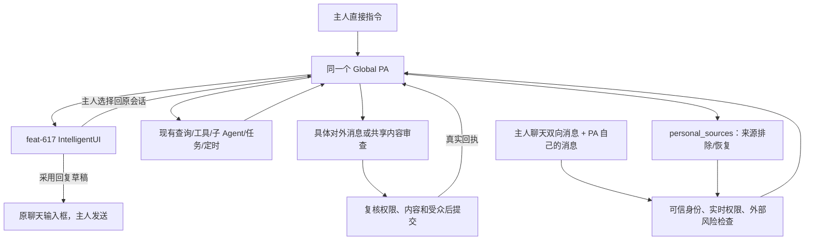

# feat-616：复用 Global 与 IntelligentUI 的个人助手

> R9，2026-10-19。替代旧设计。用户已明确授权此收敛版；历史代码和审查是旧行为证据，不作为本轮通过依据。

## 基线与职责

实施工作树为 feat-616 原工作树；基于 feat-617 `87f5214a7`，集成提交 `b50704bdd`。保持现有顶栏/聊天布局。Global 主 session、Inbox、conversations、send_message、task_graph、schedule、Heartbeat、普通文件与插件机制继续作为唯一能力实现。

### 身份与双向消息

保留 personal_agent_bindings 和既有 owner-only 配置/Work ACL、身份 epoch。PA 自己的可读会话与主人可读且参与过的会话取并集；source exclusions 应用于整个 PA 的查询与接收。查询扩展现有 conversations 工具的 list/info/read，并增加 search 参数能力，不新增 PA 历史工具或数据库。

IM 消息事件为主人所在聊天创建观察事件，包含主人发出的消息；PA 自身聊天仍走正常 relay，持久消息 ID 去重。观察只增加 Inbox 输入，不创建目标。PA 自发消息跳过自动唤醒。直接主人消息无需独立审核；主人其他聊天发言作为事实，不自动当作 PA 指令。外部输入的风险判断保留来源，失败只影响相应外部输入。

### 权限与来源控制

新增薄工具 personal_sources，动作 list/exclude/include。主 PA 根据原始主人指令调用，服务端检查真实绑定、owner DM 消息证据、会话访问权和 policy revision；无独立语义调用。设置页使用同一后端。修改后撤销尚未摄入的事件和 Inbox 队列、使未执行的披露许可失效，并向主 session 提供来源变更事实；不重建上下文、不清空记忆/成果、不删除定时。

不提供全局 observation_enabled。移除 PA 的 cleanup 产品、PersonalState 来源派生追踪/退休 session、自动知识排除机制。当前上下文已经读过的内容无法保证遗忘；后续访问由后端拒绝，使用/披露约束通过当前来源策略和外发审查处理。

### 共用能力与审核边界

撤销 PERSONAL_TOOLS 白名单、禁用代码/插件/Skill creation、个人文件工具与替代 web_search。PA 使用普通 Global 的能力目录、配置和权限规则，保留主人私人运行实例作为数据归属隔离，不把它当 OS 沙箱。

删除 pa_assistance、pa_goal_scopes、pa_decisions 及其 PA 工具/API/UI、PA schedule 恢复和目标暂停钩子。任务和定时按普通 Global 行为使用。原 PA 自建任务仍是正常 task_graph，数据保留。

主人原始消息和 feat-617 已提交选择是授权证据，不再先抽取结构化目标许可。外发审查从服务端取 canonical owner DM 中真实用户输入、已发布提案与 interaction_reply，并结合真实执行材料、当前来源权限、接收人、已披露内容判断。模型提案不能签发许可。普通内部工具不加 PA 审核；直接给主人发消息无需独立披露审查。

保留冻结具体提案→独立审核→后端复核→真实提交/回执的披露流程，应用于消息、附件与别人可见的任务修改。任务调用复用原 task_graph 参数与执行路径，仅在目标受众不是主人私聊时加入披露检查，不限制任务动作种类。代码、shell、插件沿普通权限边界；不宣称它们的任意外传都被该检查覆盖。审核模型无业务工具；该保证不能推出模型永不误判。

### IntelligentUI 与原聊天草稿

send_message 保留 feat-617 interactive 参数、发布/更新/私有草稿/提交语义。主人消息无需前置审核，提交的选择随原始消息进入主 PA。删除 PA decision 业务与重复状态机。

PA 可以在给主人发送的 interactive 消息上附加 reply_draft 元数据：target_conversation_id、source_message_id、field_name。该元数据只用于“采用到原聊天”导航，不自带发送许可；后端核对主人可写原会话、消息归属、PA 主人私聊及字段存在。正文编辑状态仍在 feat-617 interaction_drafts，不另存正文。

聊天气泡上的“在原聊天使用”取当前用户的字段值填入原聊天输入框；真正发送沿普通用户发送按钮。采用失败保留原编辑内容；主人在源聊天已回复时标明草稿可能过时，不自动覆盖用户编辑或自动发送。原聊天输入非空且不同于草稿时，保留原内容，由用户明确选择替换；取消采用不丢编辑。手机端复用现有聊天返回路径，不新增全局导航。对外发送 interactive 的全部内容也是审核 payload，不能只检查 text。

### 可疑事件与外部渠道

保留 pa_incidents 和原消息证据、主人提醒、对方告知顺序。系统固定告知必须有主人通知回执，不由主 PA 宣称。发送沿实际现有 channel adapter；外部渠道不支持交互时使用 feat-617 文本降级，不把源代码发出去。

## 数据与清理

保留绑定、来源 policy/events/reads、披露 operation/audit、代发标记、incident、node epoch/runtime status。删除未交付旧 PA assistance/scopes/decisions/cleanup 的代码与新库 schema；本地旧表可保留为未读取历史，不添加兼容流程或批量删除用户原任务。

reply_draft 保存来源定位元数据，与消息绑定，正文和编辑 revision 由 feat-617 唯一持有。当前数据从头到尾保留真实 actor，不把 owner 变为 PA 发言的实际 sender。

## Milestone

| ID | 依赖 | 并行组 | 文件范围 | 退出标准 |
|---|---|---|---|---|
| M1-personal-agent | feat-617 87f5214a7 | 单组 | IM/PA/runtime/contracts/Web 与本 unit | [reviewer] 双身份历史、双向消息、草稿编辑采用、代发身份、来源控制、实际持续协助与拒绝泄露；[worker] 旧机制无生产引用、普通 Global 回归、工具/插件能力一致、真实模型与重启证据、独立静态门禁 |

## 验证与风险

窄测试先验证：主人请求在审核不可用时仍可接收；PA 独立聊天能被查询；主人主动发出的消息能摄入；来源排除不销毁上下文；完整普通工具目录；IntelligentUI 提交和草稿采用不越权/不自动发送；私人任务不审核，外发真实 payload 必须审核。真实旅程采用现有隔离服务与两个测试用户，保留原测试数据，不接生产。主模型 6.1 Sol、审核 6 Luna。

删除旧机制是实质变化，R8 Gate 2/产品通过项不自动覆盖 R9；独立复审收口后实施，产品验收只扩展已失效范围。原型只表示既有 IM 内的新增交互，不自建导航。

## Changelog
