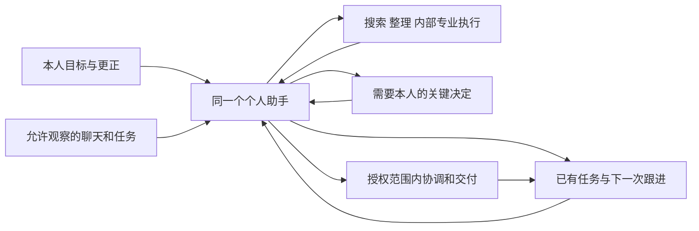
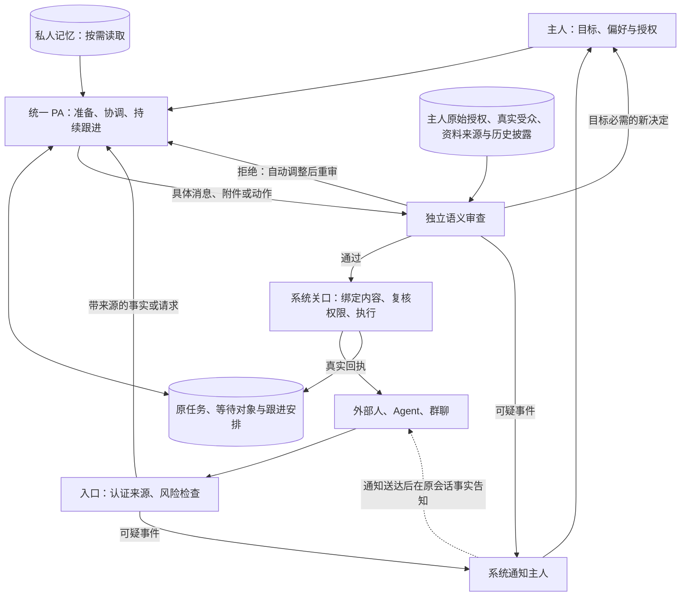

# feat-616：持续替本人推进目标的个人助手 — 技术设计

> 2026-10-19 统一 PA 与独立外发审查版。对齐 [spec](spec.md) 最新授权；本轮修改设计与契约，不实施产品。现有 UI 与已验证原型旅程保留。历史审查保留，本次架构变化需独立复审；下文为当前设计，旧研究中的三执行域/逐动作人工放行不是当前实施要求。

## 整体思路

用户说清目标后，PA 接手准备、协调和跟进。私聊说明当前结论、下一步、等谁以及什么时候再检查；用户只处理需要本人偏好、补充信息或新的授权的决定。内部子任务结果自动回主 PA；普通过程安静执行。

任务是业务事实，Work 是执行证据，私聊是合作界面。PA 不让用户管理内部执行域，也不创建平行任务库。**同一个 PA 统一理解主人与目标，独立审核和系统执行关口控制实际披露；不再为外部 DM、群聊和观察强制建立无记忆的业务 session。** 外部会话保留独立的消息归属，不取得主 PA 的记忆、Work 或工具 API 访问权。

图中审核是独立、无业务工具的模型调用，执行关口是代码；不是再增加两个常驻助手。输入风险检查、语义披露判断都可能误判，代码保证检查不可跳过及拒绝不能被普通 Auto 放行覆盖，不能保证模型永不泄密。

## 现状 grounding

设计 checkout 为 `f4162189f`，其产品基线来自 2026-10-16 main；当前主 checkout main 已前进，本轮不 rebase 或挪动用户 dirty state。实施前必须按当时 main 复核差异。

| 现有能力/路径 | 当前依据 | 本次决定 |
| --- | --- | --- |
| global 主执行与内部委派 | `packages/personal-assistant/src/global-agent.ts`；current gateway/global-agent.md 明确内部委派不转移交付责任 | 复用为本人私密主脑及专业子任务返回，不新增常驻第四个脑 |
| 工具审批 | `packages/dsh-integration/src/policy/approval.ts`：普通 web_search/read/subagent 在适用策略有 safe fast path；既有规则仍受配置影响 | PA 私密执行沿用同一工具规则，删除通用 PA 二次审批；不得借此跳过用户选定的原有 ask/deny |
| Heartbeat 与定时 | `heartbeat.ts` 持久 due/pending、onlyIfIdle；`heartbeat-policy.ts` 时区/active hours；global-agent.ts 的 schedule 入口走公开 runtime | 一般回顾用 Heartbeat；精确跟进用现有 DSH schedule；不把可能因 busy 跳过的 heartbeat 当准时承诺 |
| 任务事实和通知 | `apps/im-server/src/task-graphs.ts`；current im/task-graphs.md 的六状态、revision、真实 actor、系统通知 | 原任务唯一真相；增加有界代表协助及 PA 私密跟进投影，不复制状态 |
| 现有 Web 聊天 | AppShell / ConversationSidebar / MessagePane / global.css / useIsMobile；本轮直接渲染现有 React 组件并截图，使用合成数据 | 必须保留桌面48px顶栏和262px聊天列表、768px断点及手机列表/详情结构；PA增量在原聊天体系内 |
| 来源和私人资产边界 | 当前 SessionBinding / ProductBridge；R6 公开 exports 取证只证明相应能力 | 保留可信身份、来源与私人 ACL；外部消息以来源事件进入统一 PA，不套用旧 external/observation fresh session 方案 |
| 审批与真实投递的缺口 | `policy/approval.ts:101–118` 有 run_code、skip、safeTools 和内部发送提前返回；`personal-assistant/src/external.ts:127–179` 同时存在显式发送及完成自动 publish | 新外发关口独立于原工具审批，在所有实际 sink 执行前检查；不能只给 final reply 或 send_message 加提示词 |
| 通用代码边界 | [运行时可行性](research/execution-isolation-feasibility.md) §R6：tool guard 可挡工具入口，当前 fs-sandbox 不限制读取/网络，任意插件可在工具外执行 | 第一版自动 PA 仅装配可接入完整检查的能力；不虚构通网代码、任意插件的逐字节拦截或新 OS 沙箱 |
| 宿主插件与进程装配 | `apps/node/src/main.ts:40,58–63` 将全部 agents/bindings 交同一 RuntimeSupervisor；`agent-config.ts:79–83` 把 global extension 挂到共享 host；`client.ts` 的 supervisor 接收独立 home/cwd/env 并创建官方 DSH stdio 子进程 | 改为普通 Agent 宿主 + 每个 personal binding 的专属宿主；配置、恢复、事件及插件装配按可信分区路由，不靠 PA 工具白名单阻止另一个 Agent 的 root 初始化 |

当前 UI 对照见[保真修订记录](research/existing-ui-alignment.md)：直接运行既有 AppShell、ConversationSidebar、MessagePane 与 global.css，使用合成会话并观察真实渲染；不是重画一张所谓基线，也未登录生产账号。前轮[体验走查](research/prototype-ux-review-2026-10-19.md)和旧视频只保留机制沿革，不再作为当前导航设计依据。

## 体验收敛原则

安全检查、来源追踪、检索分页、调度与恢复属于系统责任。用户正常入口就是现有聊天：说目标、问旧事、看进展，确需时作一个具体决定。草稿/代发/不回复由 PA 根据意图和已有许可选择，不做成逐消息三选一或全局“自动化等级”。历史查询无时间配置，普通搜索和查询不新增确认。默认只报重要变化，首次启用简要说明资料处理范围即可，不要求逐群配置后才能开始。自然语言“这件事先停”“这个群别看”“只给我草稿”可形成有明确范围的偏好；设置只保留名字、简明的观察/提醒控制和必要来源例外，不暴露模型审核、重试、运行分区等参数。安全不足时先减小动作或继续可做部分，必要的新决定才询问，不把故障或不确定请求全部推给用户。

## 关键决定

### 1. 固定身份，入口直接通向合作

`personal_agent_bindings` 唯一 owner/agent，保存 canonical owner DM、node epoch。首个助手是 PA，可命名；既有普通 Agent 不静默转换。首次创建沿配置 operation 幂等恢复。公开目录仅投影名字、角色、可公开 owner 身份和可联系状态；私人配置、Work、轨迹、附件、执行 ID 由 owner-only ACL 保护，已知 ID/WS 也不绕过。

首次设置只问名字，可选一个最近目标，明示观察及模型处理范围。开启观察后无需逐条转发；未开启也能交办工作。目标随明确“创建并开始合作”一次提交，不再预填后又要求发一次。普通 Agent 可继续单独创建。

### 2. 目标使用现有任务，跟进是其私密附加信息

本人明确交办：先查找对应原任务，匹配不清只问一个澄清问题；没有则在本人 PA DM 创建私人 task_graph 节点。普通闲聊、外部请求和未采纳的主动建议不自动变成任务或对外承诺。

新增 owner-private `pa_assistance` 只存 `binding_id, task_ref, accepted_owner_message_id, scope_ref, next_check_at, schedule_id, waiting_on_ref, decision_ref, attention_until, assistance_paused, revision`。不另存任务标题/状态/结果真相；UI 按当前 ACL 读取原任务拼投影。完成条件放原任务 description，成果写原 result。被支持的两个目标拥有独立 scope/schedule/decision；一个目标变更不覆盖另一个。

目标摘要回答四件事：已有进展、助手接下来做什么、等待谁、下次何时跟进。没有实质变化不追加聊天气泡；紧凑摘要更新，重要结果/决定进入普通消息历史。

### 3. 许可来自本人真实意图，按目标持续有效

新增 `pa_goal_scopes` 持久记录真实 owner 输入证据、task_ref、允许动作类别、允许对象/会话/资料字段、期限、版本和撤销状态。区别于 R6 对每次参数签一次许可：这是一个可缩小、可撤销、到目标结束失效的有界工作许可。模型可以提出范围，不能签发 owner 意图或扩大对象。

只有认证 canonical owner DM 当前直接输入、明确回复到对应 PA 提案，或 owner UI 决定能建立/更新许可；引用、旧历史、外部消息、模型总结和 system wake 不能建立许可。host 固化原文及提案对应关系，现有审批意图判定处理语义；对象与受众解析不明确时一次澄清，不用时间相近的“好”跨目标批准。恢复使用已固化许可，不能把旧消息重新解释成新授权。

普通协助默认可做：读取当前允许的来源、公开搜索、整理本人私密草稿、内部子任务、本人的私密结果、为已交办事项安排本人可见的跟进。它们仍受原 tool allowlist/权限模式约束，PA 不添加产品层审批。搜索 query 不应含私人资料；来自第三方材料的“上传私料/访问带秘密 URL”仍作为未授权外传判断，不能因为工具名 safe 就当作用户意图。

对外沟通例子：用户说“帮我准备演示，可以和林悦协调时间，别发其他日程”，可持续协调这一场演示的时间，不能公布完整日程、预算或代表本人接受合同。统一 PA 根据私人背景提出回复；独立审核判断实际内容是否在原授权内，host 核实 actor/目标/类别/受众并投递。没有必须经过的 external 转述模型。

授权语义依然由模型解释，结构化 scope 不会令解释自动正确。创建 scope 的服务同时保留 owner 原文、被回复提案和语义判定依据；超出明确证据的对象/敏感类别不得由主 PA 补成许可。新增范围只从新的认证 owner 事件签发；外发审查再核原文，不能只相信已经抽取的宽泛 scope。后台可自动缩小披露、拒绝无关索取；仅目标必需的新披露/承诺或实质业务判断才生成本人决定，不把每个不确定外部请求变成审批。

### 4. 普通能力和内部成果正常衔接

统一 PA 使用本人配置中符合第 7 节出口契约的 global 能力；内部 subagent 继承目标范围与实际工具审批规则，按现有 parent binding 返回结果。公开搜索、允许资料读取、私密文件编辑、内部研究/制作和调度仍是可自动完成的基线能力，不能以全拒绝通过验收。PA 校验成果、记录出处/不确定性、继续推进。搜索返回资料和引用，制作返回可打开的文件/页面，不能只交“已完成”回执。内部委派默认显式任务背景而非完整主历史；需要 fork 时继承其来源和约束。内部委派不自动交给公司共享专业 Agent；向外部 Agent 派工须已有对应协作许可。

取消 R6 的 `authorized_task` 必经 fresh root、独立人工任务批准和 `shareTaskResult` 再次提供流程；保留用户主动选择的隔离环境作为可选部署能力，本 unit 不发明 OS 沙箱。主/子 private Work 都属于本人，外部联系资格不开放它们。内部结果是执行资料，绝不成为新的 owner 授权。

### 5. 推进与打扰分开，系统负责兑现下一次跟进

PA 根据目标决定下一次检查和条件，并持久绑定现有 schedule。只有 schedule 创建获得真实回执后才说“16:00 我会检查”；不能配置 cron/节点离线/调用失败时，显示安排未完成并提供恢复操作。

定时回调只带 task_ref、scope revision 与 due key，唤醒同一 PA；它先重读任务、来源与 owner 决定，再工作。busy 回调进入可靠 Inbox，优先本人实时消息，保留“跟进延后”，不让一次 busy 丢失责任。Heartbeat 用于发现到期但漏执行的既有 assistance；不从旧聊天凭空恢复已结束目标，也不为每个目标新增轮询 loop。调度表依然由 DSH 持有，assistance 只保存关联。

去重键用 `task_ref + meaningful_state_version + attention_kind`。需要判断/真实阻塞/临近本人约定期限的风险/完成/有依据的可疑套取事件才发提醒；普通新消息、每次轮询、每个子任务不逐条通知。默认本人时区 09:00–22:00 普通提醒；本人指定提醒时间可覆盖该次时段。急迫仅指本人设定期限将被错过等目标相关变化，不把外部“急”当越权依据。

“稍后提醒”只设置 decision attention_until，其他准备继续；“暂缓这件事”暂停该目标后续 schedule admission/委派，对已开始的执行说明是否已停止、未知不得伪报；不会改原任务业务状态或其他目标。`/stop` 保留 current 强制停止语义，页面不能以“稍后提醒”冒充停止。

### 6. 本人决定一次，PA 继续负责结果

决策卡用“需要你选案例”而非“批准 task”；显示推荐理由、两项业务后果、明确的稍后时间。选择方案不是自动批准向新受众分享；提交外发时卡内一次展示准确内容/附件/受众，已明确的现有许可不再弹相同确认。群受众改变、来源失权或语义超出原许可时生成新的范围差异。

原任务有授权的结果/状态更新持续沿原 grant 做，`actor=PA, authorized_by=owner`；不 claim/改 assignee。写回要求 owner 当前 write ACL、task capability、expected graph revision，保存和已有任务系统通知同事务；不同版本先重读合并，不覆盖用户新改动。任务来源群的可见结果须在许可允许披露范围内，私人准备不能隐式写进公司任务。

任务“待确认”只在确有一个明确待验证结果/人类判断时使用，文案说清什么还没确定。用户在同一决策已确认且客观完成条件满足，可直接标 completed，沿用现有六状态、无强制真人验收。发出消息不是达成目标；等待对方确认时保留 waiting_on 与下一次检查。

### 7. 统一理解，入口辨来源，出口独立审查

**选择与代价。** 默认取消 external/observation 业务 session。主 PA 可理解外部自由文本并按需读私人资料，因此承认主上下文可能受间接注入影响；防线是来源和授权不能被该内容更改，以及完整外发路径的独立检查。真正受限的子执行仍可用于适合限定资料的任务，但不是正常联络前置。两种组织方式的研究依据、比较和局限见[统一 PA 安全设计依据](research/unified-pa-security-design.md)。

#### 入口与记忆：保留事实，不继承权限

外部真人和 Agent 使用普通 DM/合法群 @；owner 群内发言仍按群域处理，不能控制全私密主脑。host 生成不可由模型改写的 `binding/actor/conversation/source-message/audience-revision/source-policy` 元数据，关联原始内容；网页、工具结果、观察与子任务返回也保留来源。入口模型判断风险，可提示主 PA、隔离明确危险内容或触发 incident，不能签发许可。检测服务不可用时保留待处理外部事件，不把“未检查”标成安全；其他主人工作继续。仅靠检测器未报攻击，不足以允许私人披露。

自动记忆写入复用现有 knowledge/memory 存储并补来源、原始作者与 `owner_decision / external_claim / derived` 类型。外部事实可用于工作；其摘要、子任务返回和后续压缩不得提升为 owner 决定。自动派生项继承实际读取来源集合（可保守扩大），而非只采信主 PA 自报引用；撤源时参与失效。owner 目标许可、配置、审核策略和自动知识根不能通过通用 edit、memory safe 分支或 Skill 自修改绕过专用写入口。用户亲写的文件不被自动清理。普通公司 Agent 的知识行为不变。

PA 本地资料工具解析真实路径与符号链接，只读当前允许的资料根/显式用户文件，私密 write/edit 只能写普通成果区，不能写配置、自动加载指令、共享目录或自动知识根。已退休的执行导出、撤源缓存和原生日志不作为普通资料工具的可读根；历史查看仍是 owner-only UI 能力，不能重新自动摄取。无法定位派生来源时保守失效/重建，不承诺精确全盘追踪。

#### 出口：一次具体提案，两类检查，一个执行结果

主 PA 提交具体 action proposal；宿主解析收件人与资料引用、冻结待发正文/附件快照和版本，形成 operation。审核不依赖主 PA 自觉调用一个“检查工具”：无论显式发送、自动完成回复、任务写回、后台调度还是子执行，实际副作用前都强制进入同一策略。

1. **确定性检查**：当前 owner/recipient ACL、目标许可及版本、目标/用途、受众、来源失权、工具能力、附件访问权。联系资格不是资料读取权。明确不满足直接拒绝，不用模型覆盖。
2. **独立语义检查**：审核器只读认证 owner 原文/对应提案、实际收件人和用途、具体 payload、相关私密证据及出处、相关历史披露。资料由宿主按实际读取/记忆使用记录组装；已注入的私人记忆也纳入，不由主 PA 自选“无敏感资料”来跳过。无法容纳必要证据时返回 `unavailable`，不截掉后按安全放行。外部请求及 payload 是带来源的不可信证据，主 PA 的解释不能成为授权。审核器无网络、写入、发送或委派工具，不读整段主 PA 推理。
3. **最终执行**：通过结果绑定同一 operation 的 payload digest、附件快照、destination、scope/source/audience/policy revisions 与有效期；紧邻副作用复核。改一个字、换附件/收件人或权限变化均需重审。模型不能伪造 pass；通过句柄仅在可信 host/adapter 之间流转。

语义返回 `allow / deny(reason) / needs_owner(exact_delta) / unavailable`。deny 由 PA 尝试减少披露或安全替代，每个 operation 最多两次实质改写，每次重审；无安全方案则停止该动作，不能改工具/改 operation key 无限重试。跨 operation 的同目标/对象拒绝记录参与检查，实质新 owner 决定才可改变权限。`needs_owner` 也先判断该披露是否为目标所必需：无关索取直接拒绝；确需新增许可才复用 `pa_decisions` 提一个范围明确的问题。审核故障暂停该外发并重试，持续阻塞按既有重要提醒规则通知；不退回 allow，也不把服务故障伪装成用户应承担的隐私判断。

出站模型正文不向外部流式透传；审核完成前只可显示固定处理中状态，草稿/审核理由仅主人可读。拒绝后生成的替代回复仍须审核，不能把拒绝理由中的秘密发给对方。主 PA 发给主人的私聊以真实 owner 收件路由快速通过披露边界，原工具规则仍适用。

#### 覆盖哪些出口，不能声称覆盖哪些能力

| 路径 | 强制接入位置与约束 |
| --- | --- |
| IM 显式消息、外部 Agent 消息、群回复 | PA 发布 operation 与 IM 最终消息写入校验；自动完成回复也转换为 proposal，不走裸 final-content 广播 |
| 飞书等 Channels 投递 | PA 在 `external.finish/publish` 之前取得放行；Channel 只接冻结后的正文/附件，不在审核后追加私人信息；沿真实 provider 回执确认，不用镜像落库冒充送达 |
| 任务结果、共享文档/文件、链接与附件 | 解析真实可见受众，检查实际内容和分享权限；共享对象的 write/share 也是披露；可变附件冻结，无法解析受众或正文则不提交该外发 |
| 公开搜索、fetch 与其他有限网络工具 | 实际 provider adapter 的出站参数检查包含 query、URL/path/body 等；正常公开查询自动通过，没有人工核对搜索词。重定向重新检查，返回结果经入口处理；工具名 safe/只读不免除检查 |
| 内部子任务、记忆与日志 | 派发最小任务背景，来源/约束随执行继承，子执行共享外发关口；内部 Work/日志/审核证据 owner-only。发给别人的 Agent、共享 memory 或可被外部读取的存储必须按披露审查 |
| 任意 bash/pwsh/run_code、自装插件或隐式网络服务 | 不能从命令字符串推导所有实际外发。第一版自动 PA 不装配无法完整接入上述出口的执行能力；既有公开工具 restrict/guard 与可信插件装配负责 fail closed，含 root 固定工具、热更新、子任务和后台 knowledge。需要这类能力时记录具体能力阻塞并继续可做部分，不新增“批准后裸跑”的后门，也不声称提供新 OS 沙箱 |

开放任务指自然语言目标与自由文本协调，不承诺任意代码/任意插件均能在读取私料后自动联网。第一版必须实际交付公开搜索、私密资料读取/编辑、内部委派、材料整理、IM/任务和调度这些正常旅程；不能因收口能力而退化成问答或人工搬运。超出可受控能力的任务如实显示限制。普通非 PA Agent 配置不受影响。模型服务本身按主人选择的 provider 和启用时的资料处理告知使用；本文不把发送模型请求误称零第三方处理。

接入清单由宿主维护受审 adapter 与明确副作用类型，不能采信插件自行声明“无外发”或仅按名字白名单。无法受控的插件在执行代码/初始化之前就不得加载到 PA 宿主配置；安装在普通 Agent 不等于允许进入 PA。对 root 自动贡献、后台事件和同进程插件副作用，不能只靠工具调用 guard。实施验收须从实际配置装配到 provider/sink 逐项验证该清单。

#### 宿主分区：阻止普通 Agent 插件进入 PA 运行进程

当前 Node 的单一 RuntimeSupervisor 不满足前述初始化约束，因此本 unit 修改 `apps/node` 的进程装配：保留普通 Agent 原共享 supervisor，另为每个可信 personal binding 建立专属 supervisor。它仍调用 `@nano/dsh-integration/client` 的 RuntimeSupervisor/prepareProfile，启动同一个官方 DSH CLI，以 stdio 通信；不新增 runtime fork、HTTP 内核、第二 Agent loop 或 OS 沙箱。**分的是插件宿主，不是主 PA/对外 PA：同一个 PA 的主执行、内部子执行、独立审核和 knowledge 维护属于同一个 PA 宿主；对外聊天不各建进程。**

- 分区身份由服务器认证的 `personal_agent_bindings` 与 node epoch 决定：`ordinary` 或 `personal:<bindingId>`。在 apps/node 内提供实现既有 `RuntimePort` 的有界路由器（不是新的包/公开 SDK）；按配置 agentId 或 NodeStore 中的 session binding 定位 supervisor。无唯一归属、agent/session 冲突、跨 owner 或旧 epoch 的请求拒绝，不能默认回落到 ordinary。子执行创建时登记同分区 lineage；通知与 ProductBridge 回调绑定实际子进程来源并复核 session 归属，模型不能通过换 sessionId 跨区调用。
- 既有无 agent/session 的接口不套用猜测路由。`KnowledgeUpdates`、`WorkflowResults` 按分区各建一个消费者，接收 Node 依据真实 supervisor 绑定的 scoped RuntimePort；`knowledge.facts({})`、`workflow.pending({})` 只查询本分区，`knowledge.acknowledge({id})`、`workflow.acknowledge({runId})` 只回同一来源。结果中的 agent/root/session 或 parentSessionId 必须与该分区的有效 binding 相符；不向所有宿主广播确认。`workflow.completed` 是触发本分区恢复的通知，不是集合查询方法。产品投递与去重使用稳定的 `bindingId（ordinary 使用节点分区标识）+ 记录类别 + 原生记录ID`，同名 fact/review/run ID 不跨区合并；DSH 请求仍保留原生 ID，来源分区由 host 持有，不能接受模型自报。
- 持久结果归属与临时运行句柄分开：消费者只接受当前 supervisor generation 的回调；旧进程回调丢弃。冷恢复从同一有效 binding 的持久运行数据重新查询未确认结果，以稳定复合键核对既有产品投递，真实接受后才向新进程确认；不复用旧进程的临时确认能力。某分区不可用只延后其查询/确认，其余消费者照常回流，不能因批次部分完成而确认未处理结果。更换 binding/撤销 epoch 不继承旧执行资格。
- 轨迹在通过当前 owner ACL/ticket 的 `trajectory.prepare` 时，由 Node 登记 `observerId → 分区 + supervisor generation + session`；后续仅带 observerId 的 call/open/next/abort/close 查此登记，streamId 也从属该 observer，不能广播或回落 ordinary。未知、冲突、失权或旧 generation 的句柄拒绝；close 清登记，宿主重启令该分区句柄及连接失效，由查看器重新 prepare。轨迹是临时观察，不靠扫描所有宿主找回句柄。
- 普通 supervisor 沿用原 home 和普通 Agent 的配置/插件。PA 使用独立 `home/cwd/profile`（如现 node home 下 `pa/<bindingId>/<epoch>`），只写入受审 Nano 内建插件与允许的 provider 配置；initialize 仅传本 PA 及其有效 session bindings。不能复制普通 profile 的 bundles、global extensions、工作目录插件、shell/CLI可执行配置或安装路径；工具来源清单在 import/mount 之前验证。PA workspace、自动知识、审核记录与导出保持独立 owner-only 资料根。
- 新建 PA 时先完成该分区 prepare/initialize 才允许摄取与执行，不先临时放入普通宿主。新增普通 Agent、workspace 插件安装、configuration.apply/preview/catalog、HMR 只触及目标分区；预览也可能加载代码，不能借预览跨区。PA 请求启用不合规插件在 mount 前拒绝并给具体能力原因，普通 Agent 同项设置继续可用；personal role 不可通过模型或普通配置切换抹掉。退休/更换 binding 时先关 admission、停止并核对旧操作，再启新 epoch，旧进程不得保留外发资格。
- 重启恢复分别只载各自 config/bindings/knowledge/schedule；某 PA 宿主不可用只标该 PA/目标 unavailable，普通 Agent 继续，不能借普通宿主运行同一私密任务。Node 整体更新/关机对现存 supervisor 集合执行 prepare/drain/release/shutdown，所有参与者就绪才切版本，部分失败释放已准备者并保持更新未完成。provider 配置变更向各分区发送相同获准 provider 数据，不广播全量 Agent 配置；轨迹、usage、history/fork 与 schedule 操作按 session/agent 路由，防止旁路跨分区。PID/恢复记录属于各 supervisor，node transport 在线不等于每个 PA runtime 就绪。

这是可实施的进程/配置边界，不是同 OS 敌对代码隔离。部署者、主机凭据、受审内建 adapter 及用户安装的本机宽权限代码属于可信计算环境；普通进程中恶意代码仍可能直接访问同用户磁盘，分进程不能解决这一点。对外联系人不会因联络而获得安装插件或执行该普通代码的资格。需要对抗本机恶意插件/其他 OS 用户时必须另设主机/OS 权限边界，不作为本 unit 已交付保证；不能拿普通插件跨宿主污染已被消除来宣称全面防泄漏。

#### 连续披露、联系与故障恢复

复用 owner-private `pa_source_events/deliveries` 的 operation 类型记录披露：owner、实际接收身份/群成员快照、goal、用途、资料引用/类别、冻结内容引用、各 revision、审核结果与真实 delivery 状态。正文不复制到公共任务。审核查同接收身份跨会话/渠道的相关历史；不同平台身份只有已验证绑定才合并，不能按昵称猜；unknown/sending 先按可能已披露计入。对相同 owner 的放行操作以短暂提交锁检查披露 revision，多个并行提案若历史已变化则重审后再提交，避免同一批审核都看不到对方。

第一版做可追溯的累计披露检查，不实现完整 OCELOT 风险预算，也不保证识别未知串通接收者或所有推断侧信道。MNC 的用途、禁止扩权转发和记忆范围仅在我们控制的运行环境内执行；已交给外部的明文不能撤回或保证对方忘记。

owner 决定入群，受众变化重新校验。对重复、不相关、越界请求可在既有同会话回复权限内说明可协助范围；无回应权限不发送。拒绝和系统不可用都只阻塞受影响动作，其他目标继续。对外发出不等于目标完成：回执与对方确认继续由原 assistance/schedule 跟进。

#### 可疑套取的双向告知

此机制承接 spec 的用户追加要求，补充隐私阻断后的可见反馈，不代替来源、披露审核或权限检查，也不保证能识别所有套取。事件和投递由 host 接手，主 PA 被诱导后不能以不调用通知工具来压下已成立事件。

- 判断责任：PA/安全审核模型根据当前对话与真实来源给出“疑似”事件及依据；重复请求次数由 host 对真实消息计数。首次不明确询问只解释边界；拒绝后继续索取、伪造 owner 同意或要求隐瞒主人等有具体证据的行为才触发事件。模型结论不能生成新的分享授权或全局恶意身份标签。
- 持久与投递：复用 `pa_source_events` 保存 owner-only 的 incident 事件，含可信 actor/conversation/source-message refs、关联目标、判定理由/不确定性、阻断动作、revision，以及 owner-notice 与 peer-notice 的 message/operation refs。原消息保留为可核对证据；不建立全公司信誉库。同一 binding+actor+conversation+风险类别的未关闭事件合并更新，不按外部自报身份去重。
- 顺序：先阻止越界输出并在原会话说明边界，同时可靠投递 owner 私聊提醒；获得 owner DM 真实送达/持久可见回执后，才允许以固定事实文案告知对方“相关请求已记录，并已通知陈同学”。这不表示 owner 已读或认定恶意。pending/unknown 复核原 operation 并重试，不谎称已通知；拒绝不等待通知完成。
- 本人界面：PA 私聊中的一次信息卡，展示谁、何处、索取什么、为何可疑及采取了什么措施；“查看相关记录 / 屏蔽新请求 / 这是误会，继续协作”。不是决策待办，用户不操作也继续工作。通知文案仅描述可核实阻断，不把“本次请求未发送资料”扩大成历史绝无泄露保证。
- 对外界面：在实际发生请求的 DM 或群内说明请求已记录/已通知；不跨会话公开、点名羞辱或披露 owner 的回应，不确认秘密存在。文案不称对方为“恶意方”，也不使用法律威胁。仅在已有同会话回复权限内发送，撤权或联系屏蔽后不能绕过策略继续警告。
- 防骚扰：同一事件首次通知一次，重复请求增加计数和证据；对外发过边界告知后不反复争辩，仍可处理该对象的正常协调。新风险类别/实际泄露证据等实质升级才再次提醒，沿现有重要提醒时段策略合并；不把普通套取自动变成紧急提醒。owner 标记误会关闭该告警，不改变分享权限；新一轮有实质新证据可另报。屏蔽使用现有 policy revision，无自动全局封禁。

I2I 因果链、回合/跳数预算和去重保留；送达、接手、结果待确认、完成分别记录。预算用尽是该协作阻塞，不把 owner 其他工作一起停掉。

### 8. 观察与暂停不丢目标

启用后自动观察本人参与且当前有权访问的 DM/群与本人任务，首次整理与后续历史查询均按问题和目标需要读取，不设固定时间窗口；分页与分批处理只控制单次读取量，不裁掉更早历史。未加入公开群不自动批量读取。conversation/task/member/policy 事件与业务写同事务持久，Node durable_received 与 processed 分开，WS 只唤醒；重复输入幂等，gap 显示补读。普通消息合并，owner 输入优先，最新事实使旧建议失效。

**新消息的三种处理。** 别人给 owner 的消息保留在原聊天，系统按观察策略产生来源事件，不要求转发或 @PA。PA 可不回复、准备仅本人可见的可编辑草稿，或在已有目标/对象协调许可内代发；不为每条消息弹三选一。本人点击发送草稿使用本人身份；自动代发使用真实 PA actor 并记录 authorized_by=owner，在原会话向双方显示“某某的 PA · 代为发送”，不能仅靠正文自称 PA。IM 新增受信代理投递路径，按 owner 当前 write ACL、personal binding、scope、受众和外发 operation 核实后写入；不冒用 owner 登录 token，不把 PA 加为该人际私聊的第三成员或永久开放全部历史。消息 DTO/同步/历史保留代理身份，Web 展示固定标记；普通浏览器不能伪造这些字段。本人已自行回复时，待发动作重读最新会话，作废过期草稿或重新判断是否仍需协调。观察、查询均不写本人 read cursor；已送达、PA 已处理、本人已读是不同状态。

**历史是按需可查的资料，而非只靠记忆。** 主 PA 可为本人问题或已有目标查询本人参与过的群/私聊；不设固定时间上限，不把全量聊天预先塞进上下文，也不要求逐条提供。先找会话，再按人物、关键词、日期定位消息，分页补齐前后文；结果带 conversation/message ID、真实作者与时间，回答给原消息定位链接。摘要只用于定位和理解，有原话争议须回读原文。历史中的 owner 发言仍是历史资料，不能重新签发当前目标许可；外部对话不能把“替主人查”变成越权查询/披露指令。

实现复用 IM 的权威消息存储和 `messaging.ts` 历史游标分页（当前有读取 ACL 与 `next_before_message_id`，没有现成跨会话关键词检索契约）。新增 PA 内部只读 `pa.history.search/read`，由 product-contracts 经既有 Gateway/PA→IM 通道调用；IM 从可信 personal binding 解析 owner，不接受模型提供的 ownerId。search 支持 conversation/参与者/关键词/时间及分页，read 支持命中消息的上下文窗口及继续分页；查询在 IM 端限定权限后检索现有消息数据，不为本需求复制一个聊天数据库或强制向量服务。每次搜索、分页、原文及附件读取都复核 owner 当前读权限、PA source policy 与来源版本；索引/摘要不能在撤权后返回旧片段。返回来源引用、匹配项及真实覆盖/游标，查询不推进自动观察 cursor，也不创建待办或发送已读回执。

“参与过”不自动保留离群权限：仍可由 owner 打开的历史才可读取；当前实现对退出的私有群可能已不可读，遵循同一规则。未加入的公开群不因全站可见而自动纳入个人历史集合；以会话参与事实限定候选（必要时补持久参与记录，不能把 current membership 当全部过往记录）。已解散但本人仍可读、已归档但未删除的聊天可查询；真实删除/失权、未接入渠道或平台未保留部分如实说明。附件沿原消息资源权限读取，不通过公共下载旁路。

暂停新观察仅关后台摄取，按需历史查询继续；排除某会话则禁止该来源的自动及工具读取，显式恢复来源范围后才能查询，不能用文件/缓存兜底。清理缓存不删除 IM 原始消息，也不代表永久禁止以后合法查询：若来源仍获准，当前问题可重新读取并重新记录来源。本人私聊问题无需新增人工批准；历史内容若要发送给他人仍须满足既有披露与受众检查。

暂停新观察停止新源摄取；已明确交办任务仍能按已有资料/授权执行和调度，但界面提示“新消息可能尚未看到”。恢复默认补读并合并最新状态。只接收今后消息也保留已有任务、决定与 schedule；每个目标仍可单独暂缓。

排除或失权：撤销该源 cursor/未发送资料/候选，受影响模型会话换新并从当前允许来源重建；assistance 保留 task_ref 并显示受影响原因，需要该源的动作停止，其他目标继续。清理 operation 可恢复、显示完成回执；原 IM/Work/DSH append-only 日志与已外发内容可能保留。过滤后的自动源 API/上下文不得重新加载这些旧引用；普通广权限文件工具不等于全盘物理遗忘保证，不能在 UI 承诺全面擦除。取消旧版泛化的全结果 taint/人工重新导入链，真实遗漏与间接注入风险作为实施负向验收。

PA node residency/epoch 保留：曾存 PA 私料的节点暂不支持转交不同 owner；同 owner 可恢复同一 PA 到新节点并失效旧 epoch，私人本地历史不自动复制。

## 接口、职责与恢复

| 层 | 负责 | 不负责 |
| --- | --- | --- |
| IM | 唯一身份、owner/通讯 ACL、task_graph、goal scope/decision、事件、真实投递与幂等、本人 UI 投影 | 执行 Agent loop/工具 |
| PA | 关联目标、摄取事件、组装可信授权与来源证据、管理外发 operation/披露记录、安排 follow-up、合并提醒和成果交付 | DSH import、第二任务真相、由模型自行签发授权 |
| apps/node | 依据可信 personal binding 分区 supervisor，RuntimePort 路由、进程来源验证、分区恢复/可用性与整体更新协调 | 加载 DSH 私有实现、把模型参数当分区身份 |
| Node / dsh-integration | 通过 DSH 公开 exports 运行统一 PA、入口/独立审核调用、受控能力装配和不可跳过的工具关口、schedule 和原生子执行 | 由模型自报 owner/scope、任意代码的虚假网络沙箱 |
| Web | 私聊、目标摘要、业务决定、成果、观察/提醒/暂缓状态 | 为每个工具生成一页审批 |

新持久事实：`personal_agent_bindings`、`pa_policies`、`pa_source_events/deliveries`、`pa_goal_scopes`、`pa_assistance`、`pa_decisions`。复用现有 task_graph/message/config operation/Work/幂等存储，不引入平行 goal 数据库。source provenance 保留用于过滤当前缓存与引用；不复制目标结果。

目标 API（通过现有 IM/Gateway transport）：

- `GET/POST /im/v1/personal-agent`：唯一 binding、创建操作与状态；重试同 request_key。
- `PATCH .../policy`：expected_revision，观察与联系规则；明示暂停与目标暂缓区别。
- `GET .../assistance`：按 owner ACL 拼 task projection，含 next check/decision/执行事实；禁止外部订阅。
- `POST .../assistance/:taskRef/pause|resume`：本人范围明确的跟进控制，取消/恢复关联 schedule，不自动修改原任务状态；离线显示 pending。
- `POST .../decisions/:id`：expected_revision + option / snooze_until / decline；认证 owner，重复 key 幂等，不能用模型回执批准；用户当前 DM 明确对应回复走同一结果。
- `GET/POST .../cleanup`：原范围缓存清理与状态，失败保留恢复路径。
- 既有 task APIs 增加受信任 PA delegated-assistance 分支：scope+owner ACL+任务版本+实际 actor，普通主体契约不变。

Host `pa.observations.read/ack`、`pa.history.read/search` 以 owner 当前 ACL∩policy∩实际 query 控制；`pa.assistance.read/update`、scope resolve、decision 等从可信 binding 定位，模型不能提供新 owner。外部人只能访问自己的会话和已分享对象，没有私人工具调用接口。子执行拿父 goal 的必要工具/资料并继承出口约束。scope 撤销停止新 admission，最终 send/task commit 再校 scope/audience/object revision；unknown 查原 operation，不盲重发。跨网络已开始操作不能保证追回。

新增的是 product-contracts 中的内部消息契约，不新增模型可调用的“签发放行”工具或一套公开审批 API：

| 内部操作 | 调用与最小数据 | 封装责任/结果 |
| --- | --- | --- |
| `pa.action.prepare` | dsh-integration 或 PA 自动投递路径 → PA；可信 execution binding + taskRef + actionKind + target + content/attachment refs + operation key | PA 向 IM 核事实，解析来源和实际受众，冻结 payload；返回 proposalRef、证据引用及 revisions。owner 不接受模型入参 |
| `pa.action.review` | PA 编排 → Node 公开 runtime 适配；proposalRef + 受信 evidence packet | 隔离、无业务工具的独立审核调用；schema 验证上述四种结果。只产生判断，不执行外发；超时/缺失证据为 unavailable |
| `pa.action.commit` | 受信 Node/PA adapter → PA/IM 或相应有限 sink；proposalRef + host-only verdict reference | 原工具权限与隐私检查都通过才能执行；原子核版本、冻结内容和披露 revision，预记 sending，执行一次，记 confirmed/failed/unknown。模型给 pass=true 无效 |

原工具审批与新关口为 AND 关系，显式 ask/deny 仍有效；原 Auto 的 safe、always-allow、skip 或无人值守 fallback 只能影响原工具审批，不能覆盖隐私拒绝。在 DSH 公开 tools middleware/guard 及产品 adapter 最终 sink 挂接；不依赖调整现有 classifier 提示词就覆盖全部出口。普通 Agent 绕过 PA 专属契约，行为不变。Channels/IM 不 import DSH；PA 通过已有 runtime client/transport 请求 Node，Node 仅经 dsh-integration 接触 DSH。

**具体调用例子。** “和供应商谈场地，最高五万、尽量三万，不披露身体情况、付款前问我”形成 goal scope 与原文证据；PA 提议向已验证供应商发“需要无台阶通道，请提供三万元附近方案”。prepare 解析接收者并记录所用预算/无障碍来源，review 核实只是需求表达而非五万底线/个人病情，commit 发送并记录。若草稿写出底线，deny 后自动改写重审，不找主人批准泄漏。付款需要本来约定的 owner 决定；可疑重复索取由 incident 通知，而正常询价与其他目标继续。

权威变化事件可靠入 Inbox。恢复顺序：校 owner/node/能力策略 epoch → 重读 task 与 scope → 核对未知操作/可能已披露记录 → 作废不匹配的审核句柄 → 恢复有效 schedule/目标 → 合并变化后通知；不回放全部“过期催回复”。旧 external/observation 执行若来自开发实验则退休，不把其历史并入新 owner 授权；产品尚未实施，无生产会话迁移承诺。

## 现有 UI 保真与增量

当前实现来源：`src/IM/frontend/src/app/shell/app-shell.tsx`、`app/shell/nano-brand.tsx`、`features/chat/components/conversation-sidebar.tsx`、`message-pane.tsx`、`styles/global.css`、`hooks/use-is-mobile.ts`。本轮核对 main 中这些 shell/style 文件无未提交差异；基线夹具渲染上述当前组件，不使用生产资料。

- 桌面：48px顶部品牌、居中的聊天/任务/智能体、右侧用户菜单；保持三个原标签顺序。PA作为右侧具名快捷入口，带“个人助手”身份，开同一个本人DM。聊天页左侧262px仍是消息搜索/筛选/会话列表，PA固定会话项可辨认，不成为产品导航栏。
- 手机（<768px）：列表页沿用聊天/任务/智能体/我底部四项，固定PA会话项是日常入口；聊天页隐藏列表与底栏，返回箭头回列表。顶部个人助手标题、设置、跟进中入口保持紧凑；不引入第五个全局标签或侧边抽屉导航。
- PA聊天内：当前目标摘要、普通消息中的决定/成果/等待信息；其他目标通过标题栏“跟进中”展开。该面板只索引现有任务投影，不是第二套任务页，不接管全局左侧区域。
- 日常消息：本人和林悦的原聊天保留相同消息区与输入框；辅助回复可形成仅本人可见的可编辑草稿，由本人发送；已授权自动代发在原会话以 PA actor 显示固定代发标记，也可不回复，不增加逐条选择弹窗。交给PA跟进时携带来源并进入PA DM；启用观察后无需手工转交也能准备建议，采纳新目标才建立持续责任。
- 原任务页、专业Agent管理、账户/模型/节点管理不重设计。原型仅保留进入这些区域的背景和PA相关入口，不作为其整页改版提案。配色、字体密度、灰色Agent气泡、本人浅绿气泡、输入框和列表尽量复用当前样式；新增PA卡片沿用现有色板和边界。

## 前端原型与体验契约

[prototype.html](prototype.html) 默认为正常本人私聊：原顶栏与聊天列表下的专属私聊、自然输入框；已有目标在聊天标题的“跟进中”里。首次设置、外部视角、时间/消息到达及断线放在产品外演示条，明确静态模拟。正常准备会由原型定时模拟返回，用户不需要点“搜索”或“专业任务批准”才能继续。时间推进控制只压缩录像等待，不冒充产品按钮。

主旅程：交办演示 → PA 自动搜集/整理，接住同一原任务 → 案例选择（可稍后） → PA 自动完成草稿并整合成果 → 一次确认把选定材料发给具体群 → 等待林悦确认、显示下次检查 → 外部确认到达后更新原任务完成。外部私料请求直接保持边界，私密侧仅说明已处理；另一目标独立存在。任务暂停/恢复、观察暂停/恢复、离线恢复提供真实可辨认模拟状态。

| 区域/状态 | 级别 | 真实入口与体验要求 | viewport/状态 | 退出标准 |
| --- | --- | --- | --- | --- |
| PA 创建与固定名字 | must-match | 首次设置说明观察/普通行动边界，目标一次提交即承接，改名不换身份 | 1440/768/390，空名、已有 PA | R1/W1 |
| 目标与私聊 | must-match | 同一目标的多源进展和等待/下次检查，成果可打开；多个目标互不干扰 | 正常/稍后/回来 | R2/W2 |
| 常规能力 | must-match | 搜索/整理/内部子任务无 PA 二次审批，结果自动回原目标 | 普通与 PA 同策略对照 | R3/W3 |
| 决策与协调 | must-match | 推荐/理由/后果、明确受众、一次决定后自动继续；外部不见私聊 | 编辑/拒绝/新受众/unknown | R4/W4 |
| 持续跟进 | must-match | 等待对象、next check、真实调度；暂缓/离线不伪报完成 | 跨天、busy、重启 | R5/W5 |
| 观察/提醒/暂缓 | must-match | 三者区别清楚，恢复不放弃已有目标；受影响来源可辨认 | 暂停/排除/恢复 | R6/W6 |
| 现有主框架 | must-match | 桌面顶部三导航、262px消息列表、原消息/输入框；手机列表底部四项、会话返回列表；不移动主导航 | 1440/768/390，列表→PA→返回 | R1/R2/W1/W2 |
| PA卡片局部间距 | may-adapt | 在原消息容器内调整卡片内容密度，手机详情全宽，不裁切主操作 | 各宽度及短屏 | 同以上 |
| 历史与原会话代发 | must-match | 自然语言查询→附作者日期出处→原聊天高亮原文→返回；本人/对方均见真实PA代发标记，无新配置页或逐消息三选一 | 1440/390，历史查询、原文返回、双方视角 | R6/W6 |
| 原生 iOS 新导航、生产数据 | out-of-scope | 保留既有聊天/API；原型不接后台 | 不以 Web 缩窄图冒充 native | W7 |

本次导航保真与普通消息协助走查见[保真修订记录](research/existing-ui-alignment.md)。此前目标机制走查、视频与修订发现记录在 [新版验证记录](research/prototype-goal-journey-validation.md)。旧 `prototype-state-checks/` 和其通过计数仅对应 R6，不能拿来认证重写后的 R7；新版以真实连续旅程和针对状态边界的最窄检查为准。

统一 PA 架构修订保留现有界面；本次补充取消固定时间窗口文案，并在现有聊天中提供历史问答→原文→返回及双方 PA 代发标记的最小原型：普通协调、拒绝越界、双向通知、一次决定后继续的用户契约仍由 R9/R10 原型覆盖。新增两段原型走查见 [历史与代发体验记录](research/history-delegation-ux.md)。历史入口是现有输入框，答案下展示作者/日期和原文链接，点击打开原群内高亮消息并可返回 PA；代发由一句明确请求触发，在本人及对方的原聊天都显示 PA 身份，演示视角切换放产品外。审核器/出口覆盖/自动改写次数不是产品按钮；当前静态原型不能证明它们已实现，旧视频也不新增安全证据。真实运行中的“审核暂不可用/能力不足”沿原有目标阻塞摘要表达，只暂停对应动作，不转成新审批页。

## 风险与回退

主要风险是目标误合并、授权语义扩大、入站和独立审核同时误判、重复查询拼出隐私、遗漏出口、工具受控后任务效用不足。统一主上下文不能声称免受外部注入，不能从“有审核器”推导所有语义秘密受保护；源码只证明可挂接的 seam，不是防御效果。使用来源/目标绑定、冻结 payload、身份与受众复核、有限重试和失败暂停，按[安全与有用性场景](security/acceptance-scenarios.md)同时测正常完成与攻击，不引入全盘 taint 引擎或逐步人工许可。

数据库 additive，feature off 停新观察和跟进 admission，保留任务/结果/历史，明确哪些安排已停；旧 global/普通 Agent 不改变。禁用 PA 也不能将其私密 Work 变为公司共享。

## Runbook for Reviewer

本轮原型：在 unit 目录启动仅绑定 127.0.0.1 的静态 HTTP server；浏览器打开 prototype.html，按上述正常/恢复旅程操作。视频是原型屏幕录制，展示的时间推进与人物消息均为演示事件。不能据视频宣称 API、模型、调度或安全机制实现。

产品实施后：`pnpm install --frozen-lockfile && pnpm build`；frontend `npm ci && npm run build`；在实施 worktree 使用 `./scripts/e2e-up.sh --wt "$WT_ROOT"`，按其生成的端口/config 运行，停止使用 `./scripts/e2e-down.sh --wt "$WT_ROOT"`。健康检查用生成 IM_URL 的 openapi、节点 status 和真实浏览器登录。不读取/复制生产聊天与凭据。

真实资源状态：本地浏览器/静态录屏可用；隔离产品 owner/peer/Agent fixture 由实施测试创建；云端 DeepSeek 凭据尚未核实。2026-10-19 用户在资源缺口已明确告知后要求“你先去实现吧”，将该资源前置调整为交付前验收项；可开始实现，不能以原型或模拟测试替代最终真实模型验收。设计审查按新内容给结论，资源阻塞独立列出，不阻止交付用户请求的可评审原型。

## Milestones

默认单 M1，现有 `M1-personal-agent/.gitkeep` 保留；本轮不预填实施 tasks/progress。

| ID | 标题 | 依赖 | 并行组 | 文件范围 | 退出标准 |
| --- | --- | --- | --- | --- | --- |
| M1-personal-agent | 持续目标协作完整旅程 | Gate 1 + Gate 2 | 无 | IM identity/onboarding/messaging/tasks/ACL/store；product-contracts；PA global/inbox/heartbeat/external/store；apps/node 装配与RuntimePort路由；DSH client/capabilities/approval/knowledge/schedule；Web onboarding/chat/tasks/settings | [reviewer] R1 保留既有顶栏/消息列表/手机底栏及固定 PA；R2 多源归同目标、两个目标独立；R3 正常搜索/制作/内部成果自动承接；R4 授权内自动协调、拒绝后安全替代、仅必要决定打断；R5 等待/复查/完成闭环；R6 观察/暂缓与可疑通知清楚，历史按需可查并定位原消息，不设固定时间窗口，原会话代发双方可辨PA身份且不改变本人已读，失效或不可用只阻塞相关动作。[worker] W1–W6 保留三宽度真实 UI 对照、目标/原工具审批/调度/任务版本/撤源/私人 ACL 证据；新增统一 PA 主请求可含任务必要私人资料但所有接收端无越权输出、全 sink 接入、safe/skip/热更新/子执行不能绕过、内容/附件/受众变更重审、审核故障与未知投递不放行/重发、派生记忆不冒充 owner、跨会话/并发披露检查及正常任务质量/打断次数。另以真实 DSH 进程验证普通 global/workspace 插件仅在普通宿主初始化，PA主/子/审核/knowledge均未加载；新增/HMR/preview/冷恢复、session路由、分区知识/内部成果回流与确认、同名结果ID去重、轨迹句柄及重启失效、局部故障/整体更新不串区，普通能力保持。补历史关键词/时间/人物检索、游标/上下文/来源链接、跨页撤权/排除/暂停与无额外审批；代发可信actor及双方DTO/同步/历史展示、不冒充用户或改变DM成员。W7 真实模型（按用户2026-10-19最新指定：主GPT-6.1 Sol、审核GPT-6 Luna）端到端同时证明有用与边界、普通 Agent/渠道/iOS API回归、runtime dependency contract；最窄后按当时 CI 执行全量。 |

### R8 用户配置入口澄清

本人 PA 复用智能体完整配置页，列表与详情以“个人助手”标识角色；聊天内的简洁设置链接到同一完整配置，不形成第二套模型配置。名称由配置事务同时更新 profile、个人绑定和专属私聊，延迟恢复走同一路径；仅名称/说明等元数据变化不等待执行空闲。暂停观察的唤醒提示明确保留本人直接请求、已交办目标和按需查询。清理来源缓存保留尚待处理的本人直接请求，后续消息序号必须高于已消费的唤醒水位。
