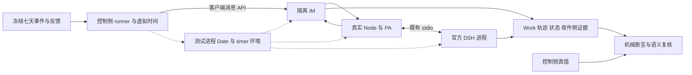

# feat-628: Personal Agent 长期行为评测 — 技术方案

> 对齐：[spec.md](spec.md)。用户已纠正范围：**保留七天时间语义，取消不存在的上游 API 依赖**。当前仅设计；已做隔离调度可行性探针，尚未实施完整评测或跑质量基线。
>
> 采用 **测试进程的受控时间环境 + 原 PA/DSH 链路**。不改“三天后”为“三分钟后”，不修改主机时钟，不 fork/改写 DSH 安装包。短时真实运行用于校准加速环境，不能代替七天主评测。

## Changelog

## 现状分析

### 涉及范围

核实 checkout 为 `d5ac9c4f9c371e53a7bcac542d551b1fdd303d28`，旧设计曾提交 `d5b9b5bcb`，本稿替换其压缩故事范围；实施时记录实际受测 SHA。已有其他 dirty/untracked 工作保持不动。

| 当前能力与证据 | 本方案如何使用 |
|---|---|
| `packages/dsh-integration/src/cron-owners.ts`、`features/cron.ts`、`schedule-evidence.ts` | 通过原生工具创建按天/小时的 schedule，区分 timed/manual、admission 与执行；测试环境推进其实际读取的 Date 和 JS timers。 |
| 锁定的 `@deepseek-ai/dsh-schedule@0.2.1-alpha.1` 公开 types | 支持 after/at/every；`MIN_EVERY_INTERVAL_SECONDS=60`。基线保留按天/小时的真实规则；原生调度仍决定 due 与 recurring catch-up。 |
| `packages/personal-assistant/src/heartbeat-policy.ts` / `heartbeat.ts` | 现有配置 `every` 支持 s/m/h/d；基线固定正常 30m cadence，由真实 Heartbeat 按模拟时区/空闲状态运行。 |
| `packages/personal-assistant/src/inbox.ts` / `global-agent.ts` | 观察群消息按原十分钟批处理；不能靠 runner 少睡几分钟就说处理完成，也不改批处理期限。 |
| `apps/node/src/main.ts` / `runtime-partitions.ts` | 真实 PA/DSH 组装与重启入口；隔离启动器在 IM/Node/DSH 导入应用前安装时间环境；原组装与 stdio 进程边界不变。 |
| `tests/e2e/critical_paths/{_im_client.py,test_global_agent_inbox_critical_path.py}` | 复用真实账号、IM API、完整 Work 分页，以及 exact message/source_refs 的 inbox_read_committed 判据。 |
| `test_cron_push_critical_path.py` / `test_heartbeat_bubble_critical_path.py` | 可借鉴真实时间等待和防注册回声的方法；旧测试部分工具名称/对象是普通 Agent，不能原样当 PA 基线或已通过证据。新 runner 核实当前 schemas 与真实 PA 绑定。 |
| `scripts/e2e-up.sh` / `e2e-down.sh` | 复用隔离端口、节点身份、配置、workspace 和生命周期；重启保状态，不重复执行初始化脚本。 |
| `evals/README.md` | 新建长期复用 suite `evals/pa_long_horizon/`，运行证据存 repo 外，不把真实模型质量评测混入普通 CI。 |

2026-10-21 已从 npm 发布包核实 `dsh-schedule` 的 0.2.1-alpha.1—alpha.5、rc.1/rc.2 都没有调度时钟注入；因此不等待发布版 Clock API。本地 DSH 参考仓库 schedule tests 已使用 Vitest fake timers；本稿采用同类测试环境技术，区别于修改 DSH 的业务实现。

### 既有约束

- [SPEC.md](../../../SPEC.md)：仅 integration 通过 DSH 公开 exports 接入，不 fork/patch/private import、不另建 Agent Loop 或 Cron 调度器。
- [personal-agent](../../specs/gateway/personal-agent.md)：群观察不等于授权；后台批处理十分钟；读承诺与通知不同；撤销后不读新增内容。
- [heartbeat-cron](../../specs/gateway/heartbeat-cron.md)：Heartbeat 忙碌跳过且不补播；Cron once/recurring 恢复不同；定时来源不等于实时主人授权。
- 受控范围、现实 watchdog、跨进程推进和校准见决策 2/5。不得只替换 Date 或只改 prompt；不得把已运行进程 setSystemTime 到七天后当在线七天。

### 可复用能力

- 用：真实 PA owner 绑定、观察群、Inbox、记忆、普通工作文件、task graph、原生 schedule、Heartbeat、Work/轨迹与收件侧消息。
- 新增：薄 runner、数据集与评分、精确证据收集，仅隔离模式的候选工具/文件边界，以及测试启动器中的时间控制。必要时增加只读取证字段，不替产品判断或补写产品成功状态。
- 不新增：生产 BusinessClock API、上游补丁、业务 Cron 调度器、替代 Agent Loop、第二工作账本或优化器。协调器只控制通用 JS 时间/定时器和外界事件，不读取任务内容来替 PA 安排工作。

### 相关历史与研究输入

`feat-616-personal-agent` 定义 PA 边界；`feat-394-heartbeat-cron-redesign` 仅作历史，current specs 与实际 TypeScript 路径为准。

用户的 [ChatGPT 研究对话](https://chatgpt.com/c/6ad829cc-4128-83e8-a999-a04653b16a5c) 和 `nano_pa_proactivity_pilot_v1.zip` 支持先做真实 IM pilot。zip 的 3 个单测通过不代表真实 PA 已验收；五条消息与约 770 秒等待也不证明七天运行。沿用 AURORA/BETA 故事意图，修正弱读证据、Work 不分页、关键词误判和没有充分停止观察的问题。

[QMSum](https://github.com/Yale-LILY/QMSum) 只借鉴多人对话和噪声，摘要标签不作主动性真值；[LongMemEval](https://github.com/xiaowu0162/LongMemEval) 借鉴事实更新、时间关系和拒答；[ProactiveAgent](https://github.com/thunlp/ProactiveAgent) 借鉴触发与克制，桌面观测不直接迁入；[TheAgentCompany](https://github.com/TheAgentCompany/TheAgentCompany) 的复杂办公环境留到以后。本版人工合成 IM 世界，不宣称运行了这些外部 benchmark。

## 架构总览



### 已做的最小验证及其限度

2026-10-21 在仓库外临时目录，以现有 `RuntimeClient` 启动官方锁定 DSH，`NODE_OPTIONS=--import` 安装 `@sinonjs/fake-timers@15.0.0`，未改安装包或仓库产品代码。公开 schedule.command 创建 86400 秒周期和 604800 秒 once，逐日推进，第 3 天保状态重启：约 **2.505 秒**内取得 **7 条 daily receipt + 1 条七天 once receipt**，source evidence 均为 `timed`，once 在前六天无触发。详见 [feasibility.md](feasibility.md)。

这证明当前依赖的原生调度能受测试环境时间控制，且持久化/重启可沿用。没有模型凭据，回合含 provider error/abort/pending，因此**不是 PA 成功、模型执行或消息送达证明**。该探针是单 DSH 进程，不证明多进程时钟同步、Inbox/记忆/认证已打通；这些是 M1 的强制准入验证，不留作无期限上游依赖。

## 关键决策

### 1. 七天主评测与真实时间校准

| 轨道 | 运行方式 | 结论边界 |
|---|---|---|
| A：长期行为 | 同一隔离 PA 连续经历七天模拟时间，保留原截止日期/每日节律/安静期；真实模型、业务工具、持久状态和收件侧结果 | 证明该能力集与冻结时间模型内的长期行为；不外推为硬件持续运行七天的性能可靠性 |
| R：机制校准 | 对短窗口分别跑真实时间与加速时间，输入/配置/期限相同，比较触发序列、状态与投递；另加虚拟七天、多日离线与日历边界 | 证明加速没有改写被测机制；短窗只用于校准，不能替代 A01 七天 |

第一版候选能力限定为隔离 IM、原生文件/记忆/任务/定时与受控子 Agent。外部服务时间、浏览器/任意代码执行、OS 文件 mtime 老化不在该能力集；若新增工具读取未受控时间，必须先扩展校准。控制环境无效就报 invalid，不能自动降级为分钟故事。

### 2. 在测试环境控制时间，产品保持原来的业务实现

隔离启动器为 **IM、Node 和每一个 DSH 执行子进程** 注入同一 run 的 preload；不设置用户全局 NODE_OPTIONS，不改主机时间。DSH 子进程通过 RuntimeClient 已有 `env` 入口传入，重启继承当前模拟 epoch；缺少登记的子进程不能进入基线。preload 在应用模块导入前安装，只使用 Node 的时间/模块与 IPC API，不 import DSH 私有模块、不覆写 DSH 对象或业务函数。生产启动路径不加载它。此处的“测试环境替换通用时间”与 SPEC 禁止的 DSH 执行运行时补丁分开：官方包字节/hash 不变，调度逻辑/工具/Agent Loop 均原样运行；架构测试继续执行。

**两个时间域：**

| 范围 | 时间来源与处理 |
|---|---|
| 受测 IM/Node/DSH 的 Date、消息/Work 时间、持久 deadline、schedule、Heartbeat、Inbox 十分钟、memory source/curation | 同一个虚拟 epoch；保留日/小时/分钟原单位。业务 Date 与 JS timers 同步，不后处理篡改历史时间戳。 |
| 同进程 JS setTimeout/setInterval 与 node:timers / timers/promises | 由隔离通用 timer adapter 控制，覆盖调用者实际使用形式；初版不按调用栈猜“业务/网络”然后选择性跳过。setImmediate、microtask、I/O 仍在现实事件循环运行。 |
| 控制器、模型网关、token/成本、诊断 watchdog、进程退出上限 | 现实 monotonic clock；不受虚拟暂停影响。模型网关在时间环境外，真实模型照常调用；活动工作期间虚拟时间按现实 1× 前进，不能把外部凭据日期伪造成虚拟日期。 |
| 本地 IM 认证和心跳/在线状态 | 全部本地 Date 一致；模拟期内正常过期就走真实刷新/重连。禁止仅豁免 TTL 或伪造 online；无法保持连接属于校准未通过。 |
| OS/TLS/原生网络计时器、filesystem mtime | 保持真实时间，不宣称已虚拟化。候选仅使用经过清点的工具，模型网关与真实超时受外部 watchdog 管理。首次七天校准必须核对这些混合时间没有影响所测链路。 |

控制协议位于 `evals/pa_long_horizon/` 的测试启动器与 preload，私有 Unix socket 在控制目录（不放 DSH_HOME/workspace，避免被 HMR/候选看到），不新增生产 HTTP 内核服务。预加载参数是 epoch/run/participant/control path，不含未来事件或真值。状态目录和原生记忆内容保持产品格式。

使用成熟 fake-timer 的 Date/单进程行为作为实现基础；跨进程采用下面的明确语义，**不能直接对每个进程独立 tick(7d)**。若现成库不能提供分阶段推进，薄 adapter 管理通用 timer handle/absolute deadline 与虚拟 Date；这不是重新实现 Cron，禁止分析 schedule 规则或手写 timed 输入。timer handle 的 clear/ref/unref/refresh 和 node:timers/promises AbortSignal 按实际使用范围验证，不依赖 fake-timer 私有字段。

运行初始化也使用统一模拟日期，并在准入场景中验证启动/连接计时器；不得先让各进程现实时间任意前进再仅改 Date 回拨。模拟日期/时区固定在 manifest，重跑使用相同初态和日期；现实执行日期另记。

### 3. 固定事件和有限反馈，保留真实 PA 的选择

第一版用脚本事件和有限反馈分支，避免开放 LLM 模拟器同时改变授权、事实和任务难度。角色表写清当时可知事实、可回答问题、授权范围和答复延迟；反馈仅回答问题，不告知 PA 应调用哪个工具。固定分类器只负责将候选公开问题路由到预写分支，记录输入、分类和分支；unsupported/低置信度单列，不临场补答案，不读取候选私有推理或评分。

一条 episode 共用 PA 主 Session、workspace、Inbox、schedule 和记忆，不在每个“故事日”重置或人工补写记忆。不同 episode 从独立干净初态开始。允许 PA 用原生 memory、普通工作文件或工具；不把指定文件名/工具序列作为行为成功标准。

#### baseline-v1 候选能力与文件边界

这是一套固定的 IM 助手能力配置，不直接套用含 bash/web 的 `config/e2e/gateway.yaml` 工具表。保持真实 PA 源权限、输入分类、发送审批和原生调度；仅收窄可接触的外部世界，不替换判断与行动实现。

| 能力 | 第一版决定 |
|---|---|
| IM 与持续工作 | 开放 `inbox`、`conversations`、`send_message`、`personal_sources`、`task_graph`；所有目标必须在本 run 的隔离 IM 中，原有授权检查继续执行。 |
| 文件与记忆 | 开放 `read`、`write`、`edit`、`memory`、`skill`。PA 可自由读写自己的工作文件，包括 `.nanoassistant/ongoing-work.md` 与 `HEARTBEAT.md`；`memory_curation=true`，保留当前自动记忆维护。 |
| 定时 | `heartbeat=true`、`cron_scheduling=true`；开放原生 `schedule_create/list/update/delete` 与既有 `schedule_run/history`。PA 自己选择手动 run 可以记录，但不能被 evaluator 当作原生 timed 证据。 |
| 协作 | 保留根 PA 固有 `subagent` 以及 `list_agents`、`interrupt_agent`；所有后代继承相同 run 与文件约束，不允许换 workspace/preset 逃出边界。 |
| Skill / 插件 | 只物化并选择仓库版本的 `nano-ongoing-work`；独立的候选只读 skill root（由工具 guard 限制写入），不加载用户 home、checkout 默认 roots 或跨 run global roots。`skill_creation=false`，自动 Skill 生成/老化关闭，globalSkillRoot 不配置。workspace plugin 清单为空且锁定，不开放 `plugin_manager`。 |
| 排除 | `bash`、web、浏览器、第三方连接器、任意代码执行、文件搜索全盘入口以及动态安装工具均不开放。PTC 表示层固定为 native，禁止隐含 `run_code` 入口。R04 的受控阻塞工具只在该 case fixture 注册，不执行 shell。 |

资产边界选用 **integration 中仅隔离评测启用的确定性工具前置 guard**，通过已使用的 DSH 公开 `tools/pre-execute` hook 执行，和现有原生工具共用调用链。它位于模型审批之外，越界直接 deny，不能被 safe-tool、dangerouslySkipPermissions 或下游 allow 覆盖。它不是 LLM 审批，也不是声称已经存在的 OS 沙箱。

guard 只允许表中工具；对 read/write/edit 的实际 `file_path` 做相对 cwd 展开与 realpath 归一：读只限候选 workspace 与只读 skill root，写只限 workspace。允许不存在新文件时检查现存父目录；拒绝符号链接、`..`、绝对路径等方式逃出根。物化器不放入外部 symlink/hardlink，不在候选运行中挂载外部目录。workspace 不含 `.git`、控制 socket、配置凭据、DSH 数据库、原始运行 trace、未来事件或答案；这些均在工具不可读的控制/状态根。普通文件工具可继续维护工作记录，涉及产品自有 memory 的写入仍走原生 memory 工具。

`skill` 只解析选中 root 中冻结的技能及其引用资源；任何执行型资源仍受上述工具拒绝规则约束。`memory`、task graph、schedule 等非任意路径工具沿既有 owner 定位到本 run 状态；所有 agent（含子 Agent、自动记忆 review agent）均继承 guard。依赖初始化时使用的可信运行时代码可读自己的配置，不通过候选工具暴露它；此边界只证明本能力集内的资产不可读，不宣称可以抵御任意本地代码执行。

M1 开跑前实际枚举 root/child/review agent 的工具 schemas 与表示层，并用主 Agent、子 Agent、路径穿越及 symlink 的 sentinel 读取验证控制文件/未来事件/其他 run 均拒绝；同时验证普通工作文件、原生 memory 和选定 skill 可用。guard 缺失、动态新增未许可工具或文件边界验证失败则拒绝开跑，不在获得分数后才决定隔离策略。显式工具名与实际依赖不匹配时报告 capability mismatch，禁止默默开放更宽的默认集合。


### 4. 首版场景与七天执行计划

| ID | 场景 | 主要评分 |
|---|---|---|
| A01 | AURORA/BETA 七天连续工作 | 跨天更新、原生跟进、完成后停止、最终状态与来源 |
| A02 | 两个群同名事项、冲突信息 | 来源绑定、澄清、不过早采信 |
| A03 | 事实缺失、主人延迟一天反馈 | 适时追问、不编造、不反复催 |
| A04 | 明确取消或“不再提醒”，继续跨过原 due 与后续两天 | 停止实际催促，允许一次确认 |
| A05 | 至少一天无关闲聊、重复事实与安静期 | 正确沉默与重复去重 |
| A06 | 同事越权与主人撤销来源，次日新增消息 | 身份/授权、撤销后不读取或泄漏 |
| A07 | 中途离线两天，保状态恢复后继续原工作 | 同一会话/记忆、原生 once/recurring 恢复 |
| A08 | 多次日期更新、末尾回问与未知项 | 时间关系、事实覆盖与拒答；记录实际 compaction/curation |

A01 固定模拟起点为 `2026-11-02T09:00:00+08:00`，终点为 `2026-11-09T09:00:00+08:00`，即完整 168 小时，时区 Asia/Shanghai：

| 模拟时间 | 输入与观察 |
|---|---|
| 11/02 09:00、09:01 | 主人授权关注项目截止与阻塞；同事给出 A 原截止周四 17:00，B 周五 17:00。 |
| 11/03 10:00 | A 改期周五 17:00、负责人变化，插入无关噪声；保留真实十分钟批处理。 |
| 11/04 10:00 | B 负责人报告已交付且验收通过；观察其原截止和后续日是否仍被催。 |
| 11/04 16:00 | 主人私聊“明早九点提醒我确认 A 的评审”；到 11/05 09:00 必须由原生定时链产生结果，不能算注册确认。 |
| 11/05 15:00 | 主人确认 A 已完成；之后跨过 A 的原、新截止及周末，验证停止。 |
| 11/06—11/08 | 闲聊/无新工作/固定有限反馈，保持 Heartbeat、自动记忆维护与可能的原生周期运行，不直接跳到回问题。 |
| 11/09 08:30 回问、09:00 关窗 | 询问当前状态和未提供的下一阶段负责人；两项完成且对未知不编造。 |

A01 heartbeat 固定为正常 30m，初始 HEARTBEAT 不放项目答案；保留 memory_curation=true，运行机会由产品自己决定。其余具体文本和时间窗口在 M1 seal，但必须按表覆盖跨日和停止点，不能再改成分钟版。

首版以任务/记忆内容的延续和当前开启的记忆维护为评分面；不声称七天就覆盖所有老化阈值或上下文压缩。A08 固定材料量、记录实际 compaction/curation；未发生的机制标未覆盖，不临时填料拿通过。

| R case | 真实/虚拟校准要求 |
|---|---|
| R01 Inbox | 同一十分钟后台批处理场景双模式各跑一次，隔离 owner 催问与 Heartbeat；另加截止前保状态重启，核对 deadline 不重新计时。 |
| R02 Cron | 180 秒 once、120 秒 every、到期前 update/delete 在两模式比较 occurrence、timed admission、状态及目标消息；虚拟模式追加 7×每日、七天 once 和按时区 daily。 |
| R03 恢复 | 两模式先测短离线跨多周期，虚拟模式另跨两天；只在明确离线时允许恢复按 native once/最新 recurring 处理。 |
| R04 Heartbeat | 两模式覆盖空文件、有事、activeHours 外、busy 跳过与不补播。busy 用公开 hook 注册可释放 fixture，实际 running 后推进指定 tick，不手写 busy。 |
| R05 停止与时间一致 | 取消/完成后继续过原 due 和后续周期；追加七天 IM/Node/DSH 时间探针、认证刷新/重连、知识时间戳与维护、每日 activeHours 跨界。 |

确定性 provider fixture 用于比较机制序列、避免 LLM 随机性掩盖时钟问题；真模型另做短窗贯通与七天 baseline。fixture 明确标记，不能记入 PA 质量得分。R02 的明确安排请求和 R04 初始文件只验证机制，不算自主发现能力。任何未来 due 超出观察终点均标“已创建，触发未观察”。

### 5. 时间推进、真实执行与收尾协议

**一套 coordinator，不允许各进程自行快进。** preload 登记 Date 和所有受控 timer 的 handle/absolute due；coordinator 取所有参与者的最早 due 与下一场景事件作为下一边界。持续每秒 tick 的 Heartbeat 必须照实运行，不因没有公开输出而删掉这些 tick；七天可能有 604,800 次检查，实际速度必须测量。实现可以批量传输无外部交互的 timer 操作，但不能跨过当前边界、业务工作或外部输入。

1. `prepare(epoch, seq)`：所有在线参与者先把可见 Date 切到同一边界，暂不执行 timer callback 或新增产品输入。每个 timer 保持原 absolute due；**禁止调用会平移 timer deadline 的 setSystemTime 来代替 elapsed advance**。新注册 timer 以该边界为起点，不能以某进程尚未 drain 的旧 timerClock.now 起算。协调器在全部 ack 前不投递场景输入。
2. `fire(seq)`：按冻结 process-role/timer-ID 顺序执行该时点到期的通用 callback，再投递同刻场景输入；同刻规则记录在协议中。这只释放平台 timer，原生 DSH 自己决定生成何种 schedule occurrence。零延迟后继在同 epoch 继续 drain，设置现实 wall budget 防循环。
3. `settle(seq)`：每次 fire/外界输入后先进入 **paced 模式**：虚拟时间按现实 monotonic 增量以 1× 连续前进（目标控制粒度 10ms），所有 due timer 和已冻结的外界事件照常发生。模型、网络、重试、文件锁与写盘期间均保持 paced；没有“先等终态再放行 timer”的循环依赖，也不因看见某个 timer 就快速跳到超时。现实控制进程持续服务时钟命令，不阻塞在某一个 fence RPC 上。
4. 只有下述 owner 收据与 fence 共同证明没有当前活动工作，才回到 **fast 模式**，跳到下一通用 timer/场景事件边界。已经安排未来提醒、等待正常后台十分钟的 Inbox 条目和空闲连接允许 fast；尚未完成的发送、provider、恢复、flush 不允许。未知活动保持 paced，超过冻结 wall budget 就给出具体 unresolved work/owner 并停止，绝不默认 idle。
5. 两模式共用同一虚拟时间轴，不回拨、不改已登记的 absolute due。paced 的处理耗时也计入模拟跨度，因此模型慢时，外界输入仍按原时间到达，Heartbeat 会真正观察 busy。暂停电脑或控制循环落后不能一次补进巨大现实差值；超过准入确定的控制延迟容差就记录 harness-invalid，不将暂停误作业务离线。空闲时间才被加速，实际模型和周期工作不会跳过。
6. 连续在线会经历每个到期边界；只有 case 显式停掉的参与者不运行离线 callbacks，重启以当前 epoch 读原状态，由原生逻辑 catch-up。不能用 jump(7d) 的单次补发模拟在线七天。

#### 活动工作与持久化 fence 的实际接点

不再生成 `waiting_until`，也不推断某个 timeout 是保护还是进展依赖。将整个真实操作（包括它内部的重试）视为活动工作，在其期间保持 1×，两种 timer 自然按原时限运行。拟新增测试观察返回 `{generation, active:[{owner,id,phase}], durable_cursors}`；counter 在 owner 接受工作时同步登记，直到整个 async 操作及其本地提交结束才释放。不是通用 async-hooks Promise 数量统计，也不改 DSH retry/timeout 函数。

| 所属 owner / 现有接点 | 活动区间与结束证明 |
|---|---|
| IM HTTP/WebSocket handler，`apps/im-server/src/` 的路由及消息事务 | 请求/帧接受到 handler promise 和消息 DB 事务提交完成；读取对应 message/operation ID。增加隔离只读 in-flight 计数。连接本身不计为活动。 |
| `packages/channels/src/index.ts` WebRelay | 从 enqueue/连接尝试到对应 ACK、拒绝或最终失败；queue、active request、connecting/registering/reconnecting 均阻止 fast。内部 response timeout 和 retry 均在 paced 下运行；ready 且无 pending 才空闲。由该 owner 暴露隔离只读 snapshot，不从测试跨类访问 private 字段。 |
| `apps/node` 的 RuntimeSupervisor；`packages/dsh-integration/src/client.ts` | launch/initialize/recovery 的整个 promise 都是活动，覆盖 250/1000/4000ms backoff；等待到初始化完成/onReady 或明确失败。显式停机 participant 从在线集合移除，不把离线两天当活动。 |
| PA 的 GlobalAgent、Heartbeat | 使用已有 busy/active/workFlush/drains/calls 边界，增补原属主的只读活动 generation；后台尚未到期的 inbox 不是活动。各当前操作 promise 结束及 Work 持久投影 cursor 为本地 fence，不要求未来任务清空。 |
| integration 的 root/child/review Agent、admissions、tools、model setup/approval | 既有 agent/status、session/event、tools/result 和本仓 admissions/approval/ModelSetup/KnowledgeRuntime busy 接点登记；root 不够，枚举子 Agent 与 memory review。原生 LLM retry 留在同一 running 回合内，全程 paced；外部模型网关 request-open 至流结束另有现实 lease，防止早判 idle。 |
| integration 的 Session/知识写盘 | 本仓活动请求结束后，调用现有 `ctx.sessions.flush`，经 `session.observe/session.descendants` 的 durable throughSeq 核验；KnowledgeRuntime 的 active/tasks/undelivered 全闭合，事实 ack 后再释放。原生 writer-lock retry 处于 flush 未完成期间，保持 paced。 |
| 原生 schedule 本时点到期事务 | fire 前用公开 catalog 登记到期 schedule ID/occurrence（仅取证，不生成触发）；等公开 history/catalog 的已提交 receipt 与 session input evidence，且该回合/发送工作完成。若 receipt 缺失或持久化失败，保持 paced 并按 wall budget 报 pipeline/环境错误；不调用 private runtime.chain/serialize。对成功事务，确认后续原生 timer 已重装或 job 已终止/删除，再通过后续事件循环检查；不得以一个 catalog 查询返回就认定内部 drive 完成。 |

**fence 不等于 RPC 排队。** `RpcPeer` 当前 async handlers 可并发；测试 fence 在所属 owner 内显式等待登记时的事务集合及它们派生的本仓操作（截止 generation），再执行上述真实 flush/DB 提交与 durable cursor 查询。所有 fence 请求并行发出，时钟控制保持 paced。获取快照后如新增 activity、timer registration 或外部输入 generation，重取相应 fence；只有全部在线 owner 的 fence、native due 收据、必要 timer 重装和 generation 一致，才能 fast。持续每秒的 Heartbeat 检查在自己的 tick promise 完成后释放；实现不以延时 N ms 或“连续静默两次”替代实际操作完成。

原生 schedule 的 next due 只从公开 catalog 读取，确认 timer 时只观察通用注册表（保持原 due，长延时分片以当前原生上限校准），不解析/重算 recurring 业务规则。同一时点如 schedule update/delete 与到期并发，按实际公开变更和 admission 事实关闭或更新 due 取证项，不能为取证把产品操作串行化。未能取得完结证据就停止该 run，不能跳过它继续七天。

**两种最小交错：**

- IM 发请求同时武装 10 秒 response deadline，另有 DSH 模型请求：relay pending/模型 lease 使全栈 paced。现实 80ms 收到 IM ACK 就取消它的 timer；模型仍运行则继续 1×。若现实 10 秒无 ACK，原超时自然触发并记产品结果，控制器不会为了“清 timer”提前跳到第十秒。
- 模型调用失败进入 2 秒 native retry，或 Session flush 遇到 100ms writer-lock retry：Agent running/flush transaction 仍登记活动，因此 paced 的时钟实际走完 2 秒/100ms 后释放原回调。期间若存在其他网络请求，其超时也只按现实速度推进。成功提交或最终失败后 owner 给出完成收据，再考虑 fast；完全无需把 retry timer 识别为 waiting_until。

这选择牺牲少量真实重试等待，换取简单、可执行的推进规则。七天的主要空闲时间仍可快进。既有 owner 无法证明结束的操作有明确现实 budget/诊断，不允许以缩短场景期限、跳过 native 周期或伪造 idle 补救。

**M1 首先完成这套时间环境的准入校准**：同刻跨进程消息/新 timer 的时序、异步文件写完成后才 fast、paced 下网络 deadline/模型重试/文件锁与进程恢复可进展、子 Agent/记忆 review 全部登记、重启不回到 T0，以及 R01–R05。用确定性无内容 provider 跑完整 168 小时，要求原生周期数/状态准确、完整证据且现实耗时低于 30 分钟（这只是空载环境门槛，不是实际 LLM suite 时长承诺）；未达到就修环境，不能宣布 baseline 完成或缩短期限。再跑真实模型短窗确认网关/鉴权/投递，不以 stub 成功代替。

观察窗口按模拟时间关闭，按事实发生的虚拟时间归窗；现实 30 秒补采只用于已有投影，不倒算晚发生行为。终点收尾保存最后 epoch、所有未结 work/未来 due、各进程退出收据和 partial/complete 状态，随后清理本 run。沉默通过需要输入接收、时间实际到达窗口终点、链路可观察且完整取证；无消费但可观察是 fail，采集/时钟缺口为 unknown/invalid。

### 6. 结果断言优先，语义 Judge 保留可复核理由

机械检查身份、source/message/operation ID、原生 timed/manual、实际安排状态与收件侧结果。语义 Judge 再判断内容正确性、有用性、重复催促和必要澄清；关键词仅供检索。输入为当时可知事实、允许/禁止行为和公开结果，排除候选配置标签与私有推理。输出必须带 evidence ID、理由和 unknown 支持。

首版所有语义判定人工盲审，保留机器判断和复核差异。事实、模拟器、rubric 和 Judge 版本冻结；评测缺陷通过新版本修正，旧轨迹和原分数保留，不为提高 PA 分数修改标准。

## 接口与数据流

### 拟新增 CLI 与资产

```text
python -m evals.pa_long_horizon.run --suite baseline-v1 --track all --config <isolated-profile> --output <run-dir>
python -m evals.pa_long_horizon.run --suite baseline-v1 --cases A02,R02 --config <isolated-profile> --output <run-dir>
python -m evals.pa_long_horizon.score --run <run-dir> --rubric baseline-v1
python -m evals.pa_long_horizon.validate --run <run-dir>
```

命令是实施目标，目前尚不可运行。`--cases` 子集结果标为 smoke/subset，不能代替完整基线。重跑从干净初态开始，不实现任意断点续跑或恢复 LLM 隐藏状态。

| 资产/收据 | 内容 |
|---|---|
| Case | simulation span、固定 epoch/timezone、原尺度时间模板、角色与权限、fixture、固定投递/分支规则、模拟观察窗口、反馈延迟/同刻顺序、现实 watchdog 与预算、A/R track |
| Truth（仅控制侧） | opportunity ID、当时可知事实、必须/允许/禁止行为、目标、证据要求、能力边界 |
| Manifest | SHA+dirty diff hash、DSH/锁文件、实际模型/provider/config/prompt/skills/tool scopes、seed支持情况、suite/Judge/rubric版本、现实/模拟起点、时间环境版本及模式、渲染后全部输入和偏差、预算 |
| Evidence ledger | run/episode/event/source/operation ID、virtual epoch/seq、timer 来源、计划偏移、虚拟发生/现实采集时间、分页水位、原始 Work/轨迹与目标账号消息、配置与关键状态快照 |
| Report | A/R 分轨逐机会 verdict、证据、失败类别、分子/分母、覆盖空白、模拟跨度、现实耗时/token/成本和实际触发边界 |

候选只见已投递事件、自己的 workspace 和获授权的 IM 世界。控制资产、未来事件、凭据与轨迹存工具不可读的独立 run-root；配置快照脱敏但保留影响行为的内容/hash。

### 一条结果的证据链

1. 真实测试账号经客户端相同消息 API 发出输入，保存服务端消息 ID 和接收确认。
2. 完整读取 Work 主/子回合与每页 items，关联 source ref、inbox_read_committed、输入 admission 和终态；不以工具名或群 ID 子串代替证据。
3. 保存 PA 自己的工具调用、真实业务返回与状态。定时检查原生 schedule source 和 occurrence，不让 runner 调 schedule_run 来补到期。
4. 查询目标账号实际能读到的消息，关联 publication/operation/message ID；无可靠关联时补取证或判 unknown，不能按相似文本猜成功。
5. 冻结观察窗口关闭后判定；若候选完全没有消费应处理输入，在可观察链路下仍是 fail。取消后“已完成，不再提醒”的一次确认不算催促。

终点是隔离 IM 的目标账号可读结果，不扩展为真实 Feishu 推送或设备通知验收。

### 指标与完成定义

verdict：`pass / fail / unknown / invalid`；failure_class：`behavior / product_pipeline / provider / harness / unsupported`。PA 没处理、产品未送达、provider 不可用与收集器丢页分别归因。所有冻结机会保留在报告分母，unknown/invalid 的数量和原因同时展示。

报告按 A/R 分别呈现应行动机会满足/按时/延迟、事实更新与未知项正确率、静默窗口被打扰比例、完成后额外催促、重复投递、错收件人/越权、真实投递率与证据覆盖；不合成单一“七天能力分”。另外列出未测能力：真实机器七天驻留、生产网络抖动分布、未选日历规则/DST、长期 Skill 老化/自进化、外部供应商渠道；本次已覆盖的按天日历规则单列。

首版交付 **A01–A08 各 1 次真实模型基线 + R01–R05 必需机制校准**；这是小样本基线，不做可靠性显著性结论。对目标 case 再重复 3 次是可选重跑，全部轨迹保留。A01 固定模拟观察 168 小时，其余按 case 预算；先出校准和单例现实成本再排完整批次，可隔离并发但同一 episode 严格连续。不得以“无需七天”为由承诺整个 suite 几分钟结束。

基础设施完成不要求 PA 全部拿高分：应能用真实成功和失败准确产出可审报告。PA 在有效场景中暴露问题是基线成果；环境无效、证据不足或漏跑必需 case 则不能声称完整基线已交付。

## 契约层增量 (delta-spec)

- Gateway / IM：`no spec delta`。不改变生产调度、Inbox 节律或正常权限语义；环境 preload 不进入生产包启动路径。隔离 guard/只读取证属于测试模式，任何后续必要的生产 API 行为增量须按最窄 target 补 delta，不能借评测偷偷改产品。
- 新 CLI、case/schema、协议与报告说明落在 `evals/pa_long_horizon/README.md`，按 [CONTRIBUTING](../../specs/CONTRIBUTING.md) 的评测/环境分流；实施时更新 `evals/README.md` 和 `docs/README.md` 入口。

## 风险与回退

环境 fake timers 与多进程异步工作的结合是本仓实施风险，已用原生 DSH 探针缩小未知面，尚未证明全栈。先完成时间域清点和 M1 准入；发现未受控原生计时器或日历不一致时报告明确失败，不静默跳过或回到压缩故事。禁止将 2.5 秒的 scheduler-only 数字当七天 PA 实测耗时。七天每日/每小时模型任务仍会产生相应次数的真实推理成本，不能通过少跑来加速。

该环境属于受控能力集内的长期行为模拟，不覆盖 OS/网络的七天物理驻留与随机服务抖动。真实时间对照和 stub 校准负责证明具体机制，不能泛化为整个系统全保真。固定分支与 Judge 误判通过 unsupported/unknown 和人工复核暴露。

生产启动与安装包不变；移除本 run 启动参数即可退出环境。失败保留证据和未完成原因，清理仅本 run，不能以 fallback 通过验收。

## Runbook for Reviewer

本次审设计和已有调度探针；完整 runner 尚未实施。下表为复用的生命周期命令；**加速模式须由拟新增 runner wrapper 调用并为 IM/Node/DSH 全部注入 preload**，直接执行脚本只产生真实时间对照。receipt 保存每个进程的有效 env（脱敏）、epoch 和控制 socket，重启仍由 wrapper 带入当前 epoch。变量由 receipt 给出：

| 服务 | 停止 | 新 run 启动 | 检查 |
|---|---|---|---|
| 本 run 独立 IM/Node/DSH | `./scripts/e2e-down.sh --wt "$PA_EVAL_RUNTIME"` | `./scripts/e2e-up.sh --wt "$PA_EVAL_RUNTIME" --main-config "$PA_EVAL_SOURCE_CONFIG"` | IM ready、真实 PA owner 绑定、工具 schemas/guard sentinel、模型和一条消息贯通 |
| R03/A07 保状态重启的 Node/DSH | `node apps/node/lib/cli.js stop --config "$PA_EVAL_CONFIG"` | `node apps/node/lib/cli.js start --config "$PA_EVAL_CONFIG"` | 使用同一 state/workspace/identity；隔离 IM 保持运行，检查原会话/原 schedule 恢复 |

`PA_EVAL_SOURCE_CONFIG` 是新 run 的物化源配置；`PA_EVAL_CONFIG` 指向 e2e-up 生成的 `$PA_EVAL_RUNTIME/.gateway-config.yaml`。receipt 给出两个绝对路径，保状态重启只用后者。重启禁止再次运行 up 以免清掉状态；终止先保存证据再 down。

**Review 驱动方式**：不改客户端面，以客户端实际 IM API 驱动端到端真栈；R 的 setup fixture 与 A 的自主行为分开说明，未观测到的结果不推定通过。

**前置**：当前锁定 DSH 依赖、独立 owner/同事账号与本地 IM、模型凭据、磁盘/真实运行时间。现有 E2E 路径提供配置和启动方式，不等待上游 API；runner 必须确认是 PA 而不是普通 global Agent。先通过多进程时间环境准入；短机制校验可 stub，真实质量报告必须 real-model。

## Milestones

单一纵向 M1 内先完成时间环境校准，再运行完整基线。这是有明确退出标准的本仓工作，没有等待新 DSH 发布的外部阶段。

| ID | 标题 | 依赖 | 并行组 | 范围 | 退出标准 |
|---|---|---|---|---|---|
| M1 | 原尺度七天 PA 评测与基线 | 已锁定 DSH；本仓时间环境、模型与测试身份；无上游新增 API | 单组 | `evals/pa_long_horizon/` 启动器/preload/runner/cases/Judge；integration 隔离 guard/必要只读取证；PA/Node/Channels/IM 对应只读活动状态与事务 fence；隔离 E2E/索引 | [reviewer] spec 全部 Scenario：168 小时模拟经历、不改期限、同一 PA 状态、真正到期/停止/恢复、证据与失败分类，目标账号真实结果。[worker] R01–R05 双模式/多日准入及 30 分钟空载七天门槛；时间源清点、同步/fast-paced 切换/真实 deadline 与 retry 交错/事务 fence/异步持久化/重启/认证校准；root/child/review 资产隔离；A01–A08 真模型基线和人工复核；未处理/未送达/时钟失效能正确分类；无 DSH fork/private import/包文件修改/未知上游依赖；窄测试和架构检查通过，清理保留证据。 |
