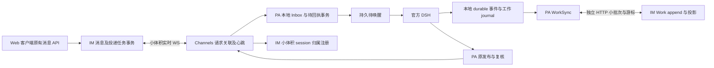

# feat-630: Web IM 可靠投递与工作记录同步隔离 — 技术方案

> 对齐：[spec.md](spec.md)。设计基线 `11f599938d67f21398570009f1c7e9e0088b81a1`。仅设计，不修改产品或生产状态。

## Changelog

## 现状分析

### 涉及范围

| 入口／文件 | 当前职责与实际问题 | 本轮落点 |
|---|---|---|
| `apps/node/src/main.ts` | 实际组装 `WebRelayConnection`、PA、Inbox、DSH supervisor；ready 恢复串行等待 managed/global 等任务 | 独立启动实时恢复和 Work uploader，关闭时收拢各自资源；不在 ready 回调等待整份 Work |
| `packages/personal-assistant/src/global-agent.ts` | `main()` 在 runtime ensure 后 flush 全节点 Work；`query()` 和 `reconcile()` 也 flush；ingest 在此之后才写 Inbox，并等待网络回执后 wake | 本地接收、运行准备、权威 scope 注册、工作记录同步分别负责；查询/发送仍做权限和纠正复核 |
| `inbox.ts`、`store.ts`、`session-controls.ts`、`external.ts` | 本地输入、wakes、读承诺、发布、会话绑定及控制持久化 | 复用已有 durable identity，增加同事务接收回执；本地 reconcile 仍以公开 DSH durable barrier 为准 |
| `packages/channels/src/index.ts` | 全连接单 active 请求；普通 ACK 只按 message_type 匹配；十秒业务超时拆连接；队列忙推迟心跳；注册即清空失败退避 | 有界请求关联与心跳独立；不把业务请求超时当整个连接失效；不承载新客户端 Work 正文 |
| `apps/im-server/src/messaging.ts`、`gateway.ts` | message＋relay 同事务；已落库后离线可能返回 503；重连全量重投；回执无终态单调保护 | 保留现有 outbox，离线正常入队；有界投递与稳定回执，不新增面向用户的阶段 |
| `work.ts`、`server.ts`、`identity.ts`、`schema.sql` | Work append 同事务存事件和投影，按 node/journal 连续确认；global query 依赖 Work session 归属；通用 HTTP principal 仅接受人或活动 socket 的临时 gateway token | 小体积 scope 注册；机器认证专用 Work HTTP；保留原子 append/project 与原始 payload |
| `packages/product-contracts` | 共享 wire/domain 契约 | 增加请求关联、能力声明、Work 同步请求/结果，保持依赖方向 |

### 既有约束

- DSH 是唯一执行运行时；仍由 integration 公开 exports 接入，Node/DSH stdio 不变。不新增执行 HTTP 服务或第二 Agent Loop。
- Channels 只承担传输；PA 拥有输入接收、消费、发布及恢复；IM 拥有账号、聊天授权、消息、投递和 Work 视图。跨包仅公开 exports/product-contracts。
- `docs/specs/im/gateway-relay.md` 的 durable/幂等、global completed 不等于工作完成、多节点独立投递和权限事实保持。
- `docs/specs/gateway/global-agent.md` 的 Inbox 读承诺、通知不代表授权、busy steer、发送前复核保持；不跳过 `session.observe` durable/source barrier。
- `docs/specs/im/agent-work.md` 的完整正文、父子归属和真实未知状态保持。既有 native trajectory 仍按查看生命周期读取。
- 普通聊天界面不新增内部状态、诊断提示或同步进度；不改 Web/iOS/飞书组件及视觉，没有前端原型。浏览器保持性须在真实页面验收。

### 可复用能力

- **用并局部改造**：message/relay 同事务、现有 `(agent_id,message_id)` Inbox 唯一约束、wakes 水位、runtime inputId、publication operationId、既有 Work journal/event 唯一身份与连续游标、机器 runtime token、node epoch、会话资格复核。
- **新增的必要 owner**：PA 内 `WorkSync` 隐藏批次/分块/游标/退避；IM Work 专用路由隐藏机器认证、分块与现有 append。不新造一份完整执行历史，也不引入 broker、对象存储或异步投影平台。
- **保留**：中心 Work 小批次仍执行既有同事务 append＋project，成功 ACK 表示二者完成。当前源站直连探针快，尚无证据支持拆出第二投影流水线；容量测试约束同步事务时间和实时延迟。

### 相关历史

`feat-596`/`bugfix-585` 是 relay、配置边界及持久化历史；`bugfix-622` 的忙碌 Inbox 下一步通知保持；`bugfix-626` 与 `bugfix-629` 的审批上下文/恢复边界保持。本轮不改变 reviewer 策略、模型或会话上下文。`feat-627` 原生轨迹的只读观察不得因 Work 补传失败被重启执行。

取证来源为本次对话的 2026-10-21 生产只读调查，具体数值见 spec；这是历史快照，不作为实施时服务仍失败的证明。既有 spec 要求可靠接收与独立交付，当前全量 flush 依赖属于本次需修正的实现耦合。

## 架构总览

本地持久化是消息交接边界；Work 中心确认不再是接收、查询、回复和停止的前置。仅 session 权威注册及实际操作依赖的权限事实继续同步确认，不能与完整历史打包。

## 关键决策

### 1. 本地先接收；回执、唤醒与 Work 各自恢复

`acceptRelay(input)` 在不调用 DSH、不访问中心 Work 的情况下校验目标 Agent、宿主已认证来源、node epoch、稳定输入身份，事务写入 Inbox 和待回执。唯一键命中时核实相同来源与内容，不新增 wake；同一输入不同 relay_task_id 保留独立回执，不把成功 socket write 当节点接收。

Inbox 的未通知水位即 durable 待唤醒，不再新建并行任务账本。回执 drain 与 wake drain 分开触发，二者不互相 await。先 ACK 后崩溃仍有待唤醒；先 wake 后 ACK 丢失仍按 inputId 幂等。`session.ensure`、scope ensure 失败只留下执行待办。已有迁移去重命中也补原接收回执，不能无声 return。

Web `/stop` 和现有控制命令仍由原解析器判定来源、寻址和权限；本地持久 command intent 后走控制优先队列，不伪装普通模型交办。PA observer/participant 分类及来源撤销仍由既有 personal authority 决定；接收原始输入不代表交给模型，来源未校验时保持待分类，不读取或执行。

### 2. Work 走独立 HTTP；实时 WS 保留必要消息与控制

选择 **HTTP WorkSync**，不选择“继续单 WS 承载全部正文＋只加优先级”。后者仍共享大帧及失败范围；HTTP 已是本仓 IM API 基础，新增机器限定上传面比第二套 WS 注册/会话生命周期简单。

WorkSync 由 PA 创建，`append` 只持久写本机 journal 并 signal，不返回网络完成 Promise。`start/stop` 管 uploader；`reconcileLocal` 只做原 durable event/Inbox read/children 投影，不能等待上传。`main`、`query`、`send`、heartbeat、observer 恢复和 ready 链逐一移除全量 flush 依赖，不能只改 ingest。

大记录仍完整留在本机和中心，既有只读原生轨迹不变。普通聊天没有 WorkSync 状态气泡。

### 3. 把 session 权威注册从历史显示事件中分离

新增小请求 `agent.session.ensure`，由绑定事实提供 `{agent_id,session_id,scope:'global_main'}`，服务端确认当前 node/epoch、Agent 管理归属与现有 main 替换/retired 规则，幂等登记现有 `agent_work_sessions` 后返回。PA 的 `ensureScope(binding)` 按 `(node_epoch,agent_id,session_id)` 缓存成功；重注册清缓存，再次调用幂等。

查询仍保留 `Work.query` 的 session/node/scope 检查，不改成相信模型自报 session。子执行关系继续由宿主事件提供。新 HTTP 历史 `session_registered/session_linked` 只补历史元数据，不能激活、复活 retired main 或取代当前 main；未知旧 main 可作为 retired 历史登记，当前 main 必须已通过小请求确立。旧 WS 路径的历史注册语义只为升级期旧节点保留。

### 4. 实时请求按 request_id 关联，业务超时不拆连接

所有新协议业务请求都有唯一 `request_id`，服务端 success/error 均原样回传。`operation_id/idempotency_key` 是跨尝试稳定身份，不能用 request_id 代替。pending map 按 connection generation＋request_id；晚到、重复或旧连接 ACK 不会完成新请求。已有服务端向节点发起的请求保留原 request_id。

节点实时窗口最多 8 项，预留 2 项给心跳/停止/权限响应；其余按 Agent 轮转，单 Agent 内保持必要顺序。排队最多 256 项，超额返回 `not-sent` 给持久 owner 等待重试，不能丢本地记录或放进无界内存。需要顺序的配置、同一外发和同一控制继续由各 owner 串行，不能因窗口扩大并发执行同一操作。

普通请求默认十秒，期限覆盖已发请求，不把本地排队时间混成对端失联。超时返回 `unknown`，只移除该 pending；宿主按业务身份核对，不盲重放工具。独立每 30 秒发送原 node heartbeat，不再因业务队列忙跳过；连续两次心跳未确认、明确 socket 关闭/错误才重连。权限撤销仍立即终止。退避有抖动且上限 30 秒，注册成功不清零，稳定 60 秒并收到两次心跳确认后才清零。

### 5. 消息 outbox 有界投递，接收回执单调推进

复用中心 `relay_tasks`，连接 ready 与新消息仅唤醒 dispatcher。每节点最多 32 项未接收投递；按 Agent 轮转，不一次读出整个积压。接收回执、连接替换/关闭释放窗口；确认未知的任务保留身份并按超时退避重投，不依赖用户再发消息触发。每次重投继续 `relayEligible` 检查权限和 epoch。

新的接收回执同 Inbox 写入 `global.sqlite3` 的 `relay_receipts`，按 relay_task_id 保留待发送状态；重启从此恢复。既有 `sent/completed/failed` 的产品语义不重新定义，但回执不能把终态退回早期态；重复同态幂等，冲突终态保留原事实并记录安全诊断。群目标各自终结，不让一个回执取消其他目标任务。

HTTP 发消息在 message＋relays 提交后，节点离线或投递暂不可用仍返回原消息结构与 `pending`，不回“未保存”的 503；真正事务失败才返回失败。不增加聊天状态字段或新文案。

### 6. 大小、吞吐和积压都有边界

以下为本轮实现初始上限，须在测试中固定并报告，不宣称是行业标准：

| 资源 | 边界及满载行为 |
|---|---|
| Work 普通批次 | 以完整 UTF-8 JSON body 计，目标 32 KiB、上限 64 KiB，最多 100 事件；遵守 node/journal 连续顺序 |
| 单条超过批次的事件 | 仅该事件使用 16 KiB 原始字节块，base64 后完整请求仍不超过 64 KiB；不单独强塞超大事件或截断结果 |
| Work HTTP 并发 | 每节点 1 项请求，中心全局 8 项接收许可，超额 429＋Retry-After；每次事务只提交一个有界批次，主动让出事件循环 |
| Work 分块暂存 | 每节点最多 1 个未完成事件；磁盘暂存阈值 16 MiB/节点、全中心 256 MiB；不足返回 429，不推进连续游标 |
| Work 重组 | 流式落盘、流式 hash，不把大正文留在 socket/队列；最终解析/投影单事件上限 16 MiB。更大事件明确 `event_too_large` 并保留本机原文，暂停该节点 Work 流，聊天继续；不伪造完整上传成功 |
| 本地历史 | 保留未确认原始事件，不用固定条数删旧记录腾空间。磁盘不足不能返回 durable 接收成功；通过现有失败机制处理并记录运维错误 |
| 中心 replay | 每节点窗口 32、按 Agent 公平；持久任务不受 socket 内存队列上限影响 |

分块若事件大于 16 MiB，本轮不承诺中心完整回看该超出协议上限事件；保留本机及现有原生读取入口，并可由管理员修复限额后续传。验收大体积结果使用 106 KiB 与 4 MiB，均不得丢正文。该边界必须在 API 契约和运维记录明确，不作为普通聊天用户的新知识。

Work 请求默认三十秒独立期限；未知结果先查 cursor/parts 状态，再补缺失。退避在 1–30 秒间带抖动，只有明确进度才恢复短退避；绝不重建聊天 WS。队列按磁盘游标惰性读取，不加载全量历史。

### 7. 采用一个端到端 milestone；不扩展中心架构

单 M1 同时交付可靠接收、实时通路与 WorkSync；只完成拆包仍不能兑现“同步失败时能收发”，故不拆出虚假的独立交付。保留单中心 SQLite、现有 Work append/project，不新增 broker、分片中心、对象存储或第二投影流水线。用容量测试给出本基线能力边界；后续多实例需单独设计共享持久任务、连接租约和跨实例路由。

## 接口与数据流

### 机器专用 Work HTTP

统一 `/im/v1/gateway/work-sync` 前缀：

| 请求 | 输入与结果 |
|---|---|
| `GET /journals/:journal_id` | 返回 `{through_seq, expected_seq, pending_event?:{seq,event_id,sha256,received_parts,total_parts}}`；仅当前认证节点自己 journal |
| `POST /journals/:journal_id/events` | `{from_seq,events}`；复用稳定 event_id/seq，事务保存与投影后返回 `{through_seq,expected_seq?}`；同身份不同内容返回 409 |
| `PUT /journals/:journal_id/events/:seq/parts/:part` | 带 event_id、原始字节 SHA-256、total_bytes、total_parts、块 hash、base64；分块 durable 后返回已存 parts，不把 parts ACK 当事件 ACK；最后一块完成验证并原子 append 后才推进 through_seq |

分块元数据自第一块后不可变，索引范围/块长度/hash 和总长度校验有界；最终事件必须与 envelope 的 seq/event_id 一致，root/session 权限由完整事件再次复核。暂存键包含 owner/node_epoch/journal/seq/event_id/hash，不允许新 epoch 继承未完成旧暂存；相同 epoch 重启可查询缺块。staging 不建立 Work 投影或调用权限。未完成暂存超过 24 小时无新进度，或其设备 epoch 已撤销时清理；这是未确认字节，可从节点原文重传，不清除已确认 Work 或推进游标。完成事件后原子标记提交并异步清除对应暂存，启动时收拢中断的清理。

专用路由使用现有 `identity.authenticateRuntime` 校验持久机器 token 与当前 binding/account；不依赖活动 WS 的临时 token，不以 owner JWT 替代。`server.ts` 仅为注册的三个路由设置机器 auth preHandler，通用用户 principal 不扩大为接受 runtime token；URL 不携带凭据，scope 来自认证身份，body 不得冒充其他 node/owner。

旧 journal_id 与 seq 原样保留。cursor 只能在该节点 journal 的 `[0,本地最高seq]` 内且不得无解释回退；服务端落后已有本地确认位置时保留本地 journal，从服务端缺口补传，不能删除本地状态。历史从未清理，故能恢复；缺失区间明确报错而不跳游标。中心已有 6743、本地 6643 的案例只需验证后推进本地确认，不再上传已保存正文。

### 本地与模块接口

- `InboxStore.accept(input,receipt)`：同步本地事务，返回 `{inserted,inputSeq}`；重复只补未确认 receipt。保持已有 reads/fragments/consumed 不变。
- `GlobalAgent.reconcileLocal(binding)`：公开 DSH durable observe → 本地 recordEvents/read commit/children/journal；完整原顺序，不等待网络。发送前仍 await 此本地 barrier。
- `GlobalAgent.ensureScope(binding)`：独立小控制请求，仅需要中心聊天访问时等待；接收和本地持久化不等待。
- `WorkSync.start()/signal()/stop()`：唯一上传 owner；隐藏批次、分块、cursor、退避、取消及只读后台诊断。`signal` 不表示已上传。
- `WebRelayConnection.request(type,payload,{priority})`：只承载实时业务；返回 matching result 或既有 `not-sent/unknown/rejected`，无自动业务重放；必要顺序由 caller owner 管。

### 外发未知结果与发送前复核

复用 `publications`/PA operation 的稳定身份，不重跑原工具或重构一轮模型。对 `unknown` 首先用新增小查询 `agent.message.status` 取同 operation 的既有投递结果：已提交就返回原 message_id；不存在才允许按现有权限、源事实和 Inbox 新消息重新核对。出现新纠正则保持 `held_for_revalidation`，旧草稿不自动再发，通知主会话重读；权限已过期或撤销的操作不得因 retry 放行。仅查询状态不发布内容。

### 重启、顺序与容量

每条消息与每个操作保持稳定幂等身份，网络至少一次投递；不承诺任意外部副作用 exactly-once。输入由既有 runtime inputId 去重；外发先核原操作结果。Work 在 node/journal 内连续，聊天输入按原 Agent/会话的通知与控制顺序处理，跨 Agent 不建立全局串行锁。

IM 重启恢复原 relay_tasks、Work 游标和未完成 parts；节点重启恢复 Inbox、待回执、wakes、publications 与本地 journal。stop 取消 HTTP/计时器并等待本地事务，未完成请求不标成功；不得启动第二同 config 实例。HTTP 重试与 WS 重连只有各自一个 owner，避免重试相乘。

## 契约层增量 (delta-spec)

- IM：[specs/im/gateway-relay.md](specs/im/gateway-relay.md) 修改“全部复用 WS”的范围并增加 durable 排队/隔离契约。
- Gateway：[specs/gateway/global-agent.md](specs/gateway/global-agent.md) 增加接收与沟通不等待工作同步的契约。
- Work：[specs/im/agent-work.md](specs/im/agent-work.md) 增加补传回看与聊天独立性。现有完整明细 Requirement 不删。
- Web/iOS/飞书布局与用户状态枚举无 delta；不新增 canonical area 或用户诊断功能。

## 风险与回退

- 新接口是实际升级边界：IM 先发布并在 register ACK 声明 `relay_request_ids:1,work_sync_http:1`，新 Node 才启用。新 Node 遇旧 IM 明确 `upgrade_required` 并保留本地任务，不静默回退大 WS 上传。旧 Node 仍走既有 WS append，extra request_id 对其原匹配无影响；旧路径限既有节点过渡，不用于新 Node 故障回退。
- 新旧 Work 路径共用 durable event 唯一键与 through_seq；同节点只允许原 lifecycle 管理的一个实例。pending parts 只有完整落库才推进，不会让旧 Node把半个事件当已保存。旧中心回滚前先停新 Node，持久 journal/parts/消息不删除，恢复匹配版本后续传，不在此执行生产回滚。
- session 小注册若放宽主会话关系会扩大查询权限，因此复用当前归属/retired/PA恢复约束；历史重放不得重新激活权限。
- 普通业务超时不关 WS 后，late ACK 关联和 owner reconciliation 必须完整；不能只改 disconnect 而留下错误 ACK 匹配。
- HTTP 与聊天共享物理网络/SQLite，隔离不是无限容量保证。限制并发/字节/事务并验证实时延迟，Work 占满带宽或事件循环即验收失败。
- Work 先中心确认、后客户端落确认的崩溃窗口靠 cursor 去重；不能通过手工推进游标“清积压”。未知数据库回退保留本机记录并对账。

## Runbook for Reviewer

下表是实施后候选版本的隔离启动要求，本轮未运行也未宣称实现通过。命令在候选实施 worktree 执行，复用现有 `config/e2e/gateway.yaml`；不得读取生产身份或对公网群发送。

| 服务 | 停止命令 | 启动命令 | 健康检查 |
|---|---|---|---|
| 本 unit 的隔离 IM＋Node＋官方 DSH | `./scripts/e2e-down.sh --wt "$PWD"` | `./scripts/e2e-up.sh --wt "$PWD" --main-config config/e2e/gateway.yaml` | `.e2e-ports.env` 指定的 `/health`、受测节点与活进程 birth；继续以实际接收/回复判定 |

**Review 驱动方式**：端到端真栈。虽然无客户端修改，简洁聊天是用户明确约束，仍须真实浏览器走发送、离线后恢复、停止/授权与 Work 回看；API 可用于建测试身份、注入故障和核对数据，不能替代可见回复。移动窄屏仅回归现有 Web 排版，不交付新样式；原生 iOS/飞书无新 UI 验收。

**验收前置**：隔离账号/节点由脚本创建；本地真实 WS/HTTP 故障代理由 M1 测试 fixture 提供，分别控制丢 ACK、延迟、限速与单独拒绝 Work HTTP，不能用生产 Tunnel 或手改成功数据库代替。固定 deterministic model provider 经真实 DSH HTTP 产生工具与回复，控制 payload/副作用计数；补一条配置许可的真实模型聊天确认非 fixture 专属接线，记录模型、版本、耗时与收件侧结果。

### 验证矩阵与证据

| 编号 | 故障／负载与观测 | 层级及通过条件 |
|---|---|---|
| V1 | 100 事件合计 1.56 MB、单条 106 KiB，Work HTTP 持续不可用 5 分钟，期间收发、查询、停止、权限响应 | 真栈＋浏览器；消息/控制不等待补传，恢复后逐事件 hash、顺序、父子和完整正文一致 |
| V2 | 中心 commit 后丢 ACK；节点 commit 后、wake 前、确认回写前分别强制结束隔离进程并保状态重启 | 真实进程故障；输入、模型通知、测试副作用与正式回复各自按稳定身份计数，不只看 HTTP 200 |
| V3 | 4 MiB 单事件，中途丢块/重复块/乱 hash/重启/epoch撤销；16 MiB 上限另测 | API/存储契约＋真栈回看；完整事件前游标不动，损坏不投影，不泄露/复活权限；过限明确错误且正常聊天继续 |
| V4 | WS 请求超时后 late ACK，同 type 并发，旧 generation ACK；Work 持续重试与心跳独立 | 真实 WS integration；无错配/无无限 pending，心跳有机会，业务超时不重连；真实失联/撤销仍停止 |
| V5 | 离线发送、多个群目标各自恢复、旧 ACK 晚到、已保存后 POST 响应丢失 | 真 API＋浏览器；一次消息/稳定 idempotency key，不因离线误报未保存；目标终态不回退 |
| V6 | 失去群资格/设备撤销、busy新消息提醒、回复前纠正、PA owner 与 observer | 复用相关现有契约/E2E，确认审批及发送前重读不被旁路，单 Thread/外部主路径回归 |
| V7 | 在同一机器/同候选构建，100 个模拟节点同时连接，20 个持续补 1.56 MB，其他节点合计 20 条普通消息/秒，连续 10 分钟 | 真实 IM/WS/HTTP＋确定性客户端；记录硬件/配置/基线与候选。消息中心保存 p99≤1s、在线节点持久接收 p99≤2s；与无 Work 基线比 p99 增量≤500ms；无消息丢失/重复，队列不超上限。阈值是此负载准入，不宣称人数容量 |
| V8 | 同一普通用户流程，桌面与窄屏截图、消息区文本、Work入口 | 浏览器；无新增内部标签/气泡/同步条，必要失败和原授权入口仍可用 |

复用与更新 `packages/channels/tests/web-relay.test.ts`、PA 的 global/inbox/session-controls 测试、`apps/im-server/tests/{node-connection,messaging,control}.test.ts` 与相关 Work 测试；新增端到端用例集中在 `tests/e2e/critical_paths/test_im_work_sync_critical_path.py` 与一份故障代理 fixture。单测验证状态边界，协议测试覆盖真实 socket/HTTP，E2E覆盖用户链，不为每个函数叠镜像测试。执行最窄测试后再跑 `pnpm build`、runtime dependency contract、对应既有 critical paths 和仓库当前 CI；无代码阶段仅做文档检查。

## Milestones

| ID | 标题 | 依赖 | 并行组 | 范围 | 退出标准 |
|---|---|---|---|---|---|
| M1-reliable-im | 独立可靠的实时投递与 Work 恢复 | 无 | 无 | `apps/{node,im-server}/src`、`packages/{personal-assistant,channels,product-contracts}`、相关 tests/fixture 及本 unit | [reviewer] spec 全部 Scenario，真实聊天无内部状态，V1/V2/V5/V6/V8 取得用户可见证据；[worker] V1–V8 可复查，游标/分块/身份/终态/背压/升级矩阵与本地 CI通过，保留审批与读承诺，禁止产品外假状态修补 |
