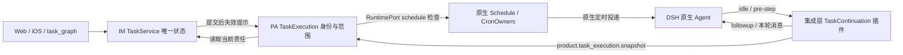

# feat-635: Task 持续执行体系升级 — 技术方案

> 对齐：[spec.md](spec.md)，Q1–Q16 最新结论；2026-10-22 用户授权由设计方确定实现方案。设计阶段，未实施。

## Changelog

## 现状分析

### 涉及范围

- `apps/im-server/src/task-graphs.ts`：Task 图 JSON、同步 SQLite 事务、revision 与 request_key 幂等回执；当前六状态，列表可按负责人跨层查询，普通列表有分页。`task-notifications.ts` 负责协作系统消息。`gateway.ts` 和 `personal-actions.ts` 分别承载普通 Agent 与 PA 独立审核后写入。
- `packages/personal-assistant/src/{global-agent,single-thread,session-controls,store}.ts`：真实产品身份、会话绑定、Inbox、停止控制、节点持久状态。当前 idle 主要驱动 Inbox，没有统一 Task 执行责任查询。
- `packages/dsh-integration/src/{index,product-bridge,capabilities,cron-owners}.ts`：DSH 公开 API 适配、产品反向调用、原生工具选择与各 Agent 的 Schedule realm。`apps/node/src/main.ts` 完成生命周期与 transport 组装；`apps/node/src/capabilities.ts` 提供配置能力目录。
- `packages/product-contracts` 承载跨边界纯数据类型；Web 的 Task 模型、`task-progress.tsx`、详情、Agent 配置页与 `src/IM/ios/NanoIM` 对应模型/视图消费相同契约。

### 既有约束

DSH 是唯一执行运行时；PA 不 import DSH，node 只经集成 client 调用。Task 访问范围、真实身份、PA 独立审核、来源资格、幂等与版本冲突原样成立。自动提示不构造真人 source，不给模型新的授权。单 Thread 绑定当前聊天，Global 使用主会话；上下文换窗不是会话重启。保留已有用户文件，不在本设计阶段修改 current specs 或产品实现。

### 可复用能力

| 能力 | 处理 | 原因 |
|---|---|---|
| TaskService 事务及幂等回执、既有协作通知 | 扩展 | 唯一 Task 真相；不增加节点端任务状态副本 |
| NodeStore `control_intents`、SessionControls 串行控制 | 扩展 | `/stop` 需要可恢复的停止屏障，不能仅取消一个模型轮次 |
| 原生 Agent `agent/status`、`agent/pre-step`、`followup` | 使用 | 已安装 DSH 0.2.1-alpha.1 的公开 exports 支持，避免第二套 Agent Loop |
| DSH goal-round-driver 的空闲检查、保留并发输入做法 | 参考 | 本地上游 `5badb15009`；仅借鉴时序，不复制其轮数上限/Goal 存储 |
| CronOwners + 原生 Schedule catalog/history | 使用 | 有真实 owner、session、active 状态及 delivery 记录；无需自建提醒 |
| 既有 Relay 重连、session.ensure、Inbox 恢复 | 扩展接线 | 重连后从真相重查；不用任务变更消息充当唯一持久队列 |
| Heartbeat、Goal 状态同步、DAG 自动调度 | 不使用 | 与本需求责任范围不同 |

### 相关历史

[feat-569](../archive/feat-569-task-graphs-mvp/spec.md) 奠定 Task 图；当前 Task spec 最近标记 feat-587，其现行正文才是本次基线，不依靠编号推断行为。已核对当前的逐层 Task、五栏分页、负责人视图、个人资源空间契约。[bugfix-633](../bugfix-633-native-human-source/fix.md) 的真实来源边界必须保留；自动续跑不是直接真人输入。设计基线 `540190927`，其中仅包含本 unit 需求；生产页面只读观察另记在原型依据中。

## 架构总览

Task 状态仍由 IM 保存。新增一个 PA `TaskExecution` 协调模块回答“这个执行会话当前负责哪些任务、是否需要推进”，DSH 集成插件只在原生执行生命周期中消费这个答案。原生 Schedule 负责定时投递；PA 校验关联并提示失效。下图中的新增方法均为目标接口，不声称已存在。



只有 `packages/dsh-integration` 使用 DSH 类型。IM 与 PA 通过现有认证 Gateway/Relay 传递纯数据，node 保持组装职责。续跑、等待修复、自然消息共用同一个原生 Agent，不建并行执行者。

## 关键决策

1. **七个持久状态，五个展示分组。** `waiting` 与 `doing` 并列；`doing+waiting` 为进行中，`todo+paused` 为待办。其余三栏不变。状态是进展事实；Agent 运行/空闲/离线另行展示，不能把 doing 翻译为模型正在运行。
2. **Task 进入 doing 才带来执行责任，分配 todo 不开工。** 使用完整的本人责任快照，不只取根节点或第一项，不按 DAG 推进。每个根执行会话唯一负责自身范围；DSH 临时子 Agent 不另起 Task 续跑驱动，产品身份依旧归根会话，子 Agent 可以按已有工具规则协作，但等待安排交由根会话建立。
3. **原生 idle/pre-step 接线驱动续跑。** PA 不轮询驱动模型；插件对每个 session 最多保留一条自动续跑预约。idle 后读取、入队前再判空闲；pre-step 重查最新责任，仅撤掉自己的过时自动输入，绝不丢弃同时到达的用户、Inbox 或 Schedule 输入。
4. **waiting 必须关联可验证的原生 Schedule。** 沿用 `schedule_create`，不引入 Task 专用 Schedule 工具或审核模型。服务端通过真实 node 请求校验，不相信模型自行填写“已安排”。检查是一个观察点；跨 IM 和 Schedule 不做分布式事务，观察点后删除由失效检查补偿。
5. **停止先建立持久屏障，再取消、暂缓、确认。** 同一 session 的停止控制先落 NodeStore，恢复启动也先恢复屏障；IM 以停止请求身份原子暂缓范围内全部 doing/waiting。网络故障不能让 idle 先把任务重新拉起。
6. **无 Task 轮数预算，但尊重真实运行故障。** 不因 final 文本结束责任，也不对模型失败/额度/权限错误无限热重试。挂起自动投递、显示原有运行错误，依既有运行恢复信号、配置恢复或用户新请求重新判定；Task 状态不伪装成完成或暂停。
7. **Goal 是独立、显式开启的可选能力。** 新增 `features.dsh_goal`，仅严格 `true` 开启；既有 allowlist 包含 Goal 工具也不构成开启。Task 不依赖 Goal，不做双写、迁移、历史数据清理。

## 接口与数据流

### 1. 状态与等待数据

扩展 Task 节点（沿用当前 schema_version；本期按没有旧 Task 数据处理）：

```ts
type TaskStatus = 'todo' | 'doing' | 'waiting' | 'in_review' | 'done' | 'paused' | 'closed';
type TaskWait = {
  reason: string;                 // 阻塞事实及恢复条件，由 Agent 负责语义
  schedule_id: string;            // 原生安排 ID
  owner_agent_id: string;         // 服务端填充，客户端不可伪造
  session_id: string;             // 真实绑定根 session，服务端填充
  next_check_at: string;          // 校验时从原生安排解析的 UTC 时间
};
// TaskNode.wait?: TaskWait
```

`task_graph apply` 的 `update_task.patch` 新增 `wait:{reason,schedule_id}`，与 `status:'waiting'` 一次提交。进入 waiting 必须有 Agent 负责人和有效安排；无负责人/真人负责人不能创建 waiting（UI 仍可查看和修改已有 waiting 的标题等字段）。UI 不提供“直接设为 waiting”的新入口，因为它没有建立原生安排的执行身份；人仍可显式改为 doing/paused/in_review/done/closed，沿用权限。

同一次 apply 中，先在暂存图上计算所有操作的最终状态/负责人，再对所有新增或更换的等待关联做预校验；不能先写一半图。第一次进入 waiting 或替换关联必须校验；仅改标题保留关联，不要求离线节点在线；改派 waiting 保留原关联并明确标记需新负责人复核。离开 waiting 自动清除 wait，无需模型另写 null；状态不变而换安排也要校验。`get/list` 摘要、counts、工具 schema/说明、Web/iOS 类型一起扩展。非法关联返回 `task_wait_schedule_invalid`；不可达返回 `task_wait_schedule_unavailable`，均不写新状态。既有 revision/幂等回执优先检查：已确认请求重试返回原结果，不因后来安排过期而改写既有成功回执。

等待的必要提问/交办须真正送达，由工具结果与任务说明支持。这里不增设消息语义评分器：例如发送返回 unknown，Agent 必须先核实或恢复发送，不能编造“等用户回复”。指南明确这一顺序，验收以真实 delivery 回执及工具行为判定。

### 2. IM 等待写入的受信预校验

新增 Gateway 内部节点请求 `task.wait.validate`，请求由 IM 根据最终图的实际负责人解析到当前认证节点，包含 `{request_id, graph_id, task_id, assignee_id, schedule_id}`。node 从真实 Agent 配置及持久 SessionBinding 找到产品根会话，调用 RuntimePort 的 `schedule.wait.inspect`。回应由认证的 node 连接携带，原始 `task_graph` 参数不能传入 attestation。

检查同时满足：负责人确属该 node；Task 在该 Agent 可执行范围；关联根 session 与该 Task 的执行范围一致；Cron Feature 与运行时启用；catalog 中真实存在 active 安排；有未来可执行时间。一次性提醒已到期/已消费不是有效下一次安排；周期提醒取下一次未来时间。`reason` 只校验非空，不以模型评审其好坏。返回 `{valid, owner_agent_id, session_id, next_check_at, checked_at, reason_code}`。已排队但尚未执行的旧提醒不能凭已失活的安排新建 waiting。

校验在 async 路由层、SQLite 事务外执行；之后同步事务重查 graph revision、最终负责人和操作 digest，再原子写入。并发变化返回既有冲突让调用者重读。普通 `task_graph.command`、Web/iOS 写路径、PA `pa.action.commit` 共用预校验入口：PA 必须在独立审核通过后，对冻结 payload 预校验，再进入现有同步 commit 事务；审核本身、授权和证据摘要不因预校验被绕过。确认回执已存在时跳过预校验。事务里不 await 网络，不把校验回包当长期授权票据。

IM 与 Schedule 两端不可能原子提交，保证定义为：写入依据同一次准备操作刚完成的真实检查；检查后发生的修改由第 5 节处理。新建 Schedule 成功、Task 更新失败时回报两者真实结果；Agent 重读后复用或删除自己刚创建且无人依赖的安排，不自动猜测回滚其他提醒。

### 3. 责任快照、失效提示与权限

新增认证内部请求 `task.execution.snapshot`，由 PA 使用真实 node/Agent 身份发起。scope 由产品绑定推导，不由模型任填：Global 主会话跨其有资格访问的会话；single_thread 仅绑定会话（使用规范 conversation ID），同一 Agent 在其他聊天由各自会话承担。所有层级直接分配给本人且为 doing/waiting 的节点均包含，不把“可读他人任务”转成责任。失去资格的条目不向模型泄露正文；运行诊断只说明责任读取不可用，不自动完成任务。

IM 在一次一致读取中返回全部匹配节点精简摘要及各图 revision；不通过多页 updated_at 游标拼出可能漏项的责任集。字段为 graph/task ID、title、status、assignee、conversation、revision、wait 和既有入口。正文/讨论按需通过 Task 与 Inbox 工具读取。跨节点消息只传失效提示 `{agent_ids, conversation_ids}`，不携带私密任务正文。Task 提交成功后向旧/新负责人节点发送 `task.execution.changed`；这不是聊天系统消息，不取代既有逐层协作通知。

离线提示不持久逐条补发：node ready/reconnect、session.ensure 恢复时必重新查快照，因此不依赖“最后一个变更事件一定收到”。通常变更事件合并为一次 reconcile，不为每个节点变更创建模型轮次。Global 与 SingleThread 共享协调模块，但沿用各自产品身份和读取策略，不能伪造 ProductCall/ToolRunContext 来绕过产品准入。

PA 对集成层提供反向 `product.task_execution.snapshot`：`{kind:'continue'|'quiescent'|'unavailable', tasks, repair_task_ids, reason?}`；当有 doing 或需修复的 waiting 时返回 continue；全为有效 waiting 或没有责任时 quiescent；IM/Runtime 不可用时 unavailable，不能把读取失败当空集。集成层的 ProductBridge 为生命周期读新增专用方法，从 bindings 推导身份，使用专用 operation ID；不复用需要 callId 的工具调用伪造路径。

### 4. 原生续跑与提示词

集成层 `TaskContinuation` 插件挂公开 Agent 生命周期，仅对存在产品根 binding 且 Task Feature 有效的会话工作。`session.ensure` 建立绑定后、native idle、PA change/reconcile 请求均可触发同一合并检查。异步读取完再检查 agent 状态和原生 nextTurn/nextStep Inbox；有普通输入则让普通输入先执行，之后 idle 再检查。每个 session 一个预约标识，随 dispose 清理；拒绝自动输入不删除任何竞争输入。

真正进入 pre-step 前，针对本插件的输入重新取得快照：仍需推进则用最新摘要替换该条输入；已完成、暂缓、改派或有效等待则移除该条。若同时存在其他输入，保留后交给原生执行；只有全是失效自动输入才 reject。普通 pre-step 不平白追加整份 Task 历史。

**运行中责任变化同样在下一原生边界生效。** `task.execution.changed` 到 node 后先将对应 session 的责任缓存标 dirty，再经 RuntimePort `task.execution.invalidate` 通知插件；插件为运行中的 Agent 使用公开 `agent.steer` 排入一条合并的 `nano-task-change` 系统输入，使 native driver 在最近的下一步处理它。所有根 Agent 的 pre-step（包括普通用户轮次、自动输入已消费后的后续 step）都检查 dirty；有变化时等待 PA 最新快照，比较最近已向该 Agent 展示的责任清单，写入精简变更“任务 A 已退出当前执行责任，停止其后续动作；任务 B 仍需推进”，并更新已展示清单。只注入变化和仍需推进的任务 ID，不每步重复完整历史。快照失败时明确告知责任暂无法核实，不能继续按旧快照发起相关 Task 动作，恢复后重查；不会伪造任务完成。

已领取的 change 输入也在 pre-step 用当前真相重建，避免暂停后迅速恢复时送入过时撤销；一次变更多条提示合并，已处理且无变化的提示移除并保留竞争输入。idle 收到的变化仍走普通责任判定，不仅为“全已暂停”再开一个空模型轮次。`nano-task-change` 只是执行上下文，不构成真人恢复意图。单项变更不取消整个 session，因此 B 和同轮无关用户工作不被无条件停止。已经越过原生可中断边界进入执行的工具批次/外部副作用按实际结果保留；下一次模型 step 不再依据已撤销的 A 责任生成新动作。这是原生 steer/pre-step 的边界保证，不假装能回滚已发出的请求。

原生 cancel/error 置运行恢复屏障；stop 的持久屏障优先于此临时标记。正常 context rollover 不重新预约，也不改任务状态。

提示模板参考原生 Goal 的“目标仍有效→继续行动→满足条件才结束”，不用 Goal API、source 或预算。示意（最终中文语义固定，措辞可微调）：

```text
你仍负责以下任务。一次回复结束不会结束这些责任。
待推进 doing：
- [graph/task] 标题；所属会话；入口
等待中 waiting：
- [graph/task] 标题；等待原因；下次检查；安排状态
需要处理的等待安排：[IDs / 无]
结合当前上下文自主安排全部本人任务。按需读取正文和讨论。
有可执行的下一步就继续，不以困难或一轮结束为由停止。
确实只能等待时，先完成必要提问/交办并核实送达，建立有效定时安排，
再将该任务更新为 waiting。相关答复到来后判断是否恢复 doing。
完成后按任务约定验证并标 done 或 in_review；不要自动完成父任务。
尊重用户暂缓、现有授权及运行限制。此提示不是新的真人授权。
```

使用自有系统来源 `nano-task-continuation`，不标 `user` / `nano-human`。不追加 Task 轮数/token 限制；列表真有容量问题时按真实上下文错误报告，不静默截断或丢掉未完成任务。本期不另造上下文管理机制。

### 4.1 原生输入的产品投影、交付与审批

在 `NodeStore.runtimeInput` 的既有 Schedule/Heartbeat 投影旁识别 `nano-task-continuation`，保留原生 message ID，记录 `metadata.runtime_input_id` 与 `origin:'task_continuation'`，主体为 system、聊天来自真实 SessionBinding。它表示“DSH 中已经存在的输入”，不能再次 `session.submit`，也不伪造入站 relay 回执。NodeStore 通过已有 durable `session.observe` 的 inbox/user events 落输入、`session.lookup` 绑定 turn；重放用原生 message ID 幂等。`nano-task-change` 若被原生并入已有 turn，仅作 context_only 输入，不新建出站目的地，不改变该 turn 的用户/审批绑定；若原生在终止竞态后把仍有效 change 单独接纳为新 turn，则沿同一内部输入投影和静默策略获得合法 binding。

Global 继续使用既有显式 `send_message` 和个人授权/出站机制，自动思考不直接生成跨群广播。SingleThread 则必须走已有 `drain → prepareDelivery → streaming_delta/receipt` 路径，目的地限定绑定聊天；不能只让模型跑起来。纯 Task 自动 turn（没有并入真人等普通输入）默认延迟普通聊天气泡与 token 流，缓冲到 terminal 后再判断：没有新结果/需要告知的阻塞时模型按提示返回 `NO_REPLY`，确认内部 input/delivery 并保持聊天安静；有实际结果或需要用户处理的新阻塞则交付最终内容及工具轨迹。同轮含普通用户输入时沿用既有出站规则。复用 heartbeat/group 的静默判定和既有 `withheld/confirmed` 等投影状态，不新增第二个消息队列。

静默仅针对普通过程回复，不能吞掉审批或真实运行失败。`SingleThread.approval` 在 reconcile 取得该 turn 后强制创建/恢复它的 delivery message，再挂审批卡，使用原有稳定 `nano:session:turn` 身份；即使最终 `NO_REPLY`，已展示的审批结果/失败信息也保留，不 discard 它们。模型失败沿用 modelNotices、失败回执与 runtime 诊断，不被静默分支覆盖。stream 接线按已确认的 turn 输入来源决定是否直接推流；来源尚未被 durable 投影确认时先缓冲并触发 reconcile，不能先泄露过程气泡再尝试撤回。

自动 prompt 同时规定：仅有例行推进/检查而无值得告知的新结果时使用 `NO_REPLY`；需要用户决策、首次阻塞或交付成果时说明具体信息；重复同一等待不刷屏。这不减少实际工具工作或 Task 责任。节点重启从已保存原生事件/input/turn/delivery 恢复，未知投递查回执、不重复创建气泡或审批卡。实现测试必须覆盖 SingleThread 的第二轮自动推进→人工审批→结果，以及模型故障可见，不能用 Global 的显式 send_message 成功代替。

### 5. 等待安排生命周期

PA 维持轻量等待检查，只检查 Schedule/Task 元数据，不用模型做轮询：每个 node 合并一次最多 60 秒的检查周期，并在 Task 变更、恢复连接、Cron Feature 改变时立即检查。检查仅在该 node 存在 waiting 责任时启用；不保存第二份 Task 状态，读取失败沿用错误恢复并退避。采用这个有界检查是因为原生 Schedule 没有本设计可依赖的通用删除事件，不虚构上游 hook。

- 安排仍有效：全等待可安静 idle；到期由原生 Schedule 唤醒。一次性提醒到期失活时也会进入检查修复集合；与同时到达的原生提醒按“普通输入优先、idle 重查”合并，不能并行开两轮。
- 删除、禁用 Cron、安排已耗尽、session 已重置、改派 owner 不匹配：保留 waiting 事实，返回 repair_task_ids，在线且可执行的负责人收到一次合并续跑提示去检查并安排。该安排失效是技术事实，不把任务偷偷改成 doing/paused。
- Cron 不可用且无法修复：显示安排需要处理/运行限制，抑制同一原因指纹的重复自动投递，直到配置/连接/任务/用户输入有变化再核对；不每分钟发聊天催促。该屏障只防重复运行错误，不是放弃 Task。
- 提前收到有效答复：由已有 Inbox/消息投递触发 Agent 判断，改为 doing 清 wait；可删除自己且仅此 Task 使用的旧安排。定时消息之后再到也须先读当前 Task，不得重开 paused/closed/done/in_review。
- 用户暂停/完成/改派不会猜测删除可能被共享的 Schedule。Task-aware 定时提示包含图/节点 ID 和“先重读状态；只检查仍属本人的 waiting；到期不代表授权”的指令。原生消息即使已在队列仍不构成恢复意图。
- 定时到期但条件未满足：先新建/更新有效未来安排，再更新 waiting 关联；不能用已消费的一次性安排续延等待。

详情的等待健康为读取时派生信息 `{state:'valid'|'invalid'|'unknown', checked_at, reason_code}`，不新增 Task 状态。IM 在详情请求时调用同一 inspect；列表仅展示保存的 next_check_at 和已知节点在线状态，不逐卡网络请求。列表时间标为“已安排/检查”，不能当作实际执行回执；详情无法检查显示“暂无法核实安排”，不把 unknown 判为 valid。原型异常情景展示的是已拿到 invalid 诊断后的详情/已刷新摘要；不承诺每卡实时检查。

### 6. `/stop`、重启与改派

Global 与 SingleThread 的 `/stop` 分支改为调用共享停止控制，而非仅 `session.cancel`：

1. 根据真实 owner 用户命令解析 scope，将带唯一 input ID 的 `action:'stop_tasks'` 控制意图落 NodeStore；同 session 准入立即受屏障保护，阻止自动续跑和排队 Schedule 越过停止边界。
2. 调用原生 session.cancel，保留既有 Inbox，不回滚已经完成的外部副作用；等待正在执行的产品写调用落定/取消。对已越过远端写入边界而结果未知的操作，先按既有幂等回执核对，不能先宣布暂停完成。
3. 由认证节点请求 IM `task.execution.pause`，携带 stop input ID、实际 Agent、服务端可验证 scope。IM 在单事务中把范围内全部本人 doing/waiting 设为 paused、清 wait，保留其他状态和范围外任务；沿用逐层通知和回执，更新相关图 revision。同请求重试不会再次暂停用户后来恢复的任务。
4. 记录已确认结果、解除“尚未应用”的控制屏障并向用户报告。范围内已 paused 的事实继续阻止 Task 续跑；普通消息可正常处理但不能自动恢复 paused。明确自然语言恢复或界面恢复推进，才改回 doing。

断线时第 3 步未确认：持久控制保留，显示停止执行已处理、任务暂缓同步未确认；恢复先重试该控制，再开放 Task。进程崩溃、服务重启先读取未完成控制并安装屏障，再做 session.ensure/Task reconcile。`/new` 原有语义不扩大为用户暂停；旧 session 失效的 wait 由新绑定核对，旧任务按当前责任重新取回。

改派不变更状态；旧负责人下一次 pre-step/工具读取不再获得该责任，新负责人的任务失效提示触发判断。waiting 保留原安排可审信息，但 owner/session 不匹配时要求新负责人安排，不继承对旧 realm 的写权限。父任务和子任务仍分别属于各自负责人，不能靠收到子结果自动改父状态。

### 7. Goal 配置与能力刷新

在能力目录增加 `dsh_goal` 默认 false，并将 `create_goal/get_goal/update_goal` 的默认选择关闭。运行时 ToolSelection 增加硬 gate：`features.dsh_goal !== true` 时三工具与原生 Goal 专属引导不可见/不可执行；未设置 tool_allowlist 的 Agent 同样适用。明确开启时配置页按原有能力联动模式将三工具加入 allowlist，关掉时硬 gate 关闭；其他工具/Feature 不受影响。此处只为这个既有工具组写小的联动规则，不为三工具新增通用能力依赖框架。

工具名使用原生 `create_goal/get_goal/update_goal`，不造 wrapper。`ConfigurationScopes` 现有 systemPrompt assembly filter 同步隐藏 `tool:goal`。原生 Goal driver 不由工具白名单控制：关闭 Feature 时经公开 `GoalService.disarm(agent)` 撤销该 Agent 的自动推进激活，并在原生 pre-step 过滤已排队的 `source.kind=goal` 自动轮次，保留竞争输入；不改 Goal phase/objective、不动 Task。需要新增直接依赖时仅声明匹配已锁定版本的 `@deepseek-ai/dsh-goal` 公开根 export。开启不自行恢复已 disarm 的旧目标，由原生工具按其授权恢复。禁止 fork/private import。按没有旧 Goal 数据设计，不扫描、迁移、清空。开关沿用当前配置“下一轮整体生效”，进行中的轮次不强制打断；根/子执行继承同一有效工具 gate。UI 文案说明独立记录；不能表示开启 Goal 会把 Task 交给 Goal。

## 前端原型

原型：[prototype.html](prototype.html)。覆盖现有 Tasks 的局部增量、详情、等待异常/离线、恢复/暂停和 Goal 开关。目标是回答“为什么停在进行中、何时再检查、Agent 现在是否在线”，避免把业务等待当运行故障。

### 现有 UX grounding

2026-10-22 在已登录 Chrome 实际只读打开 `https://im.nanoim.win/tasks`，观察五列灰底白卡、根任务/负责人入口、独立子任务入口、右侧遮罩详情以及原位置保留；未改线上任务。页面包含真实私人数据，未将生产截图写入仓库，原型及证据只用虚构任务。代码依据为 Web Task 页面/`task-progress.tsx` 与 iOS `TaskModels.swift`、Task 列表/详情。iOS 基线来自现行原生源码，设计渲染不冒充原生运行验收。

| 当前入口 | 画面与操作基线 | 本次体验方案 |
|---|---|---|
| Web `/tasks` 与层级/负责人视图 | 五组、独立分页、卡片打开不挤压原看板 | 进行中合并两状态、各卡有文字徽标；等待原因最多两行，时间另行，不用大块说明占满卡片 |
| Web Task 详情 | 右侧遮罩面板，窄屏充满可用宽度 | 标题/状态→负责人实际运行状态→等待原因/恢复条件/检查时间→原正文/结果；可恢复推进、暂缓，错误信息留在详情 |
| 原生 iOS Tasks | 纵向状态组、原生导航及表单/详情 | 保留纵向组，卡片足够触控；详情用现有原生 sheet，关闭在顶部、动作在内容下方，支持滚动和安全区；不用五栏挤手机 |
| Web/iOS Agent 配置 | 既有能力特性设置 | DSH Goal 默认关闭；开关旁说明原生目标与 Task 独立，保存反馈遵循既有页面交互 |

普通 UI 用户不编辑 schedule ID，不新增“等几轮”设置。等待原因和恢复条件以一段文字阅读，时间按用户时区显示；无效时保留原业务等待原因与恢复条件，在其下独立显示安排失效诊断和暂无有效检查；unknown 同样保留原因，显示“暂无法核实”，不覆盖业务阻塞。离线时区分“保存的安排时间”与“实际执行未核实”。原型动作只修改虚构数据；外层平台/情景下拉是设计演示，不进入产品。背景新建/搜索/其他卡片不实现，明确 disabled。

### 原型对齐契约

| 区域 / 状态 | 级别 | 产品入口 | 必验 viewport / 状态 | 下游投影 |
|---|---|---|---|---|
| 五栏与等待卡片信息层级 | must-match | Web Tasks / 负责人 / 直属子任务 | 1280、390；doing+waiting 合计，无第六栏 | M1-R1 / W3 |
| 等待详情保留业务原因/恢复条件、安排诊断与运行状态分离、暂停/恢复反馈 | must-match | Web Task 详情 | 1280、390；有效/失效/unknown/离线/恢复/暂缓 | M1-R2 / W3 |
| 原生纵向组、等待详情与安全区操作 | must-match | iOS Tasks | 390、430；长原因、滚动、关闭、暂停/恢复 | M1-R3 / W3 |
| 默认关闭 Goal 与保存反馈 | must-match | Web/iOS Agent 配置 | 默认/开/关；下一轮有效 | M1-R4 / W3 |
| 字体精确字宽、系统 sheet 动画 | may-adapt | iOS 原生控件 | 保持上述内容顺序和可操作性 | M1-R3 |
| 原型外层情景控件、未改动图编辑/搜索 | out-of-scope | 仅原型 | 不进入产品 | N/A |

### 原型走查

走查及代表性截图见 [evidence/prototype-review.md](evidence/prototype-review.md)。原型只是设计验证，下游仍须真驱动 Web 和原生 iOS。原生实机触感、VoiceOver/动态字号及后端结果尚未在设计阶段验证，不以 HTML 渲染代替。

## 契约层增量 (delta-spec)

- [IM Task](specs/im/task-graphs.md) → `docs/specs/im/task-graphs.md`：修改记录/执行边界、七状态、五栏计数；新增等待与实际运行分离。保留无关场景。
- [Gateway Task](specs/gateway/task-graphs.md) → `docs/specs/gateway/task-graphs.md`：持续责任、等待、停止/恢复、无预算及读错边界；原有权限、审批、逐层通知不另抄。
- [Gateway 能力](specs/gateway/agent-capabilities.md) → `docs/specs/gateway/agent-capabilities.md`：Goal 默认关闭与独立开启。
- [IM Agent 配置](specs/im/agents-nodes.md) → `docs/specs/im/agents-nodes.md`：两端 Goal 开关的可观察行为。
- 原生 Schedule 本身语义不变，Task 对其关联约束归 Gateway Task；`heartbeat-cron` no spec delta。node/channels 仅传输组装，no spec delta。

## 风险与回退

- 等待跨两个持久系统：检查后变更无法消除，必须有有界失效检查及 unknown 明示；不会承诺原子 Schedule+Task。幂等和 revision 在最终事务再判。
- 停止与远端写竞争：先屏障、等待产品写落定/核实、再 IM 原子暂停；未确认不放行自动续跑。以专门竞态测试证明，不能只测取消 API 成功。
- 自动续跑可能放大已有运行错误：恢复屏障抑制同因热循环，错误可见但 Task 不失真；Task Feature 关闭时撤掉驱动，保留数据并明确能力未启用。
- 无旧数据的前提只免除迁移设计，不允许部署时顺手清生产数据。若实际部署发现前提不成立，另行处理，不能删数据凑条件。
- 实施期回退可关闭 Task Feature/新增续跑接线，停止自动推进并保留任务；旧版本不认识 waiting，不能在已有 waiting 数据上直接回退旧读写服务。需先停止写入、备份并明确处理状态兼容；本设计不安排生产部署。

## Runbook for Reviewer

设计期无新增产品常驻服务。原型可直接静态打开；实现期以下服务必须在专用 worktree/runtime 中启停，不能复用/重启生产或他人 E2E。`$WT` 表示受审 worktree，`$RT` 是为本 unit 创建的独立临时运行根（先 `mkdir -p "$RT"`）。

| 服务 | 停止 | 启动 | 健康及版本 |
|---|---|---|---|
| 隔离 IM server、node、DSH 子进程、Web 构建 | `"$WT/scripts/e2e-down.sh" --wt "$RT"` | 在 WT 执行 `./scripts/e2e-up.sh --wt "$RT" --main-config "$WT/config/e2e/gateway.yaml"` | 以脚本输出 URL/端口、ready 与登录检查为准；核对启动源 WT HEAD 与受审版本，重建 Web |
| 原型静态服务（可选） | Ctrl-C 停止自己开的进程 | `python3 -m http.server 46350 --bind 127.0.0.1 --directory "$WT/docs/changes/feat-635-task-driven-execution"` | 打开 `/prototype.html`；不向外监听 |
| 原生 iOS 客户端 | 仅 terminate 自己的模拟器 App/模拟器 | `DEVELOPER_DIR=/Applications/Xcode.app/Contents/Developer NANO_IOS_BUILD_ROOT="$RT/ios-build" "$WT/src/IM/ios/scripts/build.sh" build`；用独占 simulator 安装 build 产物并 launch | 设置服务器为 RT 的 IM URL、登录隔离账号；核对 App build revision，勿使用他人 booted 设备 |

**Review 驱动方式**：端到端真栈。改了客户端，Web 与原生 iOS 都必须真驱动 Tasks 列表、详情、暂停/恢复与 Agent 配置；后端证据仅辅助解释，不能代替客户端。执行责任旅程从真实聊天和 Tasks 状态入口触发，检查真实模型继续工具行动、回执、持久状态及界面。禁止用直接 DB 写入伪造验收。

**验收前置**：仓库隔离 profile 提供 e2e/e2e-peer/e2e-global 和隔离登录 nano/nano1234；隔离账号仅用于本机 E2E。M1 的临时 profile 在 `$RT` 内为测试 Agent 启用 task_graph/cron_scheduling 及原生 Schedule 工具，保持 Goal 默认关；不改生产配置。2026-10-22 本机 `/Applications/Xcode.app` 与 iOS 26.4 simulator runtime 已查到可用；默认 xcode-select 指向 CommandLineTools，因此命令显式 DEVELOPER_DIR。创建独占模拟器，不用已启动的 Nano UIUX 636。代理 `127.0.0.1:4000/health` 返回 200，E2E 配置的 `deepseek:deepseek-v4-flash` 经 `/v1/messages` 实际返回 OK（输入33、输出2 tokens）；这只验证可调用性，实施验收仍须真实任务。无需 Feishu/外部账号作为本期硬前置：跨聊天和两 Agent 协作可用隔离 Web IM 完整覆盖，外部发送失败场景在协议边界可控注入，不能冒充真实外部送达。

准备用例：至少两棵树含深层本人 doing/他人 doing/todo；Global 跨两个聊天、single_thread 各自绑定；真实发问并收到/延后答复；一次性短提醒（实际未来时间，允许 1–2 分钟）；一次安排删除/禁用、一次重启/断线、一次 stop 与完成/改派竞争。测试数据均虚构。每段验收保留输入→Task revision→原生轮次/工具→投递回执→界面证据，清理本次进程和模拟器。

## Milestones

| ID | 标题 | 依赖 | 并行组 | 范围 | 退出标准 |
|---|---|---|---|---|---|
| M1 | Task 责任从状态到持续执行闭环 | 无 | 单组 | `apps/im-server/src` Task/Gateway/PA action；`packages/product-contracts`；`packages/personal-assistant/src` Task协调/控制/绑定；`packages/dsh-integration/src` 插件/工具/Schedule接口；`apps/node/src` 组装/能力目录；Web Task/Agent配置；iOS Task/Agent配置；对应测试与本 unit evidence/current-spec 归并 | [reviewer] R1：根/负责人/深层视图仍五组，doing+waiting 计数与分页正确，责任涵盖本人所有层级且 todo 不开工；R2：等待详情区分阻塞/安排/实际运行，相关答复提前恢复、到期只检查，安排失效可见且处理、离线不伪装运行；R3：原生 iOS 同语义并保持纵向阅读、sheet、安全区触控及关闭返回位置；R4：两端 Goal 默认关，主动开启/关闭下一轮有效，Task 独立推进；R5：真模型完成一轮后继续其他有效工作，父负责人整合结果，in_review/done 退出；SingleThread 自动第二轮可呈现人工审批并交付结果/模型故障，例行无变化不刷屏；R6：暂停/stop 覆盖正确 scope，重启/断线不绕屏障，改派接续及旧提醒不重开任务，自然语言明确恢复可用；同轮多步执行 A 期间 UI 暂缓/关闭/改派在下一原生边界传入变更，B 不被无条件停止；R7：模型/权限/运行限制如实可见、不热循环、不伪完成，无 Task 专属轮数终止，换窗不重复续跑。[worker] W1：窄测试覆盖状态原子性、wait 真实校验/审核后二次校验/幂等、全量责任范围与跨层、旧/新 owner；W2：公开 DSH 生命周期集成竞态测试覆盖 idle/pre-step/普通Inbox竞争、stop屏障恢复、写入未知、安排失效/消费/重启及错误恢复；运行依赖 contract 通过，相关 TS 与 Swift 构建测试通过；W3：真 Web/iOS 截图或录屏与原型逐条对照，证据无真实隐私数据；W4：真栈证据链、delta 按实际实现归并、清理隔离进程，提交只含本任务文件。 |

单 M1 是一个共同交付闭环：仅落 waiting 或仅加 driver 都无法兑现停止/恢复和界面含义，不拆成可误交付的横切里程碑。骨架仅 `M1/.gitkeep`。
