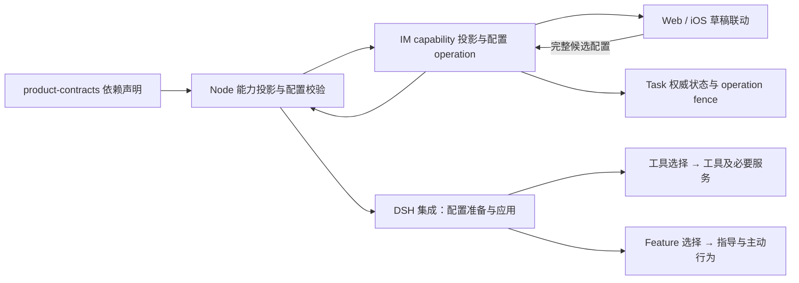

# feat-645: Feature 联动与能力依赖完整性 — 技术方案

> 对齐：[spec.md](spec.md)。取证基线：main `1fce5eb1b4692fa2764b9a59acd604241b2edb64`，2026-10-23。本文是目标设计，尚未实施，不覆盖 current specs。

## Changelog

## 现状分析

### 涉及范围

| 位置 | 已核对的当前行为与缺口 |
|---|---|
| `apps/node/src/capabilities.ts` | 六个 Feature 仅声明单个 `requires_tool`；`available` 将未选择工具误当成能力不可用。 |
| `packages/product-contracts/src/configuration.ts` | 统一 canonical 配置与 fingerprint；可保留格式与版本化配置，不新增第二份配置。 |
| `apps/im-server/src/control.ts` | capability 投影会裁掉未知字段；`ConfigOperations` 有持久 operation、CAS、ACK 恢复和补偿，但无完整依赖/占用校验。 |
| `apps/node/src/configuration.ts`、`packages/personal-assistant/src/configuration.ts` | Node resolve、落盘、runtime apply 的真实入口；Node operation 在 runtime apply 前落盘，需要把拒绝条件前移。 |
| `packages/dsh-integration/src/agent-config.ts`、`capabilities.ts` | Feature 插件生灭与工具注册绑定；白名单之外还按 Feature 排除 task_graph/memory/skill_manage；提示词按 Feature 过滤。 |
| `packages/dsh-integration/src/features/` | Task、Memory、SkillCreation 同时注册工具和主动行为；IntelligentUI 注入指导；Heartbeat 注入指导；Cron 挂原生调度工具和安全来源提示。 |
| `packages/dsh-integration/src/cron-owners.ts`、`index.ts` | per-Agent 调度 service 和 store 已隔离，setEnabled 直接受 Cron Feature 控制；工具勾选仍可能不注册。等待校验、手动运行也存在 Cron 门槛。 |
| `apps/im-server/src/task-graphs.ts` | 真实 task_graph API 的身份查询把 Feature 与工具做 AND；不能只改 runtime 的工具列表。已有 Task 持久状态、责任查询、等待校验和事务。 |
| `packages/personal-assistant/src/task-execution.ts`、integration `task-execution.ts` | Feature 控制责任恢复与自动续跑；这是应保留的 Feature 行为，不能因单独开工具而自动恢复。 |
| integration `knowledge/runtime.ts`、PA `heartbeat.ts` | 已有 active review、订阅、后台持久事实、心跳 pending admission；可读取真实占用，不以 Agent 整轮 running 猜测某能力正在使用。 |
| Web `agent-{create,detail}-page.tsx`、iOS `AgentModels.swift`/`AgentConfigView.swift` | 各自联动单工具；Web 取消工具反向关闭 Feature；Swift 固定集仍写旧 `agent` 名称。 |

### 既有约束

- 只有 dsh-integration import DSH 已声明公开 exports；Node 走 client/stdio；PA、IM、Channels 不 import DSH。不增加 Agent loop、内核 HTTP 服务或 runtime fork。
- 工具选择不授予操作权限，调用仍经过现有身份、空间、会话及审批校验。保留主会话/子 Agent 权限区别。
- 用户的最新决定是“仍被需要不能关闭”。Task 依赖 Cron；关闭被阻止时只提示，不暂停、删除或迁移业务责任。
- 升级由部署 Agent 执行 [deployment-prompt.md](deployment-prompt.md)，产品代码不做历史配置自动修复。
- 同期另一个聊天交付了 bugfix-644 设计产物，本 unit 不修改或重新提交那些文件。该 unit 未来落地的离线只读语义应在集成时沿用。

### 可复用能力

| 能力 | 用/改/不用 |
|---|---|
| 既有 feature key、features/tool_allowlist/skills 字段 | 用；配置仍是一个完整快照，不引入用户选择来源账本或持久点击日志。 |
| canonical 配置、profile_version、configuration operation | 用并扩展拒绝原因；保持 fingerprint 和 pending 恢复，不绕过 Node 确认直接写 IM profile。 |
| 原生 tools.restrict、Skill provider 过滤和公共 ScheduleService | 用；拆分贡献生命周期，不改 DSH 私有 API。 |
| CronOwners per-Agent chain、TaskGraphService 同步事务 | 用；在真实写入处闭合“检查后新建任务”的竞态，不新增通用分布式锁服务。 |
| KnowledgeRuntime.active、Heartbeat pending、工具 middleware | 用于按 Agent/能力读取占用和短暂阻止新 admission；不复制业务数据。 |
| 现有 UI 分区与保存动作、消息 Toast 的视觉语言 | 用；新增配置局部轻提示，不复用带跳转/关闭按钮的聊天通知行为。 |
| 新的逐 Feature 调度器、权限引擎、兼容迁移框架 | 不用；六个静态 Feature 的依赖图和有限关闭条件足够。 |

### 相关历史

- feat-637 已归并后的 KnowledgeRuntime 是本次实读基线；仅拆配置生命周期，保留 Memory/Skill 联合复盘、F4 范围和成功事实归属。原始 SKILL.md 读取仍由 `read` 完成，`skill` 不能替代 YAML 全文读取。
- current Task 契约已有 waiting→原生 Schedule 证据关系；本次保证依赖可用，不重做 Task 状态机、NO_REPLY、Goal 或续跑策略。
- bugfix-644 是同页的另一项 active 设计，不能把它当已实现；本次不拥有其环境、截图验收结论或提交。

## 架构总览

配置仍由 Node/IM 既有 operation 管理。增加一份纯数据的依赖声明及小型集合运算；Web、iOS、Node 和预览从同一声明取得依赖。DSH 集成把“工具贡献”与“Feature 行为贡献”分开。保存前检查静态依赖和真实占用，成功保存后运行时按工具选择注册调用入口，按 Feature 选择注册额外行为。



## 关键决策

### D1. 六个 Feature 的完整直接依赖

以下是根据用户原则与真实实现作出的设计细化；不是把所有默认项升级为必需项。传递依赖由图展开，表中不重复列出。

| Feature（默认） | 必需 Feature | 必需工具 | 必需命名 Skill | Feature 额外行为 | 关闭时额外检查 |
|---|---|---|---|---|---|
| `intelligent_ui`（开） | 无 | `send_message`, `skill` | `nano-interactive-ui` | 何时选交互回复、如何组织呈现的 `nano-interactive-replies` 指导；Skill 正文按需加载 | 相关发送调用仍在途则暂不能撤销其工具；已发布卡片不阻止关闭 |
| `task_graph`（开） | `cron_scheduling` | `task_graph` | 无 | `nano-task-graphs` 指导、责任注入、Task 自动恢复/续跑 | 本 Agent 全部会话范围内有 doing/waiting 则拒绝 |
| `memory_curation`（开） | 无 | `memory`, `read` | 无 | 持久 Memory/User 注入，记忆提醒及后台复盘 | 本 Agent 已接受的 memory 维护尚未结束则拒绝 |
| `skill_creation`（开） | 无 | `skill_manage`, `skill`, `read` | 无 | Skill 维护指导、相关提醒、后台复盘和既有维护扫描 | 本 Agent 已接受的 skills 维护尚未结束则拒绝 |
| `cron_scheduling`（关） | 无 | `schedule_create`, `schedule_list`, `schedule_update`, `schedule_delete`, `schedule_run`, `schedule_history` | 无 | `nano-cron` 功能指导；保证整套调度管理能力启用 | 有其他开启 Feature 依赖（目前为 Task），或 catalog 存在 active 安排，或相关调用仍在途则拒绝 |
| `heartbeat`（关） | 无 | `read` | 无 | `nano-heartbeat` 指导、Node 周期唤醒订阅与 HEARTBEAT 文件任务选择 | 本 Agent 心跳已接受且未完成/未确认的 admission 或执行尚在途则拒绝 |

依赖理由：

- Intelligent UI 的完整语法就在命名 Skill 中，必须保证 `skill` 可调用；不额外锁定 read/write/bash。底层渲染、历史卡片、用户已发送卡片的提交不随 Feature 关闭被删除。
- Task 需要完整等待能力，因此依赖完整 Cron Feature。Task 的任务保存/更新本身由 task_graph 完成，无必须加载的 `task-graph-planning` 或其他外部 Skill。Global 的发送能力由基础集合保障，single_thread 沿现有回复路径，不额外把所有通信工具设成 Task 依赖。
- Memory 和 Skill 维护要求先读取当前文件；Skill Creation 还要按名加载已选 Skill。glob/grep 是便利工具，不是完成这些操作的必需依赖；write/edit/bash 也不必开启，写入通过维护工具进行。
- Heartbeat 提示 Agent 读取 HEARTBEAT.md，故需要 read；它不依赖 Cron，未来周期检查本身不是必须先清空才能关闭的业务责任。已有独立 Task/Cron 责任仍按各自状态保护。
- 后台复盘所依赖的模型、知识维护策略和写入权限沿现有契约；不把审批通过列为配置依赖，不因拒绝而关闭 Feature。

**默认值保留声明值，实际初始配置展开依赖。** 新建 Agent 默认 Task 为开，所以初始有效选择会同时开启 Cron，即使 Cron 自身的独立 default_on 是 false。首次创建和“恢复默认”都先展开依赖再展示/提交；不要展示 Task 开、Cron 关的草稿。用户关闭 Task 后可以再关闭没有 active 安排的 Cron。

### D2. 基础能力按运行模式保留，不扩大默认必需范围

| 场景 | 固定能力 | 边界 |
|---|---|---|
| Global 根会话 | `inbox`, `conversations`, `send_message`, `subagent` | 使用当前实际 schema 名称 `subagent`；纠正旧 iOS/文档 `agent` 拼写，不引入别名兼容工具 |
| Personal Global 根会话 | 上述集合 + `personal_sources` | 既有个人来源权限不变 |
| 已启用默认上下文机制的会话（含子 Agent） | `notes`, `history`, `new_context`, `get_context_remaining` | 随现有上下文机制生命周期；本 unit 不增加新总开关或改变插件停用策略 |
| single_thread / 子 Agent 的其他业务工具 | 无额外固定集 | 仍遵循选择、继承和角色权限；不把 Global 根会话固定集合扩到子 Agent |

不存在基础固定的命名 Skill。read/skill/send_message 可因特定 Feature 必需而受保护，但不普遍固定。Goal、Workflow、plugin_manager、文件/web/命令工具保留原有独立选择，不新增 Feature，不恢复 Task/Goal 双写。

### D3. 工具本身与 Feature 行为分离

| 单独打开工具、所属 Feature 为关 | 应保留 | 不附带启动 |
|---|---|---|
| `task_graph` | 正常查询/修改任务，既有身份、会话、等待证据验证 | Task 专属 system prompt、责任主动注入和自动续跑 |
| `memory` | 主动调用的合法 Memory 写入、成功事实记录 | Memory/User 自动注入、主动维护提醒、后台复盘 |
| `skill_manage` | 主动调用的 Skill 管理、成功记录和发现失效通知 | 维护指导、后台复盘、F4/周期维护触发 |
| 任一 `schedule_*` | 该工具完整原生操作及必要调度服务；创建的定时安排按承诺执行 | Cron 专属额外 system-prompt section、其他未选 schedule 工具、反向开启 Cron Feature |
| `send_message` / `skill` / `read` | 各自正常操作 | 交互式回复策略、Heartbeat 或其他 Feature 行为 |

工具的名称、参数、描述和必要前置条件属于工具接口，保留既有授权与来源约束。单独选一个工具不会自动多选别的工具；调用时缺少业务参数、合法读取证据或权限仍按原工具契约报错。不能用 Feature 关闭作为调用拒绝理由。

具体落点：拆 Task/Memory/SkillCreation 的工具注册与行为插件；工具按静态注册后白名单限制，行为插件只控制 prompt/注入/订阅。移除 ToolSelection 的三个 Feature 否决名单；TaskGraphService 普通工具调用身份门槛改为有效 task_graph 工具，而 `execution`/`execution_scopes` 等自动执行入口仍要求 Task Feature。`execution_pause` 保留既有真人停止路径。不要把前台维护调用误判为后台 review。

交互式发布同样遵守完整工具语义：`packages/personal-assistant/src/global-agent.ts` 的 `GlobalAgent.send` 与 `personal-assistant.ts` 的 `PersonalAssistant.send` 两条真实发送入口移除仅因 `intelligent_ui === false` 拒绝 interactive 参数的判断。Feature 关闭只移除主动选择交互表达的指导与必需 Skill 默认选择；有效 send_message 收到显式合法 interactive 参数仍可发布新卡片。保留 interactive schema、身份/会话权限、发送前独立审批、来源、外部 channel 文字降级、幂等 receipt 及历史卡片提交规则。Skill 被联动关闭只影响发现/加载，不额外禁止调用方已构造的合法工具参数。

Cron 的 service 需要与 Feature 解耦：当有效选择含任一 schedule 工具、Cron Feature 开启、存在 active 安排或已接受调度工作未收口时保留 per-Agent service。没有这些使用者才可卸载；读取 catalog/history 可继续复用持久存储的无计时器路径。工具自身创建未来安排产生的定时执行是该操作本身的效果，不是偷偷开启其他 Feature。`schedule.wait.inspect` 校验实际 service/安排及归属，不再单看 Cron Feature；`schedule_run` 和普通 schedule command 使用工具选择与既有身份授权。UI 管理定时任务走原用户管理授权，不伪装成模型工具调用。

Cron 关闭不删除安排；用户只开 schedule_create 时也能创建并兑现提醒。若 Feature 原本关闭，该工具行为不会把它改为开启；之后尝试开启再关闭 Cron，active 安排同样阻止关闭。重启根据有效工具与持久安排恢复服务，不能重新引入 Feature AND 门槛。

`nano-cron`、`nano-task-graphs` 等额外 section 跟随 Feature；工具说明保留使用约束，宿主来源标签和审批不受 prompt 开关影响。Skill 发现/加载本身继续按选择提供，不要求 Skill Creation 开启。

### D4. 一个依赖声明，有限集合运算，不做通用规则引擎

在 `packages/product-contracts/src/capabilities.ts` 定义纯 JSON 可表达的 `FeatureDependency` 和角色固定工具声明，并以 browser-safe subpath export 暴露；不要从含 node:crypto 的 package 主入口拖入 Web bundle。只依赖集合与字符串，不引用 DSH/Node/IM。

```ts
type FeatureDependency = {
  key: string; default_on: boolean;
  requires: { features: string[]; tools: string[]; skills: string[] };
};
type CapabilityAction = {
  kind: 'feature' | 'tool' | 'skill'; name: string; enabled: boolean;
};
type CapabilityBlock = {
  code: 'required_by_feature' | 'fixed_capability' | 'active_tasks'
      | 'active_schedules' | 'capability_busy' | 'capability_unavailable';
  target: { kind: 'feature' | 'tool' | 'skill'; name: string };
  required_by?: string[];
};
```

接口：`changeCapability(draft, action, catalog)` 返回完整新草稿或 block；`validateCapabilities(candidate, catalog)` 只验证完整候选；`fixedTools(mode, role, contextEnabled)` 与 `featureClosure(features)` 隐藏集合细节。动态使用状态不写进此纯模块。

- Feature 开启：展开 Feature 依赖，选中其工具和 Skill（denylist 移除名称、历史 allowlist 加入名称），再验证资源存在。失败时整个动作不生效，不能显示半开启。
- Feature 关闭：若还有开启 Feature 依赖它先拒绝；否则仅关闭当前 Feature，默认移除它的直接工具/Skill，保留固定及其他开启 Feature 必需项。**不级联关闭依赖 Feature**：关闭 Task 后 Cron 保持当前开启状态，用户可再主动关闭。这样不会因取消一项连带停止另一项工作，不需要追踪谁最早打开了 Cron。
- 单工具/Skill 开关：只改变自身；尝试关闭固定/仍被 Feature 需要项则拒绝。批量取消按同一集合规则操作可取消项、保留必需项，一条 Toast 汇总阻碍，不反向关闭 Feature；UI 返回的勾选与最后保存快照一致。
- 依赖图固定六项、无环，测试检查引用与环，不引入插件任意规则执行或动态表达式。
- Web 直接用纯 reducer；iOS 读取相同 requires/fixed 数据，用同一有限算法解释，不硬编码 Feature→工具表。共用序列化输入/输出 fixtures 做跨语言契约检查。
- 不保存点击历史。API 的完整候选配置是最终显式选择：Feature 关但工具开是合法终态。API 客户端若只表达“开 Feature”的交互，应按公开依赖展开完整候选；服务器不猜未提交操作顺序。缺少必需依赖的完整候选明确拒绝，不静默覆盖选择，也不承担升级修复。

### D5. 关闭必须在权威使用状态上判断

| 需要者 | 权威与具体谓词 | 不算阻碍 |
|---|---|---|
| 开启的 Feature | 候选配置完整依赖图 | 刚在同一草稿中已合法关闭的 Feature |
| Task 责任 | IM 持久 Task 节点，assignee 为该 Agent，status ∈ doing/waiting，Agent 全会话而非当前聊天 | 他人任务、todo/paused/in_review/done/closed；不能因缺会话 binding 而漏算 |
| Cron 安排 | DSH 公开 catalog 中该 Agent 的 `status === active`（跨其根会话）；不按时间戳大于 now 过滤 | inactive 历史记录；一次性已到期但仍 active 仍需保护 |
| Memory/Skills 维护 | KnowledgeRuntime 已接受且未终结的工作 kinds，及对应在途维护工具调用 | 历史知识、已完成 review、未接收的未来阈值触发 |
| Heartbeat | PA pending admission 和正在执行的 heartbeat 来源轮次 | HEARTBEAT.md 内容、未来周期 tick、其他来源的普通聊天 |
| 工具在途调用 | native pre-execute middleware 进入后至返回/失败的真实调用范围 | 普通 Agent running、模型还未调用工具、已结束调用 |

普通配置关闭不能通过 KnowledgeRuntime subscription dispose 去取消已接受复盘：prepare 遇到对应 active kinds 就拒绝，保留原配置/订阅，不能先触发 `cancel` 再宣布关闭成功。既有显式取消、失败与进程停止仍沿原 `cancel/stop` 收口，保留实际成功事实，未完成复盘不推进周期；这不是新增配置关闭路径，也不重做联合复盘状态机。

保护最小范围：不能移除正在执行的工具；关闭 Feature 若会撤销该工具且没有其他依赖保留，也受同一保护。关联维护/heartbeat 已接受工作需要其 Feature 时直接拒绝关闭。关闭保护不能扩成“Agent 一忙任何设置都不可改”。

UI 的占用信息仅帮助提前提示，保存重新检查。动态状态不可读时返回“暂时无法确认使用状态，请稍后重试”，保留选择；不把读取失败当没有任务。多原因优先显示直接 Feature 依赖，再显示业务责任，再显示当前调用忙，返回全部结构化原因便于 API 判断；不显示内部 schedule/session ID。

### D6. 复用配置 operation 闭合检查与写入，不引入另一份配置真相

1. IM 在接收最终候选时先验证静态闭包；Task 关闭条件由 TaskGraphService 的专用只读计数提供（owner/node/agent 权限仍校验，但不依赖 Feature 已开或当前 session）。配置 operation 插入与 Task 计数在同一个 SQLite 同步事务内。
2. 对 pending/gateway_applied、候选将关闭 Task 或移除 task_graph 的 operation，TaskGraphService 在提交任务新建/改派/进入 doing、waiting 时，检查该目标 Agent 的现有 pending operation，拒绝会新引入阻碍的变化；允许结束、暂停、撤回及其他 Agent 的变化。既有 operation 行就是持久 fence，不新增锁表或第二套 Task 状态。
3. Node 的 ConfigurationOperations 在 persist 之前，调用 runtime `configuration.prepare`（同一 operation_id 和候选 fingerprint）。runtime 检查静态能力、catalog/active 工作，并阻止相关能力的新 admission；当前确有使用者则直接返回 rejected，尚未写 Node YAML/IM profile。
4. 成功 prepare 只在该 Agent 的待撤销能力上保留短期 reservation。相关 schedule 工具与 UI schedule.command 都经同一 CronOwners chain/检查；memory/skills review 启动与 heartbeat admission 读取同一 reservation，返回/跳过本次新工作，不能在检查后又创建阻碍。Node 的 heartbeat 在 prepare 前保留同 operation 的局部 admission hold，并读取自身 pending；不停止其他 Agent。普通模型/显示配置不建立这些 hold。
5. Node persist→runtime apply 消费 reservation；完成或明确拒绝时释放。套用原 pending receipt 恢复，重启先恢复 pending operation，再恢复相关自动工作。未落盘前拒绝保持原配置；已落盘后断联保持 pending，同 id 重试不能当旧配置成功。IM fence 到 commit/rejected 才结束；补偿沿原 operation 原配置恢复，不伪造新的用户关闭动作。
6. runtime 直接低层 `configuration.features`、`schedule.enabled` 不能绕过校验形成另一公开写入口：只供已 prepare 的配置 operation 内部应用；catalog preview 使用隔离 preview owner，不产生真实 reservation/计时业务。手工修改本机 YAML 属部署管理入口，启动验证给出缺依赖错误，不运行自动迁移；部署 Agent 先按提示词完成整理。

这是为真实双写入口竞态保留的一层有限 admission 边界，不在每次模型步骤重新求依赖，不锁整个节点，不新增持久事务协议。Task 创建先于关闭事务则关闭被拒；关闭 pending 先建立则新责任被拒；Cron 创建先成功则 active catalog 阻止关闭，prepare 先成功则新创建被拒。验证必须覆盖这两种次序。

## 接口与数据流

- `/capabilities` 原六项保留 key、label/help/default，`requires_tool` 替换为 `requires:{features,tools,skills}`；增加按 Agent 角色投影的 `fixed_tools`。`available` 仅表示目录中有完整资源，不再表示当前是否选中。IM `featureOptions`、Web 类型及 Swift Codable 同步更新，不维护第二套单工具兼容逻辑。
- 新增只读 `/im/v1/agents/:id/capability-usage`，响应仅有 `checked_at`、Task doing/waiting 数、active schedule 数、相关 busy targets。复用已授权 Agent 配置读取身份；无任务内容、无跨 owner 数据。创建页无持久责任，静态校验即可。页面首次展开能力区获取一次；尝试关闭 Task/Cron/忙碌能力时刷新，不后台轮询。
- 写入仍是现有 create/PATCH+profile_version 和 Node operation。依赖冲突返回 `409 capability_in_use`（含 blocks）；资源缺失返回 `422 capability_unavailable`；使用状态不可确认返回 `503 capability_usage_unavailable`。IM 允许的 Node error_code 映射一并扩展，不把业务拒绝转成永久 pending。
- API 完整候选缺依赖返回 `422 invalid_capability_dependencies` 和具体 target/required_by。Web/iOS reducer 先展开再提交，不会在正常交互产生该错误。预览同样验证完整候选，不能为了好看偷偷补工具。
- 保存拒绝不会静默丢掉用户其它字段草稿；页面恢复被阻止能力到仍有效状态，按最新依赖重新计算关联选择，其他编辑保留，Toast 说明原因，不自动再提交。并发版本冲突继续原冲突体验。
- 初始创建（含 Personal Agent 自动创建入口）在生成默认完整候选时执行默认依赖展开，再进入同一 operation。已有 profile 读取只展示真实选择，不在读路径修复旧配置。
- tools/skills 目录、SlashPicker、实际 tools.schemas、execution filter、system prompt preview 使用同一已确认配置。Skill disabled 的改动不允许绕过不可单关保护；原 provider 根优先级及显式调用规则保留。

## 前端原型

原型：[prototype.html](prototype.html)。局部覆盖 Agent 配置页的 Feature、工具、Skill 和保存反馈，保留相邻标题/导航/保存入口。演示状态控制独立于产品区域；不接后端，不把演示状态写入真实产品。

### 现有 UX grounding

| 当前入口 | 已观察基线 | 设计处理 |
|---|---|---|
| Web `/settings/agents/:id` 配置 | 2026-10-23 只读观察已打开的 nano-quality 页面；左列表、顶部 Agent 身份/保存、配置标签、白色卡片与 teal 勾选。此生产页当时没有六项 capability Feature 列表，保留独立 Heartbeat/Cron 控件；源码与另一项设计的 E2E 截图展示 capability 列表可用时的六项卡片。没有点保存或开关。 | 保留页面组织；六项由 capability 元数据展示，不借此修复该生产快照的目录问题。读取 [取证说明](design-evidence/README.md)。 |
| Web 创建页 | 同一 Behavior/Allowlist 组件与声明式默认草稿 | 同一联动算法；没有运行责任，不展示模拟 Task 数等新产品内容 |
| iOS `AgentConfigView` | 源码为 native Form、运行特性 DisclosureGroup、工具/Skill Toggle、页面保存与错误区；本轮未操纵真实 iOS 配置 | 保留 Form 顺序、导航与 Toggle。仅在操作控件附近的独立浮层显示轻提示，不占 Form 行高，不加入依赖说明行。原型 iOS 模式单独表现 native Form 行，不以缩窄 Web 冒充 iOS。实际 native 交互在实施验收验证。 |

### 体验决定

- 保留 Web Feature 卡片与工具/Skill 选择区域。点击受保护项仍可得到原因；不是灰到无法交互的死控件，也不出现先关再弹回的闪动。
- Toast 文案直接说明先处理什么；单句，约 2 秒，150ms 淡入/淡出，重复触发更新时间；无按钮、不抢焦点、`role=status`/polite announcement；reduced-motion 去除位移动画。单依赖文案简化为“请先关闭「{Feature 名称}」”；多依赖提示“请先关闭使用此工具的功能”，不塞长列表。
- Toast 使用独立浮层，不进入 Feature grid、工具 flex 或 iOS Form 的布局流；禁止占位容器和提示插行。默认贴近触发控件上方 8px，顶部空间不足才放下方，横向限制在视口内且离边缘至少 16px；不盖触发目标。最大宽度 320px，13px 常规字重、8px/12px 内边距、7px 圆角，短文案优先单行，长文案自然换行。浮层 pointer-events:none，不拦截相邻操作；滚动、视口变化和下一次有效调整时收起。出现、消失、切换提示均不得改变任一控件的位置或面板高度。iOS 用 Form 外的 overlay 实现同一局部反馈，不添加反馈行，遵循安全区；原 Toggle 焦点保留，VoiceOver 只读文案。
- 先做静态判断，不需要网络；Task/Cron 动态关闭在查询期间维持开态，仅相关操作暂不可重复提交。失败返回开态和 Toast，其他编辑可继续。保存时仍后端复核，避免历史 usage 使关闭绕过。
- 不增加常驻“由某 Feature 启用”文字，不引入确认弹框、依赖树 UI、自动暂停业务或新的任务管理入口。

### 原型对齐契约

| 区域/状态 | 等级 | 产品入口 | 必验尺寸/状态 | 退出标准 |
|---|---|---|---|---|
| Feature 开/关与关联选择 | must-match | Web 创建/详情；iOS 同语义 | Web 1440/768/390；Task→Cron、共享 read/skill | M1-R1 / M1-W3 |
| 受保护工具/Skill、Task/Cron 关闭 Toast | must-match | Web 配置；iOS Form Toggle | Web 390 的多行提示/键盘、iOS 390 意图原型；真实 iOS 验收需看焦点与安全区 | M1-R2 / M1-W3 |
| 同一草稿关 Feature 再单开工具、保存 | must-match | Web/iOS | 不反开 Feature、不丢其他编辑 | M1-R3 / M1-W2 |
| 页面完整身份、模型、渠道、Task 管理页面 | out-of-scope | 沿用真实原页面 | 原型仅背景，不改变这些流程 | 回归边界 |
| iOS 颜色、原生控件精确尺寸 | may-adapt | native Form | 沿 `AgentConfigView` 原布局与平台字号；反馈位置与不抢焦点约束不能省略 | M1-W3 |

### 原型走查

用户后续指出原提示插入工具流造成按钮移位，旧体验批准在此范围失效；现已修订为不占位浮层，并在 Round 4 完成独立视觉复验（含 iOS 意图画布边界修正）。实际走查记录和代表性截图落在 [design-evidence/README.md](design-evidence/README.md)。HTML 原型不代替真实客户端/后台验收。设计交付前验证 Web 三个宽度及 iOS 意图模式，独立 reviewer 自行渲染核对；原生 iOS 不在此阶段伪造已验证结论。

## 契约层增量 (delta-spec)

- [Gateway agent-capabilities](specs/gateway/agent-capabilities.md)：白名单权威、Feature 依赖、单工具行为、Skill 保护、关闭占用、原固定工具名称、交互卡片发布与复盘关闭生命周期。
- [Gateway task-graphs](specs/gateway/task-graphs.md)：Task 配置依赖与关闭条件；单独工具调用/Feature 自动续跑边界。
- [Gateway heartbeat-cron](specs/gateway/heartbeat-cron.md)：工具服务与 Feature 区别、active 关闭保护、心跳在途保护。
- [IM agents-nodes](specs/im/agents-nodes.md)：跨端联动、轻提示、有效配置/预览一致和 API 拒绝语义。

## 风险与回退

- 本次确实扩大了 Feature 开启时的依赖集合，但不扩大工具操作权限；自动补齐必须显示在草稿并经原保存流程。依赖文件缺失时拒绝开启，不把旧 allowlist 当作可用证据。
- 默认 Task 导致创建时 Cron 开启，是完整能力的直接结果；Cron 没有安排时不会自行编造或执行工作。
- 关闭 Task 后 Cron 不自动级联关闭，用户可以单独关；这避免追踪开启来源或误删安排。
- 短暂占用只保护真实在途操作；未知状态明确报错，不建无限等待/重试循环。已授权停止任务、删除 Schedule 和结束 review 的现有路径仍可使用。
- Node 与 IM 存在异步 apply，必须共享 operation 生命周期/fence，不能靠 UI 查询消除竞态。崩溃恢复保留 pending，不声称回滚了已产生的业务动作。
- 发布时先使用部署提示词处理已有配置，再按既有舰队流程切目标版本；回退恢复备份配置与匹配旧版，不让旧版接收新语义下的 tool-only 配置。无永久兼容分支。

## Runbook for Reviewer

设计阶段：仅渲染本地 prototype，无产品常驻服务、账号或外部调用。实现后的验收需独立的 IM+Node+DSH 真栈，不接管其他 task 的环境。

| 服务 | 停止 | 启动 | 检查 |
|---|---|---|---|
| 本 unit 隔离 IM/Node/DSH | `./scripts/e2e-down.sh --wt "$VERIFY_ROOT"` | `PATH="$PWD/.venv/bin:$PATH" ./scripts/e2e-up.sh --wt "$VERIFY_ROOT"` | source 该目录 `.e2e-ports.env`；`curl -fsS "$IM_URL/health"`；节点 API 确认真正 owning node/DSH 在线 |
| Web 静态构建 | 无独立服务 | `pnpm --dir src/IM/frontend build`，由该受审版本 IM 提供 | 用受审 build 的页面实际开关/保存 |

`VERIFY_ROOT` 由 reviewer 创建独立临时目录；不填主仓或别人的 worktree。脚本实际以 `/health` 验证（不沿用旧 openapi 示例）。默认 `config/e2e/gateway.yaml` 当前 Feature 缺省与显式工具会不完整，worker 在本 unit 更新该无密钥测试 fixture 为显式合法配置，不能把它当生产迁移。

**Review 驱动方式**：共享语义优先 Web 真页面；创建/详情、保护开关、轻提示消失、单开工具、preview 和保存都实际操作。iOS 复用同一业务测试与序列化 fixtures；因本次新增原生 Toast 交互，实施验收需原生 iOS 模拟器走一次保护 Toggle、VoiceOver/焦点与窄屏安全区，不重复全套后端矩阵。

**验收前置**：默认 E2E 用户 `nano/nano1234` 仅在隔离 IM；本机配置中的 E2E LLM 代理为 `127.0.0.1:4000`，实施前只读检查 `/health` 与目标模型目录，不打印密钥。模型工具真实调用使用隔离 e2e/e2e-global，Schedule 指令只写本地测试标记/在隔离聊天反馈；不发外部消息。当前有 Xcode/Simulator 工程及 `src/IM/ios/scripts/build.sh`，实现时检查构建目标和可用模拟器。若模型或模拟器不可用，如实报告验收缺口，不改用生产 Agent 代验。

## Milestones

单个 M1：同一能力闭包从草稿到保存与执行必须一起兑现，按前后端拆分不能独立交付。

| ID | 标题 | 依赖 | 并行组 | 范围 | 退出标准 |
|---|---|---|---|---|---|
| M1-capability-contract | 完整依赖与工具/Feature 生命周期拆分 | 无 | 无 | product-contracts、Node capabilities/config、PA configuration/Task/Heartbeat、IM control/TaskGraphService、dsh-integration、Web 创建/详情选择器、iOS AgentModels/ConfigView、相应测试与 E2E fixture | 下述 M1-R1–R5、M1-W1–W5 |

- **M1-R1 [reviewer]**：六 Feature 按 D1 联动；默认 Task→Cron；共享 read/skill 保留；允许关闭时工具/Skill 默认关闭；无额外依赖标注。
- **M1-R2 [reviewer]**：doing/waiting、active Schedule、Feature 依赖和真实维护占用分别阻止关闭；只提示不改业务状态；约 2 秒轻提示、不闪动/抢焦点，出现与消失时工具坐标和面板高度不变，Web 窄屏及 iOS 指定交互符合原型。
- **M1-R3 [reviewer]**：同一草稿关 Feature 再单开工具，保存重读与实际调用一致；预览不出现已关闭 Feature 的额外 section；审批及角色权限仍保留；Intelligent UI 关且 send_message 开时，在普通/Global 与 Personal 实际发布路径提交显式合法 interactive 内容仍发布新卡片，额外交互生成指导不恢复。
- **M1-R4 [reviewer]**：单开 schedule_create 实际建立并到期执行安排，Cron Feature 保持关；单开 memory/skill_manage 不触发主动维护；单开 task_graph 不恢复 Task 自动续跑。
- **M1-R5 [reviewer]**：部署提示词在隔离已有不完整配置副本上保留 Feature 补齐 Task→Cron；重复启动不改用户后续合法选择。无生产配置修改。
- **M1-W1 [worker]**：纯依赖转换共用 fixtures 覆盖六项、默认闭包、共享依赖、关后重开、固定模式、Skill deny/allowlist、资源缺失；Swift 与 TS 输出一致，schema/公开导出构建通过。
- **M1-W2 [worker]**：IM/Node/runtime 集成验证拒绝发生在落盘前、operation 重放/补偿和关闭与新 Task/新 Schedule 的两种竞争次序；失败不能留下半套选择；关闭尝试不触发维护 cancel，显式取消/失败/进程退出仍保留成功事实与未完成计数；旧单工具联动和 Feature 否决路径（含两条 PA interactive 发布门槛）移除。
- **M1-W3 [worker]**：真实 Web 截图/短录屏与原型对照，覆盖 1440/768/390、Toast 延时和重复触发，直接比较触发前/显示中/消失后相邻控件的坐标与面板高度；iOS build/契约测试及原生局部交互证据；证据写本 unit，不借其他任务日志。
- **M1-W4 [worker]**：native 工具 schema 与 prompt/call 路径分别断言；新建/恢复/预览/手动运行/等待校验一致；core public exports/架构 contract 通过，所有后台依赖基于公开 API。
- **M1-W5 [worker]**：先跑 product-contracts、integration capabilities/cron/knowledge、PA configuration、IM control/Task 和 Web/iOS 窄测试，再按 CI 风险扩展；无代码迁移、Task/Goal 双写、生产变更或未清理的任务自建进程。

### R3 窄屏原型边界修订

浮层的横向边界以当前应用可视画布与 viewport 的交集为准；模拟 Web 390 / iOS 手机画布时也保留左右 16px，长责任提示自然换行。它仍脱离文档流，不改变控件布局、不遮挡触发控件。
