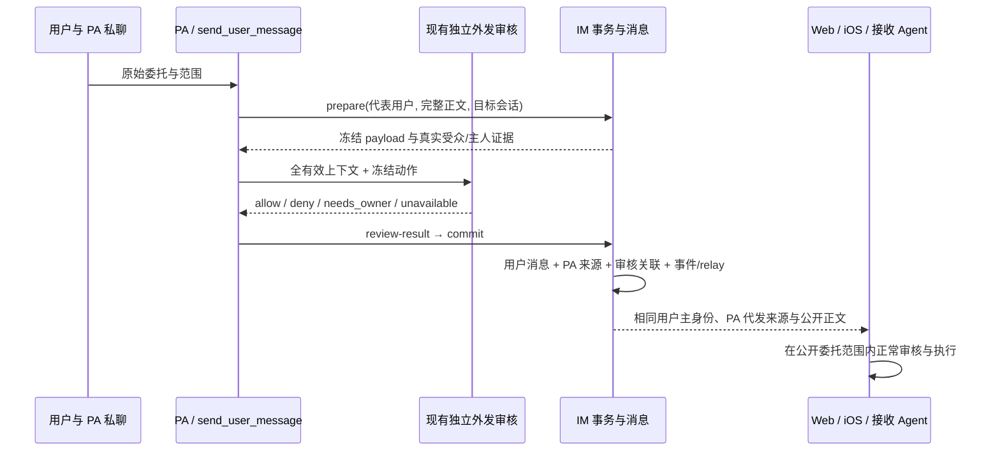

# feat-658: PA 代表用户发送 — 技术方案

> 对齐: [spec.md](spec.md)，2026-10-25 用户确认的 S1–S6 与两种发送工具、通用 ComposeMessage 方案。设计交付，不包含实施或生产部署。

## Changelog

## 现状分析

### 涉及范围

- `packages/product-contracts/src/{personal-agent,index}.ts`：PA 绑定、旧代发标签和 RelayInput。旧 `PersonalDelegation` 只有 PA/主人/显示文案，不能证明本次代表用户的委托。
- `apps/im-server/src/{personal-actions,personal-agent,messaging,interactions,work,gateway}.ts`：已审核 PA 外发事务、主人证据、消息持久化/事件/relay、历史查询。当前外发一律插入 Agent 消息；旧代发行在 message.created 快照之后才插入；Inbox 与查询结果还会丢失代发信息。
- `packages/personal-assistant/src/{personal-assistant,inbox,single-thread}.ts` 与 `packages/dsh-integration/src/{global-mode,personal-security,policy/sources,index}.ts`：发送编排、来源投影、运行时工具和独立审核。当前来源指导将 Agent 转述排除为用户许可，历史读取也不能恢复已经存在的委托语义。
- Web `src/IM/frontend/src/` 消息模型、事件合并、MessageBubble、现有引用/预览；iOS `src/IM/ios/NanoIM/` ChatModels、ChatMessageView、消息同步。Web 本人消息当前不显示头像/名字；iOS 本人头像在右、他人在左，群聊显示对方名字。

### 既有约束

IM 拥有用户/会话/PA 绑定和公开消息事实，PA 包编排产品行为，只有 dsh-integration 接入 DSH 公开能力。不能修改 DSH 或让 IM/PA import DSH。代表用户不扩展可访问会话、不跳过原审核、不改外部渠道身份。既有历史不升级、不补发；用户编辑的 custom_prompt 不覆盖。

### 可复用能力

| 能力 | 选择与理由 |
|---|---|
| prepare → 独立 review → review-result → commit | 改：冻结发送身份与正文一起审核，沿用 payload/evidence digest、受众、owner_guard、策略版本、60 秒 permit 与幂等事务 |
| messages + pa_delegated_messages + pa_operations | 改：消息直接使用用户主身份，已有代发表保留执行 PA 并链接审核 operation；不增加第二套授权账本 |
| 普通用户消息的 enqueueRelays、Inbox 持久化与 ACK | 用：新代发与人类消息使用同一目标选择/群回复策略、relay 重连与去重机制 |
| 原有全有效上下文审核 | 用：继续包含已读取原话、工具结果、主/祖先上下文；不以摘要或一个 allow 标记代替授权证据 |
| 旧 PA 外发标签 | 留作历史事实及 自身发送路径；不用它签发新用户授权 |
| 已有 ChatMessage UI/草稿/内容渲染 | 改身份行与归属；草稿改由通用 ComposeMessage 采用到输入框、再由用户发送；附件和交互卡内容功能保留 |

### 相关历史

feat-616/623 建立 PA 绑定、原始会话事实与观察/参与区别；bugfix-640/641 保留完整有效上下文及原始主人证据；bugfix-624 保留撤销来源后重验证。上述语义都继续成立。feat-654 的 daily 隔离模板作为验收基线。本次不承接 bugfix-656 短轮次任务及 feat-657 生命周期改动，只在最终实施基线上回归相关接线。

## 架构总览



现在“Agent 发言 + 旁边写主人”变为“用户通过 PA 发言 + 明确实际代发者”。公开正文是用户向该会话表达的意思；接收方无需访问私人 PA 聊天。

## 关键决策

**D1. 新消息直接存用户主身份，实际 PA 放在服务端生成的来源记录。**

`messages.sender_user_id` 为绑定用户、`sender_type=user`；只有通过 send_user_message 审核的提交能产生。拒绝只在 UI 换头像或每个消费者临时投影作者：那会继续分裂查询、未读、Agent 来源与客户端。普通发消息 API 仍不能指定他人 sender；旧行保持 Agent 身份。

**D2. 普通 send_message 共用，PA 代表用户另用 send_user_message。**

普通 Agent 与 PA 的 send_message 都使用 Agent 自身身份和会话成员写权限，不因 PA 能观察主人聊天而获得发送权限。PA 不在、主人在的会话，只能在真实委托下使用 send_user_message；不能把 send_message 自动升级或失败后无依据换工具绕过拒绝。代表发送能力仅固定 PA 根会话注册，普通 Agent 和内部子 Agent 不注册；子 Agent 可返回草稿与调查结果，公开代表发送由绑定根 PA 完成。

PA 向主人汇报、提供建议或以自己身份协作使用 send_message；主人明确委托对外表达使用 send_user_message；只起草时提供通用交互编辑器。工具名承担身份选择，不增加 send_as、主人 id 或草稿专用工具。固定工具/系统说明解释自然口吻，不覆盖已有 custom_prompt。

**D2a. 通用 ComposeMessage 替代 reply_draft，交互固定协议由系统补齐。**

ComposeMessage 是所有启用交互能力的 Agent 可使用的 OpenUI 自定义动作，不是模型工具或后端 Mutation。它将点击时的文本放入明确目标会话输入框，由点击者自行发送；不绑定原消息、不推断“过期”、不依赖 PA 身份。普通 Agent 也能提供该编辑器。模型只提供有业务含义的 interactive 参数，format/catalog_version 由现有工具适配层规范化，不继续要求填写常量。

**D3. 代表关系由现有审核事务签发，不能以 PA 绑定或正文自称替代。**

send_user_message 在现有完整外发检查中增加一个判断：真实主人原话确实委托 PA 对此受众表达这段意思，所有限制均被保留。披露许可本身不等于代表发言许可。拒绝新增模型意图分类器、可复用授权票据或“审核通过=批准未来一切”的机制。普通接收端继续审核实际动作，不把外发 allow 当作执行 allow。

**D4. 历史保留已有委托，不制造新许可或新触发。**

live、read/search、恢复及子 Agent 交接保留同一原消息 id/作者/正文/来源和时间。已核验的历史原话可以作为已有委托证据，不能被当作刚发生的同意、重新唤醒任务或绕过后续撤回。既有普通 Agent、旧 PA 标签、文件中复制的 JSON、助手概括均不升级。

**D5. 一次 M1 交付完整链路。**

接口、审核、路由与双端显示共同决定一条消息是否诚实且可执行，分阶段交付会形成可见身份与权限不一致。单 M1 内按依赖顺序实现，独立审核和真实验收收口。

## 接口与数据流

### 发送接口与事务

模型可见接口如下；原有附件表达与内部通信保留，示例省略未改字段：

```ts
type InteractiveInput = {
  source: string;
  supersedes_message_id?: string;
  source_mode?: 'patch';
};
send_message({target, text, interactive?: InteractiveInput}); // 自己发言，共用
send_user_message({target, text, interactive?: InteractiveInput}); // 仅绑定根 PA
// send_message({agent_id, message}) 保留原生内部通信，不接受 interactive。
```

两种公开发送在 dsh-integration 共用参数定义与交互规范化：系统补齐 `format='openui'`、`catalog_version='nano-1'`，完整/patch 源码仍按现有编译和替换规则校验；规范化在 publication/request digest 与审核之前完成。模型不能提供这两个常量、reply_draft、send_as、owner id、来源 receipt 或 operation id。错误反馈指出真正缺失/非法的 source、target 或动作参数，不反过来要求模型补系统字段。持久消息及跨包 wire 保留必要协议字段，conversations/Inbox 的模型投影不重复灌入协议常量；不删减交互语义、用户选择或可核验来源。

工具适配层将两种工具路由到明确的产品调用；PA 编排复用 prepare/review-result/commit，私有 frozen payload 增加 `representation: 'self' | 'owner'`，由可信工具分支决定，绝不从模型参数或正文推断。缺失视为 self，仅为已存在操作解码；新操作总是写明。publication/request digest、重试去重及审核 planned_action 包含真实工具/身份；同 request_key 改身份冲突。普通 Agent 与 PA 的 send_message 都在正式发送边界核验实际 Agent 的当前成员写权限，prepare/commit 再验，不以 PA 的 conversations 可读并集放行。既有外部 channel 自身发言不变。

send_user_message 仅用于 Nano 原生 IM，目标须主人当前具有写权限且在 PA 当前允许来源内；不要求 PA 参与文本目标。用户不在的 PA-only 私聊拒绝；主人 PA 私聊、外部 transport、系统风险通知和共享 task action 不走代表工具，不静默降级成自身发送。入口同时核验调用者是绑定根 PA，不能只靠工具清单隐藏来阻止普通/子 Agent 伪造调用。内部子 Agent 和 task_graph 仍保留各自现有协议。

prepare/commit 两次核验绑定、生命周期、目标会话权限、来源范围、完整 payload、受众和既有 guard。审核输入包含真实工具名、绑定用户与实际 PA、完整标准化正文/附件/interactive 及真实受众。代表发送 allow 必须建立在有效上下文中的真实主人原话，PA 自己发过的代表消息不能成为再代表主人或改变来源控制的新授权。仍沿用 allow/deny/needs_owner/unavailable，不增加审批卡或额外人工步骤。send_message 的普通外发披露检查保持；新工具不能因未命中旧 send_message 分支而走 alwaysAllowTools 的默认放行。

在 `pa_delegated_messages` 增加 nullable `representation_operation_id`，旧记录为 NULL；新 owner 消息填写本次 op id；普通 send_message 外发保持 NULL。显式列名 INSERT，约束一条消息最多一条来源；关联 op 必须为同 binding/目标/冻结 payload 的已审核提交。本字段为私有审计关联，不发给普通成员。原始私人上下文继续保留在现有审核证据/运行轨迹；不公开 owner_guard 或私人消息原文。

owner commit 在同一事务中：插入用户消息 → 写来源关联 → 生成包含来源的 message.created → 排队 relay → operation confirmed。对 messaging 的 insert 扩展为内部受控的 PA 来源参数，在生成消息快照前落来源行；所有公开消息/浏览器事件/relay 均从同一个 `message(id)` 投影产生。此参数不透传公共发消息 body。失败整体回滚；已确认重试返回同一个 message_id；发布失败沿用耐久事件与 relay 重连，不制造第二条用户消息。

### 公开消息与实际执行者

保留现有 `delegation`，新增仅服务端可生成的判别值：

```ts
// product-contracts；仅示意增量，未列的原有消息字段保留。
type OwnerRepresentation = {
  kind: 'owner';
  agent_id: string;        // 实际发送 PA
  authorized_by: string;   // 必须等于 message.sender_user_id
  display_name: string;    // 实际 PA 名称快照
  label: string;           // 展示兼容；客户端按 kind 本地化“PA 代发”
};
// message.sender_type='user'; sender.id=绑定用户；sender 为用户资料。
// 旧 delegation 无 kind，不能用于用户授权。
```

sender 名字/头像按普通用户消息规则解析；PA 实际 id/名称独立保留。不要将用户 id 当 Agent id 查询 Work，不给普通群成员暴露 PA 私人 Work 链接或运行信息。已审核的附件/Markdown/interactive 正常渲染；身份呈现与卡片执行者分开。

**交互卡片沿用现有参与资格，不扩展为观察会话内可交互。** owner 文本/附件可以发送到主人可写且 PA 允许观察的会话；owner interactive 额外要求实际 PA 是该会话当前可用、可写的参与 Agent。prepare 与 commit 都检查，未参与时在消息落库前以明确 `owner_interactive_requires_pa_participant` 拒绝，说明可发送普通正文或由用户按原流程加入 PA；不自动加入、不静默移除卡片、不等到点击才失败。普通 user 消息 API 仍不能创建 Agent 卡片。

`Interactions.source()` 统一返回公开作者与独立的执行者 `{executor_user_id, executor_agent_id}`：普通/旧 Agent 卡片按原 Agent 作者解析；新 owner 卡片仅从服务端受控 `pa_delegated_messages.representation_operation_id` 对应的 PA 解析，核对实际 PA/绑定，绝不对主人 username 做 slice(6)。不增加第二张卡片身份表，也不依赖 record 的 sender 参数会被持久化。来源行在 record 与事件投影之前写入同一事务。

`contexts()`、`prepare()` 的 InteractionContext/InteractionSnapshot.agent_id 使用同一 executor；生命周期、当前会话参与及写权限检查用 executor_user_id，而非公开主人 id。后续 PA 离群或失效时沿用“源 Agent 不再可用”的拒绝，原消息仍可读。背景上下文按原渠道只发给该实际 PA，提交消息仍是实际点按钮的用户本人，并由现有 relay 的 interaction_reply.agent_id 送回 PA，不冒充最初被代表用户。

`record()` 的 supersedes 所有权也比较同一 executor，同会话、同实际 PA 且旧卡可替换才接受；每一条新的 owner 卡片仍独立经历完整委托/披露审核，不能借替换继承旧 permit。普通 self 卡片沿用自身外发审核；不能以修改或替换为由更改旧消息的用户身份、原文或来源。普通卡片、readonly 历史和私人编辑状态继续按现有规则处理；ComposeMessage 的本地动作规则见下节。

### 通用 ComposeMessage：编辑后进入目标输入框

动作签名：`@ComposeMessage(target: string, text: string)`。target 是明确的 Nano IM conversation id，不接受 external target、用户别名或依赖调用时全局会话的隐式 current。Agent 先通过已有 conversations 工具取得目标；不为草稿新建寻址工具。text 是点击时求值的字符串表达式，可以引用当前 `$draft`，不要求某个固定字段名或顶层绑定。

```openui
$draft = "Q，同意在当前任务分支提交并推送报告，不合并、不部署。"
root = Stack([
  TextContent("给 Q 的回复"),
  TextArea("reply_body", "", 4, null, $draft),
  Button("采用到与 Q 的聊天", @ComposeMessage("c_target", $draft))
])
```

- **扩展入口**：使用已安装 OpenUI 的公开 `defineAction` / `library.extend({actions:{add:…}})` 扩展；不 fork/patch 上游。Web catalog 注册后由现有 generator 同步 catalog、prompt、Skill 和跨端类型。产品共享 parser/动作校验也注册同一动作；只有组件 schema 更新不足以支持动作解析。iOS JavaScript runtime 使用相同 action 定义识别 `custom_action` 并传递求值后的 name/params，Swift host 处理 compose 事件，不走 continue_conversation 分支。不新增 Query/Mutation 远程工具。
- **点击与权限**：Web/iOS host 按实际登录者核验源卡片可读且可交互、目标存在且有当前写权限；readonly/fork/被替换卡片沿用禁用。成功只导航并预填该目标的本地输入框，保留点击时编辑值；不发交互提交、普通消息、relay 或模型请求，不向卡片作者回传私有草稿。无权限/目标失效时留在原卡，显示明确原因并保留编辑值。真正发送时仍走现有用户消息权限校验。
- **输入框冲突**：复用现有每会话输入状态；目标没有草稿时直接填入。目标已有不同正文或附件时提示“替换未发送的内容？”（取消/替换），取消保留两处状态，确认后替换为选定文本并清除旧附件，不能无声混合不相干附件。当前目标文本已相同且无附件则聚焦，不重复追加；当前聊天也可作为明确 target。正常流程不增加确认；冲突确认由客户端本地完成，不请求模型决定。
- **与 ToAssistant 区别**：ToAssistant/continue_conversation 保留原本“在本会话发送实际点击用户的请求及选择”的语义。采纳按钮必须显式指定 ComposeMessage，不能依赖无 action Button 的默认 ToAssistant，也不能同一采纳动作再拼接 ToAssistant 或 Mutation 造成隐式发送；共享动作校验拒绝这种混用。Set/Reset 等本地状态组合可保留。
- **草稿生命周期**：不再写/读 reply_draft 来控制新草稿采用，删除旧 source_message_id/field_name 绑定和基于“原消息之后有人回复”的过期推断；目标后来有新消息也不自动撤销用户的编辑。普通交互快照仍有其 source_message_id，personal_sources 的原始主人证据 id 也保留，两者不是被删除的草稿绑定。
- **既有记录**：旧正文、interactive source 与旧 reply_draft 审计数据保留，不批量改写已发布源码或把旧按钮猜测成新动作。旧专用“采用草稿”入口退役，历史正文仍可查看复制；需要新采用动作时生成新卡片。部署说明明确此变化，不维持一套旧绑定/过期运行路径。已有 ToAssistant 与普通卡片功能不变。

### 模型上下文契约与修改清单

以下为实施必须适配的真实注入点，不另增一份运行时重复提示词；规则在现有各自职责段维护。用户 custom_prompt 和 DSH 原生通用安全规则不覆盖。

| 注入/消费点 | 必须调整的语义 | 验证对象 |
|---|---|---|
| `global-mode.ts` 通信段、工具描述/schema | 通用角色称 Agent；自己公开发言用 send_message，PA 代表发送由 PA 段说明；可读不等于可写；内部通信/SingleThread 最终交付不变 | 普通 Global、PA、SingleThread 的实际组装 context |
| `personal-security.ts` 固定 PA 段 | 两工具选择、自然用户口吻、可解指代自行转换；只起草用通用编辑器；删除 reply_draft 绑定指令；历史保留既有委托但不创造许可 | PA 自身回复、代发、仅草稿、观察会话 |
| `features/intelligent-ui.ts`、Web catalog、composition examples、`generate-interactive-ui.ts` 生成 Skill/prompt | 共享 interactive.source 写法；系统字段不让模型填写；生成动作签名/示例；区分本地采用与提交请求，删除“一次点击总会记录消息” | Feature on/off、生成物一致性、两端动作解析 |
| `global-agent.ts` wake、task-execution/task-graphs、heartbeat | 状态汇报仍用自身 send_message；不能强制把代表用户发言塞进它；无可交付内容时不调用任一发送工具 | 唤醒/任务续跑不改已确认身份或自动代发 |
| `personalReviewAction/Policy`、`policy/approval.ts` | 真实工具名及完整规范化公开 payload；代表委托与披露都查；Compose target、默认文本/表达式属于公开卡内容，点击不是业务授权 | CC/Codex Auto 与 PA 独立外发链，无默认放行缺口 |
| `policy/sources.ts` instructions/humanInputs/append/restore/codexEntries 与 single-thread/Inbox/conversations 投影 | 可信代表关系、原文范围、live/历史区别；两工具真实回执均投影并随恢复/父子交接保留；仅 sent 表示交付，held/unknown/内部 accepted 不算发送 | 普通接收 Agent、PA、恢复和执行子 Agent 实际 context |
| 实际加载的 `assets/auto/cc-2.1.267-nano-v1/security_monitor.txt` 及 Codex 审核输入 | Nano 来源/回执条款同步新工具和可信代表证据；保留硬性拒绝、撤回和实际动作审核，不笼统解除恢复历史限制 | 两种审核 provider 的真实请求材料 |
| `capabilities.ts`、agent-config 工具/Feature 组装、product bridge、tool-references | send_user_message 仅绑定根 PA 固定工具；后端校验相同；Compose 随共享交互能力提供，无单独草稿工具/开关；目标解析保留真实类型 | 模型实际可见 schema 与可调用路由一致 |

短核心指导应表达：自己发言用 send_message；真实委托下 PA 用 send_user_message 代表用户；只起草时用 ComposeMessage 填入目标输入框；请求本会话 Agent 继续时用 ToAssistant。不要把整份产品权限算法塞进每个 Agent 的系统提示。工具错误与回执使用同一身份词义；不暴露本不需要的协议常量，不以裁剪原始授权证据换取短 context。

实施留存实际组装的脱敏 context 样本（包括加载 Skill 后、恢复后、子 Agent 及审核器），检查旧绑定指令和矛盾绝对表述已退出；再用真实模型选择工具和按钮验证。仅文本搜索通过不能替代实际注册/运行验证。

### 路由、主人证据与回声

- owner 分支复用 messaging 用户消息 relay 排队，单次覆盖 direct/group，沿用 @、group reply policy、幂等 key 和生命周期重验；排除实际发送 PA。该分支不再同时调用旧 queueDirectAgentRelays + gateway.groupReply，避免重发或让来源再次变成 Agent。
- 这是已审核的公开消息，不经用户输入 `/stop`、`/new` 或 settings 控制路由。文字斜杠命令作为普通正文处理，不能由代表消息清空/暂停主人会话。
- PA 观察 feed/sourceFacts/messageEvidence 保留用户主身份和 `delegation.kind=owner`；自发排除使用实际 PA id，同时覆盖参与 relay 和观察路径。自己的代发历史可查询，不能成为自己的新请求或新原始授权。
- `directOwnerMessage`、source-control 原始 evidence、authorizationGuard、last_owner_message_id 与主人抢先回复判定均排除代发，明确区分本人亲自输入和经 PA 公开表达；否则会形成自我授权、自己使自己的 permit 失效或误判主人抢先回复。一般接收 Agent 仍把公开代发理解为用户意图，这个排除仅作用于 PA 原始委托/控制证据。

### Inbox、历史与审核的同一来源

1. product-contracts RelayInput.message 增加可选 delegation；IM relay、PA admission、Inbox 持久 payload 到 `inbox.read` 不丢失。分页每一片保留 id/sender/delegation/time；partial 仅表示未完整读取，不独立构成完整动作范围。
2. IM work conversation read/search 以 `message(id)` 构造 sender 和 delegation，所有分页/长消息片段保持一致。普通搜索摘要不足以执行时读取完整原消息；只有产品 conversations 工具真实返回的结构化消息才可成为来源证据，文件/任意工具 JSON 不可。
3. dsh-integration `policy/sources` 对成功 inbox 与 conversations read/search 结果生成可信的结构化来源段，明确工具调用 id、原 conversation/message id、完整性与 live/restored/historical；不信任正文嵌套的同名字段。`humanInputs` 与全上下文审核使用相同投影，不把代表消息简化为没有来源的文本。single-thread 输入与 DSH 子会话继承仍通过现有公开接口携带来源，不添加私有运行时字段。
4. 固定来源规则：`sender.type=user + delegation.kind=owner` 是该用户经核验 PA 在该目标会话发表的原文；只在原文表达范围内成立，继续遵守后续用户修改/撤回及正常工具审核。PA 自身原始委托核对不能引用自己的代发来扩大权限。仅有旧 label、Agent 自述、未知来源无此效力。
5. live Inbox 是新输入；历史和恢复提供既有原话证据而不变成新事件。保留现有 Inbox ACK、input message id、任务/工具执行结果幂等与 inherited provenance。交给子 Agent 时继承可验证的原文来源，不把父 Agent 的摘要单独视为许可。原始证据已不在有效上下文时通过正常 conversations/read 恢复；权限撤销仍拒读，不替接收方打开私人 PA 私聊。

## 前端原型

[prototype.html](prototype.html) 为局部消息流原型，使用虚构任务内容，外层选择平台、本人/其他成员和消息状态；这些都是演示控制，不新增产品入口。用户需要直接辨认“谁说话、是否 PA 代发、我该做什么”。消息正文与轻量来源标记分开，原聊天导航和输入框沿用；新增通用编辑—采用—目标输入框旅程。

### 现有 UX grounding

| 当前产品入口 | 基线 | 沿用/改善 |
|---|---|---|
| Web `/chat/:id` | spec 原始截图及 MessageBubble 的用户/Agent 布局；见 [证据](design-evidence.md) | 保留本人右侧气泡、他人左侧头像/名字。代表消息本人侧新增紧凑“用户名字 + PA 代发”身份行和用户头像；他人侧替换主身份、删去节点归属小字 |
| iOS ChatMessageView | SwiftUI 原生双方头像与群聊姓名布局；本机模拟器可用 | 保留原生头像位置、气泡与底部输入栏，代发身份行本人/对方及私聊均可见；长名字可折行，标记不截断 |
| 主人 PA 私聊 | 既有 PA 回复与草稿采用 | 普通 PA 名字/身份不变；草稿不加用户代发标记；PA 和普通 Agent 卡片均可采用到明确目标输入框，不自动发送 |

本次对双方代表消息均显示用户名字与用户头像，避免 Web 本人原有省略身份行使代发来源消失。标记为次级中性文字，与名字相邻，屏幕阅读标签为“用户名字，由 PA 名字代发”；不增加必须点击才能识别来源的弹窗，不增加节点名、授权编号或隐私证据入口。

### 原型对齐契约

| 区域/状态 | 级别 | 产品入口 | 必验视口/状态 | 退出标准 |
|---|---|---|---|---|
| V1 代表消息双方归属 | must-match | Web/iOS 原会话 | Web 1280、390、320 内容宽；iOS 原生手机；本人/他人、群/私聊 | R1/W2：用户主头像姓名、相邻 PA 代发、本人右侧；正文无传话前缀 |
| V2 长姓名与内容 | must-match | 同上 | 窄宽/长名；多段、附件与交互卡 | R1/W2：名字可换行、PA 标记完整、正文可读，来源不进入正文或卡片正文 |
| V3 自身发言/历史/草稿区别 | must-match | 原会话与 PA 私聊 | 原 PA 发言、旧标签、手动用户消息、草稿 | R2/W2：不冒充用户，历史保留；PA 与普通 Agent 草稿均用 ComposeMessage，采用仅填输入框 |
| V4 通用编辑采用 | must-match | 普通 Agent/PA 交互卡 → 目标聊天输入框 | Web 390/320、iOS；编辑后采用、目标已有草稿取消/替换、无权限 | R2/W2：目标名字可辨，采用最新文字，无发送/模型请求，冲突不静默覆盖；ToAssistant 仍显式提交 |
| 平台气泡细节/时间/菜单 | may-adapt | 原有组件 | 继承各端样式、字体与菜单；iOS 名字基于现有 caption，Web 基于 meta | R1/W2：不为复制网页而重写原生导航 |
| 演示控制、上下文消息 | out-of-scope | 无新增入口 | 原型外围明确标注；原产品是实际聊天历史 | N/A |

### 原型走查

实际渲染、截图位置与观察结论维护在 [design-evidence.md](design-evidence.md)。HTML 中的 iOS 构图证明设计意图；原生实现及 VoiceOver 要在 M1 真实客户端检查，不将原型冒充原生通过。

## 契约层增量 (delta-spec)

- [IM personal-agent](specs/im/personal-agent.md)：修改既有草稿/代发条目并添加双端主身份、历史不提升规则；归入 `docs/specs/im/personal-agent.md`，不在 Web/iOS spec 重复同一 PA 事实。
- [IM conversations-messages](specs/im/conversations-messages.md)：通用本地采用、点击者权限和交互作者/执行者，归入对应 current spec。
- [Gateway agent-capabilities](specs/gateway/agent-capabilities.md)：任意 Agent 的动作选择与系统补齐协议字段，归入对应 current spec。
- [Gateway personal-agent](specs/gateway/personal-agent.md)：添加自然代表发言及普通接收 Agent/审核/历史交接的可信代表语义；归入 `docs/specs/gateway/personal-agent.md`。

## 风险与回退

风险集中在事件快照早于来源、历史审核降级、PA 自回声和身份改为 user 后卡片/Work 路由失真。由事务级测试、真实 live→历史→子 Agent 旅程和双方客户端验证覆盖，不增加通用代理框架。历史 receipt 公开字段只描述来源，不能携带私人审核上下文。

旧节点/客户端不认识来源时会把新消息误当用户亲发；不得混合版本启用新 owner 发送。同步更新 IM、全部接收节点、Web 与在用 iOS 后开放。恢复旧程序可能丢失来源语义，出现故障停止新代发并前向修复；必要回滚见部署提示词，不自动删除新消息或重新发送。

## 一次性部署迁移

见 [deployment-prompt.md](deployment-prompt.md)：增加 nullable 审计关联列，不回填旧授权；部署时协调版本，实施期在数据库副本验证迁移和重复执行。本设计阶段不操作生产。

## Runbook for Reviewer

**Review 驱动方式**：端到端真栈。共享委托/审核/恢复在真实 Web + daily Agent 验；本人/收件人头像、标记及消息归属须在 Web 和原生 iOS 各实测一次。仅 Web 重复范围/恢复/拒绝旅程；原生不重复整套 LLM 场景。

在实施 checkout 根，先设置 `WT_ROOT` 为本轮独立绝对目录；使用仓库 daily 模板，不能复用设计期临时实例或生产身份。具体日常阵容/模型/审核配置以 [固定模板](../../development/worktree-runtime.md#固定日常验收模板) 和 `.e2e-daily.json` 为准。

| 服务 | 停止 | 启动/构建 | 健康检查 |
|---|---|---|---|
| 隔离 IM + Node/DSH + Web | `./scripts/e2e-down.sh --wt "$WT_ROOT"` | `PATH="$PWD/.venv/bin:$PATH" ./scripts/e2e-up.sh --profile daily --wt "$WT_ROOT"` | 加载 `.e2e-ports.env`；`curl -fsS "$IM_URL/health"`；清单 ready、目标节点 online；正式工具生成真实模型回复 |
| 原生 iOS | 仅终止本轮 app/模拟器 | `NANO_IOS_BUILD_ROOT="$WT_ROOT/ios-build" ./src/IM/ios/scripts/build.sh build`；用 simctl 安装到本轮设备 | Debug 登录页配置该 IM_URL；确认构建 revision；与 Web 查看相同 message id |

**验收前置**：本机 Xcode 与 iOS 26.4 模拟器可用；daily 栈/身份/PA 绑定已用当前 main 实际启动，具体证据见 design-evidence。模型与审核由本机既有 Codex provider 提供，凭据只由配置加载不写文档。额外创建隔离普通成员 B、主人与 Q 的现有私聊、PA-only 私聊（拒绝用例），并以正式产品入口配置会话权限；虚构仓库使用本轮 workspace 和本地 bare remote，允许提交推送而不碰真实项目。无第三方收件人/租户/真机签名要求。

**旅程**：

1. Web 主人在 PA 私聊要求“帮我回 Q：同意在指定分支提交推送报告，不能合并或部署”；PA 用原上下文定位同一群并代表发送。Q 真实读 Inbox、经独立工具审核完成本地测试仓库提交/推送，向群回执，不要求主人再说一次。审核 trace 与真实 commit/ref 作为执行证据。
2. 主人和 B 分别在 Web 原群/私聊查看同一消息；刷新、定位历史及已有引用/预览身份一致。iOS 登录主人/B 各看同一消息，核对自己的右侧、他人的左侧与 PA 标记；检查窄宽长名/附件/卡片不误路由 PA Work。已有原生图文/交互能力保持。在 PA 当前参与且可用的群中，用户提交 owner 卡片后，真实 PA 收到正确的交互快照；同 PA 经新一轮审核替换卡片成功，旧卡变只读。PA 未参与的观察会话中，owner 卡片发送前明确拒绝、无消息落库，普通 owner 正文仍可正常发送；PA 离群后旧卡提交按原不可用规则拒绝。
3. PA 报告仍是 PA；普通 Agent 和 PA 分别生成带 ComposeMessage 的编辑器，用户改字后采用到另一会话，仅目标输入框变化，无消息/交互提交/模型请求；分别验证已有草稿取消/替换、同会话、目标无权限、后来有新回复仍能采用，Web 与原生 iOS 各走一次。ToAssistant 仍生成本会话请求；普通用户之后手动发送才产生用户消息。有可解指代正确使用称呼，有两个实质对象时只问对象。历史旧 PA 标签不变，普通 Agent 模仿标签不获权限。
4. Q 从 conversations read/search 重新取同一原消息、恢复会话并委派执行子 Agent，读取原委托限制；用尚未完成的范围内子步骤验证许可仍可承接，以已完成 commit 验证不重复提交。主人后续撤回/修改后按新原话收敛。超范围合并/部署 proposal 应被正常审核挡住。
5. 仅主人参与的群：PA send_message 被自身成员权限拒绝，有原始委托的 send_user_message 文本成功；普通 Agent/子 Agent 无代表工具，伪造产品调用仍拒绝。send_user_message 到无主人写权限/外部目标被拒；自己的代发不形成 PA 新任务、来源设置或新 owner guard。核对普通/PA/SingleThread、恢复/子 Agent、CC/Codex 审核的实际 context、schema、工具回执及加载后的 Skill：没有旧草稿参数/系统常量要求，没有所有回复强制旧工具的冲突，能沿原范围正确执行。停止本轮所有服务与模拟器，保存脱敏证据。

## Milestones

| ID | 标题 | 依赖 | 并行组 | 范围 | 退出标准 |
|---|---|---|---|---|---|
| M1 | 代表发送、可信承接与双方展示 | 无 | 单一顺序闭环 | product-contracts；im-server PA/messaging/interactions/work/relay/db；personal-assistant send/inbox/single-thread；dsh-integration tools/review/sources；Web 与 iOS 消息/交互 runtime/输入框；catalog/generator/Skill/审核模板；相关测试和本 unit | [reviewer] R1：V1/V2 双端双方、群/私聊身份主次可辨，正文自然且原阅读交互保持，参与会话 owner 卡片实际提交/同 PA 替换正确，未参与会话发送前拒绝卡片；[reviewer] R2：V3/V4 与 S3/S4/S6 通用草稿采用、冲突和权限、两工具选择、ToAssistant 区别、自身发言、歧义和伪造/越界正确；[reviewer] R3：S1/S5 实际执行、恢复、历史、子 Agent 承接范围且不重复，旧历史不升级；[worker] W1：消息+来源+事件+relay 原子性/幂等，过期/变更/撤回/无权限拒绝，原始证据排除代发、自回声、读片段/恢复继承和卡片 source/contexts/prepare/替换/生命周期执行归属、共享参数规范化、根 PA 限制、Compose 解析/权限/最新值且无提交窄测试通过；实际模型 context 与选择证据覆盖上表；[worker] W2：Web/iOS 构建及相关回归通过，V1–V4 原型与真实客户端对照截图和结论可复查；[worker] W3：副本迁移、旧数据/操作不升级、混合版本停发/恢复验证，runtime dependency contract 与 docs-check 通过 |
