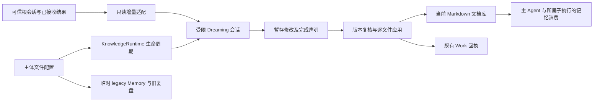

# feat-676: 角色化文档记忆与持续 Global Dreaming — 技术方案

> 对齐：[spec.md](spec.md)，含设计阶段关于默认开启、内置记忆及临时 legacy 模式的用户澄清。

## Changelog

## 现状分析

### 涉及范围

设计核对主仓 main `0ddceacb8dac5c5c6f38e2db45e0b72c26cbf3ec`。以下均为本仓实际接线，不把附件中的拟议接口当作已存在能力。

| 落点 | 当前职责与本次改动 |
| --- | --- |
| `packages/dsh-integration/src/agent-config.ts`、`features/memory-curation.ts` | 当前 Feature 同时控制记忆快照、工具可用性和复盘订阅；拆为始终挂载的角色记忆消费及独立 Dreaming 调度，legacy 走旧接线 |
| `knowledge/files.ts`、`runtime.ts`、`state.ts` | 当前 USER/MEMORY 字符限额、条目写入、F3/combined/F4、事实和 review 状态；保留 Skill 与 legacy，实现文档维护所需文件回执与增量进度 |
| `owned-sessions.ts`、`descendants.ts`、`trajectory-runs.ts`、`index.ts` | 已有可信业务绑定、后代归属、公开 Session 查询及维护轨迹；复用归属和生命周期，增加不 fork 父历史的受限维护会话 |
| `packages/personal-assistant/src/inbox.ts`、`knowledge.ts`、工作记录投影 | Inbox 保存准入和消费证据，KnowledgeUpdates 目前把后台变更发为 system_message；新 Dreaming 仅同步工作记录，来源撤销同步到维护资格 |
| `packages/product-contracts`、Node 文件配置、IM 配置服务及 Web/iOS 能力列表 | 维护模式为文件配置；用户配置只新增 Dreaming 自动开关并移除旧记忆开关，工作结果沿用已有视图 |

### 既有约束

- 仅 dsh-integration 使用 DSH 已声明公开 exports；PA、Channels、IM 不 import DSH。新增 `@deepseek-ai/dsh-fs` 或 observation policy 使用时须声明直接依赖，不能通过 pnpm 路径 import。
- 长期主体为业务 `agentId`，库根绑定其配置 workspace；内部 child 继承所属主体，不按执行 cwd 或当前聊天对象换库。两个独立主体不共享可写记忆库；既有共享 workspace 在迁移前报告冲突，由部署确定各自 workspace，不暗中复制混合知识。
- 文件是当前知识，运行账本只存游标、资格、版本、操作及回执，不存第二套事实。Task、授权、消息投递、Skill 各保留权威。
- 只做设计，current specs 不变；迁移和真实产品验收尚未执行。

### 可复用能力

| 能力 | 选择与依据 |
| --- | --- |
| DSH `sessionQuery.observeSession` | 用。公开 observation 提供 live/prepared 的不可变 events、cursor、inheritedEventCount；可读取活跃与旧窗口，不调用模型侧跨会话 history 工具 |
| DSH `sessions.flush` | 用。live 源取得不可变 observation 后再做持久化屏障，认证同一个 cut；flush 失败不导出为已保存历史 |
| DSH `agents.create/resume`、AgentHandle | 用。空 seed、专属 setup、显式输入；保留 create/dispose/cancel 的宿主所有权，不建循环引擎 |
| DSH `read/write/edit/glob/grep` 和文件 observation policy | 用。普通模型读写不另造 Memory CRUD；已读版本与 provider 原子 compare-and-write 处理单文件陈旧覆盖；外加维护计划回执解决多文件部分成功 |
| KnowledgeRuntime 与 storage-domain | 改。保留订阅、停用、更新 drain、重启恢复、Skill 管理；文档 Dreaming 不复用旧的父 prompt fork 和按 turn 计数 |
| TrajectoryRuns、KnowledgeUpdates、Work 记录 | 改。记录宿主维护执行及确定性完成回执；新 Dreaming 不发送旧自进化聊天通知 |
| 旧 Memory/combined/F4 | legacy 保留旧 Memory；document 不用旧 Memory。按用户最新选择，两模式均暂停自动 Skill F3/F4，combined 不再包含 Skill；保留前台 Skill 创建、使用和修改，Dreaming 无 Skill 发布权限 |

单文件原子性不等于多文件事务；模型正常结束不等于资料处理完成。`observeSession` 的 live 视图也不自行证明已持久化。以上差异是新增有限运行状态的原因。

### 相关历史

feat-637 的完整当前文件读取、部分成功与知识归属要求继续有效；feat-385 的压缩前固定 Memory 快照在 document 模式被本次及时刷新替代。feat-667 的通用 PA 服务和原执行者持续负责保持。已有 descendant 查询的逐流读取、释放 observation lease 方式继续采用，禁止同时物化所有历史及后代。

## 架构总览

主 Agent 在正常工作中读写角色化文档。Dreaming 是同一主体的低优先级维护作业：宿主导出合格的连续历史前缀，模型在暂存区整理，宿主按版本应用，最后确认实际处理进度。旧模式只作为文件配置选择的临时回退。



`document` 与 `legacy` 互斥；图中的两条路径不会同时消费/写入一个主体的记忆。业务历史保留在原持久化系统，导出材料仅是本次维护输入。

## 关键决策

1. **记忆内置，只有 Dreaming 是网页可关闭的自动行为。** 移除 Web/iOS 的 `memory_curation` 行。新 Feature `dreaming` 默认 true，关闭仅停止未来自动运行并取消未应用的自动批次；已成功保存的文件不回滚。手动整理仍可执行，主体整体暂停/停用则连手动作业也不接受。普通文件工具的原权限继续生效，不以“内置”绕过权限拒绝。
2. **临时保留旧模式，但只由文件配置选择。** 新 `knowledge.memoryMode: document | legacy`，缺省 document；`knowledge.legacyMemory` 保存旧自动开关和旧 interval。网页 API 不可写这些字段；网页保存其他设置不能覆盖或丢失文件值。document 不注册旧 `memory` 条目工具/旧 prompt/旧 Memory F3；legacy 不启动 Dreaming，新 `nano-memory` 文档指导也不注入。旧 Skill 选择始终独立。
3. **新库路径保持附件约定，legacy 文件和不可变备份分开。** 新库仍为 `<workspace>/.nanoassistant/memory/`；旧可写库搬到 `.nanoassistant/memory-legacy/`，备份在 `.nanoassistant/memory-backups/<migration-id>/`。同一主体改模式不复制内容、不双向同步、不改变工具名单中的无关选择。新模式只给旧备份导航，需用户指令才读取导入。
4. **先保证当前文档与下一步判断一致，再做后台提炼。** 常驻入口每次模型请求组装读取当前版本；正文变化使旧摘要失效。即时纠正由当前执行者完成，不等待 Dreaming。已在途请求无法撤销已经发生的动作；下一模型/工具边界刷新，并通过既有 child 消息链传递适用纠正。
5. **持续历史用真实流位置，不用窗口号或最近 N 条。** 每根持久 session 独立游标，处理连续、完整配对前缀；已接回的 child 报告属于根经历，细节仅按可信后代关系回查。根换窗不重置游标；根更换保留旧流及其积压。
6. **Dreaming 用空上下文受限会话，不继承父 prompt。** 只给角色、短指导、按需 Skill、显式源文件和当前记忆。无 Inbox、消息发送、业务写入、调度、联网、shell、插件及 subagent 工具；这只限制维护执行，不改变普通子 Agent 能力，也不宣称是 OS 沙箱。
7. **不为此次改造增加大型记忆 UI 或泛化任务框架。** 替换记忆设置项并更新前台 Skill 创建文案，详细处理范围、变更、延期和失败用现有 Work/轨迹文本与工具回执呈现。采用单一 M1，内部按“文件消费→历史与维护→真栈行为”顺序验证；这些部分共享配置和生命周期，不作无意义并行切片。
8. **先暂停后台 Skill 自进化，保留任务中的创建能力。** 原方案要求独立 Skill 维护保持，用户本轮提出调整：新 Memory 承接经验、偏好、项目环境与反馈，成熟可复用方法才提升成 Skill。停止宿主自动 Skill fork（F3、combined 中的 Skill 和 F4），也暂停自动归档扫描；不删除旧 Skill、统计或历史。保留 `skill_creation` 现有前台开关及 `skill_manage` 权限，改说明为“在任务中创建或修改可复用技能”，不再让该 Feature 订阅后台复盘。迁移 Codex 现有 `skill-creator` 为产品内置 Skill，由普通 Agent 按当前任务需要加载；它与历史 JSONL 专用的 conversation-skill-distiller 分工，不强制每次完成任务都生成 Skill。原自动代码暂留未接线；旧记忆及自动复盘机制对用户不可见，不新增网页说明、状态卡或重开开关，恢复后台策略另行设计。旧记忆仅保留前述文件级回退，不误删历史结果。

## 接口与数据流

### 1. 主体配置与模式生效

以下为目标配置，落在 product-contracts/Node 文件配置解析与 dsh-integration 对等定义；不要求用户填写全部字段。

```yaml
knowledge:
  memoryMode: document             # 文件专属，缺省 document
  legacyMemory:
    enabled: true                 # 仅 legacy 生效，迁移保留原值
    interval: 10                  # 仅 legacy，原计数语义
  dreaming:
    intervalMs: 86400000
    quietMs: 600000
    maxInputTokens: 24000
    maxSteps: 24
    maxRunMs: 600000
features:
  dreaming: true                  # 网页可改，仅 document 有效
```

保留现有 `knowledge.enabled` 对旧维护/Skill 的历史语义；它不再关闭内置 document 消费。新 Dreaming 仅由 `features.dreaming`、主体 lifecycle、当前模式及资源准入决定。已有 `memoryInterval` 在一次性迁移中映射至 legacyMemory.interval，不长期双读两个配置。旧 `features.memory_curation` 映射至 legacyMemory.enabled 后删除；默认新 Dreaming=true 是本次用户明确选择，不从旧 false 推断关闭新功能。

模式属于 Node 本地权威字段：IM 配置 GET 可返回只读 effective mode 供界面决定是否展示 Dreaming；PATCH/创建接口对模式和 legacy 配置不接受写入。Node 合成 UI 配置时仅合并允许的用户字段。文件模式切换使用现有配置更新流程，在 admission hold 后停止本主体所选记忆维护，等待正在提交的短临界段结束，挂载新消费层并恢复；不终止业务工作、不更换业务身份。任一步失败保留旧有效模式与诊断，不能同时挂载两个写者。

新建默认配置提供普通文件读写、nano-memory Skill 与 `memory_maintenance` 控制工具；已有显式工具选择不静默扩大。依赖缺失时内置指导仍说明库位置和当前限制，Dreaming 显示不可用及缺项，不能假报已启用运行。用户明确禁用普通工具时维持限制。legacy 仅在文件中配置；网页不显示旧记忆选项，也不显示一个会误导为有效的 Dreaming 开关。

### 2. 文档与普通文件操作

PA/专家目录及内容粒度采用[输入布局](input/nano-memory-research-v2/design/layout-and-documents.md)，实现时把模板与指导安装为产品内置 policy/`nano-memory` Skill。只有 `MEMORY.md` 入口必需，其余页按真实材料创建。角色由可信 `config.personal` 判定，不能让模型凭“请求者是谁”改变角色。

`MEMORY.md` 是简短角色背景与主题导航，目标约 2,000 tokens；超限时提示整理或仅给导航，不静默截掉条件。详细页使用自由 Markdown，建议 id/type/aliases、相对链接及来源定位；无需原子事实 schema。PA 的 timeline 与专家 work-history 按稳定事项/源标识更新，普通例行事件不强制建页。

主 Agent 使用普通 `read/glob/grep/write/edit`。文档目录的 native fs observation policy 必须开启；普通工具在 canonical path 和原子版本检查下写入，先读原文，确认不存在才可创建。MemoryDocuments（dsh-integration 私有模块）隐藏固定根、文件版本、路径归属、Git 与操作回执；调用方不自行拼写跨主体路径。以 native fs tools 的 execute/result 生命周期记录文档写入，调用失败后回读确认真实状态，不能把 observer 错误当作“磁盘没改”。

Git 是库内独立仓库，无 remote、无自动 push，祖先业务仓库本地 exclude 排除整个 `.nanoassistant/`。首次建库只提交库内指定 Markdown；不提交备份、维护材料或源配置。每个受控操作记录 `{operationId, path, beforeHash, afterHash, saved, versionRecorded, commit?, error?}`。文件成功立即可读，Git 失败保留 saved=true/versionRecorded=false；后续只补版本记录，不重做正文。人工直接保存不会自动触发模型或写入，其版本在下一次消费读取时发现；下次受控记录可收录明确观察到的变化，不吞并未知并发内容。

### 2.1 Codex skill-creator 的最小迁移

来源为本机 Codex 随包 `/Users/czj/.codex/skills/.system/skill-creator/`，实施时固定所用内容 hash，保留 Apache-2.0 license 和来源说明。当前源包包含 SKILL.md、初始化/校验脚本和 Codex UI 元数据说明，不是同名第三方项目。

保留简洁指导、按需披露、明确触发描述、根据具体需要添加资源、基于真实使用迭代等编写原则。只适配 Codex 路径/术语、工具调用和不适用的 UI 元数据：Nano 默认 agent scope；global scope 沿既有授权；创建和更新通过现有 `skill_manage` 校验及真实回执，不指导绕过工具直接写共享目录。不迁移 `agents/openai.yaml`、图标和依赖该文件的 initializer；不把 Codex 脚本命令写成 Nano 已安装能力。保留的资源引用必须随资产打包且实际可读。

安装沿现有 `packages/personal-assistant/assets/skills` 清单分发；产品内置 Skill 不可被模型覆盖。`skill_creation` 的硬依赖保持现有 `skill_manage/skill/read`，不新增必选 Skill。skill-creator 作为随包可发现指导遵循既有 Skill 选择：默认 discovery 或未排除它的 denylist 可用；旧 explicit_allowlist 未选它或显式 denylist 禁用它时不注入、不假称可加载，但原创建工具仍可用。用户可用已有 Skill 选择入口启用该指导；开关 skill_creation、保存和 Node 启动均采用相同硬依赖规则，不为旧配置绕过校验，也不扩宽旧名单。新建默认包含此可用指导。普通 child 沿既有权限返回建议，由获准根完成发布。Dreaming 无创建工具也不加载此 Skill。`conversation-skill-distiller` 保留显式历史 JSONL 提炼入口，与同一创建指导和工具衔接，不新增自动触发。

验证一次普通任务提炼成熟方法，观察实际 Skill 加载、真实工具回执与下次可发现；拒绝/失败不得宣称已创建。同时注入旧 F3/F4/combined 门槛和重启确认无后台 fork。此处只规定迁移设计，未修改或安装运行资产。

### 3. Context 消费、刷新与纠正

**Consumer**：长期 PA、独立专家及其普通 child；Dreaming 是另一种独立消费者。legacy 继续原快照行为，不混用新规则。

| 阶段 | document 模式的模型可见内容与规则 |
| --- | --- |
| 首次组装 | 短指导、真实角色与固定库根、当前 MEMORY.md、按需 nano-memory Skill 描述；无旧 USER.md 全文、无备份全文 |
| 正常工作 | 已有上下文够用直接回答；涉及历史偏好/人物/项目时按入口检索并完整读取必要条件。无结果、读取失败、部分读取明确区分 |
| 每次模型请求 | 读取当前入口并核对 Markdown 文件版本清单及来源资格 generation；未变化不追加重复提醒。已读主题变化则标出失效路径/新版本并要求相关判断前重读 |
| 正文已改、入口未同步 | 入口摘要的 basis hash 不再匹配，停止注入旧概括，改为目录导航与“入口待同步”；模型先读相关正文，再修入口。已成功正文仍可用 |
| 换窗/恢复 | 重新加载当前入口和版本，不复制旧 summary；原生 notes/history 仅提供工作恢复，不能压过当前文档与新纠正 |
| 旧备份导入 | 用户请求后普通文件读备份，查找新库已有主题、保留原义和来源，逐页写入，最后更新入口；读取备份不等于完成迁移 |

文件版本清单由 watcher 的脏路径更新，普通文件工具回执同步失效；启动/恢复或 watcher 报错时作一次有界全量核对，正常无变化请求不递归遍历/重 hash 全库。

入口 basis 是运行元信息：记录入口确认时所依据的当前正文版本，既不改变知识正文也不成为事实权威。人工只改正文时即刻让旧概括失效；人工改入口时也保留正文变化提醒，不能仅按 mtime 猜同步完成。主 Agent 通过下述 `checkpoint` 声明已核对的版本，宿主验证真实读取与文件结果后登记 basis。

明确纠正流程：当前主体获得真实用户输入 → 读取当前主题及入口 → 修改主题、重要历史及相关入口 → 保存回执 → 对受影响的运行 child 用已有 follow-up 发送纠正和源引用。所有所属执行在下一模型组装能发现库版本变化；已经在飞行中的工具不强行撤回，但后续外发/业务动作沿既有新消息复核，不把旧上下文当继续许可。验证同时检查根和 child 的实际模型请求及后续选择，不以“文件存在”替代消费。

**Before/After 示例**：旧模式在同一窗口继续看到“默认公开汇报”；新模式用户改为“只在私聊汇报”后，下一次组装显示当前条件，失效提醒指向偏好页，原执行者在相同任务中修正投递对象。记忆只提供偏好，真实发送仍需现有授权与披露审查。

### 4. 有界源适配与来源资格

MemorySources 私有入口 `freeze(agentId, cursors, limits) -> FrozenBatch`。输入 agentId 来自宿主绑定，模型不能给任意 agentId/sessionId 查询。使用长期主体的现有 roots/bindings registry，登记本主体所有根流，不按 cwd 搜全盘会话。依次初次 `sessions.flush(live)` → `observeSession` 固定不可变 cut → 对该 live session 再次 `sessions.flush` 认证观察 cut → 复制 cut 内预算允许的 own-event 范围和必要身份 → dispose。第二次屏障前先保存 observation 的 cursor 和事件范围，不在屏障后读取更新的 live 数组；无法取得 live handle 或第二次 flush 失败，本 cut 不作为持久输入、不能推进游标。cold/prepared observation 使用其持久 revision。直接沿用 DescendantReader 的公开 API 认证顺序，不锁住前台整轮，不持有全部会话数组。

`FrozenBatch` 包含 runId、每流 start/exclusive 和 through/inclusive、启用基线、源资格版本、单元 ID、实际覆盖/过滤/待处理范围及文件基线。安全上界取已落盘且模型请求、tool/call-result 配对完成的 step 边界；不要求 turn/session 结束。未完成调用留在上界后；失败工具的已完成 result 仍是合格材料。冻结后的新事件留给下轮。

| 来源 | 采用与去重 |
| --- | --- |
| 普通用户消息、已消费 Inbox 消息/观察 | 从真实持久 event/tool result 提取作者、会话、messageId、原文及参与/观察身份；仅已交给本主体且通过准入的内容，绝不替主 Inbox 消费 |
| 实际外发、工具错误/验证/回执 | 保存原始 call/result 关联；助手私有草稿只作自述，成功以真实回执为准；`surfaceOp=replace` 是同一结果的上下文替换，不产生第二次执行证据 |
| child 已回传报告 | 以根已接收报告为入口；报告和同一后代原结果关联，只算一次证据。必要细节用已验证 descendant 关系查询，不能列出其他主体 |
| 继承前缀、换窗摘要、notes | inheritedEventCount 前缀不计新证据；摘要/notes 仅导航原始来源，不当独立事实 |
| 系统、工具 schema、注入记忆、维护输入/输出、reasoning、纯唤醒 | 确定性过滤，记录数量；不递归学习自己的整理 |

持久事件主键 `(agentId, sessionId, seq)`；IM 内容另以 `(conversationId, messageId, revision)` 合并重复出现。已有消息没有统一 edit API，本 unit 不新增聊天编辑功能：适配真实源已有 revision；无 revision 时用已获准再次读到的规范正文/作者内容 hash 表示观察版本，原 transport 的同 identity 异内容仍维持冲突拒绝。用户追加纠正是新消息、新来源。S11 机制测试使用同消息不同观察版本，模型验收使用实际支持的追加纠正路径，不虚称当前产品支持原地编辑。

输入页按完整语义单元连续分配，单个大结果可分页，但未读完不能标该单元完成。首版每主体一次一批、各流轮转公平取前缀；不做重要性跳读，不需要稀疏游标。每项保留完整原引用，读不到关键证据则明确 blocked/partial，不能越过其游标。

**来源资格从权威政策同步，不从未读 Inbox 推断。** PA 的 `refreshPersonalSources` 取得完整 `pa.sources.list` 成功快照（revision、allowed/excluded IDs）后，先经现有 Node–runtime RPC 增加内部 `knowledge.sources.sync`，持久化本主体资格 generation，再清理 Inbox 缓存；同步范围包含历史导出登记的所有 source IDs，不限 `inbox.check().sources`。有资格快照时，已知来源不在允许集合或明确 excluded 即被撤销。成功的 `personal_sources` exclude/include 操作、`policy.changed/source.revoked/membership_changed` 事件、节点启动/重连及每次 Dreaming freeze/apply 前均走同一权威刷新；RPC 失败不确认政策事件处理完成、不回报已完整应用。每主体串行刷新，policy revision 加完整 allowed/excluded 集合 hash 作为快照身份；只有实际资格变化才推进 generation，不能仅按 policy revision 忽略同版本的成员变化。重连相同快照重放幂等。内存消费和 Dreaming 的来源状态在恢复同步前标为待核对，不冒用上次 allow；不阻断不依赖这些来源的普通问答。普通专家的本地文件经历仍由主体归属控制；宿主支持的外部源撤销通过相同内部同步入口传递，不能把 PA 专用来源策略暗套所有本地材料。

**撤销同时作用于未来输入、在途应用和当前记忆消费。** generation 与文件应用在同一主体的短提交序列中排序。来源资格变更即使没有未读消息、关闭 Dreaming，也标记相关记忆待核对，立即使入口 basis 失效；根和所有所属 child 下一次模型组装收到宿主失效说明，旧入口不再注入，历史中已读副本不得继续作为有效依据。依据当前 Markdown 来源定位可确定受影响页时只隔离这些页；没有完整来源定位、同义派生范围未知时，暂将既有库标为待核对并只注入导航，不猜测“其他页安全”。正常执行者在确需记忆时读取相关页和有效来源、删改被排除内容或确认独立仍有效依据，再用 checkpoint 记录该页在当前资格 generation 下已核对，恢复该页消费；普通文件读取待核对页仍允许清理，但结果附带当前失效状态，不能把读到旧字节解释为重新认可。这个保守失效标记只保存 path/hash/generation/待处理范围，不建语义依赖图或事实副本；不删除整个库，也不让用户重新手工开启记忆。

**清理由普通主执行负责，不等待 Dreaming。** 已有来源政策 follow-up 附带待核对范围及约束；主执行通过普通文件工具处理正文与入口，并向受影响的原 child 传递纠正。主体暂停或失败时待核对状态持久保留，恢复后继续，不能先宣称清理完成。`memory_maintenance status/checkpoint` 与 Work 回执区分“资格已撤销”“知识待核对/已修正”；受限 Dreaming 遇此状态不得从旧源恢复内容。主 Agent 的“停止使用”同样先登记排除意图、来源集合和文档范围，再修改当前正文/入口。include 只恢复未来访问，不自行解除用户明确的停止使用意图，也不把旧库重新整体判有效；已有明确意图需新的用户请求才能解除。更新 personal-security 的系统/工具指导，明确“不擦除历史”与“文档记忆停止采用”并存。原 IM、成果、Git、备份和原始上下文不被删除，不能声称跨系统隐私清除；未核对的范围仍列为未完成，S20 不以仅写 tombstone 判通过。

### 5. 宿主控制接口与最小状态

新增 `memory_maintenance` 是本主体维护控制，**不提供知识查询或 CRUD**：

- `status`：读取模式、默认历史起点、已处理/积压、最近回执及备份入口。
- `run`：用户明确请求当前增量整理；可带有界历史范围，宿主校验同主体真实源流，不能传任意外部路径。旧文件迁移通过普通文件读写完成，不要求运行 Dreaming。
- `checkpoint`：登记当前普通文档编辑的已保存结果、来源资格核对 generation 及入口 basis；核对真实 read/write 记录和文件 hash，不能替未读正文背书。
- `exclude`：登记用户明确停止使用/撤回所指的 docId/sourceRef 与原请求引用；不删除原聊天、备份或 Git 历史，不产生业务授权。后续恢复使用须新的明确用户请求，不从旧材料自行解除。

`run/exclude` 只接受现有请求授权链可证明的主体请求，不把模型提供的“用户同意”字符串当证据；后台维护会话只有一个私有 `finish` 工具，不能调用这些控制操作。工具与 Skill 的声明应精确解释何时用、输出含义和失败后下一步，不宣传不存在的全库语义检索。

state-domain 增加文档维护表，不复用旧 memory 迭代计数：

| 记录 | 最小字段及责任 |
| --- | --- |
| 主体调度 | agentId、activationAt、每流 baseline/cursor、lastAttempt、lastSuccess、retryAt、自动暂停/模式由当前配置读取 |
| 来源资格 | generation、权威 policy revision、已知 source IDs、撤销 refs、明确停止使用范围及请求引用、文档待核对 path/hash/generation；无事实正文副本 |
| run | runId、mode=automatic/manual、parent/session binding、frozen ranges、input/read coverage、file plan、exclusion generation、state、applied operations、Git receipt、未完成原因 |

run 状态为 `prepared → running → applying → completed | partial | failed | cancelled`。`completed` 必须覆盖声明前缀、完成所有该前缀所需文件操作和入口同步；Git 单独记录 pending/recorded/failed。非知识噪声可确定性跳过；合格内容是否值得保存由模型判断。`finish` 必须逐单元给出 reviewed/no_change 或关联输出计划；宿主验证输入实际完整读取、无遗漏、所有依赖操作已成功，不推断 LLM 内心“理解正确”。理解与提炼质量由真实模型验收覆盖。

### 6. 调度、执行与可恢复应用

自动条件：document、dreaming=true、主体未暂停/停用、同主体无在途维护、距最近成功自动批次默认 24h、有合格增量。优先安静 10 分钟；持续忙碌也可在已完成 step 的持久安全上界开始，维护用独立原生 AgentHandle 和低优先级资源准入，不占根 `runMaintenance` 整段锁。共享 provider 没有空余容量则延期，不能以高优先级抢占前台。初次起点按部署/新建时流 cursor 固定，第一次到期为 activationAt+interval；无增量不调用模型。失败退避 5m/30m/2h 后最多每 2h 尝试，lastAttempt 不等于 lastSuccess。

关闭自动 Dreaming：立刻停止新自动准入，取消尚在推理的自动 run；已经开始单文件原子写入则等其实际回执，再停止剩余操作并记 partial/cancelled。重新开启保留原 cursor，关闭期间本主体已合法处理的经历成为待整理增量；模式从 legacy 首次转 document 初始化新流基线，之后往返保留 document 的既有基线和进度，不重扫所有历史。手动运行不等自动周期且不改变 lastSuccessAutomatic，仍遵守同主体排他、预算和所有权限。

运行步骤：

1. 生成受保护的 `.nanoassistant/maintenance/dreaming/<runId>/manifest.json` 和 input 分页（0600 文件、0700 目录）；先持久化 prepared。复制当前文档基线到 staging，保存各目标 hash。
2. 用 DSH 空 seed create，专属 setup 仅挂载模型路由、文件工具、固定记忆指导/Skill、私有 finish。维护文件读只允许本次 input、staging 和所选当前记忆；写只允许 staging。真实路径、符号链接及非存在目标父路径检查在执行 guard 中完成，无 shell 可以绕过它。
3. 模型读取输入、当前主题，提出普通文档修改；先正文/历史、最后入口。finish 提交覆盖与每项处理结果；超时/步数/预算终止没有 finish 不能当成功。
4. 宿主持久化计划与 operationId（runId+相对路径+目标 hash），重新核对来源资格、每文件基线、scope 和模式，使用公开 fs 原子版本写入。短应用锁不跨 LLM 请求。后台冲突至多重新读取整理一次；仍冲突则 partial，留在后续处理。
5. 每个文件写前保存意图，写后保存真实 hash/回执；入口最后应用；checkpoint 的资格 generation 过期则拒绝恢复该页有效性。全部依赖完成后持久化可重入完成记录，再推进连续游标。无变化但完整 reviewed 的前缀同样可推进。
6. 重启时 pending run 按意图和磁盘核对：等于 before 可重试、等于 after 记已应用、两者都不是则冲突；绝不覆盖第三个版本。正文已成功而入口未完成时保留正文、抑制旧入口摘要，补剩余操作。直到所有本批依赖成功才推进该前缀；重跑复用原计划/操作 ID，不再次生成同义日记段落。

大输入按批预算分段，不跳过尾项。已读但未完成部分保留；日志明确“本批完成”与“全部历史完成”不同。活跃及未恢复 run 材料不清理；完成 run 原始输入默认保留 7 天，随后清除输入/staging，仅保留范围、hash、回执和已存在的原始源引用；失败 run 处理后同样进入保留周期。清理不删除 memory、legacy、备份或原 DSH 历史。

### 7. 工作记录与可观察结果

扩展现有维护 trajectory registration 接受宿主创建的 AgentHandle 身份与结果，保留 parentSessionId 可信绑定；不伪造 subagent catalog、不新增永久 IM 员工。KnowledgeUpdates 同步 session_linked 与维护回执，Work 仍从当前授权根访问关联执行。

最终呈现由宿主回执生成，例如：“已核对 18/24 个单元；保存 2 页；入口待同步（并发更正）；剩余 6 个单元；内容已保存，版本记录失败。”该文本作为现有 Work 的维护结果投影显示，区别模型草稿；真实 run 失败不能以 private assistant final 覆盖。详情保留源范围和路径，前台不强制用户理解 eventSeq。自动普通完成只更新 Work，不发 node.system_message、不增加新用户待办。legacy 的旧通知行为仅在 legacy 模式保留，Skill 通知不被顺手删除。

## 前端原型

原型：[prototype.html](prototype.html)。本次是配置表单局部变化：行为设置列表中删除“记忆整理”开关，原位置放“Dreaming · 自动整理记忆”，说明“定期整理已处理的经历。关闭后仍可记住、更正和读取记忆。”沿用现有 checkbox、文字层级、保存及配置生效反馈，不新增页面。legacy 模式不显示这行，不补旧机制说明或替代状态卡。新建、已有专家和 PA 设置入口共享语义。

### 现有 UX grounding

现有 Web 创建 Agent 的“行为设置”包含自定义说明、Feature checkbox 列表、群回复策略与提交区；`agent-create-page.tsx`/`agent-detail-page.tsx` 和 i18n 是实现依据。实际产品基线与渲染走查见 [prototype-review.md](prototype-review.md)。复用紧凑纵向列表，让用户就地理解开关只影响后台整理；状态错误沿用原保存区，不增加 toast-only 成功承诺。

### 原型对齐契约

| 区域/状态 | 对齐级别 | 产品入口 | viewport/状态 | 下游投影 |
| --- | --- | --- | --- | --- |
| 内置记忆无开关，document 仅 Dreaming 可选 | must-match | 创建/配置 Agent，PA 配置 | Web 1280 与 390；开/关/legacy | M1 R5、W6 |
| 保存与实际生效分离，失败保留选择 | must-match | 已有配置保存区 | Web 窄屏；编辑、等待、失败、已生效 | M1 R5、W6 |
| 工作记录中明确范围与部分成功 | must-match（信息语义） | Agent → 工作记录 → 关联维护执行 | Web 展开结果 | M1 R4、W5 |
| 外层演示控制和静态相邻功能 | out-of-scope | 仅原型 | 现有页面继续实际功能 | 无产品新增 |

iOS 只替换同一配置数据/文案并隐藏旧项，沿用原生已有列表与保存反馈；无导航、布局或手势变化，编译与配置契约测试，语义在 Web 真栈验证，不宣称 iOS 视觉验收。

## 契约层增量 (delta-spec)

- Gateway：`docs/specs/gateway/agent-capabilities.md` → [对应 delta](specs/gateway/agent-capabilities.md)，角色知识、即时消费、旧模式边界、Dreaming/停止使用。
- PA：`docs/specs/gateway/personal-agent.md` → [对应 delta](specs/gateway/personal-agent.md)，来源排除保留历史但停止文档记忆采用。
- Work：`docs/specs/im/agent-work.md` → [对应 delta](specs/im/agent-work.md)，独立 Dreaming 会话与真实维护结果。
- IM：`docs/specs/im/agents-nodes.md` → [对应 delta](specs/im/agents-nodes.md)，内置记忆无 UI 开关、Dreaming 控制与文件专属模式。
- 现有 Task、权限与外发协议不变；不改 DSH 换窗契约。

## 风险与回退

- 语义理解必须真实模型验证；完整读取和成功写盘只能证明机制。模型未理解例外、把观察当指令或未采用纠正均判失败，不用多跑择优掩盖。
- 文件可被人工任意编辑，Git/普通文件不是事务；版本核对与部分回执是硬边界，不宣称 shell 或外部进程受本机制的 OS 隔离。
- 持续历史可能大：逐流释放 observation、限制输入和执行预算；源缺失保留缺口。不新建向量库、全局语义依赖图或第二套历史存储。
- legacy 是临时回退，不长期增强；切换不会自动同步两库，回退后只能消费 legacy 当时内容。停用新后台可先关闭 Dreaming，保留 document 主路径。明确问题需要回退模式时改文件并保留新库与进度，后续可切回。

## 一次性部署迁移

见 [deployment-prompt.md](deployment-prompt.md)。由已获部署授权的 Agent 在旧写者停止后备份旧内容、建立分离旧库/新入口、转换配置、初始化历史基线，再启动目标版本。新代码不在每次启动猜测并移动旧数据。隔离副本验证功能、幂等性和失败恢复；生产仅迁移必要修改及有限只读核对。本轮不执行迁移。

## Runbook for Reviewer

在实施 worktree 执行；不复用主仓或生产 runtime。当前设计期不启动真栈。

| 服务 | 停止命令 | 启动命令 | 健康检查 |
| --- | --- | --- | --- |
| 本 unit 隔离 Node/DSH、IM 及 Web 静态产物 | `./scripts/e2e-down.sh --wt "$MEMORY_REVIEW_ROOT"` | `./scripts/e2e-up.sh --profile daily --wt "$MEMORY_REVIEW_ROOT"` | 脚本 ready + `.e2e-daily.json` 的身份/版本；登录后确认节点连接与真实一轮回复 |

`MEMORY_REVIEW_ROOT` 是本次新建临时目录绝对路径；起栈前运行 `python3 scripts/dev_host.py check`，遵守 worktree-runtime。实现者交接 commit SHA、构建、端口、daily 清单及隔离配置差异；只在无法证明版本时重建。结束即 down 并核对 PID/监听；不启动 Feishu 或修改生产路径。

**Review 驱动方式**：端到端真栈，Web 真实操作 Dreaming 开关、保存/恢复、发送记住/纠正/导入请求、查看 Work；其余批量宿主故障场景可用 Web 调用的相同接口和 recording provider 驱动。模型理解必须 daily 真实模型，不用 fixture 回复替代。iOS 无特有交互目标，按上述范围编译/契约验证。

**验收前置**：daily 已有测试主人、PA、E 专家和 P/Q 合作对象；只用合成偏好、同名人物、限制、失败结果、旧文件。模型凭据来自本机 dev-host 配置，启动检查仅说明资源可用，验收仍需一轮实际响应。无需外部账号/第三方写入/私有生产聊天。时间相关确定性测试注入时钟；真栈在隔离配置缩短 interval/quiet，报告实际值。原始模型请求和回执留本地受保护证据，提交只含去敏定位与结论。

## Milestones

| ID | 标题 | 依赖 | 并行组 | 范围 | 退出标准 |
| --- | --- | --- | --- | --- | --- |
| M1 | 角色记忆与持续整理闭环 | 无 | 单线 | dsh-integration 的记忆/配置/历史/轨迹，product-contracts，PA 资格与 Work，Node 文件配置，IM 配置及 Web/iOS 最小呈现，相关测试和 delta | [reviewer] R1：S01–S04、S08–S09，PA/专家不同受众、例外/反例、空库、实际结果正确消费；R2：S05–S07，当前会话及原 child 纠正、人工保存及时生效；R3：S10–S12，同根跨窗、持续忙碌、去重及实际结果；R4：S13–S18、S20，并发、失败/重启、停止使用、真实部分状态、普通成功安静；R5：S17/S19，新建/现有默认新模式与 Dreaming，网页无记忆总开关，关闭后仍即时记忆，文件切 legacy/切回且无双写，自然语言导入旧备份，旧机制/自动复盘不可见且正常任务可创建 Skill，原型两项 UI must-match 与 Work 信息语义成立。[worker] W1：native source adapter 的 live/cold/flush/配对/跨窗/继承去重/修订/预算机制确定性测试，首次 flush 后追加事件与二次认证失败/重启不推进；W2：原子文件冲突、Git失败、每个应用/游标崩溃点恢复；来源已全部消费并写正文/入口后排除，Dreaming关闭/重启/来源同步失败仍失效、原child与下一相关判断不采用，后续批次不复活；W3：调度注入时钟、无增量不调模型、关闭/暂停/资源延期/模式排他，skill-creator迁移/前台创建真实回执以及后台F3/F4/combined暂停回归；旧explicit_allowlist缺少及explicit_denylist禁用skill-creator的升级/启动/保存合法性；W4：模型 request capture 核对主/子/维护 prompt、schema、角色、刷新、disabled tools和无递归来源，真实模型验证消费；W5：真实 Work 授权绑定/回执/通知不外发及刷新恢复；W6：Web 1280/390截图与原型对照、保存失败和生效状态，iOS编译/共享配置契约；W7：隔离旧数据副本迁移、重复执行/中断恢复/切回验证，逐一列 S01–S20 passed/failed/blocked/not_run，并完成相关构建、runtime dependency contract、docs-check。 |

设计阶段只建立 M1 空骨架，未运行上述实现验收。实现测试入口应扩展 `packages/dsh-integration/tests/knowledge-*.test.ts`、PA 相关集成测试及 `tests/e2e/critical_paths/` 的真实栈入口；不要只保存一份场景 Markdown。真实模型理解轨使用 daily 和单独命令/筛选，结果中与确定性机制轨分列。
