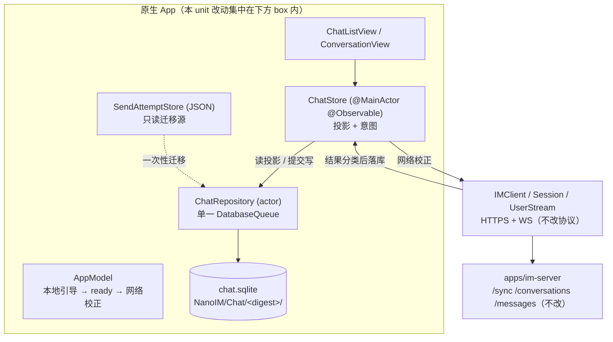
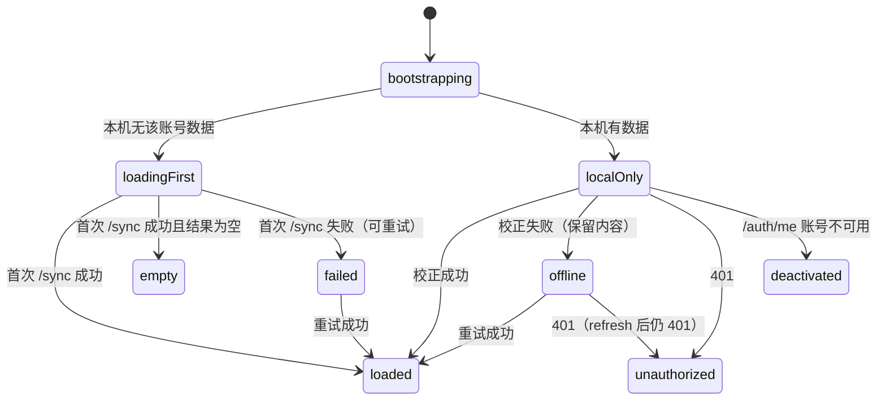

# feat-714: iOS 本地聊天库与冷启动首绘 — 技术方案

> 对齐: spec.md（Gate 1 已通过）

## Changelog

## 现状分析

### 涉及范围

本 unit 只改原生 iOS 客户端，**零服务端、零 Web 改动**：

| 目录 | 当前职责 | 本 unit 的变化 |
|---|---|---|
| `src/IM/ios/NanoIM/App/NanoIMApp.swift` | `AppModel` 持有 `IMClient`；`ready` 门控整个界面；`restore()` 直接做网络刷新 | 启动拆成「本地引导 → 立即 ready」与「网络校正」两段；新增分区装配点 `ChatStorageController`（见「仓储接口」末尾）；分区清理挂到既有的 `signOut/login/refreshUser` 路径 |
| `src/IM/ios/NanoIM/Features/Chat/ChatStore.swift` | `@MainActor @Observable`，内存持有会话/时间线/草稿/pending；`listLoaded` 标记列表是否已从网络拿到 | 改成「库的投影」：数据从仓储读、写入经仓储提交后再投影；`listLoaded` 由显式阶段机替换；`run()` 的校正结果先落库 |
| `src/IM/ios/NanoIM/Features/Chat/SendAttemptStore.swift` | 按 `(origin,userID)` SHA256 目录存 JSON 发送尝试 | 保留为**只读迁移源**；写入路径迁到库；迁移完成后目录归档 |
| `src/IM/ios/NanoIM/Client/Session.swift` | token 轮换、`generation` 世代、`clearSendAttempts()` 的清理挂点 | 新增无网络的 `storedUser()`（读 Keychain，不刷新）；`clearSendAttempts()` 同点接入分区清理；401/传输失败保持既有区分 |
| `src/IM/ios/NanoIM/Client/Transport.swift` | 30s 超时、关 URL 缓存、同源重定向限制 | 不改；错误分类的输入之一 |
| `src/IM/ios/NanoIM/Features/Chat/ChatListView.swift` | `!listLoaded && listError == nil` 显示「正在加载聊天…」；空态只在 `listLoaded` 后出现 | 改绑阶段机；新增未连接/加载失败可读状态 |
| `src/IM/ios/NanoIM.xcodeproj/project.pbxproj` | objectVersion 77、`PBXFileSystemSynchronizedRootGroup`、一个 SPM 依赖 | 加一个 SPM 依赖（4 处）与 `Package.resolved` pin；新增 Swift 文件仍不需要改 pbxproj |
| `src/IM/ios/Tests/` | 既有 `ChatStateTests`、`SendRecoveryTests`、`SessionTests`、`TimelineTests` 是回归基线 | 新增仓储/迁移/状态机测试；既有断言不放宽 |

**不改**：`apps/im-server/**`、`src/IM/frontend/**`、`/sync` 与 `/conversations` 的默认返回、`/read` 语义、事件类型枚举。

### 既有约束

- 架构红线：iOS 客户端只经 HTTPS 调 IM；不得新增本地 Agent 内核或第二套事件总线（`AGENTS.md`、`src/IM/ios/README.md:3`）。
- 契约：`docs/specs/im/ios-client.md:30-40`（按服务隔离身份、迟到结果不得重建已退出的数据、暂时失败与凭据失效可区分）、`:42-51`（受保护媒体受会话授权约束，撤销后不再显示）、`:105-114`（首次网络发送前持久化同一次发送的身份与不可变内容，普通文字/附件/交互动作都适用）。`conversations-messages.md:432-436`（已读只清自己的未读、未展示的新消息仍算未读）。
- 已定前提（issue #468 §3.2 与 spec.md Q3）：GRDB、最低 iOS 26、库不存媒体字节、`/sync` 默认保持全量、U1 一次交付完整 schema 不新增第二次迁移。
- 工具链：本机 Xcode 26.4.1（17E202）、iPhoneOS SDK 26.4；`IPHONEOS_DEPLOYMENT_TARGET = 26.0`、`SWIFT_VERSION = 5.0`、`SWIFT_STRICT_CONCURRENCY = complete`（`project.pbxproj:134-156`）。因此适配层必须能在 Swift 6 严格并发下编译（GRDB 自身以 Swift 6 语言模式编译，见 D1）。
- 文件保护沿用既有安全边界：现有 `SendAttemptStore` 对目录与文件都设 `.completeFileProtection`（`SendAttemptStore.swift:41-47`）。

### 可复用能力

| 已有能力 | 用 / 改 / 不用 | 理由 |
|---|---|---|
| `SendAttemptStore` 的 `(origin,userID)` SHA256 分区口径（`SendAttemptStore.swift:62-69`） | **用（原样复用派生逻辑）** | 迁移必须在同一口径下找到旧目录；换口径等于重写一次隔离语义，且 `KeychainCredentials` 的 service key 也已用 origin（`CredentialStore.swift:15`） |
| `Session.generation` + `assertOwner` 的世代拒绝（`Session.swift:11,40-42`） | **用（扩展成库级写上下文）** | 已证明能挡住「旧账号的挂起请求发布结果」；库层需要同型机制，不能只靠 UI 的 `epoch` UUID |
| `TimelineMerge` 的身份与排序口径（`ChatModels.swift:157-172`：按 id 去重、`(created_at, id)` 排序、boundary 依附到下一条消息） | **用（在库层复刻同一排序键）** | 首绘必须与在线合并结果同序，否则「网络校正时列表跳动」会变成新问题 |
| `recoverPending()` 的 `lookup: true, resend: false`（`ChatStore.swift:383-403`） | **用（语义原样保留）** | 这是「重启不自动重发」的唯一实现点 |
| `ChatStore.reconcile()` 的「快照即权威集合 + 差分撤销」（`ChatStore.swift:181-203`） | **改（改成库内事务 + 单调 seq）** | 语义正确但只在内存里；搬进库才能保证「重启后仍不闪回」 |
| `membership_changed → clear() + 全量重拉`（`ChatStore.swift:116-118`） | **改（定向核对替代整表清空）** | 现在改名/加成员也会清空时间线，与 spec「不整屏闪回」「不会在下一帧重新出现」冲突 |
| 系统 `libsqlite3` 直接封装（issue #468 §3.2 方案 A） | **不用** | 真正难的是迁移、并发与事务边界；自写会把这三点留给自己（数据损坏而非体验问题）。已按已定前提选 GRDB |
| `DatabasePool`（WAL 并发读） | **不用（见 D2）** | 见决策 |
| `ValueObservation` | **不用（U1）** | U1 只有一个写者且每次写都由 store 发起，写 API 直接返回新投影即可；引入观察生命周期会在 U5 之前先增加一层不必要的并发面 |

### 相关历史

- `feat-578-ios-app`：确立 `App/ Client/ Features/ UI/ Tests/` 分层与「不建全局事件总线、不做离线同步引擎」。本 unit 引入唯一的数据层，仍不建事件总线：仓储是数据出口，事件仍由 `UserStream` 进 `ChatStore`。
- `feat-636-ios-uiux-polish`、`feat-634-ios-interactive-recovery`：界定聊天页阅读细节与 Interactive UI 的渲染边界；本 unit 不改视觉体系（U9 负责），但必须保住 `TimelineItem` 里 boundary 与 interactive 卡片字段的往返保真，否则会静默丢行/丢卡。
- `bugfix-713-discard-projection`：原「iOS 本地先行」立项被瘦身为丢弃投影修复；其本地快照首绘移交本 unit 并被库替换（不在 713 里先做一版快照）。713 的现象与 RCA 仍是本 unit 的问题陈述来源。
- `issue #468` §4.2 U1 已给出 schema 草案、首绘顺序、最小离线语义与四类主要风险；本文在其上做取舍与裁剪，并把「不做第二次迁移」落成具体表结构。

## 架构总览

新增一层「库为真、网络只做校正」的数据底座。当前 `ChatStore` 的内存数组是唯一事实，现在它变成库的投影；网络结果先写库，再从库投影出 UI。



改动前后的一句话差别：**今天「列表出现」的充要条件是一次成功的 `/sync` 往返；之后「列表出现」的充要条件是本地库能打开。** 网络从「渲染前提」降级为「校正来源」。

## 关键决策

**D1 — 引入 `groue/GRDB.swift`，精确 pin 到 7.12.0，通过 4 处 pbxproj 增量接入（与 `swift-markdown` 同构）。**

- 版本核实（本机实测，不是推断）：GRDB 最新发布 7.12.0（2026-11-01），pin revision `92a554cd0d5e8d67cb18993c6054e73fe42c066c`；其 `Package.swift` 为 `swift-tools-version:6.1`、`platforms: [.iOS(.v13), ...]`、`swiftLanguageModes: [.v6]`，README 要求 Swift 6.1+ / Xcode 16.3+。以本机 Xcode 26.4.1 + iPhoneOS SDK 26.4 实测 `swift build --triple arm64-apple-ios26.0-simulator` 编译通过（`Build complete! (268.28s)`，含 `DatabaseMigrator`/`DatabaseQueue`/`DatabasePool`/`DatabaseError`）。**结论：对 iOS 26 与当前 Xcode 无硬阻塞。**
- 证据边界：上述验证是「SPM 解析 + 以 iOS 26 模拟器三元组真实编译」，不是 xcodeproj 集成后的 `xcodebuild` 结果。集成本身（4 处 pbxproj 增量、`Package.resolved` 落到工程）与 `./src/IM/ios/scripts/build.sh build` 通过属 M1 的实施证据，不能由本文的 probe 代替。
- 接入增量（相对现有 `swift-markdown` 的三件对象再加 frameworks 挂载）：新增 `XCRemoteSwiftPackageReference`（`repositoryURL = groue/GRDB.swift`、`requirement = { kind = exactVersion; version = 7.12.0 }`）、`XCSwiftPackageProductDependency`（`productName = GRDB`）、`PBXBuildFile`（`productRef` 指向前者），并把它加进 `NanoIM` target 的 `packageProductDependencies`（现为 `project.pbxproj:279-281`）与 frameworks build phase 的 `files`、`project packageReferences`（`:327-329`）。`Package.resolved` 增加一条 `grdb.swift` pin 并提交。
- 拒绝备选：手写 `libsqlite3` 封装（迁移/并发/事务边界全部自写，出错是数据损坏）；`GRDBSQLite` 产品（那是 Linux 侧 systemLibrary 出口，iOS 用 `GRDB` 产品即可）。
- 成本与回退：首次构建需联网解析（CI 与本地同 `swift-markdown` 的既有成本）；回退只需撤销 pbxproj 与 `Package.resolved`，**没有用户数据格式需要回退**（见风险 R5）。

**D2 — 用 `DatabaseQueue`，不用 `DatabasePool`。**

- 理由一：本 unit 的核心不变量是「单一写入者」。`DatabaseQueue` 用一条连接把读写都串行化，从结构上禁止并发写；`DatabasePool` 提供并发读，等于把一个我们**要禁止**的能力变成常态，再靠约定约束。
- 理由二：数据量与访问面都很小（单账号、会话数十到数百、消息按 D13 上限裁剪），首绘读一次会话列表 + 一次时间线页，串行化不构成瓶颈。
- 理由三：避开 WAL 的实现副作用。GRDB 的 `DatabasePool` 强制 WAL，会额外产生 `-wal`/`-shm` 文件，它们必须与主库同等级受保护，并在设备锁定时段引入「有库但不可读」的额外失败面；`DatabaseQueue` 默认不改 `journal_mode`（SQLite 默认回滚日志），事务日志文件同样落在同一受保护目录内，行为更可预期。
- 代价与出口：读延迟与写入正相关。若 M1 证据里出现首绘读 > 16ms 或明显卡顿，可以只替换连接类型（`DatabaseQueue → DatabasePool`），仓储接口、schema、事务边界不变——这是本决策保留的唯一演化口，不作为本 unit 的实施项。

**D3 — 单一写入者是 `actor ChatRepository`，事务边界固定为「一次网络结果」或「一次用户意图」。**

- 所有 SQL 只在 `ChatRepository` 内执行；`ChatStore`（MainActor）与视图都不持有 `Database`。`ChatRepository` 内部只持有一个 `DatabaseQueue`，因此天然无 `SQLITE_BUSY`（GRDB 默认 `busyMode = .immediateError` 也不会被触发）。
- 事务边界：
  - 一次 `/sync` 结果 → 一个事务（删除不可见会话 + 更新可见会话 + 更新游标 + 写 `snapshot_seq`）；
  - 一次消息分页结果 → 一个事务（upsert 消息 + boundary + 会话投影 + 修剪超额消息）；
  - 一次用户意图（草稿写、pending_sends 增删、已读边界写）→ 各自一个事务。
- 「不在权威集合里」的判定只取自**一次成功的全量 `/sync`**（HTTP 200 且拿到完整投影）：`/sync` 今天没有分页游标（`SyncSnapshot { items, max_event_id }`，`ChatModels.swift:123`），所以缺项即失去访问；单次 `/conversations` 页、失败的响应、或 WS 单事件都不作为删除依据。U4 若给 `/sync` 加增量参数，必须回头重审这条判据。
- 游标只增不减：一次成功快照后取 `max(库内 max_event_id, 响应 max_event_id)`。持久化游标不能让重连退回到更旧的 `after_event_id`；WS 的 `resync_required` 仍按既有路径回落全量（`ChatStore.swift:119`）。
- 拒绝备选：把 `Database` 传给 `ChatStore` 就地查询（会重新出现「视图触发 IO」与主线程 IO）；多写者 + WAL（D2 已排除）。
- 读投影：每个写 API **在同一事务内**返回更新后的投影（会话行 / 时间线页 / pending 列表），`ChatStore` 直接采用返回值。这既避免「写完再读一次」的二段竞态，也让 U1 不需要观察机制。
- 降级：仓储打不开（磁盘满、库损坏且重建也失败）时，`ChatStorageController` 返回「无仓储」，`ChatStore` 退化为今天的纯网络模式（`listPhase` 从 `loadingFirst` 起步，所有读写直连网络），App 仍可用；降级本身在界面可见为「本次没有本地缓存」，不伪装成正常首绘。
- 主线程纪律：`ChatRepository` 的初始化、migrate、一次性导入全部在 actor 内（非 MainActor）；今天 `ChatStore.init` 里同步读 JSON（`ChatStore.swift:48,50-62`）的写法必须消失，M1 退出标准含「bootstrap 路径无同步文件/SQLite 调用」。

**D4 — 写操作必须携带写上下文 `(partition, epoch, snapshotSeq)`；迟到结果在库层被拒绝，不只靠 UI 判断。**

- `ChatRepository.open(partition)` 时生成 `epoch: UUID`；`purge()`/重开会换新 epoch。每次写调用传入打开时取得的 `ChatWriteContext`；epoch 不匹配 → 抛 `StaleWrite`，不写任何行。
- `snapshotSeq` 是每次成功快照递增的单调计数（存在 `sync_cursor.snapshot_seq`）。`applySnapshot(seq:)` 只接受 `seq > 当前值`；`applyPage`/`appendEvent`/`upsertPending` 只在 `seq == 当前值` 时接受，否则拒绝。这样「一个更早的、还没返回的详情/分页响应」在访问已被撤销后无法把行写回来。
- 与既有 `Session.generation` 的关系：`generation` 管「账号/凭据世代」，`epoch` 管「本地分区世代」，`snapshotSeq` 管「权威快照世代」。三者都在库层落地，`ChatStore` 里既有的 `epoch`/`sendEpoch` UUID 继续服务 UI 与发送语义，不重复承担持久化防护。

**D5 — schema v1 用「promoted 列 + 原始 DTO JSON」的混合形状，按 U1 需要裁剪表集。**

- 混合形状的理由：`ChatMessage` 有 16 个可空字段，其中 `interactive`/`thinking`/`tool_calls`/`permission_requests`/`delegation` 是随服务端演进的结构（`ChatModels.swift:84-107`）。逐列建表会让每个 UI 字段变更都变成一次 schema 迁移；只存 JSON 又无法可靠分页、排序与去重。因此：**排序/去重/列表投影需要的列提升为真实列，渲染需要的其余部分按服务端原始 DTO 存 `payload_json`，读时原样解码回 `ChatMessage`。**
- 裁剪与理由：
  - 保留 `actors` + `conversation_members`（规范化，不用 JSON 存 `participants`）：`Conversation.category`/`avatarName` 与输入区的 `@` 候选都读参与者类型与名字（`ChatModels.swift:29-37`、`ChatListView.swift:32`），U8/U9 还会按成员查；JSON 列会让这些查询退化成全表解码。
  - 保留 `conversation_boundaries`：`TimelineItem` 里 boundary 是时间线的可见组成（「Agent 配置已更新」，`ConversationView.swift:75`）。不进库就等于离线看到的时间线与在线不一致，且 `TimelineMerge` 的锚定规则会失配。
  - **不建** `attachments` 独立表：附件在 DTO 里只有 `url/content_type/file_name`（`ChatModels.swift:39-44`），没有需要跨消息查询的维度；作为 JSON 随消息存储即可，也天然满足「只存元数据」。
  - `cache_meta` 保留为 KV 表（分区自证 + 一次性标记），`sync_cursor` 保留为单行强类型表（高水位与快照序号要参与数值比较，不能退化成字符串）。
  - `read_state` 保留但**在 U1 只写不读**：U1 的未读口径仍是服务端投影 `conversations.unread_count`，清零规则不变（U3 负责单调与多端）。保留它是为了履行的「不做第二次迁移」，并有守卫测试断言「写 read_state 不改变任何列表投影」，防止 U3 语义偷偷长进 U1。
- 迁移路径：用 GRDB `DatabaseMigrator`（迁移台账在它自己的 `grdb_migrations` 表），**不再手工维护 `user_version`**——两套台账会成为「到底迁到第几版」的第二个事实源。`cache_meta.schema.version` 只写人类可读的回显，不参与判定。`eraseDatabaseOnSchemaChange` 在 Debug/Release 都保持 `false`：自动擦库会掩盖迁移缺陷，测试需要干净库时显式调用仓储的 `reset()`。

**D6 — 启动拆成「本地引导 → ready → 网络校正」，`ready` 不再等待任何网络往返。**

- `AppModel.restore()` 拆为 `start()`：
  1. `Session.storedUser()`（新增，只读 Keychain，不刷新、不发请求）：无 → `ready = true`、`user = nil`、登录页（首次安装）。
  2. 有 → 计算分区 → 打开 `ChatRepository`（非主线程，含 migrate + 一次性导入）→ 读引导快照（会话列表、草稿计数、pending 计数、阶段初值）→ `user = stored.user`（暂定）→ `ready = true`。
  3. 之后才做网络：`session.restore()`（refresh + `/auth/me`）→ 分类结果决定 `user` 与分区去留 → `ChatStore.run()` 用 `/sync` 校正并落库。
- 代价与已知取舍：token 实际已失效（在别的设备改了密码等）时，本地内容会在 401 返回前短暂出现，之后才清除并回登录页。这与「本地优先」不可分割，且内容仍属该账号本人；记录为 D9 的显式取舍。缓解：本地记录过 `accountEnabled == false` 时不渲染内容，直接走准入页。
- 拒绝备选：先渲染、再异步补 Keychain 读取（会先出现一帧登录页，正是 spec 要消灭的现象）；把 `restore()` 超时当未登录（现状缺陷）。

**D7 — `listLoaded` 被显式阶段机 `ChatListPhase` 替换；「加载中」「离线有内容」「空」「失败」是四个不同状态。**



- `localOnly` 与 `offline` 都渲染已有内容并在顶部标「未连接/正在重试」，区别只在是否已成功校正过一次。
- 只有 `empty` 显示「暂无聊天」；`failed` 显示失败与重试入口；`loadingFirst` 显示加载中。这一条直接对应 spec 的「首次安装」与「没有本地内容且网络失败」两组场景。
- 拒绝备选：保留布尔 `listLoaded` 再叠加零散 flag（三态以上必然出现「既加载完又为空又失败」的非法组合）。

**D8 — 错误分类只有四类，只有两类会离开聊天内容。**

- 判定集中在一处：`ChatFailure.from(_ error: Error)`，输入是 `Session.perform` 已经分开的两类错误——传输层抛 `URLError`，非 2xx 抛 `APIError(status:detail:retryAfter:)`（`Session.swift:189-201`）。映射：
  - `URL`-level 失败（`URLError`，含无网/超时/连不上/DNS）→ `.offline`；
  - `APIError.status == 0`（客户端本地错误，如非法 origin）→ `.offline`。**注意 status 0 是重载的**：发送路径的「结果尚未确认」也用 status 0 表达（`ChatStore.swift:405,479`）。分类只作用于「读/校正路径」的失败；发送路径的 status 0 继续走每个会话自己的 `errors` 通道，不得改写连接状态——否则一条未确认的发送会把界面误标成离线，或反过来把离线洗成发送失败；
  - `status == 401` → `.unauthorized`。正确性来自 `Session.request` 的既有结构：401 会先尝试一次 refresh，`refresh()` 自身被拒也抛 401（`Session.swift:117-122,144-152`），所以到达 UI 的 401 已经意味着「凭据确实失效」，传输失败不会伪装成 401；
  - `status ∈ {403,404}` 且在会话范围 → `.forbidden`（会话撤销，删该会话，不退出登录）；
  - `status ∈ {408,429,5xx}` 及其他 → `.unavailable`（服务暂时不可用，与离线同样保留内容，但提示文案区分）。
- 状态机 `ConnectionState`：`localOnly / syncing / online / offline(attempt,nextRetryAt) / unavailable(status) / unauthorized / deactivated`。只有 `unauthorized` 与 `deactivated` 会清除分区并离开聊天内容。
- 「避免离线显示成已同步」的三条不变量（进 M1 退出标准）：
  1. 只有 `.online` 才允许出现「已同步/最新」类文案；`.offline`/`.unavailable` 必须至少显示一条未连接提示（`connectionText` 非空 ⟺ 非 `online`）；
  2. `.online` 的进入条件是**一次成功的 `/sync`**，不是 TCP 连通或 WS 握手成功；
  3. 离线时展示的「上次更新」时间来自 `cache_meta.sync.last_full_at`（上次成功响应的记录），不是当前时间，也不与「刚刚同步」同形。
- 不做：退避曲线、重连编排、前后台恢复策略（U7）。本 unit 只保留现有 `pow(2, attempt)` 上限 30s 的重试（`ChatStore.swift:122-129`），不放大也不重写。

**D9 — 分区口径与 `SendAttemptStore` 完全一致，文件保护与备份排除显式声明。**

- 身份串 `"<scheme>://<host>:<port>\n<userID>"`（scheme/host 小写，port 缺省按 443/80）→ SHA256 hex，与 `SendAttemptStore.ownerDirectory` 逐字符相同（`SendAttemptStore.swift:62-66`）。
- 库路径 `ApplicationSupport/NanoIM/Chat/<digest>/chat.sqlite`；同目录放事务日志等 sidecar。目录与文件都设 `.completeFileProtection`（沿用 `SendAttemptStore.swift:41-47` 的既有边界）。
- 目录设 `isExcludedFromBackup = true`：内容是服务端权威数据的可重建副本，不应作为用户备份的一部分被复制到用户未预期的位置。
- 已知后续影响（记录，不在本 unit 解决）：`.completeFileProtection` 在设备锁屏时不可读，U5 的后台刷新在锁屏唤醒下会打不开库。U5 必须自己决定「只在首次解锁后唤醒」还是「重新评估保护等级」；本 unit 不为了将来的后台刷新提前降低现有保护等级。

**D10 — 清理按「分区」与「会话」两种粒度，删除与拒绝写入在同一事务内完成，因此不会闪回。**

删除范围矩阵：

| 触发 | 判定点（复用既有挂点） | 范围 | 结果 |
|---|---|---|---|
| 用户退出登录 | `Session.signOut()`（已有 `clearSendAttempts()`，`Session.swift:82`） | 整个分区目录 + 库 | 删除；新会话看不到任何旧内容 |
| 登录另一个账号 | `Session.login`/`install(pair)` 检测 `user.id` 变化（`Session.swift:62,156`） | 旧分区 | 删除 |
| 切换服务地址 | `AppModel.authenticate(server:)` 先 `signOut()` 旧 client（`NanoIMApp.swift:74-77`） | 旧 origin 分区 | 删除 |
| 账号失效 | `/auth/me` 或 refresh 后 `accountEnabled == false`（`Session.swift:101,156`、`ChatStore.swift:100`） | 当前分区 | 删除 + 准入页 |
| 凭据失效 | refresh 后仍 401（`Session.swift:146-149`） | 当前分区 | 删除 + 登录页 |
| 会话访问撤销 | 权威快照缺该会话 / 详情 403,404 / `membership_changed` 核对失败 | 该会话全部行（级联）+ `revoked_conversations` | 列表与时间线都不再可见，重启亦然 |
| 受保护媒体 | 不适用 | 库内只有 `url/content_type/file_name` | 无字节可清；渲染仍受 `ServerOrigin.resource` 与授权约束（`Transport.swift:49-54`） |

「旧内容不闪回」靠三层叠加，任一层单独都不够：

1. **分区代际**：`purge()` 递增 epoch 并关闭连接；任何拿着旧 `ChatWriteContext` 的迟到结果被判 `StaleWrite`，写不进新分区。
2. **快照单调**：`applySnapshot` 只接受更大的 `snapshot_seq`；更早的慢响应无法把已删除的会话写回。
3. **同事务删除**：应用一次快照时，在同一事务内先删掉「不在权威集合里」的会话（级联消息/成员/草稿/pending/boundary/read_state），再写可见会话。UI 只在事务提交后看到新投影，因此不存在「先显示不可访问的会话、下一帧再删掉」的中间帧。

`purge()` 的顺序固定为「事务内清空所有表 → 关闭连接 → 删除分区目录」：即使文件删除失败（磁盘错误、连接未完全释放），下一次打开该分区也读不到任何行——「没有内容」由事务保证，不依赖文件系统操作成功。删除失败只作为诊断记录，不改变结论。

`revoked_conversations` 是跨重启的「不要复活」记录：`applyPage`/`appendEvent`/`upsertPending` 对已撤销会话直接拒绝；该会话重新出现在权威快照里时（服务端说可访问了）删除 tombstone。

**D11 — `conversation.membership_changed` 不再清空时间线，改成定向核对。**

- 现状：收到该事件就 `clear()` 并全量重拉（`ChatStore.swift:116-118`），而服务端复用同一事件表示改名与成员变化（issue #468 §2.3 D4.4），于是「改名 = 时间线被清空一次」，正是 spec 里「不整屏闪回」要消灭的现象。
- 本 unit 的最小切片：收到该事件 → 标记 `accessUnconfirmed` → 定向 `GET /conversations/{id}`：
  - 200 → 就地更新会话行与成员（改名/加成员），**不动消息**；
  - 403/404 → 删除该会话全部行 + 写 tombstone（撤销路径）；
  - 同时仍按既有节奏跑一次 `/sync` 作为兜底比对（权威集合差分仍在 D10 层生效）。
- 不做：服务端事件类型细分与事件回放（U4）。这里只用现有接口，不新增协议。

**D12 — 一次性迁移放到「打开分区」时执行，幂等身份沿用旧文件的文件名口径，且不改变任何发送语义。**

- 迁移只在 `ChatRepository.open` 内、migrator 之后、对外可用之前执行一次；对 UI 是同步可见的（pending 在首帧就在）。
- 身份：`pending_sends` 主键 `(conversation_id, source_message_id, attempt_key)`，其中 `attempt_key` 就是 `PendingSend.key`，`source_message_id` 对普通发送用 `''`（服务端消息 id 非空，占位无歧义）。这与旧文件名 `sha256("conversationID\nsourceMessageID\nkey")` 一一对应。
- 幂等：`INSERT OR IGNORE` + `cache_meta["migration.send_attempts_v1"]` 标记，两者叠加——重复执行不产生重复行，标记存在时整体跳过。
- 失败处理：逐条 `migration_report` 记账（`imported / duplicate / rejected`）；`rejected` 的 JSON 文件**保留在原目录**、不删除、不清零，并在证据里报告条数（当前实现只会在 `requestBody == nil` 时保存失败，`SendAttemptStore.swift:35-37`，所以理论值为 0）。崩溃点覆盖：插入与标记同事务（回滚后重跑）；提交成功但归档失败（标记已写，下次只做归档清理）。
- 归档：提交成功后才把旧目录改名为 `<digest>.migrated-<ts>`，下次成功打开时删除。**保留一个发布周期的旧 JSON 是本次的回退路径**（见 R1）。
- 语义不变：迁移过程零网络调用；`recoverPending()` 仍是 `lookup: true, resend: false`（`ChatStore.swift:383-403`）；只有用户显式重试才走 `resend: true`。M1 有「任何 POST 都失败」的桩测试断言冷启动零发送。交互卡片的 `source_message_id` 记录同样迁入，`interactionConversations` 的映射由库读出重建。

**D13 — 每个会话本地保留最近 300 条消息（= 5 个客户端分页），追加时在同一事务内修剪更旧的。**

- 理由：不设上限就是无界增长（消息只增不删），而 U1 没有媒体缓存那种「500MB 上限」的天然刹车。300 = 现分页大小 60（`ChatAPI.swift:4`）× 5 页，比「往上翻两屏」深得多，同时把单会话磁盘占用钉在可预期范围。
- 代价：更早的历史需要联网，此时显示「需要连接后才能读取」这一类诚实说明（spec 已要求「无法补齐的部分明确说明尚未完成」）。U6/U5 之后若引入总容量策略，只需改这个常量与修剪策略，不动 schema。
- 拒绝备选：不设上限（无界）；按时间窗（离线深度不可预期，且与用户「昨天的话都在」的直觉冲突）。

**D14 — 本 unit 不改变模型可见信息，因此不产 Context 章节与原型。**

- 依据 `docs/development/agent-context-engineering.md` 的「范围与影响判断」：本 unit 的消费者是人类用户与原生 UI，数据流是「服务端 → 客户端 → 用户」。库里的消息不会再被投喂给任何 LLM：iOS 客户端不组装 Prompt、不定义工具、不注入 Skill、不读写 Memory/History，也没有把本地库内容回传服务端的路径（U1 零服务端改动）。因此 Context Lifecycle 的八个阶段无一受影响，不新增 Context 章节，也不需要 Context Review。
- 反向确认（避免漏判）：若未来 U8（消息搜索）把本地命中结果当作模型上下文，或 U5 的后台刷新把本地内容注入 Agent 输入，那时才触发 Context 影响判断——那属于相应 unit 的范围。
- 原型同理：本次改动是**同一原生界面上的状态与生命周期变化**（首绘时机、加载/空/失败/未连接四态、访问撤销后的消失），没有新布局、新导航、新组件，UI 信息架构与视觉重设计明确属 U9 非目标。iOS 呈现只能在真机/模拟器观察，浏览器原型无法表达「飞行模式冷启动」这类决定性场景，故不产 `prototype.html`；体验裁决放到 Runbook 的真驱动客户端旅程里（见「状态呈现契约」与 Milestones 的 `[reviewer]` 轨道）。

## 接口与数据流

### 数据模型（schema v1）

`migrations` 用 GRDB `DatabaseMigrator` 注册 `v1`（台账 `grdb_migrations`），外键开启（GRDB 默认）。所有时间列沿用服务端原样字符串（与 `nanoDate` 的宽松解析一致，不在库层改格式）。

| 表 | 关键列 | 用途与约束 |
|---|---|---|
| `cache_meta` | `key TEXT PK`, `value TEXT NOT NULL` | 分区自证（`partition.origin`/`partition.user_id`）、一次性标记（`migration.send_attempts_v1`）、`sync.last_full_at`、`schema.version`（只回显） |
| `sync_cursor` | `id INTEGER PK CHECK(id=1)`, `max_event_id INTEGER NOT NULL`, `snapshot_seq INTEGER NOT NULL`, `updated_at TEXT` | WS/`/sync` 高水位（今天只在内存 `cursor`，`ChatStore.swift:107`）+ 快照单调序号（D4）。不引入增量协议：U1 仍走全量 `/sync` |
| `conversations` | `id TEXT PK`，`title/type/direct_kind/owner_id/creator_id`，`is_pinned/is_muted INTEGER`，`unread_count INTEGER`，`last_message_preview/last_message_at/created_at`，`run_state/source_agent_id/source_node_id/external_source/external_chat_id/visibility/dissolved_at`，`is_member/can_write/is_observer/can_change_visibility INTEGER NULL`，`sort_at TEXT NOT NULL`，`refreshed_at TEXT` | 列表直接投影。三态布尔保留 NULL 语义（`Conversation` 里是 `Bool?`，`ChatModels.swift:25-28`）。`sort_at = COALESCE(last_message_at, created_at)` 把现有排序键下推到 SQL；索引 `(is_pinned DESC, sort_at DESC)` |
| `actors` | `id TEXT PK`, `type`, `display_name`, `user_id`, `is_stale INTEGER NULL`, `updated_at` | 参与者身份（`ActorRef`，`CommonModels.swift:32-38`） |
| `conversation_members` | `conversation_id` → `conversations` (CASCADE), `actor_id` → `actors`, `position INTEGER`, PK`(conversation_id, actor_id)` | 重建 `Conversation.participants` 顺序；供 `@` 候选与头像/分类派生 |
| `messages` | `id TEXT PK`, `conversation_id` → CASCADE, `created_at`, `sort_key TEXT NOT NULL`, `sender_type`, `sender_actor_id`, `sender_user_id`, `sender_display_name`, `delivery_status`, `kernel_message_id`, `pa_agent_id`, `content`, `attachments_json`, `payload_json`, `written_at` | `sort_key = created_at ‖ U+0001 ‖ id`，复刻 `TimelineMerge` 的 `(created_at, id)` 序（`ChatModels.swift:162-164`）；`payload_json` 为服务端 DTO 原样，保证 interactive/thinking/tool_calls 等往返保真；索引 `(conversation_id, sort_key DESC)` 供 keyset 分页与修剪 |
| `conversation_boundaries` | `id TEXT PK`, `conversation_id` → CASCADE, `agent_id`, `before_message_id`, `applied_at` | 时间线里的「Agent 配置已更新」行（`TimelineItem` boundary），不进库会静默丢行 |
| `drafts` | `conversation_id TEXT PK` → CASCADE, `body TEXT NOT NULL`, `updated_at` | 只有文字。已上传待发的附件留在内存（属 U2 的输入区状态；只存 URL 会还原出「能看不能发」的半成品） |
| `read_state` | `conversation_id TEXT PK` → CASCADE, `last_read_message_id TEXT`, `reported_at TEXT` | U1 只写服务端确认过的边界，不参与未读计算（守卫测试见 D5） |
| `pending_sends` | `(conversation_id, source_message_id DEFAULT '', attempt_key)` PK, `content`, `attachments_json`, `request_body BLOB NOT NULL`, `created_at`, `last_error`, `updated_at` | 继承 `SendAttemptStore` 的幂等身份与冻结请求体（`SendAttemptStore.swift:35-37`、`ChatModels.swift:131-136`）。唯一 BLOB 列，内容只有 JSON 请求体，不含附件字节 |
| `revoked_conversations` | `conversation_id TEXT PK`, `revoked_at`, `reason` | 跨重启的「不要复活」tombstone（D10） |
| `migration_report` | `id TEXT PK`, `source`, `item_key`, `outcome`, `detail`, `created_at` | 一次性迁移的逐条记账（D12） |

索引只建在真实查询上：`conversations(is_pinned DESC, sort_at DESC)`、`messages(conversation_id, sort_key DESC)`、`conversation_boundaries(conversation_id, before_message_id)`、`pending_sends(conversation_id)`。

### 仓储接口

```swift
/// 一个 (origin, userID) 分区。所有 SQL 只在这里执行；调用方不接触 Database。
actor ChatRepository {
    struct Partition: Hashable, Sendable { let origin: URL; let userID: String
        var digest: String { /* 与 SendAttemptStore 同口径 */ } }

    struct WriteContext: Sendable { let epoch: UUID; let snapshotSeq: Int }

    static func open(_ partition: Partition, location: ChatStorageLocation) throws -> ChatRepository
    func writeContext() throws -> WriteContext            // 当前 epoch + snapshotSeq

    // 读
    func bootstrapSeed() throws -> BootstrapSeed          // 会话列表、草稿、pending 计数、阶段初值
    func conversations() throws -> [Conversation]
    func conversation(_ id: String) throws -> Conversation?
    func timeline(_ id: String, limit: Int) throws -> TimelinePage   // items + nextBefore + isAtLocalStart
    func pendingAttempts() throws -> [SendAttempt]
    func draft(_ id: String) throws -> String?

    // 写（返回提交后的新投影；拒绝时抛 StaleWrite / RevokedConversation）
    func applySnapshot(_ items: [Conversation], maxEventID: Int, snapshotSeq: Int,
                       write: WriteContext) throws -> SnapshotResult
    func applyConversation(_ value: Conversation, members: [ActorRef],
                           write: WriteContext) throws -> Conversation
    func applyPage(_ id: String, items: [TimelineItem], nextBefore: String?,
                   write: WriteContext) throws -> TimelinePage
    func applyEvent(_ event: UserEvent, write: WriteContext) throws -> EventResult
    func revoke(_ id: String, reason: RevokeReason, write: WriteContext) throws
    func setDraft(_ id: String, body: String) throws
    func upsertPending(_ attempt: SendAttempt, write: WriteContext) throws
    func removePending(_ attempt: SendAttempt, write: WriteContext) throws
    func markReadBoundary(_ id: String, messageID: String) throws   // U1 只写不读
    func purge() throws                                             // 删全部行 + 关库
    func reset() throws                                             // 仅测试/诊断
}
```

`ChatStore` 侧的形状（只列语义变化，不写实现步骤）：

- `pending`/`drafts`/`attachments` 从「作者」变成「投影」：对外仍是对视图友好的字典，但写入必须经 `ChatRepository`；`NanoIMApp.reference(_:_:)` 这类直接改 `store.drafts[...]` 的调用点改成 `store.setDraft(...)`。
- `listLoaded: Bool` → `listPhase: ChatListPhase`；新增 `connection: ConnectionState`。
- `openChat(_:)` = 先读库（命中则立刻出图）→ 再 `refreshChat(_:)` 网络校正 → 落库 → 重投影。
- `run()` 保留「/auth/me → /sync → WS」的现有骨架，但每一步的结果先落库；`membership_changed` 走 D11。

`ChatStorageController`（`@MainActor`，`AppModel` 持有）是分区生命周期的唯一所有者，只做四件事，不含业务 SQL：

1. `bootstrap() -> Bootstrap?`：由 `(client.baseURL, session.storedUser()?.id)` 求分区，open 仓储并返回引导快照；无凭据返回 nil（→ 登录页）。
2. 持有与替换仓储实例：分区变化即换实例，旧实例关闭。
3. `purge(reason:)`：`repository.purge()` + 目录清理，供 `signOut / login(另一账号) / 切服务 / accountEnabled==false / 401` 五个挂点调用（D10 的删除时机全部落在这里）。
4. `resetProjection()`：把 `ChatStore` 的投影与阶段机重置到初始值（等价于今天的 `clear()`，`ChatStore.swift:84-89`），但不再手工清内存里的权威数据。

`ChatStore` 只消费「有一个可用仓储或没有」，不决定删除时机。

**刻意不持久化的内存状态**（避免被读成漏项）：

| 状态 | 为什么不进库 |
|---|---|
| `uploadDrafts`（`AttachmentUpload.data`，已选未发的文件字节） | 属 U2 的输入区状态；字节不进持久层是本 unit 的硬约束，只存 URL 会还原出「能看不能发」的半成品 |
| `interactionSelections` / `interactionSending`（卡片本地探索态） | 属 Interactive UI 的私人状态，已有自己的契约（`ios-client.md:89-95`），U1 不改其恢复路径 |
| `discarded`（本次会话内被丢弃的消息 id） | 丢弃在库层表现为**删除消息行**，重启后自然不存在；内存集合只服务于在途合并（`TimelineMerge` 的 `discarded` 参数） |
| `notificationFloor`、`banner`、`composeRequest`、`errors`、`checkingAccess` | 纯瞬时 UI/提醒状态，重启后无意义 |

### 冷启动与校正时序


### 状态呈现契约

不产 `prototype.html`（理由见 D14），但每处状态变化的落点在这里固定，供 Gate 2 与产品验收对照：

| 场景 | 呈现 | 实现落点 |
|---|---|---|
| 有本地数据冷启动 | 列表首帧即上次内容；无整屏加载态 | `ChatListPhase.localOnly`/`loaded`；`NanoIMApp.swift:11` 的 `ProgressView` 只在 `bootstrapping` 出现 |
| 首次安装 | 「正在加载聊天…」直到首次 `/sync` | `loadingFirst`；替代 `ChatListView.swift:20` 的 `!listLoaded` 判定 |
| 首次结果为空 | 「暂无聊天」 | `empty`；替代 `ChatListView.swift:59` 的 `listLoaded` 判定 |
| 无本地数据且失败 | 失败说明 + 重试按钮（不出现「暂无聊天」） | `failed` |
| 离线 | 顶部「未连接，正在重试」，内容照常可读 | `ChatStore.connectionText`（非空 ⟺ 非 `online`） |
| 校正中 | 不整屏替换；只做行级更新 | 快照落库后重投影，视图 identity 不变（`RootTabs` 的 `.id` 仍绑 `baseURL-user.id`，`NanoIMApp.swift:15`） |
| 会话撤销 | 该会话从列表消失；正在看时显示「此聊天已不可访问」 | `revoked_conversations` + 既有 `revokedChats` 提示（`ConversationView.swift:98-99`） |
| 账号/服务切换 | 新会话语境里没有任何旧内容 | `purge()`（D10） |

## 契约层增量 (delta-spec)

- IM / iOS 客户端：`docs/changes/feat-714-ios-local-chat-store/specs/im/ios-client.md` —— 新增「本地聊天内容首绘与离线可读」「本地聊天数据按服务与账号分区并随访问变化清理」两条 Requirement，并修订「原生会话恢复与退出隔离」的断线场景（把「暂时失败与凭据失效可区分」写实为可观察结果）。
- IM / 跨端会话与消息：no spec delta —— `/sync` 默认全量、未读计算与 `/read` 语义均不变；本 unit 不改服务端与 Web 的可观察行为。
- 其余包：no spec delta。

## 风险与回退

| # | 风险 | 缓解 | 回退 |
|---|---|---|---|
| R1 | **迁移丢未确认发送**（直接破坏「不重复、不自动重发、重启可核对」三条既有保证） | 唯一键 + `INSERT OR IGNORE` 幂等；插入与标记同事务；提交成功才归档旧目录；逐条 `migration_report`；M1 单测逐字节比对 `request_body` 与条数，并用「任何 POST 都失败」的桩断言零发送 | 旧 JSON 目录保留一个发布周期；出问题时新版本可退回旧构建，JSON 路径与语义原样可用，零数据丢失 |
| R2 | 库打开失败/损坏（磁盘满、异常中断） | `open` 失败时把 `chat.sqlite` 侧移为 `chat.corrupt-<ts>`、重建空库、**不归档**旧 JSON，因此未确认发送仍可再次导入；失败原因写入 `cache_meta` 与日志 | 同上：空库只是丢本地缓存，服务端全量 `/sync` 即可重建；用户可见退化为「无本地数据的首次加载」。重建也失败时按 D3 的降级走纯网络模式，App 仍可用 |
| R3 | 并发写导致数据错乱 | 单连接 `DatabaseQueue` + actor 串行；写只经仓储；事务边界固定为「一次网络结果/一次用户意图」；UI 不持有 `Database` | 无需数据回退：出错时可整分区 `purge()` 重建（本地数据可重建） |
| R4 | 访问撤销后仍闪回（违反 `ios-client.md:35`） | D10 三层防护 + tombstone + 定向核对；M2 单测覆盖「旧 seq 快照被拒」「revoked 会话拒绝写入」，真机覆盖「离线冷启动仍不出现」 | 单个函数回退：`membership_changed` 回到「清空 + 全量重拉」（会闪一下，但不泄露） |
| R5 | GRDB 引入成本（供应链、构建时长、二进制体积、CI 联网解析） | 精确 pin + 提交 `Package.resolved`；首次构建实测通过（D1）；CI 与 `swift-markdown` 共用同一条 SPM 解析路径 | 撤销 pbxproj 与 `Package.resolved` 即可；无用户数据格式变化 |
| R6 | 牵连 Web/服务端 | 本 unit 明确不改 `apps/im-server/**` 与 `src/IM/frontend/**`；PR 范围以路径自证，`/sync` 不新增参数 | 不需要：没有跨端改动可回退 |
| R7 | 主线程 IO / 首绘变慢 | 仓储全部在 actor；bootstrap 不读同步文件；M1 退出标准含调用点审计 | 阅读体验退化时退回 `DatabasePool`（D2 的唯一演化口） |
| R8 | 本地磁盘无界增长 | D13 每会话 300 条 + 分区级 `purge`；总量策略交 U5/U6 | 调整常量即可，不动 schema |
| R9 | 首绘先于凭据校验（D6 的已知取舍） | 本地已记录 `accountEnabled == false` 时不渲染；401 到达后立即 `purge()` | 若要更严：把 `ready` 推迟到 refresh 成功即回到现状，代价是丢弃本 unit 的核心收益，需产品决策 |

## 一次性部署迁移

无。本 unit 不迁移服务端数据、配置或部署状态；发送尝试的迁移发生在设备端 App 升级后的首次打开，由产品自身实现（D12），不需要部署 Agent 执行，因此不创建 `deployment-prompt.md`。

## Runbook for Reviewer

| 服务 | 停止命令 | 启动命令 | 健康检查 |
|---|---|---|---|
| 隔离 IM（`apps/im-server`，本 unit 唯一依赖的常驻服务） | `./scripts/e2e-down.sh` | `./scripts/e2e-up.sh` | `curl -fsS "http://127.0.0.1:$IM_PORT/health"`（端口取自 `.e2e-ports.env`；服务路由见 `apps/im-server/src/server.ts:285-286`） |

Gateway/Node 不是本 unit 的验收对象：本 unit 只验「列表与消息的本地首绘、离线可读、隔离与撤销」，不需要 Agent 回复。若 reviewer 要复验 Agent 回复相关回归，再按 `scripts/e2e-up.sh --profile daily` 起全套。

**Review 驱动方式**: 端到端真栈 + **真驱动客户端面**。本 unit 改变了客户端面（首绘时机、四态呈现、撤销后消失），这些只在原生客户端可观察，不能用「客户端同一接口」代驱动。关键界面：聊天列表（有数据/首次安装/空/失败/未连接）、会话页（本地时间线、未连接提示、撤销提示）、登录与准入页（凭据失效/账号失效的区分）。

**验收前置**:
- 工具链：Xcode 26.4.1（`DEVELOPER_DIR=/Applications/Xcode.app/Contents/Developer`）、一个可用 iPhone 模拟器 UDID；首次构建需联网解析 GRDB。
- 构建/安装：`./src/IM/ios/scripts/build.sh build`（或 `test`），产物在 `/tmp/nano-ios-build`；模拟器安装用 `xcrun simctl install/launch`。
- 隔离服务：`./scripts/e2e-up.sh` 后 source `.e2e-ports.env`；Debug 下用 `NANO_IM_BASE_URL=http://127.0.0.1:$IM_PORT` 指向隔离 IM（`NanoIMApp.swift:38-43` 的 loopback 例外）。
- 离线场景：模拟器没有真正的飞行模式。可以用本机 `pf`/反向代理切断到隔离 IM 的流量作为**替代验证**，但系统网络状态、DNS 与超时行为与飞行模式不同，替代不能当等价结论。真机飞行模式属 M1/M2 的 `[reviewer]` 必需项，无法在 CI 验证。
- 账号准备：隔离 IM 里至少两个账号（A/B）、一个三人群、一个可被移出的成员身份，用于切账号与撤销场景。

## 测试策略与验证边界

| 层次 | 覆盖内容 | 在哪跑 |
|---|---|---|
| 单元（仓储 + 迁移） | schema v1 迁移幂等；JSON → `pending_sends` 的条数/字节保真/重复执行/拒绝记账；`purge()` 后读不到行；`revoked_conversations` 拒绝写入；旧 `WriteContext`/旧 `snapshot_seq` 被拒；300 条修剪；时间线排序与 `TimelineMerge` 同序；boundary/interactive 往返保真 | `xcodebuild test`（`./src/IM/ios/scripts/build.sh test`），CI 可跑；仓储测试用临时目录建库，不依赖服务端 |
| 单元（状态机 + 分类） | `ChatListPhase` 五态转换；`ConnectionState` 不变量（非 `online` 必有未连接提示）；`ChatFailure` 四类映射；`recoverPending` 零 POST | 同上，桩 client |
| 集成（真栈） | 首次安装加载→空态、`/sync` 校正落库、切账号/被移出群的真实服务端行为 | 模拟器 + `./scripts/e2e-up.sh` 隔离 IM（`NANO_IM_BASE_URL` 指向它） |
| 真机 | 飞行模式冷启动与恢复、杀进程后首绘、锁屏状态下的文件保护行为、备份排除是否生效 | 真机手工，**CI 无法验证** |

CI 无法证明、必须在 `[reviewer]` 轨道留真机证据的项：飞行模式（模拟器只能做流量切断替代）、锁屏/`completeFileProtection` 实际可读性、免费签名续期对本地库的连续性（重签不换容器，预期不受影响，但未验证）、首绘时延的主观感受。真实 401 的到达时机依赖服务端吊销，属集成验证而非单测。

## Milestones

两片按**两条独立用户旅程**切，不按「数据层 → UI」横切：M1「打开就看到上次内容」在实现与验证上是一个完整可观察结果（含库、迁移与首绘，缺一不可）；M2「换账号/被移出后旧内容不出现」是另一条必须真机走通的旅程，且它的证据形式（撤销/切换/迟到响应）与前一片不重叠。两片串行，无并行组。

| ID | 标题 | 依赖 | 并行组 | 范围 | 退出标准 |
|---|---|---|---|---|---|
| M1-local-first-paint | 本地库、发送尝试迁移与冷启动首绘 | — | — | GRDB 接入（pbxproj + pin）；schema v1 与 `DatabaseMigrator`；`ChatRepository` 的 open/seed/timeline/applySnapshot/applyPage/applyEvent/upsert/remove/purge 基础版；`SendAttemptStore` → `pending_sends` 一次性迁移；`AppModel` 两段式启动；`ChatStore` 投影化与 `ChatListPhase`；`ConnectionState` 与 `ChatFailure` 最小切面（offline/unavailable/unauthorized）；`purge()` 的凭据失效路径；首次安装加载态 vs 空态 | **`[reviewer]`** ① 有本地数据的账号：杀进程后正常网络重开，列表立即呈现上次的会话/预览/时间/未读，全程不出现「恢复登录…」「正在加载聊天…」整屏；校正后内容更新且无整屏闪回。② 真机飞行模式冷启动：同样呈现上次内容，明确显示未连接/正在重试，不出现登录表单、不显示成已同步。③ 飞行模式下点进此前打开过的会话：已存消息可读并显示未连接；点进从未打开过的会话：明确说明需要连接后才能读取，不显示为「没有消息」。④ 首次安装（本机无该账号数据）：聊天页显示加载中，不显示「暂无聊天」；仅当首次结果为空才显示空态。⑤ 升级前留有未确认发送的账号：升级后打开该会话仍看到那条未确认记录（内容与附件一致），且断网/重开/网络恢复都不会自动发出，只有显式重试才推进且仍只有一条。<br>**`[worker]`** ① 单测：schema v1 重复 migrate 幂等；迁移导入条数 = JSON 条数且 `request_body` 逐字节一致；重复执行不重复；`rejected == 0`；桩断言冷启动零 POST。② 单测：`ChatFailure` 四类映射（offline/unavailable/unauthorized/forbidden）、`ChatListPhase` 五态转换、`ConnectionState` 不变量（非 `online` 必有未连接提示）。③ 单测：时间线排序与 `TimelineMerge` 同序；boundary 与 interactive 字段往返保真；300 条修剪后仍能读出最新一页。④ 主线程 IO 审计：列出 bootstrap/run 路径的所有仓储调用点，证明无 MainActor 同步文件或 SQLite 调用。⑤ 构建证据：`./src/IM/ios/scripts/build.sh build` 通过，`Package.resolved` 含 GRDB 7.12.0 pin；`build.sh test` 通过既有 `ChatStateTests`/`SendRecoveryTests`/`SessionTests`/`TimelineTests` 未放宽断言。⑥ 单测：仓储打不开时降级为纯网络模式（阶段从 `loadingFirst` 起、不崩溃、不显示成正常首绘）。⑦ 证据落 `M1-local-first-paint/evidence/`：飞行模式冷启动与首次安装加载态的真实客户端截图/录屏。 |
| M2-partition-revocation | 分区隔离、访问撤销与迟到结果丢弃 | M1-local-first-paint | — | 清理矩阵（登出/换账号/切服务/账号失效/凭据失效）；`revoked_conversations` 与快照单调；迟到响应拒绝（分区 epoch + `snapshotSeq`）；`membership_changed` 定向核对替代清空；`checkingAccess`/`revokedChats` 呈现收口 | **`[reviewer]`** ① A 登出后登录 B：B 看不到 A 的任何会话、消息、草稿与未确认记录；离线打开同样。② 把服务地址切到另一台隔离 IM 并登录同一账号：只显示新服务内容。③ 在线把当前用户移出群：该会话从列表消失、进不去，下一帧不闪回；随后断网冷启动仍不出现。④ 在线撤销访问后立刻断网冷启动：被撤销会话与其消息仍不出现。⑤ 服务端吊销凭据（改密码或使 refresh 失效）后重开：回到登录页（不是聊天页），且本地聊天内容不再展示。<br>**`[worker]`** ① 单测：`purge()` 后重开该分区读不到任何行，正常路径下目录与库文件也已删除；拿着旧 `WriteContext` 的写被 `StaleWrite` 拒绝；更旧 `snapshot_seq` 的快照被拒。② 单测：`revoked_conversations` 生效后 `applyPage`/`appendEvent`/`upsertPending` 均被拒；该会话重新出现在权威快照后 tombstone 被清除。③ 单测：`membership_changed` 走定向核对时不删除消息行（改名/加成员后时间线行数与内容不变），403/404 时整会话行被删。④ 单测：清理矩阵五个触发点各自删除范围正确，且只影响目标分区（另一分区仍在）。⑤ 构建与既有测试通过；证据落 `M2-partition-revocation/evidence/`：切账号、被移出群、离线冷启动的真实客户端截图/录屏。 |
