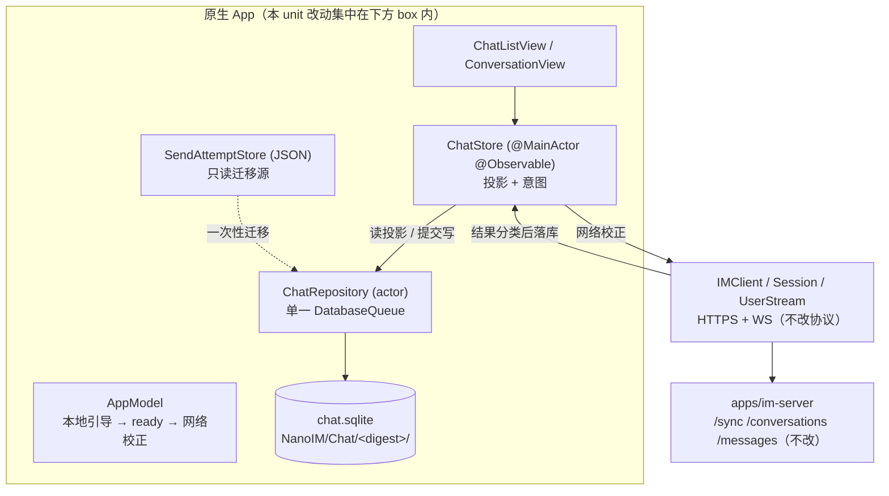
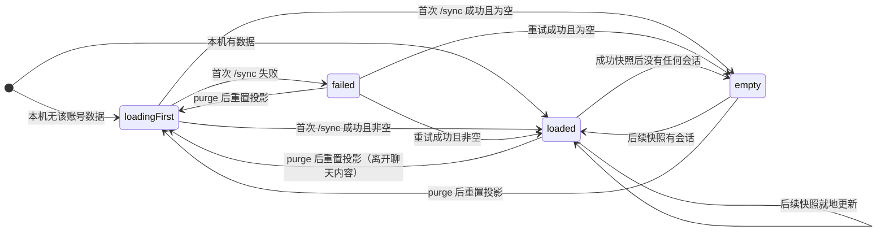
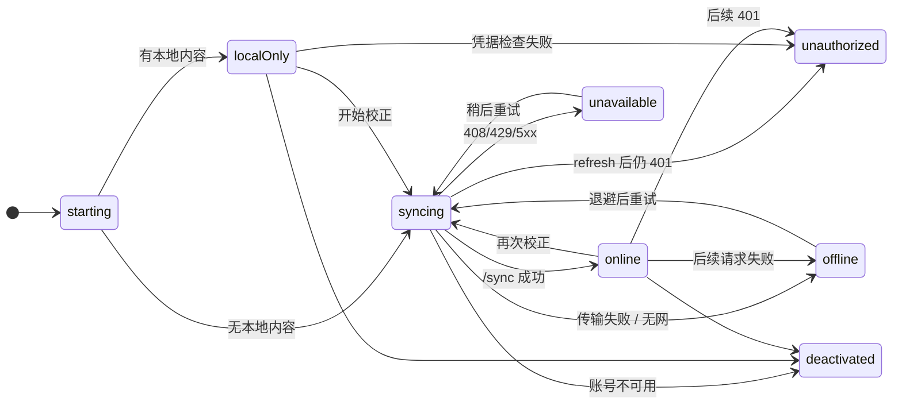
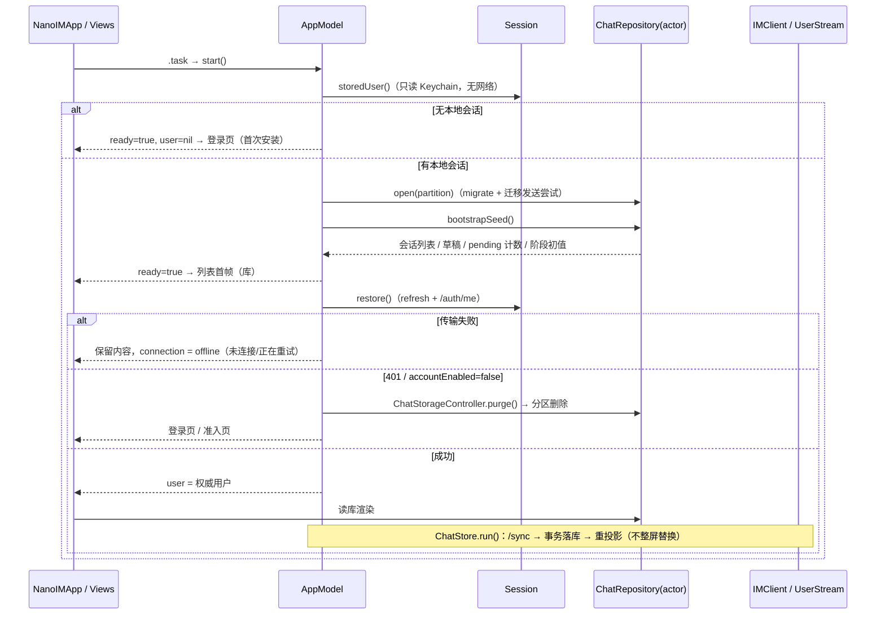

# feat-714: iOS 本地聊天库与冷启动首绘 — 技术方案

> 对齐: spec.md（Gate 1 已通过；2026-11-05 按上级决定增补两处「口径修正（design 阶段确认）」）

## Changelog

- 2026-11-05（Round 2 收口）: 补 `pending_sends` 的孤儿收敛路径（快照差分输入改为库内会话身份全集 + 显式丢弃，R2-W1）；补登录成功/换账号后的分区激活与 `ChatStorageState` 三态（R2-W2）；补三条设计承诺的证据位（R2-R1）、凭据失效的可执行构造（R2-R2）、`ChatMessage` 可空字段数更正为 13（R2-R3）、`publish(nil)` 的顺序裁定（R2-R4）。
- 2026-11-05（追加）: 上级批准后把两处口径落到首文档：`spec.md`「会话访问被撤销」改为「已得知撤销」口径、「未确认发送记录迁移一条不丢」增「升级后首次启动的呈现」Scenario，两处均以「口径修正（design 阶段确认）」标注来源（Gate 2 W1 / C1）。design 与 delta 已与首文档一致。
- 2026-11-05: Gate 2 R1 收口 — `pending_sends` 去掉会话外键并改显式删除（C1）；旧 JSON 目录在 U1 不改名不删除，迁移是否完成只由库内标记判定（C2）；补离线可读边界与撤销收敛口径（W1）、`membership_changed` 核对期间的呈现（W2）、四项不可 CI 验证项的落点与 M1⑤ 构造步骤（W3）、`ChatListPhase`/`ConnectionState` 状态口径与 401 purge 归属（W4）、草稿写入节流与单一串行写（W5）、`interaction_contexts` 边界（W6）、凭据校验前的呈现时序条款（W7），并吸收 R1–R6。

## 现状分析

### 涉及范围

本 unit 只改原生 iOS 客户端，**零服务端、零 Web 改动**：

| 目录 | 当前职责 | 本 unit 的变化 |
|---|---|---|
| `src/IM/ios/NanoIM/App/NanoIMApp.swift` | `AppModel` 持有 `IMClient`；`ready` 门控整个界面；`restore()` 直接做网络刷新；`observe()` 已订阅 `session.updates()`（`:45-56`） | 启动拆成「本地引导 → 立即 ready」与「网络校正」两段；新增分区装配点 `ChatStorageController`（见「仓储接口」末尾）；分区清理由 `Session.termination` 驱动，`AppModel` 在既有 `observe()` 里观察 `session.updates()` 的 `nil` 与终止原因（D10） |
| `src/IM/ios/NanoIM/Features/Chat/ChatStore.swift` | `@MainActor @Observable`，内存持有会话/时间线/草稿/pending；`listLoaded` 标记列表是否已从网络拿到 | 改成「库的投影」：数据从仓储读、写入经仓储提交后再投影；`listLoaded` 由 `ChatListPhase` 替换、新增 `ConnectionState`；`run()` 的校正结果先落库；`membership_changed` 走定向核对（D11）；**不决定任何分区删除时机**（D10） |
| `src/IM/ios/NanoIM/Features/Chat/SendAttemptStore.swift` | 按 `(origin,userID)` SHA256 目录存 JSON 发送尝试 | 保留为**只读迁移源**（旧构建也仍按原路径读它）；写入路径迁到库；U1 **不改名、不删除**该目录，是否已迁移只由库内标记判定（D12） |
| `src/IM/ios/NanoIM/Client/Session.swift` | token 轮换、`generation` 世代、`clearSendAttempts()` 的清理挂点（`:55-57,82,101,147,156`） | 新增无网络的 `storedUser()`（读 Keychain，不刷新）；新增 `termination: SessionTermination?`（`.signedOut` / `.credentials` / `.deactivated`）作为分区清理的唯一信号源；`clearSendAttempts()` 同点接入分区清理；401/传输失败保持既有区分 |
| `src/IM/ios/NanoIM/Client/Transport.swift` | 30s 超时、关 URL 缓存、同源重定向限制 | 不改；错误分类的输入之一 |
| `src/IM/ios/NanoIM/Features/Chat/ChatListView.swift` | `!listLoaded && listError == nil` 显示「正在加载聊天…」；空态只在 `listLoaded` 后出现 | 改绑阶段机；新增未连接/加载失败可读状态 |
| `src/IM/ios/NanoIM.xcodeproj/project.pbxproj` | objectVersion 77、`PBXFileSystemSynchronizedRootGroup`、一个 SPM 依赖 | 加一个 SPM 依赖（4 处）与 `Package.resolved` pin；新增 Swift 文件仍不需要改 pbxproj |
| `src/IM/ios/Tests/` | 既有 `ChatStateTests`、`SendRecoveryTests`、`SessionTests`、`TimelineTests` 是回归基线 | 新增仓储/迁移/状态机测试；既有断言不放宽 |

**不改**：`apps/im-server/**`、`src/IM/frontend/**`、`/sync` 与 `/conversations` 的默认返回、`/read` 语义、事件类型枚举。

### 既有约束

- 架构红线：iOS 客户端只经 HTTPS 调 IM；不得新增本地 Agent 内核或第二套事件总线（`AGENTS.md`、`src/IM/ios/README.md:3`）。
- 契约：`docs/specs/im/ios-client.md:30-40`（按服务隔离身份、迟到结果不得重建已退出的数据、暂时失败与凭据失效可区分）、`:42-51`（受保护媒体受会话授权约束，撤销后不再显示）、`:105-114`（首次网络发送前持久化同一次发送的身份与不可变内容，普通文字/附件/交互动作都适用）。`conversations-messages.md:432-436`（已读只清自己的未读、未展示的新消息仍算未读）。
- 已定前提（issue #468 §3.2 与 spec.md Q3）：GRDB、最低 iOS 26、库不存媒体字节、`/sync` 默认保持全量、U1 一次交付完整 schema 不新增第二次迁移。
- 工具链：本机 Xcode 26.4.1（17E202）、iPhoneOS SDK 26.4；`IPHONEOS_DEPLOYMENT_TARGET = 26.0`、`SWIFT_VERSION = 5.0`、`SWIFT_STRICT_CONCURRENCY = complete`（`project.pbxproj:134-156`）。因此适配层必须能在 Swift 6 严格并发下编译（GRDB 自身以 Swift 6 语言模式编译，见 D1）。
- 文件保护沿用既有安全边界：现有 `SendAttemptStore` 对目录与文件都设 `.completeFileProtection`（`SendAttemptStore.swift:41-47`）。

### 可复用能力

| 已有能力 | 用 / 改 / 不用 | 理由 |
|---|---|---|
| `SendAttemptStore` 的 `(origin,userID)` SHA256 分区口径（`SendAttemptStore.swift:62-69`） | **用（原样复用派生逻辑）** | 迁移必须在同一口径下找到旧目录；换口径等于重写一次隔离语义，且 `KeychainCredentials` 的 service key 也已用 origin（`CredentialStore.swift:15`） |
| `Session.generation` + `assertOwner` 的世代拒绝（`Session.swift:11,40-42`） | **用（扩展成库级写上下文）** | 已证明能挡住「旧账号的挂起请求发布结果」；库层需要同型机制，不能只靠 UI 的 `epoch` UUID |
| `TimelineMerge` 的身份与排序口径（`ChatModels.swift:157-172`：按 id 去重、`(created_at, id)` 排序、boundary 依附到下一条消息） | **用（在库层复刻同一排序键）** | 首绘必须与在线合并结果同序，否则「网络校正时列表跳动」会变成新问题 |
| `recoverPending()` 的 `lookup: true, resend: false`（`ChatStore.swift:383-403`） | **用（语义原样保留）** | 这是「重启不自动重发」的唯一实现点 |
| `ChatStore.reconcile()` 的「快照即权威集合 + 差分撤销」（`ChatStore.swift:181-203`） | **改（改成库内事务 + 单调 seq）** | 语义正确但只在内存里；搬进库才能保证「重启后仍不闪回」 |
| `membership_changed → clear() + 全量重拉`（`ChatStore.swift:116-118`） | **改（定向核对替代整表清空）** | 现在改名/加成员也会清空时间线，与 spec「不整屏闪回」「不会在下一帧重新出现」冲突 |
| 系统 `libsqlite3` 直接封装（issue #468 §3.2 方案 A） | **不用** | 真正难的是迁移、并发与事务边界；自写会把这三点留给自己（数据损坏而非体验问题）。已按已定前提选 GRDB |
| `DatabasePool`（WAL 并发读） | **不用（见 D2）** | 见决策 |
| `ValueObservation` | **不用（U1）** | U1 只有一个写者且每次写都由 store 发起，写 API 直接返回新投影即可；引入观察生命周期会在 U5 之前先增加一层不必要的并发面 |

### 相关历史

- `feat-578-ios-app`：确立 `App/ Client/ Features/ UI/ Tests/` 分层与「不建全局事件总线、不做离线同步引擎」。本 unit 引入唯一的数据层，仍不建事件总线：仓储是数据出口，事件仍由 `UserStream` 进 `ChatStore`。
- `feat-636-ios-uiux-polish`、`feat-634-ios-interactive-recovery`：界定聊天页阅读细节与 Interactive UI 的渲染边界；本 unit 不改视觉体系（U9 负责），但必须保住 `TimelineItem` 里 boundary 与 interactive 卡片字段的往返保真，否则会静默丢行/丢卡。
- `bugfix-713-discard-projection`：原「iOS 本地先行」立项被瘦身为丢弃投影修复；其本地快照首绘移交本 unit 并被库替换（不在 713 里先做一版快照）。713 的现象与 RCA 仍是本 unit 的问题陈述来源。
- `issue #468` §4.2 U1 已给出 schema 草案、首绘顺序、最小离线语义与四类主要风险；本文在其上做取舍与裁剪，并把「不做第二次迁移」落成具体表结构。

## 架构总览

新增一层「库为真、网络只做校正」的数据底座。当前 `ChatStore` 的内存数组是唯一事实，现在它变成库的投影；网络结果先写库，再从库投影出 UI。



改动前后的一句话差别：**今天「列表出现」的充要条件是一次成功的 `/sync` 往返；之后「列表出现」的充要条件是本地库能打开。** 网络从「渲染前提」降级为「校正来源」。

## 关键决策

**D1 — 引入 `groue/GRDB.swift`，精确 pin 到 7.12.0，通过 4 处 pbxproj 增量接入（与 `swift-markdown` 同构）。**

- 版本核实（本机实测，不是推断）：GRDB 最新发布 7.12.0（2026-11-01），pin revision `92a554cd0d5e8d67cb18993c6054e73fe42c066c`；其 `Package.swift` 为 `swift-tools-version:6.1`、`platforms: [.iOS(.v13), ...]`、`swiftLanguageModes: [.v6]`，README 要求 Swift 6.1+ / Xcode 16.3+。以本机 Xcode 26.4.1 + iPhoneOS SDK 26.4 实测 `swift build --triple arm64-apple-ios26.0-simulator` 编译通过（`Build complete! (268.28s)`，含 `DatabaseMigrator`/`DatabaseQueue`/`DatabasePool`/`DatabaseError`）。**结论：对 iOS 26 与当前 Xcode 无硬阻塞。**
- 证据边界：上述验证是「SPM 解析 + 以 iOS 26 模拟器三元组真实编译」，不是 xcodeproj 集成后的 `xcodebuild` 结果。集成本身（4 处 pbxproj 增量、`Package.resolved` 落到工程）与 `./src/IM/ios/scripts/build.sh build` 通过属 M1 的实施证据，不能由本文的 probe 代替。
- 接入增量（相对现有 `swift-markdown` 的三件对象再加 frameworks 挂载）：新增 `XCRemoteSwiftPackageReference`（`repositoryURL = groue/GRDB.swift`、`requirement = { kind = exactVersion; version = 7.12.0 }`）、`XCSwiftPackageProductDependency`（`productName = GRDB`）、`PBXBuildFile`（`productRef` 指向前者），并把它加进 `NanoIM` target 的 `packageProductDependencies`（现为 `project.pbxproj:279-281`）与 frameworks build phase 的 `files`、`project packageReferences`（`:327-329`）。`Package.resolved` 增加一条 `grdb.swift` pin 并提交。
- 拒绝备选：手写 `libsqlite3` 封装（迁移/并发/事务边界全部自写，出错是数据损坏）；`GRDBSQLite` 产品（那是 Linux 侧 systemLibrary 出口，iOS 用 `GRDB` 产品即可）。
- 成本与回退：首次构建需联网解析（CI 与本地同 `swift-markdown` 的既有成本）；回退只需撤销 pbxproj 与 `Package.resolved`，**没有用户数据格式需要回退**（见风险 R5）。

**D2 — 用 `DatabaseQueue`，不用 `DatabasePool`。**

- 理由一：本 unit 的核心不变量是「单一写入者」。`DatabaseQueue` 用一条连接把读写都串行化，从结构上禁止并发写；`DatabasePool` 提供并发读，等于把一个我们**要禁止**的能力变成常态，再靠约定约束。
- 理由二：数据量与访问面都很小（单账号、会话数十到数百、消息按 D13 上限裁剪），首绘读一次会话列表 + 一次时间线页，串行化不构成瓶颈。
- 理由三：本 unit 没有连接级并发的使用者。所有读取都由 `ChatStore` 在一次写提交之后发起，不存在「UI 查询与后台同步并行」的场景；并发读能力在这里没有消费者，引入它只是把一个要禁止的能力变成常态。真正需要并发读的是 U5 的后台刷新，届时按下面唯一的口替换连接类型即可。
- 提交成本约束（写入策略，不是选型判据）：`DatabaseQueue` 在 GRDB 默认配置下不改 `journal_mode`（`DatabaseQueue.swift:51-57` 的 `.default` 分支直接 `break`），即 SQLite 默认 rollback journal，每个 commit 都要 fsync 日志。因此高频小写必须合并（草稿按 W5 的节流/单写队列落库），不能「每键一个事务」。这条约束与连接类型无因果关系，只是本 unit 必须遵守的写入纪律。
- 代价与出口：读延迟与写入正相关。若 M1 证据里出现首绘读 > 16ms 或明显卡顿，可以只替换连接类型（`DatabaseQueue → DatabasePool`），仓储接口、schema、事务边界不变——这是本决策保留的唯一演化口，不作为本 unit 的实施项。

**D3 — 单一写入者是 `actor ChatRepository`，事务边界固定为「一次网络结果」或「一次用户意图」。**

- 所有 SQL 只在 `ChatRepository` 内执行；`ChatStore`（MainActor）与视图都不持有 `Database`。`ChatRepository` 内部只持有一个 `DatabaseQueue`，因此天然无 `SQLITE_BUSY`（GRDB 默认 `busyMode = .immediateError` 也不会被触发）。
- 事务边界：
  - 一次 `/sync` 结果 → 一个事务（删除不可见会话 + 更新可见会话 + 更新游标 + 写 `snapshot_seq`）；
  - 一次消息分页结果 → 一个事务（upsert 消息 + boundary + 会话投影 + 修剪超额消息）；
  - 一次用户意图（pending_sends 增删、已读边界写、草稿 flush）→ 各自一个事务。草稿**不是**逐键一个事务，见下方「草稿写入」。
- 「不在权威集合里」的判定只取自**一次成功的全量 `/sync`**（HTTP 200 且拿到完整投影）：`/sync` 今天没有分页游标（`SyncSnapshot { items, max_event_id }`，`ChatModels.swift:123`），所以缺项即失去访问；单次 `/conversations` 页、失败的响应、或 WS 单事件都不作为删除依据。U4 若给 `/sync` 加增量参数，必须回头重审这条判据。
- 差分的输入是**库内已存在的全部会话身份**，不是「会话行」：`conversations.id` ∪ `pending_sends.conversation_id` ∪ `revoked_conversations.conversation_id`（镜像今天 `ChatStore.reconcile` 把 `pending.keys` 并入撤销集的做法，`ChatStore.swift:190`）。迁移先于任何 `/sync`，所以 `pending_sends` 里的会话可能**没有任何会话行**；只用会话行做差分，这类记录就永远没有结论路径（只有 `purge()` 能删），计数与说明会永久残留。差集逐项走 D10 的 `revoke()`（唯一删除入口）。
- 快照校正同时处理「会话在集合内但已不能写」：`can_write == false` 或 `dissolved_at != nil` 的会话 → 丢弃该会话的 pending 记录（镜像今天的第二个调用点 `ChatStore.swift:195-198`）。否则只读/已解散会话里的未确认发送同样永远残留。
- 游标只增不减：一次成功快照后取 `max(库内 max_event_id, 响应 max_event_id)`。持久化游标不能让重连退回到更旧的 `after_event_id`；WS 的 `resync_required` 仍按既有路径回落全量（`ChatStore.swift:119`）。
- 拒绝备选：把 `Database` 传给 `ChatStore` 就地查询（会重新出现「视图触发 IO」与主线程 IO）；多写者 + WAL（D2 已排除）。
- 读投影：每个写 API **在同一事务内**返回更新后的投影（会话行 / 时间线页 / pending 列表），`ChatStore` 直接采用返回值。这既避免「写完再读一次」的二段竞态，也让 U1 不需要观察机制。
- **草稿写入（W5）**：`ConversationView` 的输入是逐字符 `Binding.set`（`ConversationView.swift:36`），`set` 是同步函数、不能 `await`。因此：
  - 输入期间只改内存（`store.drafts[...]`），不落库；每键一个事务在 rollback journal 下就是每键一次 fsync，且 fire-and-forget 的写任务会乱序覆盖（后到的旧文本盖掉新文本）。
  - 落库（flush）点：输入失焦、切换会话、`scenePhase != .active`、发送前、`openChat` 切走；flush 点之外按 1s 节流合并。
  - 合并规则：只保留「最新快照」，由单一串行写任务依次提交（同一条等待链，后写胜出），因此不存在乱序，也不需要按版本号丢弃。
  - 损失窗口：进程被系统直接杀死时最多丢最近 1s 的草稿文本；退到后台已经 flush 过，正常路径不丢。这条写进 M1 证据，不伪装成零损失。
  - 与发送的原子性：发送前先 flush 草稿，`upsertPending` 在同一事务里清空该会话草稿行，因此不会出现「草稿还在 + 未确认发送也在」的双份内容，也不会出现两者都缺的空档。
- 仓储状态必须是三态，不能是「有/无」：`ChatStorageState = .opening | .ready(ChatRepository) | .degraded(reason)`。`.opening`（尚未打开，含登录成功后正在打开）**不是**降级，不显示「没有本地缓存」；只有 `.degraded` 才是降级。`.degraded` 时 `ChatStore` 退化为今天的纯网络模式（`listPhase` 从 `loadingFirst` 起步，所有读写直连网络），App 仍可用，但界面必须显示「本次没有本地缓存」并给重试入口，不伪装成正常首绘。
- 主线程纪律：`ChatRepository` 的初始化、migrate、一次性导入全部在 actor 内（非 MainActor）；今天 `ChatStore.init` 里同步读 JSON（`ChatStore.swift:48,50-62`）的写法必须消失，M1 退出标准含「bootstrap 路径无同步文件/SQLite 调用」。

**D4 — 写操作必须携带写上下文 `(partition, epoch, snapshotSeq)`；迟到结果在库层被拒绝，不只靠 UI 判断。**

- `ChatRepository.open(partition)` 时生成 `epoch: UUID`；`purge()`/重开会换新 epoch。每次写调用传入打开时取得的 `ChatWriteContext`；epoch 不匹配 → 抛 `StaleWrite`，不写任何行。
- `snapshotSeq` 是每次成功快照递增的单调计数（存在 `sync_cursor.snapshot_seq`）。`applySnapshot(seq:)` 只接受 `seq > 当前值`；`applyPage`/`appendEvent`/`upsertPending` 只在 `seq == 当前值` 时接受，否则拒绝。这样「一个更早的、还没返回的详情/分页响应」在访问已被撤销后无法把行写回来。
- 与既有 `Session.generation` 的关系：`generation` 管「账号/凭据世代」，`epoch` 管「本地分区世代」，`snapshotSeq` 管「权威快照世代」。三者都在库层落地，`ChatStore` 里既有的 `epoch`/`sendEpoch` UUID 继续服务 UI 与发送语义，不重复承担持久化防护。

**D5 — schema v1 用「promoted 列 + 原始 DTO JSON」的混合形状，按 U1 需要裁剪表集。**

- 混合形状的理由：`ChatMessage` 有 13 个可空字段（9 个非可选 + 13 个 Optional，共 22 个，`ChatModels.swift:84-107`），其中 `interactive`/`thinking`/`tool_calls`/`permission_requests`/`delegation` 是随服务端演进的结构。逐列建表会让每个 UI 字段变更都变成一次 schema 迁移；只存 JSON 又无法可靠分页、排序与去重。因此：**排序/去重/列表投影需要的列提升为真实列，渲染需要的其余部分按服务端原始 DTO 存 `payload_json`，读时原样解码回 `ChatMessage`。**
- 裁剪与理由：
  - 保留 `actors` + `conversation_members`（规范化，不用 JSON 存 `participants`）：`Conversation.category`/`avatarName` 与输入区的 `@` 候选都读参与者类型与名字（`ChatModels.swift:29-37`、`ChatListView.swift:32`），U8/U9 还会按成员查；JSON 列会让这些查询退化成全表解码。
  - 保留 `conversation_boundaries`：`TimelineItem` 里 boundary 是时间线的可见组成（「Agent 配置已更新」，`ConversationView.swift:75`）。不进库就等于离线看到的时间线与在线不一致，且 `TimelineMerge` 的锚定规则会失配。
  - **不建** `attachments` 独立表：附件在 DTO 里只有 `url/content_type/file_name`（`ChatModels.swift:39-44`），没有需要跨消息查询的维度；作为 JSON 随消息存储即可，也天然满足「只存元数据」。
  - `cache_meta` 保留为 KV 表（分区自证 + 一次性标记），`sync_cursor` 保留为单行强类型表（高水位与快照序号要参与数值比较，不能退化成字符串）。
  - `read_state` 保留但**在 U1 只写不读**：U1 的未读口径仍是服务端投影 `conversations.unread_count`，清零规则不变（U3 负责单调与多端）。保留它是为了履行的「不做第二次迁移」，并有守卫测试断言「写 read_state 不改变任何列表投影」，防止 U3 语义偷偷长进 U1。写入触发点只有一个：`ChatStore.markRead` 收到 200 后调用 `markReadBoundary(会话, last_read_message_id)`（现状 `ChatStore.swift:254-260` 只用响应更新会话行，不记录已报边界）；失败不写，下次可见消息重报——与现状的「不因已读失败影响阅读」一致。
- 迁移路径：用 GRDB `DatabaseMigrator`（迁移台账在它自己的 `grdb_migrations` 表），**不再手工维护 `user_version`**——两套台账会成为「到底迁到第几版」的第二个事实源。`cache_meta.schema.version` 只写人类可读的回显，不参与判定。`eraseDatabaseOnSchemaChange` 在 Debug/Release 都保持 `false`：自动擦库会掩盖迁移缺陷，测试需要干净库时显式调用仓储的 `reset()`。

**D6 — 启动拆成「本地引导 → ready → 网络校正」，`ready` 不再等待任何网络往返。**

- `AppModel.restore()` 拆为 `start()`：
  1. `Session.storedUser()`（新增，只读 Keychain，不刷新、不发请求）：无 → `ready = true`、`user = nil`、登录页（首次安装）。
  2. 有 → 计算分区 → 打开 `ChatRepository`（非主线程，含 migrate + 一次性导入）→ 读引导快照（会话列表、草稿、pending **计数**、阶段初值）→ `user = stored.user`（暂定）→ `ready = true`。若 pending 计数 > 0，同一帧给出说明「N 条未确认的发送；连接后会核对：仍在的会话可在其中查看，已无权访问的会被清除」，不造占位会话行（D12）。
  3. 之后才做网络：`session.restore()`（refresh + `/auth/me`）→ 分类结果决定 `user` 与分区去留 → `ChatStore.run()` 用 `/sync` 校正并落库。
- 代价与已知取舍：token 实际已失效（在别的设备改了密码等）时，本地内容会在 401 返回前短暂出现，之后才清除并回登录页。这与「本地优先」不可分割，且内容仍属该账号本人；记录为本决策的显式取舍与风险 R9，并在 delta 里写成可判定条款（W7）：本地内容可在凭据重新校验完成前呈现，服务端确认失效后立即停止展示并清理。缓解：本地记录过 `accountEnabled == false` 时不渲染内容，直接走准入页。
- 拒绝备选：先渲染、再异步补 Keychain 读取（会先出现一帧登录页，正是 spec 要消灭的现象）；把 `restore()` 超时当未登录（现状缺陷）。
- 登录成功后的分区打开（R2-W2）：本节只覆盖「启动时已有 stored user」。**首次登录与换账号**由 `ChatStorageController.activate(partition:)` 在凭据被接受、Keychain 已保存之后打开分区（见「仓储接口」末）；打开前是 `.opening`，不是降级。这是 M1 的持久化前提——漏掉它，全新安装的第一次会话一个字节都不落库，下一次（尤其断网）冷启动就没有本地内容，与 spec「断网冷启动」「打开就有上次内容」直接冲突。

**D7 — `listLoaded` 被两个正交相位替换：内容相位 `ChatListPhase`（四态）与连接相位 `ConnectionState`（八态）。**

「有没有内容可显示」和「连没连上」是两件事，混在一个枚举里必然出现「既加载完又为空又离线」的非法组合。



- `loadingFirst`：还没有任何内容可显示（首次安装、或刚被 purge）。显示加载态。
- `loaded`：有内容可显示（来自本地或来自网络，二者呈现无差别）。**只有 `loaded` 且连接为 `.online` 才允许出现「已同步/最新」类文案。**
- `empty`：**一次成功的 `/sync` 明确说没有会话**，且本地也没有剩余行。只有这里显示「暂无聊天」。
- `failed`：没有任何内容可显示，且首次加载失败。显示失败说明 + 重试入口，**不显示「暂无聊天」**。
- 关键约束：`ConnectionState` 变化**不改变**内容相位。断网时 `.loaded` 仍是 `.loaded`（内容照常可读），这正是本 unit 要消灭的「整屏退回加载态」。

`ConnectionState`（连接相位，八态）：



- 取值：`.starting`（本地引导未完成）、`.localOnly`（有本地内容但本进程尚未成功校正过）、`.syncing`、`.online`、`.offline(attempt, nextRetryAt)`（传输失败/无网）、`.unavailable(status)`（服务暂时不可用）、`.unauthorized`（凭据确实失效）、`.deactivated`（账号不可用）。
- 两个终态 `.unauthorized` / `.deactivated` 不留在聊天页：它们触发 `purge()` → `resetProjection()`，界面回到登录页/准入页，内容相位重置为 `loadingFirst`。
- 不变量（进 M1 退出标准）：① `connectionText` 非空 ⟺ `connection != .online`；② `.online` 的进入条件是**一次成功的 `/sync`**，不是 TCP 连通或 WS 握手成功；③ 离线时展示的「上次更新」时间来自 `cache_meta.sync.last_full_at`，不是当前时间。
- 谁负责 purge：`ChatStore` 不决定删除。`Session` 维护 `termination: SessionTermination?`（`.signedOut` / `.credentials` / `.deactivated`）：`.signedOut`/`.credentials` 在 `stored` 被清空的路径上**先写 termination 再 `publish(nil)`**（签出 `Session.swift:82-85`、refresh 仍 401 `:147-148`），`.deactivated` 由 `accountEnabled == false` 的非 nil 信号表达（`updateUser` 判停用后仍 `publish(user)`，`:101-102`；`install` 同理 `:156-159`），**不额外发 nil**。`AppModel` 已在 `observe()` 里订阅 `session.updates()`（`NanoIMApp.swift:45-56`）：`nil` → 按 termination `purge` + 回登录页；`user.accountEnabled == false` → `purge(.deactivated)` + 准入页。因此「已 `loaded` 之后才拿到 401」有明确归属点，也不由 `ChatStore` 直接删库。

**D8 — 错误分类只有四类，只有两类会离开聊天内容。**

- 判定集中在一处：`ChatFailure.from(_ error: Error)`，输入是 `Session.perform` 已经分开的两类错误——传输层抛 `URLError`，非 2xx 抛 `APIError(status:detail:retryAfter:)`（`Session.swift:189-201`）。映射：
  - `URL`-level 失败（`URLError`，含无网/超时/连不上/DNS）→ `.offline`；
  - `APIError.status == 0`（客户端本地错误，如非法 origin）→ `.offline`。**注意 status 0 是重载的**：发送路径的「结果尚未确认」也用 status 0 表达（`ChatStore.swift:405,479`）。分类只作用于「读/校正路径」的失败；发送路径的 status 0 继续走每个会话自己的 `errors` 通道，不得改写连接状态——否则一条未确认的发送会把界面误标成离线，或反过来把离线洗成发送失败；
  - `status == 401` → `.unauthorized`。正确性来自 `Session.request` 的既有结构：401 会先尝试一次 refresh，`refresh()` 自身被拒也抛 401（`Session.swift:117-122,144-152`），所以到达 UI 的 401 已经意味着「凭据确实失效」，传输失败不会伪装成 401；
  - `status ∈ {403,404}` 且在会话范围 → `.forbidden`（会话撤销，删该会话，不退出登录）；
  - `status ∈ {408,429,5xx}` 及其他 → `.unavailable`（服务暂时不可用，与离线同样保留内容，但提示文案区分）。
- 错误分类只负责「一次失败 → 一个相位」：`ChatFailure` 的输出落到 D7 的 `ConnectionState`（`.offline` / `.unavailable` / `.unauthorized`）或会话级 `.forbidden`。状态取值、状态图与三条不变量统一在 D7 维护，本节不重复。只有 `.unauthorized` 与 `.deactivated` 会清除分区并离开聊天内容。
- 不做：退避曲线、重连编排、前后台恢复策略（U7）。本 unit 只保留现有 `pow(2, attempt)` 上限 30s 的重试（`ChatStore.swift:122-129`），不放大也不重写。

**D9 — 分区口径与 `SendAttemptStore` 完全一致，文件保护与备份排除显式声明。**

- 身份串 `"<scheme>://<host>:<port>\n<userID>"`（scheme/host 小写，port 缺省按 443/80）→ SHA256 hex，与 `SendAttemptStore.ownerDirectory` 逐字符相同（`SendAttemptStore.swift:62-66`）。
- 库路径 `ApplicationSupport/NanoIM/Chat/<digest>/chat.sqlite`；同目录放事务日志等 sidecar。目录与文件都设 `.completeFileProtection`（沿用 `SendAttemptStore.swift:41-47` 的既有边界）。
- 目录设 `isExcludedFromBackup = true`：内容是服务端权威数据的可重建副本，不应作为用户备份的一部分被复制到用户未预期的位置。
- 可验证性（W3）：U1 只验**属性**，不验锁屏行为。M1 的 `[worker]` 步骤在真机 Debug 下打印分区目录与库文件的 `URLResourceValues`，断言 `fileProtection == .complete` 且 `isExcludedFromBackup == true`，输出落 `evidence/`；用 `xcrun simctl get_app_container <udid> <bundle-id> data` 核对库确实落在 App 容器内。**「锁屏时确实读不到」属 U5 的后台路径**（本 unit 没有后台唤醒，锁屏不会触发读库），不作为 U1 判据。
- 签名续期（免费签名的 7 天有效期）**不纳入本 unit 任何 milestone 判据**：需要 ≥7 天等待，且重签不更换 bundle id 与数据容器（预期不受影响，但未验证）；若产品要证据，另立长周期验证，不在 U1 的交付期内假装验过。
- 已知后续影响（记录，不在本 unit 解决）：`.completeFileProtection` 在设备锁屏时不可读，U5 的后台刷新在锁屏唤醒下会打不开库。U5 必须自己决定「只在首次解锁后唤醒」还是「重新评估保护等级」；本 unit 不为了将来的后台刷新提前降低现有保护等级。

**D10 — 清理按「分区」与「会话」两种粒度，删除与拒绝写入在同一事务内完成，因此不会闪回。**

删除范围矩阵：

| 触发 | 判定点（复用既有挂点） | 范围 | 结果 |
|---|---|---|---|
| 用户退出登录 | `Session.signOut()`（已有 `clearSendAttempts()`，`Session.swift:82`） | 整个分区目录 + 库 | 删除；新会话看不到任何旧内容 |
| 登录另一个账号 | `Session.login`/`install(pair)` 检测 `user.id` 变化（`Session.swift:62,156`） | 旧分区 | 删除 |
| 切换服务地址 | `AppModel.authenticate(server:)` 先 `signOut()` 旧 client（`NanoIMApp.swift:74-77`） | 旧 origin 分区 | 删除 |
| 账号失效 | `/auth/me` 或 refresh 后 `accountEnabled == false`（`Session.swift:101,156`、`ChatStore.swift:100`） | 当前分区 | 删除 + 准入页 |
| 凭据失效 | refresh 后仍 401（`Session.swift:146-149`） | 当前分区 | 删除 + 登录页 |
| 会话访问撤销 | 权威快照缺该会话 / 详情 403,404 / `membership_changed` 核对失败 | 该会话全部行（外键级联的表 + 显式删 `pending_sends`）+ `revoked_conversations` | 列表与时间线都不再可见，重启亦然 |
| 受保护媒体 | 不适用 | 库内只有 `url/content_type/file_name` | 无字节可清；渲染仍受 `ServerOrigin.resource` 与授权约束（`Transport.swift:49-54`） |

「旧内容不闪回」靠三层叠加，任一层单独都不够：

1. **分区代际**：`purge()` 递增 epoch 并关闭连接；任何拿着旧 `ChatWriteContext` 的迟到结果被判 `StaleWrite`，写不进新分区。
2. **快照单调**：`applySnapshot` 只接受更大的 `snapshot_seq`；更早的慢响应无法把已删除的会话写回。
3. **同事务删除**：应用一次快照时，在同一事务内先删掉「不在权威集合里」的会话（级联消息/成员/草稿/boundary/read_state，并**显式删除** `pending_sends`），再写可见会话。UI 只在事务提交后看到新投影，因此不存在「先显示不可访问的会话、下一帧再删掉」的中间帧。

`pending_sends` 没有会话外键（见数据模型），所以它的删除必须显式。收敛只有一条原语 `deletePending(conversationID:)`，三个调用者，不多不少：

1. **`revoke(conversationID, reason:)`**——撤销。来源：快照差集缺项（**含「迁移进来但从未出现过会话行」的 `conversation_id`**，见 D3 的差分输入）、详情 403/404、`membership_changed` 核对失败。同事务删该会话的 pending 行、删其余会话行、写 tombstone（`reason` 区分 `snapshot_absent` / `detail_forbidden` / `membership_denied`）。语义镜像今天的 `discardConversationAttempts`（`ChatStore.swift:491-499`：撤销时丢弃未确认发送）。
2. **快照校正的「不可写」分支**——会话仍在权威集合里但 `can_write == false` 或 `dissolved_at != nil`：只调 `deletePending`，不删会话行、不写 tombstone（镜像 `ChatStore.swift:195-198`）。
3. **`purge()`**——分区级清空。

**孤儿 pending 的结论路径（R2-W1）**：迁移进来、但对应会话从未出现在权威集合里的记录，在**第一次成功 `/sync`** 时命中第 1 条——`revoke` 删行并写 `revoked_conversations(reason='snapshot_absent')`，同时在 `migration_report` 记一行 `outcome='orphaned'`。**幂等边界（R3-R1）**：只有本次调用真的删掉了 pending 行才记这一行，已存在的 tombstone 不被重写——`reason`/`revoked_at` 保留第一次判定的来源（`detail_forbidden`/`membership_denied`），随后每一轮仍缺席的快照对这些会话是幂等空操作，不会每轮追加记账。`bootstrapSeed.pendingCount` 按行数计算，因此计数随删除递减到 0，不会永久残留。若该会话日后重新出现在快照里，tombstone 按既有规则清除（但被删的 pending 不会复活——它已经不具备可核对的会话）。

快照差分**不直接**删 pending 行，它经 `revoke` 间接完成——两处各写一份删除逻辑就会出现「一处忘了删」的分叉。守卫单测：① 给一个有 pending 的会话走一次 revoke，断言消息/草稿/pending 在同一次提交后同时消失、tombstone 存在；② 构造「库里只有 pending、没有任何会话行」的分区（等价迁移后首启），跑一次不含该会话的快照，断言 pending 行被删、`pendingCount` 归零、不产生占位会话行。

`purge()` 的顺序固定为「事务内清空所有表 → 关闭连接 → 删除分区目录」：即使文件删除失败（磁盘错误、连接未完全释放），下一次打开该分区也读不到任何行——「没有内容」由事务保证，不依赖文件系统操作成功。删除失败只作为诊断记录，不改变结论。

`revoked_conversations` 是跨重启的「不要复活」记录：`applyPage`/`appendEvent`/`upsertPending` 对已撤销会话直接拒绝；该会话重新出现在权威快照里时（服务端说可访问了）删除 tombstone。

**离线可读边界与撤销收敛口径（W1）**：

- 撤销只能通过网络得知：一次成功的全量 `/sync`（D3）、详情 403/404、或 WS `membership_changed`（D11）。客户端离线期间服务端撤销访问时，本机没有任何信息可用。
- 因此本 unit 承诺的是两段，不含第三段：
  1. **已得知撤销**（在线收到、或已落 tombstone）→ 此后即使离线、冷启动、重启，都不再展示；
  2. **离线期间发生的撤销** → 从恢复联网后**第一次成功 `/sync`** 起不再展示；到达上界就是现有重试节奏（`pow(2, attempt)` 上限 30s，`ChatStore.swift:122-129`），不含系统网络事件到重连的延迟（U7）。
- 不做「猜测式隐藏」：不会因为「很久没联网」就隐藏会话，那会把「离线可读」变成「离线不可信」。
- 首文档与 delta 已按同一口径改写，不是「靠解释对齐」：`spec.md`「会话访问被撤销」的三条 AND（已得知撤销 → 离线/重启都不展示；离线期间发生 → 第一次成功 `/sync` 后收敛、上界 ≤30s；不做猜测式隐藏）与 delta 的同名 Scenario 一致。若产品要更强承诺（离线时也能即时知道撤销），需要服务端推送或访问租约，属 U4/U7，另立 unit；本 unit 不伪造该能力。

**D11 — `conversation.membership_changed` 不再清空时间线，改成定向核对。**

- 现状：收到该事件就 `clear()` 并全量重拉（`ChatStore.swift:116-118`），而服务端复用同一事件表示改名与成员变化（issue #468 §2.3 D4.4），于是「改名 = 时间线被清空一次」，正是 spec 里「不整屏闪回」要消灭的现象。
- **服务端事实（本轮核对，决定呈现只能这样设计）**：`apps/im-server/src/messaging.ts:300-306` 的 `membership(id, recipients)` 只广播 `{op:"event", event_type:"conversation.membership_changed", data:{conversation_id:id}}`——**没有标题、没有成员增量、也没有 event_id**。改名（`:855-859` 的 PATCH title）、成员变更、以及删除（`:864-873` 的 DELETE）都调用同一个方法。因此客户端**无法**从事件本身区分「改名」与「被移出」；任何「事件到了就删」或「事件到了就保留」的本地判别都是猜的。
- 本 unit 的最小切片：收到该事件 → 标记 `accessUnconfirmed`（列表行保留、该会话时间线先隐藏）→ 定向 `GET /conversations/{id}` 核对：
  - **200** → 就地恢复：重新从库投影该会话时间线与标题/成员并取消占位；不重建整屏、不重排列表、不重拉消息。
  - **403/404**，或返回的会话已不在本人可见集合 → 走 D10 的 `revoke`（删该会话全部行 + pending + tombstone），列表行随之消失。
  - **传输失败/超时/5xx** → 不判撤销：保留占位与列表行，按 D8 归类为 `.offline`/`.unavailable`，交给下一次 `/sync` 收敛。
  - 同时仍按既有节奏跑一次 `/sync` 作为兜底比对（权威集合差分仍在 D10 层生效）。
- 代价（明确接受，不隐藏）：改名/加成员会看到 ≤1 RTT 的「正在确认聊天权限…」占位（既有 `ConversationView.swift:100-101` 与 `ChatStore.checkingAccess`）。改名被误伤成占位，是为了「撤销内容不多留一帧」而付的代价；它远小于今天「改名把整屏时间线清空」。
- 兜底 `/sync` 的代价：改名不触发全量重拉（时间线来自本地库），但兜底 `/sync` 仍会跑一次——收益在「不清空时间线、不整屏闪回」，不在「少一次请求」。
- 不做：服务端事件类型细分与事件回放（U4）。这里只用现有接口，不新增协议。

**D12 — 一次性迁移在「打开分区」时执行；旧 JSON 原样保留，是否已迁移只由库内标记判定。**

- 时机与网络无关：迁移只在 `ChatRepository.open` 内、migrator 之后、对外可用之前执行一次，**纯本地 IO、零网络**。所以「首启即断网」不会让迁移失败或半途而废——迁移会正常结束，只是记录的**可见性**要等第一次成功 `/sync`（见下一条）。
- 迁移完成 ≠ 首帧可见（C1）：升级后首启时 `conversations` 表还是空的（迁移先于任何 `/sync`），因此首帧**只能给出 pending 计数**：`BootstrapSeed.pendingCount` + 一句诚实说明「N 条未确认的发送；连接后会核对：仍在的会话可在其中查看，已无权访问的会被清除」。这些记录在第一次成功 `/sync` 把会话写进库之后，就按会话出现在时间线里。**不造占位会话行**——那会在列表里出现一个点不开的假会话。首文档的「升级后首次启动的呈现」Scenario 已把这一时序写成验收口径。
- 身份：`pending_sends` 主键 `(conversation_id, source_message_id, attempt_key)`，其中 `attempt_key` 就是 `PendingSend.key`，`source_message_id` 对普通发送用 `''`（服务端消息 id 非空，占位无歧义）。这与旧文件名 `sha256("conversationID\nsourceMessageID\nkey")` 一一对应。
- 幂等：`INSERT OR IGNORE` + `cache_meta["migration.send_attempts_v1"]` 标记，两者叠加——重复执行不产生重复行，标记存在时整体跳过。**标记在库里，所以库丢了就等于「没迁移过」，会从保留下来的 JSON 重新导入**（这是选「库内标记」而不是「看目录是否存在」的直接原因）。
- 无外键（C1）：`pending_sends.conversation_id` 刻意不建外键。迁移先于 `/sync`，`conversations` 表为空；GRDB 默认 `foreignKeysEnabled = true`，给这一列加外键会让每一行都 FK 违约，而 `INSERT OR IGNORE` 只吸收 UNIQUE/NOT NULL/CHECK/PK 冲突、不吸收 FK 违约——整批迁移会全部记为 `rejected`，「一条不丢」在真实升级路径上整体失效。删除因此改成显式两处（D10）。
- 失败与崩溃点（逐条写清，不让实现者猜）：
  - 逐条 reject（`requestBody == nil` 一类）：JSON 文件保留在原目录、不删、不清零，`migration_report` 记 `rejected`，证据里报条数。当前实现只在 `requestBody == nil` 时保存失败（`SendAttemptStore.swift:35-37`），所以理论值为 0。
  - 崩溃在事务内：整批回滚，标记不存在，下次打开重跑；幂等保证不重复。
  - **首启即崩溃**（提交之后、任何后续动作之前）：插入与标记同事务，标记已持久化，下次打开跳过导入——源数据本来就还在，跳过是安全的。
  - 库文件被替换或损坏重建（R2）：标记随库消失 → 下次打开重新导入；重复行被 `INSERT OR IGNORE` 吸收。
- 归档（C2）：**U1 不改名、不删除**旧目录 `NanoIM/SendAttempts/<digest>/`。旧构建按精确目录查找（`SendAttemptStore.swift:25-31`、`:62-67`），目录一改名它就读不到任何记录，R1 的回退路径同时失效；而且「保留一个发布周期」与「下次打开就删」本来就自相矛盾。因此 U1 的删除判据是**没有**：退役旧目录留给 U2（发送内核接管写入）另立 unit 决策，届时必须写清「回退不可用」的代价。
- 回退的真实覆盖（诚实口径，替换原来的「零数据丢失」）：回退到旧构建时，**升级前**存在的尝试原样可读（目录未动、文件格式未变、语义未变）；**升级后**新产生的尝试只存在于库中，旧构建看不到——这部分在回退窗口内既读不到也无法核对。本 unit 接受这个有界损失，在证据里写明，不承诺「回退零损失」。
- 语义不变：迁移过程零网络调用；`recoverPending()` 仍是 `lookup: true, resend: false`（`ChatStore.swift:383-403`）；只有用户显式重试才走 `resend: true`。M1 有「任何 POST 都失败」的桩测试断言冷启动零发送。交互卡片的 `source_message_id` 记录同样迁入，`interactionConversations` 的映射由库读出重建。

**D13 — 每个会话本地保留最近 `max(300, 5 × 当前分页尺寸)` 条消息，追加时在同一事务内修剪更旧的，并同步修剪 boundary 与只读窗口。**

- 容量口径：写成「≥5 个当前分页尺寸」的派生常量，不写死 300。`ChatAPI.swift:4` 目前把 `limit=60` 硬编码在请求构造里；分页尺寸一变，300 就不再是 5 页。当前取值 300 只作默认下限。
- 理由：不设上限就是无界增长（消息只增不删），而 U1 没有媒体缓存那种「500MB 上限」的天然刹车。5 页比「往上翻两屏」深得多，同时把单会话磁盘占用钉在可预期范围。
- 修剪与 boundary（R2）：`conversation_boundaries` 锚定在 `before_message_id` 上；锚点被修剪后 `TimelineMerge` 会把「未锚定」的 boundary 排到全部消息之前（`ChatModels.swift:166-169`），离线时间线顶部会冒出一条与当前窗口无关的「Agent 配置已更新」。因此：① 同一事务内删除锚点落在被修剪集合里的 boundary；② 读投影再兜一层，丢弃锚点不在当前窗口内的 boundary（防写路径漏项）。
- 修剪后窗口一致性（R2）：`timeline()` 的 `nextBefore`/`isAtLocalStart` 必须与修剪后的窗口一致。`conversations.trimmed_at` 非空且已无更早行时，`isAtLocalStart` 不能报「已到最早」，而要报「更早消息需要连接后才能读取」——对应 spec 的「无法补齐的部分明确说明尚未完成」。单测覆盖：修剪后 `nextBefore` 指向窗口内最早行、`isAtLocalStart` 语义切换、boundary 不再出现在顶部。
- 代价：更早的历史需要联网，此时显示「需要连接后才能读取」这一类诚实说明（spec 已要求「无法补齐的部分明确说明尚未完成」）。U6/U5 之后若引入总容量策略，只需改这个派生值与修剪策略，不动 schema。
- 拒绝备选：不设上限（无界）；按时间窗（离线深度不可预期，且与用户「昨天的话都在」的直觉冲突）。

**D14 — 本 unit 不组装任何模型输入，因此不产 Context 章节与原型；唯一要留痕的是 `interaction_contexts` 的候选窗口。**

- 依据 `docs/development/agent-context-engineering.md` 的「范围与影响判断」：本 unit 的消费者是人类用户与原生 UI，数据流是「服务端 → 客户端 → 用户」。库里的消息不会再被投喂给任何 LLM：iOS 客户端不组装 Prompt、不定义工具、不注入 Skill、不读写 Memory/History，也没有把本地库内容回传服务端的路径（U1 零服务端改动）。该文档定义的是**七段消费链路**（信息来源 → 选择/检索 → 转换/组装 → 注入/加载 → LLM 消费 → 更新/过期 → 压缩/恢复，`:11`）与**八种 Surface 的取舍原则**（`:13`：「从具体 Consumer 和任务出发选择相关阶段，不要求每次遍历八种 Surface」）；本 unit 只换了「信息来源」的存放位置，选择之后各段都不变，因此不新增 Context 章节，也不需要完整 Context Review。
- 一条必须留痕的边界（W6）：`interaction_contexts` 的候选来自 `ChatStore.backgroundContexts`（`ChatStore.swift:414-424`）——取当前 `timelines[id]` 里最多 3 条最近交互选择，随发送上送（`ChatStore.swift:325-326`），服务端校验后放进 relay 载荷（`apps/im-server/src/messaging.ts:512`、`:615`，`interactions.ts:59-61` 限制最多 3 条）。U1 把 `timelines` 换成「每会话最多 N 条」的库投影（D13），所以**选择阶段的候选集合会变小**，仅当某会话本地消息超过窗口上限时才可能改变上送内容。判断：可接受——只取最近 3 条且按 `editedAt` 倒序，被窗口裁掉的都是更早的选择；用守卫单测固定「窗口裁剪不改变 `backgroundContexts` 的候选语义（3 条、倒序、排除 superseded）」。若将来把 D13 的窗口缩到 5 页以下，必须回到 Context Review 重新裁决。
- 反向确认（避免漏判）：若未来 U8（消息搜索）把本地命中结果当作模型上下文，或 U5 的后台刷新把本地内容注入 Agent 输入，那时才触发 Context 影响判断——那属于相应 unit 的范围。
- 原型同理：本次改动是**同一原生界面上的状态与生命周期变化**（首绘时机、加载/空/失败/未连接四态、访问撤销后的消失），没有新布局、新导航、新组件，UI 信息架构与视觉重设计明确属 U9 非目标。iOS 呈现只能在真机/模拟器观察，浏览器原型无法表达「飞行模式冷启动」这类决定性场景，故不产 `prototype.html`；体验裁决放到 Runbook 的真驱动客户端旅程里（见「状态呈现契约」与 Milestones 的 `[reviewer]` 轨道）。

## 接口与数据流

### 数据模型（schema v1）

`migrations` 用 GRDB `DatabaseMigrator` 注册 `v1`（台账 `grdb_migrations`），外键开启（GRDB 默认）。所有时间列沿用服务端原样字符串（与 `nanoDate` 的宽松解析一致，不在库层改格式）。

| 表 | 关键列 | 用途与约束 |
|---|---|---|
| `cache_meta` | `key TEXT PK`, `value TEXT NOT NULL` | 分区自证（`partition.origin`/`partition.user_id`）、一次性标记（`migration.send_attempts_v1`）、`sync.last_full_at`、`schema.version`（只回显） |
| `sync_cursor` | `id INTEGER PK CHECK(id=1)`, `max_event_id INTEGER NOT NULL`, `snapshot_seq INTEGER NOT NULL`, `updated_at TEXT` | WS/`/sync` 高水位（今天只在内存 `cursor`，`ChatStore.swift:107`）+ 快照单调序号（D4）。不引入增量协议：U1 仍走全量 `/sync` |
| `conversations` | `id TEXT PK`，`title/type/direct_kind/owner_id/creator_id`，`is_pinned/is_muted INTEGER`，`unread_count INTEGER`，`last_message_preview/last_message_at/created_at`，`run_state/source_agent_id/source_node_id/external_source/external_chat_id/visibility/dissolved_at`，`is_member/can_write/is_observer/can_change_visibility INTEGER NULL`，`sort_at TEXT NOT NULL`，`refreshed_at TEXT`，`trimmed_at TEXT NULL` | 列表直接投影。三态布尔保留 NULL 语义（`Conversation` 里是 `Bool?`，`ChatModels.swift:25-28`）。`sort_at = COALESCE(last_message_at, created_at)` 把现有排序键下推到 SQL；索引 `(is_pinned DESC, sort_at DESC)`。`trimmed_at` 非空表示该会话的本地窗口被 D13 修剪过，读投影据此把「没有更早消息」改成「更早消息需要连接后才能读取」 |
| `actors` | `id TEXT PK`, `type`, `display_name`, `user_id`, `is_stale INTEGER NULL`, `updated_at` | 参与者身份（`ActorRef`，`CommonModels.swift:32-38`） |
| `conversation_members` | `conversation_id` → `conversations` (CASCADE), `actor_id` → `actors`, `position INTEGER`, PK`(conversation_id, actor_id)` | 重建 `Conversation.participants` 顺序；供 `@` 候选与头像/分类派生 |
| `messages` | `id TEXT PK`, `conversation_id` → CASCADE, `created_at`, `sort_key TEXT NOT NULL`, `sender_type`, `sender_actor_id`, `sender_user_id`, `sender_display_name`, `delivery_status`, `kernel_message_id`, `pa_agent_id`, `content`, `attachments_json`, `payload_json`, `written_at` | `sort_key = created_at ‖ U+0001 ‖ id`，复刻 `TimelineMerge` 的 `(created_at, id)` 序（`ChatModels.swift:162-164`）；`payload_json` 为服务端 DTO 原样，保证 interactive/thinking/tool_calls 等往返保真；索引 `(conversation_id, sort_key DESC)` 供 keyset 分页与修剪 |
| `conversation_boundaries` | `id TEXT PK`, `conversation_id` → CASCADE, `agent_id`, `before_message_id`, `applied_at` | 时间线里的「Agent 配置已更新」行（`TimelineItem` boundary），不进库会静默丢行 |
| `drafts` | `conversation_id TEXT PK` → CASCADE, `body TEXT NOT NULL`, `updated_at` | 只有文字。已上传待发的附件留在内存（属 U2 的输入区状态；只存 URL 会还原出「能看不能发」的半成品） |
| `read_state` | `conversation_id TEXT PK` → CASCADE, `last_read_message_id TEXT`, `reported_at TEXT` | U1 只写服务端确认过的边界，不参与未读计算（守卫测试见 D5） |
| `pending_sends` | `(conversation_id, source_message_id DEFAULT '', attempt_key)` PK, `content`, `attachments_json`, `request_body BLOB NOT NULL`, `created_at`, `last_error`, `updated_at` | 继承 `SendAttemptStore` 的幂等身份与冻结请求体（`SendAttemptStore.swift:35-37`、`ChatModels.swift:131-136`）。唯一 BLOB 列，内容只有 JSON 请求体，不含附件字节。**`conversation_id` 刻意不建外键**（D12）：迁移发生在任何 `/sync` 之前、`conversations` 表还是空的，外键会让整批迁移 FK 违约，而 `INSERT OR IGNORE` 只吸收 UNIQUE/NOT NULL/CHECK/PK 冲突、不吸收 FK 违约；删除只经 `revoke`/`purge` 显式执行（D10） |
| `revoked_conversations` | `conversation_id TEXT PK`, `revoked_at`, `reason` | 跨重启的「不要复活」tombstone（D10） |
| `migration_report` | `id TEXT PK`, `source`, `item_key`, `outcome`, `detail`, `created_at` | 一次性迁移的逐条记账（D12） |

索引只建在真实查询上：`conversations(is_pinned DESC, sort_at DESC)`、`messages(conversation_id, sort_key DESC)`、`conversation_boundaries(conversation_id, before_message_id)`、`pending_sends(conversation_id)`。

### 仓储接口

```swift
/// 一个 (origin, userID) 分区。所有 SQL 只在这里执行；调用方不接触 Database。
actor ChatRepository {
    struct Partition: Hashable, Sendable { let origin: URL; let userID: String
        var digest: String { /* 与 SendAttemptStore 同口径 */ } }

    struct WriteContext: Sendable { let epoch: UUID; let snapshotSeq: Int }

    static func open(_ partition: Partition, location: ChatStorageLocation) throws -> ChatRepository
    func writeContext() throws -> WriteContext            // 当前 epoch + snapshotSeq

    // 读
    func bootstrapSeed() throws -> BootstrapSeed          // 会话列表、草稿、pending 计数、阶段初值；不返回 pending 记录本身
    func conversations() throws -> [Conversation]
    func conversation(_ id: String) throws -> Conversation?
    func timeline(_ id: String, limit: Int) throws -> TimelinePage   // items + nextBefore + isAtLocalStart
    func pendingAttempts() throws -> [SendAttempt]
    func draft(_ id: String) throws -> String?

    // 写（返回提交后的新投影；拒绝时抛 StaleWrite / RevokedConversation）
    func applySnapshot(_ items: [Conversation], maxEventID: Int, snapshotSeq: Int,
                       write: WriteContext) throws -> SnapshotResult
    func applyConversation(_ value: Conversation, members: [ActorRef],
                           write: WriteContext) throws -> Conversation
    func applyPage(_ id: String, items: [TimelineItem], nextBefore: String?,
                   write: WriteContext) throws -> TimelinePage
    func applyEvent(_ event: UserEvent, write: WriteContext) throws -> EventResult
    func revoke(_ id: String, reason: RevokeReason, write: WriteContext) throws
    func setDraft(_ id: String, body: String) throws
    func upsertPending(_ attempt: SendAttempt, write: WriteContext) throws
    func removePending(_ attempt: SendAttempt, write: WriteContext) throws
    func markReadBoundary(_ id: String, messageID: String) throws   // U1 只写不读
    func purge() throws                                             // 删全部行 + 关库
    func reset() throws                                             // 仅测试/诊断
}
```

`BootstrapSeed` 的字段固定为 `{ conversations, drafts, pendingCount, connectionSeed }`：升级后的首次启动里 `conversations` 还是空的，pending 记录没有可依附的会话，所以首帧只给**计数**与一句说明（D12），不给记录本身。

`ChatStore` 侧的形状（只列语义变化，不写实现步骤）：

- `pending`/`drafts`/`attachments` 从「作者」变成「投影」：对外仍是对视图友好的字典，但写入必须经 `ChatRepository`；`NanoIMApp.reference(_:_:)` 这类直接改 `store.drafts[...]` 的调用点改成 `store.setDraft(...)`。
- `listLoaded: Bool` → `listPhase: ChatListPhase`；新增 `connection: ConnectionState`。
- `openChat(_:)` = 先读库（命中则立刻出图）→ 再 `refreshChat(_:)` 网络校正 → 落库 → 重投影。
- `run()` 保留「/auth/me → /sync → WS」的现有骨架，但每一步的结果先落库；`membership_changed` 走 D11。

`ChatStorageController`（`@MainActor`，`AppModel` 持有）是分区生命周期的唯一所有者，只做六件事，不含业务 SQL：

1. `bootstrapOnLaunch() -> Bootstrap?`：启动时由 `(client.baseURL, session.storedUser()?.id)` 求分区、open 仓储并返回引导快照（D6 第 2 步）；无凭据返回 nil（→ 登录页）。
2. `activate(partition:)`：**登录成功或分区变化时打开分区**（R2-W2）。调用点只有两个——`AppModel.authenticate()` 在 `session.login(...)` 返回且 Keychain 已保存之后立即调用（`NanoIMApp.swift:65-80`），并**在 `user =` 赋值之前完成状态登记**（置 `.opening`；打开完成后再交 `.ready`），因为 `RootTabs` 构造时会立刻 `ChatStore(...)`（`:115`），晚了就会先拿到一次「无仓储」；`AppModel.observe()` 发现 `user.id` 或 origin 与 `currentPartition` 不一致时。顺序固定为「先拿到被接受的凭据 → 再算分区 → 再打开」，不能反过来：分区身份来自已认证的 `user.id`，先建库会为未验证账号落盘。
3. `state: ChatStorageState`（`.opening` / `.ready(ChatRepository)` / `.degraded(reason)`）与绑定：`.ready` 时把仓储交给 `ChatStore` 并重读 `bootstrapSeed` 重投影——**重投影是幂等合并**：只在库里有内容、或内存里还没有内容时才覆盖列表，草稿只补空缺，因此「分区打开慢于第一次 `/sync`」不会被空 seed 抹掉已渲染的网络结果（R3-R3）；`.opening` 期间 `ChatStore` 以纯网络方式工作但**不显示「没有本地缓存」**；只有 `.degraded` 显示该提示并给重试入口。分区变化时关闭旧实例再开新实例，旧实例关闭前先 `purge` 旧分区（D10）。
4. `purge(reason:)`：`repository.purge()` + 目录清理。五个挂点**不各自调用**它，而由一个观察者统一触发：`Session` 在「`stored` 被清空」的路径（签出 `Session.swift:82`、refresh 后仍 401 `:147`）**先**写 `termination = .signedOut/.credentials`，**再**在同一同步块里 `publish(nil)`；账号停用（`:101,156`，`accountEnabled == false`）**不发 nil**，`user` 保持该账号并携带 `accountEnabled == false`。`AppModel.observe()` 因此只需两判：`user == nil` → 按 `termination` 选登录页并 `purge`；`user?.accountEnabled == false` → `purge(.deactivated)` + 准入页。**不新增 `publish(nil)`**（R2-R4）：nil 与 user 交替会让观察者先回登录页再回聊天页，停用态会闪一帧登录屏，而停用本来就有非 nil 的信号。
5. `resetProjection()`：把 `ChatStore` 的投影与阶段机重置到初始值（等价于今天的 `clear()`，`ChatStore.swift:84-89`），但不再手工清内存里的权威数据。
6. `retryOpen()`：`.degraded` 的重试触发点 = 用户点「重试」/ 下一次进入前台 / 下一次 `run()` 之前，三者取先到，每次都重走 `activate`；连续失败保持 `.degraded`，**不静默降级成「永远纯网络」**。

`ChatStore` 只消费 `ChatStorageState`，不决定删除时机，也不把 `.opening` 当降级。

**刻意不持久化的内存状态**（避免被读成漏项）：

| 状态 | 为什么不进库 |
|---|---|
| `uploadDrafts`（`AttachmentUpload.data`，已选未发的文件字节） | 属 U2 的输入区状态；字节不进持久层是本 unit 的硬约束，只存 URL 会还原出「能看不能发」的半成品 |
| `interactionSelections` / `interactionSending`（卡片本地探索态） | 属 Interactive UI 的私人状态，已有自己的契约（`ios-client.md:89-95`），U1 不改其恢复路径 |
| `discarded`（本次会话内被丢弃的消息 id） | 丢弃在库层表现为**删除消息行**，重启后自然不存在；内存集合只服务于在途合并（`TimelineMerge` 的 `discarded` 参数） |
| `notificationFloor`、`banner`、`composeRequest`、`errors`、`checkingAccess` | 纯瞬时 UI/提醒状态，重启后无意义 |

### 冷启动与校正时序



### 状态呈现契约

不产 `prototype.html`（理由见 D14），但每处状态变化的落点在这里固定，供 Gate 2 与产品验收对照：

| 场景 | 呈现 | 实现落点 |
|---|---|---|
| 有本地数据冷启动 | 列表首帧即上次内容；无整屏加载态 | `ChatListPhase.loaded` + `ConnectionState.localOnly`；`NanoIMApp.swift:11` 的 `ProgressView` 只在内容相位 `loadingFirst` 时出现 |
| 分区尚未打开（启动引导中或登录成功瞬间） | 正常聊天界面（可用网络），**不显示**「没有本地缓存」 | `ChatStorageState.opening`（D3/D6、`ChatStorageController.activate`） |
| 分区打不开（磁盘满/损坏且重建失败） | 「本次没有本地缓存」+ 重试入口；网络仍可聊，不伪装正常首绘 | `ChatStorageState.degraded(reason)` + `retryOpen()`（触发点见 D3/控制器第 6 条） |
| 首次安装 | 「正在加载聊天…」直到首次 `/sync` | `loadingFirst`；替代 `ChatListView.swift:20` 的 `!listLoaded` 判定 |
| 首次结果为空 | 「暂无聊天」 | `empty`；替代 `ChatListView.swift:59` 的 `listLoaded` 判定 |
| 无本地数据且失败 | 失败说明 + 重试按钮（不出现「暂无聊天」） | `failed` |
| 离线 | 顶部「未连接，正在重试」，内容照常可读；内容相位**不变** | `ChatStore.connectionText`（非空 ⟺ `connection != .online`） |
| 校正中 | 不整屏替换；只做行级更新 | 快照落库后重投影，视图 identity 不变（`RootTabs` 的 `.id` 仍绑 `baseURL-user.id`，`NanoIMApp.swift:15`） |
| 升级后首次启动（有未确认发送） | 列表来自库（可能为空/首次加载态），另有一条诚实说明「N 条未确认的发送；连接后会核对：仍在的会话可在其中查看，已无权访问的会被清除」；**不出现占位会话行** | `BootstrapSeed.pendingCount` + 说明文案（D12）；首次成功 `/sync` 后按会话进入时间线，不可访问的对应记录被清除、计数归零（D10 孤儿 pending） |
| 凭据重校验未完成 | 同一账号本人的本地内容照常呈现；服务端明确拒绝后立即停止展示并清理 | D6 取舍 + `Session.termination` → `purge()`（D7/D10），对应 delta 的时序条款（W7） |
| `membership_changed` 核对中（改名/加成员） | 列表行保留；进入该会话看到既有「正在确认聊天权限…」占位；200 后就地恢复时间线与标题，不重排、不重拉 | `ChatStore.checkingAccess` + `ConversationView.swift:100-101`（D11） |
| `membership_changed` 核对中（已被移出/删除） | 列表行在 403/404 后消失；正在看时显示「此聊天已不可访问」 | D10 `revoke` + `ConversationView.swift:98-99` |
| `membership_changed` 核对失败（传输/5xx） | 不判撤销：保留占位与列表行，显示未连接提示，随下一次 `/sync` 收敛 | D8 分类 + D11 |
| 会话撤销（已得知） | 该会话从列表消失；正在看时显示「此聊天已不可访问」；此后离线/重启同样不展示 | `revoked_conversations` + 既有 `revokedChats` 提示（`ConversationView.swift:98-99`） |
| 会话撤销（离线期间发生） | 离线期间不承诺隐藏；恢复联网后第一次成功 `/sync` 起不再展示（上界为现有 30s 重试节奏） | D10「离线可读边界与撤销收敛口径」 |
| 账号/服务切换 | 新会话语境里没有任何旧内容 | `purge()`（D10） |

## 契约层增量 (delta-spec)

- IM / iOS 客户端：`docs/changes/feat-714-ios-local-chat-store/specs/im/ios-client.md` —— 新增「本地聊天内容首绘与离线可读」「本地聊天数据按服务与账号分区并随访问变化清理」两条 Requirement，并修订「原生会话恢复与退出隔离」的断线场景（把「暂时失败与凭据失效可区分」写实为可观察结果）。第一轮审查后：撤销 Scenario 按「本机已得知撤销」口径改写（W1），把「本地内容可在凭据重新校验完成前呈现、服务端确认失效后立即停止」写成独立 Scenario（W7），并修正首句修饰关系（R5）。
- IM / 跨端会话与消息：no spec delta —— `/sync` 默认全量、未读计算与 `/read` 语义均不变；本 unit 不改服务端与 Web 的可观察行为。
- 其余包：no spec delta。

## 风险与回退

| # | 风险 | 缓解 | 回退 |
|---|---|---|---|
| R1 | **迁移丢未确认发送**（直接破坏「不重复、不自动重发、重启可核对」三条既有保证） | 唯一键 + `INSERT OR IGNORE` 幂等；插入与标记同事务；`pending_sends` 不建会话外键（C1）；旧 JSON 在 U1 不改名不删除（C2）；逐条 `migration_report`；M1 单测逐字节比对 `request_body` 与条数，并用「任何 POST 都失败」的桩断言零发送 | 旧 JSON 目录**原样保留**（U1 无删除判据）：升级前的尝试在回退后仍可读；升级后新产生的尝试只在库中，旧构建看不到——这部分损失被明确接受并写进证据，**不承诺「回退零数据丢失」** |
| R2 | 库打开失败/损坏（磁盘满、异常中断） | `open` 失败时把 `chat.sqlite` 侧移为 `chat.corrupt-<ts>`、重建空库、**不动**旧 JSON（U1 本来就不改名不删除），因此未确认发送仍可再次导入；失败原因写入 `cache_meta` 与日志 | 同上：空库只是丢本地缓存，服务端全量 `/sync` 即可重建；用户可见退化为「无本地数据的首次加载」。重建也失败时按 D3 的降级走纯网络模式，App 仍可用 |
| R3 | 并发写导致数据错乱 | 单连接 `DatabaseQueue` + actor 串行；写只经仓储；事务边界固定为「一次网络结果/一次用户意图」；UI 不持有 `Database` | 无需数据回退：出错时可整分区 `purge()` 重建（本地数据可重建） |
| R4 | 访问撤销后仍闪回（违反 `ios-client.md:35`） | D10 三层防护 + tombstone + 定向核对；M2 单测覆盖「旧 seq 快照被拒」「revoked 会话拒绝写入」，真机覆盖「离线冷启动仍不出现」 | 单个函数回退：`membership_changed` 回到「清空 + 全量重拉」（会闪一下，但不泄露） |
| R5 | GRDB 引入成本（供应链、构建时长、二进制体积、CI 联网解析） | 精确 pin + 提交 `Package.resolved`；首次构建实测通过（D1）；CI 与 `swift-markdown` 共用同一条 SPM 解析路径 | 撤销 pbxproj 与 `Package.resolved` 即可；无用户数据格式变化 |
| R6 | 牵连 Web/服务端 | 本 unit 明确不改 `apps/im-server/**` 与 `src/IM/frontend/**`；PR 范围以路径自证，`/sync` 不新增参数 | 不需要：没有跨端改动可回退 |
| R7 | 主线程 IO / 首绘变慢 | 仓储全部在 actor；bootstrap 不读同步文件；M1 退出标准含调用点审计 | 阅读体验退化时退回 `DatabasePool`（D2 的唯一演化口） |
| R8 | 本地磁盘无界增长 | D13 派生上限 `max(300, 5 × 分页尺寸)` + 分区级 `purge`；总量策略交 U5/U6 | 调整派生常量即可，不动 schema |
| R9 | 首绘先于凭据校验（D6 的已知取舍） | 本地已记录 `accountEnabled == false` 时不渲染；`Session.termination` 驱动的 `purge()` 在 401/停用到达后立即清分区 | 若要更严：把 `ready` 推迟到 refresh 成功即回到现状，代价是丢弃本 unit 的核心收益，需产品决策 |
| R10 | `membership_changed` 无法区分改名与撤销，改名会短暂进入确认占位 | D11 默认按「可能撤销」处理：隐藏时间线、保留列表行、≤1 RTT 后 200 就地恢复；M2 分别验「改名」与「被移出」两条 | 若误伤不可接受，需要服务端事件细分（U4），本 unit 不做，也不靠猜测绕过 |

## 一次性部署迁移

无。本 unit 不迁移服务端数据、配置或部署状态；发送尝试的迁移发生在设备端 App 升级后的首次打开，由产品自身实现（D12），不需要部署 Agent 执行，因此不创建 `deployment-prompt.md`。

## Runbook for Reviewer

| 服务 | 停止命令 | 启动命令 | 健康检查 |
|---|---|---|---|
| 隔离 IM（`apps/im-server`，本 unit 唯一依赖的常驻服务） | `./scripts/e2e-down.sh` | `./scripts/e2e-up.sh` | `curl -fsS "http://127.0.0.1:$IM_PORT/health"`（端口取自 `.e2e-ports.env`；服务路由见 `apps/im-server/src/server.ts:285-286`） |

Gateway/Node 不是本 unit 的验收对象：本 unit 只验「列表与消息的本地首绘、离线可读、隔离与撤销」，不需要 Agent 回复。若 reviewer 要复验 Agent 回复相关回归，再按 `scripts/e2e-up.sh --profile daily` 起全套。

**Review 驱动方式**: 端到端真栈 + **真驱动客户端面**。本 unit 改变了客户端面（首绘时机、四态呈现、撤销后消失），这些只在原生客户端可观察，不能用「客户端同一接口」代驱动。关键界面：聊天列表（有数据/首次安装/空/失败/未连接）、会话页（本地时间线、未连接提示、撤销提示）、登录与准入页（凭据失效/账号失效的区分）。

**验收前置**:
- 工具链：Xcode 26.4.1（`DEVELOPER_DIR=/Applications/Xcode.app/Contents/Developer`）、一个可用 iPhone 模拟器 UDID；首次构建需联网解析 GRDB。
- 构建/安装：`./src/IM/ios/scripts/build.sh build`（或 `test`），产物在 `/tmp/nano-ios-build`；模拟器安装用 `xcrun simctl install/launch`。
- 隔离服务：`./scripts/e2e-up.sh` 后 source `.e2e-ports.env`；Debug 下用 `NANO_IM_BASE_URL=http://127.0.0.1:$IM_PORT` 指向隔离 IM（`NanoIMApp.swift:38-43` 的 loopback 例外）。
- 离线场景：模拟器没有真正的飞行模式。可以用本机 `pf`/反向代理切断到隔离 IM 的流量作为**替代验证**，但系统网络状态、DNS 与超时行为与飞行模式不同，替代不能当等价结论。真机飞行模式属 M1/M2 的 `[reviewer]` 必需项，无法在 CI 验证。
- 账号准备：隔离 IM 里至少两个账号（A/B）、一个三人群、一个可被移出的成员身份，用于切账号与撤销场景。
- **升级前置的构造步骤（M1 `[reviewer]` ⑤，模拟器可全程完成）**：
  1. 用基线提交 `005a36057`（或现有的旧 `.app`/ipa）按上面的命令构建旧版并装到模拟器；
  2. 登录隔离 IM 的账号 A，进入任一私聊；
  3. 切断到隔离 IM 的流量（`pf` 或反向代理替代飞行模式），输入并发送一条消息，等它停在「发送结果尚未确认」；
  4. `xcrun simctl get_app_container <udid> <bundle-id> data`，核对 `<data>/Library/Application Support/NanoIM/SendAttempts/<digest>/*.json` 存在且非空——这是「升级前留有未确认发送」的唯一真实前置；
  5. `xcrun simctl install <udid> <新构建 .app>` 覆盖安装（**不卸载**），恢复流量，打开 App。

  因此 ⑤ 的判定不需要真机；需要的只是「旧构建确实写过一条 JSON」这一步证据。
- **凭据失效的构造（M2 `[reviewer]` ⑦）**：`apps/im-server` 没有改密码路由（`apps/im-server/src/identity-routes.ts` 只有 register/login/refresh/logout/me/ws-ticket），所以直接改隔离服务的库。DB 在 `<worktree>/data/im_service.sqlite3`（`scripts/e2e-up.sh` 的 `IM_DB_PATH`）：

  ```bash
  # 在 worktree 根目录执行（data/im_service.sqlite3 是相对路径）；'<A 的 username>' 换成 reviewer 自己注册的账号。
  uid=$(sqlite3 data/im_service.sqlite3 "SELECT id FROM users WHERE username='<A 的 username>';")
  [ -n "$uid" ] || { echo "no such user" >&2; return 1; }   # 空 uid 会让下面的 UPDATE 静默不生效
  # 手段 A：吊销该账号全部会话（下次 refresh 401）
  sqlite3 data/im_service.sqlite3 "UPDATE auth_sessions SET revoked=1 WHERE user_id='$uid';"
  # 手段 B（等价，且让现有 access token 一并失效）：bump 认证世代
  sqlite3 data/im_service.sqlite3 "UPDATE users SET auth_epoch=auth_epoch+1 WHERE id='$uid';"
  ```

  预期：客户端下一次请求（含 refresh）得到 401 → `Session.termination = .credentials` → `purge()` → 登录页；本地聊天内容不再展示，重开也不再出现。构造后不用恢复：`e2e-down.sh` + `e2e-up.sh` 会重建库（`scripts/e2e-up.sh:255`）。
- **无真机时不得判 pass 的项**：真机飞行模式冷启动与恢复（M1 ②/③、M2 ④）、文件保护与备份排除的**属性断言**（模拟器上 `URLResourceValues` 可能不返回 `fileProtection`，见 D9）。缺真机时这两类只能标「待真机证据」，不能用模拟器截流或 CI 绿替代。
- **首绘读时延的证据形式（不靠主观感受）**：M1 `[worker]` 在 `bootstrapSeed()` 前后打 `os_signpost` 区间（或 Debug 下 `Logger` 打点），真机上取 ≥20 次冷启动的 p50/p95，落 `M1-local-first-paint/evidence/bootstrap-latency.md`；p95 > 16ms 时按 D2 的唯一演化口评估是否换 `DatabasePool`，并记录结论。

## 测试策略与验证边界

| 层次 | 覆盖内容 | 在哪跑 |
|---|---|---|
| 单元（仓储 + 迁移） | 孤儿 pending 收敛（只有 pending 行、无会话行时首快照后删行 + 计数归零 + tombstone/migration_report）；`read_state` 与 `backgroundContexts` 守卫；schema v1 迁移幂等；JSON → `pending_sends` 的条数/字节保真/重复执行/拒绝记账；**在 `conversations` 表为空时迁移成功**（无外键）；`purge()` 后读不到行；`revoke()` 显式删 pending + tombstone；`revoked_conversations` 拒绝写入；旧 `WriteContext`/旧 `snapshot_seq` 被拒；派生上限修剪 + 被修剪锚点的 boundary 一并删除 + `trimmed_at`/`nextBefore`/`isAtLocalStart` 一致；草稿 flush 合并只保留最新快照（乱序不覆盖）；时间线排序与 `TimelineMerge` 同序；boundary/interactive 往返保真 | `xcodebuild test`（`./src/IM/ios/scripts/build.sh test`），CI 可跑；仓储测试用临时目录建库，不依赖服务端 |
| 单元（状态机 + 分类） | `ChatListPhase` 四态转换（含 purge 后回 `loadingFirst`）；`ConnectionState` 八态与三条不变量（非 `online` 必有未连接提示）；`ChatFailure` 四类映射；`recoverPending` 零 POST | 同上，桩 client |
| 集成（真栈） | 首次安装加载→空态、`/sync` 校正落库、切账号/被移出群/改名（`membership_changed` 两条呈现分支）的真实服务端行为 | 模拟器 + `./scripts/e2e-up.sh` 隔离 IM（`NANO_IM_BASE_URL` 指向它） |
| 真机 | 飞行模式冷启动与恢复、杀进程后首绘、首绘读时延 p50/p95、文件保护与备份排除的**属性断言** | 真机手工，**CI 无法验证** |

必须在 milestone 轨道留证据、CI 无法证明的项（逐项落点）：

| 项 | 落点 | 证据形式 |
|---|---|---|
| 飞行模式冷启动与恢复 | M1 `[reviewer]` ②/③、M2 `[reviewer]` ④ | 真机截图/录屏；模拟器只能做流量切断替代，不得当等价结论 |
| 首绘读时延 | M1 `[worker]` | `os_signpost`/`Logger` + ≥20 次冷启动 p50/p95，落 `evidence/bootstrap-latency.md`；>16ms 触发 D2 演化口评估 |
| 文件保护 / 备份排除 | M1 `[worker]` | 真机 Debug 打印分区目录与库文件的 `URLResourceValues`：`fileProtection == .complete`、`isExcludedFromBackup == true`；再用 `simctl get_app_container` 核对位置。**锁屏「确实读不到」属 U5**，不在 U1 判据 |
| 签名续期连续性 | **无（不纳入任何 milestone）** | 需 ≥7 天等待且重签不换容器（D9）；本 unit 不伪造该证据 |
| 真实 401 到达时机 | M2 `[reviewer]` ⑦ / `[worker]` ④ | 依赖服务端吊销凭据，属集成验证，不是单测 |

## Milestones

两片按**两条独立用户旅程**切，不按「数据层 → UI」横切：M1「打开就看到上次内容」在实现与验证上是一个完整可观察结果（含库、迁移与首绘，缺一不可）；M2「换账号/被移出后旧内容不出现」是另一条必须真机走通的旅程，且它的证据形式（撤销/切换/迟到响应）与前一片不重叠。两片串行，无并行组。

归属裁定（R3）：M1 只交付 `purge()` **原语**并验「清空后重开读不到行」，五个触发点（登出/换账号/切服务/账号失效/凭据失效）的挂接全部属 M2。M1 期间 `conversation.membership_changed` 仍走今天的「`clear()` + 全量重拉」路径（D11 属 M2），因此 M1 的「不整屏闪回」只针对 `/sync` 快照校正，不覆盖改名场景——这条写进退出标准，避免 M1 被 M2 的判据判失败。

| ID | 标题 | 依赖 | 并行组 | 范围 | 退出标准 |
|---|---|---|---|---|---|
| M1-local-first-paint | 本地库、发送尝试迁移与冷启动首绘 | — | — | GRDB 接入（pbxproj + pin）；schema v1 与 `DatabaseMigrator`；`ChatRepository` 的 open/seed/timeline/applySnapshot/applyPage/applyEvent/upsert/remove/purge 基础版；`SendAttemptStore` → `pending_sends` 一次性迁移；`AppModel` 两段式启动；`ChatStore` 投影化与 `ChatListPhase`；`ConnectionState` 与 `ChatFailure` 最小切面（offline/unavailable/unauthorized）；草稿 flush 策略（D3「草稿写入」）；`purge()` **原语**（只验「清空后重开读不到行」，五个触发点挂接全归 M2）；首次安装加载态 vs 空态 | **`[reviewer]`** ① 有本地数据的账号：杀进程后正常网络重开，列表立即呈现上次的会话/预览/时间/未读，全程不出现「恢复登录…」「正在加载聊天…」整屏；校正后内容更新且无整屏闪回（本片 `membership_changed` 仍走旧的「清空 + 全量重拉」，改名闪回不在本片判据内，见「归属裁定」）。② 真机飞行模式冷启动：同样呈现上次内容，明确显示未连接/正在重试，不出现登录表单、不显示成已同步。③ 飞行模式下点进此前打开过的会话：已存消息可读并显示未连接；点进从未打开过的会话：明确说明需要连接后才能读取，不显示为「没有消息」。④ 首次安装（本机无该账号数据）：聊天页显示加载中，不显示「暂无聊天」；仅当首次结果为空才显示空态。⑤ 升级前留有未确认发送的账号（构造步骤见 Runbook「升级前置的构造步骤」，**不需要真机**）：升级后打开该会话仍看到那条未确认记录（内容与附件一致）；升级后首启在看到会话之前只出现「N 条未确认的发送；连接后会核对：仍在的会话可在其中查看，已无权访问的会被清除」这条说明，不出现占位会话行；断网/重开/网络恢复都不会自动发出，只有显式重试才推进且仍只有一条。<br>**`[worker]`** ① 单测：schema v1 重复 migrate 幂等；迁移导入条数 = JSON 条数且 `request_body` 逐字节一致；重复执行不重复；`rejected == 0`；桩断言冷启动零 POST。② 单测：`ChatFailure` 四类映射（offline/unavailable/unauthorized/forbidden）、`ChatListPhase` 四态转换（含 purge 后回 `loadingFirst`）、`ConnectionState` 八态与三条不变量（非 `online` 必有未连接提示）。③ 单测：时间线排序与 `TimelineMerge` 同序；boundary 与 interactive 字段往返保真；派生上限修剪后仍能读出最新一页；被修剪锚点的 boundary 同事务删除且不再出现在顶部；`trimmed_at` 非空时 `isAtLocalStart` 报「更早消息需要连接」而非「已到最早」；草稿 flush 只落最新快照（连续 set 后库里是最后文本）。④ 主线程 IO 与分区激活审计：列出 bootstrap/run 路径的所有仓储调用点，证明无 MainActor 同步文件或 SQLite 调用；并证明 `authenticate()` 成功后（`NanoIMApp.swift:65-80`）`ChatStorageController.activate(partition:)` 被调用、`ChatStore` 拿到的 `.opening` 不会显示成「没有本地缓存」。⑤ 构建证据：`./src/IM/ios/scripts/build.sh build` 通过，`Package.resolved` 含 GRDB 7.12.0 pin；`build.sh test` 通过既有 `ChatStateTests`/`SendRecoveryTests`/`SessionTests`/`TimelineTests` 未放宽断言。⑥ 单测：仓储打不开时降级为纯网络模式（阶段从 `loadingFirst` 起、不崩溃、不显示成正常首绘）。⑦ 首次登录即落库（R2-W2）：全新安装登录 → 收发各一条 → 杀进程 → 飞行模式冷启动，仍能看到该账号的会话与消息并显示未连接；同一次会话内 `ChatStore` 不因「分区尚未打开」而以纯网络模式跑完整个会话。⑧ 证据落 `M1-local-first-paint/evidence/`：飞行模式冷启动与首次安装加载态的真实客户端截图/录屏。⑨ 首绘读时延证据 `evidence/bootstrap-latency.md`（`os_signpost`/`Logger`，≥20 次冷启动 p50/p95，>16ms 记录 D2 演化口评估结论）；真机 Debug 下分区目录与库文件的 `URLResourceValues` 属性断言输出（`fileProtection == .complete`、`isExcludedFromBackup == true`）。⑩ 三条设计承诺的证据（R2-R1）：`read_state` 守卫单测（写 `read_state` 不改变任何列表投影）；`backgroundContexts` 守卫单测（300/派生窗口裁剪后候选仍是 3 条、按 `editedAt` 倒序、排除 superseded）；草稿损失窗口测量（输入中连杀 3 次，记录恢复文本与已输入文本的差，落 `evidence/draft-loss.md`，证明 ≤1s 窗口且不出现旧文本覆盖新文本）。 |
| M2-partition-revocation | 分区隔离、访问撤销与迟到结果丢弃 | M1-local-first-paint | — | `Session.termination` 与五个 purge 触发点挂接（登出/换账号/切服务/账号失效/凭据失效）；`revoked_conversations` 与快照单调；迟到响应拒绝（分区 epoch + `snapshotSeq`）；`membership_changed` 定向核对替代清空；`checkingAccess`/`revokedChats` 呈现收口 | **`[reviewer]`** ① A 登出后登录 B：B 看不到 A 的任何会话、消息、草稿与未确认记录；离线打开同样。**且 B 在这次会话里收发的消息已落库**——杀进程 + 断网重开仍能看到 B 自己的内容（分区 A 不得漏进 B，B 也不得因为「登录后没打开分区」而整段不落库，R2-W2）。② 把服务地址切到另一台隔离 IM 并登录同一账号：只显示新服务内容。③ 改名/加成员（事件无法区分，见 W2）：在线改群名后该会话仍在列表；进入会话时最多看到 ≤1 RTT 的「正在确认聊天权限…」占位后恢复，时间线行数与内容不变、列表不重排、不重拉消息。④ 在线把当前用户移出群：该会话从列表消失、进不去，下一帧不闪回；随后断网冷启动仍不出现。⑤ 在线撤销访问后立刻断网冷启动：被撤销会话与其消息仍不出现。⑥ 离线期间被撤销 → 恢复联网：第一次成功 `/sync` 后该会话消失（含重启后），收敛上界与现有 30s 重试节奏一致；离线期间允许仍可见（D10 的边界）。⑦ 服务端吊销凭据（命令见 Runbook「凭据失效的构造」）：`sqlite3 data/im_service.sqlite3 "UPDATE auth_sessions SET revoked=1 WHERE user_id='<A 的 uid>';"`（或 `UPDATE users SET auth_epoch=auth_epoch+1 WHERE id='<A 的 uid>';`）→ 客户端下一次请求/refresh 得到 401 → 回到登录页（不是聊天页、不出现准入页），本地聊天内容不再展示、重开也不再出现。<br>**`[worker]`** ① 单测：`purge()` 后重开该分区读不到任何行，正常路径下目录与库文件也已删除；拿着旧 `WriteContext` 的写被 `StaleWrite` 拒绝；更旧 `snapshot_seq` 的快照被拒。② 单测：`revoked_conversations` 生效后 `applyPage`/`appendEvent`/`upsertPending` 均被拒；该会话重新出现在权威快照后 tombstone 被清除；`revoke()` 在同一事务里删掉该会话的 `pending_sends` 行（无外键，显式删）；**孤儿 pending 收敛**：库里只有 pending 行、没有任何会话行（等价迁移后首启），跑一次不含该会话的快照 → pending 行被删、`pendingCount` 归零、写 `revoked_conversations(reason='snapshot_absent')` 与 `migration_report(outcome='orphaned')`、不产生占位会话行；快照里 `can_write == false` / `dissolved_at != nil` 的会话只丢 pending、不丢会话行。③ 单测：`membership_changed` 走定向核对时 200 不删除消息行、只重投影（改名/加成员后时间线行数与内容不变，且不触发整表重拉），403/404 时整会话行 + pending 被删并写 tombstone，传输失败时不判撤销。④ 单测：清理矩阵五个触发点各自删除范围正确、只影响目标分区（另一分区仍在）；`Session.termination` 是唯一入口——401/停用后 `ChatStorageController.purge` 被调用，`ChatStore` 不直接调 `purge()`。⑤ 构建与既有测试通过；证据落 `M2-partition-revocation/evidence/`：切账号、被移出群、离线期间撤销后联网收敛、改名占位恢复的真实客户端截图/录屏。 |
