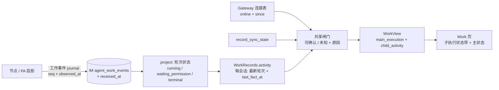

# feat-715: Work 页显示当前正在工作的一级子执行 — 技术方案

> 对齐: spec.md

## Changelog

<!-- design 阶段保持空 -->

## 现状分析

### 涉及范围

| 位置 | 当前职责 | 本次改动 |
|---|---|---|
| `apps/im-server/src/work-records.ts` | Work journal 的持久投影与读模型：注册会话、按事件维护轮次、`view()` 聚合出 `main_execution` / `other_executions` | 读模型新增「会话级最新轮次 + 最近一次收到事实的时间」派生；删除启动期的状态改写（见 D1） |
| `apps/im-server/src/work.ts` | 在持久读模型之上叠加实时事实：在线状态、记录同步完整性 | 用一份共享闸门同时决定主执行与子执行是否可确认为在跑，产出新的 `child_activity` |
| `apps/im-server/src/work-record-types.ts` | Work 读模型与对外视图的 TypeScript 形状 | 新增 `WorkChildActivity` / `WorkChildExecution`（纯增量） |
| `apps/im-server/src/gateway.ts` | 节点 WebSocket 连接表与 `isOnline` | 连接对象增加建立时间 `since`（纯增量字段） |
| `apps/im-server/src/schema.sql`、`db.ts` | `agent_work_events` 表与既有加列迁移 | 增加 `received_at`（IM 收到事实的服务器时间） |
| `src/IM/frontend/.../agent-work-panel.tsx`、`agent-work-api.ts`、`agent-work.css` | Work 页「工作记录」视图：工具栏主状态、离线/补齐提示、最近已报告上下文、主轮次、关联执行折叠 | 在「最近已报告的主上下文」与「主 Agent」之间加一条常驻子执行状态带；轮次状态降级改用服务端确认结果 |
| `src/IM/frontend/src/i18n/{zh,en}.json` | `agents.work.*` 文案（以中文源串为 key） | 新增本次文案；复用既有「运行中 / 等待授权 / 状态未知 / 节点离线」 |

不改 `packages/dsh-integration`、`packages/personal-assistant`、`apps/node`、iOS 客户端。

### 既有约束

- 架构红线：IM 只依赖 `product-contracts`，PA/Channels 不 import DSH；本 unit 全部落在 IM 与 Web 前端，不触碰运行时接入层。
- `WorkRecordView`/`WorkView` 是 Web 与 iOS 共用的 HTTP 形状。任何改动必须是**纯增量**：iOS 按名字取 `main_execution` 并已把 `unknown` 映射为「状态未知」（`AgentWorkView.swift:294-296`），新增字段不解码也不报错。
- 主执行状态、轮次明细、统计、原生轨迹、任务图与 workflow 的既有呈现不得被子执行状态顶替或合并（spec 第六个 Requirement）。`apps/im-server/tests/e2e/work-production-chain.test.ts` 已固定「主执行 idle + 子执行 completed」的组合。
- 「一级 = depth 1」的口径来自 [agent-capabilities](../../specs/gateway/agent-capabilities.md)；本 unit 只做产品侧投影，不新增运行时能力面、不新增 RPC。
- Web 侧必须继续遵循既有加载/空态/失败/降级范式，不新增权限、不新增操作入口。

### 可复用能力

| 能力 | 用 / 改 / 不用 | 理由 |
|---|---|---|
| 事件投影出的轮次状态（`project()`：`turn_started`→running，`permission_request`→waiting_permission，`turn_end`/`run_*`→completed/failed/interrupted） | **用** | 这是唯一可信的「在跑」事实来源，不需要新增运行时心跳 |
| `session_registered` 的 `scope` / `parent_session_id`（`register()` 对 subagent/workflow 强制要求父会话） | **用** | 「直属一级」= `scope='subagent' AND parent_session_id=当前主会话`，无需新口径 |
| `record_sync_state`（`work.ts:47-54`，按连接上报的 journal 进度判定 `current/catching_up/unknown`） | **用**（仅子执行带） | 补齐状态已有唯一权威判定；复用它而不是再解释一遍 |
| `node_connection_state` 与既有离线提示（`agent-work-panel.tsx:172`） | **用** | 离线降级文案与授权不可处理提示已存在 |
| `im-work-callout`、`im-work-card`、`im-work-status-label`、`statusLabel()` | **用** | 状态带复用现有卡片与状态标签语言，不引入新视觉体系 |
| 启动期把 `running/waiting_permission` 改写为 `unknown`（`work-records.ts:10-16`） | **改** | 该改写是有损的：改写后只有新轮次开始才能恢复，正在继续的执行会长期停在「未知」；且它只看进程启动，不区分「节点重启后仍在跑」与「崩溃残留」。改由读时闸门一次性判定（D1） |
| `other_executions`（`work-records.ts:500-505`） | **不用**来算数量 | 它同时含 cron、workflow 子执行与已退休主会话的历史执行，长度不是「N 个 subagent 在干活」 |
| 运行时 `session.descendants` 的 `activity`（`descendants.ts:124-129`，resident 即 running） | **不用** | 只表达「会话驻留」，已结束但驻留的会话会被算成在跑；且它是 PA 侧查询，IM 不 import DSH |

### 相关历史

- `bugfix-704-agent-pages-performance`：本页查询与轮次摘要口径的最近一次调整，`agent-work-panel.tsx` 的查询/轮询结构以它为准。
- `feat-583-native-dsh-trajectory`：同页「原生轨迹」视图与执行选择器，本次不改其行为。
- `refactor-655-retire-usage-rollup`、`refactor-672-im-contract-boundaries`：`latest_main_usage` 与 IM 只依赖 `product-contracts` 的边界，本次新增类型同样放 IM 本地读模型。
- 相邻契约 [`agent-capabilities`](../../specs/gateway/agent-capabilities.md) 定义「一级执行者 = depth 1」，是本 unit「直属」判定的来源。

## 架构总览



改动落在「读时派生」这一层：**不新增运行时能力、不新增 RPC、不新增独立状态通道**。IM 继续只回答「按已保存的事实，能确认什么」；「什么叫正在工作」在服务端收口一次，前端只渲染结果。

Before：`view()` 只聚合主会话轮次，`other_executions` 不带状态；前端只有工具栏一处主状态，用户必须先点进某个关联执行才知道有没有人在干活。
After：同一个 `view()` 响应多一个 `child_activity`，Web 在首屏用一条常驻状态带呈现数量、三分与条目；主状态与子执行状态出自同一份闸门，不会互相矛盾。

## 关键决策

**D1 残留的「运行中」在共享派生里一次收口，三道闸同时管主执行与子执行。**
闸门输入是「该会话最新轮次状态 + 最近一次收到该会话事实的服务器时间 + 连接事实」：

1. 节点在线（`gateway.isOnline`）；
2. **连接已确认**：该会话的 `last_fact_at >= connection.since`——事实是在当前这条控制连接建立之后收到的；
3. **仅对 `running`**：`now - last_fact_at <= 30min`。

三条都过才展示真实状态，否则降级为 `unknown` 并给出原因。`waiting_permission` **不受第 3 条约束**：等人本身不产生记录，等一小时是正常状态；它的残留靠第 2 条识别（连接重建后没有新事实）。理由：`isOnline` 只是「连接表里有这条 socket」，服务端没有任何 ping 超时，半开 TCP 会长期显示在线，所以只有「在线 + 连接已确认 + 近期有事实」才配叫「在跑」。因此 **`work-records.ts:10-16` 的启动期改写删除**，改由这里统一判定：该改写把「未确认」固化进持久数据，一旦节点重启后继续执行，只有等下一次 `turn_started` 才能恢复，反而制造了不存在的「未知」停留；读时判定则在任何新事实到达后立即自愈。
代价（明确接受并披露）：主 Agent 的长时间静默轮次（单次工具调用超过 30 分钟）在完成后会短暂显示「状态未知」直到下一条事实；连接重建后、节点尚未发出新事实的窗口内，上一轮的行进状态显示「状态未知」。这与 spec 的要求一致——宁可知未知，也不长期显示一个可能是假的「运行中」。
拒绝的备选：(a) 只在子执行上做闸门——会让「主 Agent 空闲、子执行状态未知」与「主 Agent 运行中、子执行未知」在同页互相矛盾，spec 明确要求两个入口不矛盾；(b) 用 `node_epoch` 识别重启——它只在设备改绑/吊销/暂停时变化，普通进程重启不变；(c) 用客户端 `observed_at` 比较连接起点——节点与中心时钟不同源；(d) 给全局 Work 补 `run_heartbeat`——那是运行时/PA 改动，超出 spec 范围。

**D2 「一级子执行」= 直属 subagent；后台维护计入但单独成组。**
计入条件是 `scope='subagent' AND parent_session_id=当前主会话`。workflow 子执行、cron 会话、已退休主会话下的历史执行都不计入（spec 与非目标）。**后台维护（Dreaming · 自动整理记忆 / 记忆整理 / 技能复盘 / 记忆与技能复盘）计入总数**，但单独一个小分组，标题写明「后台维护（自动进行，不需要你处理）」：它们是主会话下真实注册的 `subagent`（`knowledge.ts:44-70` 以 `session_linked` 登记，父会话即主会话，IM 侧 `register()` 正落为 `subagent`），从用户视角确实在占着算力运行；若不计入，会出现「页面说没有子执行在工作，可主 Agent 明明在整理记忆」的矛盾。分类是尽力而为：优先 `turn.origin === 'dreaming'`，其次命中已知维护标题（`knowledge.ts:55`），无法判断时按普通委派呈现——宁可少分组，不把普通工作误标成维护。已退休主会话下仍在跑的旧执行不计入数量，只在状态带里给一行弱化的「另有 N 条历史执行未计入」。
拒绝的备选：(a) 完全不展示维护——用户会看到「0 个在干活」却读不到机器在忙；(b) 把维护和委派混在一起不分组——用户会以为自己交办的事卡住了。

**D3 状态带常驻在「最近已报告的主上下文」与「主 Agent」之间，空态折叠成一行，不制造布局跳动。**
位置 (`agent-work-panel.tsx:174` 与 `:175` 之间) 是用户读完「主 Agent 现在什么状态」之后、进入轮次明细之前的自然一问：「它有没有把活分出去、有人在干吗」。没有子执行在工作时仍保留这张卡，显示一行「当前没有子执行在工作」——空不是留白，也不给孤立数字 0。时间只给两种：已确认在跑/等待给「已工作 X / 已等 X」，不可确认给「最后确认 HH:MM」绝对值；不做倒计时、不做客户端计时器（SSE + 15s 轮询已经负责刷新），避免出现自转的假进度。分档只在 ≥2 档非零时展开成 chip，单档时主句已说清数字，不重复。
原因只给一行、按优先级取第一条：`node_offline` > `records_catching_up` > `records_unconfirmed` > `connection_rebuilt` > `no_recent_fact`。

**D4 对外形状纯增量，且由 IM 独立计算，不让内部种子字段漏到 HTTP。**
`WorkView` 增加 `child_activity`；`main_execution` 的取值域不变（仍是 `running/waiting_permission/unknown/idle`），只是判定更准。`other_executions` **不加** `status`：它混着四类执行，加一个「状态」会诱导前端做第二套聚合，而用户要的是主视图的一次性答案。内部种子（每会话最新轮次、`last_fact_at`）由 `WorkRecords` 的独立方法返回，**不塞进 `WorkRecordView`**——`work.ts` 用 `{...view}` 展开该对象，塞进去会直接出现在 HTTP 响应里。`WorkChildActivity` 只给一条视图级 `reason`，不逐条重复同一原因（每条都带一份会让前端有两处真相，且条目区在窄屏最挤）。

**D5 「什么算正在工作」只在服务端判定一次，前端不复制规则。**
`work.ts` 的共享闸门输出最终状态，前端只按 `status` 渲染标签与分档；轮次明细的降级改为读同一份结果（`unknownSessions`），不再各自判断 `online`。这样「状态带说未知」与「轮次明细说运行中」不可能同时出现。

**D6 单 M1。**
IM 服务端读模型、HTTP 形状与 Web 呈现是同一份可观察结果，拆开任何一半都不单独成立（后端先上线而 UI 未跟上，等于没有任何用户可观察变化；UI 先上线而没有字段，等于假数据）。没有可独立交付或真实并行的切片，因此单 milestone 一次交付。iOS 属 issue #468，不在本 M1。

## 接口与数据流

### 数据结构（纯增量）

```ts
// apps/im-server/src/work-record-types.ts
export type ConfirmReason = 'node_offline' | 'records_catching_up'
  | 'records_unconfirmed' | 'connection_rebuilt' | 'no_recent_fact';

/** 一个当前可辨认的子执行条目。 */
export interface WorkChildExecution {
  session_id: string;
  title: string;                 // 有 title/description 时用名称，否则退化到 session_id
  kind: 'delegated' | 'maintenance';
  status: 'running' | 'waiting_permission' | 'unknown';
  started_at: string | null;     // 该轮 turn_started 的时间
  last_fact_at: string | null;   // 该会话最近一次事实的服务器时间（未知时用于「最后确认」）
}

export interface WorkChildActivity {
  counted: number;               // 计入「在工作」的条数 = running + waiting_permission + unknown
  running: number; waiting_permission: number; unknown: number;
  maintenance: number;           // 其中后台维护条数（已含在 counted 内）
  unattributed: number;          // 未计入的历史执行条数（已退休主会话下仍在跑）
  confirmation: 'confirmed' | 'unknown';
  reason: ConfirmReason | null;
  latest_confirmed_at: string | null;  // 状态带头部「最近确认 HH:MM」
  items: WorkChildExecution[];   // 主分组在前、维护分组在后，各自按 started_at 升序
}

export interface WorkView extends Omit<WorkRecordView, 'node_id'> {
  node_connection_state: 'online' | 'offline';
  record_sync_state: 'current' | 'catching_up' | 'unknown';
  child_activity: WorkChildActivity;   // 新增
}
```

`WorkRecordView` 不变；`main_execution` 的枚举不变。

### 数据流

1. 事件落库时写入 `received_at`（IM 服务器时间，`ALTER TABLE` 增量列；历史行为 `NULL`，视为不可确认）。
2. `WorkRecords.activity(root)` 返回内部种子（不进入 HTTP）：每会话的 `{session_id, scope, parent_session_id, title, latest turn: {status, started_at}, last_fact_at}`，主会话同样在内。
3. `work.ts` 用同一份闸门（D1）把种子折算成 `main_execution` 与 `child_activity`；同步完整性（`record_sync_state`）**只对子执行带生效**（主执行契约冻结，补齐期间的抖动不该让主状态闪变）。
4. Web 用一次 `?view=summary` 请求拿到全部结果，收到 `agent.work.updated` 后失效同一查询（既有 500ms 去抖 + 15s 轮询），无需新增请求。

### 轮次状态 × 闸门 → 呈现

| 最新轮次 | 节点离线 | 连接未确认 | `running` 且 >30min 无事实 | 呈现 |
|---|---|---|---|---|
| `running` | 任一为真 | — | — | `unknown`（原因：离线 / 连接重建 / 无近期事实） |
| `running` | 否 | 否 | 否 | `running`（已工作 X） |
| `waiting_permission` | 是 | 是 | 不适用（等人不产生记录） | `unknown` |
| `waiting_permission` | 否 | 否 | — | `waiting_permission`（已等 X） |
| terminal | — | — | — | 不进入状态带；主执行折算为 `idle` |

## 前端原型

- 原型文件: [prototype.html](prototype.html)（直连真实 `agent-work.css`，外层是现有 Work 页背景）
- 用户目标与体验方案: 用户打开 Work 页要回答的第一个问题是「它现在到底在不在干活」，第二个问题才是「干了什么」。因此状态带放在主状态摘要之后、轮次明细之前：**一行主句给结论**（「当前 3 个子执行在工作」/「当前没有子执行在工作」），**分档 chip 给构成**（运行中 2 · 等待授权 1），**一行原因给可信度**（离线 / 补齐 / 连接重建 / 无近期事实），**条目给可辨认的人**（名称 + 已工作时长，等待授权额外标「等待授权」并给「已等 X」）。分档 chip 只在两档以上非零时出现；后台维护单独成组，避免与用户自己的委派混排。窄屏（≤700px）条目改为单列铺满、名称单行省略，状态与时长不下沉到第二行。
- 用户需要判断的问题: (1) 现在有没有人在干活、几个；(2) 其中有没有在等我授权；(3) 这个数字我今天敢不敢信——页面是否告诉我它是刚确认的还是过期的；(4) 空着是因为真的没人干，还是因为读不到。
- 呈现方式与覆盖范围: 现有 Work 页背景 + 可交互增量。原型的演示按钮覆盖 9 个状态：三个在跑、2 运行 + 1 等待授权、空态、节点离线、记录补齐中、崩溃残留降级（同时有一个确认在跑和一个未知）、含后台维护、读取失败、窄屏（420px）。
- 交互边界: 条目可点击（产品内进入该次执行的既有明细），原型里只做视觉选中；工具栏切换、轮次展开、关联执行折叠是既有界面背景，原型不实现其行为；读取失败沿用现有页面级错误态。所有演示控制、状态说明与设计解释都在产品区域之外，产品区不带演示专用标记。

### 现有 UX grounding

| 当前产品入口 | 画面与操作基线 | 沿用或改善的体验及原因 | 本次设计 |
|---|---|---|---|
| 设置 → Agent → Work（工作记录） | 工具栏「主 Agent · 状态」一处运行态；离线/补齐 callout；「最近已报告的主上下文」卡；「主 Agent」轮次区；底部「关联执行 · N」默认折叠（`agent-work-panel.tsx:168-188`） | 沿用：状态语言（运行中/等待授权/状态未知/空闲）、卡片与 chip 样式、callout 语气、条目点击进入子轨迹。改善：主状态只回答主 Agent，用户必须逐条点开关联执行才知道有没有人在干活 | 在上下文卡与主轮次之间插入常驻状态带；分档 chip 复用 `im-work-status-label`；原因行复用 callout 的弱化语气但不上色成错误 |
| 关联执行折叠（`agent-work-panel.tsx:188`） | 展开后每行「名称 + session_id」，无状态 | 沿用：保留它作为**历史/全量**入口（含 cron、workflow、已退休）。改善：把「当前在跑」从「历史全部」里分出来一次说清，用户不必展开、逐个点 | 状态带与折叠区并存；折叠区不加状态文本（既有面板测试以 `${title} ${session_id}` 作为可访问名，加状态会破坏它） |
| 轮次明细状态标签（`agent-work-panel.tsx:210`、`statusLabel()`） | 离线时把 `running/waiting_permission` 渲染为「状态未知」 | 沿用：同一套标签与降级语气。改善：降级依据从「是否离线」扩展为服务端确认结果，避免离线判定之外的残留假运行 | 轮次标签改读 `unknownSessions`（来自 `child_activity` 与 `main_execution` 的同一判定） |
| 空态与失败态（`agent-work-panel.tsx:158,159`） | 「暂无工作记录。符合配置的新消息会进入收件箱。」；读取失败 `role="alert"` + 重试 | 沿用：失败不给 0、空态给一句解释 | 状态带空态单独一句「当前没有子执行在工作」，与主轮次空态区分；读取失败时不渲染任何计数 |

### 原型对齐契约

| 原型区域 / 状态 | 对齐级别 | 产品入口 | 必验 viewport / 状态 | 下游验收投影 |
|---|---|---|---|---|
| 状态带主句 + 分档 chip（3 个在跑 / 2 运行 + 1 等待授权） | must-match | 设置 → Agent → Work → 工作记录 | 1280px 与 420px；真实并行派遣 ≥2 个一级子执行 | [reviewer] R1；[worker] W7 |
| 等待授权条目的可指认（「等待授权」标签 + 已等 X） | must-match | 同上 | 1280px；真实触发一次授权等待 | [reviewer] R1；[worker] W7 |
| 空态「当前没有子执行在工作」与主状态并存 | must-match | 同上 | 1280px | [reviewer] R2；[worker] W7 |
| 降级：节点离线 / 补齐中 / 连接重建 / 无近期事实的原因行 + 「最后确认 HH:MM」 | must-match | 同上 | 1280px；断开节点、重启中心、杀掉节点进程各一次 | [reviewer] R3、R4；[worker] W1、W7 |
| 后台维护分组（标题与计数） | must-match | 同上 | 1280px；触发一次 Dreaming 或记忆整理 | [reviewer] R5；[worker] W2、W7 |
| 窄屏单列条目、名称省略、状态与时长不换行 | must-match | 同上 | 420px | [reviewer] R6；[worker] W7 |
| 读取失败沿用页面级错误态、不出现 0 | may-adapt | 同上 | 使工作视图接口失败一次 | [reviewer] R7（沿用既有失败态，只验「不显示计数」） |
| 条目点击进入该次执行的既有明细 | out-of-scope（沿用现有行为） | 同上 | 点任一条目 | 由既有「从真实发起位置进入子 Agent 的本次执行」Requirement 保障，本 unit 不改 |
| 关联执行折叠区内部 | out-of-scope（保持现状） | 同上 | 展开折叠区 | 现有面板测试与既有 Requirement |

### 原型走查

- 实际渲染与走查范围: 用本机 headless Chrome（`--headless=new --screenshot`）渲染 `?state=` 的 9 个状态，逐张看实际画面而非 DOM；另在原型内直接点击演示按钮复核状态切换。截图见 [evidence/prototype-running.png](M1-work-liveness/evidence/prototype-running.png)、[prototype-waiting.png](M1-work-liveness/evidence/prototype-waiting.png)、[prototype-empty.png](M1-work-liveness/evidence/prototype-empty.png)、[prototype-offline.png](M1-work-liveness/evidence/prototype-offline.png)、[prototype-catching_up.png](M1-work-liveness/evidence/prototype-catching_up.png)、[prototype-residue.png](M1-work-liveness/evidence/prototype-residue.png)、[prototype-maintenance.png](M1-work-liveness/evidence/prototype-maintenance.png)、[prototype-failed.png](M1-work-liveness/evidence/prototype-failed.png)、[prototype-narrow.png](M1-work-liveness/evidence/prototype-narrow.png)。
- 当前产品对照及代表性截图: 现有 Work 页结构按 `agent-work-panel.tsx` 与 `agent-work.css` 在本机渲染的现有页面复核，原型复刻同一容器类名与工具栏结构；本工作tree 未启动真实服务，故「真实页面截图」这一项以源码结构与样式类名为依据，不声称截取了线上页面（见「未验证项」）。
- 体验判断与修正: (1) 初版把分档 chip 与主句数字重复显示（「当前 3 个…」+「运行中 3」），扫读时像两套数字 → 改为单档不显示 chip；(2) 维护分组原本混在条目里，读起来像用户自己交办的事卡住了 → 独立成组并写「不需要你处理」；(3) 未知条目原本只变灰、没有时间 → 加「最后确认 HH:MM」，让用户知道这个未知多久了；(4) 状态带原本只在有内容时渲染，切换状态会挤动下方主轨迹 → 改为常驻卡片并给最小高度；(5) 读出失败原本仍渲染空状态带 → 改为整页失败态，杜绝「0 个」。
- 未验证项: 未在本机启动真实 IM/节点，「现有页面基线」是源码与样式核对而非运行截图；原型中的字体渲染（macOS）、真实长名称溢出与真实数据密度需在 M1 验收时以真实产品复核。原型外层已标注「现有界面背景 / 本次新增 / 仅演示」。

## 契约层增量 (delta-spec)

- `docs/specs/im/agent-work.md`: [specs/im/agent-work.md](specs/im/agent-work.md) —— `ADDED` 两个 Requirement（数量与条目；状态按已确认记录呈现并如实降级）。
- `docs/specs/im/spec.md`: 无独立 delta。归并时按 [CONTRIBUTING §delta 归并规则第 4 条](../../specs/CONTRIBUTING.md#delta-spec-归并规则) 同步入口 `Canonical Areas` 表里 Agent Work 一行的描述与 Requirement 计数（13 → 15），并更新该 area 文件的 `> 对齐:` 标记。
- `docs/specs/im/ios-client.md`、`docs/specs/gateway/agent-capabilities.md`、`docs/specs/im/web-chat-ux.md`: no spec delta。

## 风险与回退

| 风险 | 影响 | 处理 |
|---|---|---|
| 主执行在长静默轮次或连接重建窗口内显示「状态未知」 | 用户短暂看到比实际保守的状态 | 已在 D1 显式接受；30 分钟阈值是单一常量，可按真实观测调大；原因行会说明是「连接重建后没有新的执行记录」而非「掉线」 |
| 判定依赖事件流，历史行为 `NULL received_at` | 升级瞬间已存在的跑到一半的执行可能显示「未知」直到下一条事实（不显示假运行中） | 增量列 + `NULL` 视为不可确认；不写回历史行，不需要一次性迁移 |
| 后台维护分类是尽力而为 | 个别维护执行被当作普通委派计入 | 只影响分组标签，不影响总数；分类失败时按普通执行呈现，不谎报 |
| 状态带增加首屏内容 | 工作页信息密度上升 | 空态折叠为一行、常驻不抖动；条目单行横向排列，窄屏单列；不新增折叠层级 |
| 删除启动期状态改写 | 极少数在升级前被旧版本改写为 `unknown` 的轮次，要等该轮结束或下一次轮次开始才恢复 | 只影响升级前已在跑的会话，最长到该轮结束；不做写回兼容 |

回退：`child_activity` 是纯增量字段，回退只需前端不再渲染状态带（服务端字段保留也无副作用）；`received_at` 列与 `Connection.since` 保留不影响任何既有读取路径。

## 一次性部署迁移

无。`agent_work_events.received_at` 是增量列，按 `db.ts` 既有 `PRAGMA table_info` + `ALTER TABLE ADD COLUMN` 模式在启动时补齐，历史行为 `NULL`；无数据改写在启动路径执行，不需要 `deployment-prompt.md`。

## Runbook for Reviewer

| 服务 | 停止命令 | 启动命令 | 健康检查 |
|---|---|---|---|
| im-server（本 unit 改动） | `./scripts/e2e-down.sh --wt /Users/czj/Repos/nano-multiagent/.worktrees/feat-work-liveness` | `./scripts/e2e-up.sh --profile daily --wt /Users/czj/Repos/nano-multiagent/.worktrees/feat-work-liveness` | `source .e2e-ports.env && curl -sf http://127.0.0.1:$IM_PORT/health` |

前端：`--vite` 可选（HMR）；不启用时用构建产物，验收前必须重新构建 `src/IM/frontend`（`npm --prefix src/IM/frontend run build`），否则看到的是旧包。Web 入口 `UI_URL`（见 `.e2e-ports.env`）。

**Review 驱动方式**: 端到端真栈；**本 unit 改了客户端面**，因此必须真驱动 Web 界面：设置 → Agent（daily 模板的 P/E/Q 任一全局 Agent）→ Work → 工作记录，覆盖「≥2 个一级子执行在跑」「其中一个等待授权」「全部结束后的空态」「节点离线」「中心重启后的连接重建」「窄屏 420px」六个画面。授权等待与会话产物的构造方式见下。

**验收前置**:
- 资源：`--profile daily` 固定模板（测试主人 `nano`/`nano1234`、P/E/Q 全局 Agent、私密群、PA 私聊），来源 `config/e2e/daily/team.yaml`，可用性检查为脚本 ready 与 `.e2e-ports.env`；无需生产配置或额外账号。
- 造并行子执行：向一个全局 Agent 下达一个明确需要多路并行的任务（例如「分别核对三份材料的数字、排版和链接，再汇总」），确认 Work 页出现对应条目；条目标题取自子执行 label，无 label 时退化为会话标识。
- 造等待授权：在本轮隔离副本内把某个**无害**工具（例如某个 `bash` 只读命令模式）加入需审批规则，让子执行走到该工具；不得使用会改动本机或生产资源的工具。
- 造崩溃残留：在子执行运行中 `kill -9` 该节点的 DSH/PA 进程（`lsof -nP -iTCP:$IM_PORT` 之外另用 `ps` 定位本轮 node 子进程），再按正常方式重启该节点，回到 Work 页观察该条是否降级为「状态未知」而不是继续「运行中」。
- 造连接重建：`./scripts/e2e-up.sh`/`e2e-down.sh` 重启中心一次，观察主执行与子执行同时进入「连接重建」原因下的未知，并在节点发出新事实后自愈。
- 不要求 iOS 实测（本 unit 不改 iOS；`main_execution` 枚举未变，新增字段不参与 iOS 解码）。

## Milestones

| ID | 标题 | 依赖 | 并行组 | 范围 | 退出标准 |
|---|---|---|---|---|---|
| M1-work-liveness | 服务端派生 + Web 状态带 | — | — | `apps/im-server/src/{work-records,work,work-record-types,gateway,db,schema.sql}`、`src/IM/frontend/src/features/settings/agents/{agent-work-panel.tsx,agent-work-api.ts,agent-work.css}`、`src/IM/frontend/src/i18n/{zh,en}.json`、相关测试 | 见下 |

M1 退出标准（`R*` 为 reviewer 轨，`W*` 为 worker 轨）：

- [reviewer] **R1** 主 Agent 派发 ≥2 个一级子执行后，不展开任何折叠区就能在 Work 页读到「当前 N 个子执行在工作」，并能分辨「运行中」与「等待授权」各几个；等待授权的那条可被直接指认（含已等时长）。
- [reviewer] **R2** 三个执行陆续结束后数字自行下降，全部结束后同一位置显示「当前没有子执行在工作」，同时主 Agent 自身状态照常显示；无需手动刷新。
- [reviewer] **R3** 节点离线、记录补齐中、中心重启后的连接重建窗口内，状态带显示「状态未知」并给出对应原因，不把离线前的数字当现状、不显示 0；节点发出新事实后自动回到真实状态（未知不粘住）。
- [reviewer] **R4** 子执行运行中杀掉节点进程并重启后，该条不再显示「运行中」，而是「状态未知」并带「最后确认 HH:MM」，不显示「已完成」。
- [reviewer] **R5** 触发一次后台维护（Dreaming/记忆整理）时，它计入总数但单独成组并写明「自动进行，不需要你处理」，与用户自己的委派在视觉上可分开。
- [reviewer] **R6** 420px 宽度下状态带单列可读，名称单行省略，状态与时长不被挤到第二行或重叠。
- [reviewer] **R7** 只有 workflow 子执行或 cron 会话在活动时，它们不计入数量，其既有呈现不变；展开「关联执行」仍能看到全部历史执行且行为与之前一致；工作视图接口失败时显示读取失败与重试，不显示 0 或空列表，重试成功后按真实记录显示。
- [worker] **W1** `WorkView.child_activity` 与既有字段同时返回，`main_execution` 枚举不变；`other_executions` 未新增状态字段；iOS 相关契约测试/解码路径不被破坏。
- [worker] **W2** 单测覆盖：一级判定（subagent 直属计入、workflow/cron/已退休主会话不计入）、维护分组分类、四道降级原因与优先级、`waiting_permission` 不受 30 分钟阈值影响、`received_at` 为 `NULL` 的历史行判为不可确认。
- [worker] **W3** 扩展 `apps/im-server/tests/e2e/work-production-chain.test.ts`：真实 PA + WorkSync + IM 组合下，子执行运行→等待授权→完成三段的数量与状态如实变化，主执行状态不被顶替。
- [worker] **W4** 面板测试补充状态带渲染与空态；既有「关联执行」可访问名（`${title} ${session_id}`）断言保持通过。
- [worker] **W5** `zh.json` 与 `en.json` 同步新增 key，缺失 language key 的回归测试通过。
- [worker] **W6** 最窄相关测试与构建通过：`apps/im-server` 相关单测与 `src/IM/frontend` 构建/组件测试。
- [worker] **W7** 真实浏览器截图对照原型：1280px 与 420px 下的在跑、等待授权、空态、离线、连接重建、维护六态，截图与结论落在 `M1-work-liveness/evidence/`；证明主句、分档 chip、原因行与条目信息层级与 [prototype.html](prototype.html) 一致，并记录与原型不一致之处及理由。
