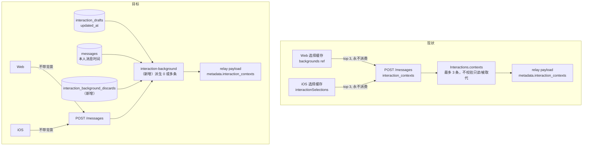
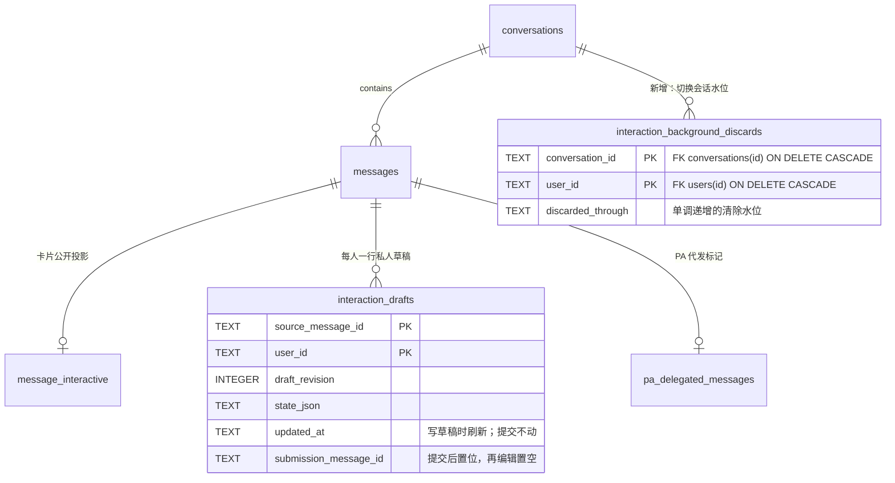
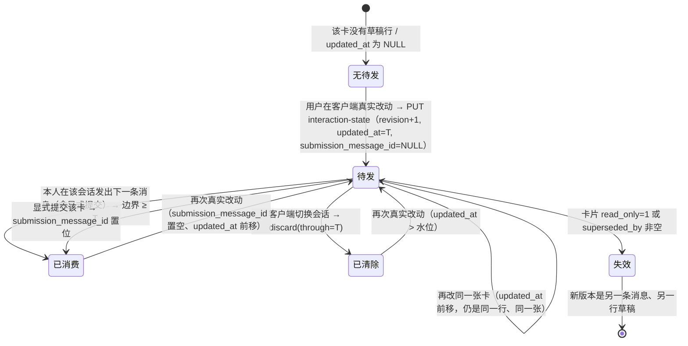
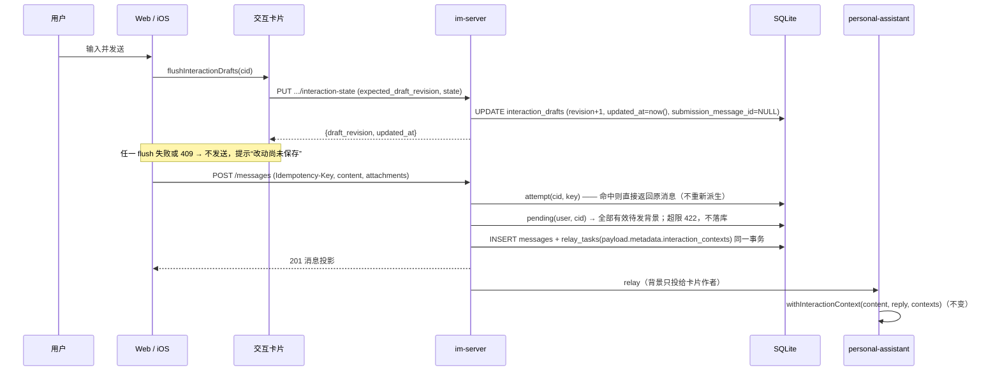

# feat-716: 交互卡片私人背景改为一次性携带 — 技术方案

> 对齐: [spec.md](spec.md) 当前多卡确认（需求与验收由 spec 持有；历史 R4 仅覆盖单卡版，本次实质增量须独立复审；Work/轨迹呈现不变）

## 多卡增量与冻结边界

本次只改变中心的候选集合及总量错误反馈，不恢复客户端选择缓存，不改草稿 CAS、全会话 flush/discard、既有 relay 与模型拼接。`pending(user,cid): InteractionContext[]` 返回自同一个 `floor` 之后编辑的所有有效草稿，每张仅一行最新状态；按保存时间升序、同毫秒按来源消息 `rowid` 升序稳定输出。不是按历史所有卡片重放，也不截取 N 张。卡片 B 失效只排除 B，仍有效的 A 不受影响。

**总量边界**：对有效整组 `JSON.stringify(contexts)` 的 UTF-8 字节数设置 **65,536 bytes（64 KiB）** 上限（包含方括号、逗号、字段、来源、捕获时间、JSON 转义；不含保持不变的固定说明和用户正文）。依据：既有每卡私人 state 限制 16 KiB，模型背景还会重复投影成 `fields`；64 KiB 允许数张常见表单，且对无卡片数上限的集合给出确定的模型输入上界，与既有公开 interactive source 的 64 KiB 数量级相同，但不是 token 保证。ASCII/中文及转义按实际序列化字节计，不能用字符数或仅 state 长度。逐项累计 JSON 数组编码长度，超过就失败，不需在内存收齐无限集合。该阈值为工程默认，不是用户拍定的数字。

**超限契约**：在 attempt 命中之后、任何新消息/attempt/relay 写入和 timezone 更新之前检查；超限抛出 HTTP 422 `detail.code=interaction_background_too_large`，`detail.message` 给出可恢复说明；消息不创建、窗口不消费、不静默少带、不自动重试。已存在幂等消息直接返回，后来的大草稿不能阻止恢复旧消息。显式 `interaction_reply` 保持原路径，既不补其他卡片，也不受普通消息总量检查影响，并照常推进共同消费边界。

**复用反馈而非新增 UI**：Web 只在 `chat-api.ts` 识别该 code，映射本地化可读错误，沿用既有发送失败 toast 与关闭按钮；iOS 只在 `ChatAPI.swift` 识别该 code，抛同 status 的本地化 `APIError`，沿用 `ChatStore.errors` + 既有会话错误显示。两端使用同义文案：“待发送的卡片背景过大，消息尚未发送。请缩减卡片内容后重试；如需清除待发背景，请在做过改动的设备上离开此聊天。正文和卡片编辑都会保留。” 不新增附带选择、Detach、自动截取或确认弹窗；普通 4xx 既有路径解除失败 attempt、保留正文及附件，下一次真实发送重新派生整组。此增量无布局/新控件决定；既有错误容器是否能完整读到该文案仍需真实窄屏检查。离开清除仍只采用本端自己保存成功的水位；若多台设备分别编辑，需分别在对应设备离开，不承诺在只读过草稿的新设备离开即可清除全部，绝不为恢复超限拿远端观测到的时间推进 discard。

**共享 iOS 接缝冻结**：预期产品增量仅 `Client/ChatAPI.swift` 的 `sendMessage` 错误 code 本地化；不动 714 的持久层/数据库/ChatStore 删除与恢复接缝，也不复制其 GRDB 逻辑。测试在 716 自己的 Tests/UITests 增补，target/scheme 沿用本分支 `1c17a7dbed`。由事项协调者向 714 owner 传达此冻结范围。

**验证增量**：A、B→第一条两份最新状态→第二条零份→只改 A→第三条仅 A；同卡多次仍一份；B 只读/被取代/坏 state 不阻止 A；来源不混合、逐 Agent relay 过滤保留；超限时 messages/message-attempts/relays 与消费边界不变，缩减后完整成功；临界值/UTF-8/JSON 转义与 >3 张小卡不截断；旧 key 重试在新增大草稿后仍恢复原组；显式提交独立。Web/iOS 真实入口分别操作两卡并核对确切 relay，模型实际 `read_messages` 及下一模型步要看到首条数组两个来源、后条无新背景、仅重改 A 后只 A，历史块仍保留。原单卡 native/模型证据只保留未变机制，不当作此增量验收。

**本次审查安排**：实质需求变更先独立 Gate 2 delta/full（新 reviewer 自定范围并读历史）；实现后代码+Context 深度审查与真实客户端体验/旅程判断按既有能力组合。固定实现审查型号/effort 的缺口仍是实际门禁阻塞，不用继承或自审替代。本次不含受拒的服务故障演练、provider 新采集或桌面前台操作。

本方案把“哪张卡的私人背景跟着哪条消息走”从**两端各自缓存的客户端判定**改成**中心按草稿与本人消息时间关系派生**。模型输入文本形态、卡片渲染、Work 核查视图都不动；客户端只失去“决定带不带”的权力，并新增两件事：发送前等草稿落地、切换会话时报一次清除。下文 §关键决策 逐条对应 spec 的「交给 design 的决策点」与派发决策 D1–D7、D9。

## Changelog

- 历史单卡实施曾修正“先选唯一最新再校验”，防止当时需求下的 A 复活；该规则与旧测试已被本次负责人确认的多卡需求取代。新版本逐卡校验，B 失效不排除 A；不得保留旧 `LIMIT 1` 或把旧 null 期望当作新契约。

## 现状分析

### 涉及范围

| 位置 | 当前职责 | 本 unit 的改动 |
|---|---|---|
| `apps/im-server/src/interactions.ts` | 卡片公开投影、私人草稿 CAS、显式提交 | 删除客户端背景规范化 `contexts()`（`:59-70`）；`writeDraft` 改用公共 `now()`；新增 public `background()` 供派生复用同一套 `source()` + `interactionState()` 校验：`source()` 已返回 `i.source`／`registry_json`／`executor_agent_id`（`:15-23`）；`readDraft()`（`:90`）附带只读 `fields`（409 对比的列标签，见下） |
| `apps/im-server/src/messaging.ts` | 发送事务、幂等指纹、relay 入队（背景只投给卡片作者，`:609-616`） | 发送前改用派生结果；新增 `discard` 路由（与 `:927-928` 同处注册） |
| `apps/im-server/src/message-attempts.ts` | 幂等指纹 `{content, attachments, interaction_contexts}`（`:15-17`）、同键不同内容 409（`:29-34`） | 指纹收敛为决定消息内容的字段；旧行仍可比较 |
| `apps/im-server/src/interaction-background.ts` | — | **新增**：待发背景派生、边界谓词、清除水位与路由 |
| `apps/im-server/src/schema.sql` | `interaction_drafts`（`:574-582`）、`messages`（`:133-142`）、`pa_delegated_messages`（`:516-520`） | **新增**`interaction_background_discards` 一张表；不改既有表 |
| `apps/im-server/src/context.ts` | `now()`（`:27`） | 无改动，但被 `writeDraft` 复用为唯一时钟生产者 |
| `src/IM/frontend/src/features/chat/components/message-pane.tsx` | `backgrounds` 缓存（`:287`，唯一写点 `:296-304`，无任何删除路径）、发送时重算最近 3 张（`:741-759`）、重试复用冻结 attempt（`:772-786`）、`wireContent`（`:761`） | 删除缓存与重算；发送前等草稿 flush；切换会话发 discard；保留“未确认”提示；拦截提示按 `transient` / `conflict` 分流（conflict 给「查看最新改动」→「改用最新草稿」） |
| `.../interactive/interactive-card.tsx` | 渲染即登记（`:89`、`:199-202`、`:207-208`）、真实输入决定保存（`:185-192`）、500ms 防抖（`:204-212`）、失败仅行内提示（`:106-122`、`:219-227`）、`composeMessage` 已有“先 flush 再动作”范式（`:67-79`） | 删除全部登记点与 `editedAt`；保留真实输入→保存；把组件内部状态封成三个句柄（`flush`／`describeConflict`／`adoptRemote`）注册给发送路径——`state.current`、`revision.current`、`load()` 都只活在组件内，composer 无法自己读“我这台”或触发采用 |
| `packages/product-contracts/src/interactive-types.ts` | `InteractionDraft`（`:37-45`）、`InteractionSnapshot.fields`（`:24`） | **只加一个只读可选字段** `fields?: InteractionDraftField[]`（独立类型，见下），无新写入口；Web 类型由 `scripts/generate-interactive-ui.ts` 从本文件**逐字**生成，iOS 的 `struct InteractionDraft` 是手写 `Codable`（`InteractiveModels.swift:26-34`），需同步手写可选 `fields` |
| `.../components/send-attempt-store.ts` | 冻结 `{text, attachments, contexts}`（`:5-16`、`:74-90`） | 冻结载荷去掉 contexts |
| `.../chat-api.ts` | 请求体带 `interaction_contexts`（`:88-98`）、`interaction-state` PUT（`:315-322`） | 去掉 contexts；新增 discard 调用 |
| `src/IM/ios/NanoIM/Features/Chat/InteractiveRuntime.swift` | 四个 `select()` 写点（`:71`、`:82`、`:100`、`:286`）、`editedAt` 客户端时钟（`:63-66`）、500ms 防抖（`:284-289`）、只读清缓存（`:150-154`）、`leave()` 只 `Task { await flush() }`（`:275-279`） | 删除选择缓存与全部写点；保留真实输入→保存；`flush()` 返回 `updated_at` 与失败原因；`leave()` 改为串行 flush → 水位 → discard |
| `src/IM/ios/NanoIM/Features/Chat/ChatStore.swift` | 全局 `interactionSelections`、发送时取最近 3 张（`:414-424`）、请求体一次性冻结（`ChatAPI.swift:14-27`） | 删除选择缓存与背景构造；发送前 flush；切换会话发 discard |

`packages/product-contracts`：**只加一个只读可选字段**（不动模型输入的形状）。`InteractionDraft` 新增 `fields?: InteractionDraftField[]`，由既有 `GET .../interaction-state` 返回：

```ts
interface InteractionDraftField {
  name: string; label: string; value: unknown;
  display_value?: string;                       // 选择类字段的可读文本
  options?: {label: string; value: string}[];   // 仅此处返回：让客户端把本机值也翻成可读文本
}
```

`options` 由服务端**归一化后再返回**：catalog 的选项是 union，允许纯字符串（`open-intelligent-ui/components/style.ts:42` `z.union([z.string(), z.object({value,label})])`，`toOption`（`:44`）才展开），所以 `interactionState` 在 `withOptions` 分支里逐个展开成 `{label, value}`（字符串 → `{label:s, value:s}`，与 `toOption` 同义）。不归一化的后果很具体：iOS 的 `InteractionDraft` 是整份 `Codable` 解码，一个字符串元素就会抛错，而卡片挂载时的 `load()` 走同一个方法（`InteractiveModels.swift:37`），草稿读取与 409 对比会一起挂；Web 取 `option.label` 得到 `undefined`，三列里出现空标签。

为什么必须来自服务端：三列对比的列标签（“时间”“参会人”）与选项文本只能由 `interactionState()` 用 registry 里的组件绑定求值（`interactive-source.ts:143-158`），客户端没有等价能力，硬算等于把服务端校验逻辑复制一份。为什么是**独立类型**而不是复用 `InteractionSnapshot['fields']`：后者同时是 `InteractionContext.fields` 的来源，会随 `withInteractionContext` 逐字节进入模型输入——给它加 `options` 会改变模型可见字节（§Context 影响 的字节快照会红）。实现上给 `interactionState(schema, input, {withOptions=false})` 加一个默认关闭的开关，`readDraft()` 传 `true`，`prepare()`/`contexts()`/`background()` 不传，因此**默认产物与现状逐字节相同**（M1 `[worker]` ⑦ 固定）。`withInteractionContext` 的拼接与 `InteractionContext` 类型原样保留（拼接与组装不变见 §Context 影响 的「组装：不变」；呈现侧不动的理由见 §D8（已撤销））。旧客户端忽略该字段。

### 既有约束

- **执行运行时只经 `packages/dsh-integration` 公开 exports 接入**（`AGENTS.md` 架构红线）。本 unit 不碰 DSH：背景仍由 PA 拼进**同一条**用户文本块提交，不新增 `session.*` 调用、不改内容段结构。
- **IM 与 PA 之间只走 HTTP/relay 协议，零 import**；PA 只能依赖 Channels 与 product-contracts。派生规则因此只能落在 `apps/im-server`。
- **私聊背景只交付卡片作者 Agent、不进公开消息**（`docs/specs/im/conversations-messages.md:577-579`，`messaging.ts:609`）。派生只能替换“来源”，不能改路由。
- **群聊普通文字不携带；越权客户端带背景仍被拒绝**（`messaging.ts:498`）。
- **同一幂等键 + 同一内容返回原消息；同键不同内容 409**（`messaging.ts:509-510`、`message-attempts.ts:32`）。
- **不改任何呈现**：注入背景在模型输入与 Work 核查视图里的形态按现状保留（spec「范围校准」）。
- Web 前端 `src/IM/frontend/dist/` 是本地产物不提交；不提交 secret/本机 config/日志。

### 可复用能力

| 已有能力 | 用 / 改 / 不用 | 理由 |
|---|---|---|
| `interaction_drafts`（`schema.sql:574-582`，含 `updated_at`、`submission_message_id`） | **用** | 私人草稿本来就是服务端状态、本来就跨端；D1 不需要新建“待发”表 |
| `now()`（`context.ts:27`）与 `writeDraft` 的内联 `new Date().toISOString()`（`interactions.ts:108`） | **用**（后者改为调用前者） | 两处同格式固定宽度 UTC ISO，可直接字符串比较；消除第二个时钟生产者 |
| `personal-actions.ts:70` 的“本人消息”谓词、`task-graphs.ts:876`、`personal-agent.ts:133-135` | **改**（收敛成一处公共谓词） | 三份同类判断各漏一种情况；本 unit 合并为一条可检谓词，避免第四份 |
| `message_interactive.read_only` / `superseded_by`（`schema.sql:563-573`，写点 `interactions.ts:82`、`:156-157`） | **用** | “被取代/只读”已有权威标记 |
| `interaction_submissions` + `interaction_drafts.submission_message_id`（`interactions.ts:146-151`） | **用** | 显式提交已有唯一标记与消息，天然满足 D5 |
| relay 载荷 `metadata.interaction_contexts`（`messaging.ts:601-621` → `relay_tasks.payload_json`） | **用** | 事务内与消息一起落库，重投读同一份 payload——这就是 D7 要的“冻结”，不需要新表 |
| Web `interactive-card.tsx:185-192` 捕获式触摸 + `:204-212` 防抖保存 | **用** | 已有的“真实输入”信号；D6 只要求删掉其它登记点 |
| Web `composeMessage`（`:67-79`）“先 await 保存、再看 dirty/saving 决定是否继续” | **用** | 发送前 flush 直接复用这个既有范式，不新造同步机制 |
| Web 既有失败提示（workspace 错误 toast `chat-workspace-page.tsx:1128-1153`、输入框上方 `role="status"` `message-pane.tsx:1259`）、iOS `ErrorNotice`（`UI/CommonViews.swift:7-14`）+ 重试按钮（`InteractiveCardView.swift:24-29`） | **用** | D9 的“改动未保存”反馈沿用既有样式与组件，不新造控件 |
| 两端选择缓存（`backgrounds` / `interactionSelections`）与 `contexts()` 规范化 | **不用（删除）** | 一次性语义下它们既无消费判据也无权威，保留只会继续制造“渲染即登记”和两套时钟 |

### 相关历史

- `docs/changes/archive/feat-617-agent-interactive-responses/design.md:143`、`:145` 明确写了“成功发送不清除背景缓存”——本 unit 修的根因；`:155` 的“不得强制解释卡片、覆盖手写正文”约束模型行为，现状拼接已满足，本 unit 不动。
- `docs/specs/im/conversations-messages.md:571-579`（背景准确且不改路由）、`:551-552`（“私聊自然文字可携带后台上下文”）、`:600-602`（同键不同快照 409 提到“交互背景”）是本 unit 全部要改的 current 契约。
- `docs/specs/im/personal-agent.md:106-113`（代表用户的消息在各端保持同一身份）给了“PA 代发”这一既有产品标记，是 D2 判据的产品依据。
- `bugfix-358`（composer 提及重建）与 `feat-439`（过程时间线）动过 `message-pane.tsx` 同一函数族；本 unit 只删 `commit()` 的背景分支，不动提及/附件/发送尝试的既有逻辑。
- 设计阶段的范围校准（spec「范围校准（design 阶段确认）」）：负责人确认“注入背景在 Work 详情可见”是既有预期行为，原 Requirement「Work 详情分开显示」与 D8 一并撤销，本 unit 呈现侧零改动。

## 架构总览

现状与目标的分界在“谁决定带不带”：



before：两端各自缓存“屏幕上最近几张卡”，服务端只做规范化与转发，没有任何“已带过”的判据。
after：客户端不再表达背景；中心从 `interaction_drafts` 与消息时间派生 0 或多条，写入与消息同一事务的 relay payload。模型输入文本、PA 组装、查看器都不变。

**规则归属**（避免再出现“第一层/未知”式含糊）：

| 规则 | 归属进程 | 依据 |
|---|---|---|
| 哪张卡是待发背景、带不带、是否已消费 | `im-server`（`interaction-background.ts`） | 唯一同时能看到 `interaction_drafts`、本人消息、清除水位的地方 |
| “用户真的动过这张卡” | 客户端（Web/iOS 交互卡片） | 只有客户端能分辨真实输入事件；它只经既有 `PUT .../interaction-state` 表达，不表达“带不带” |
| 切换会话的“清除” | 客户端发显式信号，`im-server` 落水位 | 切换不产生服务端事件；信号幂等且单调 |
| 背景进入模型输入的文本形态 | `personal-assistant`（经 `product-contracts`） | 现状不变（`single-thread.ts:152`、`inbox.ts:347`） |
| 只读/被取代/群聊/跨会话 | `im-server` | 已有权威标记与路由 |

## 关键决策

**D1 / 决策点 1 — 待发背景由中心派生，客户端不再有发言权。**
派生读 `interaction_drafts`（服务端已有）与本人消息时间；客户端只保留“保存草稿”这一既有写入口。理由：`interaction_drafts` 本来就是跨端权威（`interactions.ts:90-112`），把“带不带”放这里不引入新权限，反而消掉两套客户端缓存。拒绝备选：客户端算好再上报（现状；无法表达“已消费”，两端必然漂移）、新增“待发背景”表（与草稿时间重复，要维护两份状态）。

**D2 — 边界必须是“本人经客户端亲手发出的消息”，不是“最后一条看着像本人的消息”。**
判定谓词（单条 SQL，落在 `interaction-background.ts`）：

```sql
-- 本人在该会话亲手发出的最后一条消息
SELECT MAX(m.created_at) AS at FROM messages m
WHERE m.conversation_id = :cid AND m.sender_user_id = :uid
  AND m.sender_type = 'user'                       -- 排除 system 任务/上下文通知（task-context-access.ts:139、persistTaskNotice）
  AND m.sender_source_id IS NULL                   -- 排除外部渠道镜像（messaging.ts:396）与 PA 经外部影子会话代发（external.ts:353）
  AND NOT EXISTS (SELECT 1 FROM pa_delegated_messages d
                  WHERE d.message_id = m.id AND d.representation_operation_id IS NOT NULL)  -- 排除“PA 代发”
```

逐项说明为什么必须这样写（每一条都对应一个会静默吃掉待发背景的真实写点）：

| 写点 | 落库形态 | 排除方式 |
|---|---|---|
| PA 在主人不在的会话里代发（`personal-actions.ts:243-244`） | `sender_user_id=owner`、`sender_type='user'` | `pa_delegated_messages.representation_operation_id IS NOT NULL`。`destination()`（`:59-61`）禁止在 PA 自己的会话或外部影子会话里用 owner 身份发言，因此每条代发必有该标记 |
| 外部渠道镜像（`messaging.ts:396`） | `sender_user_id=owner`、`sender_type='user'`、`sender_source_id=<provider 用户>` | `sender_source_id IS NULL` |
| PA 经外部影子会话以主人身份发（`packages/personal-assistant/src/external.ts:353`，PA/node 里唯一这类 HTTP 调用点） | 同上，必带 `sender_source_id` | 同上 |
| 任务/上下文通知（`task-context-access.ts:139`、`persistTaskNotice`） | `sender_type='system'` | `sender_type='user'` |
| 历史导入（`evaluation.ts:97`，owner 身份 + 任意历史 `created_at`，无上界） | 只写**评测专用临时库**（`options.path` 自建、`publicUrl: evaluation.invalid`、无 listener），不会进生产库，也不可能有卡片/草稿 | 结构上不可能相遇；设计记录该事实以免被当成漏网 |
| fork 副本（`conversation-actions.ts:315-336`，逐列复制发送者、`created_at` 重写为近期） | 目标会话的卡片全部 `read_only=1`（`interactions.ts:156-157`），且草稿不复制 | 各候选均由 `background()` 的只读校验排除 |

这正是 spec「决策点 1」点名要核实的三种情况，也是仓库里三份同类判断（`personal-actions.ts:70`、`task-graphs.ts:876`、`personal-agent.ts:133-135`）各漏一种的地方；本 unit 只保留这一份权威谓词。

另加会话级前置：`conversations.type='direct'`（群聊永不带，与 `messaging.ts:498` 同源）且 `conversations.external_source IS NULL`（影子会话没有客户端，谈不上“用户亲手发送”）。

**D3 — 跨刷新、跨设备保留。**
待发状态就是 `interaction_drafts`，两端的卡片状态本来就服务端化且跨端（`readDraft` 返回本人那一行）。刷新/重启后派生重新读到同一行；设备乙发送时派生出设备甲的改动。这不是额外能力，是 D1 的直接结果；“改动后刷新或重开”“换设备继续”两条 Scenario 不需要任何客户端状态。

**D4 / 决策点 2 — 切换会话靠显式 `discard` 信号，水位是“本端在该会话已确认保存的最大时间”。**
新增 `POST /im/v1/conversations/:conversation_id/interaction-background/discard`：

- 传输：普通认证 HTTP，body `{through?: string}`（ISO-8601）。`through` 的取值是**该客户端在该会话内所有草稿保存成功响应中 `updated_at` 的最大值**（每会话单调不回退），不是“最后一次响应”：两张卡同时在防抖窗口里保存时（`interactive-card.tsx:204-212`）响应可能乱序到达，取“最后一次”会漏掉较新的那次改动，切走后回来仍会带上它。水位只在**成功**响应后推进——与 `interactive-card.tsx:114` 只在成功时推进 `revision.current` 同源。
- 持久化：水位必须活过刷新，否则“迟到 discard 不清新改动”在刷新后立即失效。Web 持久化在既有按账号/服务隔离的 IndexedDB 里（与 `send-attempt-store` 的 `im-message-attempts` 同一套库，新增一个小 store，键 `(accountId, conversationId)`）；iOS 存在既有按服务隔离的 `ChatStore` 会话存储里。登出/切服务清除；会话删除或失去访问时删该行；只保留最近 128 个会话的水位，超出丢最旧——丢一个旧会话的水位等价于“该端没有水位”，按下面第 7 条处理。
- 授权：与 `interaction-state` 同一套（`messaging.principal` → human-only → `access(..., 'write')`）；非 direct 会话 204 空操作（那里不可能有待发背景）。
- 幂等：语义是“把水位推进到 `min(through, now)`”，写入 `MAX(旧水位, 新值)`；重复或乱序到达都不回退，不需要请求键。
- 丢失：失败时客户端保留水位并在下一次离开该会话或回到前台时重试；服务端没收到就**不清除**——该会话下一条消息会带上那次改动（一次性、单会话），这是写明的降级，不是静默。
- 迟到：因为带 `through`，迟到的 discard 只清 ≤ 那次改动的内容，**不会**清掉用户回到该会话后的新改动；水位持久化后这条性质跨刷新成立。
- **`through` 缺失（该端从未在这个会话成功保存过草稿）→ 客户端不发 discard，服务端对缺 `through` 的请求也是 no-op**（不写水位，返回当前水位）。理由：网络级清除只能由“知道自己在清什么”的一端发起；让一个没有水位的新设备把水位推到 `now()`，会抹掉另一台设备上用户还没看到的改动，直接违反验收「换设备继续」。
- **跨设备优先级裁决**（`spec.md:112-116` 与 `:129-131` 在“乙是新设备、打开又切走”这条路径上原本给出相反结论）：

| 路径 | 结果 | 依据 |
|---|---|---|
| 甲改卡未发 → 乙（新设备）打开 → 直接发送 | 乙这条**携带**甲的改动，之后不带 | 验收「换设备继续」；乙无水位、不发 discard |
| 甲改卡未发 → 乙打开 → 切走 → 回来 → 发送 | 仍**携带**，不因乙切走而被清除 | 规则 4 的“切换会话”由**做过这次改动的那一端**执行；乙不知道自己清的是什么 |
| 甲改卡未发 → 甲自己切走 → 回来 → 发送 | **不携带** | 甲的水位 = 那次保存时间，discard 清除 |
| 甲、乙都改过同一张卡 → 乙保存成功 → 乙切走 | **不携带**（甲的更早改动也 ≤ 乙的水位，一并清除） | 一次清除覆盖 ≤ 该水位的所有改动 |

  这条裁决只解释规则 4 的“谁来清除”，不改“改动后切换会话 → 不携带”的结论；`spec.md:129-131` 已按此补一句 AND（Requirement/Scenario 数不变）。

拒绝备选：把需求收窄成“按会话隔离”（会丢掉验收「改动后切换会话」）；用服务端“打开会话”事件推断（打开/分页/轮询/刷新无法区分切换与刷新，而刷新必须保留）；`through` 缺失按 `now()` 全清（多端会互相抹掉未读改动，见上表第 2 行）；水位只放内存（刷新即退化为全清，迟到 discard 的性质失效）。

**D5 — 任何出站本人消息都消费，包括显式提交。**
消费不需要标记表：派生要求 `draft.updated_at >` 本人最后一条消息时间。显式提交本身就是一条本人 `user` 消息（`messaging.ts:542`），它推进边界；同时 `submit()` 写入 `submission_message_id`（`interactions.ts:149`），两条判据互相印证。用户对卡片 B 的提交因此消费掉卡片 A 的待发背景，不会出现“A 悄悄挂到 B 之后那条消息”。`writeDraft` 每次保存都把 `submission_message_id` 置空（`interactions.ts:107`），提交后再次改动会重新武装。

**D6 / 决策点 4 — 只保留真实输入信号，删掉两端的选择缓存（原决策前提有误）。**
派发决策原本假设“iOS 只在 `changed()` 登记”。核对结果**不成立**：`InteractiveRuntime.swift` 里 `select()`（唯一写 `ChatStore.interactionSelections` 的地方）有四个调用点——`:71`（web renderer `load()`）、`:82`（JS renderer `load()`）、`:100`（未触碰的渲染器状态推送：`if different && touched == true { changed() } else { select() }`）、`:286`（`changed()`）；`editedAt` 取服务端 `updated_at` 或 `0`，真实输入时取 `Date.now()`。Web 同样渲染即登记（`interactive-card.tsx:89`、`:199-202`、`:207-208`）。两端同源，所以本 unit 不是“删两处登记点”，而是**整体删除选择缓存**（Web `backgrounds`、iOS `interactionSelections`）与全部登记调用，只留 `interactive-card.tsx:185-192` + `:204-212`、iOS `changed()` + `:284-289` 这条真实输入→保存链路。不新造机制。

**D7 / 决策点 3 — 重试复用冻结载荷：派生结果冻结在消息与 relay 载荷里，指纹只留决定内容的字段。**
- 派生发生在创建消息的**同一事务之前**，结果写进 `relay_tasks.payload_json.metadata.interaction_contexts`（`messaging.ts:601-621` 既有形态）。投递、重连重投、离线重放都读同一份 payload（`relay-delivery.ts:31-49`），永不重算；`relay_tasks.idempotency_key` 唯一（`schema.sql:232`），也不会二次入队。
- 重试路径 `if (old) { assertMessageAttempt(...); return this.message(old.id); }`（`messaging.ts:509-510`）**必须保持在派生之前**：命中同一幂等键时直接返回原消息，不重新派生，因此不可能把“带了背景”变成“没带”。实现时把“派生必须在 attempt 命中之后”写成注释与测试（有人把派生提前就会破坏 D7）。
- 幂等指纹（`message-attempts.ts:15-17`）**去掉 `interaction_contexts`**，只剩 `{content, attachments}`。理由：指纹应只含决定消息内容的字段；背景已由中心派生，客户端字段不再影响消息，继续纳入只会因“客户端改了一个不影响结果的字段”产生无意义 409。
- 旧行兼容：`assertMessageAttempt` 从 `existing.caller_payload_json` 里**只取 `content`/`attachments`** 再比较，因此升级前落库、含 contexts 的旧 payload 与升级后的重试仍然匹配（否则部署窗口内所有在途重试都会 409）。
- 在途跨版本重试：升级前的客户端把 contexts 冻在 attempt 里，升级后**逐字节重发同一 body**（Web `send-attempt-store.ts`、iOS `ChatAPI.swift:14-27` 的 `requestBody` 都是冻结后复用）；中心忽略该字段，同键返回原消息。
- 唯一不冻结的窗口是“第一次尝试根本没到服务端”（没有消息行）。此时重试按到达时刻的派生结果处理——那正是产品规则“下一条出站消息携带当前待发背景”本身；而且客户端在未确认前锁住发送（`sendInFlightRef`、`isComposerSending`、iOS `pending[id]`），不会在两次尝试之间插入另一条消息。

**D8（已撤销）** — 原决策要求“Work 详情把注入背景与用户原话分开、可折叠、带来源”。设计阶段经派发方转达负责人校准：注入背景在 Work 详情可见、可查原文**是既有预期行为**，本 unit 不改呈现。据此该决策与对应 Requirement/Scenario 一并撤销；本文不再保留“可选分块方案”，也没有任何查看器改动（`packages/trajectory-ui` 不进入本 unit 范围）。撤销理由与前后约束记录在 spec「范围校准（design 阶段确认）」。

**D9 / 决策点 6 — 发送前先让草稿落地；落地不成就不发，并按失败原因给出**能成功**的出口。**
客户端在 `commit()`/`ChatStore.send` 前 `await flushInteractionDrafts(cid)`：把该会话所有已挂载卡片中 `dirty` 的草稿立刻保存（不等 500ms 防抖），按 `(cid, messageId)` 收集每张卡片的结果。实现顺序复用 `interactive-card.tsx:67-79` `composeMessage` 已验证的 `clearTimeout(debounce)` → `await saveRequest` → `await save()` → 检查 `dirty.current || saving.current`。

- **范围是会话级，不是“这一条消息”。** 该会话里只要有一张卡处于 dirty（或保存失败），这个会话的**所有**发送都被拦住，包括与卡片毫无关系的追问——因为这些改动本来会在下一条出站消息里被携带，而非目标禁止“是否仍要发送”的二选一（`spec.md:202`）。代价写进 §风险与回退；提示文案必须说清“这个会话暂时不能发送”，不能让人以为只影响那一条。
- **按失败原因分流**（`interactive-card.tsx:118` 已经把 409 与其它失败分开，直接复用，不新造成因判定）：
  - **网络 / 5xx / 超时（transient）** → 提示 + 「重试保存」。离线时提示追加“当前网络不可用，恢复后会自动放行”；「重试保存」保持可用，失败就如实再提示一次，不做无限自动重试。
  - **409 草稿冲突（conflict）** → **不给「重试保存」**：`:114` 只在成功时推进 `revision.current`、`:84` 只有 `load()` 会取回服务端 revision，用被拒绝的旧 revision 重试只会再 409，输入区会被永久锁死（`design-review.md` R1-C1）。给出的两个动作是这条路径上唯一能成功的顺序：
    1. **「查看最新改动」**：调卡片注册的 `describeConflict()`——内部只读拉取服务端草稿（既有 `readInteractionDraft`，其 `fields` 给出列标签、可读值与选项），与组件内的 `state.current` 做**字段级**对比，把「字段 / 另一台设备 / 我这台」三列返回给 composer 渲染。两列都用同一套 `label`/`options` 出文本，因此选择类字段不会一边显示「周四 14:00」另一边显示 `thu`。不应用、不丢弃任何内容。
    2. **「改用最新草稿（会放弃本机这次改动）」**：只在第 1 步成功后出现，调同一个句柄的 `adoptRemote()`（内部就是既有 `load()`，`interactive-card.tsx:84`）用服务端状态替换本机编辑，并清掉该卡的失败条目；随后提示消失、发送恢复。用户需要自己的那版就按卡片 UI 重新改一遍——**不做自动合并**（服务端草稿是整份 state，缺少逐字段因果，合并结果既无法解释也无法验收），也不新增第二个写入口。
  - 两类同时存在 → 冲突优先（它需要用户决策）；冲突解决后 transient 卡片仍按「重试保存」处理。
- **冲突草稿不得被静默丢弃**：在用户点「改用最新草稿」之前，本机编辑、输入正文与提示都保留；提示里写明这一步会放弃本机改动。刷新页面时卡片按服务端草稿重建、提示不再出现——那是浏览器刷新丢弃本机内存编辑的既有语义，不算静默丢弃，也不因此新增“草稿恢复”能力。
- **两端同义、容器各自沿用**（Web 用输入框上方的 `role="alert"` 行内条，iOS 用会话级 `ErrorNotice`）：
  - transient：标题「卡片改动尚未保存，这个会话暂时不能发送」；正文「先保存「会议安排」的改动再发送，否则这条不会带上你刚改的周四和参会人；同一会话的其他消息也要等它保存好。」；动作「重试保存」；离线追加「当前网络不可用，恢复后会自动放行。」
  - conflict：标题「另一台设备更新了这张卡片，这个会话暂时不能发送」；正文「「会议安排」的草稿在另一台设备上改过；本机这次改动还没保存，所以现在发送不会带上它。」；动作「查看最新改动」→ 展开字段对比 →「改用最新草稿（会放弃本机这次改动）」。
- 拒绝备选：静默发送无背景消息（违反验收「改动后立刻发送」）；把未保存草稿塞进发送请求让服务端顺带落库（D6 明确“不要新造机制”，且会让客户端重新成为第二权威）；弹“是否仍要发送”二选一（接近 spec 非目标禁止的“附带开关/Detach”心智）；**把 409 也交给「重试保存」**（动作必然重复失败，等于把输入区锁死）；**自动合并两份草稿**（见上）。

**决策点 5 — 捕获时间改由中心填充。**
`InteractionContext.interacted_at` 仍为毫秒数值（注入 JSON 形态不变），值取 `Date.parse(draft.updated_at)`（服务端时钟、该次保存时间）。客户端不再上报 `interacted_at`，`Date.now()` 与 `Date.parse(draft.updated_at)` 混用两套时钟的问题随之消失；两端一致，误差只有 500ms 防抖 + 一次 RTT。

**持久化形态：只加一张“清除水位”表。** 派生结果不新增消息列——它对模型的唯一影响已经在 relay payload 里，而模型输入文本本身按现状保留。

新表带外键并随会话删除级联：`FOREIGN KEY(conversation_id) REFERENCES conversations(id) ON DELETE CASCADE`（`schema.sql` 已对同类私有状态启用 `foreign_keys`）。会话被解散（`dissolved_at`）不清行——谓词闸门已排除，解散后可能恢复；真正删除或 fork 源会话删除时由级联清掉，不留孤儿水位（fork 不复制草稿，也不复制水位，与 `interaction_drafts` 的复制规则一致）。



**待发背景的状态机**（同一行草稿在时间轴上的归属变化；没有任何行被删除或改写）：



「已消费/已清除/失效」都不是存储状态，而是派生时按谓词算出来的结论；状态机描述同一行草稿各阶段的可观察归属。

## 接口与数据流

### 派生谓词（`apps/im-server/src/interaction-background.ts`，新增）

```ts
/** 该用户在私聊里此刻的待发背景：0 或多条，已按卡片状态与消费边界过滤。 */
pending(user: Row, cid: string): InteractionContext[]
```

0. **调用点**：只在 `messaging.send()` 里、**人类 JWT** 的**普通文字发送**中调用（`messaging.ts:481` 之后、attempt 命中之后、与消息同一事务之前）。判据必须用仓库里既有的“人类查看者”测试 `p.kind !== 'gateway' && !p.username?.startsWith('agent:')`（`interactions.ts:60`、`:92`、`:100`、`:117` 四处同款），**不能写成 `p.kind === 'user'`**：人类 principal 根本没有 `kind` 字段——`SendPrincipal` 的人类分支是 `{id, username}` 且 `kind?:'user'` 只是可选字面量（`message-input.ts:5`），`principal()` 仅在 gateway 分支补 `kind`（`messaging.ts:56`，另一分支直接返回 `users` 行），`sendPrincipal()` 也只为 gateway 要求 `node_id/owner_id`（`message-input.ts:48-50`）。写成 `p.kind === 'user'` 会让**每一次真实发送**都派生不出背景，功能静默失效。gateway 身份（含 PA 代发、外部渠道镜像、`external.ts:353` 那条路径）与 agent 凭据不派生——它们的 `sender_user_id` 不是“用户亲手发送”，§D2 的边界已经把它们排除在消费侧之外；让它们也走派生只会用错误身份查草稿。
1. 会话闸门：`type='direct'`、`external_source IS NULL`、`dissolved_at IS NULL`；否则返回 `[]`。
2. 边界 `floor = max(coalesce(localHumanAt,''), coalesce(discarded_through,''))`，其中 `localHumanAt` 是 §D2 的 SQL，`discarded_through` 来自：

```sql
SELECT discarded_through FROM interaction_background_discards
WHERE conversation_id = :cid AND user_id = :uid
```

3. 按时间顺序遍历全部待发候选（每卡的私人草稿只有一行，故天然只取最新状态）：

```sql
SELECT d.source_message_id, d.updated_at, d.state_json, m.content AS source_content
FROM interaction_drafts d
JOIN messages m            ON m.id = d.source_message_id
JOIN message_interactive i ON i.message_id = d.source_message_id
WHERE d.user_id = :uid AND m.conversation_id = :cid
  AND d.updated_at IS NOT NULL            -- 只由 submit 建行、从未改过的那一行不算
  AND d.submission_message_id IS NULL      -- 已显式提交的草稿不再作为背景
  AND d.updated_at > :floor                -- 已被本人消息消费，或已被切换会话清除
ORDER BY d.updated_at ASC, m.rowid ASC     -- 稳定保存顺序；只读/被取代逐卡校验，不截 N 张
```

4. 对每个候选调用 public 缝 `Interactions.background(user, cid, sourceMessageId, stateJson)`。候选查询不必自己拼 `fields`／`agent_id`：该缝复用现状 `contexts()` 的同一套调用——`source(id, cid)`（`interactions.ts:15-23`，已 SELECT `i.*`，含 `source`、`registry_json`、`executor_agent_id`，并 JOIN 出 `content` 与代发标记）→ `interactionState({source:source.source, actions:JSON.parse(source.registry_json).actions}, state)` 得 `{state, fields}`。**校验失败不报错、不阻塞发送**，返回 `null` 按“没有待发背景”处理（草稿是客户端写的历史数据，不能用它否决用户的话）。缝内逐卡校验 `read_only`／`superseded_by`：该卡失效返回 `null` 并继续处理其他候选；合法卡产出 `{source_message_id, source_summary: content.slice(0,160), agent_id: executor_agent_id, state, fields}`——与现状 `interactions.ts:60-69` 同一套字段与截断。这里**不传** `interactionState` 的 `withOptions`：这份 `fields` 会逐字节进模型输入，多一个键就破坏 §Context 影响 的字节快照。
5. 每条 `interacted_at = Date.parse(updated_at)`（`background()` 不产出该字段，由派生层写入）；累计完整编码长度，含数组标点，超 64 KiB 抛本节首部定义的可恢复 422，不返回部分集合。
6. 结果作为 `contexts` 传给 `enqueueRelays(...)`；`messaging.ts:609-616` 的路由过滤（只给卡片作者）不变。若该卡片作者此刻不在会话的 relay 名单里，背景会随过滤丢弃，而边界仍前移（“携带即消费”按消息计，不按送达计）——这是直接沟通的单 Agent 场景之外的边界，写在此处以免被误认为漏判。

时钟与格式：`messages.created_at`（`message-records.ts:159` → `now()`）与 `interaction_drafts.updated_at`（`interactions.ts:108` → 改为 `now()`）都是 `toISOString()` 的固定宽度 24 字符 UTC 文本，可直接字符串比较。除 `incomingExternal`、评测导入、fork 副本外无第三个 `created_at` 生产者，而这三者已被 §D2 的谓词排除。

### 发送主流程（含幂等与冻结）



### `discard` 路由（新增，与 `messaging.ts:927-928` 同处注册）

| 项 | 值 |
|---|---|
| 方法与路径 | `POST /im/v1/conversations/:conversation_id/interaction-background/discard` |
| 请求体 | `{through?: string}`（ISO-8601）。客户端总是带本端已确认保存的最大水位；缺失/无法解析 = no-op |
| 认证/授权 | 人类 JWT（`principal`），`access(p, cid, undefined, 'write')`；gateway/agent 身份 403 |
| direct 会话 | `200 {discarded_through: string \| null}`：写入后的有效水位（该会话还没有水位时 `null`） |
| 非 direct 会话 | `204` 空 body，不写水位（那里不可能有待发背景） |
| `through` 缺失/非 ISO-8601 | `204` 空 body，不写水位（语义同“该端没有水位”，见 D4） |
| 幂等 | `MAX(旧值, min(through, now))`，重复/乱序不回退；不需要请求键 |
| 失败 | 5xx/网络失败由客户端有限重试并保留本地水位；未送达即视为未清除（文档化降级） |
| 语义 | 只清「≤ 该水位」的改动，不会清掉用户之后的新改动 |
| 404/501 | 客户端一律**静默忽略**：501 或路由级 404 = 旧服务端；会员资格 404 表示这个会话本身已不可写，此时也不会产生消息，因此不弹错、不阻塞、也不把本地水位当作已清除（下次离开再试） |

### Context 影响（`docs/development/agent-context-engineering.md`）

**Consumer**：卡片作者 Agent 的 `single-thread` / Global Inbox 输入组装；以及有该 Agent Work 空间权限的人在原生轨迹里核查。文本拼接仍由 `withInteractionContext` 完成：single-thread 进入用户输入文本，Global 模式经 `read_messages` 的工具结果进入下一模型步。恢复实施的真实 daily 栈使用 Global 模式，不能把其实际 `tool/result` 误记为顶层 `user/message`；这只校正消费面描述，不改变拼接、入口或 Work 呈现。

**Context Lifecycle**（来源 → 选择 → 组装 → 消费 → 过期）：

| 阶段 | 现状 | 目标 |
|---|---|---|
| 来源 | 客户端缓存的“最近渲染过的卡” | `interaction_drafts`（真实改动）+ 服务端时钟 |
| 选择 | 客户端按 `editedAt` 取前 3 | 中心取全部有效待发卡片各自最新状态：未被消费/清除、仍可交互；整组超限则不发、不消费 |
| 组装 | `withInteractionContext` 拼接进同一条用户文本 | **不变**（拼接、标记、字段、顺序都不动） |
| 消费 | 无（每条消息重复注入） | 下一条本人消息即消费；界外无残留 |
| 过期 | 只有 App 重启/刷新 | 消费、显式提交、切换会话、卡片只读/被取代四条显式路径 |

**模型可见 Before / After**（同一旅程：改动会议卡后连发两条消息）：

```
Before  消息 1 正文 = "...这样还能排得下吗？\n\n[Private interactive background captured when this message was sent. …]\n[{"source_message_id":"m1","source_summary":"…","state":{…},"fields":[…],"interacted_at":1.7e12}]"
        消息 2 正文 = "那谁负责订场地？\n\n[Private interactive background …]\n[{…同一批旧卡…}]"
After   消息 1 正文 = 同格式同字段、同一条用户文本块；只含全部真正改动且仍有效的待发卡片，各自保留来源与最新状态，interacted_at 取各自服务端草稿时间
        消息 2 正文 = "那谁负责订场地？"（无背景块）
```

**Interactions**：`discard` 只影响“是否携带”，不改卡片可交互性、草稿恢复、提交语义；`flush` 复用既有 `PUT interaction-state`，不新增写路径；`GET .../interaction-state` 多返回只读 `fields`，只用于 409 对比的列标签，不进入组装、不进模型输入。

**Validation**：
- 字节形状：`withInteractionContext(用户原话, undefined, [派生背景])` 与现状函数在同一组输入下逐字节相等（worker 快照测试，证明拼接未改）。
- 请求级：断言 `relay_tasks.payload_json.metadata.interaction_contexts` 在“改动→发送 1→发送 2”里只有发送 1 有值，且只出现在卡片作者的 relay 行。
- 模型实际消费：优先按 `docs/development/llm-integration.md` 读取真实请求。恢复实施时声明的 `llm_logs` 没有本次请求；事项负责人决定不新建采集代理，只读取精确隔离测试 session 的既有 native 输入和随后模型行为，并明确缺少 HTTP/provider 序列化证据。Global 模式观察 `read_messages` 的 `tool/result`：第一条被读取消息含一块、第二条不含新背景；历史第一块仍在上下文中是预期，不宣称抹去历史。独立审查需判断该证据对选择/一次性目标的充分性，详见实施 evidence。
- 呈现：本 unit 不改，只需确认查看器对同一份会话数据仍能显示原文（回归抽样，不新增断言）。

### 客户端改动要点

Web（`src/IM/frontend/src/features/chat/`）：

- 删除 `message-pane.tsx:287` 的 `backgrounds`、`:296-304` 的 `chooseInteraction`、`:741-759` 的 top-3 计算；`commit()` 不再传 contexts。`wireContent` 统一用 `trimmed`：现状是 `contexts.length ? text : trimmed`（`:761`），删掉 contexts 分支后不再有“带背景才保留首尾空白”的分支——这是**可见但极小**的差异（原来会带背景的那条消息的首尾空白会被裁掉），不作为契约写进 delta，M2 用测试固定，不用“副作用”含混带过。
- 新增 `interaction-background.ts`（客户端），注册表键 `(cid, messageId)`：
  - `registerDraftHandle(cid, messageId, handle)` / `unregister`：幂等，容忍 StrictMode 的二次挂载与卸载。`handle` 是**唯一**跨组件缝——`state.current`（`interactive-card.tsx:63`）、`revision.current`（`:64`）、`load()`（`:84`）都只活在卡片内部，composer 既读不到“我这台”也触发不了采用：

    ```ts
    interface DraftHandle {
      /** flush 该卡的防抖窗口（复用 composeMessage 的 clearTimeout → await saveRequest → await save → 检查 dirty/saving）；返回本次确认的 updated_at，或失败原因。 */
      flush(): Promise<{updatedAt?: string; reason?: 'transient' | 'conflict'}>;
      /** 只读对比：服务端草稿 vs 组件内 state.current，三列字段差异；本机值用服务端返回的 options 翻成可读文本；不应用、不丢弃。 */
      describeConflict(): Promise<{columns: {label: string; remote: string; local: string}[]}>;
      /** 采用服务端草稿（内部就是既有 load()），并清掉本卡失败条目。 */
      adoptRemote(): Promise<void>;
    }
    ```
  - `flushInteractionDrafts(cid)`：遍历该会话的句柄并发 `flush()`，按 `(cid, messageId)` 汇总 `{messageId, updatedAt?, reason?}`；有 `updatedAt` 的立刻 `noteDraftSaved`，有 `reason` 的写入失败集。
  - `noteDraftSaved(cid, updatedAt)`：维护该会话水位 = `max(旧值, 新值)`，并**持久化**到与 `send-attempt-store` 同一套按账号隔离的 IndexedDB（键 `(accountId, conversationId)`，登出/切服务清除，最多 128 条）。
  - `discardOnLeave(cid)`：只有存在水位时才发请求；无水位则不发（D4）。
  - `awaitPendingDiscard(cid)`：`commit()` 前等上一次 discard 落地，关闭“discard 还在飞、消息先到”的窗口。
  - `useDraftFailures(cid)`（`useSyncExternalStore` 订阅失败集）：composer 渲染拦截提示的来源，条目是 `{messageId, reason}`。**由卡片自己推进**——保存成功或 `adoptRemote()` 完成时清掉本卡条目并通知；composer 不轮询、也不靠 `flush()` 的返回值倒推，409 恢复后提示才能自动消失。
- `interactive-card.tsx`：删 `select` 与 `:89`、`:199-202` 登记；`editedAt` 与 `Selection` 类型删除；挂载时 `registerDraftHandle`（三个方法直接闭包复用组件内的 `save()`／`load()`／`state.current`／`revision.current`），卸载时注销；保存成功回调把 `updated_at` 交给 `noteDraftSaved`；保存失败保留并暴露 `error`（`save` / `conflict`），供发送路径分流。冲突恢复不新增写入口：`describeConflict()` 用既有 `readInteractionDraft` 读、`adoptRemote()` 用既有 `load()` 写回本机。
- `chat-api.ts`：`CreateMessageRequest.interactionContexts` 删除；新增 `discardInteractionBackground(cid, through)`（`through` 必填；404/501 静默忽略；返回 `discarded_through` 仅作日志，不作为客户端水位来源——水位只由保存成功响应推进）。
- `send-attempt-store.ts`：`SendAttemptPayload` 去掉 `contexts`；恢复旧 IndexedDB 行时忽略该字段（有也不重发）。
- `message-pane.tsx:1259` 的“是否送达尚未确认”提示改为“存在未确认 attempt”条件——否则删掉 contexts 会连带删掉这条既有反馈。
- `message-pane.tsx` 的拦截提示：一个 `role="alert"` 行内条，数据来自 `useDraftFailures(cid)`，两套内容（D9 文案）：
  - transient →「重试保存」（重新调该卡 `flush()`）；
  - conflict →「查看最新改动」（调该卡 `describeConflict()`，渲染三列 `字段 / 另一台设备 / 我这台`）→ 成功后出现「改用最新草稿（会放弃本机这次改动）」→ 调该卡 `adoptRemote()`。
  - 提示只在“存在未保存/冲突草稿”时出现；保存或改用最新成功后条目消失、提示立刻隐藏，不加“已保存”提示（既有约定）。
- 会话切换：`chat-workspace-page.tsx` 的会话 id 变化处对**离开的**会话调用 `discardOnLeave`（有水位才发），并在 `commit()` 前 `await awaitPendingDiscard(cid)`。

iOS（`src/IM/ios/NanoIM/`）：

- `ChatStore.interactionSelections`、`InteractiveSelection`、`ChatStore.backgroundContexts`、`ChatAPI` 的 `contexts` 参数与 `interaction_contexts` 编码全部删除；已冻结的旧 attempt body 原样重发（不重算）。
- `InteractiveRuntime.select()` 与 `:71`、`:82`、`:100` 调用删除；保留 `changed()`、`:284-289` 防抖、`:253-274` flush；`flush()` 改为返回本张卡最后确认的 `updated_at`（可选）与失败原因（`conflict` 已在 `InteractiveRuntime.swift:266` 按 `APIError.status == 409` 区分），由 `ChatStore` 汇总成会话水位 = `max`，并按服务隔离持久化；`setReadOnly` 不再需要清选择缓存。
- **会话切换顺序（必须 await，不能并发）**：`leave()`（`:275-279`）现在是 `Task { await flush() }` 且与 discard 无顺序关系，若 discard 先到，flush 刚写出的 `updated_at` 会大于水位，待发背景在切走后**存活**（`design-review.md` R1-W2）。改为一条串行任务：
  1. `await flush()`（等 PUT 落定，成功或失败都返回）；
  2. 成功 → 用水位 `max(旧值, 返回的 updated_at)`；失败 → 水位保持不变；
  3. 有水位 → `discard(through: 水位)`；无水位 → 不发；
  4. **flush 超时（例如 10s）只停止等待，不取消请求**：底层 `saveFlight` 保持不 abort，因此有两种收尾，都要做。
     - 先用**已有水位**发一次基线 discard。PUT 确实没到服务端时，它就是这次离开的最终收尾。
     - **迟到成功补一次**：那次 PUT 后来成功返回（`updated_at = T'`）时，`noteDraftSaved(cid, T')` 推进水位并**再发一次** `discard(through: T')`。这是“响应丢了但请求已落库”这一最常见超时形状的唯一正确收尾——否则服务端草稿 `updated_at` 大于旧水位，待发背景在切走后**存活**（与 R1-W2 同一类失效），而只断言顺序的测试看不出来。这条补发用的是本端自己收到的 `T'`，因此归属明确，也不会清掉他端更大的 `T_B`（D4 单调语义）。
     - **明确不做“下次观测到 `updated_at > 水位` 就补发”的恢复。** `interaction_drafts` 是 `(source_message_id,user_id)` 单行、`discard` 水位也按 `(cid,user)` 服务端共享，所以“`updated_at` 比本端水位大”**无法归属**：既可能是本端那次未知写入，也可能是另一台设备更晚的一次保存。拿他端的 `T_B` 当 `through` 会把 `floor` 抬到 `T_B`，让那台设备**已保存但未发送**的改动永远不再被携带，而它那一侧仍显示“已保存”——直接违反 delta `conversations-messages.md:57` 的「清除由做过这次改动的那一端执行」。宁可留一个写明的残余窗口（§风险与回退），也不要一条会静默吃掉他端改动的“恢复”。
  `selectedID` 的界面切换不等待这条任务，但任务内部 `flush → 水位 → discard（含迟到补发）` 严格串行；两端同一规则：Web 的 `discardOnLeave` + `awaitPendingDiscard` 同样只做这两种收尾（迟到成功补发一次），不做观测式补发。
- 发送前 `await flushDrafts(conversationID)`：失败时不发送，按原因写 `errors[conversationID]` 的分支（transient / conflict），沿用 `ErrorNotice` + 重试（`InteractiveCardView.swift:24-29` 同款）；conflict 分支的动作为「查看最新」→「改用最新草稿」，由 `InteractiveRuntime` 新增的两个方法实现（`describeConflict()` 用既有 `readDraft`（`ChatAPI` 的 `interaction-state` GET）+ 本地 `state` 出三列，`adoptRemote()` 就是既有 `load()`），与 Web 的三个句柄同义。

## 前端原型

本 unit 呈现侧只剩一处真实界面变化：**发送前草稿保存失败时，输入区必须明确告知并且不发出这条消息**（D9 / 验收「改动后立刻发送」）。注入背景的呈现、Work 核查视图、卡片本身都不改，因此原型只覆盖这一处局部前后对照。

- 原型文件: [prototype.html](prototype.html)
- 用户目标与体验方案：用户在输入框里打完字、按下发送时的唯一判断是“这条会不会把我刚才改的东西带上”。现状是保存失败只在卡片底部出现一行错误（`interactive-card.tsx:219-227`），而卡片可能已经在视口之外；用户按发送会得到一条**缺背景**的消息且毫无提示。方案：发送动作被拦下，提示出现在输入框正上方（贴着发送按钮的视线路径），说清“卡片改动尚未保存 → 这个会话暂时不能发送”，并按失败原因给一个能成功的出口——网络/5xx 给「重试保存」；409 冲突不给重试（旧 revision 必然再失败），改为「查看最新改动」（只读字段对比）→「改用最新草稿（会放弃本机这次改动）」。保存成功或改用最新草稿后提示消失、发送恢复。Web 用行内 `role="alert"` 条，iOS 用会话级 `ErrorNotice` + 同名动作，两者文案与语义一致、容器与控件沿用各自平台既有形态。
- 用户需要判断的问题：提示是否在“按下发送”的位置被看见；它是否清楚表达“这次没带上去”而不是笼统的“保存失败”；每种失败原因给出的动作是否真的能成功（重试保存 / 明确放弃本机改动）；拦截范围（整条会话）是否被说清；窄屏下是否挤压输入框或与“未确认”提示互相覆盖。
- 呈现方式与覆盖范围：局部前后对照 + 组件状态，背景是现有 composer（输入框、附件行、发送按钮、上方既有“是否送达尚未确认”提示）。状态：①正常（无提示）②卡片改动保存失败（transient：新增提示 + 发送被拦）③离线（同一提示追加“当前网络不可用”，动作仍是「重试保存」）④草稿在多端冲突（409：只读字段对比 →「改用最新草稿（会放弃本机这次改动）」）⑤保存成功后发送恢复 ⑥发送未确认（既有提示，保持不变）⑦两者同时出现在窄屏 ⑧窄屏失败态；iOS 覆盖 ②④ 的会话级形态。Web 与 iOS 各一版形态，不重画聊天页其它部分。
- 交互边界：可点击——「重试保存」（模拟保存成功→提示消失、发送恢复）、409 分支的「查看最新改动」→「改用最新草稿」（模拟采用另一台设备的草稿→提示消失、发送恢复）、状态与宽度切换（1280 / 390）。沿用现有界面作背景、不可操作——消息列表、卡片内容、真实发送。仅为演示——模拟的保存失败、冲突与状态切换；原型不产生真实请求，也不证明携带/清除语义。

### 现有 UX grounding

| 当前产品入口 | 画面与操作基线 | 沿用或改善的体验及原因 | 本次设计 |
|---|---|---|---|
| Web 会话页 composer（`message-pane.tsx`） | 输入框上方已有一行 `role="status"` 的“是否送达尚未确认。再次发送将重试原消息。”（`:1259`）；卡片保存失败只在卡片底部 `role="alert"`（`interactive-card.tsx:219-227`） | 沿用：同一位置、同一字号/颜色的单行提示，同一套“重试”动作语义；失败色沿用 workspace 错误 toast 的 danger 样式。改善：卡片可能在视口外，用户看不到那条错误就发出缺背景消息；把失败放到发送动作旁边并在保存成功前拦住发送 | 输入框上方 `role="alert"` 提示 + 「重试保存」；保存成功即消失、发送恢复；“未确认”提示原位不变 |
| iOS 会话页 + 卡片（`InteractiveCardView.swift:24-29`、`UI/CommonViews.swift:7-14`） | 卡片底部 `ErrorNotice`（红色 Label）+ 「读取最新 / 重试」 | 沿用：同一 `ErrorNotice` 组件与按钮语义；改善同上（发送前 flush 失败时把提示挂到会话级，位于输入区上方） | 会话级 `ErrorNotice` + 重试；草稿未保存时发送不动作 |
| 两端“发送按钮状态” | 忙碌/上传中已有禁用与进行中文案 | 沿用：同一种“当前不可发送”的表达方式 | 草稿未保存时按同一模式禁用，不新增文案体系 |

### 原型对齐契约

| 原型区域 / 状态 | 对齐级别 | 产品入口 | 必验 viewport / 状态 | 下游验收投影 |
|---|---|---|---|---|
| 输入区：卡片改动保存失败（alert + 重试保存 + 发送不可用） | must-match | Web 会话页 composer | 1280 桌面 + 390 窄屏；失败态、离线分支与重试成功态 | M2 `[reviewer]` 第 4 条；`[worker]` 截图对照 |
| 输入区：草稿在多端冲突 409（只读对比 → 明确放弃后恢复） | must-match | Web 会话页 composer | 1280；冲突态 →「查看最新改动」→「改用最新草稿」 | M2 `[reviewer]` 第 4 条（b 分支）；`[worker]` 截图对照 |
| 输入区：发送未确认（既有提示，删 contexts 后仍在） | must-match | Web 会话页 composer | 1280 / 390 | M2 `[reviewer]` 第 5 条 |
| iOS：同一失败提示的会话级形态与文案（含 409 分支） | may-adapt | iOS 会话页 | 390（iPhone 宽度） | M2 `[reviewer]` 第 4 条（两端同语义）；字节级布局不要求对齐 |
| 消息列表、卡片、轨迹查看器 | out-of-scope | — | — | 真实产品保持现状；本 unit 不改 |

### 原型走查

- 实际渲染与走查范围：见 [evidence/prototype-walkthrough.md](evidence/prototype-walkthrough.md)（逐条判断 + 本地截图路径），覆盖十个状态（正常 / 改动未保存 / 离线 / 409 冲突 / 冲突对比 / 改用最新草稿后 / 保存成功 / 未确认 / 窄屏并存 / 窄屏失败）与 iOS 的三态（失败 / 409 / 409 对比），Web 1280/390 + iOS 390。截图 PNG 按 `.gitignore` 只留本地，走查记录用反引号路径指认。
- 当前产品对照及代表性截图：基线取自 `message-pane.tsx:1259` 的既有一行提示与 `interactive-card.tsx:219-227` 的卡片内错误；真实产品截图在 M2 验收时补齐。
- 体验判断与修正：见 evidence 的“事实 → 判断 → 修正”。
- 未验证项：原型为静态 HTML、不接后端；iOS 只对齐语义与组件形态，不做像素级对照。

## 契约层增量 (delta-spec)

delta 文件按 canonical 目录镜像（[CONTRIBUTING §放在哪里](../../specs/CONTRIBUTING.md#放在哪里)），只写本次变化的条目。本 unit 没有 REMOVED，也没有新增 Requirement 名：携带/消费/失效的规则作为 Scenario 级内容并入既有 Requirement，因此归并后 `docs/specs/im/spec.md` 的 `Canonical Areas` 计数不变。

两个记录在案的取舍：①spec 的 5 条失效 Scenario（被取代／只读／切会话／群聊／跨会话）在 delta 里合并为 1 条「失效条件只清除这次携带」，这是**有意的**——它们共用同一份派生过滤，拆成 5 条只会让同一句话出现五次；逐条件的可核对粒度仍由 spec 原文持有，归并时不需要重建。②「同一张卡再改一次」在 delta 里单列为 Scenario（Gate 2 R1-R6），因为它有一条独立的可观察结论（只有一条背景、内容是最终状态），不是措辞重复。

| canonical | delta | 锚点（Requirement） | 增量计数与要点 |
|---|---|---|---|
| `docs/specs/im/conversations-messages.md` | [specs/im/conversations-messages.md](specs/im/conversations-messages.md) | `:549-569`「交互确认保留真实用户、原回复与选择语义」、`:571-579`「自然消息的交互背景保持准确且不改变路由」、`:581-602`「同一次普通 Web 发送在结果未知时幂等恢复」 | ADDED 0 · MODIFIED 3 · REMOVED 0；三条均为“改后的完整条目 + Scenario 级增删”：私聊自然文字整组携带一次、所有有效待发卡各取最新、超限明确不发不消费、四条失效条件（另注明清除由做过改动的那一端执行）、同一张卡再改一次、重载与换设备仍只携带一次、重试沿用已确定的背景、快照身份只含正文与附件 |
| `docs/specs/im/ios-client.md` | [specs/im/ios-client.md](specs/im/ios-client.md) | `:82-103`「原生通用交互回复」 | ADDED 0 · MODIFIED 1 · REMOVED 0；「私聊文字携带背景」改为一次携带、随后失效、只由真实改动产生；新增两个 Scenario：发送前改动尚未保存（transient：会话级拦截 + 重试保存 + 离线说明）、发送前草稿在多端冲突（409：查看最新 → 改用最新草稿，不自动合并、不静默丢弃） |
| `docs/specs/im/web-chat-ux.md` | [specs/im/web-chat-ux.md](specs/im/web-chat-ux.md) | `:627-645`「交互内容保持聊天阅读与操作连贯」 | ADDED 0 · MODIFIED 1 · REMOVED 0；补“不提供附带开关、至多携带一次”，新增两个 Scenario：发送前改动尚未保存（transient：贴发送按钮的 `role="alert"` + 「重试保存」+ 会话级范围 + 离线说明）、发送前草稿在多端冲突（409：字段级对比 + 明确放弃后才恢复），并给「手机与桌面」补窄屏不互相遮挡 |
| `docs/specs/gateway/agent-capabilities.md` | [specs/gateway/agent-capabilities.md](specs/gateway/agent-capabilities.md) | `:794-802`「Agent 按用户话语理解交互背景」 | ADDED 0 · MODIFIED 1 · REMOVED 0；范围为“这条消息实际携带的每张卡，各自保留来源”，新增 Scenario「未携带背景的追问」；只引用新语义、不复制失效条件 |
| `docs/specs/im/agent-work.md` | **no spec delta** | — | 呈现按现状保留（spec「范围校准」已撤销原「Work 详情分开显示」要求，也没有任何查看器改动） |
| `docs/specs/im/spec.md` | **无独立 delta 文件** | `:22` 的 area 摘要 | ADDED 0 · MODIFIED 0 · REMOVED 0；归并时只把摘要措辞改成“私聊一次性交互背景与群聊明确提交”，Requirement 计数不变（[CONTRIBUTING §delta 归并规则第 4 条](../../specs/CONTRIBUTING.md#delta-spec-归并规则)）|

## 风险与回退

| 风险 | 影响 | 缓解 / 回退 |
|---|---|---|
| 派生谓词漏掉某个“owner 身份但不是本人亲手发”的写点 | 待发背景被静默消费（少带一次） | 谓词按写点逐条列举（§D2）；单测覆盖六类写点；新增 owner-attributed 写点必须过该测试 |
| 客户端 flush 与发送的时序竞争 | “刚改完却不带” | 发送前 `await`；失败即不发（D9）；两端同一条规则 |
| discard 丢失/迟到 | 切会话后仍带一次背景（单会话、一次、可在 Work 看到） | 带 `through` 水位 + 有限重试；文档化降级；不会跨会话 |
| **flush 超时但 PUT 已落库（响应丢失）** | 若只按上一水位发一次 discard，服务端草稿 `updated_at > 水位`，待发背景在切走后**存活**（切走仍带一次，正是 R1-W2 那类失效），而只断言顺序的测试看不出来 | 超时不 abort 请求；迟到成功补一次 `discard(T')`（归属明确，不清他端更大的 `T_B`）；M2 `[worker]` ⑤ 覆盖三种形状。**残余窗口**（不做观测式补发，理由见 §客户端改动要点 iOS 第 4 步）：这次 PUT 的响应若永远收不到，该改动仍待发——直到本端在该会话下一次任意保存成功使水位越过 `T'`、之后正常切走的 discard 才清掉；在此之前下一次发送会带上它（单会话、一次、可在 Work 核查视图看到），且**不会**影响另一台设备已保存的改动 |
| 旧客户端继续发送 `interaction_contexts` | 中心忽略；旧 Web 仍会把“没动过的卡”算进去，但结果由中心决定，因此**立即收敛** | 保留群聊 422 与字段接受；顺序见 §一次性部署迁移 |
| 指纹去掉 contexts 后旧行与新计算不匹配 | 部署窗口内在途重试 409 | `assertMessageAttempt` 只比较 `content`/`attachments` 子集（写入实现要求与测试） |
| 删除 contexts 连带删掉“未确认”提示 | 丢失既有反馈 | 提示改为“存在未确认 attempt”；M2 `[reviewer]` 覆盖 |
| 卡片在 500ms 防抖窗口内被卸载（切换会话） | 这次改动本来就没保存（现状亦如此） | 派生看不到它、discard 也无需清；D9 只覆盖“发送前”这一条路径；不为此新增离线队列 |
| **跨设备时序：甲的防抖保存落在乙的消息之后** | 乙那条**不带**背景（与「换设备继续」的期望相反），而这次改动仍待发，会被乙的**下一条**消息带上（用户以为已经发过） | 不引入跨端锁；可接受窗口 = 500ms 防抖 + 一次 RTT。M2 `[reviewer]` ⑥ 的口径是“先等甲的未保存提示消失（保存完成）再用乙发送”。这是已知代价，写在这里以免被当成漏判 |
| **会话级拦截的代价（D9 范围）** | 该会话里任一卡片改动没保存成功时，这个会话的**所有**发送都被拦住；离线时一句话也发不出去，直到保存成功 | 来自 spec 非目标（禁止“是否仍要发送”二选一）的必然结果；文案明确写“这个会话暂时不能发送”并给出「重试保存」/冲突分支的可行出口；不新增离线队列或本地暂存 |
| 409 冲突恢复需要用户放弃本机那版 | 用户可能觉得自己的编辑被丢了 | 提示里先给只读字段对比，再给「改用最新草稿（会放弃本机这次改动）」；不自动合并、不静默丢弃；M2 `[reviewer]` ④(b) 覆盖 |
| 回退 | — | 服务端可单独回退为“接受客户端 contexts、忽略草稿派生”；客户端已删的缓存不回退（需要重新发版，属显式决定） |

## 一次性部署迁移

无。

- 历史消息里已经注入的文本是历史输入的真实记录，spec 非目标明确不改写。
- 旧客户端从未写过“污染”的服务端状态：`backgrounds` / `interactionSelections` 只在内存与本地存储里，`interaction_drafts` 只在真实输入后才写。因此没有一次性数据整理。
- 唯一需要顺序保证的是**部署顺序**（下），不是数据迁移。

**部署顺序与双向兼容**（实施时写进 PR 描述）：

1. 先上 `im-server`：派生逻辑 + discard 路由 + 指纹归一化。旧 Web/iOS 仍在发 contexts，但中心已按派生结果注入 → 行为收敛到“所有有效待发卡各取最新、整组一次性”，超限旧客户端至少得到明确 422，升级客户端提供本地化恢复说明。
2. 再上客户端：停止发送 contexts、删除缓存、发送前 flush、切换会话发 discard。
3. 旧客户端 × 新服务端：字段被接受但忽略；群聊仍 422；同键重试仍返回原消息（指纹归一化保证不误判 409）；**不会**发 discard → 切换会话不清除（降级：单会话内一次，不串会话）。
4. 新客户端 × 旧服务端（客户端先上线或服务端回滚）：请求不再带 `interaction_contexts`，旧服务端派生不出背景 → **该消息不带背景**（功能降级而非报错）；`discard` 路由 404/501，客户端静默忽略；flush 与发送流程正常。因此客户端必须把 404/501 当“忽略”，不得弹错或阻塞发送。

## Runbook for Reviewer

| 服务 | 停止命令 | 启动命令 | 健康检查 |
|---|---|---|---|
| im-server（`apps/im-server`） | `./scripts/e2e-down.sh` | `./scripts/e2e-up.sh --profile daily` | `curl -fsS http://127.0.0.1:<port>/im/v1/health`（端口见本轮 `.e2e-daily.json`） |
| Web 前端 | 随 `e2e-down` | `./scripts/e2e-up.sh --profile daily` | 浏览器打开 `/chat/<conversationId>`，DevTools Network 里能看到 `interaction-state` PUT 与 `interaction-background/discard` |

**Review 驱动方式**：端到端真栈；**本 unit 改了客户端面**（两端的发送前 flush、切换会话 discard、失败提示），因此必须真驱动客户端面，关键界面：①私聊会话页——改卡→发送→再发送、改两张卡、只渲染不改动、切走再回来发送、群聊卡片；②卡片保存失败态（断网/409）下的发送拦截与「重试保存」；③iOS 客户端——同一旅程的携带结论与保存失败提示。仅打接口不足以验收 R1–R6（接口观察不到“渲染即登记是否消失”“提示是否出现”“切会话是否清除”）。

**验收前置**：需要可用的 Agent 节点、一个私聊会话、一张可交互卡片、一个群聊（验证不携带）、一台已登录的 iOS 构建（用于两端一致结论）。隔离端口/数据/workspace 按 `docs/development/worktree-runtime.md`。

## Milestones

两个 milestone 的依据：M1 单独上线就能让产品行为收敛（旧客户端也不再重复携带），因此可独立交付并独立验收（纯接口 + 真栈观察）；M2 依赖 M1 的 `discard` 路由与派生语义，且是唯一需要双端真实操作才能证明的部分。不按“数据层/API/UI”横切——两个 milestone 各自都有一条端到端用户可观察结果。

| ID | 标题 | 依赖 | 并行组 | 范围 | 退出标准 |
|---|---|---|---|---|---|
| M1-server-derived-background | 中心派生待发背景与清除水位 | — | A | `apps/im-server/src/interaction-background.ts`(新)、`interactions.ts`、`messaging.ts`、`message-attempts.ts`、`schema.sql`、`packages/product-contracts/src/interactive-types.ts`（`InteractionDraft.fields?`）、`generate-interactive-ui.ts` 产出的 Web 类型、iOS 手写 `InteractiveModels.swift` 的可选 `fields`（契约可解码性跟着契约走，只加字段）、相关测试 | `[reviewer]` ①私聊改一张卡后连发两条：第一条模型输入含该卡背景、第二条不含（用未升级的 Web 观察也成立，因为中心已接管）；②改 A/B 后一起带各自最新状态，下一条零份，仅重改 A 后只 A；超限明确拒绝且消息/attempt/relay/消费边界不变，缩减后整组成功；③从未改动的卡不再出现在任何入站背景里；④卡片被新版本取代或转只读后不再注入；⑤显式提交后该卡不再作为背景出现，且提交消息内容与今天一致；⑥群聊普通文字仍不带背景（带背景的请求仍被拒绝）。`[worker]` ①`pending()` 谓词单测覆盖六类 owner-attributed 写点（代发／外部镜像／外部影子代发／system 通知／fork 副本／评测导入）与四个失效条件；②`relay_tasks.payload_json.metadata.interaction_contexts` 断言只在卡片作者的 relay 行、只在被携带的那条消息上；③`discard` 幂等/单调/迟到用例（含 `through` 缺失 no-op、非 direct 会话 204、无权限 403、会话删除级联清水位），并在服务端用 `pending()` 断言：迟到补发 `T'` 之后该草稿不再待发，而他端更晚保存（`T_B > T'`）的草稿**仍待发**；④`message-attempts` 用例：旧 payload（含 contexts）与新重试匹配、正文变化仍 409；⑤`withInteractionContext` 字节快照（证明拼接未改）；⑥同一张卡连续两次改动（不发送）：候选仍为 1 条、`state` 为最终合并状态、`updated_at` 前移，且只有一条背景注入；⑦`Interactions.background()` 用例：正常产出 `fields`/`agent_id`、`read_only`/`superseded_by` 复核、`state` 校验失败时降级为“无背景”且不抛错；同时断言 `readDraft()` 返回的 `fields` 与草稿 `state` 同源（同一个 `interactionState()`）、`withOptions` 默认关闭时 `interactionState()` 产物与现状逐字节相同（模型输入不因这次扩字段而变）、草稿 state 非法时降级为 `[]` 且仍 200；`options` 的字符串形式（`['wed','thu']` 之类）返回 `{label,value}` 对象，两端都能解码/渲染；断言用“包含该字段与取值”而不是整对象相等（`readDraft()` 同时是 GET 与 **PUT** 的响应体，`interactions.ts:111`，整对象相等会把纯增量契约变成假红）；Web 类型生成用 `pnpm exec tsx scripts/generate-interactive-ui.ts --check` 且生成文件与 `product-contracts/src/interactive-types.ts` 逐字节一致（`generate-ios-interactive.ts` 只打包 JS runtime、**不产 Swift**，不能拿它当类型生成的证据）；iOS 侧用手写的可选 `fields` + 一段含 `fields` 的 JSON 做解码测试并通过编译；⑧派生入口只对人类 JWT 生效：fixture 用**真实人类 principal 形状**（`{id, username}`，**没有 `kind`**）断言派生发生，另用 gateway principal（`{kind:'gateway',node_id,owner_id,…}`）与 `agent:` 凭据断言不派生——否则“写成 `p.kind === 'user'`”这类错误在测试里同样看不出来；⑨`pnpm --filter @nano/im-server test` 与 typecheck 通过 |
| M2-clients-one-shot | 两端停止自决、发送前 flush、切换会话 discard | M1 | B | Web `message-pane.tsx`/`interactive-card.tsx`/`chat-api.ts`/`send-attempt-store.ts`/`chat-workspace-page.tsx`/新增 `interaction-background.ts`；iOS `InteractiveRuntime.swift`/`ChatStore.swift`/`ChatAPI.swift`/`InteractiveModels.swift`（消费 M1 的 `fields`）/`ConversationView.swift`；两端测试 | `[reviewer]` ①两端同结论：改卡→发送→再发送，只有第一条带；②只渲染不改动（打开/刷新/滚过/切走再回）后发送不带任何背景；③切换会话再回来发送不带（两端）；④卡片改动保存失败时两端都在输入区说明“这个会话暂时不能发送”且**没有**发出缺背景的消息——分两个子情形：**(a) transient**（断网/5xx）给「重试保存」，恢复后可重试成功；**(b) 409**（两台设备改同一张卡）给「查看最新改动」→ 字段对比可见 → 「改用最新草稿」后可发送，且点之前本机编辑与正文未被丢弃；⑤“是否送达尚未确认”的既有提示仍在；⑥换设备继续：甲改、**等甲的未保存提示消失**、乙发，乙那条带、之后不带；⑦**改卡→刷新页面→发送**：携带，且 `state` 是刷新前最后一次改动（服务端派生的直接证据，客户端内存状态已随刷新消失）；⑧改卡后 **<500ms 内立刻发送**（成功路径）：Work 原生轨迹里的注入内容是新状态，不是上一次保存的值；⑨同一张卡连续改两次后发送：只带一条、内容为两次改动后的最终状态。`[worker]` ①两端选择缓存与登记点全部删除（grep 断言：`backgrounds`、`interactionSelections`、`select(` 无残留，`interaction_contexts` 只在兼容注释/测试出现）；②flush 失败的阻塞路径单测（Web vitest、iOS 单测），**从 composer 侧驱动**：挂载卡片使其 `registerDraftHandle` 后再触发 flush 409 → `commit()` 不进发送、`useDraftFailures(cid)` 出现 conflict 条目、提示为 conflict 文案；点「查看最新改动」渲染三列（`describeConflict()` 返回的 `label`/`remote`/`local`，标签来自服务端 `fields`）；点「改用最新草稿」调 `adoptRemote()` 后条目消失、提示隐藏、发送可继续，且在此之前本机编辑与正文未被丢弃；transient 分支同路径改判「重试保存」；③Web 组件测试：flush 成功后请求不带 `interaction_contexts`，且 `wireContent` 统一走 `trimmed`；④切会话调用 discard 的组件测试：乱序保存响应取 `max`、刷新后水位从持久化恢复、无水位不发请求、404/501 静默；⑤iOS 单测：`leave()` 顺序为 flush → 水位 → discard，三种情形都覆盖——**(a)** flush 失败/超时：先用已有水位发一次 discard；**(b) 响应丢失但 PUT 已落库**：底层 task 迟到成功 → 断言发出**第二次** discard 且 `through == T'`（未补发则此断言红，这正是“只断言顺序”测不出来的判别式），重复发送幂等、水位不倒退；**(c) 不做观测式补发**：构造“他端更晚保存 + 本端水位较低”的场景，断言本端 `load()` 之后**没有**发出任何 discard（他端改动不被清除），直到本端下一次保存成功使水位越过 `T'`、随后切走才发 `discard(新水位)`；`pending()` 是服务端 SQL，不在 iOS 单测断言，见 M1 `[worker]` ③；⑥iOS 编译 + 相关单测；⑦旧 IndexedDB 行/旧 attempt body 重发不改字节 |
