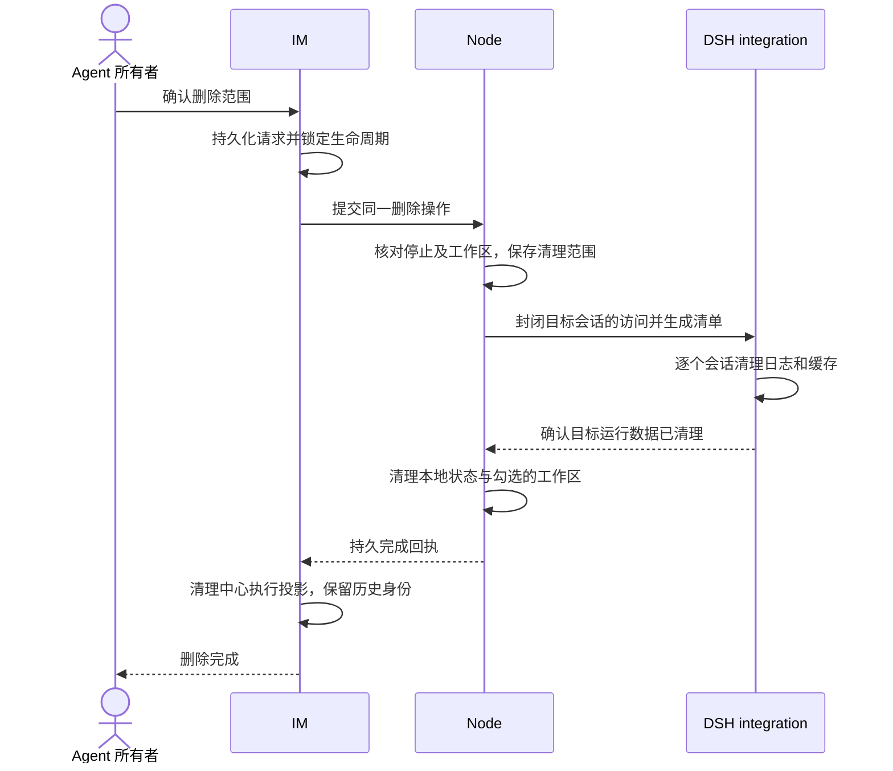

# feat-738：永久删除 Agent 技术方案

> 对齐：[需求](spec.md)

## Changelog

## 现状分析

- IM 持有 Agent profile、执行权限、任务图、聊天和 Work 投影。现有[停用服务](../../../apps/im-server/src/agent-lifecycle.ts)以真人 owner、生命周期 revision 和节点回执为准。停用已冻结任务、关闭新工作，并使待审批失效。Agent 的聊天身份行仍参与历史消息的外键和展示。
- [节点启动与注册](../../../apps/node/src/main.ts)使用本地配置和本地生命周期状态。[配置持久化](../../../apps/node/src/configuration.ts)已有串行写入和原子替换；中心现有注册路径会将节点上报的 Agent 标记为可用，永久删除必须在这条路径加屏障。
- 普通和 Global Agent 共用 DSH host 与持久 home。[运行时停用](../../../packages/dsh-integration/src/index.ts)只收敛目标 Agent 的活跃执行、终端、调度、后台工作和观察；它保留持久历史。[OwnedSessions](../../../packages/dsh-integration/src/owned-sessions.ts)与[子会话目录](../../../packages/dsh-integration/src/descendants.ts)提供 root binding、原生归属及冷读能力。[feat-657](../archive/feat-657-agent-disable-switch/design.md)已经验证停用与保留历史的边界。
- [Work 同步](../../../apps/im-server/src/work-records.ts)按节点的共享 journal 连续确认序号，Agent 的事件可能与其他 Agent 交错。可清理事件内容，序号和回执必须继续有效。IM 聊天附件与该同步链中的执行快照分开存储。
- 锁定的 DSH 0.2.1-alpha.1 和 npm 发布的 0.2.2-rc.1 的会话持久化公开类型均只有 create、open、flush、stat、list。上游[持久化文档](https://github.com/deepseek-ai/deepseek-harness/tree/dsh-v0.2.2-rc.1/packages/session/session-persistence)也记录该限制。上游已有[设计草案](https://github.com/deepseek-ai/deepseek-harness/blob/master/.agents/notes/proposed/architecture/2026-07-24-domain-kv-storage-and-workspace.md#future-work-session-side-deletion-design-settled-not-implemented-this-phase)，其接口仍属于未发布提案。
- 上游 [JSONL 文档](https://github.com/deepseek-ai/deepseek-harness/tree/dsh-v0.2.2-rc.1/packages/session/session-persistence-jsonl)定义每个会话独占的目录，目录包含所有日志代际，明确将删除留给运行时之外的维护；[投影缓存文档](https://github.com/deepseek-ai/deepseek-harness/tree/dsh-v0.2.2-rc.1/packages/session/session-projection-cache)描述每会话独立记录与进程内写回。仓库锁定包的 JSONL provider 公开 `resolveCurrentLog(id)` 可定位当前代际，历史代际可通过公开 list 识别为同一会话。Nano profile 的全文索引默认不打开持久 SQLite，原生附件按内容寻址并可跨会话共享。
- 隔离取证使用锁定的 DSH 0.2.1-alpha.1 和 Node 24.22.1，在同一 cwd 写入 A 主会话、A 子会话和 B 会话。单个 DSH 进程内取得 A 会话的公开写租约，移出 A 的日志并按 ID 删除缓存。公开查询只剩 B，B 在清理期间持有原写句柄，随后成功追加并读回事件。探针覆盖当前格式及正常清理，未验证完整产品链路。
- 另一个隔离探针让 A 已经发起的缓存写入等待 `session/flush`，随后脱离 A 并删除缓存行。恢复该写入后，行再次出现。会话写租约只保护日志，清理还需要目标级的缓存写入屏障。
- 在原样安装的 DSH 中，用 Cordis 禁用默认投影缓存插件，并装配基于公开 `SessionProjectionCache` 的试验扩展。重复延迟 A 写入，清理只等待 A 的写入完成。B 在等待期间和清理完成后都成功写缓存，A 的缓存行保持消失，迟到的 A 写入被挡住。三个探针都使用临时存储和合成会话，产品链路需在 M1 验收。

## 架构总览

沿用 IM 管理入口和节点主动连接。IM 确认真人删除意图、锁定权限和显示进度；节点持久化同一删除操作，协调本地配置和路由。DSH integration 用公开服务确定归属并生成清单，在共享 host 运行期间，仅按目标会话 ID 清理持久日志及缓存。各存储凭同一个操作 ID 重试，最后由 IM 发布完成。

## 关键决策

### 复用停用证明，另存不可逆的删除操作

删除依赖同一 revision 上的已确认停用。IM 在事务中同时验证真人 owner、普通或 Global 类型、当前绑定、配置版本、停止证明、无正在应用的配置或设备转移，并写入唯一操作；启用、改配、接单和设备转移的写入路径与之互斥。节点在第一次修改前复核停止证明及实际数据范围。删除提交后的重试复用原始选择；不同选择的重复提交拒绝覆盖。

永久保留最少的删除回执和身份占位，包含 agent ID、归属、原空间、历史显示名和操作结果。中心将 profile 标记为已删除并清除运行配置。原 `users` 行、私聊、群聊、附件和共享任务记录继续按聊天权限可读。设备转移的快照、所有者重写和注册集合均排除已删身份和回执。原 ID 不可重新注册、配置或创建，可用新 ID 创建同名 Agent。节点保留本地回执，在读取旧配置并创建目录或初始化运行时之前过滤该 ID。

### 通过真实归属生成清单，按存储所有者清理

清理清单先于任何破坏性写入持久化。种子来自 NodeStore 当前和历史绑定、目标 Work 关联、DSH 父会话原生目录及已知子 ID。用公开 `sessionPersistence.list` 的 header 扩展到仍有可证归属的冷子项和未落 NodeStore 的分支。原生子会话的父链、preset 及已知原生子目录相互印证，已终结 one-shot 同样纳入。未落绑定的 fork 须沿原生 fork 父链回到目标绑定，且 Nano preset 与配置 revision 匹配。其他 Agent 的明确绑定优先。cwd 和继承前缀仅用作定位。

每个已知 ID 再单独做持久化检查。JSONL list 会跳过部分损坏或未知格式，缺项还要核对受管根中该 ID 的精确物理目录。目录及代际均不存在才记为已无数据。有物理产物但身份、header 或兼容性无法证实时，报告该目标未清理。无目标归属证据的目录不参与判断。验收覆盖同 cwd、真实旧代际、已知但 list 漏报的冷子项、未落绑定的 fork 和另一 Agent 独立绑定的分支。

| 所有者 | 删除边界 |
|---|---|
| DSH integration | 清理目标原生会话目录、投影缓存及实际挂载的独占索引；停用后移除目标运行时绑定及专属计划，清理 Nano 持有的运行、模型、工具视图、审批、Workflow、知识维护及轨迹关联记录。共享内容寻址附件不随会话目录递归删除，保留其他会话及 IM 附件使用的内容。 |
| Node / PA / Channels | 通过各自的存储入口清理目标 session、Inbox、事件/交付副本、待处理控制、工作同步检查点、心跳和独占渠道配置。用现有渠道撤销语义停止接入并清理节点持有的凭据；不向外部平台发删除请求。按配置串行写入移除 Agent，更新运行分区和注册清单。 |
| IM | 清理目标 Work 事件、投影、工具/权限历史、执行缓存、分片上传和专属配置副本；已发 IM 消息和附件使用聊天存储，原引用、作者和 ACL 均保留。共享任务保持原记录及停用时暂停的状态，可由有权用户重新分配。 |

Work journal 共享序号。节点先以认证删除操作向 IM 登记目标的 `(journal ID, seq, event ID)`，节点从 InboxStore 原 journal 中只选 root 属于目标的事件。中心验证当前 node、owner、epoch 和删除操作。对已提交位置以中心保存的 root 和 event ID 对账。对只有分片或尚未上传的位置，以该授权范围内的节点清单为归属证据，并核对存在的分片及回执身份。任何已有 root 或 event ID 冲突均拒绝登记。中心为通过的位置持久化去内容回执并清理匹配的旧分片。节点收到持久回执后才用同序号及 event ID 的空占位替换本地记录。认证且精确匹配回执的旧 batch、旧分片和空占位共用同一成功响应，在摘要冲突判断前处理。旧分片在提交分片回执和 finalize 前再查一次去内容回执，发现回执则丢弃本次暂存并按同一规则返回。已有水位保持，下一位置按连续序号推进。节点收到回执后重读游标，丢弃同一位置的旧 `pending_event`，继续发送后续事件。其他位置沿用原摘要和分片校验。回执写入的事务限于目标身份及序号，文件回收在事务后进行。

聊天存储按字段清理。目标执行生成的消息保留正文、附件、交互内容、发送者、投递状态与时间。清除工具调用、思考、后台执行结果、回复过程、运行计量、审批与 native fork 引用。持久事件移除纯执行事件，对仍需回放的发布事件按同一边界清理 payload，保留其他事件的 ID 和顺序。同一事务推进受影响会话的执行投影清理版本。现有聊天同步响应、历史分页和在线通知携带该版本，通知只发给受影响会话的合法订阅者。Web 与 iOS 遇到较新版本时丢弃该会话的旧分页缓存和由其派生的计量与过程缓存，包括已经翻到的早期页。迟到的旧版本请求不参与合并。客户端用已有历史入口读取权威分页并恢复当前阅读位置。即使离线超过事件回放窗口，也会在复用缓存前通过聊天同步完成版本检查。

### 在共享进程内逐个清理已关闭的目标会话

Nano 持有产品 Agent 身份和删除授权。仅目标 Agent 的停止证明和清理资源构成前置条件。共享 DSH 进程及其他 Agent 的执行、任务准入和历史读取持续进行。

1. **先封闭目标入口并保存清单。** 持久化删除意图和已确认停止的 revision，停止目标的新增执行、冷读、轨迹订阅与续做，等待属于目标的已接收读写退出。通过公开 `sessionPersistence.list()`、已验证的绑定与原生归属生成持久化清单。任何仍被其他 Agent 独立拥有或依赖的资源留在原处。无法证实目标归属或访问已收敛时，此次删除保持未完成。
2. **收敛目标的缓存写入。** 普通 host 启动时通过 Nano profile 的 Cordis 配置装配官方 `SessionProjectionCache` 的扩展。其公开 `write` 记录在途写入，`coldSnapshot` 对已进入删除的会话关闭新的写回。此前由同步冷读发出的写入已经进入 domain 队列。等待目标的在途写入收敛后，通过公开 domain 表按键删除。其他会话继续执行官方读写实现。节点重启时，在开放目标的观察与执行入口前恢复删除屏障。
3. **在目标写租约内移出日志。** 使用锁定版本 JSONL provider 的公开 `resolveCurrentLog(id)`、`acquireWriteLease(header)`。对只存在历史代际的 Nano 会话，在锁定版布局中用可信 ID 和公开 header 核对唯一目录及文件身份。持有租约时仅将该目录内的日志代际移入本操作的同文件系统暂存目录，保留 `session.lock` 的 inode。对账目标的投影缓存、对应的历史缓存备份及实际挂载的独占索引。清理仅适用于受管根及已验证的版本和布局，遇到未知或冲突时报告具体失败。运行时集成仍通过公开 exports。受管文件维护的版本约束与范围纳入 [架构契约](../../../SPEC.md) 的实施归并。
4. **验证并提交结果。** 目标的公开持久化与冷读入口返回缺失，缓存记录消失，暂存文件已清理后才确认运行数据完成。中断后用原清单及持久化屏障恢复。验证同 cwd 的另一 Agent 能在目标清理开始前进入执行，在清理时接收新输入，并在同一个进程完成原工作。另覆盖历史代际、缓存写入延迟、目标租约冲突和异常恢复。DSH 升级时重新验证当前版本的适配契约。

### 工作区须有节点侧的专属证明

未勾选时文件留在原路径。节点只提供能证明由 Nano 为目标创建并管理、且无其他 Agent 或共享根引用的目录。默认路径标记只是线索，无可信归属证明的旧目录保留。确认前返回规范路径和文件身份见证。节点配置所有者用同一短临界区登记所有 Agent 已使用或待应用的目录占用，登记在准备及 `mkdir` 前生效。删除在同一临界区复核见证及同级或父子路径占用，随后将符合条件的原目录原子移出。递归回收暂存文件在临界区外进行。重试只处理本操作的暂存目录或重新验证过的原文件身份。若 B 已预留重叠目录，A 的该项清理失败。

## 接口与数据流

- IM 增加 owner-only 的 `GET /im/v1/agents/:id/deletion`（资格、工作区可选范围或当前结果）、`POST` 同路径（`request_id`、停用 revision、配置版本、工作区选项与见证）、`POST .../deletion/retry`（同一操作 ID）。首次确认和手动重试沿用当前设置写入的在线前置，节点缺少清理能力时给出版本要求。已受理的操作在掉线期间可只读查询，重连后恢复原范围。重复请求返回同一记录。
- 中心保存 `waiting_node | deleting | failed | deleted`、操作 ID、owner、node、绑定 epoch、停用 revision、配置版本、选项和进度。复用 Gateway 受认证控制通道，连接同步待续操作。同一 node 和 owner 的凭据恢复事务推进未完成删除的授权 epoch，沿用原操作和清单。中心只接受当前已认证连接的匹配回执。未完成删除与设备转移互斥。
- 节点先落本地操作并持久保存已经核对的清单，然后按清理阶段执行。重连、进程重启或重试从已记录范围继续；资源已不存在视为该资源已清理，未知归属或未确认写入不是成功。IM 仅在节点持久完成回执到达后清理中心投影、写完成标记并通知两端刷新。中心事务失败时重放同一回执。清理开始后仅支持继续，不提供撤销已删除数据的操作。
- 删除投影前保存无执行内容的历史索引，记录已发布 Work/轨迹定位键、所属 Agent、session/root 归属及已关联的消息和会话 ID。旧链接须命中精确的定位键，再按保留的原空间、Work 权限及消息入口的现行聊天权限判断。通过时展示“执行记录已删除”。无权和伪造定位沿用普通未找到行为。关闭目标观察连接。Owner 完成后回列表，仍可从原管理入口读取本人回执。

### 模型消费与恢复边界

删除目标已经通过既有停用屏障退出执行。删除再撤销该 ID 的恢复资格以及旧 Inbox、计划、Work 和原生会话读取入口；重连后的陈旧控制或历史 journal 重放不变成新唤醒。共享聊天正文和任务记录仍经各自的 ACL 提供给其他有权 Agent。此能力无新增模型工具或提示词。验证用受控 provider 观察删除前后相同投递与恢复入口：删除目标没有新请求，另一个仍有权的 Agent 能接收新任务并正常读取共享历史。

### 客户端入口

Web Agent 详情的所有者管理区沿用启停状态和[渠道删除](../../../src/IM/frontend/src/features/settings/agents/agent-channels-panel.tsx)的确认及失败反馈结构。iOS 使用现有 Agent 配置的原生确认 sheet，放在启停状态后。两个端都让目标名称、永久删除范围和聊天保留说明在工作区可选项之前出现；勾选默认关闭，仅在专用时提供并显示将删除的目录。提交后回到同一详情的进度区，显示等待节点、删除中、失败原因和重试；已确认完成后回列表。旧聊天提示“Agent 已删除”，而非设备离线或可重新启用。沿用已有详情和确认控件，无待选择的独立布局；实施时检验 Web 窄屏和 iOS sheet 能看全后果及主操作。设计基线为当前组件及 [feat-657 隔离验收记录](../archive/feat-657-agent-disable-switch/acceptance.md)，本轮未运行界面。

## 本次审查安排

| 必须回答的问题 | 能力与阶段 | 证据方法 |
|---|---|---|
| 删除的确是同一个已停止 Agent，能够清理冷历史，其他 Agent 仍可工作 | 设计与代码独立审查，产品旅程 | 真实注册、同节点双 Agent、旧数据样本。以同一 DSH 进程验证 B 的在途执行、新输入和历史读取。以混合 journal 验证旧分片与占位交错后 B 继续同步，以及中心拒绝覆盖已知归属 B 的序号，以真实配置入口验证目录占用竞争。对照日志占用与公开查询，再验证凭据恢复、异常重试和旧上报重放 |
| 所有者辨认目标与范围，能在失败后继续，原 IM 历史仍可读 | 前端体验和产品旅程 | 隔离 Web 验证确认后掉线再重连、失败重试和返回。用带工具或审批的旧消息比对在线更新、旧分页和超出回放窗口后的重连，验证旧轨迹与消息链接的权限。iOS 实测新增确认 sheet 和返回 |
| 目标不能再被唤醒或从旧记录恢复，共享历史对其他 Agent 仍可用 | Agent Context、代码审查 | 核对实际持久化状态与投递、冷恢复、缓存失效；用受控 provider 捕获实际请求，无模型自主删除判断 |

## 风险与回退

失败和重试锁定在目标 Agent 的操作范围内。回退必须保留永久删除屏障和回执。旧版本不能接管已受理的删除，已实际清理的数据不可恢复。

## 一次性部署迁移

无。旧数据通过同一受授权的产品删除路径清理。

## Runbook for Reviewer

在受审构建中使用独立的 `WT_ROOT`，命令从仓库根执行，按 [daily 运行模板](../../development/worktree-runtime.md#固定日常验收模板)准备环境。

| 服务 | 停止命令 | 启动命令 | 健康检查 |
|---|---|---|---|
| 隔离 IM 与 Node/DSH | `./scripts/e2e-down.sh --wt "$WT_ROOT"` | `./scripts/e2e-up.sh --profile daily --wt "$WT_ROOT"` | 读取本轮 `.e2e-ports.env`，检查 IM `openapi.json`、节点进程和测试 owner 的节点在线 |

从 Web 详情完成删除和故障恢复，保留 B 作为同节点对照；iOS 用本地模拟器验证新增确认 sheet 与返回。使用 daily 提供的测试 owner 与隔离节点，准备普通/Global、主子冷会话、共享群、消息附件、共享任务、专用及共享目录。上游真实包、同文件系统的受管目录、iOS 模拟器和测试模型配置须在 Gate 2 记录可用性。验证结束回收隔离资源。

## Milestones

| ID | 依赖 | 并行组 | 文件范围 | 退出标准 |
|---|---|---|---|---|
| M1-permanent-deletion | 锁定版 DSH 的目标级日志和缓存清理 | 单项 | IM、Node、PA、Channels、product-contracts、dsh-integration、Web/iOS 与受影响测试 | **[reviewer]** 普通/Global owner 删除可完成，工作区默认保留且可明确清理专用目录，聊天和共享任务保留；离线、失败和重试状态如实。**[worker]** 证实身份和停止校验、旧数据归属、真实日志和派生数据清除、工作区见证复核、混合 Work 序号不缺失、同一进程内其他 Agent 的运行、历史读取和新消息接收持续有效、并发/重启恢复、不复活。适用的文档、依赖契约与 CI 通过。 |
