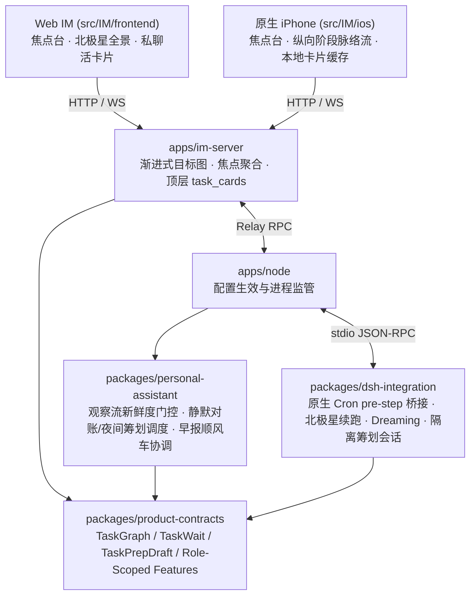
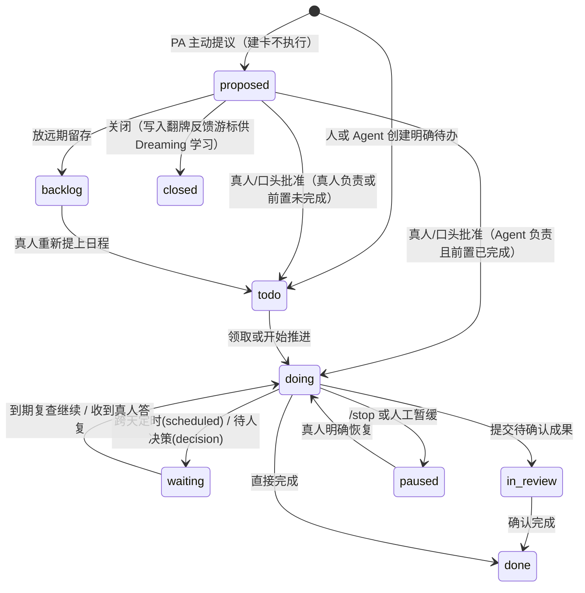
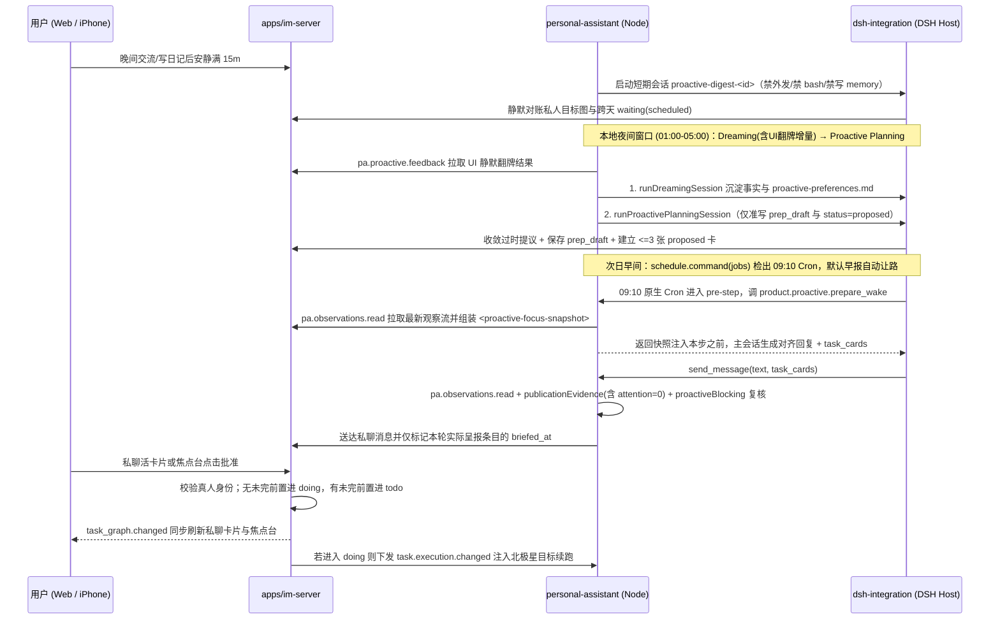

# feat-785: Personal Agent 主动性闭环与渐进式目标图 — 技术方案

> 对齐: [spec.md](spec.md)

## Changelog

## 现状分析

### 涉及范围

- **`packages/product-contracts`**：`src/task-execution.ts`（任务责任快照与等待校验结构）、`src/capabilities.ts`（角色感知的 `FeatureDependency` 与 `proactive_planning` 依赖联动）、`src/configuration.ts`（保持既有 SHA-256 指纹稳定不注入默认键）、`src/chat.ts`（顶层 `ChatMessage.task_cards` 与 `AgentPublication`）、`src/runtime-rpc.ts` / `src/node-rpc.ts`（Cron 唤醒桥接与翻牌反馈游标 RPC）；新增共享 `src/task-graphs.ts` 收敛四端重复定义的任务图节点、九状态、两类等待、来源会话与草稿类型。
- **`apps/im-server`**：`src/schema.sql` 与 `src/db.ts`（`messages.task_cards_json` 启动期幂等加列）、`src/task-graphs.ts`（单卡根与一步带子图创建、九状态与 `proposed` 真人/核验消息批准门禁、两类 `waiting` 校验、焦点台与节点批量摘要查询、翻牌结果增量读取）、`src/task-notifications.ts`（协作群通知与 PA 私聊静默分级）、`src/control-routes.ts`（`/im/v1/task-graphs/focus`、`/im/v1/task-graphs/nodes`）、`src/message-records.ts`、`src/messaging.ts` 与 `src/personal-actions.ts`（顶层 `task_cards` 持久化、幂等摘要与外发审计）。
- **`packages/personal-assistant`**：`src/inbox.ts` 与 `src/personal-assistant.ts`（`send()` 发送前调 `pa.observations.read`、执行 `publicationEvidence` 冲刷 `attention IN (0, 1)` 同轮已读记录并执行跨观察流 `held_for_revalidation`，外部通道自动退化追加文本摘要）、`src/task-execution.ts`（`snapshotAdmitted` 对 `wait.kind === "decision"` 跳过 Schedule 核验免触发修复循环）、`src/global-agent.ts`（限定仅活跃真人轮次且根会话调用才透传 `source_message_id`，并为后台维护会话施加 `task_graph` 动作/状态白名单）、新增 `src/proactive-coordinator.ts`（安静后兜底对账调度、独立夜间筹划窗口调度、经 `schedule.command({ action: 'jobs' })` 检测早间自定义 Cron 自动让路合并、按批次条目更新 `briefed_at`）。
- **`packages/dsh-integration` 与 `apps/node`**：`src/index.ts` 与 `src/context-order.ts`（在 `agent/pre-step` 拦截 PA 主会话 `source.kind === "schedule"` 原生 Cron 唤醒，反向调用 `product.proactive.prepare_wake` 拉取观察流并注入 `<proactive-focus-snapshot>`）、`src/message-arguments.ts`（`send_message` 的 `task_cards` schema 校验）、`src/features/task-graphs.ts` 与 `src/features/task-graph-schema.ts`（单卡起步、一步建图及提示词松绑）、`src/task-execution.ts`（深层续跑注入北极星根目标与祖先路径）、`src/knowledge/dreaming.ts` 与 `dreaming-prompts.ts`（拉取静默 UI 翻牌增量作为合格材料，沉淀显式一次/隐式两次分寸规则）、新增 `src/proactive-runner.ts`（创建禁 `bash` 且封禁 `.nanoassistant/memory/**` 与 `ROLE.md` 写入的短期维护会话，接入 `ColdLifecycleBarrier` / `UpdateBarrier` 取消链）、`src/personal-agent-defaults.ts` 及随包 `nano-ongoing-work` / `nano-proactive-care` Skill、`apps/node/src/{main,configuration}.ts`。
- **`src/IM/frontend`**：`src/features/tasks/`（以「行动焦点台」+「北极星全景图」替换旧五列总览，补齐「与我有关 / 按负责人 / 团队全部」三视图、速建归属选择器与多层子作用域面包屑钻取）、`src/features/chat/components/message-pane.tsx`（渲染顶层 `task_cards` 实时同源活卡片与草稿查看器）、`src/features/settings/agents/agent-detail-page.tsx`（PA `BehaviorCard` 内单一「主动筹划」开关，沿用底部统一保存、依赖浮层与离线只读）。
- **`src/IM/ios`**：`NanoIM/Features/Tasks/`（`TasksView.swift` 升级为行动焦点台与可展开前序、支持多层钻取及新增/编辑节点的纵向阶段脉络流；`TaskModels.swift` 兼容未知枚举回退）、`NanoIM/Features/Chat/{ChatModels,ChatStorageController,ChatMessageView}.swift`（本地 SQLite 缓存 `task_cards_json` 并监听任务变更实时刷新卡片）、`NanoIM/Features/Agents/{PersonalAgentManagementView,AgentConfigView}.swift`（一级页展示主动筹划当前状态跳转行，二级运行配置页承载单一开关、依赖联动与统一保存）。

### 既有约束

- **分层与依赖红线（`SPEC.md`）**：`IM` 仅依赖 `@nano/product-contracts`，不直接读取节点本地工作区文件；`PA` 仅依赖 `product-contracts` 与 `channels`；仅 `dsh-integration` 通过公开 exports 接入 `@deepseek-ai/*`，不引入第二套 Agent Loop 或内核 HTTP 服务（由 `tests/contract/test_runtime_dependency_contract.py` 自动守卫）。
- **正式记忆单写者边界（`feat-676`）**：`<workspace>/.nanoassistant/memory/` 与 `ROLE.md` 对前台及非 `Dreaming` 后台会话保持严格只读（含真实路径/符号链接解析防逃逸），仅 `Dreaming` 可编辑正式记忆仓并提交 Git。
- **上下文缓存前缀不变量（`verify-context-cache-prefix`）**：同一活跃 DSH 会话窗口内，`systemPrompt.section`、工具 schema 与已发送历史消息不得静默改写（`NoSilentPrefixRewrite`）；动态焦点快照与任务脉络只能通过当轮追加消息进入上下文，或运行在独立短期维护会话中。
- **滚动升级指纹稳定与权限硬边界**：`canonicalAgentConfiguration` 与 `agentConfigurationFingerprint` 对未显式提交新特性键的存量记录不得改变 SHA-256 指纹；第一期主动引擎仅对 PA 生效，未经真人点击或当轮真实主人消息核验前，`proposed` 节点不得转入 `doing`/`todo` 执行。

### 可复用能力

- **用并小改 — `apps/im-server/src/task-graphs.ts`（`schema_version: 2`）**：现行 `applyOperations`（`:284`）已支持将无子节点的 `mode: "none"` 原位升级为 `"dag"` 或 `"explore"`，并具备乐观锁 `revision`、`request_key` 幂等与私人/群空间鉴权。
- **用并小改 — `TaskExecution` 与 `TaskExecutionDriver`（`packages/personal-assistant/src/task-execution.ts`、`packages/dsh-integration/src/task-execution.ts`）**：自动续跑仅消费 `doing`；只需在 `snapshotAdmitted` 对 `wait.kind === "decision"` 跳过 Schedule 核验，并在 `TaskResponsibility` 补入北极星根目标与祖先路径。
- **用并补齐 — 原生 `CronOwners` 与 `agent/pre-step` 管道（`packages/dsh-integration/src/{cron-owners,index,context-order}.ts`）**：用户 Cron 运行在 `dsh-integration` 的 `ScheduleService` 中；通过 `schedule.command({ action: 'jobs' })` 读取早间计划表，并在 `agent/pre-step` 拦截 `source.kind === "schedule"` 桥接 `personal-assistant` 即可无损接入所有自定义 Cron。
- **用并补洞 — `publicationEvidence` + `held_for_revalidation`（`packages/personal-assistant/src/{global-agent,personal-assistant,inbox}.ts`）**：复用 `GlobalAgent.send()` 现有的同轮已读冲刷机制并将 `pendingReadCalls` 扩展到 `attention=0`，即可在不产生同轮死循环的前提下拦截未读观察群消息。
- **用 — `effectiveFeatures` 默认模式（`packages/product-contracts/src/capabilities.ts`）与 `Agent Work` 维护轨迹**：沿用 `dreaming`“不改存储指纹、仅在 `effectiveFeatures` 按角色默认开启”的成熟做法，并复用 `KnowledgeUpdates` 将后台消化与夜间筹划发布为可回溯的 `Work` 维护记录。

### 相关历史

- **`feat-635` / `refactor-673` / `bugfix-678` / `refactor-679`**：建立 `task_graphs` v2、1 小时 `waiting` 校验、256 次连续短跑熔断与五列看板。本 unit 保留拓扑、乐观锁、`/stop` 围栏与熔断底座，重塑单卡起步、两类等待语义与双端焦点/全景视图。
- **`feat-667`**：引入 PA 默认服务指导与 `nano-ongoing-work` / `nano-proactive-care` Skill；本 unit 将跨轮跟进、垫步草稿与待拍板提议统一收敛进静默的私人渐进式目标图。
- **`feat-676` / `feat-759`**：确立角色化文档记忆与 `Dreaming` 单写者；本 unit 为 `Dreaming` 补齐静默 UI 翻牌反馈输入源以沉淀分寸规则，并在独立夜间窗口调度主动筹划。
- **`feat-774`**：确立 `collaboration_scope` 与观察流 10 分钟合并；本 unit 在发信与定时唤醒前显式调用 `pa.observations.read` 拉取未到期积压观察事件。

## 架构总览

下图展示本 unit 的跨包模块边界与调用方向（全部遵守 `SPEC.md` 单向依赖；原生 Cron 仍在 `dsh-integration` 触发，经 `ProductBridge` 向 `personal-assistant` 拉取观察流与焦点快照）：



## 关键决策

1. **原位演进 `schema_version: 2` 支持「单卡即根、一步成图、多层钻取」，不拆分多套异构任务表。**
   - **理由**：放开根节点 `mode: "none"`（`create` 默认值）并允许 `create` 可选附带初始 `operations`，独立小事与新点子零摩擦成卡；演变为长线目标时直接原位升级为 `"dag"` 或 `"explore"` 并支持多层子容器逐级嵌套钻取，保持图 ID、节点短 ID 与存量 v2 数据 100% 兼容。
   - **拒绝备选**：拆分为独立 `proposals` / `todos` 表（批准后升级长线目标会断裂历史引用与聊天卡片绑定）。

2. **扩展九状态生命周期、服务端真人批准门禁与两类 `waiting` 解耦，机械锁死「未批准不执行」与「待决策免轮询」。**
   - **理由**：
     1. 新增惰性态 `proposed`（待拍板）与 `backlog`（远期留存）。**双层门禁**：宿主层禁止后台 `proactive-plan` 传入非 `"proposed"` 创建状态；服务端 `im-server` 规定节点脱离 `"proposed"` 进入 `"doing" | "todo"` 必须具备 `actor.kind === "user"`（双端界面点击）或当轮活跃真人消息核验的 `verifiedHuman`（私聊自然语言同意），无真人凭据的后台 Agent 自批一律返回 `403`。批准后若负责人为 Agent 且无未完成 `dag` 前置依赖则转入 `"doing"` 立即唤醒推进，否则转入 `"todo"` 等待前置或真人处理。
     2. `waiting` 拆为 `kind: "scheduled"`（要求 `assignee.type === "agent"` 且绑定有效原生 Schedule，未来上限放宽至 180 天）与 `kind: "decision"`（允许任意负责人，记录明确 `question` 与目标真人 `asked_user_id`；`personal-assistant/src/task-execution.ts` 的 `snapshotAdmitted` 对 `decision` 跳过 Schedule 核验，绝不触发 256 轮自动修复唤醒风暴）。



3. **准备草稿随任务节点存轻量 `prep_draft`，聊天消息采用顶层 `task_cards` 字段绑定真实任务实现跨端同源活卡片。**
   - **理由**：与 `ChatMessage` 既有顶层扁平字段（`attachments`、`interactive`、`reply_to`）一致，新增顶层 `task_cards?: TaskCardRef[]`（`messages.task_cards_json` 启动期自动加列，纳入发送幂等摘要、PA 外发审计与 iOS 本地 SQLite 消息缓存；发往飞书等外部通道时自动退化追加纯文本标题摘要）。客户端直接订阅真实任务节点状态并秒开节点上的 `prep_draft`（上限 64 KiB），聊天卡片、焦点台与口头审批三处操作同源实时一致。

4. **分层静默消化 + 独立夜间窗口主动筹划，并封堵跨会话 `source_message_id`、后台写 `doing` 与 `.nanoassistant/memory/` 写旁路。**
   - **理由**：
     1. 对话中已明确事项由主会话当轮静默落库；安静满 15 分钟后的兜底对账（`proactive-digest-<id>`）与夜间窗口（本地 `01:00–05:00` 且安静满 15 分钟，每晚至多一次，与 `dreaming` 是否开启或白天是否跑过解耦；若当晚 `Dreaming` 也到期则先跑 `Dreaming` 再跑筹划）均运行在独立短期会话中，并接入 `ColdLifecycleBarrier` / `ConfigurationScopes` / `UpdateBarrier` 即时中断。
     2. **三道安全隔离**：①修复 `global-agent.ts:796`——仅当 `call.sessionId === binding.sessionId` 且根会话处于尚未 `turn/end` 的活跃真人轮次时才附带 `source_message_id`；②宿主桥接层限制 `proactive-plan` 仅能读写主人私聊任务、禁 `delete`、新建节点仅限 `status: "proposed"`；③`proactive-digest` 与 `proactive-plan` 不挂载 `send_message` / `send_user_message` / `agent_creation` / `bash`，并通过真实路径解析钩子拒绝写入 `.nanoassistant/memory/**` 与 `.nanoassistant/ROLE.md`。
     3. **静默翻牌通往 `Dreaming`**：`im-server` 记录 PA 私聊任务的 `triage_outcome` 序号游标；`dreaming.ts` 检查增量时同步拉取未消费翻牌记录作为合格 `pendingMaterial`，确保用户仅在 UI 连续两次点掉同类提议（无聊天发言）也能触发夜间 `Dreaming` 提炼克制规则。

5. **在 `PersonalAssistant.send()` 先冲刷当轮已读证据再核验跨观察流未读消息，杜绝同轮重发死循环与纯文本提醒漏检。**
   - **理由**：每个任务节点通用保留 `source_conversation_ids?: string[]`。当 PA 发送消息时：①先调 `pa.observations.read` 同步中心待处理观察事件；②调用与 `GlobalAgent.send()` 同构的 `publicationEvidence`（将 `InboxStore.pendingReadCalls` 放宽为不限 `attention` 位），把模型在同一轮刚通过 `inbox(action="read")` 读过的观察消息提交为 `consumed=1`；③再对目标会话、`task_cards` 关联会话及本轮活跃焦点任务的 `source_conversation_ids` 检查 `proactiveBlocking`（覆盖 `attention IN (0, 1)` 未读消息），既精准拦下过时纯文本提醒，又保证同轮重读后再次发送顺畅放行。

6. **原生 Cron `agent/pre-step` 桥接 + 通用有货早报与早间自定义 Cron 顺风车合并。**
   - **理由**：针对用户自定义 Cron 运行在 `dsh-integration` 内部的架构事实：
     1. **早间自动让路**：`proactive-coordinator` 通过 `schedule.command({ action: 'jobs' })` 读取主会话启用的原生 Schedule，若当日用户本地 `[06:00, 11:30]` 内存在待触发的主会话定时任务，默认早报自动让路不触发；若无自定义早间 Cron，则仅在存在未呈报 `prep_draft`、未呈报 `proposed` 卡或当日到期节点时唤醒一次主会话（无新成果零模型调用、零空消息）。
     2. **全时段原生 Cron 桥接**：每当 PA 主会话在 `dsh-integration` 的 `agent/pre-step` 即将消费 `source.kind === "schedule"`（或节点侧 `heartbeat` / 默认早报）时，先反向调 `product.proactive.prepare_wake` 执行 `pa.observations.read` 并返回确定性裁剪的 `<proactive-focus-snapshot>` 追加到该步之前；当轮向主人私聊确认送达后，仅将本轮快照实际包含或 `task_cards` 显式携带的条目标记 `briefed_at`。

7. **角色感知的 `proactive_planning` Feature 定义，零存储指纹漂移且统一双端配置页保存与依赖模型。**
   - **理由**：`canonicalAgentConfiguration` 不注入默认布尔键，滚动升级期间存量配置 SHA-256 指纹完全不变；`FeatureDependency` 增加 `roles: ['personal']`，通过 `definitionsForRole(isPersonal)` 使普通团队 Agent 完全不暴露、不默认开启也不受 `proactive_planning` 依赖约束。Web（`AgentDetailPage` `BehaviorCard`）与 iOS（二级 `AgentConfigView` `运行特性`，一级 `PersonalAgentManagementView` 展示只读状态跳转行）统一走 `AgentConfig` 版本乐观锁保存、`capabilityEditor` 依赖提示与节点离线只读锁，消除隐藏依赖死锁。

## 接口与数据流

### 1. 共享契约与数据模型（`packages/product-contracts`）

新增 `packages/product-contracts/src/task-graphs.ts` 并扩展 `task-execution.ts`、`capabilities.ts`、`chat.ts`、`runtime-rpc.ts`：

```ts
export type TaskMode = "none" | "dag" | "explore";

export type TaskStatus =
  | "proposed"
  | "todo"
  | "doing"
  | "waiting"
  | "in_review"
  | "done"
  | "paused"
  | "backlog"
  | "closed";

export interface TaskProposalMeta {
  rationale: string;
  on_approve: string;
  proposed_for_user_id?: string | null;
  briefed_at?: string | null;
  triage_outcome?: "approved" | "deferred" | "dismissed" | null;
  triaged_at?: string | null;
}

export interface TaskPrepDraft {
  title: string;
  markdown: string; // <= 65_536 UTF-8 bytes
  workspace_path?: string | null;
  updated_at: string;
  briefed_at?: string | null;
}

export type TaskWait =
  | {
      kind?: "scheduled"; // 兼容无 kind 历史记录
      reason: string;
      schedule_id: string;
      owner_agent_id: string;
      session_id: string;
      next_check_at: string; // > now 且 <= now + 180d
    }
  | {
      kind: "decision";
      reason: string;
      question: string;
      asked_user_id: string; // 私聊省略时服务端自动解析为对端真人 ID，群聊必填成员真人 ID
    };

export interface TaskCardRef {
  graph_id: string;
  node_id: string;
}
```

- **通用节点来源引用**：`TaskNode` 增加可选 `source_conversation_ids?: string[]`（最多 5 个有权访问的会话 ID），供 `doing` / `waiting` / `proposed` 阶段发信前新鲜度核验统一读取。
- **`TaskResponsibility` 扩展（`task-execution.ts`）**：增加 `root_node_id: string`、`root_title: string`、`root_goal_summary: string`（`<= 400` 字符）、`parent_path: { id: string; title: string; mode: TaskMode }[]` 与 `source_conversation_ids?: string[]`。
- **角色感知 Feature 定义（`capabilities.ts`）**：`FeatureDependency` 增加可选 `roles?: ('root' | 'personal')[]`；`proactive_planning` 声明 `roles: ['personal'], default_on: true, requires: { features: ['task_graph'], tools: ['task_graph'], skills: [] }`；导出 `definitionsForRole(isPersonal: boolean)` 供 `effectiveFeatures`、`featureClosure`、`validateCapabilities`、`changeCapability` 与 `im-server` 创建默认使用。
- **顶层消息字段（`chat.ts`）**：`ChatMessage` 与 `AgentPublication` 增加顶层可选 `task_cards?: TaskCardRef[]`（最多 5 项），纳入 `publicationBody` 排序 JSON 哈希。

### 2. IM 服务端接口、数据库与权限规则（`apps/im-server`）

- **`messages` 表兼容加列（`src/schema.sql` & `src/db.ts`）**：`ensureColumn(db, "messages", "task_cards_json", "TEXT")`；发帖时校验每项 `(graph_id, node_id)` 存在且发送者具备该图所属会话读权限。
- **`POST /im/v1/task-graphs` 与 `POST /im/v1/task-graphs/:graph_id/apply`**：
  - `create` 默认 `mode: "none"`，可选携带初始 `operations` 单事务建图；支持无子节点 `mode: "none"` 原位升级为 `"dag" | "explore"`，保留最多 8 层子容器嵌套。
  - **批准门禁与确定性状态流转**：将 `status === "proposed"` 更新为 `"doing"` 或 `"todo"` 时，校验 `actor.kind === "user"` 或已核验当轮主人 `verifiedHuman`（否则返回 `403 proposal_approval_requires_human`）；通过后若节点当前 `assignee?.type === "agent"` 且同层无未完成 `dag` 前置依赖则落地为 `"doing"`（触发 `task.execution.changed`），否则落地为 `"todo"`。
  - **两类 `waiting` 校验**：`kind === "scheduled"` 保持 `assignee.type === "agent"` 与原生 Schedule 校验（未来上限 180 天）；`kind === "decision"` 允许任意负责人，校验非空 `reason` 与 `question`，在单聊中自动补全对端真人 `asked_user_id`，在群聊中要求显式传入本群真人成员 `asked_user_id`。
  - **翻牌反馈增量记录**：每当 PA 私人空间 `proposed` 节点产生 `triage_outcome`（`approved | deferred | dismissed`），写入单调递增的反馈事件序号，通过 Relay RPC `pa.proactive.feedback` 供节点 `Dreaming` 按游标增量拉取。
- **`GET /im/v1/task-graphs/focus` 与 `GET /im/v1/task-graphs`**：
  - `focus` 返回「与我有关」三区数据（每区默认返回前 30 条并附 `next_cursor` 支持增量加载，避免大数据量无界响应）：
    - `needs_you`：本人 PA 私聊中的 `proposed` 节点、团队会话中显式指定 `proposed_for_user_id === user.id` 的 `proposed` 节点（不向全群无关成员广播）、`wait.kind === "decision" && wait.asked_user_id === user.id` 的待拍板节点、以及本人创建或父节点归属本人的 `in_review` 节点；
    - `active`：本人 PA 私聊活跃单卡/叶子事项，及团队会话中直接分配给本人的 `doing | waiting(scheduled) | todo` 节点；
    - `goals`：本人 PA 私聊或团队中本人发起/直接负责根节点的未完结多节点目标图概览；
    - `counts`：`backlog / paused / done / closed` 计数，展开时复用 `GET /im/v1/task-graphs` 按 `statuses=backlog,paused,done,closed` 与 `cursor` 分页读取。
  - `GET /im/v1/task-graphs` 扩展 `statuses` 枚举支持全部 9 种状态，继续服务「按负责人（`assignee_type/id`）」「团队全部（`scope=all`）」与「本群任务」分页查询。
- **PA 私聊静默规则（`src/task-notifications.ts`）**：所属会话为 `personal_agent_bindings.conversation_id` 时抑制任务增改系统通知，仅向客户端广播 `task_graph.changed` WS 事件刷新任务视图与聊天活卡片。

### 3. 24 小时主动闭环跨模块时序

以下时序图展示包含原生 `dsh-integration` Cron `pre-step` 桥接、同轮观察流冲刷与真人批准门禁的完整主路径：



### 4. Agent Context 设计与缓存前缀保护

- **受影响 Consumers 与生命周期**：
  1. **PA / Global 前台主会话（Root Session）**：
     - **稳定前缀层**：`systemPrompt.section`（`nano-personal-agent`、`nano-task-graphs`）仅含静态规则；`MEMORY.md` 与 `ROLE.md` 保持窗口首轮快照不变，严格满足 `NoSilentPrefixRewrite`。
     - **定时唤醒追加层（`<proactive-focus-snapshot>`）**：在原生 `schedule`（经 `agent/pre-step` 桥接）、`heartbeat` 或默认早报唤醒时，以追加上下文块注入当轮输入之前；普通真人对话轮次不注入。
     - **确定性预算裁剪规则（总上限 `1,500` 字符）**：构建器按完整条目结构化裁剪，绝不按原始字符硬截断破坏闭合标签或末尾 `guidance`——优先级依次为：①固定闭合壳与末尾 `guidance`（预留 220 字符）；②`learned_proactive_rules`（最多 5 条）；③`unbriefed_prep_drafts` 与 `open_proposals_awaiting_owner`（按最新更新时间，单标题截断至 60 字符，超预算部分汇总为 `+K more unbriefed items; call task_graph(action="list") to inspect`）；④`active_focus_frontiers`（最多 5 条活跃主线前沿，超出部分汇总为 `+M more active tasks`）。
  2. **任务自动续跑消费者（`TaskExecutionDriver`）**：
     - 仅在存在本人 `doing` 或失效 `scheduled` 等待时追加 `task-execution` 消息，每项携带 `root_node_id`、`root_title`、`root_goal_summary` 与 `parent_path`。
  3. **独立短期维护会话（`proactive-digest-<id>` 与 `proactive-plan-<id>`）**：
     - 独立空历史短期会话运行，不挂载 `bash` 与对外发信工具，挂载真实路径只读守卫保护 `.nanoassistant/memory/**` 与 `ROLE.md`；结束后摘要进入 `Agent Work` 维护轨迹。
  4. **PA `Dreaming` 会话（`dreaming-<id>`）**：
     - 首轮批次输入合并对话增量与 `pa.proactive.feedback` 拉取的 UI 翻牌结果（`approved / deferred / dismissed`），支持纯 UI 连续两次关闭同类提议自动晋升为 `knowledge/proactive-preferences.md` 中的克制规则。

- **模型可见输入 Before / After 对照**：
  - **场景 A：深层子任务自动续跑（`TaskExecutionDriver`）**
    - *Before*：`{"doing":[{"graph_id":"tg_nano","node_id":"n4","title":"整理首批 10 人邀请文案","status":"doing","conversation_id":"c_pa","relative_url":"/tasks/tg_nano?node=n4"}]}`
    - *After*：`{"doing":[{"graph_id":"tg_nano","node_id":"n4","title":"整理首批 10 人邀请文案","status":"doing","root_node_id":"n1","root_title":"把 Nano 打磨成熟并推出去","root_goal_summary":"跑顺主动操心但不越权打扰的闭环，录出 3 分钟真实演示并拿给首批 10 位同路人试用。","parent_path":[{"id":"n1","title":"把 Nano 打磨成熟并推出去","mode":"dag"},{"id":"n3","title":"演示发布阶段","mode":"dag"}],"conversation_id":"c_pa","relative_url":"/tasks/tg_nano?node=n4"}]}`
  - **场景 B：原生 `schedule` / 早间唤醒追加块（`<proactive-focus-snapshot>`）**
    ```xml
    <proactive-focus-snapshot local_time="2026-11-26T09:10:00+08:00" delivery_mode="piggyback_morning_schedule">
    unbriefed_prep_drafts:
    - [tg_nano:n3] 《Nano 3 分钟 Demo 演示骨架》 (目标: 把 Nano 打磨成熟并推出去)
    open_proposals_awaiting_owner:
    - [tg_bot:n1] 调研「自媒体 Bot」主流平台发布限制与防封号边界 (单卡新构想, 未执行)
    active_focus_frontiers:
    - [tg_nano:n3] 录制 3 分钟真实场景 Demo 视频 (doing, assignee=owner, source_chats=[c_dev_daily])
    learned_proactive_rules:
    - 家人健康与家务沟通 → 仅作背景记忆，不主动建立任务卡或出主意
    guidance: 若本轮为早间计划对齐，请在尊重主人自行决定今日计划的前提下，自然附上相关草稿或待拍板 task_cards 供参考，切勿替主人直接拍板定计划。
    </proactive-focus-snapshot>
    ```

## 前端原型

- **要通过原型判断的设计决定**：
  1. 替换旧五列看板后，「与我有关 / 按负责人 / 团队全部」三范围视图、带归属会话选择的单卡速建框（支持选团队群或打开完整创建表单）及主次分明的翻牌操作权重；
  2. 长线目标内页在桌面（阶段/探索脉络流 + 多层子脉络钻取入口 + 右侧同屏详情与草稿）与手机/iPhone（置顶终局目标 + 可展开前序阶段 + 支持添加/编辑子节点的纵向阶段脊柱流 + 草稿 Sheet）的自然呈现，以及「无前置单卡批准直入推进中 vs 前置未完新芽批准进入待办」的准确反馈；
  3. PA 私聊顶层 `task_cards` 活卡片与焦点台双向同步，以及双端 PA「主动筹划」开关与统一保存/依赖联动/离线只读的一致体验。
- **原型文件**：[prototype.html](prototype.html)（走查记录见 [evidence/prototype-walkthrough.md](evidence/prototype-walkthrough.md)）
- **用户目标与体验方案**：
  - **全局任务入口（`/tasks` · iOS `任务` Tab）**：顶栏切换「与我有关（默认）/ 按负责人 / 团队全部」并保留搜索；速建栏内嵌归属会话选择胶囊（有 PA 默认选 PA 私聊，也可切至已加入的团队群聊；无 PA 用户默认选首个可写会话或弹出会话选择，右侧附「完整新建…」入口建多阶段大图）。「按负责人」按所选成员/Agent 分「待处理与待拍板 / 推进与等待 / 待验收」加折叠已完结展示；「团队全部」展示可访问的团队目标与独立任务列表。
  - **北极星全景图（`/tasks/:graphId` · iOS `TaskGraphView`）**：顶部常驻终局目标栏与多层面包屑；含子容器的阶段节点提供「进入子脉络」钻取；前沿 `proposed` 新芽完整提供「批准立项（前置未完时进待办）/ 批准开工（前置已完时进推进中）/ 放远期 / 关闭」动作；iPhone 端前序已完成阶段可点击展开回看，顶栏保留 `+ 子节点` 与点击任意卡片进入详情/编辑能力。
  - **PA 设置页**：Web 在 `AgentDetailPage` 行为设置区、iOS 在二级 `AgentConfigView` 运行特性区承载单一「主动筹划」开关（共用底部/顶栏「保存」、`task_graph` 依赖轻提示与节点离线只读锁），iOS 一级 `PersonalAgentManagementView` 提供显示当前开关状态的快捷跳转行，既一触可达又消除隐藏依赖冲突。
- **交互边界**：支持真实切换「与我有关 / 按负责人 / 团队全部」、切换速建归属群聊、区分独立单卡批准（进 `doing`）与前置未完新芽批准（进 `todo`）、在 iOS 展开已完成阶段及查看统一保存栏；顶部 `.demo-chrome` 仅作演示控制。

### 现有 UX grounding

| 当前产品入口 | 画面与操作基线 | 沿用或改善的体验及原因 | 本次设计 |
|---|---|---|---|
| Web `/tasks` 总览（`task-progress.tsx:81-105`） | 五列根看板 + 弹窗必选 `dag`/`explore` 及所属会话 | **沿用**：归属会话选择、搜索、按负责人筛选与分批加载。**改善**：默认聚焦「与我有关」，小事回车即建单卡同时保留切群聊与完整建图入口 | 行动焦点台（`与我有关`）+ 同构三分组的 `按负责人` 与 `团队全部` 视图 + 带归属会话胶囊的速建栏 |
| Web `/tasks/:graphId` 与 iOS `TaskGraphView`（`task-graphs-page.tsx:34-122`、`TasksView.swift:310-430`） | 多层面包屑钻取、节点编辑与 409 冲突合并已完备，但手机二维画布需缩放平移 | **沿用**：多层 `scope` 钻取、节点详情/编辑、`+ 子节点` 与冲突保护。**改善**：锁定终局目标，手机改为可展开前序的纵向阶段脊柱流 | 桌面阶段/探索流 + 右侧常驻详情与草稿；手机纵向阶段脊柱流（支持展开前序、钻取子脉络、添加与编辑节点） |
| Web / iOS PA 私聊消息流（`chat/components/message-pane.tsx:2218`、`ChatMessageView.swift:27`） | 顶层消息字段渲染与 iOS 本地 SQLite 缓存成熟 | **沿用**：顶层消息字段与本地离线阅读缓存。**改善**：`task_cards` 绑定真实任务节点，消除静态快照状态分叉与后台系统通知刷屏 | 气泡内嵌同源活任务卡与草稿入口，监听 `task_graph.changed` 双端实时刷新 |
| Web `AgentDetailPage` 与 iOS `PersonalAgentManagementView` + `AgentConfigView` | Web 与 iOS `AgentConfigView` 共用 `AgentConfig` 乐观锁保存、依赖联动与 `ready` 离线只读 | **沿用**：统一保存按钮、Feature 依赖联动浮层与节点离线只读锁。**改善**：iOS 一级页加状态跳转行直达二级页单一开关，避免跨页隐藏依赖死锁 | Web `BehaviorCard` 与 iOS `AgentConfigView` 承载单一「主动筹划」开关并走统一保存；iOS 一级页展示当前状态入口行 |

### 原型对齐契约

| 原型区域 / 状态 | 对齐级别 | 产品入口 | 必验 viewport / 状态 | 下游验收投影 |
|---|---|---|---|---|
| 行动焦点台（「与我有关 / 按负责人 / 团队全部」切换、带会话归属选择的单卡速建、主次按钮权重、零待审安静态、浮层提示不挤动卡片） | `must-match` | Web `/tasks`、iOS `任务` Tab | Web `1280` + `390`，iOS `390` | M1 `[reviewer]` ①②；M1 `[worker]` 原型截图对照 |
| 北极星全景图（桌面阶段/探索流 + 子脉络钻取 + 右侧同屏详情与草稿；前沿新芽含批准/放远期/关闭且区分前置未完进 `todo`） | `must-match` | Web `/tasks/:graphId` | Web `1280` | M1 `[reviewer]` ③；M1 `[worker]` 原型截图对照 |
| 手机窄屏与原生 iPhone 纵向阶段脉络流（置顶终局目标、前序可展开、支持子脉络钻取与添加/编辑节点、无强制二维缩放画布） | `must-match` | Web `/tasks/:graphId`（窄屏）、iOS `TaskGraphView` | Web `390`、iOS `390` | M1 `[reviewer]` ③；M1 `[worker]` Web 窄屏与 iOS Simulator 截图对照 |
| PA 私聊顶层 `task_cards` 同源活任务卡片与准备草稿阅读 | `must-match`（Web）/ `may-adapt`（iOS 原生 Sheet 与卡片容器） | Web `/chat/:paConvId`、iOS `ConversationView` | Web `1280` + `390`，iOS `390` | M1 `[reviewer]` ④⑤；M1 `[worker]` 双端实测证据 |
| PA「主动筹划」开关、统一保存与依赖联动及所属电脑离线只读态（iOS 一级状态入口 → 二级运行特性单开关） | `must-match`（语义、后果说明、无隐藏依赖死锁与离线只读）/ `may-adapt`（iOS `Form` 原生样式） | Web `/settings/agents/:paId`、iOS `PersonalAgentManagementView` → `AgentConfigView` | Web `1280`、iOS `390` | M1 `[reviewer]` ⑦；M1 `[worker]` 离线/在线与依赖测试 |
| 顶部深色 `.demo-chrome` 演示栏 | `out-of-scope` | — | — | 仅用于静态原型浏览，真实产品不渲染 |

### 原型走查

- **实际渲染与走查范围**：已通过本机 headless Chrome 渲染并目视核查全部 10 个状态（桌面 `1280` 4 张、窄屏 Web 与 iOS `390` 6 张），完整走查与两轮视觉/交互修正记录见 [evidence/prototype-walkthrough.md](evidence/prototype-walkthrough.md)。
- **体验判断与修正摘要**：除首轮去除机制自夸文案、增加阶段流向与探索对比线、固定手机一屏高度外，结合独立审查补充修正了五处细节：①速建栏补齐归属会话选择胶囊与完整新建入口；②实装「按负责人 / 团队全部」切换内容；③全景图前沿新芽补齐「关闭」并准确展示前置未完时「批准立项 → 待办（等前置完成）」与独立单卡「批准开工 → 推进中」的差异；④iOS 阶段脉络流补齐前序展开切换、`+ 子节点` 与点击卡片编辑入口；⑤设置页对齐统一「保存」动作与依赖联动说明。
- **未验证项**：真实 LLM 生成内容质量、并发 409 逐字段冲突合并与 iOS 真机动态字号/深色模式在 M1 实施与真栈验收中实测。

## 本次审查安排

| 必须回答的问题 / 对应目标 | 能力与使用阶段 | 证据方法、范围与已有定位 |
|---|---|---|
| 跨包边界、九状态与真人批准门禁、两类 `waiting`（含 `snapshotAdmitted` 免修复循环）、原生 Cron `pre-step` 桥接、同轮观察流新鲜度门控及配置指纹零漂移是否正确，delta-spec 是否与实现一致 | `change-code-review`（阶段 4 独立代码与契约审查） | 审查完整 unit diff、6 份 delta-spec、窄测试与 `tests/contract/test_runtime_dependency_contract.py` |
| 主会话、深层续跑、独立短期对账/筹划会话（含 `.nanoassistant/memory` 写封禁与 `source_message_id` 隔离）及 `Dreaming`（含静默 UI 翻牌输入）的实际模型输入是否语义清晰且满足缓存前缀不变量 | `agent-context-review` + `verify-context-cache-prefix`（设计期 + 实施后独立审查） | 运行 `.agents/skills/verify-context-cache-prefix/check.py` 与 wire replay 测试；从隔离真栈 `llm_logs` 核查四条消费链真实请求正文 |
| 行动焦点台（含三范围切换与群归属速建）、北极星全景图（多层钻取、桌面分栏与手机纵向阶段流）、私聊同源活卡片与 PA 主动开关是否自明协调、无隐藏依赖死锁 | `frontend-experience-review`（设计期原型走查 + 实施后独立体验审查） | 对照 [prototype.html](prototype.html) 与真实隔离栈 Web（`1280` / `390`）及 iOS Simulator 连续操作截图/录屏 |
| 真实用户与真实模型能否跑通「单卡到多层长线图 → 静默消化与夜间筹划 → 默认有货早报与自定义原生 Cron 顺风车合并 → 观察群发前新鲜度拦截 → 双端翻牌同步与 UI/口头分寸进化」完整闭环 | `product-journey-review`（阶段 4 真实产品入口连续旅程验收） | 基于 `./scripts/e2e-up.sh --profile daily` 隔离真栈 + 真实模型实测默认用户与自定义 Cron 用户双路径、跨群纯文本提醒新鲜度拦截及 UI 连续两次关闭提议触发 `Dreaming` 规则沉淀 |

## 契约层增量 (delta-spec)

归并时 `im/task-graphs.md` 净增 1 条 Requirement（`19 -> 20`），`gateway/personal-agent.md` 净增 1 条（`18 -> 19`），`gateway/agent-capabilities.md` 净增 1 条（`64 -> 65`），`gateway/task-graphs.md`（`24`）、`im/personal-agent.md`（`8`）与 `im/ios-client.md`（`19`）计数保持不变；归档归并时同步更新 `docs/specs/im/spec.md` 与 `docs/specs/gateway/spec.md` 的 `Canonical Areas` 计数。

| 受影响领域 | Canonical 路径与对应 Delta | 变更摘要 |
|---|---|---|
| IM 任务图、三范围焦点台、多层全景与顶层 `task_cards` 活卡片 | `docs/specs/im/task-graphs.md` → [specs/im/task-graphs.md](specs/im/task-graphs.md) | ADDED 2 · MODIFIED 5 · REMOVED 1：单卡根与原位成图、九状态与确定性真人/口头批准判据、两类 `waiting`、三范围焦点台与有界增量加载、保留多层子作用域钻取的北极星全景图、PA 私聊改图静默、顶层 `task_cards` 活卡片与外部通道文本退化 |
| IM 个人助手设置与离线边界 | `docs/specs/im/personal-agent.md` → [specs/im/personal-agent.md](specs/im/personal-agent.md) | MODIFIED 1：双端 PA 设置页单一「主动筹划」开关、统一保存与依赖联动及所属电脑离线只读保证 |
| 原生 iPhone 客户端体验 | `docs/specs/im/ios-client.md` → [specs/im/ios-client.md](specs/im/ios-client.md) | MODIFIED 2：iPhone 行动焦点台、支持展开前序/多层钻取/添加编辑节点的纵向阶段脉络流、`task_cards` 本地缓存与同步、一级设置状态入口与二级运行特性单开关联动 |
| Gateway 任务工具与自动续跑 | `docs/specs/gateway/task-graphs.md` → [specs/gateway/task-graphs.md](specs/gateway/task-graphs.md) | ADDED 1 · MODIFIED 4 · REMOVED 1：`create` 默认单卡与一步带子图、`proposed`/`backlog` 不续跑、跨天 `scheduled` 与零轮询 `decision` 等待（跳过修复唤醒）、深层续跑注入北极星根目标与祖先路径 |
| Gateway PA 主动性闭环、原生 Cron 桥接与新鲜度门控 | `docs/specs/gateway/personal-agent.md` → [specs/gateway/personal-agent.md](specs/gateway/personal-agent.md) | ADDED 1 · MODIFIED 2：更新存量「PA 复用完整 Global 执行能力」消除旧措辞冲突；定义分层静默消化、独立夜间窗口筹划（工具/记忆/凭证三重硬隔离）、同轮已读冲刷后的跨观察流 `held_for_revalidation`、原生 Cron 桥接与通用有货早报/顺风车合并 |
| Gateway 角色感知运行特性与 Dreaming 分寸沉淀 | `docs/specs/gateway/agent-capabilities.md` → [specs/gateway/agent-capabilities.md](specs/gateway/agent-capabilities.md) | ADDED 1 · MODIFIED 1：仅对 PA 生效且不改存量指纹的 `proactive_planning` Feature，以及消费对话与静默 UI 翻牌增量的 `Dreaming` 分寸规则沉淀 |
| IM Agent Work / 会话基础 / Web 聊天通用交互 / Gateway Heartbeat-Cron | `docs/specs/im/{agent-work,conversations-messages,web-chat-ux,agents-nodes}.md`、`docs/specs/gateway/heartbeat-cron.md` | **no spec delta**：维护轨迹、Feature 通用依赖浮层/离线框架与用户时区活跃窗口均直接复用既有契约保证 |

## 风险与回退

| 风险 | 影响 | 缓解与回退方案 |
|---|---|---|
| PA 夜间主动筹划产出过多或过时提议 | 待拍板区堆积噪音 | 服务端硬限单会话活跃 `proposed <= 10`、每晚限产 `<= 3` 张且先清理已解决旧卡；UI 连续两次关闭或口头劝阻经 `Dreaming` 自动写入克制规则；一键关闭 `proactive_planning` 立即止血 |
| 观察群高频新消息引发 `held_for_revalidation` 重试阻塞 | 私聊提醒无法发出 | 发送前先执行 `publicationEvidence`（含 `attention=0`）将同轮已读消息置为 `consumed=1`，且仅检查主人私聊与当前消息/焦点任务 `source_conversation_ids` 关联会话，无关群聊不拦截 |
| 滚动升级期间新旧节点配置指纹或枚举差异 | 配置对账报错或旧 iPhone 解码失败 | `canonicalAgentConfiguration` 不注入默认新键，保持 SHA-256 指纹完全兼容；iOS `TaskModels` 对未知 `status` / `wait.kind` 实现安全兜底解码单测 |

## 一次性部署迁移

无。

- **SQLite 幂等演进**：`task_graphs.document_json`（`schema_version: 2`）新增枚举与可选字段天然向后兼容；`messages.task_cards_json` 与翻牌反馈事件表/列均通过 `apps/im-server/src/db.ts` 启动期 `CREATE TABLE IF NOT EXISTS` / `ensureColumn` 自动幂等补齐，无需人工停机脚本或 `deployment-prompt.md`。
- **零配置指纹漂移**：`proactive_planning` 仅在 `effectiveFeatures(..., definitionsForRole(isPersonal))` 层对 PA 默认取 `true`，不改写存量 `agent_config_operations` 或 `gateway.yaml` 指纹，支持先升 `im-server`、再升 `node`/Web、最后升 iOS 的平滑滚动发布。

## Runbook for Reviewer

| 服务 | 停止命令 | 启动命令 | 健康检查 |
|---|---|---|---|
| 隔离 IM 中心、Node、DSH 子进程与同源 Web UI | `./scripts/e2e-down.sh --wt "$WT_ROOT"` | `PATH="$NANO_MAIN_ROOT/.venv/bin:$PATH" ./scripts/e2e-up.sh --profile daily --wt "$WT_ROOT"` | `source "$WT_ROOT/.e2e-ports.env" && curl -fsS "$IM_URL/im/v1/health"` 返回 200，且 `pnpm pa status --config "$WT_ROOT/.gateway-config.yaml"` 显示在线 |
| 原生 iPhone 客户端（Simulator） | 测试结束按 UDID 关闭并删除本轮新建模拟器 | `xcodebuild -project src/IM/ios/NanoIM.xcodeproj -scheme NanoIM -destination 'platform=iOS Simulator,name=iPhone 16' build` 并安装指向本轮 `$IM_URL` | 登录测试账号 `nano` / `nano1234`，会话列表与「任务」Tab 正常加载本轮隔离服务数据 |

**Review 驱动方式**：
1. **Web（`1280`/`390`）与渐进式目标图实测**：验证默认「与我有关」行动焦点台、切换「按负责人 / 团队全部」、速建栏切归属会话创建私人单卡与团队群任务、原位展开多层 `dag`/`explore` 目标图并逐层钻取返回、跨天 `waiting(scheduled)` 与零轮询 `waiting(decision)`（确认后台零自动修复唤醒风暴）。
2. **真实 LLM 双路径主动闭环与安全边界实测**：
   - *默认无 Cron 用户路径*：验证无新成果时早间窗口零模型调用、零空问候；有夜间新草稿与 `proposed` 卡时早间发出带顶层 `task_cards` 的整合简报。
   - *自定义原生 Cron 顺风车路径*：通过 `schedule_create` 创建早间计划对齐、午后防走神、晚间写日记三条原生 Cron，验证默认早报自动让路不双发、`09:10` 原生 Cron 经 `pre-step` 获得 `<proactive-focus-snapshot>` 合并呈递且不替主人强定计划；在「研发日常」观察群先行发出已完成消息后，触发午后纯文本提醒验证 `pa.observations.read` + `held_for_revalidation` 拦截并在同轮 `inbox(read)` 后正常收尾不死循环；验证纯 UI 连续两次关闭同类提议（无聊天发言）与口头单次划定边界均可由 `Dreaming` 写入 `proactive-preferences.md`。
3. **原生 iPhone Simulator 实测**：验证行动焦点台、纵向阶段脉络流（展开已完成阶段、钻取子脉络、`+ 子节点`、编辑任务与打开草稿 Sheet）、私聊 `task_cards` 冷启动缓存与跨端实时同步，以及一级设置状态跳转行 → 二级运行特性单开关保存/依赖轻提示/节点离线只读锁。结束后执行 `./scripts/e2e-down.sh --wt "$WT_ROOT"` 并核实资源全部回收。

**验收前置**：本机已通过 `python3 scripts/dev_host.py check` 确认可用模型源与 `llm_logs`，具备 Chrome 与 Xcode / iOS Simulator，无外部第三方凭据前置。

## Milestones

| ID | 标题 | 依赖 | 并行组 | 范围 | 退出标准 |
|---|---|---|---|---|---|
| M1 | 实现渐进式目标图、PA 主动性闭环与 Web/iOS 双端体验 | — | A | `packages/product-contracts`、`apps/im-server`、`packages/personal-assistant`、`packages/dsh-integration`、`apps/node`、`src/IM/frontend`、`src/IM/ios`、相关单测与 E2E | **`[reviewer]`** ①**渐进式目标图、多层钻取与两类等待**：支持私人与团队群零摩擦新建单卡并原位展开为多层嵌套 `dag`/`explore` 目标图，存量 v2 图无损兼容；跨天 `waiting(scheduled)` 与无闹钟 `waiting(decision)` 均正常保存且后者安静等待不触发后台修复循环；深层子任务在界面与续跑中始终携带顶层北极星目标。②**三范围焦点台（对齐原型 `must-match`）**：Web（`1280`/`390`）与 iPhone 默认进入「与我有关」焦点台，支持切换「按负责人 / 团队全部 / 本群任务」与有界增量加载，连续翻牌浮层不挤动卡片。③**北极星全景图（对齐原型 `must-match`）**：Web 桌面支持阶段/探索流、多层子脉络钻取与同屏草稿阅读，前沿新芽提供批准/放远期/关闭且准确区分前置未完进 `todo` 与前置就绪进 `doing`；窄屏 Web 与 iPhone 纵向阶段脉络流支持展开前序、钻取子脉络、添加/编辑子节点与草稿 Sheet。④**PA 静默维护与三重硬隔离**：PA 私聊后台改图零系统通知刷屏；夜间筹划仅在本地夜间窗口运行，物理剥离外发/`bash` 工具、封禁 `.nanoassistant/memory` 写入、禁继承旧轮次人类 `source_message_id` 且无法越权自批 `doing`。⑤**顶层 `task_cards` 活卡片双端同步**：私聊卡片、焦点台与口头同意三处审批双向实时同步，iPhone 离线冷启动保留已缓存卡片。⑥**原生 Cron 桥接、通用早报、新鲜度门控与分寸进化（真实 LLM 实测）**：默认无 Cron 用户有货才发、无货零调用；自定义早间原生 Cron 自动让路顺风车合并且不代定计划；纯文本提醒发前拉取观察流触发 `held_for_revalidation` 且同轮已读后顺畅收敛无死循环；口头单次表态与纯 UI 连续两次关闭提议均经 `Dreaming` 固化分寸规则。⑦**PA 主动开关与离线/依赖一致性**：仅 PA 暴露「主动筹划」开关（普通 Agent 不受影响），Web 与 iOS 沿用统一保存、任务图依赖提示与节点离线只读锁。<br/>**`[worker]`** ①全包窄测试、TS 构建与 `pytest tests/contract/test_runtime_dependency_contract.py` 全绿；②服务端与桥接单测覆盖：无真人/活跃主人消息自批 `proposed -> doing/todo` 返回 403、子会话/已结束轮次不透传 `source_message_id`、`proactive-plan` 写 `.nanoassistant/memory`（含 symlink）拒绝、`waiting(decision)` 在 `TaskExecution.snapshotAdmitted` 零修复唤醒、`CanonicalAgentConfiguration` 指纹零变化且 `definitionsForRole(false)` 不含 `proactive_planning`；③`personal-assistant` 与 `dsh-integration` 集成测试覆盖：原生 `ScheduleService` Cron 进入 `pre-step` 触发 `prepare_wake` 注入预算裁剪后的 `<proactive-focus-snapshot>`、`schedule.command(jobs)` 早间让路合并、条目级 `briefed_at`、`attention=0` 观察消息触发 `held_for_revalidation` 且同轮 `inbox(read)` 后重试 `send_message` 成功不死循环、纯 UI 翻牌增量唤醒 `Dreaming`；④`.agents/skills/verify-context-cache-prefix/check.py` 与 wire replay 通过，并在 `M1/evidence/` 记录隔离真栈 `llm_logs` 四条消费链请求定位与核对结论；⑤Web build/test、Xcode iPhone Simulator build/test（含 `TaskModels` 未知 `status` / `wait.kind` 兜底解码单测与 `ChatStorageController` `task_cards_json` 缓存单测）通过，保存双端真实截图与 `prototype.html` 对照记入 `M1/evidence/`；⑥执行 `./scripts/e2e-down.sh` 并核实端口、进程与模拟器全部回收。 |
