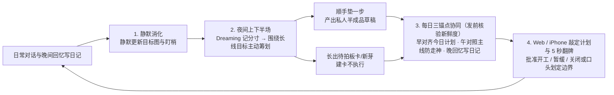

# feat-785: Personal Agent 主动性闭环与渐进式目标图

## Relations

- Related: feat-676, feat-774

## 原始需求

### 问题起源（用户在日常使用中向 PA 提出的原话）

> 你有没有发现，你运行起来是没有主动性的？
>
> 就勉强算点主动性，就是你设置了定时任务，然后每天三个时间段固定找我一下。就你没有说，有一个定期从我的角度去思考我需要干什么，或者说再从你的角度，你可以主动帮我干一些什么。
>
> 我觉得我们的系统需要具备这个能力，你觉得呢？我得想一下这个特性要怎么设计

### 本次调研、架构联合与立项原话

> 我就想说这个主动性的问题。你看看我们拉下来的/Users/czj/Repos/opensource-hub/linger和raft。还有搜搜一些知名的商业personal agent项目muse，instinct等或者开源项目，他们怎么做主动性的。我想你帮我调研，并给我建议，我们应该怎么做主动性

> dsh的super agent的文章你也可以看看，他好像有个概念是主动做的事情，可以先搞个任务，但是不实际执行。

> 东西有点多，不好一下子理解。比如夜间Studying和Dreaming是两个还是一个事情。比如Linger的Track是不是就类似DSH的Proposed任务卡？
>
> 你先规划一个完整的理念，跟我用一个例子，贯穿整个主动性设计？给我讲整个例子的流程怎么样，让我感受下。

> ok，大概这个体验是不错的。你先新建一个unit，记录这个完整理念和 真实剧本

> 坦率说，现有的task体系是没发挥作用的。所以我也不确定这些应该怎么设计。可能要联合task体系在一起考虑。

> 我觉得你还有必要派个subagent去研究下上面我们研究过的竞品的task体系怎么构建的，对比下我们的。你别自己研究，上下文顶不住。

> 然后，关于你说的两个方案，我先不说观点。但是我说一个点：按照图来编排任务是我的期望。不一定所有任务都需要，但是有的任务是需要的，特别是超长线的任务，你要做很多子任务，来达成大任务的目标。如果只是扁平的任务体系，很容易丢了大的目标，忘了小目标的目的是实现大目标。

> 关于前端怎么展示我觉得我是开放的，不需要拘泥现在

## 澄清记录

- Q1: PA 主动想到的事项如何既不擅自越权或空耗资源执行，又不靠频繁发聊天消息追问打扰用户？
  A(原话): dsh的super agent的文章你也可以看看，他好像有个概念是主动做的事情，可以先搞个任务，但是不实际执行。
  Agent 解读: 引入「立项与执行分离」机制。对于用户未明确派单、由 PA 主动思考得出的较重或方向待定的事项，PA 先做无外部副作用的轻量核实，建立一张处于「待拍板（提议态）」的候选任务卡，写明做什么、谁负责、提出依据以及获批后如何处理，在用户拍板前绝不自动进入执行。

- Q2: 夜间 Studying 与 Dreaming 的关系、Linger 的 Track 与 DSH 提议任务卡的区别，以及整体主动性体验节奏是否成立？
  A(原话): ok，大概这个体验是不错的。你先新建一个unit，记录这个完整理念和 真实剧本
  Agent 解读: 用户认可完整理念与 24 小时剧本：
  1. `Dreaming`（向后看，沉淀长期记忆与打扰分寸）与 `主动筹划`（向前看，围绕主人目标准备半成品或立提议卡）是夜间连续配合的上下半场，方向相反、职责分开，无需向用户暴露两套独立后台概念。
  2. `内部盯梢（Track）`面向用户已拍板的目标或时间节点，PA 默默挂动态检查点跟进，无需审批；`提议任务卡（Proposed）`面向用户未派单、由 PA 主动推演出的新事项或下一步，建卡不执行，等待用户翻牌。

- Q3: 第一期主动性闭环的作用对象是仅限 Personal Agent（PA），还是同时覆盖普通 Global 数字员工？
  A(原话): 先pa吧
  Agent 解读: 第一期主动思考引擎（静默消化、夜间主动筹划、主动早报与分寸学习）仅对 PA 开启；普通专业数字员工继续按显式协作与已分配任务推进，不在团队群内自发立项或推送个人早报。

- Q4: 提议任务卡和主动交互需要优先照顾哪些客户端或外部通道？
  A(原话): 优先只考虑我们内部，web im和iphone app的体验。其他channel没那么重要，现在用飞书也是过渡状态。
  Agent 解读: 重点打磨内置 Web IM（含窄屏）与原生 iPhone App 的完整体验，充分利用内置任务界面与私聊交互卡片；飞书等外部通道仅保持既有基础文本兼容，不作为本需求的设计和验收重点。

- Q5: 现有任务体系在日常未能发挥作用，主动性载体与任务体系如何结合？前端与图编排应如何取舍？
  A(原话): 坦率说，现有的task体系是没发挥作用的。所以我也不确定这些应该怎么设计。可能要联合task体系在一起考虑。 / 按照图来编排任务是我的期望。不一定所有任务都需要，但是有的任务是需要的，特别是超长线的任务，你要做很多子任务，来达成大任务的目标。如果只是扁平的任务体系，很容易丢了大的目标，忘了小目标的目的是实现大目标。 / 关于前端怎么展示我觉得我是开放的，不需要拘泥现在 / 我觉得大方向可以。一个feat一起设计好点吧。很难分开。具体实现时可以分开（skill已有这种设计），设计还是要一起
  Agent 解读: 在本 unit 内将「PA 主动性闭环」与「渐进式目标图任务体系重塑」统一设计（实施阶段可按里程碑分步落地）：
  1. 不退化为纯扁平待办表，保留阶段依赖与多方向探索试错的图编排能力以承载超长线大目标，确保查看和执行深层子任务时始终锚定顶层大目标；同时放开轻量单卡起步，不强迫日常小事预先套上复杂图容器，并允许 PA 围绕未完结的长线目标图在前沿主动长出待拍板的下一步子节点。
  2. 前端展示不必拘泥现有五列看板和桌面画布形态，按桌面与手机各自的自然导航（见 [Web IM 体验原则](../../product/web-im-principles.md)）重塑为「平时看行动焦点台，点开长线目标看北极星全景脉络」。

- Q6: 新任务界面是整体替换现有五列看板吗？整个 IM 里有大量不同人和 Agent 的任务时，面板默认呈现哪些？
  A(原话): 可以替代。另外可能要思考清楚里面呈现哪些task，毕竟整个IM里有一堆agent，一堆task / 大概是这个逻辑
  Agent 解读: Web IM 与 iPhone App 的任务入口直接由新视图整体替换旧五列看板（历史已保存任务图兼容保留）。为避免无关任务淹没个人注意力，任务入口默认聚焦「与我有关」范围（本人及本人 PA 私人空间的事项、团队会话中本人负责或待本人拍板/验收的节点、以及本人发起的团队长线根目标概览，不把他人负责的底层子任务或无关公开群任务平铺进个人焦点台），同时保留按指定负责人（某个数字员工或成员）、团队全部可见任务以及从具体群聊查看本群任务的切换入口。

- Q7: PA 主动筹划与早报的开关如何控制？与用户原有的每日三次问候及日记节奏如何配合？
  A(原话): 不冲突吧。我本来就想要他每天3次给我问候，这是我明确期望的。因为我ADHD，容易走神，需要agent提醒我今天要做什么，以及是不是走神了 / 根据我给的日记skill，早上是主动跟我对齐我自己今天的计划，以及晚上让我回忆这一天，写一下日记
  Agent 解读: 后台主动筹划与用户明确期望的每日早、午、晚三次触达及日记节奏**深度互补、共存不冲突**，既不把防走神与日记提醒当成噪音砍掉，也不由 PA 越俎代庖代替主人决定当日计划：
  1. **早晨（主动对齐主人自己的今日计划 + 呈上夜间准备成果）**：按用户的日记习惯，早间核心是主动询问并跟主人对齐主人自己今天的计划（等主人确认后再记录晨间计划，不替主人强定安排）；夜间主动筹划产出的半成品草稿与待拍板提议卡作为手边弹药一并呈上，帮有 ADHD 启动阻力的主人在定计划与迈出第一步时不再两手空空。
  2. **午后（对照今日已对齐计划与长线大目标防走神拉回）**：结合主人早晨亲自敲定的今日计划、当前事项进展与所属顶层大目标，在容易走神的时段温和确认是否偏航，并切出五分钟可上手的最小动作。
  3. **晚间（引导回忆这一天并写日记 → 无缝喂入静默消化与夜间筹划）**：晚上主动引导主人回忆当天的推进与真实感受并写下日记；晚间对话安静后自然转入后台静默消化、夜间 `Dreaming` 与次日 `主动筹划`，把日记里的真实卡点、挂念与明日念头转化为第二天的准备抓手。
  4. 没有单独约定每日三次提醒或日记习惯的用户，PA 按默认主动策略在有新准备成果或待拍板提议时于早间集中送达一次，无新价值时保持安静；PA 设置页提供简洁的主动筹划开关供用户随时启停。

## 现状与参考

### 当前现状与核心症结

[产品愿景](../../product/vision.md) 期望 PA 与任务体系共同支撑跨周期目标推进、主动感知准备与清晰进度把控。底层上，系统已具备 [Heartbeat 与定时调度](../../specs/gateway/heartbeat-cron.md)、[PA 服务指导与观察收件](../../specs/gateway/personal-agent.md)、[IM PA 体验](../../specs/im/personal-agent.md)、文档记忆与夜间 Dreaming，以及支持阶段依赖与探索分支的 [IM 任务图](../../specs/im/task-graphs.md) 与 [Gateway 任务契约](../../specs/gateway/task-graphs.md)。

然而在真实日常使用中，生产环境的任务看板长期零新增，PA 私下却在工作区累积了逾十万字节的文本流水账，且日常互动停留在「被动回消息 + 空手定时问候」。交叉核查现行契约与实现，症结集中在两套机制相互卡死：

1. **任务创建门槛倒挂，小事无法单卡起步**：现行规则要求根节点必须为复杂图容器，且提示词限制仅在用户明确要求“保存计划”时才创建任务，日常一句话的小事或新点子无法零摩擦入列，迫使 PA 退回私有文本文件记流水账。
2. **防越权指引误杀了私人准备与大目标主动生长**：现有心跳指引将“不从聊天猜测未交办任务”一刀切应用到所有场景，既阻止了 PA 为主人的明确目标提前做私人草稿准备，也使已建立的长线目标在完成前序步骤后无法由 PA 主动提议下一步节点。
3. **子任务执行与等待机制脱离长线场景**：Agent 自动续跑深层子任务时未获得顶层大目标与上级脉络，容易做偏；等待状态又强制要求一小时以内的检查安排，跨天或跨周跟进以及“静默等待主人拍板”的场景均无法自然承载。
4. **界面与通知噪音阻碍后台整理**：任务每次增改都会向所属会话发送可见系统消息，PA 不敢在后台维护目标图；同时首屏固定五列平铺所有可见根任务，既不突出当下需要本人拍板的焦点，又容易混入团队内与本人无关的他人任务。
5. **每日计划对齐、防走神与晚间日记缺少后台筹划闭环支撑**：用户明确需要早间对齐今日计划、午后防走神拉回、晚间回忆写日记的三段式陪伴，但因后台缺少「日记与对话安静后静默消化 + 夜间围绕长线目标做准备」，早间对齐时拿不出预先垫好的参考抓手来降低启动阻力，午后提醒也难以结合焦点台与大目标主线精准拉回。

### 外部参考基线

以下竞品与开源参考用于验证取舍，不直接照搬为本仓契约：

- **纯扁平任务流派（Raft `5214e34e`、DSH Super-agent `6337fc82`、Poke / Instinct）**：Raft 将消息直接转为扁平任务并引入发送前未读消息暂扣复核（Freshness Hold）及免催促的远期 `backlog`；DSH Super-agent 严格区分明确交办与主动推断候选，支持只生成结构化任务提案而不启动执行（`observe` 提案模式）及无副作用轻量预探，并在首屏置顶「待人处理的事项」。但纯扁平工单在跨周/跨月超长线目标上缺乏顶层目标树，子任务增多后人和 Agent 都容易迷失大方向。
- **拼装与分层目标流派（Linger `c8564edc`、Meta Muse `1b6f9361`、Linear）**：Linger 具备对话安静后复盘、事项级动态检查与「夜间从用户反馈提炼打扰规则（隐式两次成规、显式一次成规）」的精细闭环，但其项目 Wiki、个人盯梢与协作看板分成三套互不打通的存储；Meta Muse 将长线 `Goals` 与每日主动生成的 `Ideas`（点绿灯前零执行）分开，每晚围绕 `Goals` 主动做功课（Studying）；Linear 通过顶层项目里程碑加任务依赖图锁定大方向，同时用 `Triage` 收件区承接候选事项，并将 Agent 内部琐碎执行过程收敛在单卡会话内。
- **Nano 的组合取向**：保留并强化本仓独有的「阶段依赖 + 探索试错」长线图底座（底层琐碎步骤仍归 `Agent Work`），解开单卡起步、跨天等待、静默维护与主动提议节点四道枷锁，使 PA 主动性与渐进式目标图合二为一。

## 核心理念与用户场景

### 完整理念

> **暗处多操心，明处有抓手；小事一卡即走，长线成图不丢北极星；拿得准的顺手垫一步，拿不准的立张卡等你翻牌。**

整个体验围绕五个紧密咬合的设计运转：

1. **渐进式目标图（不强求事事成图，但长线事必锚定大图）**：
   - 一件独立小事或随口提的新念头，起手只是一张轻量单卡；当它演变为跨周、跨月的超长线目标（如“把 Nano 打磨成熟推向内源并做出影响力”），可原位展开为阶段推进图或探索试错树。
   - 无论用户在焦点台看单张子任务，还是 Agent 在后台执行深层子节点，**顶层北极星大目标与上级脉络始终可见且在场**，绝不让碎步骤掩盖初衷。
2. **聊完静默消化 + 夜间上下半场**：
   - **聊完静默消化**：一段实质对话安静下来后，PA 在后台静默理清刚聊出的新目标、长线进展、挂念与灵感，不插话、不在私聊刷系统状态消息。
   - **夜间上半场 `Dreaming`（向后管记忆与分寸）**：沉淀事实，并从主人对主动提议和提醒的真实反应（批准开工、忽略关闭、明确劝阻或调整时段）中提炼个人分寸规则。
   - **夜间下半场 `主动筹划`（向前管目标与准备）**：优先扫描主人未完结的长线目标图，站在「主人接下来该干什么 / 哪里容易偏航」和「PA 现在能先替主人垫哪一步」两个视角准备次日弹药。
3. **三路分流承接（区分盯梢、垫步与立卡）**：
   - **内部盯梢 / 跨天等待**：主人已拍板的目标或远期节点，挂上跨天动态检查安排默默跟进，无需审批。
   - **顺手垫一步**：主人近期主线目标下低成本、纯私人的前置准备（如拉出脚本骨架、核清关联进展），PA 直接在后台先做出半成品草稿挂到对应事项上。
   - **立「待拍板」提议卡（建卡不执行）**：重投入调研、跨 Agent 派工、长线目标前沿主动生长出的下一步子节点、或拿不准主人当下是否要做的构想，PA 只做零副作用的轻量核实，生成写清「做什么、谁负责、为什么提、批准后怎么做」的待拍板卡片（在长线目标图中以候选新芽形态挂在推进前沿），未经批准绝不自动执行。
4. **双层原生界面，默认只看「与我有关」**：
   - **首屏 `行动焦点台`**：默认只收敛与本人有关的事项（本人及 PA 私人事项、团队中本人负责或待本人拍板/验收的节点、本人发起的团队长线根目标概览），按「待你拍板」「正在推进与盯梢」「长线目标」清晰呈现，每张子任务卡自带所属大目标标识，支持一键批准开工、暂缓留存或关闭；顶部可按需切换查看指定数字员工/成员或团队全部任务。
   - **内页 `北极星全景图`**：点进任一长线目标，顶部常驻终局目标说明；Web 端直观展示阶段依赖、探索试错分支与前沿待拍板新芽并同屏查看详情；iPhone 端采用适合单手浏览的纵向阶段脉络呈现，告别窄屏缩放画布之苦。
5. **与「早对齐计划 · 午防走神 · 晚写日记」节奏深度咬合 + 发前查新鲜度**：
   - 后台主动筹划与主人的日常三段锚点首尾相接：**早晨**主动与主人对齐主人自己的今日计划（绝不替主人代定安排），同时递上昨晚垫好的半成品草稿与待翻牌卡片作为低阻力抓手；**午后**对照主人早晨敲定的今日计划与背后的长线大目标，温和拉回走神的注意力并给出五分钟可上手的最小动作；**晚间**引导主人回忆全天经历与感受并写下日记，安静后自然喂入静默消化与夜间筹划。
   - 每次提醒或检查触发前先核对相关群聊、私聊与任务的最新状态；主人已自行搞定的事自动结项销账，绝不马后炮催问。

### 24 小时真实剧本（Web IM + iPhone App 原生体验）

假设主人当前有一棵正在推进的长线目标 **🎯《把 Nano 打磨成熟并推出去》**（前序核心开发阶段已完成）。

#### 第 1 步：前晚 23:00 → 23:25 —— 晚间回忆写日记，安静后进入「静默消化」（零弹窗、零系统刷屏）

23:00 晚间锚点触发，PA 温和引导主人回忆这一天并写日记。主人在回顾当天推进与心事时聊到三件事：

- *“明天开始想用新模型把 Nano 真用起来，目标是这周录个 Demo。”*
- *“家人刚做了视网膜脱落手术，肺结核又加重，不信科学信玄学，要找时间单独严肃谈几个小时。”*
- *“周末想到两个 idea：一个家庭 bot，叮嘱关心家里人；一个自媒体 bot，多平台发帖回复、帮我想做什么，增加社媒曝光和影响力。”*

PA 先协助主人妥帖记完当晚日记。主人放下 iPhone 休息、会话安静满一段时间后，PA 在后台静默整理：

- 识别到「这周录个 Demo」直接服务于长线大目标 **🎯《把 Nano 打磨成熟并推出去》**，在该目标图下更新近期节点并挂好周四下午的跨天检查安排（届时先查研发群和工作区进展），整个过程不在 PA 私聊刷任何系统通知。
- 将「找时间跟家人谈术后医嘱」与「家庭 Bot / 自媒体 Bot 两个新构想」记入待筹划线索，留给夜间深想。

#### 第 2 步：凌晨 02:00 —— 睡眠期间跑完「夜间上下半场」

1. **上半场 `Dreaming`（向后记）**：沉淀当晚日记与近期对话中的工作重心和家庭背景，保留主人需要早对齐计划、午防走神、晚写日记的习惯，同时记下「不要空手干问，要围绕目标提前垫好参考抓手」。
2. **下半场 `主动筹划`（向前想）**：
   - **围绕长线目标顺手垫一步 + 长出前沿新芽**：扫描 **🎯《把 Nano 打磨成熟并推出去》**，发现下一步正是录 Demo，而启动最容易卡在缺脚本。PA 直接在私人空间核对近两周成果与研发群状态，写好一页 **《Nano 3 分钟 Demo 演示骨架草稿》**，并在该长线目标图的推进前沿挂上关联节点。
   - **为新构想与生活挂念立 2 张独立「待拍板」单卡（不执行）**：
     - **待拍板单卡 A（预设负责人：PA）**：*调研「自媒体 Bot」主流平台发布限制、防封号边界与选题工作流*（尚未展开复杂大图；说明因本周主线是 Nano Demo，先立单卡挂起，批准后后台跑完方案对比；未来若决定正式长期投入，再从这张卡一键展开为新的长线目标图）。
     - **待拍板单卡 B（预设负责人：主人 / 可一键转 PA 查资料）**：*与家人谈话前，将长篇科学辩论收敛为「术后体位用眼与按时服药 3 条具体底线」*。

#### 第 3 步：次日早上 09:10 —— 主动对齐主人自己的今日计划 + 呈上夜间垫步干货

主人早上在 iPhone 打开 PA 置顶私聊，PA 不越权替主人定计划，而是一边主动与主人对齐今天自己的打算，一边把昨晚备好的干货和待翻牌卡片摆在手边：

> 早，J！今天状态怎么样？咱们来对齐一下你今天的计划～
>
> 昨晚日记里你提到这周想推进 **🎯 把 Nano 打磨成熟并推出去 › 录 3 分钟 Demo**。如果你今天打算开这一块，昨晚我先替你垫了一步；另外顺手理了 2 张不着急立刻干的提议卡供你翻牌：
>
> - 📄 **已备好参考草稿：《Nano 3 分钟 Demo 演示骨架》**（理好了 3 个候选真实镜头，核对过主链路均就绪）`[打开草稿]`
> - 🌱 **2 张待你翻牌的提议卡（未执行）**：
>   1. **调研自媒体 Bot 多平台方案与风控边界** `[批准开工]` `[先放远期]` `[关闭]`
>   2. **准备家人术后医嘱 3 条底线清单** `[让 PA 查医嘱禁忌]` `[我自己处理]`
>
> 你今天自己想重点抓哪一两件事？跟我说一声，我帮你记进今天的晨间计划里。

#### 第 4 步：白天 —— 敲定今日计划与 5 秒翻牌 + 午后防走神精准拉回 + 晚间回忆写日记

- **早饭时敲定计划 + 5 秒翻牌**：主人回了一句：*“今天上午就看你那份骨架把 Demo 三个镜头定下来，下午录第一版；家里老人的事记个背景就行，以后不用主动给我立任务卡。”* 同时顺手点了「自媒体 Bot 调研」的 **`[批准开工]`** 和第二张卡的 **`[我自己处理]`**。PA 随即记好主人亲口敲定的今日计划，并把获批的调研转入后台推进。
- **桌面查看全景**：上午主人坐到电脑前打开 Web IM 的任务行动焦点台，界面干干净净只有与自己有关的事（研发群里 E2、Q2 各自跑的十几条底层测试子任务都收纳在团队目标内部，完全不干扰视线）。点进 **🎯《把 Nano 打磨成熟并推出去》**，顶部锁着终局目标，图上清晰亮着当前推进前沿「定 Demo 镜头 → 录屏剪辑」。
- **14:10 午后防走神锚点（对照早晨对齐的今日计划，不瞎催）**：午睡醒来容易走神的时段到了。PA 先静默核对上午的聊天和工作区进展：
  - 若看主人上午顺手去调了一个无关边角料样式、还没碰自己早上定的「定 Demo 三个镜头」，PA 温和拉一把：*“J，下午开工啦～看你上午顺手处理了点界面细节，要不要切回你早上定的今日主线 **🎯 Nano Demo 定镜头**？早上那份 3 分钟骨架你只需挑出保留哪三个场景，5 分钟就能定完第一步。”*
  - 若看主人上午已经在研发群里把 Demo 镜头拍板并开始录初版了，PA 就顺着最新进展轻巧承接，绝不机械再问一遍“启动得怎么样”。
- **23:00 晚间回忆与写日记**：PA 主动陪主人回忆这一天定镜头、录初版的进展和真实感受，完成当日日记；会话安静后自然汇入新一轮静默消化与夜间循环。

#### 第 5 步：次日深夜 —— 分寸规则自动进化

当晚 `Dreaming` 消化白天的两处真实互动：

- 记录有效模式：当主人忙于主线大目标但随口提出新产品构想时，立一张「可行性预研」待拍板单卡最受认可。
- 将主人的明确表态一次固化为分寸规则：**「家人健康与家务沟通 → 仅作背景记忆，不主动立任务卡或出主意」**。此后同类话题自动保持克制。

## 验收标准

### Requirement: 任务支持从轻量单卡到长线目标图的渐进编排，且始终锚定大目标

#### Scenario: 零摩擦建立单卡事项并按需生长为长线目标图
- **WHEN** 用户或 Agent 为一件独立事项或新想法创建任务
- **THEN** 可直接建立为单张任务卡，无需预先选择复杂图结构或分多步创建空容器
- **AND** 当该事项后续演变为多阶段长线目标时，可在保留原事项上下文与历史记录的前提下，将其原位展开为带前后置阶段依赖或多方向探索试错分支的目标图

#### Scenario: 查看与执行深层子任务时始终保留顶层大目标脉络
- **GIVEN** 一个长线目标下存在多层阶段子任务或探索分支
- **WHEN** 用户在任务焦点台、负责人视图或详情中查看某张子任务卡，或负责该子任务的 Agent 自动续跑推进、汇报结果与提出阻塞问题
- **THEN** 用户在卡片与详情中始终能直接看到其所属的顶层大目标与上级路径
- **AND** Agent 基于顶层大目标的终局目标与当前子任务要求一致行动，不会脱离大目标孤立曲解子任务

#### Scenario: 区分跨天跟进等待与静默待人拍板
- **WHEN** 一项任务需要等待数天或跨周的未来时间点再跟进检查
- **THEN** 系统允许保存跨天及更长周期的跟进安排，并在界面展示等待原因与下次跟进时间，不因间隔超过一小时而拒绝保存
- **WHEN** 一项任务因需要用户作出选择或确认而暂停推进
- **THEN** 该事项在界面标明待用户决定的具体问题并进入安静等待，不要求绑定高频轮询闹钟反复催问用户

#### Scenario: 升级前已保存的任务图兼容保留
- **GIVEN** 系统中存在升级前已保存的任务图、层级关系、探索选型与完成记录
- **WHEN** 服务升级后用户在 Web IM 或 iPhone App 打开任务入口及对应目标详情
- **THEN** 原有目标、子任务状态、依赖与探索关系完整可读并可继续正常维护

### Requirement: Web IM 与原生 iPhone 提供焦点优先与长线全景两层任务体验，并默认聚焦本人事项

#### Scenario: 默认进入「与我有关」的行动焦点台
- **GIVEN** IM 中同时存在用户私人空间的事项、本人牵头或负责的团队任务，以及其他成员和数字员工在其他公开群推进的任务
- **WHEN** 用户在 Web IM 或 iPhone App 打开全局任务入口
- **THEN** 默认进入「与我有关」范围的行动焦点台，按「待你拍板」「正在推进与盯梢」「长线目标」清晰分区展示：包含本人与本人 PA 私人空间的事项、团队会话中本人直接负责或待本人拍板/验收的节点，以及本人发起的团队长线根目标概览
- **AND** 本人发起的团队长线目标下由他人或其他数字员工负责的底层子任务收纳在该目标内页，无关公开群中他人的任务不进入默认焦点台

#### Scenario: 切换查看指定数字员工、团队全部或当前群聊任务
- **WHEN** 用户在任务入口切换按指定数字员工或成员筛选、切换到团队全部可见范围，或从某个群聊打开本群任务入口
- **THEN** 分别准确展示该主体直接负责的跨图事项、有权访问的团队目标，或当前群聊关联的目标与任务；从任一事项可返回对应会话继续讨论
- **AND** 无匹配事项、加载中或读取失败时分别给出明确的空态说明或可重试提示，不把加载失败显示为空列表

#### Scenario: Web 与 iPhone 各自顺畅理解长线目标全景并处理待拍板新芽
- **GIVEN** 一个长线目标包含已完成阶段、当前推进节点、探索试错分支以及 PA 主动提出的待拍板候选子节点
- **WHEN** 用户在桌面 Web IM、窄屏浏览器或 iPhone App 打开该长线目标
- **THEN** 用户在浏览下属阶段与分支时始终能看到该目标的终局目标说明，清晰区分已完成阶段、当前推进前沿、探索分支选型结果以及尚未获批执行的待拍板候选节点，并能顺畅查看节点详情、准备草稿与关联运行状态
- **AND** 桌面端与手机端均按各自屏幕形态自然浏览和完成拍板操作，无需在窄屏上反复缩放平移画布，也不裁切关键目标上下文与操作入口

#### Scenario: 并发更新或离线异常时保护用户操作
- **WHEN** 用户在 Web IM 或 iPhone App 操作任务时遇到网络中断、节点不可达或他人/Agent 已先行修改同一事项
- **THEN** 界面明确告知当前不可用或发生冲突的具体原因，提供刷新或重试入口，不静默覆盖更新后的状态，也不丢失用户尚未提交的编辑草稿

### Requirement: PA 在静默复盘与夜间筹划中主动垫步准备或立待拍板提议卡，未获批不越权执行

#### Scenario: 对话安静后静默更新盯梢与筹划线索，不刷聊天系统通知
- **WHEN** 主人在与 PA 对话中表达了近期目标、新构想或待跟进事项，随后对话进入安静状态
- **THEN** PA 在后台静默更新跟进安排与内部目标结构，不在主人正输入或连续发言时插话
- **AND** PA 在私人空间后台创建提议卡、调整目标节点或更新跟进状态时，不在 PA 私聊时间线刷出机械的任务系统通知

#### Scenario: 区分私人垫步草稿与待拍板提议卡的行动边界
- **WHEN** PA 围绕主人已明确的近期目标及新提到的构想开展夜间主动筹划
- **THEN** 对目标明确、可在私人范围低成本完成的准备工作，PA 直接产出大纲、清单或核查草稿并关联到对应事项供主人取用
- **AND** 对需要较大执行投入、跨 Agent 协作或主人尚未拍板的新构想与下一步延伸工作，PA 仅建立标明「做什么、预设负责人、提出依据与获批后行动范围」的待拍板提议卡（属于已有长线目标时挂在该目标推进前沿），在主人批准前不自动启动后台重度执行，更不擅自对外发信、代作承诺或改动共享外部资源

#### Scenario: 待拍板提议保持精简且在双端一键翻牌生效
- **GIVEN** PA 生成了待拍板提议卡，并在行动焦点台、长线目标内页及 PA 私聊交互卡片中展示
- **WHEN** 主人在 Web IM 或 iPhone App 点击「批准开工」「先放远期」或「关闭」，或在 PA 私聊用自然语言表达同意、修改要求或拒绝
- **THEN** 批准且由 PA 负责的事项立即转入推进直至交付成果；放入远期的事项安静留存且不再主动催问；关闭的事项立即移出待拍板区，聊天卡片与任务面板状态保持一致
- **AND** 待拍板提议数量保持有界，已被后续对话解决或明显过时的旧提议自动收起，不堆积成待审垃圾场

### Requirement: 主动筹划与主人日常计划对齐、防走神提醒及晚间日记节奏协同工作，发前核验新鲜度并持续学习个人分寸

#### Scenario: 早间结合夜间准备成果与主人对齐当日计划，不越权代定安排
- **GIVEN** PA 主动筹划处于开启状态，且夜间产出了新的私人准备草稿或待拍板提议卡
- **WHEN** 到达主人所在时区的早间触达时段
- **THEN** 若主人约定有早间计划对齐习惯，PA 在主动询问并与主人对齐其自身今日计划的同时附上可查看的准备草稿与可快捷处理的提议卡供参考，待主人确认后再记录当日计划，不代替主人直接决定今日安排
- **AND** 若主人未单独约定固定早间对齐问候，PA 在有新准备成果或待拍板提议时发送简短早报，无任何新成果、无新提议也无紧急变化时保持安静，不发送“暂无更新”类空消息

#### Scenario: 午后防走神拉回与晚间回忆写日记同后台消化筹划形成闭环
- **GIVEN** 主人与 PA 明确约定了早间对齐今日计划、午后防走神提醒与晚间回忆写日记的日常节奏
- **WHEN** 午后防走神提醒或晚间日记提醒触发
- **THEN** 这些固定陪伴节奏正常保留，不与夜间主动筹划冲突：午后提醒结合主人早间敲定的今日计划、当前事项进展及其所属顶层大目标，在主人可能走神偏离时温和拉回并给出可立即上手的最小下一步；晚间提醒主动引导主人回忆全天经历与感受并完成日记记录，对话安静后其内容自然汇入后台静默消化与夜间筹划

#### Scenario: 发送提醒前核验最新状态，消除马后炮催问
- **GIVEN** 某项盯梢检查点或防走神提醒即将触发
- **WHEN** 主人此前已在获准访问的群聊、私聊或任务面板中自行推进或完成了该事项
- **THEN** PA 根据核实到的最新进展静默更新或结项该事项，不再向主人发送过时的催办或重复询问

#### Scenario: 从主人的批准、关闭与口头边界中学习主动分寸
- **WHEN** 主人在对话中明确要求某类话题（如特定家庭事务）不要主动立卡或出主意，或连续关闭同一类别的主动提议、调整希望被提醒的时段
- **THEN** PA 在后续夜间整理后吸收该分寸偏好：对明确划出边界的话题仅作背景记忆而不再主动生成提议卡，对时段偏好按新窗口投递

#### Scenario: 在 PA 设置页独立启停主动筹划能力
- **WHEN** 主人在 Web IM 或 iPhone App 打开本人 PA 的设置页关闭或重新开启主动筹划开关
- **THEN** 关闭后 PA 停止后台自动生成待拍板提议卡与主动筹划早报，主人明确交办的任务与主人自行约定的固定提醒安排继续按原规则生效；重新开启后恢复主动筹划
- **AND** 当 PA 所属节点离线时，设置页如实显示离线只读状态，不假装配置已生效

## 范围与非目标

- **在范围**：
  - 将任务体系升级为「渐进式目标图」：支持零摩擦单卡起步、原位展开阶段依赖与多方向探索分支、深层子任务在界面与 Agent 执行中全程保留顶层大目标脉络、支持跨天跟进等待与静默待人拍板、新增「待拍板（提议态）」与远期留存状态，并兼容已有历史任务图。
  - 重塑 Web IM（含窄屏）与原生 iPhone App 的任务体验：以默认展示「与我有关」事项的「行动焦点台」和始终锚定终局目标的「北极星全景图」整体替换现有五列看板，适应桌面与手机各自的自然浏览交互，并提供按指定负责人、团队全部及当前群聊切换查看的能力。
  - 实现 Personal Agent（PA）第一期完整主动性闭环：对话与晚间日记安静后静默消化（私聊后台改图静默不刷屏）、夜间 `Dreaming`（沉淀记忆与分寸规则）与 `主动筹划`（围绕长线目标做私人垫步草稿或长出待拍板提议卡）上下半场联动、与主人「早对齐今日计划 · 午防走神拉回 · 晚回忆写日记」节奏自然融合、发送前最新状态核验，以及 PA 私聊内嵌交互翻牌卡片与设置页开关。
- **非目标**：
  - 第一期不为普通团队数字员工开启自发夜间筹划、自发立项或个人早报推送（普通数字员工仅使用升级后的任务图模型与界面推进获分配的工作）。
  - 不专门为飞书等外部过渡渠道定制复杂原生交互卡片体验（外部渠道仅保持基础消息收发兼容）。
  - 不在未经主人批准或授权的情况下放开 PA 擅自对外联系他人、代发外部消息、产生费用或修改共享外部资源；所有对外行为继续受既有外发披露与权限审核约束。
