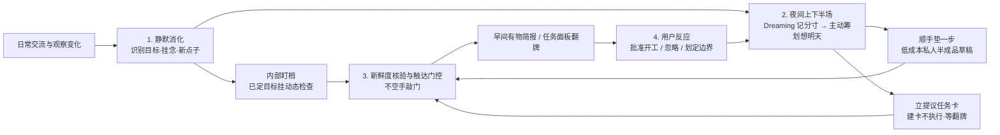

# feat-785: Personal Agent 主动性闭环

## Relations

- Related: feat-676, feat-774

## 原始需求

### 问题起源（用户在日常使用中向 PA 提出的原话）

> 你有没有发现，你运行起来是没有主动性的？
>
> 就勉强算点主动性，就是你设置了定时任务，然后每天三个时间段固定找我一下。就你没有说，有一个定期从我的角度去思考我需要干什么，或者说再从你的角度，你可以主动帮我干一些什么。
>
> 我觉得我们的系统需要具备这个能力，你觉得呢？我得想一下这个特性要怎么设计

### 本次调研与立项原话

> 我就想说这个主动性的问题。你看看我们拉下来的/Users/czj/Repos/opensource-hub/linger和raft。还有搜搜一些知名的商业personal agent项目muse，instinct等或者开源项目，他们怎么做主动性的。我想你帮我调研，并给我建议，我们应该怎么做主动性

> dsh的super agent的文章你也可以看看，他好像有个概念是主动做的事情，可以先搞个任务，但是不实际执行。

> 东西有点多，不好一下子理解。比如夜间Studying和Dreaming是两个还是一个事情。比如Linger的Track是不是就类似DSH的Proposed任务卡？
>
> 你先规划一个完整的理念，跟我用一个例子，贯穿整个主动性设计？给我讲整个例子的流程怎么样，让我感受下。

> ok，大概这个体验是不错的。你先新建一个unit，记录这个完整理念和 真实剧本

## 澄清记录

- Q1: PA 主动想到的事项如何既不擅自越权或空耗资源执行，又不靠频繁发聊天消息追问打扰用户？
  A(原话): dsh的super agent的文章你也可以看看，他好像有个概念是主动做的事情，可以先搞个任务，但是不实际执行。
  Agent 解读: 引入「立项与执行分离」机制。对于用户未明确派单、由 PA 主动思考得出的较重或方向待定的事项，PA 可以只做无外部副作用的轻量核实，先创建一张处于「待拍板（提议态）」的候选任务卡，写明做什么、依据是什么以及获批后如何处理，但不自动进入执行；用户确认开工后才转入实际推进。本仓现有任务体系已具备「仅进入进行中（doing）且分配给 Agent 的节点才持续自动推进，待办（todo）分配不自动开工」的分界（见 [Gateway 任务契约](../../specs/gateway/task-graphs.md) 与 [IM 任务契约](../../specs/im/task-graphs.md)），可在该原则上演进提议态体验。

- Q2: 夜间 Studying 与 Dreaming 的关系、Linger 的 Track 与 DSH 提议任务卡的区别，以及整体主动性体验节奏是否成立？
  A(原话): ok，大概这个体验是不错的。你先新建一个unit，记录这个完整理念和 真实剧本
  Agent 解读: 用户认可下述完整理念与 24 小时真实剧本作为本 unit 的产品基调：
  1. `Dreaming`（向后看，沉淀长期记忆与打扰分寸）与 `主动筹划`（向前看，围绕主人目标准备半成品或立提议卡）是夜间后台连续配合的上下半场，方向相反、职责分开，无需向用户暴露两套独立概念。
  2. `内部盯梢（Track）`面向用户已拍板的目标或时间节点，PA 默默挂动态检查点跟进，无需审批；`提议任务卡（Proposed）`面向用户未派单、由 PA 主动想出的新事项，建卡不执行，等待用户翻牌。

## 现状与参考

### 当前现状与缺口

[产品愿景](../../product/vision.md) 将 PA 定位为从主人角度持续理解目标、关系、承诺与变化，并在无新指令时主动发现遗漏、提前准备材料、有新价值才开口、无新价值保持安静的长期助手。底层能力上，系统已具备 [Heartbeat 与定时调度](../../specs/gateway/heartbeat-cron.md)、[PA 观察收件与默认服务指导](../../specs/gateway/personal-agent.md)、文档记忆及夜间 Dreaming 整合、以及任务持续推进机制。

但真实日常使用暴露出四个脱节，导致 PA 在体感上退化为「被动回消息 + 记流水账 + 固定时间打卡问候」：

1. **防越权约束误杀了私人范围的主动思考与准备**：现有心跳与持续事项指引强调「没有明确交办事项时，不从聊天猜测任务」，虽防止了擅自对外行动，却把主人表达的个人计划、近期目标与新想法一并排除在私人准备范围之外，心跳唤醒后往往直接静默结束。
2. **定时任务沦为索取输入的提问器**：日常跑起来的周期任务多为固定时段的打卡问候（询问状态、催问进展、睡前回顾），将思考下一步的负担抛回给用户，而非在后台替用户先做功课。
3. **缺少对话静默后的站远一步复盘**：一段有实质内容的交流结束后，PA 当轮仅完成即时回应，没有在会话安静后审视整段对话暴露的新目标、隐忧、信息缺口或可提前垫一步的准备工作。
4. **Dreaming 只向后归档，不向前筹划，也未对主动打扰形成显式反馈闭环**：夜间整理把历史对话沉淀为静态记忆，但没有紧接着从「主人需要做什么 / PA 能主动替主人做什么」两个视角转化为次日可交付的半成品或待拍板提案，也缺少针对「用户对某类主动提醒是欢迎还是反感」的专项分寸收敛。

### 外部参考基线

以下参考仅用于印证设计取舍，不直接替代本仓契约：

- **Linger `Another Me`**（`simplexai-labs/linger`，commit `c8564edc`）：会话安静满窗口后触发隐藏复盘；对独立事项做 `notify / track / silent` 三态判断（拿不准时优先静默 `track`）；围绕具体事项动态挂载带前置核查指令的 `Routine` 并在提醒前先完成资料准备；夜间读取白天主动消息及用户后续反应，按「隐式反馈两次成规、显式指令一次成规」维护精简的个人打扰规则。
- **DeepSeek Super-agent**（《Super-agent 设计探索：迈向更自主的 Agent 系统》及 `deepseek-ai/dsh-superagent-prototype`，commit `6337fc823ce20251c8de8085948165c81aaa701e`）：以「消耗最少人类注意力、交付最大价值」为核心原则；严格区分明确交办（`explicit`）与主动推断候选（`inferred`）；在观察/提议模式下完整跑完研判并产出结构化任务提案（标题、范围、依据证据），但不派生重度执行；辅以纯只读、无外部副作用的轻量投机预探（无把握结果静默丢弃）。
- **Raft**（`botiverse/raft-source`，commit `5214e34e`）：提醒强制锚定源消息上下文并支持同条件触发合并限流；Agent 发送或变更前若目标会话出现未读新消息，先暂扣并展示新消息供其复核，若问题已解决则直接丢弃草稿，避免马后炮打扰。
- **商业个人助手参考（Meta Muse、Instinct、Poke、ChatGPT Pulse）**：将后台自我演进拆为对话安静后扫尾（Quiet-moment pass）与夜间围绕用户目标做功课（Studying）；坚持「带着做完一半的草稿/方案敲门，而非空手提问」（Action over Questions）；低紧急度主动成果通过早间集中简报或卡片收件区呈现，避免切碎聊天流。

## 核心理念与用户场景

### 完整理念

> **暗处多操心，明处少打扰；拿得准的顺手垫一步，拿不准的立张卡等你翻牌。**

把「思考、盯梢、立项、干活、开口」五件事拆开，形成四个闭环动作：

1. **聊完静默消化**：用户与 PA 完成一段实质交流并安静下来后，PA 在后台静默理清刚聊出的目标、挂念、承诺与新点子，不在用户正说话时插嘴，也不发无意义回执。
2. **三路分流承接**（围绕「主人该干什么」与「PA 能替主人干什么」双视角）：
   - **内部盯梢（Track）**：针对用户**已经拍板**的目标或时间节点，PA 默默记下并挂载动态检查点（到时候先核查真实进展再决定是否提醒），无需用户审批，取代死板的每日固定催问。
   - **顺手垫一步（Private Prep）**：针对用户近期明确主线目标、且在私人范围低成本零风险即可完成的前置准备（如查清现状、拉出提纲草稿、整理对比材料），PA 直接在后台先做出半成品。
   - **立提议任务卡（Proposed Task，建卡不执行）**：针对重算力投入、跨 Agent 协作、或拿不准用户当下是否想启动的新构想与衍生建议，PA 只做轻量只读核实，生成写明「做什么、谁负责、为什么提、点同意后怎么做」的待拍板任务卡，停在执行门外等待用户翻牌。
3. **不空手敲门，发前查新鲜度**：平时无重要变化、无阻塞、无新成果时保持安静；非紧急的主动准备与候选任务卡集中到每日一次的早间简报交付，让你几秒钟翻牌即可；任何提醒发出前先核对相关聊天与工作的最新状态，用户已自行推进或解决的事项自动销掉，绝不马后炮催问。
4. **夜间上下半场与分寸自学习**：
   - **上半场 `Dreaming`（向后管记忆）**：沉淀当天重要事实，并从用户对主动消息和提议卡的真实反应（批准开工、忽略冷落、明确劝阻或调整时段）中提炼个人主动分寸规则。
   - **下半场 `主动筹划`（向前管行动）**：基于整理好的最新记忆、角色分工与分寸规则，从主人视角审视近期目标遗漏与偏航，从助手视角完成一项垫步准备或立出高价值提议任务卡。

### 24 小时真实剧本

以下剧本以用户的三段真实输入串起完整的一天体验：

- 前一晚用户提到：*“明天开始用 Gemini 新模型，把 Nano 真正用起来，目标是这周录个 Demo。”*
- 前一晚用户倾诉：*“家人刚做了视网膜脱落手术，肺结核又加重，不信科学信玄学，要找时间单独严肃谈几个小时。”*
- 当晚 22:02 用户补充：*“周末想到两个 idea：一个家庭 bot，帮我叮嘱关心家里人；一个自媒体 bot，帮我多平台发帖、回复、思考做什么，增加社媒曝光和影响力。”*

#### 第 1 步：当晚 22:20 —— 聊完放下手机后的「静默消化」（屏幕零打扰）

用户聊完放下手机休息，会话安静满一段时间后，PA 在后台静默醒来消化刚聊完的内容：

- 将 **「本周五前录 Nano Demo」** 归入内部盯梢，给自己设好周四下午的动态检查点（注明届时先核查工作区和研发群进展，确未推进再提醒），而不是第二天中午机械催问。
- 记下 **「找时间跟家人谈术后医嘱」** 与 **「家庭 Bot / 自媒体 Bot 构想」**，留给夜间深入筹划。
- 飞书与 IM 保持安静，不发任何回执打扰用户休息。

#### 第 2 步：凌晨 02:00 —— 睡眠期间跑完「夜间上下半场」（屏幕零打扰）

1. **上半场 `Dreaming`（向后记）**：
   将近期双线工作节奏、家人术后恢复背景，以及用户明确表达的「反感只有固定时段打卡、缺乏主动思考」沉淀进长期记忆与主动分寸规则。
2. **下半场 `主动筹划`（向前想，双视角出活儿）**：
   - **拿得准、低成本的事 → 顺手垫一步**：
     围绕用户本周最核心的目标「录 Nano Demo」，判断最容易卡住启动的是缺少演示主线。PA 在私人范围查阅近两周已落地的核心亮点与研发群状态，直接写好一份一页纸的 **《Nano 3 分钟 Demo 演示骨架草稿》**。
   - **重投入或拿不准用户意愿的事 → 立 2 张「提议任务卡（待拍板，不执行）」**：
     - **提议卡 A（建议 PA 代劳 · 预设负责人：PA · 状态：待拍板）**：*调研「自媒体 Bot」在主流平台的发布限制、防封号边界与选题工作流*。理由说明：周二晚新构想，因本周主线是录 Nano Demo，先立卡挂起不抢占精力，点批准后即在后台独立调研并交付方案对比。
     - **提议卡 B（站在主人角度提醒把控 · 预设负责人：主人 / 可转交 PA 准备 · 状态：待拍板）**：*与家人谈话前，将「几小时科学辩论」收敛为「术后体位用眼与按时服药 3 条具体底线」*，并附可选动作：如需 PA 先查好标准术后护理禁忌清单作为谈话依据，可一键交办。

#### 第 3 步：次日早上 09:15 —— 全天唯一一次主动找你：「有物晨报」

用户早起打开聊天，不再收到空洞的 *“早，今天状态怎么样？”*，而是收到一条带着半成品草稿与待翻牌选项的简短早报：

> 早，J。围绕你这周**录 Nano Demo** 的目标，昨晚我先替你垫了一步，另外立了 2 张待拍板的候选卡：
>
> 1. **【已备好草稿】《Nano 3 分钟 Demo 演示骨架》**：按“个人 PA 跨端跟进 + 专业数字员工协同”理了 3 个镜头，顺便核对了研发进展，主链路都已就绪，你想弄的时候直接打开改就行。
> 2. **【待翻牌任务卡（未执行）】**：
>    - **调研自媒体 Bot 多平台方案与风控边界**（点批准开工我就后台去跑，暂不搞可留存或关闭）
>    - **准备家人术后医嘱 3 条底线清单**（需要我先查好标准术后禁忌清单给你做依据，还是你自己处理？）
>
> 今天按你的节奏走，不用回我打卡。

#### 第 4 步：次日白天 —— 5 秒翻牌即调度，其余时间零噪音

- 用户吃早饭时扫了一眼：
  - 对「自媒体 Bot 调研」点下 **批准开工** → 该卡立即转入进行中，PA 在后台派执行者跑完调研并将报告挂回交付，无需用户再手写一段长指令。
  - 对第二张卡选择关闭，并在聊天里顺口回了一句：*“家里老人的事你记个背景就行，以后不用主动给我立任务卡。”*
- **午后 14:10**：原本机械催进度的打卡问候不再出现；因无紧急冲突或阻塞，PA 全天保持安静。
- **周四下午（动态盯梢 + 发送前新鲜度核验）**：
  检查点到达时，PA 先查看研发群和工作区最新动态：若发现用户周三已在群里发出了录好的 Demo，便默默将盯梢结项，一句话不发；若临近周末仍无动静，才结合最新进展温和提醒并询问是否需要刷新周初那版脚本草稿。

#### 第 5 步：次日深夜 —— 用户反应吃进分寸规则

当晚 `Dreaming` 复盘白天的两处真实反馈：

- 记录正向偏好：用户提出新产品构想但忙于主线时，适合先立「可行性预研」提议卡供其异步翻牌。
- 将用户明确的边界要求一次写成硬规则：**「家人健康与家务沟通 → 仅作背景记忆，不主动立任务卡或出主意」**。自第三天起，PA 在同类话题上自动守住分寸。

## 验收标准

## 范围与非目标
