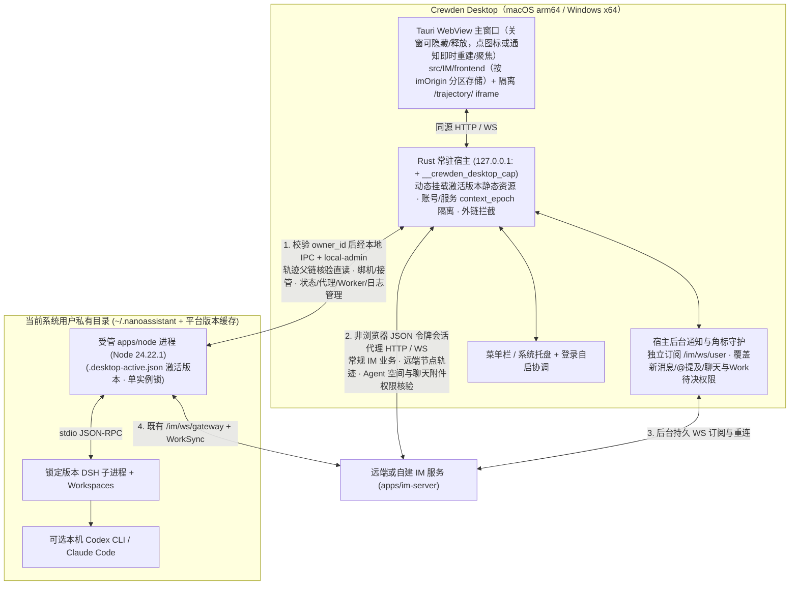
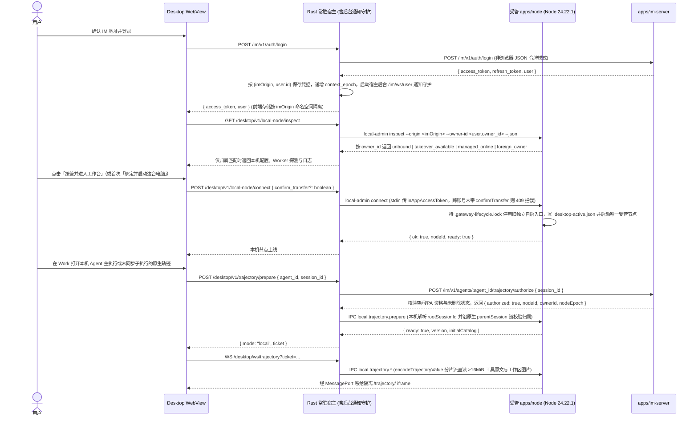

# feat-790: Crewden Desktop 桌面客户端（V1） — 技术方案

> 对齐: [spec.md](spec.md) v1

## Changelog

- **Gate 2 Round 1 修订**：收敛为 Rust 常驻宿主独立维护后台 `/im/ws/user` 通知与角标守护（覆盖新消息、`@提及`、聊天与 Work 待决工具权限并支持点击跳转 `/chat/<conversationId>` 或 `/settings/agents/<agentId>?view=work`）；补齐跨账号 `owner_id` 归属隔离与 `inAppAccessToken` / `confirmTransfer` 拆分；引入 `shell_protocol: 1` 动态静态资源挂载与独立 `.desktop-active.json` 消除版本撕裂及 Windows `feat-781` 指针冲突；改为中心 Agent 级轨迹授权 + 本机 `parentSession` 链直读；固定回环端口并按 `imOrigin` 隔离前端存储命名空间；补齐代理 9 键归一、空节点审批模型校验、macOS 免中断 `autostart` 切换、`--isolated-root` 宿主隔离、官方 Node `24.22.1` 归档拉取、`SPEC.md` 范围及原型对齐修正。

## 现状分析

### 涉及范围

- **跨包架构与依赖契约**：[`SPEC.md`](../../../SPEC.md) 在部署路径、代码归属与依赖方向登记 `apps/desktop`；[`tests/contract/test_runtime_dependency_contract.py`](../../../tests/contract/test_runtime_dependency_contract.py) 将 `apps/desktop` 纳入 `ALLOWED` 白名单（仅允许 `@nano/product-contracts` 及其公开子路径，严禁导入 DSH、`personal-assistant` 或 `channels`）。
- **桌面宿主与打包发布（新增）**：新增 `apps/desktop`（Tauri v2 Rust 常驻宿主：本地固定端口回环网关、独立后台用户事件流与系统通知/未读角标守护、菜单栏/托盘、登录自启管理、自定义协议 `crewden-desktop://` 与本机工作区路径安全打开），以及 `packaging/desktop/`（含 Windows 专用 `DesktopGatewayHost.cs` 复用编译与安装器脚本）、`scripts/build-desktop-archives.py`、`.github/workflows/desktop-candidate.yml` 与扩展后的 [`scripts/publish-node-release.mjs`](../../../scripts/publish-node-release.mjs)、[`.github/workflows/node-release.yml`](../../../.github/workflows/node-release.yml)。
- **共享契约层**：[`packages/product-contracts/src/node-update.ts`](../../../packages/product-contracts/src/node-update.ts) 扩展 `desktop-darwin-arm64` 与 `desktop-win32-x64` 清单模型（含 `shell_protocol: 1`）；新增 `packages/product-contracts/src/desktop-local.ts` 声明桌面端与本机节点之间的归属核验、状态、代理/环境变量映射、Worker 探测、轨迹直读及工作区打开类型。
- **IM 服务端**：[`apps/im-server/src/install.ts`](../../../apps/im-server/src/install.ts) 与 [`apps/im-server/src/onboarding.ts`](../../../apps/im-server/src/onboarding.ts) 向首次引导和连接电脑入口暴露并存的桌面端安装材料；[`apps/im-server/src/node-updates.ts`](../../../apps/im-server/src/node-updates.ts) 支持桌面平台的更新目标匹配与 `shell_protocol` 兼容性判定；[`apps/im-server/src/trajectory.ts`](../../../apps/im-server/src/trajectory.ts) 新增面向本机直读的 Agent 级轨迹授权与聊天附件会话权限核验接口。
- **本机 Node 服务**：[`apps/node/src/cli.ts`](../../../apps/node/src/cli.ts)、[`apps/node/src/main.ts`](../../../apps/node/src/main.ts)、[`apps/node/src/lifecycle.ts`](../../../apps/node/src/lifecycle.ts)、[`apps/node/src/device-binding.ts`](../../../apps/node/src/device-binding.ts)、[`apps/node/src/configuration.ts`](../../../apps/node/src/configuration.ts) 与 [`apps/node/src/update-worker.ts`](../../../apps/node/src/update-worker.ts) 新增 `LocalNodeBridge`（Unix Domain Socket / Windows Named Pipe）与 `local-admin` 子命令，支持拆分「应用内令牌确认」与「整机转移二次确认」的设备绑定、跨账号归属门禁、免中断在途任务的 macOS 登录自启切换、空节点 `tool_approval_model` 校验、候选 `PATH` Worker 探测、本机轨迹父链核验直读与桌面版本热切换通知。
- **共享前端界面**：[`src/IM/frontend`](../../../src/IM/frontend/package.json) 保持单一 React SPA 代码库，扩展桌面模式下按 `imOrigin` 命名空间隔离的 `IndexedDB` / `localStorage` / 内存草稿存储；在 [`onboarding-page.tsx`](../../../src/IM/frontend/src/features/onboarding/onboarding-page.tsx) 与 [`node-connect-guide.tsx`](../../../src/IM/frontend/src/features/settings/nodes/node-connect-guide.tsx) 提供双入口并存选择（含 Intel Mac 轻量后台节点分流说明）；在桌面模式下为 [`login-page.tsx`](../../../src/IM/frontend/src/features/auth/login-page.tsx) 增加服务切换条与本机绑机/接管/跨账号保护引导，在 [`nodes-page.tsx`](../../../src/IM/frontend/src/features/settings/nodes/nodes-page.tsx) 置顶保留改名、新建助手与 `NodeUpdatePanel` 的「这台电脑」渐进披露面板，在 [`agent-trajectory.tsx`](../../../src/IM/frontend/src/features/settings/agents/agent-trajectory.tsx) 增加本机直读传输，并在真实聊天 Markdown `file://` 链接与 [`tool-detail-renderers.tsx`](../../../src/IM/frontend/src/features/chat/components/tool-detail-renderers.tsx) / [`agent-work-presenters.tsx`](../../../src/IM/frontend/src/features/settings/agents/agent-work-presenters.tsx) 的工作区路径处提供本地打开与定位按钮。

### 既有约束

- **运行时与包依赖红线**：遵循 [`SPEC.md`](../../../SPEC.md) 与 [`tests/contract/test_runtime_dependency_contract.py`](../../../tests/contract/test_runtime_dependency_contract.py)，仅 `packages/dsh-integration` 导入公开 `@deepseek-ai/*` 服务端入口；`packages/dsh-trajectory-viewer` 继续在隔离 `sandbox="allow-scripts"` iframe 中通过 `MessagePort` 工作。
- **IM 服务端同源与会话门禁**：现行 [`apps/im-server/src/identity-routes.ts`](../../../apps/im-server/src/identity-routes.ts) 与 [`apps/im-server/src/server.ts`](../../../apps/im-server/src/server.ts) 仅对非浏览器模式（省略 `X-IM-Session: browser`）开放跨源安全的 JSON `{ access_token, refresh_token, user }` 会话，并对浏览器 CORS/WebSocket `Origin` 严格锁源。Desktop 通过本地回环同源网关代理请求并在出站侧采用非浏览器 JSON 令牌模式，无需削弱存量 IM 安全门禁。
- **单机多账号与权限单一权威边界**：`~/.nanoassistant/connections/<origin-hash>/config.yaml` 按 `imOrigin` 寻址，不按登录账号分目录；因此所有本机节点读取、控制、接管及工作区文件打开必须先校验当前登录账号的 `owner_id` / 会话访问权，严禁向同机切换登录的非归属账号暴露 `gateway.environment`、运行日志或私人 PA 工作区，严禁跳过整机转移确认静默夺取设备（[`docs/specs/im/agents-nodes.md`](../../specs/im/agents-nodes.md)）。
- **构建 Node 版本固定与开发机保护隔离**：受管运行时固定要求官方 Node.js `24.22.1`（当前开发机 `air` 默认 `/opt/homebrew/bin/node` 为 `v25.8.2`，且 `/Users/czj/.nanoassistant` 为受保护生产目录）。打包脚本必须显式拉取并按 SHA-256 校验官方 `24.22.1` 发行包；桌面隔离测试必须通过显式 CLI 参数 `--isolated-root` 端到端隔离桌面目录、`NANO_INSTALL_ROOT` 与测试自启注册目录，绝不依赖 `open -n` 环境变量继承或写入真实 `~/Library/LaunchAgents`。
- **模型可见 Context 零变更**：本需求不改变任何系统提示词、工具 schema、Skill 注入、记忆或上下文裁剪恢复逻辑，无 Agent Context 契约影响。

### 可复用能力

- **直接复用**：
  - [`apps/node/src/bootstrap.ts`](../../../apps/node/src/bootstrap.ts) 的 `connections/<origin-hash>/config.yaml` 连接目录布局与 [`apps/node/src/lifecycle.ts`](../../../apps/node/src/lifecycle.ts) 的 `.gateway-lifecycle.lock`、`processBirth` / `LastBootUpTime` 单实例身份核验。
  - [`packages/dsh-integration/src/trajectory.ts`](../../../packages/dsh-integration/src/trajectory.ts) 的 `NativeTrajectory.prepare` 本机原生 `parentSession` 父链归属校验与 [`packages/product-contracts/src/trajectory-wire.ts`](../../../packages/product-contracts/src/trajectory-wire.ts) 的 `encodeTrajectoryValue` / `TrajectoryValueDecoder` 分片编解码器。
  - [`packages/dsh-trajectory-viewer`](../../../packages/dsh-trajectory-viewer/README.md) 完整沙箱查看器 bundle 与 [`NodeUpdatePanel`](../../../src/IM/frontend/src/features/settings/nodes/node-update-panel.tsx) 更新进度/取消/恢复组件。
- **扩展改造**：
  - [`apps/node/src/device-binding.ts`](../../../apps/node/src/device-binding.ts)：将 `options.auto` 拆分为独立的 `inAppAccessToken`（免开外部浏览器完成 `accept`）与 `confirmTransfer`（跨账号或含已有 Agent 的整机转移仍须显式二次确认，绝不静默跳过）。
  - [`apps/node/src/lifecycle.ts`](../../../apps/node/src/lifecycle.ts)：为 `darwin` 补齐免中断在途任务的 `autostart-on` / `autostart-off` / `autostart-status` 支持，并支持 `NANO_TEST_AUTOSTART_DIR` 隔离测试自启定义。
  - [`scripts/build-windows-archives.py`](../../../scripts/build-windows-archives.py) 与 [`apps/node/src/update-worker.ts`](../../../apps/node/src/update-worker.ts)：扩展为支持 `desktop-darwin-arm64` 与 `desktop-win32-x64` 的固定版本 Node `24.22.1` `runtime` 归档缓存复用、`app`（含前端与轨迹 `dist`）切换及通知常驻桌面宿主热重载静态资源根。
- **独立并存（不互相踩踏）**：
  - Windows `feat-781` 轻量后台节点保留 `%LOCALAPPDATA%\Crewden`、`Crewden.lnk`、`crewden://`、`\Crewden-<key>` 计划任务与 `.windows-active.json` 不变；Desktop 在 Windows 使用独立的 `%LOCALAPPDATA%\CrewdenDesktop`、`Crewden Desktop.lnk`、`crewden-desktop://`、`DesktopGatewayHost.exe`（计划任务前缀 `\CrewdenDesktop-<key>`）与独立的 `.desktop-active.json` 激活指针。

### 相关历史

- **[feat-781](../archive/feat-781-windows-node-install/design.md)**：确立了 Windows 10/11 x64 免管理员安装、`launcher_protocol: 1` 稳定薄启动器 + `runtime`/`app` 分包缓存复用、`GatewayHost` 监护及 Grok Bot `Bbot` 干净客户机验收体系。
- **[feat-779](../../specs/im/ios-client.md)**：确立了独立客户端按「服务地址 + 账号」隔离本地状态与短暂断网保态契约。
- **[feat-583 / feat-589 / perf-754](../perf-754-bounded-work-transfer/motivation.md)**：揭示了 `>16 MiB` 单条事件触发 `event_too_large` 暂停后续 `WorkSync` 上传的场景——本方案通过本机 `parentSession` 链核验与本机分片流直读，确保未同步到中心库的子执行与超大输出在本机照常秒开。

## 架构总览

`Crewden Desktop` 由常驻的 **Tauri v2 Rust 宿主进程** 与按需显示/销毁的 **WebView 主窗口** 组成：
1. **Rust 常驻宿主**持久绑定固定本地回环端口 `127.0.0.1:<persisted_port>`（带 `HttpOnly; SameSite=Strict` 能力 Cookie 防护），动态从当前连接激活的 `.desktop-active.json` 版本目录挂载前端与 `/trajectory/` 静态资源；同时**由 Rust 宿主自身在后台独立维护当前活跃登录会话的 `/im/ws/user` 实时订阅**，无论主窗口打开、关闭隐藏还是 `--background` 登录静默自启，均持续驱动未读角标与新消息、`@提及`、待决工具权限的系统原生通知。
2. **本机节点交互**按严格的所有权门禁经同用户私有 IPC（Unix Socket / Windows Named Pipe）与一次性 `local-admin` 命令连接受管 `apps/node`，实现零命令行绑机/平滑接管、本机轨迹直读、工作区文件定位打开与「这台电脑」图形化配置。

## 关键决策

1. **采用「稳定协议 Tauri v2 薄宿主（`shell_protocol: 1`）+ 动态挂载的 `runtime`/`app` 双归档缓存」消除升级撕裂与 TCC 失效。**
   - *理由*：效仿 `feat-781` 的 `launcher_protocol: 1` 设计，Tauri Rust 原生宿主仅承载窗口、托盘、通知、回环代理与本地桥接协议（固定 `shell_protocol: 1`），**不把前端静态产物写死在原生二进制内**；`src/IM/frontend/dist`、`packages/dsh-trajectory-viewer/dist` 与 `apps/node` 统一打入 `app` 归档，官方 Node `24.22.1` 与锁定 DSH 依赖打入 `runtime` 归档，安装包内置首装种子缓存。日常受管更新时，`update-worker.ts` 复用未变动的 `runtime` 缓存、仅下载变更的几 MiB `app` 归档，写入连接目录的 `.desktop-active.json`，重启后台 `apps/node` 并通知常驻 Rust 宿主即时切换静态资源根与刷新 WebView——前后端与 Node 版本 100% 原子同步，macOS 不改动 `.app` 签名包体（保留全部 TCC 权限），Windows 不覆盖运行中的 `CrewdenDesktop.exe`。当未来极少数破坏性变更升级 `shell_protocol` 时，`node-updates.ts` 将该节点标为 `incompatible` 并引导一次性下载新安装包，绝不伪报原地升级成功。
   - *拒绝备选*：将前端 `dist` 编译进 Rust 二进制或尝试原地覆盖运行中的 `.app`/`exe`（会导致后台 Node 已升级而前台 UI 停在旧版，或破坏 macOS 签名与 Windows 文件锁）。

2. **由常驻 Rust 宿主独立持有后台 `/im/ws/user` 通知与角标守护，完整覆盖新消息、`@提及` 与聊天/Work 待决权限。**
   - *理由*：开机 `--background` 静默自启尚未建窗，且日常关闭主窗口会隐藏/释放 WebView（或被系统挂起后台页面定时器），通知不能依赖前端组件存活。Rust 宿主利用当前活跃会话凭据独立维护 `/im/ws/user` 连接与游标恢复（桌面模式下前端禁用浏览器 `new Notification` 避免双弹）：① 汇总未静音会话 `unread_count` 实时更新 macOS Dock / Windows 任务栏与托盘未读提示；② 当窗口隐藏、失焦或不在目标会话时，对 Agent 回复完成（`message.completed`）、非本人发送的未静音真人消息及 `@提及`（`message.created`）、会话内待决工具权限（`permission.request` 且 `status === "pending"`）以及本人管理 Agent 的 Work 待决权限（`agent.work.updated` 处于 `waiting_permission`）发送系统原生通知；③ 点击通知由宿主创建/恢复并聚焦主窗口，分别导航至 `/chat/<conversationId>` 或 `/settings/agents/<agentId>?view=work`。
   - *拒绝备选*：由 WebView 调用 `/desktop/v1/notifications` 触发通知（关窗释放或 `--background` 冷启动期间通知完全失效）。

3. **持久化本地回环端口 + 桌面端存储按 `imOrigin` 命名空间隔离，兼顾持久发送恢复与多服务零串台。**
   - *理由*：桌面宿主首次启动选取空闲高位端口后持久化记录于 `<desktop-home>/host-config.json` 并在后续重启复用同一 `127.0.0.1:<port>`（保持同源 WebView `origin` 稳定），以一次性启动 nonce 签发 `HttpOnly; SameSite=Strict` 能力 Cookie 并拒绝外源 `Origin`。同时在桌面模式下通过宿主注入的当前 `imOrigin`，为前端 `IndexedDB`（`im-message-attempts::<imOrigin>`）、`composer-draft-store`、`onboarding` 草稿及用户流游标加上 `imOrigin` 分区前缀：切换 IM 服务地址时递增 `context_epoch` 中断旧网络流并重载新服务上下文，**保留原服务待恢复的未确认发送记录而不串入新服务**；退出某账号时仅精准清理该 `(imOrigin, userId)` 分区数据。上游 `/im/v1/auth/refresh` 网络不可达返回 `503` 保态，明确 `401` 或账号停用才清凭据退回登录。
   - *拒绝备选*：每次启动随机换端口或切服时粗暴清空整个 WebView 存储（会丢失 `im-message-attempts` 中的未确认发送恢复记录）。

4. **对共享连接目录实施严格的 `owner_id` 归属门禁，并拆分「应用内令牌绑机」与「整机转移二次确认」。**
   - *理由*：同一 `imOrigin` 的本地连接目录 `connections/<origin-hash>/config.yaml` 绑定了唯一 `node.user_id`（即 `owner_id`）。`/desktop/v1/local-node/*` 在每次请求时核对当前登录用户的 `owner_id`：若本机已绑定其他账号（`foreign_owner`），拒绝返回 `gateway.environment`、代理、运行日志及启停/改配权限，且 `/desktop/v1/workspace/open` 严格校验 PA 主人身份（`user.id === personal_agent.ownerId`）或有效 Agent 访问资格。在 [`device-binding.ts`](../../../apps/node/src/device-binding.ts) 中新增独立的 `inAppAccessToken` 与 `confirmTransfer` 参数：首次绑机或同一主人重绑免开外部浏览器直接完成；若触发跨账号转移或涉及已有 Agent 归属变更，未带 `confirmTransfer: true` 时立即中止并返回 `409 transfer_confirmation_required`，由界面默认引导「仅使用聊天」或要求用户显式二次确认整机转移。
   - *拒绝备选*：直接传入现行 `options.auto = true`（会连带跳过 `device-binding.ts` L185 的整机转移确认，造成跨账号静默夺权）。

5. **Windows 采用独立 `.desktop-active.json` 与 `DesktopGatewayHost.exe`，实现同 `feat-781` 轻量节点无损并存与平滑接管。**
   - *理由*：不在 Windows 上读写 `feat-781` 专用的 `.windows-active.json`（保留给 `%LOCALAPPDATA%\Crewden` 与开始菜单 `Crewden.lnk`）。Desktop 在双平台统一使用连接目录下的 `.desktop-active.json` / `.desktop-switch.json` 指向 `<desktop-home>/versions/<sha256>`；Windows 端编译独立的 `DesktopGatewayHost.exe`（任务计划名 `\CrewdenDesktop-<key>`、控制管道 `crewden-desktop-host-<key>`）。当同一账号在 Desktop 中确认接管已有的 CLI `LaunchAgent` 或 `feat-781` 后台节点时，在共享 `.gateway-lifecycle.lock` 锁内先调用原入口的 `stop` + 关闭原独立自启触发器，再写入 `.desktop-active.json` 启动 Desktop 受管实例，既杜绝双实例竞争，又不破坏原 `Crewden.lnk` 的文件完整性。
   - *拒绝备选*：直接共用或覆写 `.windows-active.json`（会导致 `GatewayHost` 跨目录找不到版本包崩溃，或破坏并存的 `Crewden.lnk`）。

6. **本机原生轨迹直读采用「中心 Agent 级授权 + 本机 `parentSession` 父链核验 + 分片无上限流」。**
   - *理由*：当单条事件超过 16 MiB 触发 `event_too_large` 暂停 `WorkSync` 后，新派生的子执行 `session_id` 尚未同步到中心 IM 的 `agent_work_sessions` 表。因此中心 `POST /im/v1/agents/:agent_id/trajectory/authorize` 仅核验当前用户对该 `agent_id` 的空间/PA 访问权、针对该 `session_id` 的已删除拦截（`rejectDeletedExecution`）及节点绑定身份，不查中心 `work.session`；随后由本机 `apps/node` 的 `LocalNodeBridge` 从本地持久 `store.bindings()` 解析 `global:${agentId}` 根会话并调用 `NativeTrajectory.prepare` 沿原生 `parentSession` 链闭环校验子执行归属。数据流复用 `encodeTrajectoryValue` / `TrajectoryValueDecoder` 分片传输并解除公网中继的 `1 MiB` `bufferedAmount` 断连阈值，使 `>16 MiB` 工具原文和未同步子执行均可本地秒开；`session/attachment` 仍对 `workspace` 来源本地放行、对 `chat` 来源调中心核验原会话权限。
   - *拒绝备选*：在中心 `/trajectory/authorize` 中依赖 `work.session(agentId, sessionId)`（会在 `>16 MiB` 阻断同步后把新子执行误判为 `404`）。

7. **「这台电脑」保留完整电脑管理动作并采用渐进披露，规范代理 9 键归一、空节点校验与 macOS 免中断自启切换。**
   - *理由*：在 `/settings/nodes` 置顶的「这台电脑」卡片完整保留改名、在此电脑新建助手与 `NodeUpdatePanel`（受管更新/取消/恢复），默认仅直露状态摘要、启停按钮、更新横幅与免重启「开机登录自启」开关，将低频运行配置与带关键字搜索的运行日志收于按需展开折叠区，避免把其他远端电脑挤出首屏。后端配置层固化四项闭环：① 代理表单强制校验 `http(s)://`（拒绝 `socks://`），统一映射为 `NODE_USE_ENV_PROXY="1"` 及大小写成对的 `HTTP_PROXY`/`HTTPS_PROXY`/`ALL_PROXY`/`NO_PROXY` 共 9 个键，环境变量编辑器自动隐藏这 9 个受管键与 `NANO_OWNER_CONFIG_ROOT` 防止双写冲突；② 无论 `agents` 是否为空均强制校验 `llm.tool_approval_model` 已在 `llm.providers` 注册；③ Worker 探测合并默认服务 `PATH` 与候选 `gateway.environment.PATH`；④ macOS 开关 `autostart` 只更新 `config.yaml`、桌面登录项与下次登录生效的 `LaunchAgent` plist 定义，不杀掉当前运行中的节点进程与在途任务。
   - *拒绝备选*：macOS 改 `autostart` 时直接调 `restart`（会无故中断正在执行的本机任务）。

8. **本机工作区路径打开落在真实聊天与工具详情组件，结合所属 `agent_id` 解析相对路径并拦截可执行文件运行。**
   - *理由*：不在 Work 页虚构无后端数据源的侧边栏，而是在聊天/Work 真实渲染路径的位置——包括 `ReadCard`、`WriteCard`、`DiffCard`、`skill_manage`、`agent.output_file` 等工具详情头部的路径（相对路径按该消息/Work 所属 `agent_id` 的本机 `workspace_root` 解析）及正文 `file://` 工作区链接——当且仅当该 `agent_id` 归属当前已授权的本机节点时渲染紧凑的 `打开文件` 与 `在 Finder（资源管理器）中显示` 按钮；后端经 `realpath` 限定在 `workspace_root` 内，并对 `.app`/`.exe`/`.bat`/`.cmd`/`.ps1`/`.sh`/`.command` 仅开放定位显示、禁止直接 `open` 执行。

## 接口与数据流

### 1. 核心跨模块流程（登录隔离 / 归属核验与接管 / 本机轨迹父链直读）

### 2. 发布清单、三段包布局与受管更新同步协议

- **清单与描述文件（`packages/product-contracts/src/node-update.ts`）**：
  - 新增 `platform: 'desktop-darwin-arm64'`（`package: 'desktop-darwin-arm64.json'`，安装器 `Crewden-Desktop-arm64.dmg`）与 `platform: 'desktop-win32-x64'`（`package: 'desktop-win32-x64.json'`，安装器 `Crewden-Desktop-Setup-x64.exe`）。
  - 描述文件包含 `shell_protocol: 1`、`updater_protocol: 1`、`data_epoch: 1`、`runtime`（官方 `node-v24.22.1` + 锁定 DSH 生产依赖归档，带 `sha256` 与 `size`）及 `app`（`apps/node` + `packages/*` + `IM frontend dist` + `trajectory viewer dist`，带 `sha256` 与 `size`）。`scripts/build-desktop-archives.py` 始终从官方 Node.js `v24.22.1` 发行源拉取并按 `SHASUMS256.txt` 校验平台二进制，绝不复制构建机 `PATH` 上的 `node`。
- **更新切换与宿主热重载（`apps/im-server/src/node-updates.ts` + `apps/node/src/update-worker.ts`）**：
  - `node-updates.ts` 比对目标清单的 `shell_protocol` 与节点上报 `release.shell_protocol`（扩展 `NodeRelease` 可选字段 `shell_protocol?: number`）；不匹配时返回 `reason: 'incompatible'` 提示下载新版安装包。
  - `shell_protocol` 匹配时，`update-worker.ts` 在 `<desktop-home>/cache/` 按 SHA-256 复用已有 `runtime` 归档，仅下载校验变化的 `app` 归档并组装 `<desktop-home>/versions/<target.sha256>/`（含 `runtime/`、`app/`、`ui/` 与 `.ready`），在空闲屏障后停止旧 `apps/node`、原子更新连接目录下的 `.desktop-active.json`、以新版本的 `node` 启动新 `apps/node` 并核验 `ready` 与 IM 上线注册；常驻 Rust 宿主监听 `.desktop-active.json` 变更（并接收本地刷新信号），立即将该连接的静态资源根切换至新版本 `ui/` 并触发打开中的 WebView 刷新。若新 `apps/node` 未就绪，回滚 `.desktop-active.json` 并恢复旧版本。

### 3. IM 轨迹 Agent 级授权与聊天附件核验接口（`apps/im-server/src/trajectory.ts`）

- `POST /im/v1/agents/:agent_id/trajectory/authorize`：校验 Bearer 用户身份、`rejectDeletedExecution(ctx, user, agentId, 'session', sessionId)`、`agent_profiles`（`work_mode === 'global'`、未删除且可用）、`canAccessSpace`、PA `owner_user_id === user.id` 以及该 Agent 所属节点的 `node_binding_state`（**不查询**中心 `agent_work_sessions`，保证 `>16 MiB` 阻断 `WorkSync` 期间新子执行仍能通过鉴权），返回 `{ node_id, owner_id, node_epoch, auth_session_id }`。
- `POST /im/v1/agents/:agent_id/trajectory/authorize-attachment`：输入 `{ sources }`，复用 `attachmentAllowed()` 核验 `kind === 'chat'` 的原会话读取权限，返回 `{ allowed: boolean }`。

### 4. Desktop 本地回环与本机管理接口契约

| 接口 / 守护组件 | 权限门禁 | 核心行为与不变量 |
|---|---|---|
| Rust 宿主后台通知守护 | 持有当前活跃 `(imOrigin, userId)` 有效 `refresh_token` | 独立于 WebView 生命周期连接 `/im/ws/user`，维护 Dock/任务栏/托盘未读数，对未静音会话的 `message.completed`、非本人 `message.created`（含 `@提及`）、`permission.request(pending)` 及本人管理 Agent 的 Work `waiting_permission` 发送系统原生通知，点击唤醒主窗口跳 `/chat/:id` 或 `/settings/agents/:id?view=work` |
| `GET /desktop/v1/context` & `PUT /desktop/v1/server` | 同源 `__crewden_desktop_cap` Cookie + 非外源 `Origin` | 返回当前 `imOrigin` 供前端隔离存储命名空间；切换服务时递增 `context_epoch` 断流并重载新服务上下文，保留其他服务已存的 `im-message-attempts::<origin>` |
| `GET /desktop/v1/local-node/inspect` & `POST /desktop/v1/local-node/probe-workers` | 同上 + 校验当前登录用户 `owner_id` | 当 `config.node.user_id` 为其他账号时仅返回 `{ ownership: 'foreign_owner', nodeName }`；归属匹配或未绑定时返回实时/离线状态、解包后的代理设置、过滤掉受管代理键与内部键后的环境变量、合并候选 `PATH` 后的 `dsh/codex/claude` 可执行探测结果及支持关键字过滤的 `gateway.log` 尾部 |
| `POST /desktop/v1/local-node/connect` | 同上 + Bearer `access_token` | 同账号已有后台节点平滑停旧启新写入 `.desktop-active.json`；首次绑定传 `inAppAccessToken` 应用内完成；跨账号或涉及已有 Agent 转移且未带 `confirm_transfer: true` 时返回 `409 transfer_confirmation_required` |
| `POST /desktop/v1/local-node/lifecycle` | 同上 + `owner_id === config.node.user_id` | `start` / `stop` / `restart` 经配置锁串行执行；`autostart` 开关在双平台免中断当前在途任务更新 `config.yaml`、系统自启定义与桌面登录项 |
| `PUT /desktop/v1/local-node/config` | 同上 + `owner_id === config.node.user_id` | 校验 `http(s)://` 代理并归一映射 9 个环境变量键、即使 `agents: []` 也校验 `llm.tool_approval_model` 已注册；备份原 `config.yaml` 后原子写入并按需受管重启，超时未 `ready` 自动回滚备份并恢复原进程 |
| `POST /desktop/v1/trajectory/prepare` + `WS /desktop/ws/trajectory` | 同上 + IM `/trajectory/authorize` 通过 + 本机 `node_id` 匹配 | 经本机 IPC 调用 `NativeTrajectory.prepare` 校验根会话与 `parentSession` 链；`encodeTrajectoryValue` 分片流无 `1 MiB` 缓冲上限直读；失权或切号立即 `trajectory.close` |
| `POST /desktop/v1/workspace/open` | 同上 + PA 主人或已核验 Agent 访问权 | 结合所属 `agent_id` 的本机 `workspace_root` 与 `realpath` 校验目标存在且未越界；可执行后缀（`.app`/`.exe`/`.bat`/`.cmd`/`.ps1`/`.sh`/`.command`）仅允许 `reveal` 定位、禁止 `open` 执行 |

## 前端原型

- **要通过原型判断的设计决定**：
  1. Web 连接电脑页如何并列呈现「完整 Desktop 客户端」与「轻量后台节点」（含 Intel Mac 分流提示）及未发布降级态；
  2. Desktop 登录页如何内嵌服务地址切换，并在登录后区分「全新一键绑机」「同账号已有节点平滑接管」与「本机已归属其他账号时的设备保护/转移确认」；
  3. `/settings/nodes` 置顶「这台电脑」如何在**完整保留电脑改名、新建助手与 `NodeUpdatePanel` 受管更新横幅**的前提下，用渐进披露组织免重启自启开关、低频运行配置（Worker 探测、代理、审批模型、分组环境变量、回退报错保草稿）与带搜索的运行日志，不将其他远端电脑挤出首屏；
  4. 本机工作区路径打开与原生轨迹 `本机直读` 如何严格落在真实 `AppShell`（桌面左侧 `聊天 | 任务 | 助手` 竖向导航轨 + 左下角 `UserMenu`，窄屏底部四栏导航）与真实 `Agent Work`（左侧 `AgentsRailDesktop` + 顶部 `工作记录 | 原生轨迹` 切换 + 工具详情卡片头部路径）中。
- **原型入口**：[`prototype.html`](prototype.html)
- **用户目标与体验方案**：100% 继承现有 `AppShell`、`NodesPage` 与 `AgentWorkPanel` 框架结构，不新增第 4 个主导航项，也不虚构无后端数据源的侧栏；高频状态、启停、自启与版本更新直露，低频配置与日志折叠按需展开，窄屏为每条环境变量提供独立卡片边界防误删。
- **用户需要判断的问题**：双入口与 Intel Mac 分流是否清楚、「这台电脑」默认收展密度是否得当、真实工具卡路径打开与轨迹直读状态是否自然。
- **呈现方式与覆盖范围**：现有页面框架 + 4 段可交互流程（含跨账号保护、配置展开、停止态、回退报错态、日志搜索及工作记录/原生轨迹双子页签切换）。
- **交互边界**：外框深色顶栏为「交互原型 · 仅演示」切换栏；下方为真实产品结构与交互示意。

### 现有 UX grounding

| 当前产品入口 | 画面与操作基线 | 沿用或改善的体验及原因 | 本次设计 |
|---|---|---|---|
| 全局壳层 `AppShell` 与 `UserMenu` | 见 [`baseline-nodes.png`](design-evidence/baseline-nodes.png)、[`app-shell.tsx`](../../../src/IM/frontend/src/app/shell/app-shell.tsx) 与 [`user-menu.tsx`](../../../src/IM/frontend/src/app/shell/user-menu.tsx)：桌面左侧竖向导航轨固定 `聊天 / 任务 / 助手` 三项、左下角头像菜单进入 `电脑 / 模型服务 / 账号`，窄屏底部四栏导航 | 保持 Web 与 Desktop 全局导航心智完全一致，不破坏一级导航层级 | 原封沿用桌面左侧三项竖向主导航轨 + 左下角 `UserMenu` 及窄屏底部导航（加托盘快捷打开入口） |
| Web `/onboarding` 与 `/settings/nodes` 连接抽屉 | 见 [`baseline-onboarding.png`](design-evidence/baseline-onboarding.png)、[`onboarding-page.tsx`](../../../src/IM/frontend/src/features/onboarding/onboarding-page.tsx) 与 [`node-connect-guide.tsx`](../../../src/IM/frontend/src/features/settings/nodes/node-connect-guide.tsx) | 沿用左栏三步进度；补齐 Desktop 与轻量后台节点并存选择，防止 Intel Mac 误下 `arm64` 包 | `macOS / Windows 10·11 x64 / Linux·WSL` 分段下设二选一卡片，`macOS` Desktop 卡片明确标注支持 Apple Silicon 并引导 Intel Mac 选右侧轻量后台节点 |
| 登录页 `/login` | 见 [`login-page.tsx`](../../../src/IM/frontend/src/features/auth/login-page.tsx)：居中 `AuthPageFrame` 表单 | 沿用简洁登录卡；补齐冷启动服务选择及本机归属安全引导 | 卡片顶部嵌入单行 `当前服务 + 切换服务`；登录后按实情展示全新绑机、同账号平滑接管或非归属账号的「仅使用聊天（推荐）/ 确认整机转移」保护卡 |
| 电脑页 `/settings/nodes` | 见 [`baseline-nodes.png`](design-evidence/baseline-nodes.png)、[`nodes-page.tsx`](../../../src/IM/frontend/src/features/settings/nodes/nodes-page.tsx)、[`node-details.tsx`](../../../src/IM/frontend/src/features/settings/nodes/node-details.tsx) 与 [`node-update-panel.tsx`](../../../src/IM/frontend/src/features/settings/nodes/node-update-panel.tsx)：优先展示身份、状态、版本、`NodeUpdatePanel`，按需展开详情与诊断 | 遵循「优先展示身份与可用性、按需展开管理操作」契约，完整保留改名、更新与建助手 | 置顶「这台电脑」卡片直露名称（可原位改名）、在线状态、版本、`+ 新建助手`、`重启/停止`、`NodeUpdatePanel` 更新横幅与免重启 `开机登录自启`；下方以两个独立折叠区承载「本机运行配置」与带搜索框的「本机运行日志」，保证下方的远端电脑卡片首屏可见 |
| 聊天与 Agent Work 路径及原生轨迹 | 见 [`baseline-agent-work.png`](design-evidence/baseline-agent-work.png)、[`agent-profile-page.tsx`](../../../src/IM/frontend/src/features/settings/agents/agent-profile-page.tsx)、[`tool-detail-renderers.tsx`](../../../src/IM/frontend/src/features/chat/components/tool-detail-renderers.tsx) 与 [`agent-trajectory.tsx`](../../../src/IM/frontend/src/features/settings/agents/agent-trajectory.tsx)：左侧 `AgentsRailDesktop` + 顶部 `工作记录 / 原生轨迹` 切换，工具卡头部展示文件相对/绝对路径 | 不虚构额外侧栏，在用户实际看到路径的工具卡与消息链接处就地提供操作 | 当所属 Agent 位于本机已授权节点时，在 `write`/`edit`/`read` 等工具卡路径旁提供紧凑 `打开文件` 与 `在 Finder（资源管理器）中显示`（脚本后缀仅提供定位显示）；切换到 `原生轨迹` 时状态栏显示 `本机直读 · 实时更新 · 只读` |

### 原型对齐契约

| 原型区域 / 状态 | 对齐级别 | 产品入口 | 必验 viewport / 状态 | 下游验收投影 |
|---|---|---|---|---|
| Web 连接电脑双入口并存卡片（含 Intel Mac 分流说明与未发布降级态） | `must-match` | `/onboarding`、`/settings/nodes` 连接电脑抽屉 | `1280x860`、`390x844`；初始态 / 已唤起 / 未发布 / 已上线 | M1 `[reviewer]` ①、`[worker]` ③ |
| Desktop 登录页服务地址栏 + 全新绑机 / 同账号接管 / 跨账号归属保护卡 | `must-match` | Desktop `/login` 与本机接入引导 | `1280x820`、`390x844`；服务切换 / 全新绑机 / 同账号接管 / 跨账号保护 / 连接失败 | M1 `[reviewer]` ①③、`[worker]` ②③；M2 `[reviewer]` ①② |
| Desktop `/settings/nodes` 置顶「这台电脑」卡片（保留改名、建助手、`NodeUpdatePanel`、免重启自启，以及折叠式运行配置、窄屏分组环境变量、回退报错保草稿与可搜索运行日志） | `must-match` | Desktop `/settings/nodes`（从 `UserMenu` 或托盘进入） | `1280x940`（默认紧凑态与展开态）、`390x960`（展开回退报错态） | M1 `[reviewer]` ②⑤、`[worker]` ②③；M2 `[reviewer]` ②③ |
| 真实 `Agent Work`（保留 `AgentsRailDesktop` 与 `工作记录 / 原生轨迹` 切换）及聊天工具详情路径处的本地打开/定位操作与 `本机直读` 状态栏 | `must-match` | Desktop 聊天工具详情卡 / `file://` 链接与 `/settings/agents/:id?view=work` | `1280x820`、`390x844`；本机节点（普通文件 vs 可执行脚本） / 远端节点 / 原生轨迹子页签 | M1 `[reviewer]` ④、`[worker]` ②③；M2 `[reviewer]` ② |
| 系统菜单栏（macOS）/ 系统托盘（Windows）常驻菜单与系统原生通知 | `may-adapt` | macOS `NSStatusItem` / Windows 托盘与系统通知中心（见关键决策 2、5） | macOS `arm64` 与 Windows 10/11 `x64` 原生桌面 | M1 `[reviewer]` ②③、M2 `[reviewer]` ② |
| 原型顶部深色演示切换栏与静态示例数据文本 | `out-of-scope` | 真实产品无演示栏，挂载真实会话数据与 `/trajectory/` 隔离 bundle | N/A | N/A |

### 原型走查

- **实际渲染与走查范围**：使用 Chromium 在 `1280px` 与 `390px`（`deviceScaleFactor: 2`）下实际渲染全部 4 个场景及紧凑态、展开态、跨账号保护态、配置回退报错态、工作记录工具卡路径态与原生轨迹态，全部视口 `scrollWidth === innerWidth` 无横向溢出。
- **当前产品对照及代表性截图**：
  - 当前产品现状基线（Web 连接电脑、电脑列表 `/settings/nodes`、Agent Work `/settings/agents/:id?view=work`）：[`baseline-onboarding.png`](design-evidence/baseline-onboarding.png)、[`baseline-nodes.png`](design-evidence/baseline-nodes.png)、[`baseline-agent-work.png`](design-evidence/baseline-agent-work.png)
  - Web 双入口宽屏与窄屏：[`web-onboarding-1280.png`](design-evidence/web-onboarding-1280.png)、[`web-onboarding-390.png`](design-evidence/web-onboarding-390.png)
  - Desktop 登录与节点接管/跨账号保护：[`desktop-bind-takeover-1280.png`](design-evidence/desktop-bind-takeover-1280.png)、[`desktop-bind-foreign-1280.png`](design-evidence/desktop-bind-foreign-1280.png)
  - Desktop `/settings/nodes` 默认紧凑态（保留 `NodeUpdatePanel`、改名、建助手且远端电脑同屏可见）与展开回退报错窄屏态：[`desktop-local-admin-1280.png`](design-evidence/desktop-local-admin-1280.png)、[`desktop-local-admin-error-390.png`](design-evidence/desktop-local-admin-error-390.png)
  - Desktop 真实 Work 框架下工具卡路径本地打开与原生轨迹本机直读：[`desktop-local-work-1280.png`](design-evidence/desktop-local-work-1280.png)、[`desktop-local-trajectory-1280.png`](design-evidence/desktop-local-trajectory-1280.png)
- **体验判断与修正**：
  - 对齐真实 `AppShell` 桌面左侧竖向三项主导航轨 + 左下角 `UserMenu` 与窄屏底部四栏导航；在「这台电脑」卡片补齐 `NodeUpdatePanel` 更新横幅、原位改名与 `+ 新建助手`，并将运行配置与日志改为渐进披露折叠区，使 `Team-Build-Server` 在桌面首屏直接可见（见 [`desktop-local-admin-1280.png`](design-evidence/desktop-local-admin-1280.png)）；在 `390px` 下为每条环境变量增加独立浅灰边框卡片容器，并使回退错误文案中的 `http://127.0.0.1:9999` 与输入框草稿完全一致（见 [`desktop-local-admin-error-390.png`](design-evidence/desktop-local-admin-error-390.png)）；在 Work 视图恢复左侧 `AgentsRailDesktop` 与 `工作记录 | 原生轨迹` 切换，将文件打开/定位放回真实的 `write` / `edit` 工具详情卡头部（见 [`desktop-local-work-1280.png`](design-evidence/desktop-local-work-1280.png)）。
- **未验证项**：原生系统通知中心点击唤醒、Dock/任务栏角标与 Finder/资源管理器窗口唤起留待 M1/M2 真机验收。

## 本次审查安排

| 必须回答的问题 / 对应目标 | 能力与使用阶段 | 证据方法、范围与已有定位 |
|---|---|---|
| 架构与安全隔离闭环（后台独立通知守护、固定端口能力 Cookie、按 `imOrigin` 存储命名空间、`owner_id` 跨账号归属门禁与转移二次确认、`.desktop-active.json` 双端更新同步、本机轨迹 `parentSession` 链直读、代理 9 键归一与工作区可执行拦截） | Gate 2 `change-design-reviewer`；实施后 `change-code-review` + `test_runtime_dependency_contract.py` | 核对 [`SPEC.md`](../../../SPEC.md)、单测与跨进程集成测试覆盖全部越权/断流/回滚/并存分支 |
| Web 双入口、Desktop 绑机/接管/跨账号保护、「这台电脑」渐进披露面板及真实工具卡路径打开的自明性与视觉协调 | 设计期与实施后 `frontend-experience-review` | 设计期对照 [`design-evidence/`](design-evidence/) 多视口截图；实施后在真实 Web（`1280`/`390`）与真实 Crewden Desktop 实测 |
| macOS Apple Silicon（`arm64`）无全局 Node 环境首次接入、老节点接管、后台常驻通知（新消息/`@提及`/聊天与Work待决权限点击直达）、`>16 MiB` 子执行轨迹直读、图形化配置重启/回退及受管更新复用 `runtime` 缓存 | M1 `product-journey-review` | 在本机 macOS `arm64` 以 `--isolated-root` + 剥离 Homebrew 的洁净 `PATH` 连接隔离 daily 栈完成全链路真实模型实测 |
| Windows 10 x64 与 Windows 11 x64 干净客户机双击安装、应用内绑机、与 `feat-781` 轻量节点并存及接管、自启/强杀恢复、本机轨迹直读、资源管理器定位与受管更新缓存复用 | M2 `product-journey-review` | 在 Grok Bot `Bbot` 两版干净 Windows x64 KVM 虚拟机快照上实测完整旅程与字节传输账单 |

## 契约层增量 (delta-spec)

- **IM — Desktop 客户端新增专属契约**：新增 `docs/specs/im/desktop-client.md`（见 [`specs/im/desktop-client.md`](specs/im/desktop-client.md)，共 5 条 Requirement；归并时添加标准文件头 `> 对齐: feat-790` 与 `## Purpose`，并在 [`docs/specs/im/spec.md`](../../specs/im/spec.md) 的 `Canonical Areas` 索引表新增 `[Desktop Client](desktop-client.md)` 行）。
- **IM — 首次设置与连接电脑双入口**：修改 [`docs/specs/im/agents-nodes.md`](../../specs/im/agents-nodes.md) 的 `托管 IM 提供连续首次设置` 与 `电脑列表 SHALL 提供与当前服务一致的连接指引并区分空列表与读取失败`（见 [`specs/im/agents-nodes.md`](specs/im/agents-nodes.md)）。
- **IM — 原生轨迹双视图适用端**：修改 [`docs/specs/im/agent-work.md`](../../specs/im/agent-work.md) 的 `Work 提供工作记录与原生轨迹两种查看方式`（见 [`specs/im/agent-work.md`](specs/im/agent-work.md)；归并回 `docs/specs/im/agent-work.md` 时将括号内的 iOS 引用保持为同目录相对链接 `[iOS 客户端](ios-client.md)`，与 `[Desktop 客户端](desktop-client.md)` 并列）。
- **Gateway — 单实例接管、运行环境缓存复用与本机配置原子回退**：在 [`docs/specs/gateway/service-lifecycle.md`](../../specs/gateway/service-lifecycle.md) 新增 `Desktop 受管节点按单实例接管已有配置并复用已下载运行环境`（见 [`specs/gateway/service-lifecycle.md`](specs/gateway/service-lifecycle.md)）。
- **其他包（`personal-assistant`、`channels`、`dsh-integration`）**：`no spec delta`。

## 风险与回退

- **开发机实测污染生产 `~/.nanoassistant` 或系统登录项风险**：`Crewden` 宿主原生支持显式 CLI 参数 `--isolated-root <dir>`，端到端向宿主自身与所有 `apps/node` 子进程显式注入 `CREWDEN_DESKTOP_HOME=<dir>/desktop`、`NANO_INSTALL_ROOT=<dir>/nano` 与 `NANO_TEST_AUTOSTART_DIR=<dir>/autostart`，不依赖 `open -n` 环境变量透传，且在设置 `NANO_TEST_AUTOSTART_DIR` 时绝不读写 `~/Library/LaunchAgents`、`SMAppService` 或 Windows 真实注册表/计划任务根。
- **跨账号本机越权与误触发整机转移风险**：所有本机读取/配置/打开接口强校验 `owner_id` 与 Agent 访问资格，并在 `device-binding.ts` 将应用内确认令牌同整机转移确认解耦，单测覆盖跨账号访问 `403` 与未确认转移 `409`。
- **升级版本撕裂或回退风险**：通过 `shell_protocol: 1` 兼容门禁、`.desktop-active.json` 原子指针切换与宿主静态资源根热重载确保 UI 与 Node 同步升级；任意下载、校验或新进程 `ready` 失败均自动回滚 `.desktop-active.json` 并恢复旧实例。紧急撤回某桌面平台只需移除 IM 部署目录下的 `manifest.desktop-*.json`。

## 一次性部署迁移

无。

## Runbook for Reviewer

| 服务 | 停止命令 | 启动命令 | 健康检查 |
|---|---|---|---|
| 隔离 IM + 测试 Gateway 栈 | `./scripts/e2e-down.sh --wt "$WT_ROOT"` | `PATH="$(git rev-parse --show-toplevel)/.venv/bin:$PATH" ./scripts/e2e-up.sh --profile daily --wt "$WT_ROOT"` | `source "$WT_ROOT/.e2e-ports.env" && curl -fsS "$IM_URL/openapi.json" >/dev/null` |
| Crewden Desktop（macOS `arm64` 洁净隔离实例，M1） | `"$WT_ROOT/dist/desktop/Crewden.app/Contents/MacOS/crewden-desktop" --isolated-root "$WT_ROOT/isolated" --stop` | `env -i HOME="$HOME" USER="$USER" TMPDIR="${TMPDIR:-/tmp}" PATH="/usr/bin:/bin:/usr/sbin:/sbin" "$WT_ROOT/dist/desktop/Crewden.app/Contents/MacOS/crewden-desktop" --isolated-root "$WT_ROOT/isolated" &` | 核对 `$WT_ROOT/isolated/desktop/host-state.json` 中 `ready=true`、内置 `node` 版本为 `v24.22.1`，且 `/Users/czj/.nanoassistant` 与 `~/Library/LaunchAgents` 零新增/修改 |
| Crewden Desktop（Windows 10/11 `x64` 隔离 VM，M2） | 客户机托盘停止并还原干净 VM 快照，宿主执行 `./scripts/e2e-down.sh --wt "$WT_ROOT"` | 在无 Node/WSL 的干净 Windows 10/11 x64 VM 双击 `Crewden-Desktop-Setup-x64.exe` 启动连接测试 IM | 客户机托盘显示本机在线，隔离 IM 收到真实模型回复 |

**Review 驱动方式**：
- M1 在当前 macOS Apple Silicon 主机上以剥离 `/opt/homebrew/bin` 的洁净 `PATH` 和 `--isolated-root "$WT_ROOT/isolated"` 启动真实 `Crewden.app`（内置官方 Node `24.22.1` 受管运行时），连接隔离 daily 栈，逐项实测：Web 双入口与 Intel Mac 分流说明、零命令行全新绑机与真实对话、同账号已有节点接管、跨账号归属保护（非归属账号不泄露配置/日志/工作区且不静默转移设备）、关闭主窗口后宿主后台接收真人新消息/`@提及`/聊天与 Work 待决权限通知并点击直达、切服保留原服务未确认发送记录且不串台、`>16 MiB` 输出阻断 `WorkSync` 后的主/子执行原生轨迹本机直读、工具卡路径打开与 Finder 定位、免中断任务的 `autostart` 切换、代理/Worker/环境变量/审批模型更新重启与非法配置回滚，以及生成第二个固定测试版本实测 macOS 受管更新复用 `runtime` 缓存与坏包自动回退。
- M2 在干净官方 Windows 10 x64 与 Windows 11 x64 Hyper-V 虚拟机（复用 `feat-781` 云端嵌套虚拟化验收架构）上实测从 IM 下载安装、应用内绑机与真实回复、与 `feat-781` `Crewden-Setup-x64.exe` 同机并存互不破坏及平滑接管、系统重启后登录托盘自启上线、强杀后台恢复、关闭自启后重启保持离线、本机轨迹直读、资源管理器文件定位、「这台电脑」配置与回滚，以及 Windows 受管更新复用 `runtime` 缓存与回退。结束后全量销毁回收临时 VM 与隔离 IM 资源。

**验收前置**：
- macOS Apple Silicon 主机（当前 `air` / `mini` 已具备 `darwin-arm64`、Rust `cargo`/`rustc`、Playwright 与测试模型代理；打包脚本自动从官方源拉取校验 `node-v24.22.1-darwin-arm64`）。
- Windows 10 x64 与 Windows 11 x64 干净官方评估镜像 Hyper-V 虚拟机（复用 `feat-781` 同构嵌套 Hyper-V 洁净环境及 Windows 候选构建工作流）。

## Milestones

| ID | 标题 | 依赖 | 并行组 | 范围 | 退出标准 |
|---|---|---|---|---|---|
| M1 | Desktop 常驻工作台、后台通知守护、本机直读、图形化节点管理与 macOS arm64 闭环 | — | A | `SPEC.md`、`tests/contract/test_runtime_dependency_contract.py`、`packages/product-contracts`、`apps/im-server`、`apps/node`、`src/IM/frontend`、`apps/desktop`（Tauri 宿主与 macOS `arm64` 打包）、`scripts/build-desktop-archives.py`、相关测试 | **`[reviewer]`** ①**双入口、零命令行接入、平滑接管与跨账号保护（对齐原型 `must-match`）**：Web 连接电脑在 `1280`/`390` 并列提供完整 Desktop（含 Intel Mac 分流说明）与轻量后台节点入口及未发布降级态；在剥离全局 Node 的洁净 macOS `arm64` 隔离环境下启动 `Crewden.app` 可切换服务地址、登录并在应用内完成全新绑机与真实模型对话；同账号已有后台节点平滑接管且无双实例竞争；切换非归属账号时不暴露原账号本机配置/日志/工作区且不会静默触发整机转移。②**常驻守护、后台通知与 macOS 受管更新**：关闭主窗口或 `--background` 自启模式下，Rust 宿主独立维护未读角标及真人新消息、`@提及`、聊天与 Work 待决工具权限的系统原生通知，点击通知唤醒窗口直达对应聊天或 Work 审批入口；免中断在途任务切换登录自启，异常退出自动恢复；实测两个固定测试版本的 macOS 受管更新复用 `runtime` 缓存、前后端与 Node 同步切换，以及坏候选自动回退保留原可用版本。③**主力 IM 工作台与按服务/账号存储隔离**：主窗口保持既有 IM 业务与外链无凭据浏览器打开；重启保持同一服务未确认发送恢复记录，切换 IM 服务保留原服务待恢复发送记录且同 `userId` 跨服务不串台，短暂断网保态不误退登录页。④**本机直读加速（对齐原型 `must-match`）**：在 `>16 MiB` 大工具输出阻断 `WorkSync` 场景下，本机已绑定节点 Agent 的主执行与未同步子执行/fork 原生轨迹及工作区图片均直接从本机毫秒级完整加载（聊天来源附件仍验原会话权限，无权限账号拒绝读取），远端节点自动走 IM 通路；真实聊天链接与 `write`/`edit`/`read` 工具详情路径支持一键打开文件与在 Finder 中显示（可执行脚本仅定位不直接运行）。⑤**「这台电脑」渐进披露管理（对齐原型 `must-match`）**：置顶卡保留改名、`+ 新建助手` 与 `NodeUpdatePanel`，在线与停止态均可查看状态、搜索运行日志、按候选 `PATH` 探测 `DSH/Codex/Claude Code`、配置 `http(s)://` 代理/环境变量/专用审批模型并平滑重启生效；非法输入（含 `socks://`、空节点未注册审批模型）或启动超时自动回滚原可用配置并保留草稿。 **`[worker]`** ①全包 `pnpm build && pnpm typecheck && pnpm test`、前端 `vitest`、`pytest -m "not e2e"`（含更新后的 `test_runtime_dependency_contract.py`）与 `./scripts/docs-check` 全绿；②单测与集成测试覆盖：宿主后台通知四类事件过滤与点击路由、固定端口能力 Cookie 与异源拒绝、按 `imOrigin` 的 `IndexedDB`/草稿命名空间隔离、`foreign_owner` `403` 与 `bindDevice` 跨账号 `409 transfer_confirmation_required`、`.desktop-active.json` 热重载与 `shell_protocol` 不兼容拦截、`>16 MiB` 阻断同步下本机 `parentSession` 子执行轨迹直读与聊天附件鉴权、代理 9 键归一/禁 `socks://`/空节点审批模型校验/macOS 免中断 `autostart` 切换、工作区 `realpath` 越界与可执行后缀拦截；③`build-desktop-archives.py` 固定拉取校验官方 `node-v24.22.1-darwin-arm64`，产出两个测试版本记录安装包体积、首装与纯业务升级复用 `runtime` 缓存的字节账单，在 `M1/evidence/` 保存真实截图与原型对照证据，并核实开发机 `/Users/czj/.nanoassistant` 与 `~/Library/LaunchAgents` 零触碰且本轮隔离资源全量回收。 |
| M2 | Windows 10/11 x64 桌面安装包、轻量节点无损并存接管与双版客户机发布闭环 | M1 | B | `apps/desktop`（Windows 托盘、通知、Named Pipe、登录项与资源管理器定位适配）、`packaging/desktop/windows`（含 `DesktopGatewayHost.cs` 与安装器）、`scripts/publish-node-release.mjs`、`.github/workflows/desktop-candidate.yml`、`.github/workflows/node-release.yml`、`docs/operations/gateway.md` | **`[reviewer]`** ①**干净 Windows 10 与 Windows 11 x64 零命令行全流程**：在两版无 Node.js/npm/pnpm/WSL 的干净 Windows 客户机上（含 WebView2 检测准备），从 Web 下载 `Crewden-Desktop-Setup-x64.exe` 双击安装或冷启动输入服务地址，在应用内完成绑机、配模型、建助手并收到真实模型回复。②**与 `feat-781` 轻量后台节点无损并存及接管、后台通知与本机直读/管理**：验证同一台 Windows 电脑上 `Crewden-Setup-x64.exe`（`.windows-active.json` / `Crewden.lnk`）与 `Crewden-Desktop-Setup-x64.exe`（`.desktop-active.json` / `Crewden Desktop.lnk`）并存互不破坏，同账号接管 `feat-781` 节点保留原身份、助手与工作文件且无双进程竞争；验证重启登录系统托盘静默自启上线、关窗后台原生通知点击唤醒直达、强杀后台自动恢复、关闭自启重启保持离线、`>16 MiB` 主/子执行轨迹本地直读、资源管理器定位与「这台电脑」配置重启/回退。③**Windows 受管更新复用 `runtime` 缓存与回滚**：实测纯业务更新复用已缓存 `runtime` 归档并同步刷新桌面 UI 与后台节点，失败时自动回退原可用版本。 **`[worker]`** ①Windows 候选构建流水线与 smoke 测试全绿，校验 `Crewden-Desktop-Setup-x64.exe`、`desktop-win32-x64.json`、官方 `node-v24.22.1-win-x64` `runtime` 与 `app` 归档的固定命名、字节数、SHA-256 及匿名下载回读校验；②单测覆盖 `DesktopGatewayHost` 独立计划任务/管道/当前用户 ACL、`crewden-desktop://` 参数防注入及与 `.windows-active.json` 并存接管互斥；③在 `M2/evidence/` 记录实测字节传输账单与两版 Windows 真实截图操作证据，回收全部测试 VM 快照与隔离 IM 资源。 |
