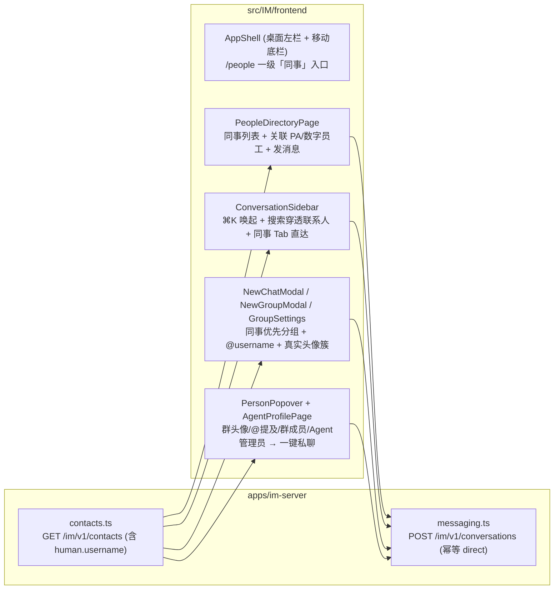
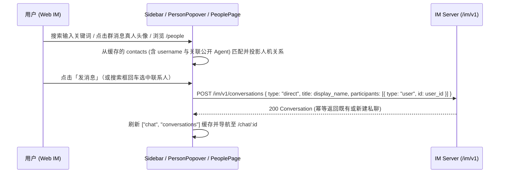

# feat-795: 组织级人机协作找人与通讯录体验 — 技术方案

> 对齐: spec.md v1

## Changelog

- **v2 (Gate 2 Round 1 修订)**：采纳 `R1-C1~C3`、`R1-W1~W5` 与 `R1-R1~R3`：将 `apps/im-server/src/server.ts` SPA 路由白名单（放行 `/people`）纳入范围；明确排除 `conversation.external_source` 与 `sender.avatar_id` 以 `external:` 开头的未映射外部发送者；在 `contacts.ts` 为 Agent 统一补齐解析后的 `owner_user_id`（`users.id`）及公司 Agent 的 `owner_display_name` 回退，并在 `AgentProfilePage` 拉取完整 `contacts` 解析可见真人管理者；对 `membership_status === "active"` 的团队成员禁用全屏 `FirstUseWelcome` 遮挡侧栏；区分点击同事公开 PA（直接 1:1 私聊，且非本人 PA 资料页隐藏 `Work` Tab 与空设备行）与专业数字员工（进入 `/settings/agents/:id`）；将 `PersonPopover` 层级提至 `z-index: 110`、打通 `MarkdownContent` + `renderInlineContent` 双正文路径（排除引用块 `replyPreview`）并安全追加 `draft` + `draftMentions`；明确侧栏状态互斥、站内 1:1 去重键、`$IM_URL/health` 检查端点、移动端底栏角标锚定与 `GroupSettings` `@username` 透传。

## 现状分析

### 涉及范围

- `apps/im-server/src/contacts.ts`：中心 IM 公开联系人目录与单联系人查询实现。当前对 `kind === 'human'` 仅返回 `{ user_id, kind, display_name }`（未投影 `users.username`，`q` 未匹配 `username`）；同时 `agent_profiles.owner_id` 存的是 `users.owner_id` 而非 `users.id`，`LEFT JOIN users owner ON owner.id = ap.owner_id` 在 `owner_id !== id` 时无法命中公司 Agent 的 `owner_display_name`，且未返回可供 `POST /im/v1/conversations` 直接使用的 `owner_user_id`。
- `apps/im-server/src/server.ts`：中心 IM 静态资源与 SPA 入口回退路由。当前第 340 行 SPA 路由白名单正则未包含 `/people`，直连或刷新 `/people` 会返回 `404`。
- `src/IM/frontend/src/features/chat/contacts-api.ts`：前端 `Contact` 类型与 `listContacts` / `getContact` 封装（补充可选 `username` 与 `owner_user_id`）。
- `src/IM/frontend/src/app/router.tsx`、`src/IM/frontend/src/app/shell/app-shell.tsx`、`src/IM/frontend/src/app/shell/app-shell.css`、`src/IM/frontend/src/app/shell/mobile-nav-icons.tsx`：顶层路由、桌面左栏导航（`Chat | People | Tasks | Agents`）与移动端 5 项底栏导航（`Chat | People | Tasks | Agents | Me`，未读角标锚定在 `.im-shell-bottomtab-icon` 上）。
- `src/IM/frontend/src/features/people/people-directory-page.tsx`（新增）：一级「同事」目录页，展示组织可见真人成员、`@username`（本人标「你 / You」且不显示自发私聊按钮）、关联公开 PA（点击发起与该 PA 的 1:1 会话）与负责的专业数字员工（点击进入 `/settings/agents/:agentId`），行尾使用安静次级按钮（`.im-settings-action`）发起私聊，区分加载骨架、请求失败重试、个人空间引导与搜索空态。
- `src/IM/frontend/src/features/chat/components/person-popover.tsx`（新增）及样式：与 `AgentActivityPopover` 对称的真人轻量名片浮层（`z-index: 110`，高于 `GroupSettings` 的 `90~95`，且关闭点击不穿透关闭抽屉）。
- `src/IM/frontend/src/features/chat/components/conversation-sidebar.tsx`：聊天侧栏搜索、分类胶囊与会话列表。新增桌面 `⌘K` / `Ctrl+K` 唤起（避开弹窗打开、`distillMode` 与未挂载态）、搜索召回 `contacts`（仅对站内非外部 1:1 直聊去重）、以及在 `!searchActive && !distillMode && filter === "direct-user"` 时直接展示尚未私聊的团队同事。
- `src/IM/frontend/src/features/chat/components/new-chat-modal.tsx`、`new-group-modal.tsx`、`group-settings.tsx`：`NewChatModal` 增加「全部 / 同事 / 助手」筛选并将同事分段置顶、展示 `@username`；`NewGroupModal` 将同事分段置顶并用 `@username` 替代裸露 UUID，同时保留本人 Agent 的 `Agent ID + 机器名` 双行信息；`GroupSettings` 修正 `clusterMembers` 包含真人头像、非本人成员行透传 `@username` 并支持点击打开 `PersonPopover`、更新添加成员标题与分组顺序。
- `src/IM/frontend/src/features/chat/components/message-pane.tsx`、`src/IM/frontend/src/features/chat/chat-workspace-page.tsx`：对 `membership_status === "active"` 的团队成员不再用全屏 `FirstUseWelcome` 隐藏会话侧栏；在消息正文（同时覆盖真人消息 `renderInlineContent` 与 Agent 消息 `MarkdownContent` + `remarkMention`，严格排除 `replyPreview` 引用块内部以及 `conversation.external_source` / `sender.avatar_id` 为 `external:*` 的外部未映射发送者）接入真人头像与 `@mention` 点击打开 `PersonPopover`，并支持不覆盖既有草稿与附件的 `insertMention`（同步追加 `draft` 与 `draftMentions`）。
- `src/IM/frontend/src/features/settings/agents/agent-profile-page.tsx`：拉取全量 `listContacts("")` 以对齐可见真人目录，非本人 `role === "personal"` 公开 PA 隐藏无权限的 `Work` Tab 与空设备行；当解析后的 `owner_user_id` 命中可见非本人真人同事时，在管理者字段旁提供一键发起私聊入口。
- `src/IM/frontend/src/i18n/zh.json`、`src/IM/frontend/src/i18n/en.json`：中英文国际化词条。

### 既有约束

- **包边界红线**（`AGENTS.md` / `SPEC.md`）：`apps/im-server` 与 `src/IM/frontend` 仅依赖产品契约，不引入任何 DSH 运行时或跨包相对路径。
- **多租户与空间隔离**（`docs/specs/im/auth-tenancy.md`）：`contacts` 只向有效公司成员公开其他 `membership_status === 'active'` 的公司真人成员与可见 Agent；个人空间未获批账号仅可见本人与私人 Agent。公司成员准入与停用仍仅限 `is_company_admin` 在 `/settings/company` 操作。
- **外部渠道影子身份边界**（`docs/specs/im/conversations-messages.md`）：外部渠道写入的未映射发送者不进入真人联系人目录，也不能在消息流中被当作站内可私信用户。
- **PA 隐私边界**（`docs/specs/im/personal-agent.md`）：他人仅能看到同公司 active owner 的公开 PA 身份并发起协作沟通，绝不暴露他人 PA 的私人配置、私人聊天或 Work。
- **Agent Context 零影响**：`/im/v1/contacts` 仅供人类客户端 UI 消费，不进入任何 Gateway / DSH 工具返回或系统提示词。

### 可复用能力

- **复用并小幅扩展** `apps/im-server/src/contacts.ts`：直接从已有 `users u` 表投影 `u.username`，复用 `visible()` 的全部空间与成员资格判定，不另起新的成员查询接口。
- **直接复用** `POST /im/v1/conversations`（`createConversation`）：契约已保证同一对联系人的普通 `direct` 私聊幂等返回同一会话（`conversations-messages.md`），所有“发消息”入口统一走一条 `openOrCreateDirectChat(contact)` 辅助逻辑。
- **直接复用** `Avatar` 与 `AvatarIdentities`（`avatar.tsx`）：`feat-790` 已统一全应用身份目录，传入 `user_id` 或 `agentAvatarId(agent_id)` 即可渲染一致头像与角标。
- **复用交互范式** `AgentActivityPopover`（`agent-activity-popover.tsx` + `.css`）：`PersonPopover` 复用相同的固定视口边界计算、`Escape`/外部点击关闭、焦点归还与卡片视觉尺寸，保证点击真人头像与点击 Agent 头像体感一致。
- **复用目录排版** `im-agent-directory`（`agent-settings.css`）：`/people` 页面复用相同的页头、搜索框、双列响应式网格与分割线风格，保持 Crewden 连续画布设计语言。

### 相关历史

- `refactor-710-organization-product-vision`：确立“真人 + 个人 PA + 专业数字员工”共同在 IM 工作的组织级定位，是本次补齐真人可发现性与人机互链的产品依据。
- `feat-780-chat-topics`：建立聊天侧栏独立搜索视图与分类状态保存恢复机制，本次在其搜索结果流中无损嵌入「联系人」分组。
- `feat-790-desktop-client`：引入 Desktop 壳层事件与 `AvatarIdentities` 共享目录，本次修改 `AppShell` 与各面板头像均遵循新 `Avatar` 签名。

## 架构总览



改动前，真人仅散落在 `NewChatModal` 的混排列表中；改动后，同一份受权限保护的 `/im/v1/contacts` 数据源同时支撑宏观目录（`/people`）、主动搜索（侧栏搜索 + `⌘K` + `同事` Tab）、新建选人（单聊/建群弹窗）与上下文穿透（`PersonPopover` + Agent 管理员互链），并统一汇入幂等的 `createConversation` 私聊打开链路。

## 关键决策

1. **在桌面左栏与移动底栏新增对等的一级「同事（`/people`）」入口，保留 `/settings/agents*` 与 `/settings/company` 原职责，并在服务端放行 SPA 路由**
   - 理由：桌面左栏（`88px` 纵向轨）空间充足，将「同事」与「智能体」并列（`聊天 | 同事 | 任务 | 智能体`）最直观表达“真人与数字员工共事”；移动端底栏采用成熟 IM 的 5 栏等分（`聊天 | 同事 | 任务 | 智能体 | 我`，最小触控区 `>= 44px`），不破坏任何现有 `/settings/agents*` 深链与配置心智；`apps/im-server/src/server.ts` 同步将 `people` 加入 SPA 入口白名单保证直连、刷新与登录回跳不返回 404；管理员在 `/people` 页头可一键跳往 `/settings/company` 审批台。`/people` 行尾「发消息」采用次级安静按钮（`.im-settings-action`），本人行仅展示「你 / You」与个人设置入口，并明确区分加载态、请求失败重试态、个人空间引导态与搜索空态。
   - 拒绝备选：将同事塞进「智能体」页作为子标签（找人要先进“智能体”违背直觉）；或开放 `/settings/company` 给普通成员（混入审批/停用语义且缺少人机关系视角）。
   - 风险：320px~767px 移动底栏宽度变化导致未读角标漂移或挤压。通过 `.im-shell-bottomtab { flex: 1; min-width: 0; max-width: 88px; }` 并将 `.im-shell-unread-badge` 锚定到 `.im-shell-bottomtab-icon`（`position: relative`），保证 320px~767px 均对齐图标且触控高度 `52px`。

2. **侧栏搜索合并已缓存 `contacts` 提供「联系人」分组，支持桌面 `⌘K`/`Ctrl+K` 唤起并对站内 1:1 直聊精确去重**
   - 理由：消除“聊没聊过”的前置判断。按当前 `filter`（`all` 召回人与 Agent、`direct-user` 仅召回人、`direct-agent` 仅召回 Agent、`group`/`agent-network` 不召回单人）过滤匹配联系人，真人排在 Agent 前；去重仅对比上方命中的**站内非外部** 1:1 直聊会话（`c.type === "direct" && !c.external_source`，真人按 `p.type === "user" && (p.user_id ?? p.id) === contact.user_id`、Agent 按 `p.type === "agent" && p.id === contact.agent_id` 匹配），不被飞书等外部映射影子会话误去重。桌面 `⌘K` / `Ctrl+K` 在存在活动模态框（`[role="dialog"]`）、`distillMode` 或侧栏未挂载时不抢占焦点；无会话匹配时按 `Enter` 可直接打开首个匹配联系人。
   - 拒绝备选：新建独立的全局模态 Command Palette（会与现有侧栏历史消息搜索形成两套重复搜索框）。

3. **侧栏对活跃团队成员始终保留可见，并在「同事」筛选 Tab 下直接列出尚未建立私聊的团队同事**
   - 理由：`ChatWorkspacePage` 的全屏 `FirstUseWelcome` 仅针对尚未加入企业的纯个人空间空账号（`membership_status !== "active"`）；一旦 `membership_status === "active"`，即使尚未绑定本机节点且暂无历史会话，也始终渲染 `ConversationSidebar` + `WorkspaceWelcome`，并在 `!searchActive && !distillMode && filter === "direct-user"` 时在已有私聊下方展示未建立站内私聊的团队同事，确保新入职成员第一时间可通过 `⌘K` 或「同事」胶囊找到真人同事。

4. **新增轻量 `PersonPopover` 打通群消息头像、双渲染路径 `@mention` 芯片与群成员行，区分公开 PA 与专业数字员工动作，并在 `AgentProfilePage` 打通联系管理员**
   - 理由：对齐现有 `AgentActivityPopover` 的操作反馈，同时严守身份与隐私边界：
     - **外部未映射发送者硬隔离**：服务端将外部入站未映射消息代记在 `c.owner_user_id` 名下并通过 `sender.avatar_id` 的 `"external:"` 前缀与 `conversation.external_source` 区分；前端仅在 `!conversation?.external_source && !message.sender.avatar_id?.startsWith("external:") && visibleHumanContactsById.has(userId) && userId !== selfUserId` 时激活消息流真人名片。
     - **人机归属与动作区分**：基于服务端统一解析的 `agent.owner_user_id ?? agent.owner_id === person.user_id` 聚合该同事名下的公开 PA 与专业数字员工；点击同事**公开 PA**（`role === "personal"`）直接打开/创建与该 PA 的 1:1 会话，点击**专业数字员工**（`role !== "personal"`）导航至 `/settings/agents/:agentId`（且 `AgentProfilePage` 对非本人 `role === "personal"` 隐藏 `Work` Tab 与空设备行）。
     - **层级、双路径 `@mention` 与草稿追加**：`PersonPopover` 使用 `z-index: 110` 高于 `GroupSettings`（`90~95`），外部点击关闭事件在浮层打开时拦截冒泡避免误关抽屉；消息正文同时为 `renderInlineContent`（真人消息）与 `MarkdownContent`（Agent 消息 `remarkMention`）注入 `@mention` 点击回调，而 `replyPreview` 引用块不传回调避免 `<Link>`/`<button>` 内部嵌套按钮；当会话为可写非外部未解散群聊（`type === "group" && can_write !== false && !dissolved_at && !external_source`）且目标成员仍在 `participants` 中时，名片提供「`@` 提及」按钮，调用专用追加方法在保留既有 `draft` 与待发附件的前提下追加 `@显示名 ` 并写入 `draftMentions`（`{ label, type: "user", target_id }`）。

5. **`/im/v1/contacts` 补齐真人 `username` 与 Agent `owner_user_id`；Web 选人及群成员界面统一“同事置顶分段 + `@username` 副标题”**
   - 理由：`users.username` 已是唯一公开标识；同时 `agent_profiles.owner_id` 存的是 `users.owner_id`，通过 `owners` 映射统一补齐 `owner_user_id: owner.id` 并修复公司 Agent 在 `owner_id !== id` 时的 `owner_display_name` 回退，确保 `POST /im/v1/conversations` 始终收到合法 `users.id`。前端在 `NewChatModal`（含分类胶囊）、`NewGroupModal` 与 `GroupSettings`（含成员列表与加人面板）统一透传并展示 `@username`，修复 `NewGroupModal` 真人裸露 UUID 与 `GroupSettings` 头像簇排斥真人的问题。

6. **不生成独立静态 `prototype.html`，直接在隔离真栈完成真实多角色数据走查与截图交付**
   - 理由：本次交互均基于 Crewden 既有设计系统（`AgentActivityPopover`、`im-agent-directory`、`ConversationSidebar`、`NewChatModal`）做对称补齐，且用户已明确要求直接在真实测试服务上改完给截图并保留服务亲自体验。

## 接口与数据流

### 1. 联系人与路由增量（`apps/im-server/src/contacts.ts`、`server.ts`）

- `apps/im-server/src/server.ts`：SPA HTML 路由匹配正则扩展为 `/^\/(chat|tasks|people|settings|bind\/confirm|login|register|membership|onboarding|me)(\/|$)/`，返回 `index.html`（`Cache-Control: no-store`）。
- `GET /im/v1/contacts?q=&kind=&cursor=` 与 `GET /im/v1/contacts/:user_id`：
  - 当 `kind === "human"` 时，返回对象新增字符串字段 `username`：
    ```json
    {
      "user_id": "u-colleague",
      "kind": "human",
      "display_name": "林夏",
      "username": "linxia"
    }
    ```
  - 当 `kind === "agent"` 时，通过 `owners` 表（按 `users.owner_id` 索引）统一解析归属者的 `users.id` 作为可选字段 `owner_user_id`，并将公司 Agent 的 `owner_display_name` 回退补齐为 `row.owner_display_name ?? owner?.display_name ?? undefined`，解决 `users.owner_id !== users.id` 时归属关联与私聊建连断裂问题。
  - `contactPage` 的 `q` 子串匹配（不区分大小写）扩展为检查 `[row.display_name, row.username ?? '', row.user_id, row.agent_id ?? '']`（支持带前导 `@` 的用户名查询如 `@linxia` 归一匹配）。
  - 可见性过滤规则保持不变：真人仅在 `row.user_id === viewer.id || (viewer.membership_status === 'active' && row.membership_status === 'active')` 时返回；公开 PA 继续隐藏 `node_id` 与 `node_name`。
- 前端 `Contact` 接口（`contacts-api.ts`）新增可选字段 `username?: string; owner_user_id?: string;`，兼容历史测试桩数据与原生 iOS 客户端。

### 2. 核心交互时序（搜索/名片一键发起私聊）



### 3. 模型可见上下文影响

无。本次改动仅作用于 IM 人类客户端 API 与前端视图，不修改 Gateway、DSH、Agent 工具定义或提示词组装链路。

## 本次审查安排

| 必须回答的问题 / 对应目标 | 能力与使用阶段 | 证据方法、范围与已有定位 |
|---|---|---|
| 代码正确性、租户/外部影子身份边界、需求与设计一致性及 delta-spec 准确性 | `change-code-review`（实施完成后独立审查） | 审查 `origin/develop...HEAD` 完整 diff；运行 `apps/im-server` 与 `src/IM/frontend` 单元/集成测试、前端构建与 `./scripts/docs-check` |
| 找人五大触点的自明性、视觉协调、人机主次层级与桌面/移动窄屏可操作性 | `frontend-experience-review`（作者自检 + 独立审查） | 在隔离真栈注入多位真人同事、PA、专业数字员工与群聊消息，在桌面（1280x820）与移动（390x844）真实浏览器走查 `/people`、侧栏搜索/`⌘K`、「同事」筛选、`PersonPopover`、「新聊天/建群/群详情」并保存截图 |

## 契约层增量 (delta-spec)

- IM 公开联系人与 Agent 公开资料互链：[`specs/im/agents-nodes.md`](specs/im/agents-nodes.md)（对应 `docs/specs/im/agents-nodes.md`）
- Web IM 导航、聊天侧栏搜索/筛选、上下文人物名片与选人弹窗体验：[`specs/im/web-chat-ux.md`](specs/im/web-chat-ux.md)（对应 `docs/specs/im/web-chat-ux.md`）
- 其他包（`gateway`、`dsh-integration`、`product-contracts`）：`no spec delta`（不涉及跨包 RPC 或网关运行契约变化）

## 风险与回退

- **未映射外部渠道代记发送者误触风险**：服务端将外部入站未映射消息的 `sender_user_id` 代记为节点 owner 的真实 `users.id`，仅通过 `conversation.external_source` 与 `message.sender.avatar_id` 的 `"external:"` 前缀标识外部身份。前端在 `MessagePane` 严格同时校验 `!conversation?.external_source && !message.sender.avatar_id?.startsWith("external:") && visibleHumanContactsById.has(userId) && userId !== selfUserId`，杜绝把外部消息误识别为代记同事本人。
- **并发重复点击创建会话**：`PersonPopover`、`PeopleDirectoryPage` 与侧栏联系人行均维护 `pendingTargetId` 防重入锁，且服务端 `POST /im/v1/conversations` 本身保证一对一私聊幂等。
- **回退方案**：所有改动集中在 `contacts.ts` 可选字段追加、`server.ts` 路由白名单及前端组件，无数据库 schema 变更；直接回退本分支提交即可无损恢复原状。

## 一次性部署迁移

无。`users.username` 为现有数据库固有列，无需任何历史数据迁移或 `deployment-prompt.md`。

## Runbook for Reviewer

| 服务 | 停止命令 | 启动命令 | 健康检查 |
|---|---|---|---|
| 隔离 IM + Gateway 测试栈 | `./scripts/e2e-down.sh --wt "$WT_ROOT"` | `./scripts/e2e-up.sh --wt "$WT_ROOT"` | `source "$WT_ROOT/.e2e-ports.env" && curl -fsS "$IM_URL/health" >/dev/null` |

**Review 驱动方式**:
1. 运行窄测试与构建：`pnpm --filter @nano/im-server test`、`pnpm --filter @nano/im-server build`、`npm --prefix src/IM/frontend run test`、`npm --prefix src/IM/frontend run build`、`./scripts/docs-check`。
2. 在隔离真栈 `$IM_URL`（本轮按用户要求保持运行供用户亲自体验，注意审查期间不要执行 `e2e-down.sh` 关闭用户待测实例）使用预设测试账号登录，在桌面与移动视口真实走查 `/people`（含直连刷新）、侧栏 `⌘K` 搜索、侧栏「同事」Tab、群聊头像/`@mention`/`GroupSettings` 的 `PersonPopover`、Agent 公开页联系管理员、以及「新聊天 / 新建群聊」弹窗。

**验收前置**: 无仓库外付费凭据或真机依赖；隔离真栈本地 SQLite 注册多个 active 团队测试成员即可完整覆盖全部找人协作旅程。

## Milestones

| ID | 标题 | 依赖 | 并行组 | 范围 | 退出标准 |
|---|---|---|---|---|---|
| M1 | 组织级找人目录、搜索直达与上下文人物名片 | — | G1 | `apps/im-server/src/contacts.ts`、`apps/im-server/src/server.ts`、`apps/im-server/tests/**`、`src/IM/frontend/src/**` | `[reviewer]` 兑现 `spec.md` 全部 4 组 Requirement/Scenario：一级「同事」目录（含直连 `/people` 刷新不 404）可浏览团队成员及关联公开 PA（直接私聊）/专业数字员工（查看资料与 Work）并一键私聊（含管理员入口、失败重试与个人空间空态）；活跃团队成员不被 `FirstUseWelcome` 隐藏侧栏，侧栏支持 `⌘K`/`Ctrl+K` 及未私聊联系人搜索召回（仅对站内直聊去重、真人优先）且「同事」Tab 在浏览态直接展示未私聊同事；群聊真人头像、双路径正文 `@mention`、群成员列表与他人 Agent 公开页「管理员」支持就地名片/一键私聊及保留草稿的 `@` 提及追加，且严格排除外部渠道代记发送者；新聊天（含分类筛选）/新建群聊/群设置将同事置顶分组、显示 `@username`、消除真人裸 UUID 并修正群详情头像簇与中英文文案。<br>`[worker]` `apps/im-server` 测试覆盖真人 `username`、`owner_user_id`/`owner_display_name` 对齐及 `/people` SPA 路由；前端新增/更新测试覆盖 `/people` 目录、侧栏联系人搜索与「同事」Tab、`PersonPopover`、`NewChatModal`/`NewGroupModal`/`GroupSettings`、`AgentProfilePage` 及 `AppShell` 导航；前后端构建、`./scripts/docs-check` 全部通过；启动并保留隔离真栈、完成桌面与移动端真实画面截图及走查记录。 |
