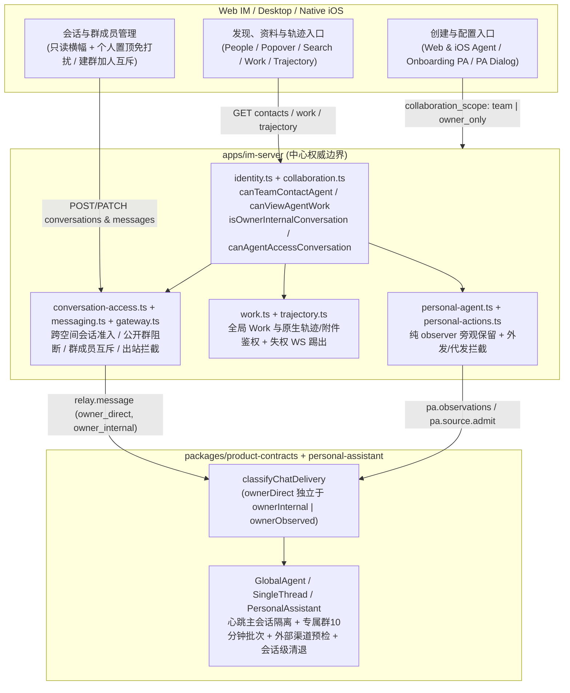
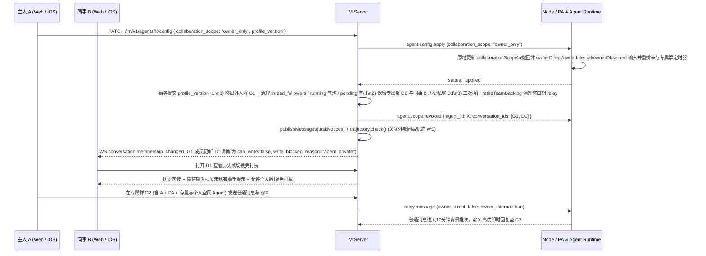

# feat-796: Agent 与个人助手可见性及双向通信权限管理 — 技术方案

> 对齐: [spec.md](spec.md) v1

## Changelog

## 现状分析

### 涉及范围

- `packages/product-contracts/src/collaboration.ts`：共享入站分类契约 `CollaborationScope`（`'team' | 'owner_only'`）与 `classifyChatDelivery`。当前 `ChatAddress` 仅携带 `ownerDirect`，当 `scope === 'owner_only'` 时只要 `!facts.ownerDirect` 就一律返回 `'skip'`，排除了同主人其他 Agent 私聊、同主人私密专属群与私有 PA 的 `observer` 旁观事件；同时必须注意 `facts.ownerDirect` 仍须严格代表“真人主人 1:1 直聊 / 飞书绑定主人单聊”，不能与群聊混用（否则会破坏群普通消息 10 分钟合并与 `SingleThread` 心跳主会话绑定）。
- `apps/im-server/src/identity.ts`、`apps/im-server/src/contacts.ts`、`apps/im-server/src/agent-lifecycle.ts`、`apps/im-server/src/identity-routes.ts`：身份空间判定与联系人目录可见性。当前：(1) `contacts.ts` 与 `canContactPersonalAgent` 未过滤 `collaboration_scope === 'owner_only'`，导致私有 Agent/PA 仍暴露在同事目录、个人名片、搜索与新建会话候选中；(2) 启用个人空间的有效团队成员（先个人注册后获批入队，或因创建 PA 将 `users.personal_space_enabled` 置为 `1`）名下普通 Agent 的 `space_id` 为 `personal:<owner_id>`，而现有跨空间白名单仅豁免了 `personal_agent_bindings`，未覆盖设为 `'team'` 的普通/全局 Agent。
- `apps/im-server/src/conversation-access.ts`、`apps/im-server/src/messaging.ts`、`apps/im-server/src/gateway.ts`、`apps/im-server/src/chat-streaming.ts`、`apps/im-server/src/conversation-actions.ts`、`apps/im-server/src/work.ts`、`apps/im-server/src/trajectory.ts`、`apps/im-server/src/task-graphs.ts`：会话读写与跨空间门禁、群成员互斥、Agent 出站拦截、全局 Work 与原生 DSH 轨迹鉴权。当前存在四类缺口：
  1. **跨空间门禁硬编码 `space_id` 相等**：`messaging.ts:126`（`Messaging.access` Gateway 分支，支撑 `publishAgent`、`ChatStreaming`、`node.delivery_receipt`、`agent.config.boundary` 及 `media.ts` 上传）、`gateway.ts:141`（`permission_response`）、`messaging.ts:296-305`（`createConversation`）、`messaging.ts:852-869`（`resolveTarget`）、`conversation-actions.ts:150`（斜杠命令与技能可用性）、`work.ts:184, 587`、`gateway.ts:214`（`agent.work.updated` 广播）均硬判 `agent.space_id === conversation.space_id` 或 `canAccessSpace(viewer, profile.space_id)`，既阻断了个人空间团队成员公开普通 Agent 在 `company:default` 的收发/Work，也阻断了同一主人名下存量 `company:default` Agent 与 `personal:<owner_id>` Agent/PA 建立内部专属群或 `agent-agent` 私聊；
  2. **原生轨迹与实时流遗漏权限校验**：`trajectory.ts`（`create`、`valid`、`authorizeLocal`、`authorizeAttachmentSources`）仅校验 `canAccessSpace(user, profile.space_id)`，导致公司空间内的 `'owner_only'` 全局 Agent 仍向同事暴露完整推理轨迹与工作区附件，切换 `'owner_only'` 时也未主动关闭外部同事已打开的 `/im/ws/agent-trajectory` 连接，同时个人空间团队成员的 `'team'` 全局 Agent 原生轨迹对同事报不可访问；
  3. **历史私聊只读与群成员互斥缺失**：同事与 `'owner_only'` Agent 的历史 1:1 私聊仍保持 `can_write: true`；`PATCH /im/v1/conversations/:id` 对个人 `is_pinned` / `is_muted` 偏好也使用 `"write"` 校验；建群、加人及群可见性切换未阻止私有助手与外部同事混处；
  4. **出站拦截缺失**：未拦阻 `'owner_only'` Agent 通过 `publishAgent`、`sendMessage`、`ChatStreaming.turn_start`、`work.query (create/join/resolve_target)` 向外部目标写入。
- `apps/im-server/src/schema.sql`、`apps/im-server/src/db.ts`、`apps/im-server/src/collaboration.ts`、`apps/im-server/src/message-records.ts`、`apps/im-server/src/threads.ts`、`apps/im-server/src/control.ts`、`apps/im-server/src/personal-agent.ts`、`apps/im-server/src/personal-actions.ts`、`apps/im-server/src/personal-agent-creation.ts`：中心入站分类、话题关注、消息回执、切换收口与 PA 策略。当前 `threads.ts:35`（`followInitialParticipants`）与 `message-records.ts:409`（`trackReceipts`）硬判 `collaboration_scope = 'team'`；`POST /im/v1/personal-agent` 硬编码 `'team'`；`schema.sql` 触发器与 `personal-agent.ts` 在 `'owner_only'` 下切断了 PA 静默旁观；`gateway.ts:455` 对 `pa.*` 结构化错误码包装不一致。
- `packages/personal-assistant/src/attention.ts`、`packages/personal-assistant/src/inbox.ts`、`packages/personal-assistant/src/global-agent.ts`、`packages/personal-assistant/src/single-thread.ts`、`packages/personal-assistant/src/personal-assistant.ts`：节点侧入站分类、`SingleThread` 会话绑定与群背景定时器、收紧清退与 PA 外部渠道预检。当前：(1) `single-thread.ts:212` 用 `chatDelivery(..., owner_only) !== 'skip'` 判定 `ownerDirect` 会话绑定，且 `schedule` / `flushGroup` 对 `owner_only` 直接 `return`；(2) `global-agent.ts:761` 为外人群参与者事件也打上 `pa_observation: true`，不能直接把 `pa_observation === true` 当作纯旁观放行条件；(3) `personal-assistant.ts:483-491` 对 `external:` 目标先调 `external.request('agent.message')` 真实外发并写 `turn_start` 镜像帧、后调 `pa.action.prepare` 校验，且 `resolve` 对未建聊同事先抛非结构化异常。
- `src/IM/frontend/src/` 与 `src/IM/ios/NanoIM/`：Web IM（含 Desktop 复用前端）与原生 iOS 客户端。涉及 Web 的 `onboarding-page.tsx`、`personal-agent-dialog.tsx`、`personal-agent-api.ts`、`agent-create-page.tsx`、`agent-detail-page.tsx`、`agent-profile-page.tsx`、`contacts-api.ts`、`chat-api.ts`、`chat-workspace-page.tsx`、`new-group-modal.tsx`、`group-settings.tsx`、`message-pane.tsx`、`zh.json` / `en.json`，以及 iOS 的 `AgentsView.swift`（`AgentCreateView`）、`AgentConfigView.swift`、`PersonalAssistantSetup.swift`、`ChatModels.swift`、`ChatStorage.swift`、`ConversationView.swift`、`NewChatView.swift`、`ChatInfoView.swift`。

### 既有约束

- **跨包边界红线（[AGENTS.md](../../../AGENTS.md)、[SPEC.md](../../../SPEC.md)）**：不修改 `packages/dsh-integration` 或 DSH 私有行为，`apps/node` 仅通过 `@nano/dsh-integration/client` 通信，`personal-assistant` 与 `im-server` 通过 `@nano/product-contracts` 共享纯类型与 `classifyChatDelivery`。
- **多租户与双 Agent 观察隔离不变量（`docs/specs/im/auth-tenancy.md`、`apps/im-server/tests/tenancy.test.ts`）**：账号获批入队不迁移既有 `agent_profiles.space_id`，不公开个人历史会话、受保护附件、私有任务图与 PA Work；`company:default` 中跨空间异常双 Agent 直聊不因个人空间开启而越权暴露（保持 `tenancy.test.ts:400-402` 断言为 `404`）；`'owner_only'` Agent 绝不能通过 `currentActorCanAccess` 获得公司公开群（`visibility = 'public'`）的非成员读取、搜索或加入资格；停用公司资格后个人空间自有资源仍正常可用。
- **Prompt Cache 前缀稳定（`packages/dsh-integration/src/agent-config.ts`）**：`collaborationScope` 已排除在运行时执行指纹之外，切换权限原地热更新，不重建 DSH Agent Preset、不插入 `agent_config_changed` 分界线。

### 可复用能力

- **扩展 `identity.ts` 权限谓词族（改）**：基于既有 `agentAvailable` / `canContactPersonalAgent` 提炼职责正交的 `canTeamContactAgent`、`canViewAgentWork` 与 `canAgentAccessConversation`，零历史迁移同时闭合“私有隐藏”、“个人空间团队成员公开普通 Agent 全链路可用”和“同主人跨空间内部会话互通”。
- **复用 `ConfigOperations.commit` + `retireTeamBacklog` + `revokeLostTaskContextAccess` + `trajectory.check()`（改）**：在配置保存事务中原子完成退群、清理未决状态与取消外部积压，并在事务提交后广播会话成员变更、发布任务撤销通知、断开失权原生轨迹 WebSocket，以及向在线节点同步退出的会话 ID 集合。
- **复用 Web `MessagePane` 与 iOS `ConversationView` 只读横幅槽位（改）**：通过会话投影的 `write_blocked_reason: 'agent_private'` 精确渲染双端中英文未开放提示，同时保持成员个人 `is_pinned` / `is_muted` 偏好可调。

### 相关历史

- `feat-795-people-discovery`：刚合入 `origin/develop`，建立了 `/people` 一级同事目录、`PersonPopover`、侧栏联系人搜索与群详情加人搜索，非本人助手数据均源自 `/im/v1/contacts`，收紧目录投影后自动继承正确可见性。

## 架构总览

将 `collaboration_scope` 升级为中心 IM 与节点一致执行的**可见性与双向会话边界**：严格区分 **`ownerDirect`**（真人主人 1:1 直聊与飞书绑定主人单聊，用于即时高优唤醒与 `SingleThread` canonical 心跳会话绑定）、**`ownerInternal`**（仅含同一 `owner_id` 真人及名下非 stale Agent 的私密会话，作为 `'owner_only'` 的站内双向可交互域）与 **`ownerObserved`**（PA 按 `pa_policies` 对主人已参与会话的纯 `observer` 静默旁观域）。

## 关键决策

1. **保持 `'team' | 'owner_only'` 存储与协议枚举不变，统一双端界面语义为「团队公开 / 私有（仅自己与名下助手）」**
   - **理由**：复用现有枚举值与默认 `'team'`，零历史配置迁移，同时在 Web 与原生 iOS 全入口（含首次引导、弹窗创建 PA、iOS 新建普通/全局 Agent、PA `agent_creation`）支持创建瞬间直接选为 `'owner_only'`，避免先公开再改私有的瞬间暴露。
   - **拒绝备选**：新增第三个枚举值 `'private'`，制造冗余状态与历史兼容负担。

2. **以三组精细权限谓词替代粗粒度 `space_id` 相等门禁，不改写存量 `agent_profiles.space_id` 且不破坏租户隔离与公开群边界**
   - **理由**：针对 `R1-C1`、`R1-C2`、`R1-W3`，明确区分空间归属与协作准入：
     1. `canTeamContactAgent(db, viewer, profile)`：要求 `!profile.is_stale && agentAvailable(db, profile) && (profile.collaboration_scope ?? 'team') === 'team' && viewer.membership_status === 'active' && ownerAccount(db, profile.owner_id)?.membership_status === 'active'`；若存在 `personal_agent_bindings` 记录则还须 `binding.status === 'active'`，否则普通/全局 Agent 无论 `profile.space_id` 是 `'company:default'` 还是 `'personal:<owner_id>'` 均对有效同事开放目录可见与会话联系。
     2. `canViewAgentWork(db, viewer, profile)`：要求 `!profile.is_stale && agentAvailable(db, profile)`，且满足“查看者即 `owner_id` 本人并有权访问 `profile.space_id`”或“`!isPersonalAgent(db, profile.agent_id) && canTeamContactAgent(db, viewer, profile)`”。统一应用于 `work.ts`（`profile()`、`memberExecutionNode`）、`gateway.ts`（`agent.work.updated` 广播过滤）以及 `trajectory.ts` 的全部 4 处鉴权点（`create`、`valid`、`authorizeLocal`、`authorizeAttachmentSources`）；并在 `ConfigOperations.commit` 更新 `collaboration_scope` 后立即调用 `ctx.gateway.trajectory.check()` 主动以 `1008` 关闭失去资格的同事实时轨迹 WebSocket。
     3. `canAgentAccessConversation(db, profile, conversation)` 与同主人跨空间会话定址：
        - **会话 `space_id` 选择与查找（闭合 `R1-W3`）**：当会话参与者全部属于同一 `owner_id`（真人本人及/或其名下存量 `company:default` Agent 与 `personal:<owner_id>` Agent/PA）时，若主人 `personal_space_enabled = 1` 则新建会话落入 `personal:<owner_id>`（否则 `company:default`），且 `Messaging.resolveTarget` 对同主人双方先在 `['personal:' + owner_id, 'company:default']` 中查找既有 `direct_key` 再按上述默认空间创建，确保 X→Y 与 Y→X 复用同一会话；当参与者含外部有效同事或他人 `'team'` Agent 时，校验 `canTeamContactAgent` 并将会话落入 `'company:default'`，`resolveTarget` 同样在 `'company:default'` 查找/创建直聊。
        - **Gateway 与会话内 Agent 门禁（闭合 `R1-C1`）**：`Messaging.access` Gateway 分支（`messaging.ts:126`，统一放行 `publishAgent`、`ChatStreaming`、`node.delivery_receipt`、`agent.config.boundary`、`media.ts`）、`gateway.ts:141`（`permission_response`）与 `conversation-actions.ts:150`（斜杠命令与技能）均改用 `canAgentAccessConversation`：`'owner_only'` Agent 仅允许访问其作为成员的 owner-internal 会话（或飞书绑定主人影子会话）；`'team'` Agent 允许访问 `profile.space_id === c.space_id`、主人团队资格有效时的 `'company:default'` 会话，以及同主人 `personal:<owner_id>` 内部会话。
        - **保留双 Agent 观察隔离并阻断私有助手访问公开群**：`conversation-access.ts` 的 `observerOwners` 对 `company:default` 双 Agent 直聊保持 `p.space_id === space` 要求（仅在 `space === 'personal:' + p.owner_id` 时允许同主人混合空间双 Agent 直聊被主人观察；PA 与外部真人 1:1 历史直聊即使 PA 切为 `'owner_only'` 仍保留 PA 主人的 Network 只读观察权），从而 100% 保持 `tenancy.test.ts:400-402` 通过；同时在 `readableConversationIds`、`conversationRowAccess` 与 `joinConversation` 中显式禁止任何 `'owner_only'` Agent 非成员读取、搜索或加入 `visibility === 'public'` 的公开群。

3. **严格分离 `ownerDirect` 与 `ownerInternal`，保持心跳主会话隔离与专属群 10 分钟背景合并策略**
   - **理由**：针对 `R1-C3` 与 `R1-W4`：
     - `owner_direct_agent_messages` SQLite 视图与 `facts.ownerDirect` **严格保持原义**（仅匹配真人主人本人 1:1 直聊——排除 PA 代发——及飞书绑定主人单聊），绝不纳入群聊或 `agent-agent` 私聊；
     - 独立计算 `isOwnerInternalConversation(db, conversationId, ownerId)`（`external_source IS NULL`、`visibility !== 'public'`，且 `conversation_participants` 非空、全部成员均为 `owner_id` 本人或同 `owner_id` 的非 stale Agent），在 `deliveryFacts` 中作为独立布尔字段 `owner_internal` 下发；
     - `classifyChatDelivery` 在 `scope === 'owner_only'` 时仅对 `!facts.ownerDirect && !facts.ownerInternal && !facts.ownerObserved` 返回 `'skip'`：因此真人主人 1:1 仍走 `ownerDirect -> 'high'`，同主人 `agent-agent` 1:1 走 `directToAgent -> 'high'`，而同主人专属群中 `@`/回复该 Agent 走 `addressedToAgent -> 'high'`、未点名普通消息走 `'background'`（保留 10 分钟窗口合并！）；
     - `SingleThread`（`single-thread.ts`）：`chatBinding` 仅在真实 `ownerDirect`（真人主人 1:1 或飞书主人单聊）时收编绑定 `owner:<ownerId>` canonical 心跳会话，绝不被群聊或 `agent-agent` 直聊劫持；同时移除 `schedule` 与 `flushGroup` 中 `config.collaborationScope === 'owner_only'` 的提前 `return`，并在 `restrictToOwner` 清退外部会话后调用 `this.schedule(config)` 重排幸存专属群的 10 分钟背景定时器；
     - `threads.ts:35`（`followInitialParticipants`）与 `message-records.ts:409`（`trackReceipts`）将硬编码 `collaboration_scope = 'team'` 扩展为“ `'team'`，或 `'owner_only'` 且当前会话对该 Agent 的 `owner_id` 属于 owner-internal（或 `owner_direct_agent_messages`）”，确保专属群话题连续跟帖唤醒与已读回执完整生效。

4. **闭合 `'team' -> 'owner_only'` 切换的事务清理、竞态窗口与历史私聊只读体验**
   - **理由**：针对 `R1-W2` 与 `R1-W4`：
     - **完整退群与未决状态清理**：`enforceOwnerOnlyTransition` 在事务内找出该 Agent 参与的全部非 owner-internal 站内群聊，执行：(a) `captureTaskContextAccess` + 删除 `conversation_participants` + `revokeLostTaskContextAccess` 收集任务撤销通知；(b) 删除该 Agent 在这些群的 `thread_followers` 记录；(c) 丢弃该 Agent 在这些群及外部 1:1 会话中残留的 `running` provisional 消息气泡，并将未决 `permission_requests` 标记为已取消/失效；(d) 再次执行 `retireTeamBacklog` 取消 `agent.config.apply` RPC 往返窗口内新入队的非 owner-internal `relay_tasks`。事务提交后调用 `publishMessages(notices)` 发布任务撤销系统通知并广播 `conversation.membership_changed`；
     - **消除陈旧 `owner_internal` 快照与 RPC 时间窗**：当外部真人首次被拉入原本仅含同一主人及 `'team'` Agent 的群（`POST /conversations/:id/participants`），以及中心完成 `enforceOwnerOnlyTransition` 提交后，中心向对应在线节点下发会话清退通知 `agent.scope.revoked`（携带被移出或已变为外部的 `conversation_ids`），节点 `InboxStore`、`SingleThread` 与 `PersonalAssistant` 按 `conversation_id` 立即撤回未送交模型的缓冲输入与待审 `reviews` 条目，不依赖消息入库时的静态 `metadata.owner_internal`；
     - **历史 1:1 只读体验细节**：`PATCH /im/v1/conversations/:id` 在仅修改个人会话偏好（`is_pinned` / `is_muted`，且未传 `title` / `visibility`）时，仅要求已加入成员的 `"read"` 资格，使外部同事在 `agent_private` 只读私聊中仍可置顶、免打扰或本地隐藏/移除会话；Web `MessagePane` 在 `can_write === false` 时隐藏历史消息上的「从此处创建分支」操作，对 `agent_private` 私聊保留仅含置顶/免打扰的会话菜单并隐藏指向已不可见助手的失效 `⚙` 配置链接，同时 `AgentProfilePage` 对非主人不可访问状态展示明确本地化提示而非网络故障重试。

5. **闭合私有 PA 的纯 `observer` 旁观过滤、外部渠道预检与结构化错误反馈**
   - **理由**：针对 `R1-C4`：
     - **精确区分 `observer` 与外人群 `participant`**：在 `attention.ts` 中定义 `ownerObserved = !!config.personal && meta.personal_delivery === 'observer'`（不再把 `meta.pa_observation === true` 当作放行条件，从而确保切为 `'owner_only'` 时已标为 `personal_delivery === 'participant'` 的外人群积压与 `inbox.reviews` 待审参与者消息被立即清退）；对尚未调用 `pa.source.admit` 的 `personal_unclassified: true` 条目，节点在唤醒前始终经中心 `admitSource` 按当前最新成员关系与 `collaboration_scope` 实时裁决（PA 已退出外人群 `G1` 但主人在群内时返回 `delivery: 'observer'`；主人在外的旧同事 1:1 PA 私聊返回 `{ allowed: false, scope_skipped: true }` 直接丢弃）；
     - **外部渠道出站前置拦截**：在 `PersonalAssistant.send` 处理 `external:` 目标时，若 `config.collaborationScope === 'owner_only'`，必须在调用 `this.options.external.request('agent.message', ...)` **之前**先经中心 `pa.action.prepare`（或本地已验证的绑定主人 `owner_open_id` 单聊）确认 `owner_private === true`；非主人飞书单聊或飞书群在发送前直接拦截返回 `not_sent`，实现零飞书外发、零影子会话 `turn_start` 幽灵气泡；
     - **统一结构化错误码**：修正 `gateway.ts:455` 对 `IdentityError.detail` 为 `{ code, message }` 对象时的解包逻辑（输出字符串 `error.code = detail.code`）；在 `work.ts` `resolve_target` 与 `PersonalAssistant.resolve / send` 中，当 `'owner_only'` PA 指向未建聊的外部同事或他人 Agent 时直接返回确定性 `{ status: 'not_sent', target, changed_reason: 'collaboration_scope_restricted', message: '...' }` 并落库 `rejected`，不抛裸异常。

## 接口与数据流

### 1. HTTP / WS 与内部契约增量

1. **PA 创建接口 `POST /im/v1/personal-agent`（`apps/im-server/src/personal-agent.ts`、`db.ts`、`schema.sql`）**
   - 请求体新增可选字段 `collaboration_scope?: 'team' | 'owner_only'`（省略默认 `'team'`；非法值返回 `422`）。
   - `personal_agent_bindings` 幂等补充 `collaboration_scope TEXT NOT NULL DEFAULT 'team'`；使用同一 `request_key` 重试未完成创建时，省略该字段沿用首次持久化的档位，显式传入不一致的档位返回 `409` 冲突，防止并发篡改覆盖。
   - `GET /im/v1/personal-agent` 的 `binding` 同步返回 `collaboration_scope`。

2. **联系人接口 `GET /im/v1/contacts` 与 `GET /im/v1/contacts/:user_id`（`apps/im-server/src/contacts.ts`）**
   - 对 `row.owner_id === viewer.owner_id` 返回本人所有可用非 stale Agent（含 `'team'` 与 `'owner_only'`）并附带 `collaboration_scope`；对非本人 Agent 仅返回 `canTeamContactAgent(db, viewer, row)` 为真的 `'team'` 普通/全局 Agent 与已激活 PA。

3. **会话读写投影、偏好修改与群约束（`apps/im-server/src/conversation-access.ts`、`messaging.ts`）**
   - 站内 1:1 直聊对端为他人 Agent 且当前 `!canTeamContactAgent(db, viewer, peerProfile)` 时，外部真人获得 `can_write: false, write_blocked_reason: 'agent_private'`；切回 `'team'` 且双方有效时自动恢复 `can_write: true, write_blocked_reason: null`。
   - `PATCH /im/v1/conversations/:id`：仅包含 `is_pinned` / `is_muted` 时校验成员 `"read"` 资格；包含 `title` / `visibility` 时仍校验 `"write"` 及相应管理员/非私有助手群约束（群含 `'owner_only'` Agent 时禁止设为 `'public'`，返回 `409 private_agent_in_group`）。
   - 建群与加人：含 `'owner_only'` Agent 的群强制 `visibility = 'private'` 且禁止混入外部成员（`409 private_agent_in_group`）；已含外部成员或 `visibility = 'public'` 的群禁止加入 `'owner_only'` Agent（`409 private_agent_group_external_members`）。
   - 写入拒绝码：外部真人写入 `agent_private` 私聊返回 `403 { code: 'agent_private', message: '...' }`；Gateway 代表 `'owner_only'` Agent 向非 owner-internal 会话写入返回 `403 { code: 'collaboration_scope_restricted', message: '...' }`。

4. **共享入站分类与会话清退通知（`packages/product-contracts/src/collaboration.ts`、`packages/personal-assistant/src/`）**
   - `ChatAddress` 新增可选布尔字段 `ownerInternal?: boolean`、`ownerObserved?: boolean`；`ownerDirect` 保持原语义不变。
   - `classifyChatDelivery`：`if (scope === 'owner_only' && !facts.ownerDirect && !facts.ownerInternal && !facts.ownerObserved) return 'skip';`，其余优先级分支不变。
   - 中心在退群或群首次引入外部成员导致某 `'owner_only'` / 待收紧会话失效时，向在线节点发送 `agent.scope.revoked`（`{ agent_id, conversation_ids }`），节点清理对应会话未消费 Inbox 条目、待审 `reviews` 与 `SingleThread` 群缓冲。

### 2. 核心时序：从「团队公开」切换为「私有」并协同工作

### 3. 模型可见上下文与生命周期影响

遵循 [Agent Context Engineering](../../development/agent-context-engineering.md) 逐项说明：

- **Consumer**：
  1. 主 PA（调用 `agent_creation` 代建助手，或处于 `'owner_only'` 时静默旁观主人会话并尝试调用 `send_message` / `send_user_message`）；
  2. 处于 `'owner_only'` 的 Global / `single_thread` Agent（在主人 1:1、同主人 `agent-agent` 1:1 及同主人专属群协同，或尝试对外调用 `send_message` / `conversations`）。
- **Context Lifecycle**：
  - **静态前缀零变更与心跳会话隔离**：不向静态系统提示词注入 `collaboration_scope`；`SingleThread` 仅把真实 `ownerDirect` 绑定至 `owner:<ownerId>` canonical 心跳会话，防止专属群或 `agent-agent` 私聊污染心跳上下文。
  - **按需工具元数据更新**：`personal-agent-creation.ts` 中 `agent_creation(action="options")` 的 `collaboration_scope` 描述明确说明 `team`（默认，团队同事可见可协作）与 `owner_only`（私有，对同事隐藏，仅与主人本人及主人名下助手通信）。
  - **入站摄取与撤回**：`owner_only` 普通/全局 Agent 正常接收同主人 `agent-agent` 私聊与专属群消息（专属群未点名消息保持 10 分钟批次合并）；`owner_only` PA 仅保留 `delivery: "observer"` 旁观输入与同主人内部会话输入，切为私有时通过中心 `admitSource` 与 `agent.scope.revoked` 清退外人群 `participant` 积压及待审队列。
  - **出站拦截工具反馈（Before / After）**：
    - *Before*：`owner_only` Agent 可向外部会话发消息；私有 PA 向非主人飞书会话调用 `send_message` 会先真实发出并产生影子气泡，向未建聊同事调用 `send_message` 会抛非结构化 `'Recipient is not a resolved conversation'`。
    - *After*：所有外部目标（含站内同事/群与非主人外部渠道）均在实际发送前拦截；Global/Single-thread 收到明确范围限制错误，PA 在 `PersonalAssistant.send` 统一收到 `{ status: "not_sent", target, changed_reason: "collaboration_scope_restricted", message: "This assistant is set to Private and cannot send messages or represent the owner in external conversations. Report to the owner in your private conversation instead." }` 并落库为 `rejected`。
- **Validation**：自动化测试覆盖 `runtime_fingerprint` 不变、`SingleThread` canonical 心跳会话不被专属群劫持、专属群 10 分钟背景合并生效、私有 PA 站内与飞书出站前置拦截返回结构化 `not_sent` 且零外部副作用。

### 4. 现有 UX Grounding（无需独立 HTML 原型）

改动均落在 Web 与 iOS 既有表单、弹窗和聊天横幅槽位，无新页面骨架或布局分歧，不单独制作 `prototype.html`：

| 当前产品入口 | 画面与操作基线 | 沿用或改善的体验及原因 | 本次设计 |
|---|---|---|---|
| Web & iOS 新建/编辑普通或全局 Agent（`agent-create-page.tsx`、`agent-detail-page.tsx`、iOS `AgentsView.swift` `AgentCreateView`、`AgentConfigView.swift`） | Web 创建/编辑与 iOS 配置页已有「协作范围」选择器，但 iOS `AgentCreateView` 传 `showProfile: false` 漏掉了该控件，且旧文案为「团队协作 / 仅限本人」 | 补齐 iOS 新建页权限选择，双端文案统一并准确传达两档可见与内部多 Agent 协同规则 | 双端新建与编辑统一展示「团队公开」（默认）/「私有（仅自己与名下助手）」；编辑页补充切换为私有时自动退出外人群与冻结历史私聊说明（PA 编辑页额外说明保留聊天访问范围内的静默旁观） |
| 首次引导与弹窗创建 PA（Web `onboarding-page.tsx` Step 2、`personal-agent-dialog.tsx`、iOS `PersonalAssistantSetup.swift`） | 仅填名字与选头像，硬编码创建为公开 PA | 保持首屏紧凑（`390x844` 无需滚动即可点击主按钮），让用户在创建瞬间可直接选私有 | 采用紧凑两档分段控件（默认「团队公开」）配合单行短说明（说明同事是否可见可联系，不堆叠存量切换解释），选择结果随本地草稿与 `personal_agent_bindings` 幂等恢复 |
| 历史外部 1:1 私聊面板与不可访问资料页（Web `message-pane.tsx`、`chat-workspace-page.tsx`、`agent-profile-page.tsx`；iOS `ConversationView.swift`） | Web 只读横幅回退为任务历史文案、仍显示消息分支按钮与失效 `⚙` 链接且隐藏置顶菜单；iOS 将非群只读会话误显为“公开群 · 加入后可参与” | 消除双端错误文案、坏链与偏好锁死 | `write_blocked_reason === "agent_private"` 时，Web 与 iOS 均隐藏输入框并显示中英文“该助手当前设为私有，暂不对外接收或发送消息”；Web 隐藏消息分支按钮与失效 `⚙` 链接、保留个人置顶/免打扰/移除会话菜单，`AgentProfilePage` 对不可访问助手显示明确未开放空态；切回「团队公开」后自动恢复可写 |
| 新建群聊与群详情添加成员（Web `new-group-modal.tsx`、`group-settings.tsx`；iOS `NewChatView.swift`、`ChatInfoView.swift`） | Web `NewGroupModal` 已有 `personalGroup` 锁定私密逻辑；iOS 建群默认 `public` 未锁定 | 双端在勾选阶段即时防呆，避免提交时触发 409 | Web 与 iOS 新建群聊勾选本人私有助手时自动锁定群可见性为私密并禁用/过滤外部同事（附简短原因），勾选外部同事时禁用本人私有助手；群详情含私有助手时隐藏公开切换并过滤外部同事加人候选，含外部同事时过滤本人私有助手候选 |

## 本次审查安排

| 必须回答的问题 / 对应目标 | 能力与使用阶段 | 证据方法、范围与已有定位 |
|---|---|---|
| 跨空间 `'team'` 普通 Agent 全链路、同主人跨空间内部会话、原生轨迹鉴权与 WS 踢出、切换事务与竞态收口及 12 份契约增量一致性 | `change-code-review`（实施完成后独立审查） | 审查 `origin/develop...HEAD` 完整 diff；运行 `pnpm build && pnpm typecheck && pnpm check:ios-runtime && pnpm test`、`npm --prefix src/IM/frontend run test`、`pytest -m "not e2e" -q`、`ruff check .` 与 `./scripts/docs-check` |
| Web 与 iOS 创建/配置权限档位、建群加人互斥、历史私聊只读横幅与个人置顶保留在桌面与移动视口的可操作性 | `frontend-experience-review`（作者自检 + 独立审查） | 构建最新前端后在隔离真栈用多账号在桌面（`1280x820`）与移动（`390x844`）浏览器实测创建私有/公开助手（验证首屏主按钮可见）、同事目录/名片/Work/原生轨迹隔离与公开、同主人跨空间多 Agent 专属私密群协同、切为私有自动退外人群、历史 1:1 只读提示/置顶免打扰/隐藏分支与切回恢复，保存截图证据；核验 iOS Swift 契约与视图状态测试 |
| 私有 PA 静默旁观保留、站内与外部渠道前置拦截结构化反馈、`SingleThread` 心跳主会话隔离与缓存前缀稳定 | `agent-context-review`（作者自检 + 独立审查） | 核查 `personal-agent-creation.ts`、`PersonalAssistant.send`、`SingleThread` 与 `agent-config.ts`，配合单元/集成测试验证零外部泄漏、确定性 `not_sent` 恢复指引、心跳会话零劫持与零 `agent_config_changed` 分界线 |

## 契约层增量 (delta-spec)

- IM 包级职责摘要与领域计数索引：[specs/im/spec.md](specs/im/spec.md)（对应 [docs/specs/im/spec.md](../../specs/im/spec.md)）
- IM Agent 配置、创建与目录可见性：[specs/im/agents-nodes.md](specs/im/agents-nodes.md)（对应 [docs/specs/im/agents-nodes.md](../../specs/im/agents-nodes.md)）
- IM 个人助手创建权限档位与私有旁观协助边界：[specs/im/personal-agent.md](specs/im/personal-agent.md)（对应 [docs/specs/im/personal-agent.md](../../specs/im/personal-agent.md)）
- IM 会话读写权限、含私有助手群约束与历史私聊只读恢复：[specs/im/conversations-messages.md](specs/im/conversations-messages.md)（对应 [docs/specs/im/conversations-messages.md](../../specs/im/conversations-messages.md)）
- IM 全局 Agent Work 与原生轨迹对外可见性及跨个人空间公开读取：[specs/im/agent-work.md](specs/im/agent-work.md)（对应 [docs/specs/im/agent-work.md](../../specs/im/agent-work.md)）
- IM 多租户空间与团队公开/私有对象权限叠加：[specs/im/auth-tenancy.md](specs/im/auth-tenancy.md)（对应 [docs/specs/im/auth-tenancy.md](../../specs/im/auth-tenancy.md)）
- Web IM 建群/加人互斥交互与历史私聊只读提示：[specs/im/web-chat-ux.md](specs/im/web-chat-ux.md)（对应 [docs/specs/im/web-chat-ux.md](../../specs/im/web-chat-ux.md)）
- 原生 iOS 客户端创建/编辑权限档位、建群锁定与历史私聊只读说明：[specs/im/ios-client.md](specs/im/ios-client.md)（对应 [docs/specs/im/ios-client.md](../../specs/im/ios-client.md)）
- Gateway 全局 Agent 入站范围与专属群接收：[specs/gateway/global-agent.md](specs/gateway/global-agent.md)（对应 [docs/specs/gateway/global-agent.md](../../specs/gateway/global-agent.md)）
- Gateway 个人助手旁观保留、外发/代发拦截与代建选项：[specs/gateway/personal-agent.md](specs/gateway/personal-agent.md)（对应 [docs/specs/gateway/personal-agent.md](../../specs/gateway/personal-agent.md)）
- Gateway 群聊路由、话题唤醒与产品工具出站范围校验：[specs/gateway/routing-delivery.md](specs/gateway/routing-delivery.md)（对应 [docs/specs/gateway/routing-delivery.md](../../specs/gateway/routing-delivery.md)）
- Gateway 外部渠道术语对齐与私有助手非主人渠道出站前置拦截：[specs/gateway/external-channels.md](specs/gateway/external-channels.md)（对应 [docs/specs/gateway/external-channels.md](../../specs/gateway/external-channels.md)）
- `dsh-integration`：no spec delta（复用既有 `collaborationScope` 原地更新与 `ChatScope.restrict` 机制，无需改动 DSH 集成边界）

## 风险与回退

- **SQLite 触发器与视图升级一致性**：`owner_direct_agent_messages` 视图保持原定义不变，但 `schema.sql` 中 `personal_observation_event` 触发器依赖 `db.ts` 既有的 `DROP TRIGGER IF EXISTS personal_observation_event` 重建；同时在 `db.ts` 显式保留 `DROP VIEW IF EXISTS owner_direct_agent_messages` 自愈保护，确保任何历史测试库视图定义一致。
- **在途流式回复与并发队列跨越收紧边界**：中心事务在退群/冻结时同步丢弃该会话中未完成的 `running` 占位消息、取消未决 `permission_requests`、二次执行 `retireTeamBacklog` 并向节点下发 `agent.scope.revoked`；`single-thread.ts` 在 `reconcile` 捕获 `collaboration_scope_restricted | agent_private | conversation_id not found` 时直接结清本地 delivery 与 receipt，杜绝死循环重试。
- **回退方案**：数据库仅新增幂等默认列 `personal_agent_bindings.collaboration_scope` 并更新触发器，不改写存量 `space_id`、不删除历史会话或消息行；回退本分支提交即可无损恢复旧行为。

## 一次性部署迁移

无。存量 `agent_profiles.collaboration_scope` 已使用 `'team' | 'owner_only'`，触发器与 `personal_agent_bindings.collaboration_scope` 默认列均由 `openDatabase` 幂等自愈，无需 `deployment-prompt.md`。

## Runbook for Reviewer

| 服务 | 停止命令 | 启动命令 | 健康检查 |
|---|---|---|---|
| 隔离 IM + Gateway 测试栈 | `./scripts/e2e-down.sh --wt "$WT_ROOT"` | `npm --prefix src/IM/frontend run build && ./scripts/e2e-up.sh --wt "$WT_ROOT"` | `source "$WT_ROOT/.e2e-ports.env" && curl -fsS "$IM_URL/health" >/dev/null` |

**Review 驱动方式**:
1. 执行全套窄测试、类型检查与构建门禁：`pnpm build && pnpm typecheck && pnpm check:ios-runtime && pnpm test`、`npm --prefix src/IM/frontend run test`、`npm --prefix src/IM/frontend run build`、`pytest -m "not e2e" -q`、`ruff check .`、`./scripts/docs-check`（若宿主具备匹配 Xcode / Simulator 环境，可同步执行 `./src/IM/ios/scripts/build.sh test`）。
2. 先运行 `npm --prefix src/IM/frontend run build` 确保 `im-server` 托管本分支最新前端静态资源（或传入 `--vite`），再启动 `./scripts/e2e-up.sh --wt "$WT_ROOT"`；在 `$IM_URL` 创建多角色团队成员与多 Agent（含个人空间入队成员、存量公司空间 Agent、PA），在桌面（`1280x820`）与移动（`390x844`）视口走查新建/编辑权限选择、同事目录/名片/Work/原生轨迹隔离与公开、同主人跨空间多 Agent 专属私密群协同与加人防呆、切为私有自动退出外人群、历史同事 1:1 私聊只读提示/个人置顶保留与切回恢复；验证结束后务必执行 `./scripts/e2e-down.sh --wt "$WT_ROOT"` 回收全部测试资源。

**验收前置**: 无仓库外专有硬件或额外付费密钥依赖；使用本机隔离测试栈即可完成全部验证。

## Milestones

| ID | 标题 | 依赖 | 并行组 | 范围 | 退出标准 |
|---|---|---|---|---|---|
| `M1-agent-privacy-scope` | Agent 与 PA 两档可见性、内部协同及双向隔离全链路实现 | 无 | `G1` | `packages/product-contracts/`、`packages/personal-assistant/`、`apps/im-server/`、`src/IM/frontend/`、`src/IM/ios/` | `[reviewer]` 1. Web 与原生 iOS 新建/编辑普通或全局 Agent、首次引导与弹窗创建 PA、以及 PA `agent_creation` 均默认「团队公开」且支持直接选为「私有（仅自己与名下助手）」，切换权限不产生配置缓存分界线；2. 私有 Agent/PA 对其他同事在「同事」目录、个人名片、侧栏搜索、新聊天/建群候选、智能体公开资料、全局 Work 与原生轨迹/附件中彻底隐藏（切为私有时立即断开外部同事轨迹 WS），而启用个人空间的有效团队成员名下「团队公开」普通/全局 Agent 对同事正常可见、可双向收发、可用斜杠命令并可查看公开资料、Work 与原生轨迹；3. 主人本人与同主人名下多 Agent（含 PA 及存量跨空间 Agent）可在 1:1 私聊及同主人私密专属群中双向唤醒、话题追问与回执（不劫持 `SingleThread` 心跳主会话且保留专属群 10 分钟背景合并），含私有助手的群锁定私密且禁止混入外部同事，私有助手向站内或外部渠道非主人目标发送、加公开群均被前置拦截并返回结构化原因；4. 从「团队公开」切为「私有」时原子退出外人群、清理关注/在途状态并同步清退节点会话积压，历史同事 1:1 私聊在 Web 与 iOS 保留可读及个人置顶/免打扰、隐藏输入框与分支操作并提示未对外开放，切回「团队公开」后自动恢复；5. 私有 PA 保持对主人允许会话的纯 `observer` 静默旁观并仅对内汇报。 `[worker]` 1. 新增覆盖上述全部正常/跨空间/竞态/原生轨迹/外部渠道拦截/恢复路径的 `product-contracts`、`im-server`、`personal-assistant`、`frontend` 与 `ios` 测试且全部通过（含既有 `tenancy.test.ts` 全绿）；2. `pnpm build && pnpm typecheck && pnpm check:ios-runtime && pnpm test`、`npm --prefix src/IM/frontend run test`、`npm --prefix src/IM/frontend run build`、`pytest -m "not e2e" -q`、`ruff check .` 与 `./scripts/docs-check` 零错误；3. 完成最新前端构建后的隔离真栈桌面与移动视口真实浏览器走查，保存关键状态截图证据并在验证后完整回收隔离进程与端口。 |
