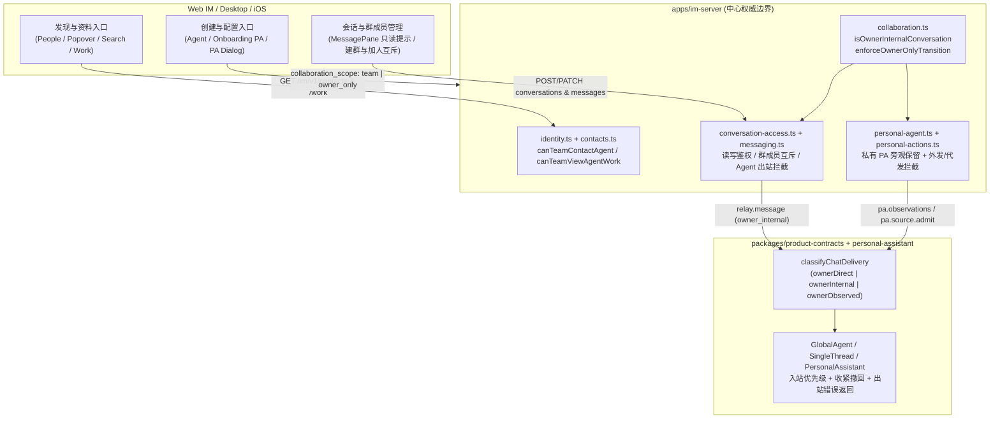
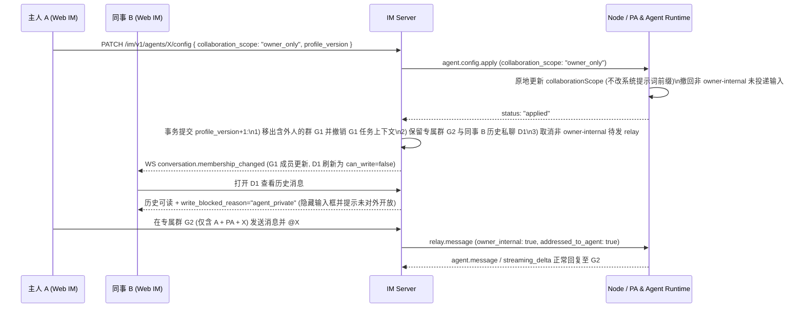

# feat-796: Agent 与个人助手可见性及双向通信权限管理 — 技术方案

> 对齐: [spec.md](spec.md) v1

## Changelog

## 现状分析

### 涉及范围

- `packages/product-contracts/src/collaboration.ts`：共享入站分类契约 `CollaborationScope`（`'team' | 'owner_only'`）与 `classifyChatDelivery`。当前 `ChatAddress` 仅携带 `ownerDirect`，当 `scope === 'owner_only'` 时只要 `!facts.ownerDirect` 就一律返回 `'skip'`，既排除了同主人其他 Agent 私聊与同主人专属群消息，也排除了私有 PA 对主人允许会话的静默旁观事件。
- `apps/im-server/src/identity.ts`、`apps/im-server/src/contacts.ts`、`apps/im-server/src/agent-lifecycle.ts`、`apps/im-server/src/identity-routes.ts`：身份空间判定与联系人目录可见性。当前存在两处偏差：(1) `contacts.ts` 与 `canContactPersonalAgent` 未过滤 `collaboration_scope === 'owner_only'`，导致私有 Agent/PA 仍暴露在同事目录、个人名片、搜索与新建会话候选中；(2) 创建 PA 会将 `users.personal_space_enabled` 置为 `1`（先注册个人空间后入队的成员同样为 `1`），使其普通 Agent 落在 `personal:<owner_id>`，而 `contacts.ts` 与 `currentActorCanAccess` 仅豁免了 `personal_agent_bindings`，未放行有效团队成员设为 `'team'` 的普通 Agent。
- `apps/im-server/src/schema.sql`、`apps/im-server/src/db.ts`、`apps/im-server/src/collaboration.ts`、`apps/im-server/src/message-records.ts`、`apps/im-server/src/threads.ts`：中心入站放行、已读回执与收紧清理。当前 `owner_direct_agent_messages` 视图仅匹配“真人主人本人的一对一私聊（排除 PA 代发）”及飞书绑定主人单聊，未覆盖同主人名下其他 Agent 发来的消息与仅含“主人 + 同主人名下 Agent”的私密专属群（以下简称 **owner-internal 会话**）；`threads.ts` 也将 `owner_only` 一刀切排除在所有群未读之外；同时 `schema.sql` 的 `personal_observation_event` 触发器、`collaboration.ts` 的 `retireTeamBacklog` 与 `personal-agent.ts` 的 `admitSource / pendingObservationIds` 在 `collaboration_scope === 'owner_only'` 时切断了 PA 对主人参与会话的 `observer` 旁观链路。
- `apps/im-server/src/conversation-access.ts`、`apps/im-server/src/messaging.ts`、`apps/im-server/src/chat-streaming.ts`、`apps/im-server/src/work.ts`、`apps/im-server/src/task-graphs.ts`：会话读写授权、建会话/加人/退群、Agent 出站投递与全局 Work 读取。当前：(1) 同事与 `owner_only` Agent 的历史 1:1 私聊仍保持 `can_write: true`，且未拦阻 `owner_only` Agent 通过 `agent.message`、`sendMessage`、`node.streaming_delta (turn_start)`、`conversation.query (create/join)` 向外部会话或外部同事投递；(2) 建群与群加人未阻止混入私有助手与外部同事，也未在切换 `owner_only` 时自动将私有助手移出含外部成员的群；(3) `work.ts` 对公司空间内的 `owner_only` 全局 Agent 未隐藏非主人 Work 读取与 `agent.work.updated` 推送，同时对 `personal_space_enabled = 1` 有效团队成员的 `'team'` 普通全局 Agent 拒绝了同事读取 Work，且 PA `resolve_target` 尚未支持首次解析同主人名下其他 Agent 的直聊目标。
- `apps/im-server/src/control.ts`、`apps/im-server/src/personal-agent.ts`、`apps/im-server/src/personal-actions.ts`、`apps/im-server/src/personal-agent-creation.ts`：配置提交钩子、PA 创建与外发审核边界。当前 `POST /im/v1/personal-agent` 硬编码 `collaboration_scope: 'team'`，不支持创建时直接指定 `'owner_only'`；`PersonalActions.destination` 在 PA 处于 `'owner_only'` 时未禁止向外部会话发起 `send_message` 或 `send_user_message`（`representation: 'owner'`）。
- `packages/personal-assistant/src/attention.ts`、`packages/personal-assistant/src/global-agent.ts`、`packages/personal-assistant/src/single-thread.ts`、`packages/personal-assistant/src/personal-assistant.ts`：节点侧入站分类、收紧撤回与出站错误处理。当前 `attention.ts` 未读取服务端判定的 `owner_internal` 与私有 PA `observer` 放行标记；`single-thread.ts` 对 `owner_only` 直接跳过群背景定时器，且在会话因收紧权限失去写资格时需平稳收口在途流式对账而不陷入死循环重试。
- `src/IM/frontend/src/` 与 `src/IM/ios/NanoIM/`：Web IM（含 Desktop 复用前端）与原生 iOS 客户端。涉及 `onboarding-page.tsx`、`personal-agent-dialog.tsx`、`personal-agent-api.ts`、`agent-create-page.tsx`、`agent-detail-page.tsx`、`contacts-api.ts`、`chat-api.ts`、`chat-workspace-page.tsx`、`new-group-modal.tsx`、`group-settings.tsx`、`message-pane.tsx`、中英文语言包 `zh.json` / `en.json`，以及 iOS `PersonalAssistantSetup.swift`、`AgentConfigView.swift`。

### 既有约束

- **跨包边界红线（[AGENTS.md](../../../AGENTS.md)、[SPEC.md](../../../SPEC.md)）**：不修改 DSH 私有行为，`apps/node` 仅通过 `@nano/dsh-integration/client` 通信，`personal-assistant` 与 `im-server` 通过 `@nano/product-contracts` 共享纯类型与 `classifyChatDelivery` 函数。
- **多租户与个人空间隔离不变量（`docs/specs/im/auth-tenancy.md`、`apps/im-server/tests/tenancy.test.ts`）**：账号获批加入团队不公开个人空间内的既有私人会话、受保护附件、私有任务图与 PA Work；成员被停用团队资格后，同事立即失去对其 `'team'` 助手的可见与联系权，而拥有个人空间的本人仍可在个人空间继续使用自有资源。
- **Prompt Cache 前缀稳定（`packages/dsh-integration/src/agent-config.ts`）**：`collaborationScope` 已从运行时执行指纹中排除（原地热更新，不重建 DSH Agent Preset、不插入 `agent_config_changed` 分界线）；本方案必须保持该设计，不把动态权限档位拼入系统提示词前缀。

### 可复用能力

- **复用并扩展 `canContactPersonalAgent` 跨空间公开联系模型（改）**：现有 PA 保存在 `personal:<owner_id>` 空间中，通过 `canContactPersonalAgent` 允许有效团队成员在 `company:default` 发现并与之建立会话，无需改动 `agent_profiles.space_id` 或迁移私人历史。将其泛化为统一的 `canTeamContactAgent` / `canTeamViewAgentWork` 判定（要求 `collaboration_scope === 'team'` 且双方均为 `active` 团队成员），即可零数据迁移同时解决“私有隐藏”和“个人空间团队成员公开普通 Agent”两项需求。
- **复用 `ConfigOperations.commit` + `retireTeamBacklog` + `revokeLostTaskContextAccess`（改）**：配置保存已在单一 SQLite 事务内推进 `profile_version` 并调用 `retireTeamBacklog`；在同一事务中执行外部群退群、任务上下文撤销与实时 `conversation.membership_changed` 广播，可保证数据库与在线客户端状态原子收敛。
- **复用 `MessagePane` 的 `conversation.can_write === false` 只读横幅与输入隐藏机制（改）**：`MessagePane` 已具备完整的只读态渲染、隐藏输入框与禁用回复/卡片提交逻辑；仅需在会话响应补充 `write_blocked_reason: 'agent_private'` 并在横幅渲染对应中英文提示，无需另造第二套聊天锁定组件。
- **复用 `NewGroupModal` 的 `personalGroup` 私密可见性锁定交互（改）**：`NewGroupModal` 已有选中个人空间助手时锁定 `visibility = "private"` 的控件结构，可直接扩展为“勾选私有助手与勾选外部同事互斥 + 锁定私密群”。

### 相关历史

- `feat-795-people-discovery`：刚合入 `origin/develop`，建立了 `/people` 一级同事目录、`PersonPopover`、侧栏联系人穿透搜索与群详情加人搜索，所有非本人助手数据统一源自 `/im/v1/contacts`。在 `contacts.ts` 收紧非主人可见性并修复跨个人空间 `'team'` 普通 Agent 投影后，`feat-795` 的全部前端发现入口自动继承正确可见性。

## 架构总览

核心思路是将 `collaboration_scope` 从原先单纯的“入站唤醒过滤器”升级为中心 IM 与节点协同执行的**统一可见性与双向会话边界**，并以 **owner-internal 会话**（仅含同一 `owner_id` 真人及其名下 Agent、且非团队公开群的会话，以及已绑定主人的飞书私聊）作为 `'owner_only'` 档位的唯一可交互通信域；对 PA 额外区分 **参与者通信域（受 `owner_only` 限制）** 与 **主人旁观域（`delivery === 'observer'`，遵循 `pa_policies` 访问范围）**。



## 关键决策

1. **保持 `'team' | 'owner_only'` 存储与协议枚举不变，升级用户界面语义为「团队公开 / 私有（仅自己与名下助手）」**
   - **理由**：现有 SQLite `CHECK` 约束、节点配置快照、幂等指纹和 iOS/Web 字段均已使用 `'team'`（默认）与 `'owner_only'`；复用原枚举可实现零历史配置迁移与前向/后向协议兼容，同时通过更新中英文标签、辅助说明与 PA 创建入参准确表达新语义。
   - **拒绝备选**：新增第三个枚举值 `'private'` 并保留旧 `'owner_only'`——这会制造两套近似私有的死状态，违背用户确认的“两档极简模型”。

2. **通过泛化 `canTeamContactAgent` 解决个人空间团队成员公开普通 Agent 问题，不改写存量 `space_id`**
   - **理由**：在 `identity.ts` 中定义 `canTeamContactAgent(db, viewer, profile)`：当 `!profile.is_stale && agentAvailable(db, profile) && profile.collaboration_scope === 'team' && viewer.membership_status === 'active' && ownerAccount(db, profile.owner_id)?.membership_status === 'active'`（若为 PA 另需 `binding.status === 'active'`）时返回 `true`。`contacts.ts`、`messaging.ts`、`agent-lifecycle.ts` 与 `work.ts`（非 PA 全局 Agent）统一调用该判定；同时 `currentActorCanAccess` 允许同一 `owner_id` 的 Agent 访问 `personal:<owner_id>` 与 owner-internal 会话，并允许活跃团队成员的 Agent 存在于 `company:default` 会话记录中以保留历史回看与主人观察权。这样既让个人空间团队成员的 `'team'` 普通 Agent 对同事立即可见可聊可看 Work，又严格保留 `tenancy.test.ts` 中“个人历史会话/任务不外泄、停用公司资格后个人空间仍可用”的全部不变量。
   - **拒绝备选**：在审批入队时批量把用户所有 `personal:<owner_id>` 资源改为 `company:default`——一旦该成员日后被停用公司资格，将会连带丧失对自己个人空间原有 Agent 的访问权，破坏既有租户隔离契约。

3. **以服务端权威计算的 `isOwnerInternalConversation` 统一裁决 `'owner_only'` 的入站、出站与群成员边界**
   - **理由**：定义站内会话 `c` 对 `ownerId` 属于 **owner-internal** 当且仅当：`c.external_source IS NULL`、`c.visibility !== 'public'`，且 `conversation_participants` 非空、所有成员均为 `owner_id === ownerId` 的真人或 `agent_profiles.owner_id === ownerId` 的非 stale Agent（外部渠道仅当为该 Agent 已绑定飞书 `owner_open_id` 的单聊时视为 owner-direct）。据此：
     - 入站：`owner_only` Agent 接收所有来自 owner-internal 会话（含主人 1:1、同主人 Agent 1:1、同主人私密专属群的主时间线与话题）以及飞书主人单聊的消息；
     - 出站：`owner_only` Agent（含普通/全局 `publishAgent`、`sendMessage`、`ChatStreaming.turn_start`、`work.query` 的 `create/join/resolve_target`，以及 PA 的 `pa.action.prepare/commit` 自身发言与 `send_user_message` 代主人发言）仅允许向其 `owner_id` 的 owner-internal 会话（或飞书主人单聊）写入，向任何含外部成员或公开群的目标写入均拒绝并返回结构化错误码 `collaboration_scope_restricted`；
     - 群约束：含任一 `owner_only` Agent 的群强制 `visibility = 'private'` 且禁止加入 `owner_id` 不同的真人或他人 Agent（返回 `409 private_agent_in_group`）；已含外部成员或 `visibility = 'public'` 的群禁止加入 `owner_only` Agent（返回 `409 private_agent_group_external_members`）。
   - **风险与缓解**：PA 首次通过 `send_message` 联系同主人名下另一 Agent 时可能尚无现成直聊；在 `work.ts` 的 `resolve_target` 中对“目标为同主人名下有效 Agent”开放 `s.resolveTarget(p.agent_id, p.target, true)` 自动建立/复用同主人 `agent-agent` 直聊。

4. **`'team' -> 'owner_only'` 状态转换在配置提交事务内执行“外人群自动退群 + 历史 1:1 只读冻结”**
   - **理由**：在 `ConfigOperations.commit`（以及 `POST /im/v1/personal-agent` 初建为 `'owner_only'`）提交时，若目标档位为 `'owner_only'`：
     1. 找出该 Agent 当前参与的所有非 owner-internal 站内群聊，调用 `captureTaskContextAccess` + 删除该 Agent 的 `conversation_participants` 行 + `revokeLostTaskContextAccess` 生成任务上下文撤销通知，并清理该群内该 Agent 遗留的 provisional `running` 消息气泡，事务提交后向原群成员广播 `conversation.membership_changed`；
     2. 对该 Agent 与外部同事已有的 1:1 直聊保留 `conversation_participants` 不删（使双方历史仍可读），由 `conversationRowAccess` 动态计算外部同事的 `can_write = false` 与 `write_blocked_reason = 'agent_private'`，并在档位正反向切换（`team <-> owner_only`）提交后向相关 1:1 会话成员广播 `conversation.membership_changed`，驱动在线客户端即时刷新输入框可用态；
     3. 更新 `retireTeamBacklog`：仅取消非 owner-internal 会话中的待投递 `relay_tasks`（保留同主人 Agent 直聊与专属群消息）。

5. **分离 PA 的“对外参与/外发开关”与“主人会话静默旁观开关”**
   - **理由**：按用户确认的 Q2(3)，私有 PA 是“隐身秘书”。移除 `schema.sql` `personal_observation_event`、`collaboration.ts` `retireTeamBacklog` 与 `personal-agent.ts` `pendingObservationIds` 中因 `collaboration_scope = 'owner_only'` 拦截主人会话旁观事件的条件；在 `personal-agent.ts` `admitSource` 中区分 `facts.delivery === 'observer'`（只要 `messageAllowed` 即放行）与 `facts.delivery === 'participant'`（`owner_only` 下仅 owner-internal 会话放行，旧同事 1:1 私聊拦截）；并在 `PersonalActions.destination` 与 `PersonalAssistant.send / external` 中对 `collaboration_scope === 'owner_only'` 强制要求目标会话属于 owner-internal（或飞书主人私聊），彻底杜绝私有 PA 向同事会话发言或代表主人发言。

## 接口与数据流

### 1. HTTP / WS 与内部契约增量

1. **PA 创建接口 `POST /im/v1/personal-agent`（`apps/im-server/src/personal-agent.ts`、`db.ts`、`schema.sql`）**
   - 请求体新增可选字段 `collaboration_scope?: 'team' | 'owner_only'`（省略时默认 `'team'`；非法值返回 `422`）。
   - `personal_agent_bindings` 表通过 `schema.sql` 与 `db.ts` 幂等 `ALTER TABLE` 补充 `collaboration_scope TEXT NOT NULL DEFAULT 'team'`，确保首次请求在节点确认前中断时，前端刷新重试（使用同一 `request_key`）仍恢复用户最初选择的档位，不会回退成 `'team'`。
   - `GET /im/v1/personal-agent` 的 `binding` 对象同步返回当前 `collaboration_scope`。

2. **联系人接口 `GET /im/v1/contacts` 与 `GET /im/v1/contacts/:user_id`（`apps/im-server/src/contacts.ts`）**
   - 可见性规则：对 `kind === 'agent'`，当 `row.owner_id === viewer.owner_id` 时返回本人所有可用非 stale Agent（含 `'team'` 与 `'owner_only'`），并在返回项中附带 `collaboration_scope: row.collaboration_scope`；当 `row.owner_id !== viewer.owner_id` 时仅返回 `canTeamContactAgent(db, viewer, row)` 为真的 `'team'` Agent/PA。

3. **会话详情与列表投影（`apps/im-server/src/conversation-access.ts`、`messaging.ts`）**
   - `conversationRowAccess` 对站内 1:1 直聊（`type === 'direct' && !external_source`）检查对端参与者：若对端为非当前用户所有的 Agent，且当前 `peerProfile.collaboration_scope === 'owner_only'`（或 `!canTeamContactAgent`），则对该外部真人设置 `can_write: false, write_blocked_reason: 'agent_private'`；当主人切回 `'team'` 且双方资格有效时自动恢复 `can_write: true, write_blocked_reason: null`。
   - `Messaging.conversation()` 对外投影新增可选字段 `write_blocked_reason: access.write_blocked_reason ?? null`。
   - `Messaging.access(..., mode = 'write')`：
     - 真人写入 `can_write === false` 且 `write_blocked_reason === 'agent_private'` 的会话时，返回 `403 { code: 'agent_private', message: 'This assistant is currently private and unavailable for external messages.' }`；
     - Gateway 代表 `owner_only` Agent 向非 owner-internal 会话写入时，返回 `403 { code: 'collaboration_scope_restricted', message: 'This assistant is set to Private and can only communicate with its owner and the owner’s own assistants.' }`。

4. **共享入站分类契约（`packages/product-contracts/src/collaboration.ts`、`packages/personal-assistant/src/attention.ts`）**
   - `ChatAddress` 扩展可选布尔字段 `ownerInternal?: boolean` 与 `ownerObserved?: boolean`：
     ```ts
     export interface ChatAddress {
       ownerDirect: boolean;
       ownerInternal?: boolean;
       ownerObserved?: boolean;
       directToAgent: boolean;
       addressedToAgent: boolean;
       addressedToOwner: boolean;
       contextOnly?: boolean;
     }
     ```
   - `classifyChatDelivery`：当 `scope === 'owner_only'` 时，仅在 `!facts.ownerDirect && !facts.ownerInternal && !facts.ownerObserved` 时返回 `'skip'`；其余优先级判定（`contextOnly`、`directToAgent`、`addressedToAgent`、`addressedToOwner`）保持不变。
   - `im-server` 在 `deliveryFacts` 与 `personal-agent.ts` `sourceFacts` 中附上权威布尔值 `owner_internal`；`attention.ts` 读取 `meta.owner_internal === true` 及 `ownerObserved = !!config.personal && (meta.personal_delivery === 'observer' || meta.pa_observation === true)`。

### 2. 核心时序：从「团队公开」切换为「私有」并协同工作



### 3. 模型可见上下文与生命周期影响

遵循 [Agent Context Engineering](../../development/agent-context-engineering.md) 逐项说明：

- **Consumer**：
  1. 主 PA（调用 `agent_creation` 工具代主人创建新 Agent，或处于 `'owner_only'` 时旁观主人会话并调用 `send_message` / `send_user_message`）；
  2. 处于 `'owner_only'` 的普通 Global / `single_thread` Agent（接收同主人多 Agent 专属群/直聊输入，或尝试调用 `send_message` / `conversations`）。
- **Context Lifecycle**：
  - **静态前缀零变更**：不向系统提示词注入动态 `collaboration_scope` 段落，`packages/dsh-integration/src/agent-config.ts` 保持原地更新 `collaborationScope`，切换权限不触发缓存前缀失效、不产生聊天配置分界线。
  - **按需工具元数据更新**：`apps/im-server/src/personal-agent-creation.ts` 中 `agent_creation(action="options")` 返回的 `configuration_fields.collaboration_scope` 更新为：`"team (default: visible to team colleagues for direct and group collaboration) or owner_only (private: hidden from colleagues; communicates only with the owner and the owner's own Agents)."`。
  - **入站摄取与撤回**：
    - `owner_only` 普通/全局 Agent 的 Inbox 与会话输入现在合法包含同主人其他 Agent 私聊与同主人专属群消息（带真实 `sender` 身份与群成员列表），不再误标为 `withdrawn`；切为 `owner_only` 时，`restrictToOwner` 仅撤回尚未送交模型的外部会话输入。
    - `owner_only` PA 的 Inbox 继续接收 `delivery: "observer"` 的主人允许会话动态（保留旁观标记，不转化为交办指令）。
  - **出站拦截工具反馈（Before / After）**：
    - *Before*：`owner_only` Agent 调用 `send_message(target="c_external_group")` 或私有 PA 调用 `send_user_message(target="c_colleague")` 仍能成功对外发出。
    - *After*：IM 中心拒绝并返回明确工具错误（Global/Single-thread `send_message` 与 `conversations(create/join)` 收到包含 `"This assistant is set to Private and can only communicate with its owner and the owner’s own assistants."` 的错误；PA 的 `PersonalAssistant.send` 捕获 `collaboration_scope_restricted` 后返回 `{ status: "not_sent", target, changed_reason: "collaboration_scope_restricted", message: "This assistant is set to Private and cannot send messages or represent the owner in external conversations. Report to the owner in your private conversation instead." }` 并落库为 `rejected`，避免模型盲目重试或滞留 `unknown` 状态）。
- **Validation**：通过 `apps/im-server` 与 `packages/personal-assistant` 单元/集成测试核对：(1) 切换 `collaboration_scope` 不改变 `runtime_fingerprint` 且不生成 `agent_config_boundaries`；(2) 私有 PA 仍能消费 `observer` 消息并在尝试对外 `send_message` / `send_user_message` 时收到确定性 `not_sent` 指引后改向主人汇报；(3) 同主人双 Agent 在直聊与私密专属群内双向唤醒与投递闭环通过。

### 4. 现有 UX Grounding（无需独立 HTML 原型）

本次前端改动均在既有表单、弹窗与聊天面板的固定槽位上做明确选项/状态增量，无新页面结构或待比较的视觉布局分歧，按 [原型判断范围](https://github.com/Mrchen116/dev-workflow-skills/blob/main/skills/frontend-experience-review/references/prototype-and-runbook.md#原型的判断范围) 不生成冗余 `prototype.html`，直接落地到真实组件并在隔离真栈验证：

| 当前产品入口 | 画面与操作基线 | 沿用或改善的体验及原因 | 本次设计 |
|---|---|---|---|
| 新建/编辑 Agent（`agent-create-page.tsx`、`agent-detail-page.tsx`、iOS `AgentConfigView.swift`） | 已有「协作范围」`<select>` / `Picker`，选项为「团队协作 / 仅限本人」 | 保留原位置与即时动态说明，消除“仅限本人却仍被同事看见且不能跟自己其他 Agent 聊”的误导 | 选项文案统一改为「团队公开」/「私有（仅自己与名下助手）」，动态说明写清目录可见性、内部多 Agent 协同与切为私有时的退群/只读收口效果（PA 编辑页额外说明保留聊天访问范围内的静默旁观） |
| 首次引导与弹窗创建 PA（`onboarding-page.tsx` Step 2、`personal-agent-dialog.tsx`、iOS `PersonalAssistantSetup.swift`） | 当前仅填写名字与选头像，硬编码创建为公开 PA | 保持首屏轻量不增加步骤，让不想公开 PA 的用户在创建瞬间即可选为私有 | 在头像选择器下方增加紧凑的「可见与协作权限」两档选择（默认「团队公开」），并将选择存入本地草稿与 `personal_agent_bindings` 恢复记录 |
| 历史外部 1:1 私聊面板（`message-pane.tsx`） | `conversation.can_write === false` 时顶部渲染 `.tasks-notice` 横幅并隐藏底部 `.chat-pane-composer` | 沿用既有只读横幅与隐藏输入框机制，避免展示笼统的“任务历史只读”让同事困惑 | 当 `conversation.write_blocked_reason === "agent_private"` 时，横幅展示“该助手当前设为私有，暂不对外接收或发送消息”（英文对应本地化），切回公开并收到实时事件后自动恢复输入框 |
| 新建群聊与群详情添加成员（`new-group-modal.tsx`、`group-settings.tsx`、`chat-workspace-page.tsx`） | `NewGroupModal` 已有 `personalGroup` 锁定私密逻辑；`GroupSettings` 已有分组成员多选与搜索框 | 提前在勾选阶段防呆，避免用户提交后才撞上 409 报错 | `NewGroupModal`：已选私有助手时锁定群可见性为私密并禁用外部同事候选（附单行说明），已选外部同事时禁用本人私有助手候选；`GroupSettings`：群内含私有助手时隐藏可见性切换并过滤外部同事加人候选（展示清晰说明），群内已含外部同事时过滤本人私有助手候选 |

## 本次审查安排

| 必须回答的问题 / 对应目标 | 能力与使用阶段 | 证据方法、范围与已有定位 |
|---|---|---|
| 可见性过滤、跨个人空间 `'team'` 公开、owner-internal 双向路由、退群/只读事务收口及契约增量一致性 | `change-code-review`（实施完成后独立审查） | 审查 `origin/develop...HEAD` 完整 diff；运行 `pnpm build && pnpm typecheck && pnpm test`、`npm --prefix src/IM/frontend run test`、`pytest -m "not e2e" -q` 与 `./scripts/docs-check` |
| PA/Agent 创建与设置权限控件、建群/群加人互斥提示、历史私聊只读提示在桌面与移动视口的可理解性与可操作性 | `frontend-experience-review`（作者自检 + 独立审查） | 在隔离真栈使用多账号（含个人空间入队账号与普通同事账号）在桌面（1280x820）与移动（390x844）浏览器实测创建私有/公开助手、验证同事目录/名片隐藏与公开、专属群互斥防呆、切为私有后的历史私聊只读横幅与切回恢复，保存截图证据 |
| 私有 PA 静默旁观保留、外发硬拦截返回给模型的指引清晰度，以及权限切换不破坏缓存前缀 | `agent-context-review`（作者自检 + 独立审查） | 检查 `personal-agent-creation.ts` 工具字段描述、`PersonalAssistant.send` / `GlobalAgent` 出站拒绝返回载荷及 `agent-config.ts` 原地更新逻辑，配合单元/集成测试核实模型收到的结构化反馈与零 `agent_config_changed` 分界线 |

## 契约层增量 (delta-spec)

- IM Agent 配置、创建与目录可见性：[specs/im/agents-nodes.md](specs/im/agents-nodes.md)（对应 [docs/specs/im/agents-nodes.md](../../specs/im/agents-nodes.md)）
- IM 个人助手创建权限档位与私有旁观协助边界：[specs/im/personal-agent.md](specs/im/personal-agent.md)（对应 [docs/specs/im/personal-agent.md](../../specs/im/personal-agent.md)）
- IM 会话读写权限、含私有助手群约束与历史私聊只读恢复：[specs/im/conversations-messages.md](specs/im/conversations-messages.md)（对应 [docs/specs/im/conversations-messages.md](../../specs/im/conversations-messages.md)）
- IM 全局 Agent Work 对外可见性与跨个人空间公开读取：[specs/im/agent-work.md](specs/im/agent-work.md)（对应 [docs/specs/im/agent-work.md](../../specs/im/agent-work.md)）
- IM 多租户空间与团队公开/私有对象权限叠加：[specs/im/auth-tenancy.md](specs/im/auth-tenancy.md)（对应 [docs/specs/im/auth-tenancy.md](../../specs/im/auth-tenancy.md)）
- Web IM 建群/加人互斥交互与历史私聊只读提示：[specs/im/web-chat-ux.md](specs/im/web-chat-ux.md)（对应 [docs/specs/im/web-chat-ux.md](../../specs/im/web-chat-ux.md)）
- Gateway 全局 Agent 入站范围与专属群接收：[specs/gateway/global-agent.md](specs/gateway/global-agent.md)（对应 [docs/specs/gateway/global-agent.md](../../specs/gateway/global-agent.md)）
- Gateway 个人助手旁观保留、外发/代发拦截与代建选项：[specs/gateway/personal-agent.md](specs/gateway/personal-agent.md)（对应 [docs/specs/gateway/personal-agent.md](../../specs/gateway/personal-agent.md)）
- Gateway 群聊路由、话题唤醒与产品工具出站范围校验：[specs/gateway/routing-delivery.md](specs/gateway/routing-delivery.md)（对应 [docs/specs/gateway/routing-delivery.md](../../specs/gateway/routing-delivery.md)）
- `dsh-integration`：no spec delta（复用既有 `collaborationScope` 原地更新与 `ChatScope.restrict` 机制，无需改动 DSH 集成边界）

## 风险与回退

- **SQLite 视图在既有数据库上不自动更新风险**：`schema.sql` 中的 `CREATE VIEW IF NOT EXISTS owner_direct_agent_messages` 对存量数据库不会覆盖旧视图定义。在 `apps/im-server/src/db.ts` 执行 `schema.sql` 前显式加入 `DROP VIEW IF EXISTS owner_direct_agent_messages;`（与既有的 `DROP TRIGGER IF EXISTS personal_observation_event` 同处），保证新老数据库视图与触发器定义完全一致。
- **在途流式回复跨越收紧边界残留 `running` 气泡风险**：若 `single_thread` 助手在外部群或外部 1:1 会话刚发出 `turn_start` 时被主人切为 `'owner_only'`，中心事务在退群/冻结时同步丢弃该会话中该助手未完成的 `running` 占位消息并发布 `message.discarded`，同时 `single-thread.ts` 在 `reconcile` 捕获 `collaboration_scope_restricted | agent_private | conversation_id not found` 终端拒绝错误时直接结清本地 delivery 与 receipt，杜绝死循环重试。
- **回退方案**：数据库仅新增幂等默认列 `personal_agent_bindings.collaboration_scope` 并重建可随时恢复的视图/触发器，不破坏任何历史会话或消息行；回退本分支提交即可恢复旧行为。

## 一次性部署迁移

无。存量 `agent_profiles.collaboration_scope` 已使用 `'team' | 'owner_only'`，视图/触发器与 `personal_agent_bindings.collaboration_scope` 默认列均由 `openDatabase` 幂等自愈，个人空间团队成员的 `'team'` 普通 Agent 通过运行时空间+权限联合判定直接生效，无需 `deployment-prompt.md`。

## Runbook for Reviewer

| 服务 | 停止命令 | 启动命令 | 健康检查 |
|---|---|---|---|
| 隔离 IM + Gateway 测试栈 | `./scripts/e2e-down.sh --wt "$WT_ROOT"` | `./scripts/e2e-up.sh --wt "$WT_ROOT"` | `source "$WT_ROOT/.e2e-ports.env" && curl -fsS "$IM_URL/health" >/dev/null` |

**Review 驱动方式**:
1. 执行全套窄测试、类型检查与构建门禁：`pnpm build && pnpm typecheck && pnpm test`、`npm --prefix src/IM/frontend run test`、`npm --prefix src/IM/frontend run build`、`pytest -m "not e2e" -q`、`./scripts/docs-check`（若修改了 `src/IM/ios/*.swift`，在具备 Xcode 26.4.1 的宿主同步核验或通过远端 iOS CI 验证）。
2. 在隔离真栈 `$IM_URL` 创建多角色团队成员与多 Agent（含个人空间入队成员、普通 Agent、PA），在桌面与移动视口走查新建/编辑权限选择、同事目录与名片隐藏/公开、同主人多 Agent 专属私密群协同与加人防呆、切为私有自动退出外人群、历史同事 1:1 私聊只读提示与切回恢复，验证结束后执行 `./scripts/e2e-down.sh --wt "$WT_ROOT"` 回收全部测试资源。

**验收前置**: 无仓库外专有硬件或额外付费密钥依赖；使用本机隔离测试栈即可完成全部验证。

## Milestones

| ID | 标题 | 依赖 | 并行组 | 范围 | 退出标准 |
|---|---|---|---|---|---|
| `M1-agent-privacy-scope` | Agent 与 PA 两档可见性、内部协同及双向隔离全链路实现 | 无 | `G1` | `packages/product-contracts/`、`packages/personal-assistant/`、`apps/im-server/`、`src/IM/frontend/`、`src/IM/ios/` | `[reviewer]` 1. Web 新建普通 Agent、首次引导与弹窗创建 PA、iOS 创建/配置及 PA `agent_creation` 均默认「团队公开」且支持直接选为「私有（仅自己与名下助手）」，切换权限不产生配置缓存分界线；2. 私有 Agent/PA 对其他同事在「同事」目录、个人名片、侧栏搜索、新聊天/建群候选、智能体公开资料与全局 Work 中彻底隐藏，而启用了个人空间的有效团队成员名下「团队公开」普通 Agent 对同事正常可见、可私聊、可看公开资料与 Work；3. 主人本人与同主人名下多 Agent（含 PA）可在 1:1 私聊及同主人私密专属群中双向唤醒与发言，含私有助手的群锁定私密且禁止混入外部同事，私有助手对外发送或加公开群被拦截并返回清晰原因；4. 从「团队公开」切为「私有」时自动退出含外部同事的群聊、保留专属群，同事侧历史 1:1 私聊保留记录但隐藏输入框并提示未对外开放，切回「团队公开」后自动恢复；5. 私有 PA 保持对主人允许会话的静默旁观并仅对内汇报。<br>`[worker]` 1. 新增覆盖上述全部正常/边界/拒绝/恢复路径的 `product-contracts`、`im-server`、`personal-assistant` 与 `frontend` 测试且全部通过；2. `pnpm build && pnpm typecheck && pnpm test`、`npm --prefix src/IM/frontend run test`、`npm --prefix src/IM/frontend run build`、`pytest -m "not e2e" -q` 与 `./scripts/docs-check` 零错误；3. 完成隔离真栈桌面与移动视口真实浏览器走查，保存关键状态截图证据并在验证后完整回收隔离进程与端口。 |
