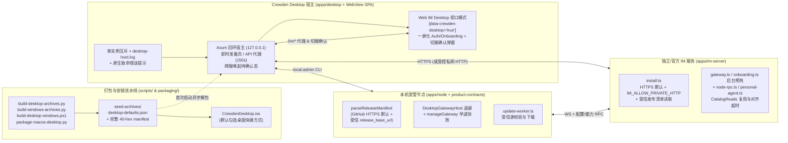
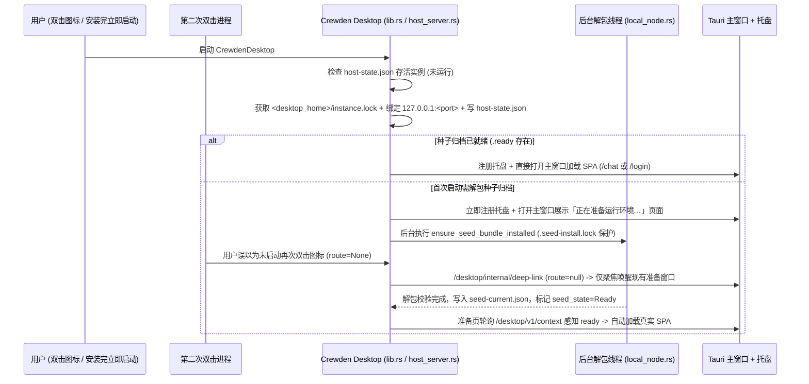

# feat-799 Technical Design: Crewden Desktop 打包运行加固、一屏化引导体验与受控私有化部署

## Overview

### 问题定性与收敛结构

基于对 Windows 11 + 独立 IM 真实部署反馈的全链路核查，本单元需收敛四组相互耦合的工程与体验缺口：

1. **发行打包、安装器与受管节点启动确定性故障（Issue 1、Issue 2、周边 1A/1B + Windows 快捷方式）**：
   - `scripts/build-desktop-archives.py`、`scripts/build-desktop-windows.ps1`、`scripts/package-macos-desktop.py` 直接将 `--source-commit` 原样写入 `.release-manifest.json` 与 `.nano-release.json`，传入短 SHA 时在运行期被 `parseReleaseManifest`（严格要求 40 位 hex）拒绝；同时 `build-desktop-windows.ps1` 用占位文件构造内嵌 `seed-archives/manifest.desktop-win32-x64.json` 的 `installer` 字段而未区分内嵌种子清单与外部发布清单语义。
   - `scripts/build-desktop-archives.py` 与 `scripts/build-windows-archives.py` 的 `build_graph()` 仅把 `node_modules/.pnpm/node_modules/<name>` 中恰好指向 `visited` 节点的顶层软链拷入 `p/node_modules/`。当锁文件中存在多版本（如 `zod@4.6.5` 与 `zod@4.6.6`）且 `@deepseek-ai/dsh-web` 未在自身 `package.json` 声明 `zod` 时，`p/node_modules/zod`（以及 `fast-uri`、`http-proxy-agent`、`parse5`、`undici-types`）缺失，导致 Node ESM 沿 realpath 向上查找失败，`dsh-web` 的 `typert` 模块激活报错，而 `packaging/windows/smoke.mjs` 未对激活告警做失败断言。
   - 当本机 `apps/node` 因清单或配置无效在启动初期确定性退出时，`DesktopGatewayHost.cs` 的 `Serve` 循环无延迟立即重启刷爆 `gateway.log`，同时 `apps/node/src/lifecycle.ts` 的 `manageGateway` 盲等 120 秒才报 `Gateway startup timed out`。
   - `packaging/desktop/windows/CrewdenDesktop.iss` 仅创建开始菜单快捷方式，缺少默认勾选的「创建桌面快捷方式」安装选项。

2. **首次启动空白等待、并发写冲突、静默闪退与无路由唤醒误跳（Issue 8 + 周边）**：
   - `apps/desktop/src/lib.rs` 在绑定回环服务、写出 `host-state.json` 及创建托盘/主窗口**之前**同步执行 `ensure_seed_bundle_installed`（解压约 76MB 归档并运行 `layout.mjs`，Windows 首次耗时 15~45 秒）。在此期间既无窗口也无托盘，且二次双击快捷方式因 `host-state.json` 尚未生成而并发写 `cache/` 触发 Windows `os error 32` 静默退出。
   - `apps/desktop/src/main.rs` 启用了 `#![cfg_attr(target_os = "windows", windows_subsystem = "windows")]`，致命启动错误仅 `eprintln!` 导致用户完全不可见。
   - `forward_to_running_instance` 与 `handle_internal_deep_link` 在无深链路由的普通图标重开（`cli.initial_route == None`）时默认回退到 `"/chat"`，强制把停留在 `/login` 或 `/onboarding` 的用户跳走。

3. **Windows 冷启动能力检查多层硬超时、无预热与创建错误笼统（Issue 3 + 周边 3A/3B/3C）**：
   - Windows Defender / NTFS 下首次拉起 `RuntimeClient` 检查子进程加载 500+ 包常超过 `inspectionTimeouts(true)` 的 `30_000ms`（实测 `30454ms` 被杀，导致 `CatalogReads` 永远无法写入 5 分钟缓存）。
   - 同一创建链路上还存在三处隐藏超时与绕过：`apps/im-server/src/node-rpc.ts` 对非 inspection 命令（含创建时的 `node.config.apply`）硬编码 `10_000ms`；`apps/desktop/src/host_server.rs` 的 `http_client` 硬编码 `60s` 超时；`POST /im/v1/personal-agent` 直接调用 `ctx.gateway.request(..., 'node.capabilities.resolve')` 绕过了 `CatalogReads` 缓存，且电脑上线与模型保存成功时未触发后台非阻塞能力目录预热；前端 `onboarding-page.tsx` 将所有创建异常统一折叠为「电脑尚未确认创建结果」。

4. **官方/公网严格 HTTPS 边界、独立 IM 私有化部署闭环与桌面一屏化体验（Issue 4~7 + 桌面视口改造）**：
   - 官方服务与公网地址必须保持严格 `https://`（仅本机回环开发地址例外），防止凭据嗅探、恶意深链钓鱼与更新包中间人篡改。
   - 独立 IM 私有化部署需要：服务端显式私网 HTTP 开关（`IM_ALLOW_PRIVATE_HTTP=1`）放行私网下载/唤起材料、安装包/构建预设默认 IM 地址与受信自托管发布源基地址（修复现有 `--base-url` 产出清单被 `parseReleaseManifest` 拒绝的自爆问题），以及所有跨服 `crewden-desktop://connect?origin=...` 唤起的强制应用内用户确认（含明文 HTTP 风险警示）。
   - 桌面客户端下 `/login`、`/register`、`OnboardingWelcome`、`OnboardingPage` 与 `FirstUseWelcome` 复用了 Web 营销向长页顶栏（`88~100px`）与大外边距（`35~70px`），导致在 `1280×840` 与 `1280×720` 桌面窗口中出现整页垂直滚动条，且点击品牌标识会跳入 `/about` 长营销介绍页。

### 目标与非目标

- **目标**：在不破坏 `AGENTS.md` / `SPEC.md` 运行时依赖红线与官方公网 HTTPS 安全基线的前提下，一次性闭环上述打包校验、依赖完整性、首次启动即时反馈与单实例互斥、Windows 冷启动检查超时链与预热、受控私有化部署与自托管更新、外部唤起切服确认，以及桌面端认证/引导页面一屏化原生布局。
- **非目标**：不对官方域名（`im.crewden.work` / `*.crewden.work`）或任意公网非私网主机放开明文 `http://`；不修改宿主机注册表 IPv6 或系统防火墙规则；不重做普通浏览器访问的 `/about` 公共官网着陆页或原生 iOS 客户端布局。
- **Agent Context 影响判断**：本单元不涉及模型可见提示词、工具 schema、上下文注入、会话压缩或恢复链路变更，无 Agent Context 影响。

---

## Architecture



### 模块职责与依赖边界

| 模块路径 | 职责边界 | 架构红线核对 |
|---|---|---|
| `packages/product-contracts/src/{node-update.ts,configuration-rpc.ts}` | 定义发布清单校验契约（默认 GitHub Release HTTPS + 可选受信 `release_base_url` 与私网/回环策略）与跨端能力检查/配置 RPC 超时预算。 | 纯 TypeScript 契约，零运行时与外部依赖。 |
| `scripts/{build-desktop-archives.py,build-windows-archives.py,build-desktop-windows.ps1,package-macos-desktop.py}` & `packaging/` | 构建期将 `--source-commit` 归一化为 40 位提交哈希；修复 `p/node_modules/*` 多版本与漏声明依赖兜底链接；生成 `desktop-defaults.json` 预设与一致的种子/发布清单；在 `CrewdenDesktop.iss` 提供默认勾选的 `desktopicon` 任务；在冒烟脚本断言零 `typert` 激活错误。 | 仅构建与安装脚本，不引入运行时私有耦合。 |
| `apps/node/src/{release.ts,lifecycle.ts,local-admin.ts,update-worker.ts}` & `DesktopGatewayHost.cs` | 校验本机安装清单与受信自托管更新源；守护进程对快速崩溃执行退避并由 `manageGateway` 立即检测子进程早退、提取 `gateway.log` 首因返回给桌面端。 | 仅通过 `@nano/dsh-integration/client` 管理运行时子进程，不新增内核 HTTP 服务。 |
| `apps/im-server/src/{install.ts,server.ts,node-rpc.ts,gateway.ts,onboarding.ts,personal-agent.ts}` | 默认严格 HTTPS；仅在 `IM_ALLOW_PRIVATE_HTTP=1` 且 `publicUrl` 为私网地址时开放私网 HTTP 客户端安装与唤起材料；对齐 Windows 配置与检查 RPC 超时，在节点注册与模型保存后后台预热 `CatalogReads` 并在 `POST /im/v1/personal-agent` 复用缓存、返回可区分错误码。 | IM 不 import DSH，不中转安装包二进制字节。 |
| `apps/desktop/src/{main.rs,lib.rs,config.rs,local_node.rs,host_server.rs,tray.rs}` | 先建立宿主单实例锁与回环服务、立即展示托盘与首次准备窗口并后台异步解包种子归档；记录 `desktop-host.log` 与原生错误弹窗；无路由重开保持原页面；拦截公网明文 HTTP 并将跨服深链暂存为待用户确认状态。 | 纯 Rust/Tauri 宿主，通过 CLI 与回环接口协作，不触碰 DSH。 |
| `src/IM/frontend/src/{desktop/*,features/auth/*,features/onboarding/*,features/home/*}` | 在 Desktop 模式下挂载 `data-crewden-desktop="true"` 实现桌面视口一屏化布局与卡片内局部滚动、阻止顶栏品牌跳往 `/about` 营销长页、渲染跨服深链切换确认弹窗及细化后的助手创建失败提示。 | IM 前端仅依赖 `@nano/product-contracts`。 |

---

## Data Flow

### 1. 首次启动即时进度窗口、异步解包与单实例唤醒链路



### 2. 受控私有化预设、跨服深链确认与 Windows 个人助手创建预热链路

```mermaid
sequenceDiagram
  participant Browser as 浏览器 (Web 下载页)
  participant Desktop as Desktop 宿主 + WebView
  participant IM as IM Server
  participant Node as 本机受管 Node (Windows)

  Browser->>Desktop: crewden-desktop://connect?origin=http://10.24.8.15:8011
  Desktop->>Desktop: 校验协议安全边界 (公网 http:// 拒绝; 私网 http:// 允许)
  alt 目标 origin != 当前已保存 im_origin
    Desktop->>Desktop: 写入 pending_server_switch (含 is_cleartext_http=true) 并唤醒主窗口
    Desktop->>Desktop: 展示切服确认弹窗 (列示原地址/目标地址 + 未加密内网风险提示)
    Desktop->>Desktop: 用户点击「确认切换」-> PUT /desktop/v1/server 递增 context_epoch 切服
  end
  Desktop->>Node: 一键绑定并启动本机节点 (若清单损坏早退 -> 2s 内快败返回具体原因)
  Node->>IM: WS node.register (managedWindows=true)
  IM--)Node: 后台非阻塞预热 readNodeCreationCapabilities (120s worker / 130s RPC 预算)
  Desktop->>IM: POST /im/v1/nodes/:id/setup (action=save 验证模型通过)
  IM--)Node: 失效旧目录后再次后台非阻塞预热最新模型与工具目录
  Desktop->>IM: POST /im/v1/personal-agent (150s 宿主代理超时 > 130s RPC 预算)
  IM->>IM: 复用已预热的 CatalogReads 缓存 + 对齐 node.config.apply 超时
  IM->>Node: agent.create / node.config.apply
  Node-->>IM: 创建确认回执
  IM-->>Desktop: 201 Created -> 直接进入私人对话
```

---

## Interface & Schema

### 1. 网络地址安全分类契约（Rust 宿主、`product-contracts` 与 `im-server` 对齐）

统一三端的地址安全分类语义，确保**官方及公网地址严格 HTTPS 零退化**：

- **Loopback 开发回环主机**：`127.0.0.1`、`localhost`、`[::1]` / `::1`。
- **RFC1918 / RFC4193 内网私网主机（Private Network Host）**：
  - IPv4 私网段：`10.0.0.0/8`、`172.16.0.0/12`（`172.16.*` ~ `172.31.*`）、`192.168.0.0/16`；
  - IPv6 唯一本地地址：`fc00::/7`（`fc*` / `fd*`）；
  - 局域网本地域名后缀：`*.local`、`*.lan`、`*.internal`、`*.intranet`、`*.home.arpa` 或不含公网点的单标签内网主机名（且**显式排除** `crewden.work` 及 `*.crewden.work`）。
- **准入规则**：
  1. `https://<valid-host>[:port]`：始终允许（禁止内嵌 `user:pass`）。
  2. `http://<loopback>[:port]`：始终允许（供本机回环开发与隔离 E2E 使用）。
  3. `http://<private-host>[:port]`：
     - **Desktop 客户端**（`normalize_im_origin`、`parse_deep_link_origin`、`<DesktopServerBar />`）：允许连接私网 `http://`（在服务栏与切服弹窗中标注「未加密内网连接」提示）；凡非回环且非私网的公网/官方域名（如 `http://im.crewden.work`、`http://evil.example`）使用 `http://` 一律拒绝并返回明确错误。
     - **IM 服务端**（`apps/im-server/src/install.ts`）：默认仅允许 `https:` 与回环 `http:`；**仅当环境变量/配置显式设置 `IM_ALLOW_PRIVATE_HTTP=1`（或 `ServerOptions.allowPrivateHttp === true`）且 `publicUrl` 为私网 `http://` 时**，`installMaterials` 对 `desktop_win32_x64`、`desktop_darwin_arm64` 与 `windows_x64` 返回有效下载与唤起入口。

### 2. 发布清单受信基地址与桌面预设配置契约

#### 2.1 `packages/product-contracts/src/node-update.ts`

扩展 `ReleaseMetadata` 与 `parseReleaseManifest` 以支持显式受信自托管发布基地址，同时保持无配置调用时严格绑定官方 GitHub Release：

```ts
export interface ReleaseMetadata {
  version: string;
  source_commit?: string;
  sha256: string;
  download_url: string;
  /** Optional self-hosted base URL (`https://.../` or private/loopback `http://.../`), must end with `/`. */
  release_base_url?: string;
  node_major: 24;
  pnpm_version: '11.7.0';
  updater_protocol?: number;
  data_epoch?: number;
  release_notes?: string;
}

export interface ParseReleaseManifestOptions {
  /** Explicitly trusted self-hosted release base URL prefix(es) configured by this deployment or seed install. */
  trustedReleaseBaseUrls?: readonly string[];
  /** Allow private-network HTTP in `trustedReleaseBaseUrls` when private HTTP mode is enabled. */
  allowPrivateHttpReleaseBase?: boolean;
  /** Allow embedded seed manifest where outer installer wrapper SHA/size is placeholder before final signing/packing. */
  embeddedSeed?: boolean;
}

export function parseReleaseManifest(
  input: unknown,
  options?: ParseReleaseManifestOptions,
): ReleaseManifest | null;
```

- **校验规则**：
  - 默认（未传 `trustedReleaseBaseUrls` 且无匹配受信源）：`base` 必须严格等于 `https://github.com/Mrchen116/nano-multiagent/releases/download/${tag}/`，与现状 100% 一致，清单自身携带的 `release_base_url` **不能单方面自证受信**（防止被篡改清单指向任意第三方地址）。
  - 当调用方传入 `trustedReleaseBaseUrls`（来自 IM 服务端 `IM_RELEASE_BASE_URL` 或客户端安装时固化的 `desktop-defaults.json` / `.nano-release.json` 的受信源）且清单的 `release_base_url` 归一化后命中该受信列表时：
    - 校验该基地址必须为 `https://`，或回环 `http://`，或在 `allowPrivateHttpReleaseBase` 启用时为私网 `http://`；
    - 要求 `download_url === normalizedBase + v.package`，且平台安装包的 `installer.download_url === normalizedBase + spec.installer`（内嵌种子模式 `embeddedSeed: true` 下仍严格校验 `version`、`source_commit`、`sha256`（descriptor 哈希）与 `package`，不再被外层安装器自引用哈希死锁）。

#### 2.2 构建期参数与 `desktop-defaults.json`

- `scripts/build-desktop-archives.py`、`scripts/build-desktop-windows.ps1`、`scripts/package-macos-desktop.py`、`scripts/build-windows-archives.py`：
  - 新增 `resolve_full_commit_sha(raw_commit)`：通过 `git rev-parse --verify <rev>^{commit}` 解析并强制匹配 `/^[a-f0-9]{40}$/`，非法引用直接以非零退出码报错中止。
  - 新增可选 `--default-im-origin <url>`（PowerShell `-DefaultImOrigin`）与校验后的 `--base-url <url>`（PowerShell `-BaseUrl`）：校验 URL 合法性与安全分类后，在 `seed-archives/desktop-defaults.json` 写出：
    ```json
    {
      "default_im_origin": "http://10.24.8.15:8011",
      "trusted_release_base_url": "http://10.24.8.15:9000/releases/v0.1.0/",
      "allow_private_http_release_base": true
    }
    ```
  - `apps/desktop/src/config.rs` 在初始化 `PersistedHostConfig`（当用户尚未手动保存 `host-config.json` 时）按优先级读取：`--im-origin` CLI 参数 > `CREWDEN_DEFAULT_IM_ORIGIN` 环境变量 > 随包 `seed-archives/desktop-defaults.json`（或 `<desktop_home>/desktop-defaults.json` 持久化副本）的 `default_im_origin` > `"https://im.crewden.work"`。
  - `ensure_seed_bundle_installed` 将 `desktop-defaults.json` 同步保存至 `<desktop_home>/desktop-defaults.json`，并由 `run_local_admin_sync` 与 `apps/node`（`loadNodeRelease` / `update-worker.ts`）读取其中的 `trusted_release_base_url` 完成离线内网校验与受管更新。

#### 2.3 受管运行时依赖图兜底（`build_graph()` 加固）

- 在 `scripts/build-desktop-archives.py` 与 `scripts/build-windows-archives.py` 的 `build_graph()` 中：
  1. 保留现有 `node_modules/.pnpm/node_modules/<name>` 指向 `visited` 节点的优先映射；
  2. 对 `visited` 中已收录但未出现在 `top_links` 的所有包名 `<pkg_name>`，按确定性版本排序（最高语义/字典序 store key）补齐 `top_links[<pkg_name>] = store_key`，确保 `p/node_modules/zod`、`fast-uri`、`http-proxy-agent`、`parse5`、`undici-types` 100% 存在，满足 Node ESM 从 `p/<store_key>/node_modules/<scope>/<pkg>` 向上查找 `p/node_modules/<dep>` 的标准解析；
  3. 同时对 `@deepseek-ai/dsh-web` 等在源码中存在静态裸包导入但未声明于 `package.json` 的受管包，显式补充 `package_links` 边写入 `dependencies.json`；
  4. 更新 `packaging/windows/smoke.mjs` 与打包契约单测：断言 `p/node_modules/zod` 可被 `@deepseek-ai/dsh-web` 解析，且启动或能力检查输出中不包含 `did not activate` 或 `failed to register`。

#### 2.4 Windows 安装向导桌面快捷方式（`CrewdenDesktop.iss`）

- 在 `packaging/desktop/windows/CrewdenDesktop.iss` 增加：
  ```iss
  [Tasks]
  Name: "desktopicon"; Description: "创建桌面快捷方式(&D)"; GroupDescription: "附加图标："

  [Icons]
  Name: "{autoprograms}\Crewden Desktop"; Filename: "{app}\CrewdenDesktop.exe"
  Name: "{autodesktop}\Crewden Desktop"; Filename: "{app}\CrewdenDesktop.exe"; Tasks: desktopicon
  ```
  Inno Setup 中未声明 `Flags: unchecked` 的 Task 在图形安装向导中**默认勾选**，用户可手动取消勾选；静默安装可通过 `/MERGETASKS=desktopicon` 或 `/MERGETASKS=!desktopicon` 精确控制并在 `packaging/desktop/windows/smoke.ps1` 验证。

---

### 3. 节点确定性崩溃快败与 Windows 超时/预热契约

#### 3.1 后台守护退避与 `manageGateway` 早退快败

- `packaging/desktop/windows/DesktopGatewayHost.cs`：在 `Serve` 循环中记录子进程单次存活时长；若存活 `< 5s` 即非零退出，连续快速崩溃计数递增并按 `1s -> 2s -> 5s -> 15s` 指数退避（连续 5 次在 15 秒内立即崩溃且错误相同则写入 `.gateway-crash.json` 摘要并进入慢速退避，避免无间隔刷爆磁盘日志）。
- `apps/node/src/lifecycle.ts`（`waitReady` / `manageGateway`）：在轮询 `.gateway-state.json` 等待 `ready` 期间，若检测到新拉起的后台进程已退出（或 `.gateway-crash.json` / `gateway.log` 新增致命错误且进程不再存活），立即中止 120 秒轮询，从 `gateway.log` 尾部提取首条非空错误原因抛出可读异常，使 `/desktop/v1/local-node/connect` 在 1~3 秒内将具体原因返回给 `DesktopNodeOnboardingBanner`。

#### 3.2 跨层超时对齐与能力目录预热

- `packages/product-contracts/src/configuration-rpc.ts`：
  - `inspectionTimeouts(true)`（Windows 受管节点）调整为 `{ workerMs: 120_000, nodeMs: 125_000, rpcMs: 130_000 }`（非 Windows 保持 `{ workerMs: 15_000, nodeMs: 17_000, rpcMs: 20_000 }`）。
- `apps/im-server/src/node-rpc.ts`：
  - Windows 受管节点上的配置落地与创建命令（`agent.create`、`node.config.apply`、`node.setup.request`）不再落入 `10_000ms` 默认短超时，统一给予 `60_000ms`（能力解析保持 `inspectionTimeouts(true).rpcMs = 130_000ms`）。
- `apps/desktop/src/host_server.rs`：
  - 将 `HostSharedState.http_client` 的请求超时从 `60s` 提升至 `150s`，确保不会在 `130s` RPC 完成前提前切断 `/im/v1/personal-agent` 或 `/im/v1/nodes/:id/setup`。
- **后台预热与创建缓存复用**：
  - 在 `apps/im-server/src/gateway.ts`（`node.register` 成功后）与 `apps/im-server/src/onboarding.ts`（`POST /im/v1/nodes/:node_id/setup` 的 `action === 'save'` 成功后），异步非阻塞触发 `void readNodeCreationCapabilities(ctx, nodeId, ownerId).catch(() => {})` 预热 `CatalogReads` 5 分钟缓存。
  - 在 `apps/im-server/src/personal-agent.ts` 的 `POST /im/v1/personal-agent` 中，优先通过 `readNodeCreationCapabilities(ctx, b.node_id, user.owner_id)` 读取节点能力（命中预热缓存时 0ms 完成，无需再次冷启动检查子进程！），并对离线（`503 node_offline`）、能力检查不可用/超时（`503/504 node_capabilities_unavailable`）与创建确认超时（`504 create_confirmation_timeout`）返回结构化 `code`；前端 `onboarding-page.tsx` 按 `code` 呈现可区分中文/英文引导并完整保留草稿。

---

### 4. Desktop 宿主启动、日志弹窗、路由保持与切服确认接口

#### 4.1 宿主状态与 HTTP 接口扩展（`apps/desktop`）

```ts
export interface PendingServerSwitch {
  target_origin: string;
  is_cleartext_http: boolean;
}

export interface DesktopHostContextResponse {
  im_origin: string;
  context_epoch: number;
  platform: "darwin-arm64" | "win32-x64";
  seed_ready: boolean;
  seed_error?: string | null;
  host_log_path?: string;
  pending_server_switch?: PendingServerSwitch | null;
}
```

- **新增接口**：
  - `POST /desktop/v1/server/pending/dismiss`（受 capability cookie + origin 保护）：清除 `pending_server_switch`，保留当前 `im_origin` 与登录会话。
  - `POST /desktop/v1/seed/retry`（受 capability cookie + origin 保护）：当首次解包因磁盘满等临时原因失败时重新触发后台解包。
  - `PUT /desktop/v1/server`：确认切换目标 `im_origin` 时同时自动清空 `pending_server_switch`。
- **单实例、无路由唤醒与致命错误暴露**：
  - `DesktopPaths::instance_lock_path()`（`<desktop_home>/instance.lock`）与 `host_log_path()`（`<desktop_home>/desktop-host.log`）：`main.rs` 捕获 `run_from_env()` 返回的任何 `Err(msg)`，写入带 ISO 时间戳的 `desktop-host.log`（若 `desktop_home` 不可写则回退至系统临时目录 `crewden-desktop-host.log`），并在未设置 `CREWDEN_SUPPRESS_OS_OPEN=1` 时调用原生系统提示（Windows PowerShell `System.Windows.Forms.MessageBox` / Win32 API，macOS `osascript display alert`）告知错误摘要与日志路径。
  - `forward_to_running_instance` 发送 `"route": cli.initial_route`（无深链时为 `null`）；`handle_internal_deep_link` 在 `url == None && route == None` 时仅聚焦主窗口而不推入 `"/chat"` 路由覆盖当前 `/login` 或 `/onboarding`。

---

### 5. Desktop 一屏化视口布局契约（`src/IM/frontend`）

- 在 `src/IM/frontend/src/desktop/desktop-context.ts` 新增 `syncDesktopDocumentAttribute()`，在 `main.tsx`、`AppProviders` 与 `setDesktopBootContextForTest` 中同步设置 `document.documentElement.dataset.crewdenDesktop = isDesktopClient() ? "true" : undefined`（测试清理时移除该属性）。
- **导航收敛**：
  - `ProductHeader` 在 `isDesktopClient()` 下将左上角品牌链接目标从 `/about` 改为已登录进 `/chat`、未登录留在本页（`/login`），不在桌面客户端窗口内跳往长滚动营销页；
  - `PublicHomePage({ restoreSession: true })`（`/` 根路由）在 `isDesktopClient() && hydrated && !user` 时直接 `<Navigate to="/login" replace />`。
- **CSS 视口锁定契约（仅限 `html[data-crewden-desktop="true"]` 且 `@media (min-width: 768px)`）**：
  - **外层零整页滚动**：`.crew-account` 与 `.onboarding-screen` 设为 `height: 100%; overflow: hidden; display: flex; flex-direction: column;`；顶栏 `.product-header` 压缩至 `min-height: 52px`。
  - **认证页（`/login`、`/register`、`/membership`）**：`.crew-account-main` 去除了 `35px / 70px` 上下外边距，改为 `flex: 1; min-height: 0; display: flex; align-items: center; justify-content: center; padding: 6px 0 18px;`；`.crew-account-shell` 限定 `max-height: 100%`，左侧叙事栏与右侧表单栏收敛内边距与字号比例，在 `1280×840` 与 `1280×720` 下登录页（含展开 `<DesktopServerBar />`）与注册页完整落在一屏之内；极端矮窗下仅 `.crew-account-form-region` 内部 `overflow-y: auto`。
  - **首次引导欢迎页与三步向导（`OnboardingWelcome` / `OnboardingPage` / `FirstUseWelcome`）**：
    - `OnboardingWelcome` 采用垂直居中双栏紧凑栅格（`1280×840` 与 `1280×720` 零滚动）；
    - `OnboardingPage` 将顶部标题压成单行导览条，主体 `.onboarding-layout` 设为 `flex: 1; min-height: 0`，右侧 `.onboarding-card` 拆分为 `flex: 1; min-height: 0; overflow-y: auto` 的 `.onboarding-card-body` 与底部固定不滚动的 `.onboarding-footer`，同时收敛第三步头像选择器与间距，使三步初态在标准桌面窗口一屏直达，动态长表单展开时仅卡片体内部滚动、底部主按钮始终可见；
    - `FirstUseWelcome` 收敛顶部 `64px` 内边距与标题行高，在聊天主区域内一屏呈现。
- **跨服切换确认全局弹窗（`<DesktopServerSwitchModal />`）**：挂载于 `AppProviders` 顶层（覆盖 `/login`、`/register`、`/onboarding`、`/chat` 全部路由），监听 `window.__CREWDEN_DESKTOP__.pendingServerSwitch`、`/desktop/v1/context` 及宿主唤醒派发的 `crewden:context-updated` 事件。

---

## Prototype Projections

交互原型文件：[prototype.html](prototype.html)（视觉走查截图存放在 `design-evidence/`）。

| 原型场景 (`?scene=`) | 投射等级 | 必须一致的设计承诺 (`must-match`) | 允许实现期微调 (`illustrative`) |
|---|---|---|---|
| `splash`（首次准备运行环境窗口） | `must-match` | 启动后立即呈现品牌标识、「正在准备运行环境…」主标题、无需命令行说明与进度条；失败态直接展示错误摘要与本机 `desktop-host.log` 路径。 | 具体进度百分比动画形式（确定性阶段步进或平滑不定进度条）。 |
| `login` & `register`（桌面一屏化认证页） | `must-match` | `52px` 紧凑顶栏、双栏卡片在 `1280×840` 与 `1280×720` 视口内垂直居中且外层零垂直滚动条、服务地址栏内嵌在表单区顶部并拒绝公网明文 `http://`、点击品牌不跳往 `/about`。 | 左侧协作插画的精确 SVG 细节（复用现有 `AuthPageFrame` 插画组件并按桌面紧凑比例缩放）。 |
| `switch-confirm`（外部唤起切服确认弹窗） | `must-match` | 模态阻断展示「当前连接服务」与「请求切换目标」对比；当目标为 `http://` 私网地址时显著展示琥珀色「未加密内网连接（HTTP）风险提示」横幅；提供「保留原服务」与「确认切换到该服务」双操作。 | 背景模糊度与弹窗阴影细微色值。 |
| `onboarding-welcome` & `onboarding-wizard`（首次引导一屏化） | `must-match` | 欢迎页与三步向导初态在 `1280×840` 与 `1280×720` 下外层无垂直滚动条；向导右侧拆分为可独立内滚的 `.onboarding-card-body` 与固定底栏 `.onboarding-footer`；步骤 1 节点确定性崩溃快败原位展示原因，步骤 3 区分展示离线/能力准备中/确认超时并保留草稿。 | 头像候选网格继续复用真实 `AvatarPicker`（24 款角色形象）的紧凑高度样式。 |

---

## Design Decisions & Trade-offs

1. **为什么把回环服务与主窗口启动前移到种子归档解包之前，而不是另做独立原生 Splash 小窗口？**
   - 独立原生窗口需要跨 Windows Win32 / macOS AppKit 维护两套 UI 与进程间切换，且仍需单独处理单实例锁与深链转发。而 `start_host_server` 纯 Rust 绑定回环端口并写出 `host-state.json` 仅需 `< 5ms`：前移后天然复用了同一套单实例唤醒通道（消除二次点击写 `cache/` 的 `os error 32`）、托盘常驻与 Tauri 主窗口，热启动（`.ready` 已存在）0ms 直通真实 SPA 无闪烁，冷启动在主窗口内平滑过渡。
2. **为什么内嵌 `seed-archives/manifest` 采用 `embeddedSeed` 校验而外部发布清单保持完整安装包哈希校验？**
   - Windows `Crewden-Desktop-Setup-x64.exe` 将 `seed-archives/` 打包在安装程序二进制内部，内嵌文件在数学上不可能包含外层最终 `.exe` 自身的 SHA-256。区分内嵌种子元数据（严格锁定 `version`、`source_commit` 40-hex 与 `descriptor` 哈希）与外部发布清单（完整校验 `installer.sha256` 与 `installer.size`），既消除了假占位哈希不一致，又保持了下载链路完整性。
3. **为什么自托管发布源必须通过本地/服务端受信配置（`trustedReleaseBaseUrls`）双向绑定，而不能仅凭清单自带字段放行？**
   - 若 `parseReleaseManifest` 无条件信任清单 JSON 内的任意 `release_base_url`，一旦清单被污染即可诱导客户端从任意恶意地址拉取代码。要求清单的 `release_base_url` 必须命中客户端安装预设（`desktop-defaults.json`）或服务端显式配置的受信源，且默认仍只信任官方 GitHub Release HTTPS，兼顾了离线内网自托管与供应链安全。
4. **为什么所有跨服 `crewden-desktop://connect?origin=...` 唤起（含 HTTPS 与私网 HTTP）都必须经用户弹窗确认？**
   - 任意第三方网页均可构造自定义协议链接触发操作系统唤起。若静默改写 `im_origin`，攻击者可将客户端切向伪造的钓鱼 IM 诱导用户输入密码。强制展示当前地址与目标地址对比（并对私网明文 HTTP 叠加未加密警告），从根源阻断了静默切服钓鱼。
5. **为什么通过 `html[data-crewden-desktop="true"]` 限定一屏化布局，而不直接全局修改 Web 端样式？**
   - 普通浏览器仍承担公共官网 `/about` 叙事与多样化浏览器分屏高度阅读，移动端 `<768px` 则已有紧凑窄屏规则。用 `data-crewden-desktop="true"` + `@media (min-width: 768px)` 限定桌面客户端视口规则，保证 Web 官网与手机端零回归。

---

## Risks & Edge Cases

- **冷启动解包期间点击托盘菜单「启动/重启本机节点」**：此时 `seed_ready == false`，`resolve_active_bundle` 尚未就绪——托盘与 `/desktop/v1/local-node/*` 在 `seed_ready == false` 时返回明确的 `503 Local runtime is still preparing` 而不报找不到文件错误。
- **用户在首次准备窗口停留期间触发深链 `crewden-desktop://connect?origin=...`**：宿主正常暂存 `pending_server_switch`，待解包完成进入真实 SPA 后立即弹出切服确认框，不丢失深链意图。
- **升级前已安装客户端缺少 `desktop-defaults.json`**：回退链保持 `host-config.json` 已保存地址 -> `CREWDEN_DEFAULT_IM_ORIGIN` -> `https://im.crewden.work`，已绑定用户的既有配置与会话 100% 保持不变。
- **Windows 高缩放（如 `150%` 下 `1920×1080` 逻辑视口为 `1280×720`）**：原型与实现均以 `1280×720` 作为桌面一屏化下限基线实测校验 `scrollHeight <= clientHeight`，且卡片表单体保留 `overflow-y: auto` 兜底极端小窗口（最小 `380×560`），绝不裁切提交按钮。

---

## 一次性部署迁移

无。

---

## Runbook for Reviewer

1. **查看交互原型与设计期视口证据**：
   - 在浏览器打开 `docs/changes/feat-799-desktop-hardening-private-deploy/prototype.html` 切换底部 6 个场景，或通过 `?scene=splash|login|switch-confirm|register|onboarding-welcome|onboarding-wizard&clean=1` 在 `1280×840` 与 `1280×720` 视口下检查零外层滚动表现；对应走查截图位于 `docs/changes/feat-799-desktop-hardening-private-deploy/design-evidence/`。
2. **契约与后端/打包单测验证（实施后）**：
   - `pnpm build && pnpm typecheck && pnpm test`
   - `cargo test --manifest-path apps/desktop/Cargo.toml`
   - `pytest -m "not e2e" -q`（含打包图完整性、短 SHA 归一化、架构依赖契约 `tests/contract/test_runtime_dependency_contract.py`）
3. **前端单测与真实浏览器 Desktop 视口验收（实施后）**：
   - `cd src/IM/frontend && npx tsc -b && npm run test`
   - 启动隔离 IM + Desktop 回环宿主（或带 `window.__CREWDEN_DESKTOP__` 注入的真实构建产物），在 `1280×840`、`1280×720` 与移动端 `390×844` 下实测 `/login`、`/register`、`/onboarding`（欢迎页与三步向导）、切服确认弹窗及首次准备页。

---

## Milestones

### M1: Crewden Desktop 打包运行加固、一屏化视口改造与受控私有化部署

- **范围**：完成打包脚本提交号归一化、运行时依赖图多版本兜底与 `dsh-web -> zod` 补链、Windows 安装器默认桌面快捷方式、本机节点确定性崩溃退避与快败、Desktop 首次启动即时准备窗口与单实例互斥及原生错误日志弹窗、无路由唤醒原页面保持、Windows 能力检查与配置 RPC 跨层超时对齐及后台预热、官方/公网严格 HTTPS 与独立 IM 受控私网 HTTP / 预设地址 / 受信自托管发布源、跨服深链确认弹窗，以及桌面客户端认证与首次引导一屏化布局改造。
- **准出标准**：
  - `[worker]` 构建脚本传入短 SHA 可自动解析为 40 位完整提交号并产出合法清单，传入无效提交或非法基地址直接非零报错；`build_graph()` 为全部已访问包生成确定性 `p/node_modules/<name>` 链接并补齐 `@deepseek-ai/dsh-web` 的 `zod` 依赖边，冒烟测试断言无 `typert` 未激活告警；`CrewdenDesktop.iss` 包含默认勾选的 `desktopicon` 任务。
  - `[worker]` `DesktopGatewayHost.cs` 与 `manageGateway` 对启动即退出的节点执行退避并在数秒内失败返回 `gateway.log` 具体原因；`inspectionTimeouts(true)`、`node-rpc.ts` 与 `host_server.rs` 代理超时跨层对齐，节点上线与模型保存触发后台能力预热，`POST /im/v1/personal-agent` 复用 `CatalogReads` 并返回可区分错误码。
  - `[worker]` `apps/desktop` 在解包前建立单实例互斥与回环宿主、立即呈现准备窗口与托盘、将致命错误写入 `desktop-host.log` 并触发原生提示、无路由重开保持当前页面。
  - `[worker]` 默认严格拒绝公网与官方域名明文 `http://`；`IM_ALLOW_PRIVATE_HTTP=1` 受控放行私网下载/唤起，`desktop-defaults.json` 与 `parseReleaseManifest` 受信 `release_base_url` 打通内部预设 IM 地址与自托管更新；跨服 `crewden-desktop://connect` 唤起必须经用户弹窗确认（私网 HTTP 显示未加密警示）。
  - `[reviewer]` 在 `1280×840` 与 `1280×720` 桌面视口实测渲染真实前端应用：`/login`（含展开服务切换栏）、`/register`、`OnboardingWelcome`、`OnboardingPage` 三步初态及 `FirstUseWelcome` 外层容器 `scrollHeight <= clientHeight` 无整页滚动条，向导长表单展开时仅卡片体内部滚动且底部按钮可见，窄屏 `390×844` 与普通浏览器 `/about` 无回归；全量测试、`./scripts/docs-check` 与架构依赖契约全部绿灯。
