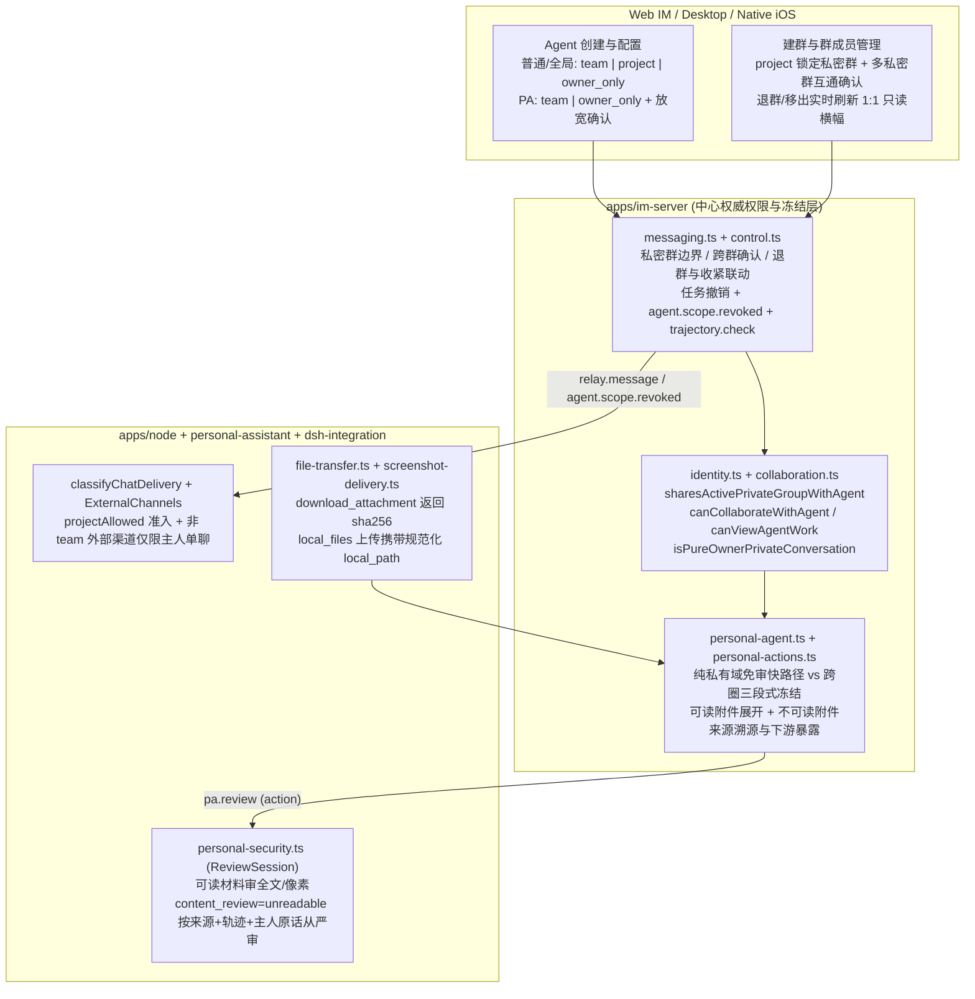
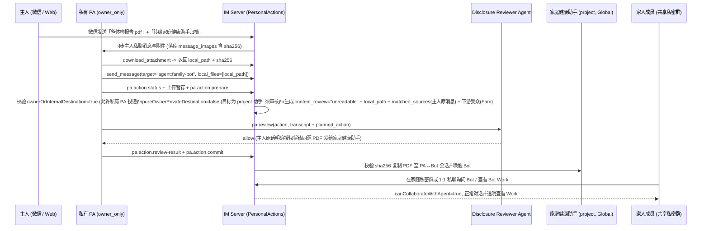

# feat-803: Agent 项目级协作权限、PA 内部转发与不可读附件披露审核 — 技术方案

> 对齐: [spec.md](spec.md) v1

## Changelog

## 现状分析

### 涉及范围

- `packages/product-contracts/src/collaboration.ts`、`configuration.ts`、`configuration-rpc.ts`、`index.ts`：共享枚举 `CollaborationScope` 当前仅包含 `'team' | 'owner_only'`，未表达普通与全局助手的 `'project'` 档位及个人助手（PA）保持两档的区分；`ChatAddress` 与 `classifyChatDelivery` 缺少 `'project'` 档位的站内许可标识；`ChatAttachment` 尚未携带待审本地上传路径元数据供 `pa.action.prepare` 绑定。
- `apps/im-server/src/schema.sql`、`db.ts`、`identity.ts`、`collaboration.ts`、`contacts.ts`、`conversation-access.ts`、`messaging.ts`、`message-records.ts`、`threads.ts`、`task-context-access.ts`、`work.ts`、`trajectory.ts`、`control.ts`、`control-routes.ts`、`personal-agent.ts`、`personal-agent-creation.ts`、`personal-actions.ts`：
  1. **数据库与配置边界**：`agent_profiles.collaboration_scope` 的 SQLite `CHECK` 约束硬编码为 `IN ('team','owner_only')`（而 `pa_binding_scopes` 仅用于 PA，应继续限制为两档）；`control.ts` / `control-routes.ts` 尚未拦截将 PA 设为 `'project'`，也尚未对从 `'owner_only'` 放宽至 `'project' | 'team'` 提供显式确认保护。
  2. **动态同项目圈与群治理缺失**：`identity.ts` 的 `canTeamContactAgent`、`canViewAgentWork`、`currentActorCanAccess` 与 `collaboration.ts` 的 `canAgentAccessConversation`、`groupHasPrivateAgent`、`applyCollaborationScopeTransitionInTx` 仅二元区分 `'team'` 与 `'owner_only'`；缺少基于「当前共同处于至少一个未解散私密群（`visibility='private'`, `external_source IS NULL`, `dissolved_at IS NULL`）」的动态同项目成员判定，缺少 `'project'` 全局助手跨非重叠私密群加入确认，缺少成员退群/被移出/群解散或 `'team' -> 'project'` 收紧时对失权 1:1 私聊冻结、任务上下文撤销、在途气泡清理及原生轨迹 WebSocket 断开的联动。此外，`message-records.ts:432` 的回执追踪硬判 `a.collaboration_scope='team'`，未覆盖 `'project'` 助手所在的私密群与同项目私聊。
  3. **PA 免审边界与不可读附件（PDF 等）出站审核阻塞**：
     - `messaging.ts:126` 与 `personal-actions.ts` 当前仅对 `ownerConversation`（主人与 PA 的专属 1:1 私聊）免除披露审核，尚未覆盖纯主人私有域（仅含主人本人与同主人 `'owner_only'` 助手的内部会话）；而当 PA 向同主人 `'project'` / `'team'` 助手发消息时，`evidence.recipient` 未标明目标非 PA 助手的 `collaboration_scope` 及其下游可见成员范围（项目私密群成员或全团队有效成员）。
     - `personal-actions.ts:724` 对所有非静态光栅图、非 `≤ 256 KiB` UTF-8 文本的附件一律在 `prepare` 阶段硬抛 `409 attachment_content_review_unavailable`，导致 PDF、Office、压缩包等通用附件（`≤ 25 MiB`）在进入独立披露审核 Agent 前即被拦截；同时 `prepareLocalAttachments` 上传后丢弃了本地规范化路径 `local_path`，`download_attachment` 返回值未包含 `sha256`，且 `personal-security.ts:646` 的 PA 系统提示词明确要求 PA 放弃向非主人目标发送非图文/非小文本文件。
- `packages/personal-assistant/src/`、`packages/dsh-integration/src/`、`apps/node/src/`：
  - `packages/dsh-integration/src/index.ts:92` 将 `AgentConfiguration.collaborationScope` 窄化为 `'team' | 'owner_only'`；`packages/personal-assistant/src/attention.ts`、`global-agent.ts`、`single-thread.ts`、`external.ts` 与 `apps/node/src/main.ts` 需同步支持 `'project'` 档位（站内由中心精确下发 `project_allowed` 准入事实，外部渠道对非 `'team'` 助手仅放行已绑定主人单聊，配置收紧时经既有 `agent.scope.revoked` 与 `configuration.restrictChat` 清退失权会话）；
  - `packages/personal-assistant/src/screenshot-delivery.ts` 与 `apps/node/src/file-transfer.ts` 需在本地附件暂存与下载链路补齐 `local_path` 和 `sha256` 真实来源元数据；`packages/dsh-integration/src/personal-security.ts` 需将不可读附件投影为 `content_review: 'unreadable'` 快照并补充不可读材料的从严审核准则与 PA 工具说明（不新增任何 PDF 解析、渲染或专用读取工具）。
- `src/IM/frontend/src/` 与 `src/IM/ios/NanoIM/`：Web（含 Desktop 复用前端）与原生 iOS 的普通/全局 Agent 新建与配置页、放宽确认弹窗、新建群聊与群成员添加防呆及跨私密群确认、历史 1:1 私聊项目级只读提示（PA 新建与设置页保持两档不变）。

### 既有约束

- **架构红线（[AGENTS.md](../../../AGENTS.md)、[SPEC.md](../../../SPEC.md)）**：不修改 DSH 运行时源码或引入私有 `@deepseek-ai/*` 导入；不新增 PDF 文本提取、页面光栅化或专用文档读取工具；`apps/node` 仅经 `@nano/dsh-integration/client` 管理子进程；`PA/Channels/IM` 严格保持单向包依赖边界。
- **多租户与观察权隔离（`docs/specs/im/auth-tenancy.md`）**：不改写存量 `agent_profiles.space_id`；PA 的 Work 与原生轨迹在任何档位下始终仅主人本人可见；公司空间异常跨空间双 Agent 直聊不因 `'project'` 准入而越权暴露；`'project'` 与 `'owner_only'` 助手均不得获得公开群（`visibility='public'`）的非成员读取、搜索或加入权。
- **Prompt Cache 前缀与会话连续性（`packages/dsh-integration/src/agent-config.ts`）**：`collaborationScope` 继续排除在执行指纹之外，三档之间任意切换均原地热更新，不触发会话重建或缓存分界线；对 `personal-security.ts` 中 PA 根提示词与披露审核提示词的最小文本更新需保持静态段确定性（与会话动态状态无关）。

### 可复用能力

- **扩展 `identity.ts` + `collaboration.ts` 中心权限谓词与事务收口（改）**：在 `feat-796` 已落地的 `canTeamContactAgent`、`canViewAgentWork`、`canAgentAccessConversation`、`applyCollaborationScopeTransitionInTx` 与 `agent.scope.revoked` 基础上扩展动态私密群共处谓词 `sharesActivePrivateGroupWithAgent` 与 `canCollaborateWithAgent`，并将同一套会话冻结/任务撤销/在途清理/轨迹踢出逻辑复用到群成员移除与群解散路径。
- **复用 `PersonalActions` 三段式冻结提交协议与 `ReviewSession` 只读审核 Agent（改）**：对纯主人私有域直接在 `prepareChecked` 事务内完成哈希校验、附件复制与 `state='confirmed'` 提交（命中 `PersonalAssistant.send` 既有快路径）；对非私有域的不可读附件保留完整三段式协议，仅补充服务端验证过的来源元数据（`local_path`、`matched_sources`）与目标非 PA 助手的下游暴露范围，交由现有 `ReviewSession` 判断。
- **复用 Web `MessagePane` 与 iOS `ConversationView` 只读横幅及配置确认流（改）**：扩展 `write_blocked_reason: 'agent_project_restricted'`，复用既有只读态下保留个人置顶/免打扰与移除会话体验。

### 相关历史

- `feat-796-agent-privacy-scope`：建立了 `'team' | 'owner_only'` 双档可见性、内部会话互通、切换清退、`agent.scope.revoked` 及 Web/iOS 双端防呆基础。
- `feat-794-wechat-channel`：接入个人微信 1:1 主人通道与 PDF 等入站媒体解密镜像，是用户通过微信经 PA 向名下专项助手转发体检 PDF 的直接上游入口。

## 架构总览

围绕「普通/全局助手三档（`owner_only` / `project` / `team`）+ 个人助手两档（`owner_only` / `team`）」建立统一的中心判定、节点入站过滤与 PA 分级出站审核闭环：

## 关键决策

1. **普通/全局助手升级为 `'team' | 'project' | 'owner_only'` 三档，PA 严格保持 `'team' | 'owner_only'` 两档，SQLite 采用无损表重建放宽 `agent_profiles` 检查约束**
   - **理由**：在不影响存量 `'team' | 'owner_only'` 数据的前提下，`openDatabase` 在开启业务迁移事务前检测 `agent_profiles` 表定义：若 `CHECK` 尚未包含 `'project'`，临时关闭 `foreign_keys` 重建 `agent_profiles`（严守原列顺序并恢复 `agent_lifecycle_created` 触发器，避免触发 `agent_channels` / `agent_lifecycle` / `agent_deletions` 的 `ON DELETE CASCADE`），随后恢复 `foreign_keys=ON` 并执行 `foreign_key_check`；`pa_binding_scopes` 保持两档约束，同时在 `personal-agent.ts`、`control.ts` 与 `control-routes.ts` 对绑定为 PA 的 Agent 传入 `'project'` 时统一返回 `422 invalid_collaboration_scope`。
   - **拒绝备选**：新增独立 `agent_projects` 实体表维护成员名单——增加重复管理负担且与私密群成员状态极易漂移。

2. **以未解散站内私密群共处关系动态定义 `project` 同项目成员，统一驱动通讯录、1:1 私聊、群治理与 Work/原生轨迹透明度**
   - **理由**：定义 `sharesActivePrivateGroupWithAgent(db, userId, agentId)` 判定双方是否共同处于至少一个 `type='group' AND visibility='private' AND external_source IS NULL AND dissolved_at IS NULL` 的会话中，并由此导出 `canCollaborateWithAgent(db, viewer, profile)`：
     - **发现、私聊与 Work**：普通/全局 `'project'` 助手对主人及 `canCollaborateWithAgent` 为真的同项目成员开放 `/im/v1/contacts`、`/im/v1/contacts/:user_id`、1:1 私聊创建与读写、以及 `Work` 和全部 4 处原生轨迹/附件鉴权（PA 的 Work 仍严格仅主人本人可见）；圈外成员一律不可见、访问资料/Work 返回 404。
     - **入群与群可见性边界**：仅助手主人本人可将名下助手拉入群聊（非主人尝试拉他人可见的 `'project'` 助手入群时明确返回 `403 { code: 'agent_owner_required' }` 而非笼统 404）；含 `'project'` 或 `'owner_only'` 助手的群强制 `visibility = 'private'` 且不可改为 `'public'`（显式创建公开群或将 `'project'` 助手加入公开群返回 `409 { code: 'project_agent_requires_private_group' }`）。
     - **多私密群跨上下文轻提示确认**：当主人将 `work_mode === 'global'` 且 `collaboration_scope === 'project'` 的助手新建或加入私密群 `G_target`（或向含该助手的私密群添加新外部成员），若该助手已在另一含外部真人成员的未解散私密群中、且两群的外部真人成员集合不完全相同时，未传 `confirm_project_context_share: true` 则返回 `409 { code: 'project_agent_cross_group_confirmation_required', agent_ids }`；前端弹出跨群记忆与工作区互通提示，主人确认后携带 `confirm_project_context_share: true` 重试即入群。
     - **从 `'owner_only'` 放宽确认**：当存量配置为 `'owner_only'` 而新配置为 `'project'` 或 `'team'` 时，`PATCH /im/v1/agents/:id/config` 要求 `confirm_scope_widen: true`（否则返回 `409 { code: 'scope_widen_confirmation_required' }`），前端在保存前向主人明确提示历史私有记忆与工作区可能被协作者接触。

3. **统一收敛「退群 / 移除成员 / 解散私密群 / 档位收紧」的会话冻结与实时清退事务**
   - **理由**：提取通用失权对账函数，在以下两类事务中一致执行：
     1. **档位切换（`applyCollaborationScopeTransitionInTx`）**：`'team' -> 'project'` 时自动退出全部公开群（保留私密群），并对当前无共同私密群的外部成员冻结历史 1:1 私聊；`'team' | 'project' -> 'owner_only'` 时退出全部非纯主人内部群并冻结全部外部 1:1 私聊；向更宽档位切换时广播恢复可写的历史私聊。
     2. **私密群成员变动或解散（`DELETE /participants/:user_id` 与 `dissolveConversation`）**：预先对受影响 `'project'` 助手捕获全量任务上下文资格（覆盖群会话及关联 1:1 私聊）；变更后对失去最后一个共同私密群的 `(projectAgent, member)` 组合，清理该 1:1 私聊中的未完成流式气泡、待决权限请求与未发 relay，撤销失权任务上下文，广播 `conversation.membership_changed`（客户端立即刷新为 `can_write: false, write_blocked_reason: 'agent_project_restricted'`），向节点下发 `agent.scope.revoked`，并调用 `trajectory.check()` 立即断开失权成员的实时原生轨迹连接。当双方再次进入同一未解散私密群时，同步广播该 1:1 私聊恢复 `can_write: true`。

4. **精确分离 PA 的「同主人内部可达域」与「纯主人私有免审域」，并在跨圈投递时显式暴露目标助手下游受众**
   - **理由**：
     - **可达域（`ownerOrInternalDestination`）**：保持匹配主人专属私聊及仅含同一 `owner_id` 成员与名下助手的站内内部会话——因此 `'owner_only'` 私有 PA 允许向同主人名下的 `'project'` 或 `'team'` 助手发起 1:1 投递（仍禁止向外部真人或含外部真人的群聊发言）。
     - **免审域（`pureOwnerPrivateDestination`）**：仅当目标为 `ownerConversation`（Web 主人私聊或飞书/微信已绑定主人 1:1 单聊）或 `isPureOwnerPrivateConversation`（参与者仅含主人本人与同主人 `'owner_only'` 助手的非公开站内会话）时免除披露审核。免审站内会话在 `PersonalActions.prepareChecked` 内直接完成哈希核验、附件复制与 `state='confirmed'` 落库（不限附件格式与页数，`≤ 25 MiB`）。
     - **跨圈受众透明化**：一旦目标会话包含同主人 `'project'` 或 `'team'` 非 PA 助手，强制进入独立出站披露审核，并在 `evidence.recipient` 中为每个 Agent 成员附上 `collaboration_scope`，同时标注下游潜在读者（含非 PA `'team'` 助手时标记 `'eligible_company_members_via_team_agent'`；含非 PA `'project'` 助手时标记 `'shared_private_group_members_via_project_agent'` 并列出当前共享私密群的外部成员），防止审核器把发给项目/团队助手的 1:1 消息误判为仅主人可见。

5. **不引入任何 PDF 解析或读取工具，将 PDF 等二进制附件统一作为「内容不可读材料（`content_review: 'unreadable'`）」纳入现有出站披露审核 Agent**
   - **理由**：遵循用户明确约束，避免引入脆弱复杂的文档拆解工具链：
     - **可读附件保持原样**：静态光栅图片（`PNG/JPEG/WebP`）继续解码校验并作为多模态 `ImageBlock` 送审（损坏或超限光栅图仍 fail-closed 拒绝，防止伪装图片绕过像素审阅）；`≤ 256 KiB` 严格 UTF-8 文本继续内联全文并标记 `content_review: 'inline_text'`。
     - **不可读通用附件放行入审**：其余合法非光栅通用附件（如 `application/pdf`、Office 文档、压缩包、超 256 KiB 数据文件等，`≤ 25 MiB`）不再在 `PersonalActions.attachments` 抛 `409 attachment_content_review_unavailable`，而是生成带 `file: true, content_review: 'unreadable'` 的冻结快照，并附带两项服务端可信来源证据：(a) 若经 `local_files` 上传，保留规范化绝对路径 `local_path`；(b) 服务端按精确 `sha256` 在 PA 当前可读会话的真实已发布消息附件中检索同哈希来源 `matched_sources`（含 `conversation_id`、`message_id`、`sender`、`is_owner`、`file_name`）；同时 `download_attachment` 工具返回结果补充计算出的 `sha256`，使 `<conversation_transcript>` 与 `<planned_action>` 形成完整哈希闭环。
     - **从严审核准则**：在 `personalReviewPolicy('action')` 中明确对 `content_review="unreadable"` 附件适用更严格标准——因内部字节不可读，仅当主人原始原话结合 `local_path` / `matched_sources` 与可见执行轨迹能够确定主人已明确授权向当前受众（含目标助手下游暴露范围）发送该特定文件（或该文件在当前可见轨迹中完全由获准公开给该受众的材料生成、未混入未审阅私有来源）时才返回 `allow`；否则一律返回 `deny` 或 `needs_owner`，绝不仅凭文件名猜测内容安全。

6. **在 `docs/specs/im/auth-tenancy.md` 维护唯一权威的 Agent 多档权限统一矩阵表**
   - **理由**：`auth-tenancy.md` 是 IM 空间、对象可见性与会话准入的根契约；在此集中维护一张覆盖 PA（两档）与普通/全局 Agent（三档）全维度行为的权威对照表，并从 `docs/README.md` 及 `agents-nodes.md`、`personal-agent.md`、`conversations-messages.md`、`agent-work.md`、`gateway/personal-agent.md` 链接引用，满足单一事实源原则。

## 接口与数据流

### 1. 协议、数据库与 API 契约增量

1. **配置与联系人接口**
   - `CollaborationScope`：`'team' | 'project' | 'owner_only'`（PA 创建 `POST /im/v1/personal-agent` 及 PA 配置 `PATCH /im/v1/agents/:id/config` 仅接受 `'team' | 'owner_only'`，传 `'project'` 返回 `422 invalid_collaboration_scope`）。
   - `PATCH /im/v1/agents/:id/config`：新增可选布尔字段 `confirm_scope_widen?: boolean`；当 `existing.collaboration_scope === 'owner_only'` 且目标档位为 `'project' | 'team'` 时，未传 `confirm_scope_widen: true` 返回 `409 { code: 'scope_widen_confirmation_required', message }`。
   - `personal-agent-creation.ts`：`agent_creation(action="options")` 的 `collaboration_scope` 字段说明同步包含 `team`、`project`、`owner_only` 三档语义。
   - `GET /im/v1/contacts` 与 `GET /im/v1/contacts/:user_id`：对本人返回全部非 stale 助手及 `collaboration_scope`；对其他有效团队成员返回 `canCollaborateWithAgent(db, viewer, row)` 为真的助手（含 `'team'` 助手/公开 PA，以及与查看者共享至少一个未解散私密群的 `'project'` 普通/全局助手）。

2. **群聊创建、加人、退群与会话访问接口**
   - `POST /im/v1/conversations` 与 `POST /im/v1/conversations/:id/participants`：
     - 支持可选布尔字段 `confirm_project_context_share?: boolean`；当 `'project'` 全局助手跨成员不完全重叠的多个私密群共享上下文且未传该确认标志时，返回 `409 { code: 'project_agent_cross_group_confirmation_required', agent_ids, message }`。
     - 非主人尝试添加他人可见 `'project'` 助手入群返回 `403 { code: 'agent_owner_required', message }`；向公开群添加 `'project'` 助手或创建含 `'project'` 助手的公开群返回 `409 { code: 'project_agent_requires_private_group', message }`。
   - 会话快照 `write_blocked_reason`：扩展支持 `'agent_project_restricted'`（对端为他人 `'project'` 助手且当前无共同未解散私密群）；与 `'agent_private'` 一样保留历史可读、允许个人 `is_pinned` / `is_muted` 修改及删除本地直聊，向其发消息返回 `403 { code: 'agent_project_restricted', message }`。

3. **PA 出站准备与披露审核载荷**
   - `prepareLocalAttachments`：向 `pa.action.prepare` 传递的附件项附带规范化 `local_path`（落库公开消息时仅保留 `{ url, content_type, file_name }`，不向外部受众暴露主人本机路径）。
   - `download_attachment`：返回 `{ attachment_id, local_path, file_name, content_type, byte_size, sha256 }`。
   - `PersonalActions.prepare` 冻结的 `attachment_snapshots`：
     - 可读文本：`{ ..., text, content_review: 'inline_text', ...(local_path ? { local_path } : {}) }`
     - 光栅图片：`{ ..., image: true, width, height, content_review: 'inline_image', ...(local_path ? { local_path } : {}) }`
     - 不可读通用文件：`{ ..., file: true, content_review: 'unreadable', ...(local_path ? { local_path } : {}), ...(matched_sources.length ? { matched_sources } : {}) }`

### 2. 核心时序：微信 PDF 经私有 PA 转发至项目级家庭助手并同步家庭私密群协作

### 3. 模型可见上下文与生命周期影响

遵循 [Agent Context Engineering](../../development/agent-context-engineering.md) 说明：

- **Consumer**：
  1. **主 PA**（通过系统提示词理解附件外发与同主人助手协作边界，使用 `download_attachment`、`send_message` 与 `agent_creation`）；
  2. **独立出站披露审核 Agent（`nano-codex-reviewer`）**（消费 `<conversation_transcript>` 与 `<planned_action>` 判定是否放行含 `content_review="unreadable"` 附件或发往 `'project' | 'team'` 助手的动作）；
  3. **处于 `'project'` 档位的普通/全局 Agent**（接收主人、同主人内部会话、所加入私密群及同项目成员 1:1 私聊输入；成员退圈或收紧档位时撤回失权待发输入）。
- **Context Lifecycle & Before / After**：
  - **PA 系统提示词（`personal-security.ts` `nano-personal-agent` 段）**：
    - *Before*：提示非主人目标仅支持可审阅静态图片与 `≤ 256 KiB` UTF-8 文本，导致模型遇到 PDF 直接放弃调用 `send_message`。
    - *After*：说明发往主人私聊及纯主人私有会话免审；发往其他受众时，静态图片与 `≤ 256 KiB` UTF-8 文本按内容审阅，PDF 等二进制文件按不可读材料核对主人明确授权与文件来源身份后可发送。静态文本固定，不影响会话内缓存命中。
  - **`download_attachment` 工具输出与 `<planned_action>` 证据闭合**：
    - *Before*：`download_attachment` 无 `sha256`，`<planned_action>` 丢失 `local_files` 的 `local_path` 且无原消息同源证明，非图文小文本在服务端直接 409 拒审；发给同主人 `'project' | 'team'` 助手时 `audience` 未体现该助手的共享范围。
    - *After*：`download_attachment` 输出含 `sha256`；`<planned_action>` 的附件条目携带 `content_review`、`local_path`（本地上传时）与服务端核实的 `matched_sources`，`audience` 携带目标非 PA 助手的 `collaboration_scope` 与下游可见范围说明。
  - **披露审核策略（`personalReviewPolicy('action')`）**：
    - 保持单段确定性策略文本，新增对 `content_review="unreadable"` 附件的严格来源与原始授权核验规则，不新增任何审核工具 Schema，保持 `ReviewSession` 既有 4 个只读工具与增量 checkpoint 复用不变。
  - **失权撤回**：当成员退出最后一个共同私密群或助手收紧档位时，复用 `agent.scope.revoked` + `configuration.restrictChat` 撤回尚未消费的待发输入与任务上下文。
- **Validation**：单元与集成测试验证：(1) `personalReviewAction` 正确投影 `content_review: 'unreadable'`、`local_path`、`matched_sources` 及 `'project' | 'team'` 助手的下游暴露标记（且向公开消息落库时不泄露 `local_path`）；(2) PA 向同主人 `'owner_only'` 助手发 PDF 走免审快路径，向同主人 `'project'` 助手发 PDF 强制触发审核并携带项目受众暴露信息；(3) `collaborationScope` 切换为 `'project'` 不改变运行时执行指纹。

### 4. 现有 UX Grounding（无需独立 HTML 原型）

所有界面改动均复用 Web 与原生 iOS 现有的配置表单选择器、确认弹窗、建群/加人弹窗与会话只读提示横幅，无新页面骨架或复杂自定义布局，不单独生成 `prototype.html`：

| 当前产品入口 | 画面与操作基线 | 沿用或改善的体验及原因 | 本次设计 |
|---|---|---|---|
| Web & iOS 普通/全局 Agent 新建与配置页（`agent-create-page.tsx`、`agent-detail-page.tsx`；iOS `AgentsView.swift`、`AgentConfigView.swift`） | 现有协作范围选择器含「团队公开 / 私有」两项；从公开切私有时显示自动退群与冻结私聊提示 | 保持同一选择器位置与交互，让主人一眼区分三档适用圈层，并在从私有放宽时防误泄密 | 普通/全局 Agent 展示三档：「团队公开」（默认）/「项目级（共同私密群成员可见与私聊）」/「私有（仅自己与名下助手）」；从「团队公开」切「项目级」提示自动退出公开群并冻结非同项目私聊；从「私有」切「项目级」或「团队公开」保存时弹出放宽确认提示。PA 创建与配置页保持原有两档不变 |
| Web & iOS 新建群聊与群详情添加成员（Web `new-group-modal.tsx`、`group-settings.tsx`、`chat-workspace-page.tsx`；iOS `NewChatView.swift`、`ChatInfoView.swift`） | 勾选本人「私有」助手时自动锁定私密并禁用外部同事 | 「项目级」助手需要与同项目真人共处私密群，但不能进公开群，且跨多个非重叠私密群需防背景串味 | 勾选本人「项目级」助手时自动锁定群可见性为私密，**保留**勾选团队真人成员能力；群内含「项目级」助手时同样锁定群可见性为私密但允许继续添加真人成员（仅创建者/主人可添加本人助手）；当服务端返回跨非重叠私密群确认码时弹出轻提示确认后提交 |
| 历史 1:1 私聊面板（Web `message-pane.tsx`；iOS `ConversationView.swift`） | `write_blocked_reason === "agent_private"` 时隐藏输入框并展示私有未开放说明，保留置顶/免打扰 | 成员退出全部共同私密群后需要准确理解为何不能继续私聊该项目级助手 | 新增识别 `write_blocked_reason === "agent_project_restricted"`，隐藏输入框与分支操作、保留历史阅读与个人置顶/免打扰/移除会话，并以当前语言展示“该助手仅面向同项目私密群成员开放，当前无法继续发送消息”；再次共处私密群后自动恢复可写 |

## 本次审查安排

| 审查编组 | 必须回答的问题 / 对应目标 | 能力与使用阶段 | 证据方法、范围与共享定位 |
|---|---|---|---|
| `G1-code-and-contracts` | 1. 三档/两档边界、动态私密群共处谓词、退群/解散/档位收紧事务一致性、SQLite 无损迁移与双端契约是否闭合且无租户/观察权回归；2. 纯主人私有免审域、私有 PA 向名下项目/团队助手投递及不可读附件来源溯源是否防伪严密；3. 11 份 delta-spec（含权威统一权限矩阵表）是否与实现及长青契约完全一致 | `change-code-review`（实施完成后独立审查） | 审查 `origin/develop...HEAD` 完整提交与最终 delta-specs；核验 `pnpm build && pnpm typecheck && pnpm check:ios-runtime && pnpm test`、`npm --prefix src/IM/frontend run test`、`pytest -m "not e2e" -q`、`ruff check .` 与 `./scripts/docs-check` 结果 |
| `G2-context-and-ux` | 1. PA 系统提示词、`download_attachment` 返回值、`<planned_action>` 不可读附件来源/下游受众投影及 `personalReviewPolicy('action')` 是否让模型与审核器在无专用 PDF 工具下准确放行合规转发并拦截越权黑盒文件；2. Web 桌面（`1280x820`）与移动（`390x844`）视口下三档/两档配置、放宽确认、私密群协作与多私密群互通提示、退群后 1:1 私聊只读冻结与重入恢复是否清晰可操作 | `agent-context-review` + `frontend-experience-review`（作者自检 + 同一独立审查编组联合验收） | 亲自读取 `personal-security.ts`、`personal-actions.ts` 与测试生成的实际 `<planned_action>` / 审核输入样本核查 Context 完整性；在隔离真栈（`./scripts/e2e-up.sh --wt "$WT_ROOT"`）用多账号在桌面与移动浏览器实测完整权限与私密群/退群/只读恢复旅程并保存截图证据（验证后执行 `./scripts/e2e-down.sh --wt "$WT_ROOT"` 回收） |

## 契约层增量 (delta-spec)

- IM 包入口职责摘要与领域 Requirement 计数：[specs/im/spec.md](specs/im/spec.md)（对应 [docs/specs/im/spec.md](../../specs/im/spec.md)）
- IM 权威统一 Agent 权限矩阵表与数据面/空间叠加规则：[specs/im/auth-tenancy.md](specs/im/auth-tenancy.md)（对应 [docs/specs/im/auth-tenancy.md](../../specs/im/auth-tenancy.md)）
- IM 普通/全局 Agent 三档协作范围、目录可见性与切换规则：[specs/im/agents-nodes.md](specs/im/agents-nodes.md)（对应 [docs/specs/im/agents-nodes.md](../../specs/im/agents-nodes.md)）
- IM 个人助手两档保持、内部跨档沟通与代建三档选项：[specs/im/personal-agent.md](specs/im/personal-agent.md)（对应 [docs/specs/im/personal-agent.md](../../specs/im/personal-agent.md)）
- IM 私密群项目级助手治理、多群互通确认与退群后 1:1 私聊只读恢复：[specs/im/conversations-messages.md](specs/im/conversations-messages.md)（对应 [docs/specs/im/conversations-messages.md](../../specs/im/conversations-messages.md)）
- IM 项目级全局助手 Work 与原生轨迹向同项目成员透明开放及失权断开：[specs/im/agent-work.md](specs/im/agent-work.md)（对应 [docs/specs/im/agent-work.md](../../specs/im/agent-work.md)）
- Web IM 建群/加人项目级防呆、多私密群确认与项目级历史私聊只读横幅：[specs/im/web-chat-ux.md](specs/im/web-chat-ux.md)（对应 [docs/specs/im/web-chat-ux.md](../../specs/im/web-chat-ux.md)）
- 原生 iOS 三档/两档配置、放宽与多群确认及项目级历史私聊只读说明：[specs/im/ios-client.md](specs/im/ios-client.md)（对应 [docs/specs/im/ios-client.md](../../specs/im/ios-client.md)）
- Gateway PA 纯私有免审边界、跨圈下游暴露及不可读附件（PDF 等）从严披露审核：[specs/gateway/personal-agent.md](specs/gateway/personal-agent.md)（对应 [docs/specs/gateway/personal-agent.md](../../specs/gateway/personal-agent.md)）
- Gateway 全局 Agent 在项目级私密群中的信号接收策略：[specs/gateway/global-agent.md](specs/gateway/global-agent.md)（对应 [docs/specs/gateway/global-agent.md](../../specs/gateway/global-agent.md)）
- Gateway 群聊路由、产品工具投递与话题唤醒对项目级档位的支持：[specs/gateway/routing-delivery.md](specs/gateway/routing-delivery.md)（对应 [docs/specs/gateway/routing-delivery.md](../../specs/gateway/routing-delivery.md)）

## 风险与回退

- **SQLite `agent_profiles` 检查约束升级安全性**：存在多张子表通过 `ON DELETE CASCADE` 引用 `agent_profiles(agent_id)`；若在 `foreign_keys=ON` 下 `DROP TABLE` 会清空通道与生命周期表。迁移严格在事务外先设 `PRAGMA foreign_keys=OFF`、在独占事务内按原列名显式拷贝并重建表与 `agent_lifecycle_created` 触发器，提交后恢复 `PRAGMA foreign_keys=ON` 并校验 `PRAGMA foreign_key_check`，由专门迁移单测守护子表数据零丢失。
- **本机路径隐私边界**：`local_path` 仅存在于节点发往 `pa.action.prepare` 的内部参数及送交本机 `ReviewSession` 的冻结证据中，`PersonalActions.commit` 写入 `messages.attachments_json` 时只保留 `{ url, content_type, file_name }`，绝不向会话成员暴露主人电脑目录结构。
- **回退方案**：若需回退，将已设为 `'project'` 的普通/全局助手改回 `'owner_only'` 或 `'team'` 后即可直接回滚代码，历史会话与消息记录无损保留。

## 一次性部署迁移

无。`openDatabase` 启动时幂等升级 `agent_profiles` 的 `CHECK` 约束，存量 `'team' | 'owner_only'` 行保持原语义，无需人工执行 `deployment-prompt.md`。

## Runbook for Reviewer

| 服务 | 停止命令 | 启动命令 | 健康检查 |
|---|---|---|---|
| 隔离 IM + Gateway 测试栈 | `./scripts/e2e-down.sh --wt "$WT_ROOT"` | `npm --prefix src/IM/frontend run build && ./scripts/e2e-up.sh --wt "$WT_ROOT"` | `source "$WT_ROOT/.e2e-ports.env" && curl -fsS "$IM_URL/health" >/dev/null` |

**Review 驱动方式**:
1. 运行窄测试与全仓门禁：`pnpm build && pnpm typecheck && pnpm check:ios-runtime && pnpm test`、`npm --prefix src/IM/frontend run test`、`npm --prefix src/IM/frontend run build`、`pytest -m "not e2e" -q`、`ruff check .`、`./scripts/docs-check`。
2. 构建前端后启动隔离真栈 `./scripts/e2e-up.sh --wt "$WT_ROOT"`，在桌面（`1280x820`）与移动（`390x844`）浏览器视口下，使用主人账号、同私密群项目成员账号与圈外同事账号验证：普通/全局助手三档与 PA 两档配置、从私有放宽确认、拉入私密群后同项目成员可见/1:1 私聊/Work 透明而圈外成员 404、拉入成员不重叠的第二个私密群触发互通确认、退群后 1:1 私聊自动变为项目级只读横幅且重新入群后恢复可写；验证完毕执行 `./scripts/e2e-down.sh --wt "$WT_ROOT"` 回收全部隔离进程与端口。

**验收前置**: 无仓库外硬件或专有外部凭据依赖；本机隔离测试栈即可完成全部验证。

## Milestones

| ID | 标题 | 依赖 | 并行组 | 范围 | 退出标准 |
|---|---|---|---|---|---|
| `M1-project-scope-and-pa-review` | 项目级协作权限、PA 内部免审边界、不可读附件从严披露审核与权威权限矩阵全链路实现 | 无 | `G1` | `packages/product-contracts/`、`packages/dsh-integration/`、`packages/personal-assistant/`、`apps/node/`、`apps/im-server/`、`src/IM/frontend/`、`src/IM/ios/`、`docs/` | `[reviewer]` 1. Web、原生 iOS 与 PA 代建对普通/全局助手提供「团队公开 / 项目级 / 私有」三档，PA 创建与设置保持「团队公开 / 私有」两档；2. 项目级助手未进私密群时仅主人及名下助手可见，主人拉入私密群后同群有效成员可在通讯录看到该助手、群内互动、1:1 私聊并查看其 Work 与原生轨迹（PA Work 仍仅主人可见），圈外成员均不可见不可访问，禁止进公开群或由非主人拉群，跨非重叠私密群加入全局项目级助手以及从私有放宽档位均有明确风险确认；3. 成员退出全部共同私密群、群解散或助手从团队公开收紧至项目级时，无共同私密群成员的历史 1:1 私聊自动转为只读并停止未完成协作、断开实时轨迹连接，再次共享私密群或放宽为团队公开后自动恢复可写；4. PA 向主人私聊及同主人私有档助手免审直达任意合规消息与附件（含 PDF），私有档 PA 允许向同主人项目级/团队公开助手发起经审核的 1:1 投递，PDF 等不可读附件作为不可读材料连同真实来源与下游受众交由披露审核器从严核验（合规指定文件放行送达、未获明确授权的黑盒文件严格拦截，不新增专用 PDF 读取工具）；5. 长青规范维护唯一权威的 Agent 多档权限统一矩阵表且各关联网页引用一致。 `[worker]` 1. SQLite `agent_profiles` 约束无损升级（保留 `ON DELETE CASCADE` 关联子表全部记录）、`download_attachment` 返回 `sha256`、`<planned_action>` 投影 `content_review='unreadable'` / `local_path` / `matched_sources` 及下游助手受众暴露且落库公开消息不泄露本机路径；2. 新增并跑通覆盖 `product-contracts`、`im-server`、`personal-assistant`、`dsh-integration`、`node`、`frontend` 与 `ios` 的单元/集成测试；3. `pnpm build && pnpm typecheck && pnpm check:ios-runtime && pnpm test`、`npm --prefix src/IM/frontend run test`、`npm --prefix src/IM/frontend run build`、`pytest -m "not e2e" -q`、`ruff check .` 与 `./scripts/docs-check` 全部通过；4. 完成隔离真栈桌面与移动视口浏览器实测、留存关键状态截图证据并完整回收隔离服务资源。 |
