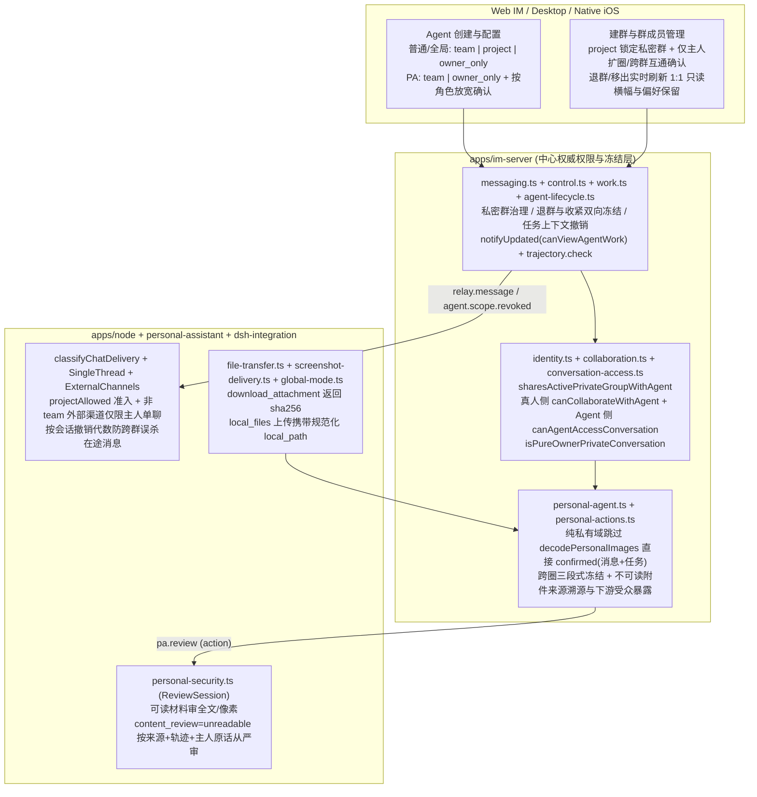

# feat-803: Agent 项目级协作权限、PA 内部转发与不可读附件披露审核 — 技术方案

> 对齐: [spec.md](spec.md) v1

## Changelog

## 现状分析

### 涉及范围

- `packages/product-contracts/src/collaboration.ts`、`configuration.ts`、`configuration-rpc.ts`、`index.ts`：共享枚举 `CollaborationScope` 当前仅包含 `'team' | 'owner_only'`，未表达普通与全局助手的 `'project'` 档位及个人助手（PA）保持两档的区分；`ChatAddress` 与 `classifyChatDelivery` 缺少 `'project'` 档位的站内许可标识；`ChatAttachment` 尚未携带待审本地上传路径元数据供 `pa.action.prepare` 绑定。
- `apps/im-server/src/schema.sql`、`db.ts`、`identity.ts`、`collaboration.ts`、`contacts.ts`、`conversation-access.ts`、`conversation-actions.ts`、`messaging.ts`、`message-records.ts`、`threads.ts`、`task-context-access.ts`、`task-graphs.ts`、`agent-lifecycle.ts`、`work.ts`、`trajectory.ts`、`control.ts`、`control-routes.ts`、`personal-agent.ts`、`personal-agent-creation.ts`、`personal-actions.ts`：
  1. **数据库与配置边界**：`agent_profiles.collaboration_scope` 的 SQLite `CHECK` 约束硬编码为 `IN ('team','owner_only')`（而 `pa_binding_scopes` 仅用于 PA，应继续限制为两档）；`control.ts` / `control-routes.ts` 尚未拦截将 PA 设为 `'project'`，也尚未对从 `'owner_only'` 放宽至 `'project' | 'team'` 提供显式确认保护；`personal-agent-creation.ts:21` 的 `fields.collaboration_scope` 仅描述两档。
  2. **动态同项目圈、Agent 侧访问谓词与实时广播缺口**：
     - `identity.ts`（`canTeamContactAgent`、`canViewAgentWork`、`currentActorCanAccess`）、`collaboration.ts`（`canAgentAccessConversation`、`groupHasPrivateAgent`、`applyCollaborationScopeTransitionInTx`）、`conversation-access.ts`（`readableConversationIds`、`conversationRowAccess` 的真人与 `isAgent` 双分支）、`messaging.ts`（`access`、`resolveParticipants`、`createConversation`、`joinConversation`、`resolveTarget`、`POST/DELETE participants`）、`task-context-access.ts`（`personalSourceAccess`、`taskContextEligible`）仅二元区分 `'team'` 与 `'owner_only'`；缺少基于「当前共同处于至少一个未解散站内私密群（`visibility='private'`, `external_source IS NULL`, `dissolved_at IS NULL`）」的真人与 Agent 双向权限谓词。
     - `work.ts:notifyUpdated`（L138）仍按 `canAccessSpace(u, profile.space_id)` 筛选实时 `agent.work.updated` 接收者（个人空间 `'project'`/`'team'` 全局助手的协作同事收不到实时事件）；`agent-lifecycle.ts`（L54、L156）与 `work.ts:memberExecutionNode`（L185）仍调 `canTeamContactAgent`；`task-graphs.ts`（L447、L1656）与 `conversation-actions.ts`（L271）未将 `'agent_project_restricted'` 映射为 `403`；`message-records.ts:432` 的回执追踪硬判 `a.collaboration_scope='team'`。
     - 私密群现允许任意群内真人成员调用 `POST /participants` 拉新同事入群，若群内含有他人 `'project'` 助手，非主人拉人将未经主人同意扩大该助手的私聊与全局 Work 暴露圈。
  3. **PA 免审边界、任务图委托写操作与不可读附件（PDF 等）出站审核阻塞**：
     - `messaging.ts:126` 与 `personal-actions.ts` 当前仅对 `ownerConversation` 免除披露审核，尚未覆盖纯主人私有域（仅含主人本人与同主人 `'owner_only'` 助手的内部会话）；且 `PersonalActions.prepareChecked` 在判定免审前无条件执行面向审核模型的 `decodePersonalImages`（禁 GIF、禁 >4096px、限 5 张），会 422 误拒纯私有域合法图片，同时纯私有非 `b.conversation_id` 会话的 `args.task` 若回退 `task_graph.command` 会撞上 `gateway.ts:531` 的 `personal_reviewed_delivery_required`。
     - 当 PA 向同主人 `'project'` / `'team'` 助手发消息时，`evidence.recipient` 未标明目标非 PA 助手的 `collaboration_scope` 及其下游可见成员范围。
     - `personal-actions.ts:724` 对非静态光栅图、非 `≤ 256 KiB` UTF-8 文本的附件一律硬抛 `409 attachment_content_review_unavailable`；`prepareLocalAttachments` 丢弃了本地规范化路径 `local_path`；`download_attachment` 未返回 `sha256`。
- `packages/personal-assistant/`（含 `assets/skills/nano-agent-creation/SKILL.md`）、`packages/dsh-integration/src/`（`index.ts`、`global-mode.ts`、`personal-security.ts`）、`apps/node/src/`（`file-transfer.ts`、`main.ts`）：
  - `packages/dsh-integration/src/index.ts:92,747,1524`、`apps/node/src/main.ts:529,723`、`packages/personal-assistant/src/attention.ts`、`global-agent.ts`、`single-thread.ts`、`external.ts` 仅硬编码 `'owner_only'`（外部渠道在 `'project'` 下漏放行非主人会话，`team -> project` 收紧未预留 `chatScope` 与清理外部渠道积压，且 `single-thread.ts` 的全局 `scopeChanges` 若用于单会话撤销会误杀另一正常私密群的并发在途消息）；
  - `nano-agent-creation/SKILL.md:15` 仅写两档，`global-mode.ts:103` 的 `download_attachment` 工具描述未提 `sha256`，`personal-security.ts:381` 的 PA 主提示词仍要求对非主人目标拒发 >256 KiB 或非文本文件。
- `src/IM/frontend/src/` 与 `src/IM/ios/NanoIM/`（含 `AgentConfigView.swift`、`AgentsView.swift`、`NewChatView.swift`、`ChatInfoView.swift`、`ConversationView.swift`）：Web 与原生 iOS 的三档/两档权限配置、按助手类型区分的放宽风险确认、建群/加人私密锁定与跨私密群 `409` 二次确认重试、以及 `'agent_project_restricted'` 只读横幅与个人置顶/免打扰开关豁免。

### 既有约束

- **架构红线（[AGENTS.md](../../../AGENTS.md)、[SPEC.md](../../../SPEC.md)）**：不修改 DSH 运行时源码或引入私有 `@deepseek-ai/*` 导入；不新增 PDF 文本提取、页面光栅化或专用文档读取工具；`apps/node` 仅经 `@nano/dsh-integration/client` 管理子进程；`PA/Channels/IM` 严格保持单向包依赖边界。
- **多租户与观察权隔离（`docs/specs/im/auth-tenancy.md`）**：不改写存量 `agent_profiles.space_id`；PA 的 Work 与原生轨迹在任何档位下始终仅主人本人可见；公司空间异常跨空间双 Agent 直聊不因 `'project'` 准入而越权暴露；`'project'` 与 `'owner_only'` 助手均不得获得公开群（`visibility='public'`）的非成员读取、搜索或加入权。
- **Prompt Cache 前缀与会话连续性（`packages/dsh-integration/src/agent-config.ts`）**：`collaborationScope` 继续排除在执行指纹之外，三档之间任意切换均原地热更新，不触发会话重建或缓存分界线；对 `personal-security.ts` 与 `global-mode.ts` 的静态文本更新与会话动态状态无关。

### 可复用能力

- **扩展 `identity.ts` + `collaboration.ts` 中心权限谓词与事务收口（改）**：基于 `feat-796` 的谓词族与 `applyCollaborationScopeTransitionInTx` / `agent.scope.revoked` 扩展双向 `sharesActivePrivateGroupWithAgent`、`canCollaborateWithAgent` 与 `canAgentAccessConversation`，复用到私密群退群/移出/解散与档位收紧。
- **复用 `PersonalActions` 三段式协议与 `executeDelegated`（改）**：在 `prepareChecked` 入口统一拦截纯主人私有域的消息/附件提交与任务图 `executeDelegated` 委托提交（跳过审核专用的 `decodePersonalImages`，直接落库 `state='confirmed'` 并命中 `PersonalAssistant.send / task` 既有快路径）；非私有域继续走三段式协议与 `ReviewSession`。
- **复用 Web 与 iOS 只读横幅、置顶/免打扰偏好豁免及 `409` 确认重试模式（改）**：将 `'agent_project_restricted'` 纳入与 `'agent_private'` 同等的成员个人偏好与删除直聊豁免集合。

### 相关历史

- `feat-796-agent-privacy-scope`：建立了 `'team' | 'owner_only'` 双档可见性、内部会话互通、切换清退、`agent.scope.revoked` 及 Web/iOS 双端防呆基础。
- `feat-794-wechat-channel`：接入个人微信 1:1 主人通道与 PDF 等入站媒体解密镜像，是用户经微信通过 PA 向名下专项助手转发体检 PDF 的上游入口。

## 架构总览

围绕「普通/全局助手三档（`owner_only` / `project` / `team`）+ 个人助手两档（`owner_only` / `team`）」建立统一的双向中心判定、节点精确清退与 PA 分级出站审核闭环：

## 关键决策

1. **普通/全局助手升级为 `'team' | 'project' | 'owner_only'` 三档，PA 严格保持 `'team' | 'owner_only'` 两档，SQLite 在事务外切换 `foreign_keys=OFF` 无损重建 `agent_profiles`**
   - **理由**：`openDatabase`（`db.ts`）在进入主迁移事务**之前**检查 `sqlite_master` 中 `agent_profiles` 的建表 SQL：若 `CHECK` 未包含 `'project'`，先单独执行 `PRAGMA foreign_keys=OFF`，随后在独立 `BEGIN IMMEDIATE` 事务内创建含 `CHECK(collaboration_scope IN ('team','project','owner_only'))` 的新表、按显式列名拷贝全量行、删除依赖旧表的 `owner_direct_agent_messages` 视图与 `agent_lifecycle_created` 触发器及旧表、重命名新表、重建视图与触发器并执行 `PRAGMA foreign_key_check`，`COMMIT` 后立即恢复 `PRAGMA foreign_keys=ON`，彻底规避 `agent_channels` / `agent_lifecycle` / `agent_settings_snapshots` 的 `ON DELETE CASCADE` 误删与外键报错。`pa_binding_scopes` 保持两档约束，且 `personal-agent.ts`、`control.ts` 与 `control-routes.ts` 对绑定为 PA 的 Agent 传入 `'project'` 统一返回 `422 invalid_collaboration_scope`。
   - **拒绝备选**：新增独立 `agent_projects` 成员表——造成与私密群成员双重维护及状态漂移。

2. **以未解散站内私密群共处关系同时定义真人侧 `canCollaborateWithAgent` 与 Agent 侧 `canAgentAccessConversation`，闭合双向会话、寻址、生命周期与实时 Work 权限**
   - **理由**：定义 `sharesActivePrivateGroupWithAgent(db, userId, agentId)`（双方同时存在于至少一个 `type='group' AND visibility='private' AND external_source IS NULL AND dissolved_at IS NULL` 的 `conversation_participants` 中）：
     1. **真人与同伴视角（`canCollaborateWithAgent`）**：要求查看者与助手主人均为有效团队成员且 `agentAvailable`；PA 须 `status='active'` 且档位为 `'team'`；普通/全局助手在 `'team'` 下为真，在 `'project'` 下当查看者（真人或同伴 Agent 用户）满足 `sharesActivePrivateGroupWithAgent` 时为真。统一驱动 `contacts.ts`、`canViewAgentWork`（PA 仍仅主人可见）、`work.ts:notifyUpdated`（按 `canViewAgentWork` 向跨个人空间的获权同项目/团队成员推送 `agent.work.updated`）、`work.ts:memberExecutionNode` 以及 `agent-lifecycle.ts`（`GET /lifecycle` 与 `agent.lifecycle.changed` 广播）。
     2. **Agent 自身视角（`canAgentAccessConversation` 与 `messaging.ts` 寻址门禁，闭合 `R1-C1`）**：当 `profile.collaboration_scope === 'project'` 时：
        - 外部影子会话仅放行 `isFeishuBoundOwnerShadow`；`visibility === 'public'` 一律返回 `false`；`isOwnerInternalConversation` 返回 `true`；
        - 站内 `private` 群聊仅在该 Agent 当前仍在 `conversation_participants` 内且主人具备空间资格时返回 `true`；
        - 站内 `direct` 私聊仅在该 Agent 为参与者，且对端成员属于同一 `owner_id` 或当前满足 `canCollaborateWithAgent(db, peerUser, profile)`（即仍共享至少一个未解散私密群）时返回 `true`。
        - 由此：当外部成员退出最后一个共同私密群后，历史 1:1 私聊在真人侧返回 `can_write: false, write_blocked_reason: 'agent_project_restricted'`（`messaging.ts`、`task-graphs.ts`、`conversation-actions.ts` 写操作统一返回 `403`），在 Agent 侧 `canAgentAccessConversation` 立即变为 `false`（`conversationRowAccess(isAgent)` 返回 `undefined`，`Messaging.access` 写模式、`joinConversation`、`createConversation`、`resolveParticipants` 与 `resolveTarget` 统一以 `403 collaboration_scope_restricted` 拦截越界写入/建聊/加公开群，同时 `task-context-access.ts:taskContextEligible` 因 `can_write` 失效自动捕获并吊销该失权私聊的未消费任务上下文）。
     3. **私密群扩圈主人授权与跨群背景互通确认（闭合 `R1-W3`）**：
        - 含 `'project'` 或 `'owner_only'` 助手的群强制 `visibility = 'private'` 且禁止改为 `'public'`（违反返回 `409 project_agent_requires_private_group` / `private_agent_in_group`）；非主人尝试将他人助手拉入任何群返回 `403 agent_owner_required`。
        - 若某私密群已包含某位主人的 `'project'` 助手，向该群新增非该主人名下的外部真人成员将直接扩大该 `'project'` 助手的私聊与全局 Work 可见圈——因此要求操作者 `p.owner_id` 必须等于群内所涉 `'project'` 助手的 `owner_id`，否则返回 `403 { code: 'project_agent_owner_required', message }`（前端在含他人 `'project'` 助手的私密群中对非主人禁用添加外部成员并提示原因）。
        - 当主人本人将全局模式（`work_mode === 'global'`）的 `'project'` 助手加入/新建私密群，或向含该助手的私密群添加外部成员，若该助手已在另一含外部真人成员的未解散私密群中且两群的外部真人成员集合不完全相同，未携带 `confirm_project_context_share: true` 时返回 `409 { code: 'project_agent_cross_group_confirmation_required', agent_ids, message }`（仅助手主人本人的确认标志有效）。
     4. **从 `'owner_only'` 放宽确认（按助手类型精确提示，闭合 `R1-W5`）**：存量档位为 `'owner_only'` 改为 `'project' | 'team'` 时，`PATCH /im/v1/agents/:id/config` 要求 `confirm_scope_widen: true`（否则返回 `409 scope_widen_confirmation_required`）；前端按角色区分提示文案（PA 说明开放同事发现与联系但私人 Work 与记忆仍仅主人可见；全局普通助手说明历史记忆、工作区与全局 Work 将对项目/团队成员开放；`single_thread` 普通助手说明开放发现、对话及后续运行可能接触的工作区内容）。

3. **统一收敛中心与节点的「退群 / 移除成员 / 解散私密群 / 档位收紧」清退协议，消除跨群在途消息竞态**
   - **理由**：
     1. **中心事务收口**：`applyCollaborationScopeTransitionInTx` 在 `'team' -> 'project'` 时自动退出全部公开群（保留私密群）并冻结无共同私密群外部成员的 1:1 私聊；`DELETE /participants/:user_id` 与 `dissolveConversation` 预先对受影响 `'project'` 助手执行 `captureTaskContextAccess(db, { agentIds })`（覆盖群及关联 1:1 私聊），变更后对失去最后共同私密群的 1:1 私聊清理 `running` 气泡、待决权限请求与未发 relay，调用 `revokeLostTaskContextAccess` 发布撤销通知，广播 `membership_changed`，下发 `agent.scope.revoked`，并触发 `trajectory.check()` 断开失权成员轨迹连接；重入共同私密群或放宽档位时广播恢复 `can_write: true`。
     2. **节点与运行时精确清退（闭合 `R1-W2`）**：
        - `apps/node/src/main.ts:529` 将 `ExternalChannels` 的非主人拦截条件设为 `(collaborationScope ?? 'team') !== 'team'`（使 `'project'` 与 `'owner_only'` 在飞书/微信均仅放行已绑定主人单聊）。
        - 对所有收紧跃迁（`team -> project`、`team -> owner_only`、`project -> owner_only`），`dsh-integration/src/index.ts:747` 均预留 `chatScope`；`main.ts:723` 在收紧至 `'owner_only'` 时调用 `restrictToOwner`，在 `'team' -> 'project'` 时调用 `external.restrictToOwner(agentId)` 清退非主人外部渠道积压，并依赖中心下发的 `agent.scope.revoked` 精确清退退出的公开群与失权私聊（保留仍在成员表内的私密群未读积压）。
        - `single-thread.ts` 将单会话撤销（`revokeConversations`）改为维护按会话维度的撤销代数 `revokedConversations: Map<string, number>`，不再递增会将全部在途消息强制视作 `'owner_only'` 的全局 `scopeChanges`，确保移出私密群 `G2` 时绝不误杀另一正常私密群 `G1` 的并发在途消息。

4. **闭合纯主人私有域的消息/附件/任务图免审快路径（跳过审核专用图片解码），并在跨圈投递时暴露下游受众**
   - **理由（闭合 `R1-C2`）**：
     - **可达域 vs 免审域**：`ownerOrInternalDestination` 允许 `'owner_only'` PA 向主人私聊及同主人名下任意档位（`owner_only` / `project` / `team`）助手的内部会话发起投递；`pureOwnerPrivateDestination` 仅在 `ownerConversation` 或 `isPureOwnerPrivateConversation`（参与者仅含主人本人与同主人 `'owner_only'` 助手）时为真。
     - **免审快路径完整覆盖 `args.task` 与原始合法媒体**：在 `PersonalActions.prepareChecked` 入口先解析目标会话（含 `args.task` 的目标会话）并判断 `pureOwnerPrivateDestination(b, destination)`：命中时**跳过**面向多模态审核器的 `decodePersonalImages`（使纯私有域直发合法 GIF、>4096px 长图、多附件及 `≤ 25 MiB` PDF/通用文件不被 422 误拒）；对非 `b.conversation_id` 的纯私有会话，在 `prepareChecked` 内直接幂等执行任务图 `checkTaskWaits` + `executeDelegated`（返回 `{ state: 'confirmed', conversation_id, result }`）或字节复制插入消息（返回 `{ state: 'confirmed', message_id, conversation_id }`），直接命中 `PersonalAssistant.task / send` 既有 `confirmed` 快路径而无需放宽 `gateway.ts:531`。
     - **跨圈下游受众透明化**：发往含同主人 `'project'` 或 `'team'` 非 PA 助手的会话强制走独立出站披露审核，`evidence.recipient` 为每个 Agent 成员附上 `collaboration_scope`，并标注下游暴露范围（非 PA `'team'` 助手标 `'eligible_company_members_via_team_agent'`；非 PA `'project'` 助手标 `'shared_private_group_members_via_project_agent'` 及当前共享私密群外部成员列表）。

5. **不引入任何 PDF 解析或读取工具，将 PDF 等二进制附件统一作为 `content_review: 'unreadable'` 纳入现有出站披露审核 Agent**
   - **理由**：
     - 静态光栅图继续经 `decodePersonalImages` 校验像素并作为 `ImageBlock` 送审（损坏或超限光栅图保持 fail-closed）；`≤ 256 KiB` 严格 UTF-8 文本继续内联全文（`content_review: 'inline_text'`）。
     - 其余合法非光栅通用附件（`application/pdf`、Office、压缩包、超 256 KiB 数据文件等，`≤ 25 MiB`）在 `PersonalActions.attachments` 生成 `file: true, content_review: 'unreadable'` 快照，附带规范化本地源路径 `local_path`（仅存于审核证据，`commit` 落库公开消息时剥离）及可读会话内精确同 `sha256` 的已发布消息附件来源 `matched_sources`；`download_attachment`（`file-transfer.ts` 与 `global-mode.ts`）同步返回 `sha256`。
     - `personalReviewPolicy('action')` 对 `content_review="unreadable"` 适用严格不可读准则：仅当主人原话结合真实文件来源与可见执行轨迹足以确认主人明确授权向当前受众（含下游暴露范围）发送该特定文件（或轨迹内纯由获准面向该受众的材料确定性生成、无未审阅私有输入）时放行，否则返回 `deny` 或 `needs_owner`。

6. **在 `docs/specs/im/auth-tenancy.md` 维护唯一权威的 Agent 多档权限统一矩阵表并打通全仓引用**
   - **理由**：在 `auth-tenancy.md` 新增统一权限矩阵 Requirement，在 `specs/im/{spec,agents-nodes,personal-agent,conversations-messages,agent-work}.md` 与 `specs/gateway/personal-agent.md` 均挂接指向该矩阵的规范链接，并在归并阶段同步在 `docs/README.md`「从哪里开始」补充该权威矩阵入口。

## 接口与数据流

### 1. 协议、数据库与 API 契约增量

1. **配置、生命周期与联系人接口**
   - `CollaborationScope`：`'team' | 'project' | 'owner_only'`（PA 创建与配置仅接受 `'team' | 'owner_only'`，传 `'project'` 返回 `422 invalid_collaboration_scope`）。
   - `PATCH /im/v1/agents/:id/config`：新增 `confirm_scope_widen?: boolean`；从 `'owner_only'` 放宽至 `'project' | 'team'` 未确认时返回 `409 { code: 'scope_widen_confirmation_required', message }`。
   - `personal-agent-creation.ts` 与 `nano-agent-creation/SKILL.md`：同步补齐 `team` / `project` / `owner_only` 三档选项说明。
   - `GET /im/v1/contacts`、`/im/v1/contacts/:user_id`、`/im/v1/agents/:agent_id/lifecycle`：统一使用 `canCollaborateWithAgent` 放行同项目私密群成员。

2. **群聊治理、会话访问与错误码**
   - `POST /im/v1/conversations` 与 `POST /im/v1/conversations/:id/participants`：
     - 支持 `confirm_project_context_share?: boolean`（仅所涉 `'project'` 助手主人有效）；全局 `'project'` 助手跨外部真人成员集合不完全相同的多个私密群时未确认返回 `409 { code: 'project_agent_cross_group_confirmation_required', agent_ids, message }`。
     - 非主人拉他人助手入群返回 `403 { code: 'agent_owner_required' }`；非主人向已含他人 `'project'` 助手的私密群添加外部真人成员返回 `403 { code: 'project_agent_owner_required' }`；公开群混入 `'project'` 助手返回 `409 { code: 'project_agent_requires_private_group' }`。
   - 冻结私聊 `write_blocked_reason: 'agent_project_restricted'`：在 `messaging.ts`、`task-graphs.ts`、`conversation-actions.ts` 写操作统一返回 `403`，同时允许成员修改个人 `is_pinned` / `is_muted` 及删除本地直聊。

3. **PA 出站准备与附件溯源载荷**
   - `download_attachment`：返回 `{ attachment_id, local_path, file_name, content_type, byte_size, sha256 }`。
   - `PersonalActions.prepareChecked`：纯主人私有域直接返回 `{ state: 'confirmed', message_id | result, conversation_id }`；非私有域为不可读通用附件冻结 `{ ..., file: true, content_review: 'unreadable', local_path?, matched_sources? }`（公开落库剥离 `local_path`）。

### 2. 核心时序：微信 PDF 经私有 PA 转发至项目级家庭助手并同步家庭私密群协作

### 3. 模型可见上下文与生命周期影响

遵循 [Agent Context Engineering](../../development/agent-context-engineering.md) 说明：

- **Consumer**：
  1. **主 PA**（消费 `personal-security.ts` 系统提示词、`global-mode.ts` 工具描述、`nano-agent-creation/SKILL.md` 及 `agent_creation(options)` 返回值）；
  2. **独立出站披露审核 Agent（`nano-codex-reviewer`）**（消费 `<conversation_transcript>` 与 `<planned_action>` 核查 `content_review="unreadable"` 附件与 `'project' | 'team'` 助手下游受众）；
  3. **普通/全局 `'project'` Agent**（按 `project_allowed` 接收私密群与同项目私聊输入，失权时经按会话撤销代数清退待发输入）。
- **Context Lifecycle & Before / After**：
  - **PA 主模型提示词与创建助手上下文（闭合 `R1-W4`）**：
    - *Before*：`personal-security.ts:381` 要求非主人目标仅传静态图片或 `≤ 256 KiB` 文本并主动汇报不可审阅限制；`nano-agent-creation/SKILL.md:15` 与 `personal-agent-creation.ts:21` 仅列出 `team` / `owner_only`；`global-mode.ts:103` 的 `download_attachment` 描述不含 `sha256`。
    - *After*：`personal-security.ts` 明确纯主人私有域（主人私聊及同主人 `owner_only` 助手会话）免审直发任意附件，其余目标对静态图/小文本审内容、对 PDF 等通用文件按不可读材料核对主人明确授权与文件真实来源后发送；`nano-agent-creation/SKILL.md` 与 `personal-agent-creation.ts` 完整说明 `team` / `project` / `owner_only` 三档；`global-mode.ts` 说明 `download_attachment` 返回 `sha256`。全部为静态定义，保持会话内 Prompt Cache 稳定。
  - **披露审核输入与策略**：`<planned_action>` 携带不可读附件的 `content_review: 'unreadable'`、`local_path`、`matched_sources` 以及目标非 PA 助手的 `collaboration_scope` 与下游可见成员范围；`personalReviewPolicy('action')` 保持无新增工具、增量 checkpoint 复用不变。
- **Validation**：测试覆盖 PA 主提示词与 `agent_creation(options)` 包含 `project` 说明、`download_attachment` 返回精确 `sha256`、`personalReviewAction` 投影不可读附件溯源与下游受众且公开消息剥离 `local_path`、以及 `collaborationScope` 切换不改变运行时执行指纹。

### 4. 现有 UX Grounding（无需独立 HTML 原型）

改动均落在 Web 与原生 iOS 既有表单选择器、确认弹窗、建群/加人弹窗与会话只读横幅，无新页面骨架或信息层级重构，不单独制作 `prototype.html`：

| 当前产品入口 | 画面与操作基线 | 沿用或改善的体验及原因 | 本次设计 |
|---|---|---|---|
| Web & iOS 普通/全局 Agent 与 PA 配置页（Web `agent-create-page.tsx`、`agent-detail-page.tsx`；iOS `AgentsView.swift`、`AgentConfigView.swift`、`PersonalAssistantSetup.swift`） | 现有两档选择器；切私有时提示自动退群与冻结私聊；无放宽二次确认 | 按助手真实能力区分三档/两档及放宽后果，避免对 PA 产生“开放全局 Work”的虚假警告 | 普通/全局 Agent 提供「团队公开 / 项目级 / 私有」三档，PA 保持「团队公开 / 私有」两档；Web 与 iOS `AgentConfigView.swift` 在从「私有」放宽保存前均弹出按角色区分的确认提示（PA：开放团队发现与联系，私人 Work 与记忆仍仅本人可见；全局普通助手：历史记忆、工作区与全局 Work 将对同项目私密群或团队成员开放；`single_thread` 普通助手：开放发现、对话及后续运行涉及的工作区内容） |
| Web & iOS 新建群聊与群详情添加成员（Web `new-group-modal.tsx`、`group-settings.tsx`、`chat-workspace-page.tsx`；iOS `NewChatView.swift`、`ChatInfoView.swift`） | 勾选「私有」助手锁定私密并禁选外部同事；iOS 锁私密提示固定写“仅你与名下助手可参与” | 区分「项目级」锁私密（允许同群外部同事）与「私有」锁私密（禁外部同事），并在双端闭环跨群 `409` 确认与非主人扩圈拦截 | Web 与 iOS `NewChatView.swift` 勾选本人「项目级」助手时自动锁定私密并提示“含项目级助手的群聊固定为私密群”，保留勾选真人同事能力；含他人「项目级」助手的私密群对非主人禁用添加外部成员并说明仅助手管理者可扩圈；Web 与 iOS（`NewChatView.swift`、`ChatInfoView.swift`）捕获 `409 project_agent_cross_group_confirmation_required` 时弹出跨群背景互通确认弹窗，确认后带 `confirm_project_context_share: true` 重试 |
| 历史 1:1 私聊面板与会话详情（Web `message-pane.tsx`；iOS `ConversationView.swift`、`ChatInfoView.swift`） | Web/iOS 仅识别 `agent_private`，iOS `ChatInfoView.swift:94` 置顶/免打扰豁免仅写死 `agent_private` | 确保退出共同私密群后双端只读原因准确且个人置顶/免打扰开关在列表与详情页均可用 | Web 与 iOS 同步支持 `write_blocked_reason === "agent_project_restricted"`，隐藏输入框与分支按钮、展示“该助手仅面向同项目私密群成员开放，当前无法继续发送消息”，并在 iOS `ChatInfoView.swift` 同步豁免置顶/免打扰开关禁用限制；重入共同私密群后自动恢复可写 |

## 本次审查安排

| 审查编组 | 必须回答的问题 / 对应目标 | 能力与使用阶段 | 证据方法、范围与共享定位 |
|---|---|---|---|
| `G1-code-and-contracts` | 1. 三档/两档边界、真人与 Agent 双向 `project` 访问谓词、非主人私密群扩圈拦截、退群/解散/收紧事务与按会话撤销代数、SQLite `foreign_keys=OFF` 无损重建、纯私有域消息/媒体/任务图免审快路径及不可读附件溯源是否严密闭合；2. 12 份 delta-spec（含权威统一权限矩阵表及全仓互链）是否与实现及长青契约完全一致 | `change-code-review`（实施完成后独立审查） | 审查 `origin/develop...HEAD` 完整提交与最终 delta-specs；核验 `pnpm build && pnpm typecheck && pnpm check:ios-runtime && pnpm test`、`npm --prefix src/IM/frontend run test`、`pytest -m "not e2e" -q`、`ruff check .` 与 `./scripts/docs-check` 结果 |
| `G2-context-and-ux` | 1. PA 主提示词、`nano-agent-creation` Skill、`agent_creation(options)`、`download_attachment`（含 `sha256`）、`<planned_action>` 不可读附件来源/下游受众投影及 `personalReviewPolicy('action')` 是否准确自洽；2. Web 桌面（`1280x820`）与移动（`390x844`）视口下三档/两档配置、按角色放宽确认、私密群协作与多私密群互通确认、非主人扩圈限制、退群后 1:1 只读冻结/置顶保留与重入恢复是否清晰顺畅 | `agent-context-review` + `frontend-experience-review`（作者自检 + 同一独立审查编组联合验收） | 亲自读取 `personal-security.ts`、`global-mode.ts`、`nano-agent-creation/SKILL.md` 与测试捕获的实际 `<planned_action>` / 审核输入核查 Context；在隔离真栈用三角色真人账号（主人、同项目成员、圈外同事）在桌面与移动浏览器实测完整旅程并留存截图证据（验证后回收资源） |

## 契约层增量 (delta-spec)

- IM 包入口职责摘要与领域 Requirement 计数：[specs/im/spec.md](specs/im/spec.md)（对应 [docs/specs/im/spec.md](../../specs/im/spec.md)）
- IM 权威统一 Agent 权限矩阵表与数据面/空间叠加规则：[specs/im/auth-tenancy.md](specs/im/auth-tenancy.md)（对应 [docs/specs/im/auth-tenancy.md](../../specs/im/auth-tenancy.md)；归并时同步在 [docs/README.md](../../README.md) 顶层导航表增加入口链接）
- IM 普通/全局 Agent 三档协作范围、目录可见性与切换规则：[specs/im/agents-nodes.md](specs/im/agents-nodes.md)（对应 [docs/specs/im/agents-nodes.md](../../specs/im/agents-nodes.md)）
- IM 个人助手两档保持、按角色放宽确认与内部跨档沟通：[specs/im/personal-agent.md](specs/im/personal-agent.md)（对应 [docs/specs/im/personal-agent.md](../../specs/im/personal-agent.md)）
- IM 私密群项目级助手治理、主人扩圈与跨群互通确认及退群后 1:1 私聊双向只读恢复：[specs/im/conversations-messages.md](specs/im/conversations-messages.md)（对应 [docs/specs/im/conversations-messages.md](../../specs/im/conversations-messages.md)）
- IM 项目级全局助手 Work 与原生轨迹向同项目成员透明开放及失权断开：[specs/im/agent-work.md](specs/im/agent-work.md)（对应 [docs/specs/im/agent-work.md](../../specs/im/agent-work.md)）
- Web IM 建群/加人项目级防呆、跨私密群确认与项目级历史私聊只读横幅：[specs/im/web-chat-ux.md](specs/im/web-chat-ux.md)（对应 [docs/specs/im/web-chat-ux.md](../../specs/im/web-chat-ux.md)）
- 原生 iOS 三档/两档配置、按角色放宽确认、跨群 `409` 确认及项目级历史私聊只读/偏好豁免：[specs/im/ios-client.md](specs/im/ios-client.md)（对应 [docs/specs/im/ios-client.md](../../specs/im/ios-client.md)）
- Gateway PA 纯私有免审边界（含消息、原始合法媒体与任务图）、跨圈下游暴露、不可读附件从严审核与三档代建选项：[specs/gateway/personal-agent.md](specs/gateway/personal-agent.md)（对应 [docs/specs/gateway/personal-agent.md](../../specs/gateway/personal-agent.md)）
- Gateway 全局 Agent 在项目级私密群中的信号接收策略：[specs/gateway/global-agent.md](specs/gateway/global-agent.md)（对应 [docs/specs/gateway/global-agent.md](../../specs/gateway/global-agent.md)）
- Gateway 群聊路由、产品工具投递、话题唤醒及 `download_attachment` 返回 `sha256`：[specs/gateway/routing-delivery.md](specs/gateway/routing-delivery.md)（对应 [docs/specs/gateway/routing-delivery.md](../../specs/gateway/routing-delivery.md)）
- Gateway 外部渠道在三档协作范围下仅对 `team` 开放非主人会话及出站前置拦截：[specs/gateway/external-channels.md](specs/gateway/external-channels.md)（对应 [docs/specs/gateway/external-channels.md](../../specs/gateway/external-channels.md)）

## 风险与回退

- **SQLite `agent_profiles` 检查约束升级安全性**：严格在 `BEGIN IMMEDIATE` 之外先设 `PRAGMA foreign_keys=OFF`，在独占事务内按原列顺序重建表并重建依赖的 `owner_direct_agent_messages` 视图与 `agent_lifecycle_created` 触发器，执行 `PRAGMA foreign_key_check` 通过后提交并恢复 `PRAGMA foreign_keys=ON`，由迁移回归单测校验子表记录零丢失。
- **SingleThread 并发在途消息隔离**：按会话维度维护撤销代数 `revokedConversations`，避免局部私密群退群误丢其他正常私密群在途消息。
- **本机路径隐私边界**：`local_path` 仅用于审核证据，`PersonalActions.commit` 落库公开消息时严格只保留 `{ url, content_type, file_name }`。
- **回退方案**：将已设为 `'project'` 的助手切回 `'owner_only'` 或 `'team'` 后即可无损回滚代码，历史会话与消息完整保留。

## 一次性部署迁移

无。`openDatabase` 启动时幂等完成 `agent_profiles` 约束升级，存量数据零人工操作，无需 `deployment-prompt.md`。

## Runbook for Reviewer

| 服务 | 停止命令 | 启动命令 | 健康检查 |
|---|---|---|---|
| 隔离 IM + Gateway 测试栈 | `./scripts/e2e-down.sh --wt "$WT_ROOT"` | `npm --prefix src/IM/frontend run build && ./scripts/e2e-up.sh --wt "$WT_ROOT"` | `source "$WT_ROOT/.e2e-ports.env" && curl -fsS "$IM_URL/health" >/dev/null` |

**Review 驱动方式**:
1. 运行窄测试与全仓门禁：`pnpm build && pnpm typecheck && pnpm check:ios-runtime && pnpm test`、`npm --prefix src/IM/frontend run test`、`npm --prefix src/IM/frontend run build`、`pytest -m "not e2e" -q`、`ruff check .`、`./scripts/docs-check`。
2. 构建最新前端后启动隔离真栈 `./scripts/e2e-up.sh --wt "$WT_ROOT"`（本需求核心在于验证「主人 A + 同私密群项目成员 B + 圈外有效同事 C」三方权限边界与多账号审批准入，默认隔离栈便于直接初始化公司管理员并注册批准 B、C 两个独立同事账号；若复用 `--profile daily` 亦可在此基础上额外注册并批准新同事账号作为圈外对照），在桌面（`1280x820`）与移动（`390x844`）视口下实测完整权限、放宽确认、跨私密群互通确认、非主人扩圈拦截、Work/原生轨迹隔离与退群只读恢复旅程；验证完毕执行 `./scripts/e2e-down.sh --wt "$WT_ROOT"` 回收资源。

**验收前置**: 无仓库外硬件或专有外部凭据依赖；本机隔离测试栈即可完成全部验证。

## Milestones

| ID | 标题 | 依赖 | 并行组 | 范围 | 退出标准 |
|---|---|---|---|---|---|
| `M1-project-scope-and-pa-review` | 项目级协作权限、PA 内部免审边界、不可读附件从严披露审核与权威权限矩阵全链路实现 | 无 | `G1` | `packages/product-contracts/`、`packages/dsh-integration/`、`packages/personal-assistant/`、`apps/node/`、`apps/im-server/`、`src/IM/frontend/`、`src/IM/ios/`、`docs/` | `[reviewer]` 1. Web、原生 iOS 与 PA 代建（含 `nano-agent-creation` Skill）对普通/全局助手提供「团队公开 / 项目级 / 私有」三档，PA 创建与设置保持两档，从私有放宽按助手角色给出准确风险确认；2. 项目级助手未进私密群时仅主人及名下助手可见，主人拉入私密群后同群有效成员可在通讯录看到该助手、群内互动、1:1 私聊、查看生命周期并查看其 Work 与实时更新/原生轨迹（含个人空间助手，PA Work 仍仅主人可见），圈外成员均不可见不可访问，禁止进公开群、禁止非主人拉助手入群或擅自向含他人项目级助手的私密群拉新外部成员，全局项目级助手跨外部成员集合不完全相同的私密群加入在 Web 与 iOS 均有确认重试；3. 成员退出全部共同私密群、群解散或助手收紧档位时，失权 1:1 私聊双向禁止继续发消息（保留历史可读与列表/详情页个人置顶免打扰）、撤销未消费任务上下文、断开实时轨迹连接且不误杀其他正常私密群在途消息，重新共享私密群或放宽为团队公开后自动恢复可写；4. PA 向主人私聊及同主人私有档助手免审直达消息、任意合法图片/通用文件（含 PDF）与任务图修改，私有档 PA 允许向同主人项目级/团队公开助手发起经审核的 1:1 投递，PDF 等不可读附件作为不可读材料连同真实来源与下游受众交由披露审核器从严核验（合规指定文件放行送达、越权黑盒文件严格拦截，无专用 PDF 工具）；5. 长青规范维护唯一权威的 Agent 多档权限统一矩阵表且全仓关联文档互链一致。 `[worker]` 1. SQLite `agent_profiles` 在 `foreign_keys=OFF` 下无损升级（保留关联子表全部记录并通过 `foreign_key_check`）、`download_attachment` 返回 `sha256`、`<planned_action>` 投影 `content_review='unreadable'` / `local_path` / `matched_sources` 及下游助手受众暴露且公开消息剥离本机路径；2. 新增并跑通覆盖 `product-contracts`、`im-server`、`personal-assistant`、`dsh-integration`、`node`、`frontend` 与 `ios` 的单元/集成测试；3. `pnpm build && pnpm typecheck && pnpm check:ios-runtime && pnpm test`、`npm --prefix src/IM/frontend run test`、`npm --prefix src/IM/frontend run build`、`pytest -m "not e2e" -q`、`ruff check .` 与 `./scripts/docs-check` 全部通过；4. 完成隔离真栈桌面与移动视口三角色浏览器实测、留存关键状态截图证据并完整回收隔离服务资源。 |
