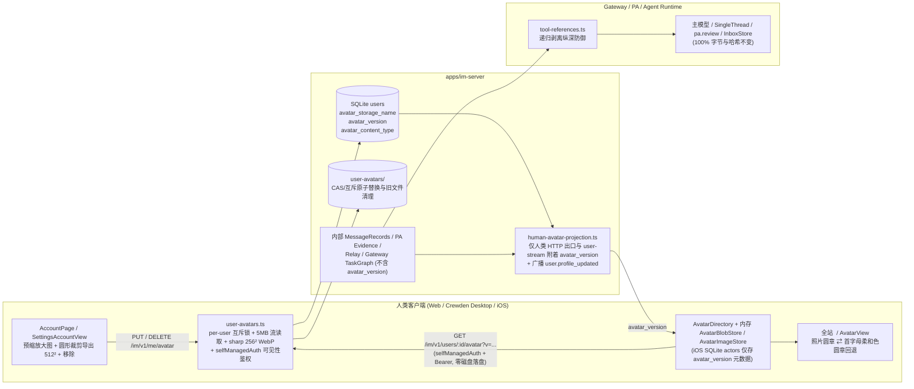
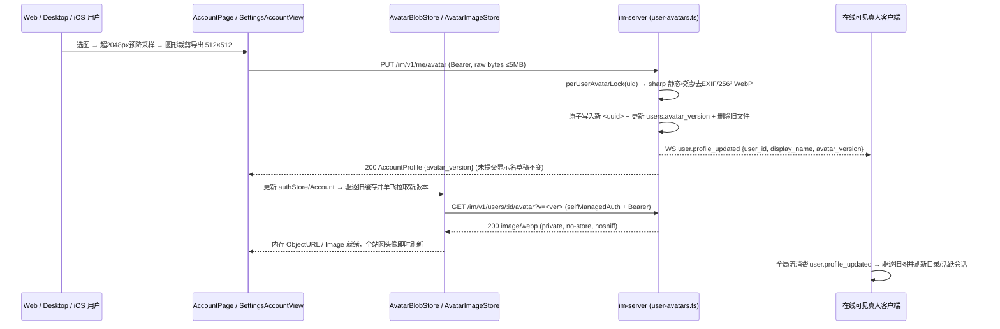

# feat-804: 真人用户自定义图片头像与全端统一展示 — 技术方案

> 对齐: spec.md v1

## Changelog

## 现状分析

### 涉及范围

- **`packages/product-contracts/src/chat.ts`**：定义跨包 `ChatActor`、`ChatMessage`、`MessageReceipt` 等契约，当前仅声明 Agent 专用的 `avatar_variant?: number`，无真人自定义头像版本字段。
- **`apps/im-server/src/{schema.sql,db.ts,server.ts,user-avatars.ts(新增),human-avatar-projection.ts(新增),identity.ts,identity-routes.ts,contacts.ts,messaging.ts,personal-agent.ts,gateway.ts}`**：
  - `users` 表无头像列；
  - `server.ts:75-77, 113-131, 157-165` 设有根级 `bodyLimit: 2 MiB`，并在 `preHandler` 与 `onSend` 中对非白名单 `/im/v1/*` 路由默认调用 `ctx.messaging.principal(req)`（强制 `authenticateRequest(req, true)`，会将 `!accountEnabled(viewer)` 拦截为 `403 company_membership_required`，同时允许 Gateway Bearer token 通过 `principal`）；
  - `messaging.message(id)`（`MessageRecords.projectMessage`）被同时用作人类客户端消息 DTO 以及 `PersonalAgents.messageEvidence` / `authorizationGuard`（`personal-agent.ts:208, 386`，对 `reply_to` 计算 SHA-256 证据哈希）、`PersonalAgents.observations` → `InboxStore.acceptRelay`（`inbox.ts:347, 370`，对整条 `message` 计算幂等身份哈希）、`enqueueRelays`（→ SingleThread `sources.ts`）与 `pa.action.prepare`（→ `pa.review` `personal-security.ts`）的内部权威快照；`TaskGraphService.identity`（`task-graphs.ts:454`）同样同时服务于人类 HTTP 与 Gateway Agent 工具调用。
- **`packages/personal-assistant/src/tool-references.ts`**：模型可见工具输出短引用投影层；可作为纵深防御兜底递归剔除身份对象中的视觉字段。
- **`src/IM/frontend/src/`（Web IM 与 Crewden Desktop 共享前端）**：
  - `features/chat/components/avatar.tsx` + `app/providers.tsx` + `features/chat/contacts-api.ts`：通过 `IdentityDirectory` 按身份 ID 解析头像（当前真人固定渲染 `AVATAR_PALETTE` 首字母圆章；`me-page.tsx:58` 已接入 `<Avatar id={user?.id ?? ""} size={62} />`；但 `IdentityDirectory.get` 采用整对象优先级覆盖，`source="names"` 在聊天页内会被外层 `members`/`history` 吞没，且 `contactActor` 丢弃了展示与头像字段）；
  - `features/chat/use-membership-cache.ts`：应用壳层常驻订阅 `subscribeUserStream` 的全局入口（而 `ChatWorkspacePage` 仅在 `/chat` 路由挂载）；
  - `features/settings/account/account-page.tsx` + `features/settings/{im-settings-api,mock-settings-api}.ts`：仅支持编辑 `display_name`，无头像上传、裁剪预览或移除入口；
  - `features/settings/company/company-members-page.tsx`、`features/personal-agent/{personal-agent-blocked-contacts,personal-agent-incidents}.tsx`、`features/tasks/task-wait.tsx`、`features/chat/components/actor-profile-popover.tsx`：局部 `<AvatarIdentities>` 需同步携带 `avatar_version`。
- **`src/IM/ios/NanoIM/`（原生 iOS 客户端）**：
  - `Client/{CommonModels,IMClient,Session}.swift`、`Storage/ChatRepository.swift`、`Features/Chat/ChatStore.swift`、`Features/Me/{MeView,SettingsModels,SettingsCompanyView}.swift`、`App/NanoIMApp.swift`、`UI/{AvatarIdentity,AssistantPortrait}.swift`：
  - `ChatRepository.swift` 的本地 SQLite `actors` 表仅有 `role` 与 `avatar_variant`（无 `avatar_version` 列），会话同步落盘重读后会裁剪未持久化的参与者字段；`SettingsCompanyView.swift` 成员目录尚未对齐展示成员 `AvatarView`（且待审/停用成员不在 `contacts` 内），`SettingsAccountView` 无相册选图裁剪与移除能力（`PersonalAgentManagementView.swift` 的风险事件与受限联系人采用紧凑原生 `DisclosureGroup` 纯文本折叠行，按克制原则保持纯文本不额外塞入头像）。

### 既有约束

- **跨包依赖边界**（`AGENTS.md` / `SPEC.md`）：IM 与 PA 不得导入 DSH；前端与 iOS 仅消费 IM HTTP/WebSocket 契约，跨包共享类型集中在 `@nano/product-contracts`；Crewden Desktop 复用 `apps/desktop/src/host_server.rs` 既有的 `/im/{*path}` 与 `/im/ws/user` 反代及 `blob:` 图片支持，无需新增 Rust 宿主接口。
- **令牌与受保护媒体边界**（[`docs/specs/im/auth-tenancy.md`](../../specs/im/auth-tenancy.md)、[`docs/specs/im/ios-client.md`](../../specs/im/ios-client.md)）：
  - Web 与 Desktop 的 `access_token` 仅驻留内存并通过 `Authorization: Bearer` 发送，严禁把会话令牌拼入图片 URL 查询参数；
  - iOS 契约明确规定「本地 SHALL NOT 保存受保护媒体的字节」，退出登录、切换账号或切换服务地址时必须立即停止展示并清空旧会话状态与内存缓存（本地 SQLite 仅允许保存元数据 `avatar_version`）。
- **PA 授权哈希与模型上下文边界**（[`docs/development/agent-context-engineering.md`](../../development/agent-context-engineering.md)）：内部 `messaging.message()`、`relay_tasks`、`pa.*` 证据及 Gateway `task_graph` 载荷必须对真人头像变更保持字节级不变，既不触发虚假的 `409 owner_authorization_changed` 或 `Relay input identity conflict`，也不让 `avatar_version` 进入任何主模型或 `pa.review` / SingleThread 审查模型上下文。
- **人机视觉区分与商业级层级克制原则**（[`docs/product/web-im-principles.md`](../../product/web-im-principles.md)）：PA 与专业数字员工保留既有 24 款 `AssistantPortrait`；真人保持圆形照片或柔和色首字母圆章，禁止动态 GIF 头像，不在注册或首次引导流程增加前置步骤。**严格遵循视觉层级克制**：自定义头像仅赋能既有主身份槽位（`<Avatar>` / `AvatarView`），绝不在消息气泡内的引用回复块（`reply_to`）、输入框待引用条、气泡外置已读勾号、正文 `@` 提及胶囊、系统通知行或紧凑纯文本折叠行中堆叠冗余头像，也不在账号页头像上叠加常驻相机贴纸或在裁剪弹窗内堆砌重复的多尺寸小圆预览条。

### 可复用能力

- **`sharp` 图像安全解码与重编码**（`apps/im-server/src/personal-images.ts`）：**复用 `sharp` 依赖并独立封装 `normalizeUserAvatar`**，执行 `limitInputPixels: 4096 * 4096`、单帧静态校验、EXIF 自动方向矫正（`.rotate()`）与居中裁剪重编码为 `256×256` 静态去元数据 WebP。
- **Fastify 子插件流式二进制解析与路由自管鉴权配置**（`apps/im-server/src/media.ts`、`server.ts:130, 164`）：**复用同一模式**。在 `user-avatars.ts` 内用独立子插件注册 `removeAllContentTypeParsers()` + `addContentTypeParser('*', ...)` 接收最高 `5 MiB` 原始图片字节流（显式设置路由 `bodyLimit: 6 * 1024 * 1024` 并在流读取层精确执行 `5 MiB` -> `413` 截断，无需引入 `@fastify/multipart`）；对 `GET /im/v1/users/:user_id/avatar` 标记路由 `config: { selfManagedAuth: true }`，在 `server.ts` 的 `preHandler` 与 `onSend` 放行交由路由自身执行 `authenticateRequest(req, false)`。
- **Web 全局实时流钩子、身份目录与受保护图片加载**（`use-membership-cache.ts`、`avatar.tsx`、`providers.tsx`、`auth-fetch.ts`）：**扩展复用**。在常驻 `useMembershipCache` 统一消费 `user.profile_updated`，在 `IdentityDirectory` 支持显式 `avatar_version: string | null` 优先级合并，配合账号作用域单飞内存 `AvatarBlobStore` 覆盖全站 `<Avatar>`（含已接入 `<Avatar>` 的 `me-page.tsx`）。
- **iOS 本地元数据表、身份目录与受保护资源请求**（`ChatRepository.swift`、`AvatarIdentity.swift`、`AssistantPortrait.swift`、`IMClient.protectedResource`）：**扩展复用**。在 `ChatRepository` 新增 `v9_actor_avatar_version` 迁移保存 `avatar_version` 元数据字符串，在 `RootTabs` 注入纯内存 `AvatarImageStore`（`cachePolicy = .reloadIgnoringLocalCacheData`），保持全仓常规 `AvatarView` 调用点零签名破坏。

### 相关历史

- **`feat-540` / `d41ec8939` / `1a7edfcbd`**：建立 Web 与原生 iOS 统一的 `AvatarDirectory` 身份解析目录、24 款 Agent/PA 剪影以及 `src/IM/shared/avatar-palette.json` 真人柔和色板。
- **`feat-795`**：新增一级「同事（`/people`）」目录、聊天侧栏同事筛选/搜索及群内 `PersonPopover` 个人名片，全部统一调用 `<Avatar id={user_id} />`。
- **`feat-790` / `feat-799`**：落地 Crewden Desktop 多服务切换、按服务/账号隔离及一屏化注册与首次引导。

## 架构总览

修改前，真人账号无持久头像资产，三端固定渲染首字母圆章；修改后，`im-server` 以每账号串行互斥方式管理单槽位 `256×256` 静态 WebP 文件与 12 位随机 hex `avatar_version`，**仅在面向人类客户端的 HTTP 响应与浏览器/iOS `user-stream` 出口**批量附着最新 `avatar_version`（内部 `messaging.message()`、PA 证据与 Gateway 通道保持纯净不变），三端经认证通道单飞拉取内存图像并在加载/离线时零抖动回退首字母圆章。

## 关键决策

1. **服务端按账号串行互斥写入独立随机文件名 `user-avatars/<uuid>`（`256×256` 静态 WebP）与 12 位随机 hex `avatar_version`**
   - **理由**：`sharp` 异步转码在 SQLite 事务外执行，若同一账号并发触发慢速大图 `PUT` 与快速 `DELETE`（或连续两次 `PUT`），无锁覆盖会导致旧图覆盖新版本或已删头像复活。由于 `im-server` 为单进程 SQLite 服务，在 `user-avatars.ts` 按 `user.id` 维护进程内串行互斥队列（`perUserAvatarLock`），每次写入独立 `<uuid>` 文件、在事务内更新 `avatar_storage_name` 与新随机 `avatar_version` 后再 `unlink` 旧 `avatar_storage_name`，可从根源消除并发失步，同时将每账号磁盘占用稳定控制在约 `8–25 KB` 且不污染 `/im/v1/attachments/capacity`。
   - **拒绝备选**：无锁覆盖固定 `${userId}.webp` 路径（存在并发 `PUT`/`DELETE` 写盘与版本号错位竞态）；原样保存用户上传大图（泄漏 EXIF GPS 且拖慢列表首屏）。

2. **协议层仅传递 `avatar_version: string | null`，客户端统一经 `authFetch` / `IMClient` 单飞内存缓存加载，`GET /im/v1/users/:user_id/avatar` 采用 `selfManagedAuth` 自管鉴权**
   - **理由**：避免 URL token 泄漏、兼容 Desktop 跨源与 iOS 原生请求，并严格遵守 iOS「本地不保存受保护媒体字节」契约；在 `server.ts` 为 `GET /im/v1/users/:user_id/avatar` 标记 `config: { selfManagedAuth: true }` 跳过全局 `requireActive = true` 钩子，使路由自身可调用 `authenticateRequest(req, false)` 同时兑现「待审批/已停用真人可读自身头像 `200`、请求任何他人头像返回防枚举 `404`、Gateway 机器令牌返回 `401`」三项精确契约。
   - **拒绝备选**：沿用 `server.ts` 默认 `principal(req)` 钩子（会把非活跃账号一律提前拦截成 `403` 且误放行 Gateway 令牌）。

3. **将 `avatar_version` 严格限制在「面向人类客户端的主身份投影出口」，保持内部 `messaging.message()`、引用快照、PA 授权证据与中继载荷 100% 纯净不变**
   - **理由**：`PersonalAgents.authorizationGuard` 对主人历史消息（含 `reply_to`）做 SHA-256 校验，`InboxStore.acceptRelay` 对未确认观察消息整包做幂等身份比对，SingleThread 与 `pa.review` 直接消费中继消息与证据对象。不在 `MessageRecords.projectMessage` 或 `TaskGraphService.identity` 内部直接塞入动态 `avatar_version`，而是由独立的 `human-avatar-projection.ts` 仅在 `principal.kind !== 'gateway'` 的人类 HTTP 响应与 `Gateway.broadcast` / `Gateway.replay` 人类 `user-stream` 帧出口，对主身份槽位批量附着最新 `users.avatar_version`（次级纯文本引用 `reply_to` 不展示也不注入头像字段；`tool-references.ts` 保留递归剥离兜底），既让人类客户端在历史消息发言人、回执明细、搜索与任务卡中拿到实时头像版本，又保证 PA 授权守卫、观察重放与所有 LLM 上下文零变动。
   - **拒绝备选**：在底层 `MessageRecords.projectMessage` 直接动态注入 `avatar_version`（会导致被引用人换头像时正在提交的 PA 外发误报 `409 owner_authorization_changed`，并导致观察重试报 `Relay input identity conflict`）。

4. **账号资料页采用「客户端预缩放大图 → 圆形裁剪导出 `512×512` 即时保存、移除即刻生效」，与显示名/语言表单草稿正交**
   - **理由**：手机或相机直出照片常为 `< 5 MiB` 但边长超过 `4096px`（如 12MP/48MP 照片）；客户端选图解码时先将超 `2048px` 的原图等比降采样至安全工作画布，经用户圆形取景拖拽/缩放后统一导出 `512×512` 静态图像字节上传，既避免端侧大图内存峰值与服务端 `4096px` 误拒，又让裁剪所见即所得，且完全不触碰表单未提交的 `display_name` / `locale` 草稿。

5. **打通 iOS 本地 SQLite `actors.avatar_version` 元数据持久化与 Web `useMembershipCache` 全局实时失效链**
   - **理由**：iOS 冷启动首绘与同步列表读取自本地 SQLite `actors` 表（保存字符串版本号完全符合「只保留元数据、不落盘媒体字节」规范），且 Web 用户可能停留在 `/people`、`/tasks`、`/settings/*` 或 `/me` 等非聊天路由；在两端全局常驻流入口完整消费 `user.profile_updated` 可保证跨页、跨设备与冷启动体验一致。

6. **保持单里程碑 `M1-human-user-avatars` 交付**
   - **理由**：服务端存储鉴权、人类出口投影、Web/Desktop 与 iOS 共享同一套接口与测试闭环，单里程碑原子交付避免中间态。

## 接口与数据流

### 1. 服务端存储、Fastify 管线与鉴权契约（`apps/im-server`）

- **`schema.sql` & `db.ts` 幂等迁移**：
  在 `users` 表新增可空列 `avatar_storage_name TEXT`、`avatar_version TEXT`、`avatar_content_type TEXT`（`db.ts` 按 `PRAGMA table_info(users)` 幂等补齐，存量账号默认为 `NULL`）。
- **`server.ts` 钩子适配**：
  - 在 `server.ts` 注册 `await registerUserAvatarRoutes(app, ctx)`；
  - 将 `preHandler`（`server.ts:130`）与 `onSend`（`server.ts:164`）扩展为识别 `(req.routeOptions.config as { selfManagedAuth?: boolean }).selfManagedAuth === true`：命中时不调用 `ctx.messaging.principal(req)`，交由路由自身执行显式真人会话校验。
- **`user-avatars.ts` 上传、移除与读取实现**：
  - 磁盘目录：`${dirname(ctx.dbPath)}/user-avatars/`（目录 `0o700`，文件 `0o600`；服务启动时清理遗留 `.*.tmp` 临时文件）。
  - **独立流式解析子插件**：`PUT /im/v1/me/avatar` 注册在封装子插件内，调用 `removeAllContentTypeParsers()` + `addContentTypeParser('*', (_req, payload, done) => done(null, payload))`，路由选项设 `bodyLimit: 6 * 1024 * 1024`。在流读取循环中按 `5 * 1024 * 1024` 字节硬截断（超出立即销毁流返回 `413 avatar_too_large`；0 字节返回 `400 empty_avatar`）。
  - **格式与 `sharp` 归一化**：仅接受请求头与文件魔数匹配的 `image/png`、`image/jpeg`、`image/webp`（`image/gif`、SVG 或魔数不符返回 `415 avatar_image_unsupported`）；调用 `sharp(rawBytes, { animated: true, limitInputPixels: 4096 * 4096 })` 校验 `(metadata.pages ?? 1) === 1` 且 `1 <= width, height <= 4096`（否则 `422 avatar_image_unsupported`，解码异常 `422 avatar_image_decode_failed`），再经 `.rotate().resize(256, 256, { fit: 'cover', position: 'centre' }).webp({ quality: 86 }).toBuffer()` 生成静态去 EXIF WebP。
  - **单账号串行互斥（防并发 `PUT`/`DELETE` 失步）**：维护进程内 `avatarLocks = new Map<string, Promise<void>>()`，同一 `user.id` 的 `PUT /im/v1/me/avatar` 与 `DELETE /im/v1/me/avatar` 严格按进入顺序串行执行：
    - `PUT` 在锁内先复核用户仍有效（`identity.authenticateRequest(req)` 且非 `system`/`agent:*`/`shadow:*`），写入 `.${storage}.tmp` 并 `renameSync` 为 `${storage}`，在事务内读取旧 `avatar_storage_name` 并更新 `avatar_storage_name = storage, avatar_version = randomBytes(6).toString('hex'), avatar_content_type = 'image/webp'`，提交后 `unlinkSync` 旧文件（若任何前置步骤失败，`finally` 清理本次新文件）。
    - `DELETE` 在锁内复核 `identity.authenticateRequest(req)`，事务内读取旧 `avatar_storage_name` 并将三列置 `NULL`，提交后 `unlinkSync` 旧文件（原本为空时幂等返回 `200`）。

| 方法与路径 | 路由配置与鉴权 | 请求 / 响应契约 | 错误码 |
|---|---|---|---|
| `PUT /im/v1/me/avatar` | 子插件原始流解析（`bodyLimit: 6 MiB`）；`identity.authenticateRequest(req)`；限流 `avatar:write:<uid>` 15 次/60s；`perUserAvatarLock(uid)` | 请求体为原始图片字节流（`<= 5 MiB`）；`200 OK` 返回完整 `account(user)`（含新 `avatar_version: string`），并广播 `user.profile_updated` | `400 empty_avatar`、`401`、`403`、`413 avatar_too_large`、`415 avatar_image_unsupported`、`422 avatar_image_unsupported \| avatar_image_decode_failed`、`429` |
| `DELETE /im/v1/me/avatar` | `identity.authenticateRequest(req)`；限流 `avatar:write:<uid>` 15 次/60s；`perUserAvatarLock(uid)` | 清除三列与磁盘文件，幂等 `200 OK` 返回 `account(user)`（`avatar_version: null`），广播 `user.profile_updated` | `401`、`403`、`429` |
| `GET /im/v1/users/:user_id/avatar` | `config: { selfManagedAuth: true }`；路由内调用 `identity.authenticateRequest(req, false)`（拒绝未登录与 Gateway 令牌为 `401`） | 可选 `?v=<avatar_version>`；满足 `canReadUserAvatar` 且文件存在时返回 `200 image/webp`，响应头 `Cache-Control: private, no-store`、`X-Content-Type-Options: nosniff`、`Content-Security-Policy: default-src 'none'` | 未登录/机器凭据 `401`；目标不存在、保留身份、无头像、文件缺失或查看者无可见权限（含 `!accountEnabled(viewer)` 查看他人）统一 `404 avatar not found` |

- **可见性判定函数 `canReadUserAvatar(db, viewer, target)`**：
  1. `viewer` 必须为真人账号（非 `agent:*`/`shadow:*`/`system`），`target` 必须存在且为真人账号且 `target.avatar_storage_name` 非空；
  2. 若 `viewer.id === target.id`：允许（支持待审批或已停用真人在 `/membership` 等界面正常加载自身头像）；
  3. 若 `viewer.id !== target.id`：必须首先满足 `accountEnabled(viewer) === true`（否则直接返回 `false` -> `404`），且满足其一：① `viewer.membership_status === 'active' && target.membership_status === 'active'`；② `viewer.membership_status === 'active' && viewer.is_company_admin && target.membership_status !== 'none'`；③ 存在会话 `c` 使 `target.id` 为 `conversation_participants` 成员或 `messages` 中 `sender_source_id IS NULL` 的发言人，且 `conversationAccess(db, c.id, viewer.id)` 可读（`is_member || is_observer`）。

### 2. 仅面向人类客户端的身份投影与实时广播（零内部哈希/Context 污染）

- **`@nano/product-contracts`**：`ChatActor` 增加可选字段 `avatar_version?: string | null`。
- **纯人类身份与管理接口直接输出 `avatar_version: string | null`**：
  - `Identity.user` / `Identity.publicUser`（`/im/v1/auth/{register,login,refresh,me}`、`/im/v1/company/join`、`/im/v1/company/members/:id/:action`）；
  - `identity-routes.ts` 的 `account(user)`（`GET/PATCH /im/v1/me`、`PUT/DELETE /im/v1/me/avatar`）与 `GET /im/v1/company/members`；
  - `contacts.ts`（`GET /im/v1/contacts`、`GET /im/v1/contacts/:user_id`，在 `row.kind === 'human'` 输出 `avatar_version: row.avatar_version ?? null`）；
  - `personal-agent.ts` 的人类管理端点 `GET /im/v1/personal-agent/blocked-contacts` 与 `GET /im/v1/personal-agent/incidents`（对非 `external:` 的真人 `actor_id` 联表补充 `avatar_version: u.avatar_version ?? null`，不动 Gateway RPC `pa.input.context` / `pa.observations` / `pa.action.prepare`）。
- **聊天、搜索与任务图的人类出口投影器 `human-avatar-projection.ts`**：
  - **内部保持原样**：`MessageRecords.projectMessage`、`messaging.message()`、`messaging.actor()`、`enqueueRelays`、`syncTaskContext`、`PersonalAgents.messageEvidence` / `authorizationGuard` / `observations`、`PersonalActions.prepare` 与 `TaskGraphService.identity` 均**不写入** `avatar_version`。
  - **人类出口按批注入**：提供纯函数 `attachHumanAvatars(db, value)`，仅在以下**人类客户端出口**调用（当路由 `principal.kind === 'gateway'` 时跳过，原样返回内部对象）：
    1. 会话与消息 HTTP 路由（`messaging.ts` / `conversation-actions.ts` 中 `principal.kind !== 'gateway'` 分支）：`POST/GET /im/v1/conversations`、`GET /im/v1/sync`、`GET/PATCH /im/v1/conversations/:id`、`POST /im/v1/conversations/:id/{join,fork,participants}`、`DELETE .../participants/:uid`、`GET/POST /im/v1/conversations/:id/messages`、`GET /im/v1/conversations/:id/messages/:mid`、`GET /im/v1/conversations/:id/message-attempts/:key`、`GET /im/v1/conversations/:id/threads/:root_id`、`GET /im/v1/messages/search`；
    2. 任务图人类 HTTP 路由（`task-graphs.ts` 中非 Gateway 调用）：对返回节点与活动中的真人 `created_by`、`assignee`、`updated_by_actor`、`wait` actor 补充 `avatar_version: string | null`；
    3. 人类实时流与断线重放出口（`Gateway.broadcast` 向 `this.browsers` 下发帧及 `Gateway.replay` 补发帧前）：对帧 `data` 内的主身份槽位（`sender`、`participants`、`receipts[].recipient`、`thread.participants[].actor`）批量附着当前 `users.avatar_version ?? null`（`reply_to` 保持纯文本引用摘要，不附着 `avatar_version`）。
  - **外部影子发送者严格隔离**：`attachHumanAvatars` 对任何 `type === 'agent'`、`avatar_id?.startsWith('external:')` 或消息级 `sender_source_id != null` 的对象绝不附着 `avatar_version`。
- **实时 `user.profile_updated` 广播**：`PUT /im/v1/me/avatar`、`DELETE /im/v1/me/avatar` 与 `PATCH /im/v1/me` 提交后，筛选当前在线且满足 `viewer.id === user.id || (accountEnabled(viewer) && (viewer.membership_status === 'active' && (user.membership_status === 'active' || (viewer.is_company_admin && user.membership_status !== 'none')) || hasSharedReadableConversation(db, viewer.id, user.id)))` 的真人连接，通过 `ctx.gateway.broadcast` 推送无游标事件 `{ op: 'event', event_type: 'user.profile_updated', data: { user_id: user.id, display_name: user.display_name, avatar_version: user.avatar_version ?? null } }`。

### 3. Web / Crewden Desktop 客户端实现流（`src/IM/frontend`）

- **`AvatarBlobStore`（`features/chat/components/avatar-blob-store.ts`）**：
  - 按当前登录 `viewerUserId` 维护内存 LRU 映射（上限 256 条），键为 `${userId}:${avatarVersion}`；并发订阅共享同一个 `authFetch("/im/v1/users/" + encodeURIComponent(userId) + "/avatar?v=" + encodeURIComponent(avatarVersion), { cache: "no-store", redirect: "error" })` Promise。
  - 提供 `evictUserAvatarBlobs(userId, keepVersion?)`（收到 `user.profile_updated` 或本人更换/移除头像时立即 `revokeObjectURL` 旧版本）与 `clearAvatarBlobStore()`（在 `AppProviders` 检测到退出、账号切换、准入变更或 Desktop 切服时 `abort` 全部在途请求并释放全部 `ObjectURL`）。
- **`IdentityDirectory` 优先级合并与 `contactActor` 补全（`avatar.tsx`、`contacts-api.ts`）**：
  - 服务端人类出口统一显式返回 `avatar_version: string | null`（`null` 表示明确无自定义头像，`undefined` 表示仅含名称的局部占位 stub）。`IdentityDirectory.get(id)` 按优先级（`contacts: 3 > members: 2 > history: 1 > names: 0`）选取主记录；当高优先级记录的 `avatar_version === undefined`（局部未携带该字段）而低优先级显式传入了 `avatar_version !== undefined`（如 `ActorProfilePopover` 或 `task-wait`）时回填该字段；当高优先级记录明确为 `avatar_version: null`（已移除头像）或新版本号字符串时，严格以高优先级权威值为准。
  - `contactActor(contact)`（`contacts-api.ts:24-26`）补齐透传 `user_id`、`display_name`、`role`、`avatar_variant` 与 `avatar_version`。
  - `providers.tsx`（`AccountAvatarDirectory`，其中 `self` 排在 `rows` 末尾覆盖同 ID `contacts` 条目以保证本人修改零延迟生效）、`company-members-page.tsx`、`personal-agent-blocked-contacts.tsx`、`personal-agent-incidents.tsx`、`task-wait.tsx`、`actor-profile-popover.tsx` 均传入 `avatar_version`；`me-page.tsx:58` 已使用 `<Avatar id={user?.id ?? ""} size={62} />`，直接受益无需结构重写。
- **全局常驻 `user.profile_updated` 处理（`use-membership-cache.ts`）**：
  - 在应用壳层常驻的 `useMembershipCache` `onEvent` 中监听 `event.eventType === "user.profile_updated"`：
    1. 调用 `evictUserAvatarBlobs(userId, avatarVersion)`；
    2. 若 `userId === useAuthStore.getState().user?.id`，立即调用 `useAuthStore.getState().replaceUser({ ...current, display_name, avatar_version })` 并 `invalidateQueries({ queryKey: ["settings", "account"] })`（跨设备改头像/改名时左侧导航栏左下角个人菜单、`/me` 与账号页即时同步）；
    3. 调用 `invalidateQueries` 刷新 `["contacts"]`、`["chat", "conversations"]`、`["chat", "conversation-detail"]`、`["chat", "messages"]`、`["chat", "thread"]`、`["company", "members"]`、`["task-graphs"]` 与 `["personal-agent"]`（React Query 仅对当前活跃挂载的查询立即重拉，后台查询标记 stale 按需刷新；同时在 `useMembershipCache.onRecovery` 中顺手失效 `["contacts"]` 保证断线重连后 `/people` 等非聊天页同步收敛）。
- **`AccountPage` 与 `AvatarCropDialog`（`features/settings/account/`）**：
  - 身份行保持克制清爽：沿用 `.settings-identity` 左头像（`56px` 纯净圆形头像，不叠加常驻相机贴纸避免遮挡人像或与右下角在线圆点槽位混淆；头像自身可点击并带轻量悬停反馈）+ 姓名/`@username` + 右侧明确的次级按钮「上传头像 / 更换头像」与条件显示的轻量幽灵按钮「移除」。
  - 选图预检与大图保护：校验文件非空、`<= 5 MiB` 且 MIME 为 `image/png | image/jpeg | image/webp`（选入 GIF、非图片或 `> 5 MiB` 时原位报错且保留原头像与未提交 `display_name` 草稿）。使用 `URL.createObjectURL(file)` 加载图片（换图、取消、保存或卸载弹窗时立即 `URL.revokeObjectURL` 防内存泄漏）；若原图任一边长 `> 2048px`，先等比绘制到长边 `2048px` 的离屏工作画布后再进入交互裁剪，消除高像素照片拖拽卡顿与超限风险。
  - 裁剪弹窗基于 Radix `Dialog`（原生支持 `Escape` 关闭与关闭后焦点归还触发按钮），聚焦单一圆形取景视口（桌面 `240×240`、窄屏 `208×208`），支持指针拖拽平移（钳制边界不露空白底边）与简洁的 `−` 滑杆 `+` 缩放控制（去除冗余的 `40px/24px` 重复小圆预览条与工程倍率读数），底栏左置轻量「重新选择」、右置「取消 / 保存」，确认后导出 `512×512` `image/webp`（不支持 WebP 编码的环境回退 `image/png`）Blob 调用 `PUT /im/v1/me/avatar`。

### 4. 原生 iOS 客户端实现流（`src/IM/ios/NanoIM`）

- **模型与 `Contact.actor` 补全（`CommonModels.swift`、`SettingsModels.swift`）**：
  - `AuthUser`、`Contact`、`ActorRef`、`SettingsAccount` 与 `SettingsMember` 增加 `var avatar_version: String?`；
  - 补全 `Contact.actor`（`CommonModels.swift:32`）完整透传 `display_name`、`user_id`、`role`、`avatar_variant` 与 `avatar_version`。
- **本地 SQLite `actors` 元数据迁移（`ChatRepository.swift`）**：
  - 注册迁移 `v9_actor_avatar_version`：检查 `db.columns(in: "actors")` 幂等执行 `ALTER TABLE actors ADD COLUMN avatar_version TEXT`，并同步将 `cache_meta('schema.version', ...)` 更新为 `'9'`；
  - 在 `upsertConversation` 的 `INSERT INTO actors(...) ON CONFLICT(id) DO UPDATE`（`L991-995`）与 `loadConversations` 的 `SELECT`（`L1171-1177`）中贯通读写 `avatar_version`；提供 `updateActorProfile(userID:displayName:avatarVersion:)` 方法供实时事件原位更新本地参与者元数据。
- **`AvatarIdentity` 与纯内存 `AvatarImageStore`（`AvatarIdentity.swift`、`AssistantPortrait.swift`、`Session.swift`、`NanoIMApp.swift`）**：
  - `AvatarFace.person(String, avatar: UserAvatarRef? = nil)`（当 `actor.avatar_id != nil` 即 `external:*` 时强制 `avatar = nil`）；新增 `AvatarIdentity.member(_ member: SettingsMember)` 使 `SettingsCompanyView.swift` 成员目录（含不在 `contacts` 内的 `pending`/`suspended` 成员）准确渲染 `36pt` `AvatarView` 而不退化为 `"?"`（`PersonalAgentManagementView.swift` 的紧凑 `DisclosureGroup` 风险事件/受限联系人折叠行与 `ChatReplyLabel` 消息引用块保持既有纯文本形态，不新增头像槽位）。
  - `AvatarImageStore` 为 `@MainActor @Observable final class`，由 `RootTabs` 按 `(client.baseURL, user.id)` 创建并通过 `@Environment(\.avatarImageStore)` 注入；内部使用 `client.protectedResource("/im/v1/users/\(uid)/avatar?v=\(ver)")`（`Session.makeRequest` 显式设 `cachePolicy = .reloadIgnoringLocalCacheData` 杜绝磁盘 `URLCache` 落盘），维护上限 256 条的内存 `[String: Image]` 与单飞任务去重；`clearChat()` / 退出 / 切账号 / 切服务时调用 `clear()` 取消全部任务并清空字典。
- **iOS 实时 `user.profile_updated` 消费链与重连收敛（`ChatStore.swift`、`NanoIMApp.swift`）**：
  - 在 `ChatStore.consume(_ event: UserEvent)` 的无游标事件分支（`L1109` 之前）处理 `event.event_type == "user.profile_updated"`：
    1. 通知 `avatarImageStore.evict(userID: uid, keepingVersion: nextVersion)`；
    2. 调用 `repository.updateActorProfile(...)` 更新本地 `actors` 表并重算 `conversations`，若当前打开会话 `selectedID` 涉及 `uid`（参与者或当前 `timelines[selectedID]` 消息发送者/回执人）则将 `selectedID` 加入 `dirtyChats` 触发 `scheduleRefresh()`；
    3. 发出 `UserProfileUpdated` 通知让 `RootTabs` 原位更新 `avatarContacts[uid]`（并在 `ChatStore.run()` 断线重连完成 `GET /im/v1/sync` 后同步刷新/合并 `avatarContacts`），当 `uid == user.id` 时触发 `accountUpdated()`（调用 `model.refreshUser()` 更新 `Session` 持久化的 `AuthUser` 与 `MeView` 顶部身份）。
- **`SettingsAccountView` 相册选图与原生裁剪（`MeView.swift`）**：
  - 个人资料分组顶部展示 `64pt` `AvatarView`、`PhotosPicker`（读取静态图片字节后用 `CGImageSourceCreateThumbnailAtIndex` 将超 `2048px` 大图降采样至安全工作尺寸，弹出 `AvatarCropSheet` 支持拖拽与缩放裁剪导出 `512×512` PNG/JPEG 数据调用 `PUT /im/v1/me/avatar`）及条件显示的「移除头像」（`DELETE /im/v1/me/avatar`），全程保留未提交的 `name`、`defaultNode` 与 `locale` 草稿。

### 5. Agent Context 影响评估

- **Consumer**：Global Agent、Personal Assistant、`single_thread` Agent（含 `sources.ts` 审批转录）、`InboxStore.acceptRelay`、`PersonalAgents.authorizationGuard` 及独立披露审核 `ReviewSession`（`pa.review`）。
- **Context Lifecycle**：
  1. **源头隔离（主防线）**：`MessageRecords.projectMessage`、`messaging.message()`、`enqueueRelays`、`syncTaskContext`、`PersonalAgents.{messageEvidence,compactMessageEvidence,observations}`、`PersonalActions.prepare` 与 Gateway 鉴权的 `TaskGraphService` 均不产生 `avatar_version`；
  2. **工具投影兜底（纵深防御）**：在 `packages/personal-assistant/src/tool-references.ts` 的 `result()` 出口增加递归身份净化函数 `stripVisualActorFields`，无论未来何处向工具结果传入身份对象，均自动剥离 `avatar_version`。
- **Before / After**：所有主模型输入、工具结果（含 `inbox`、`conversations`、`read_messages`、`search_messages`、`task_graph`）、SingleThread 审批转录、`pa.review` 独立审查上下文、`authorizationGuard` SHA-256 与 `InboxStore.acceptRelay` 幂等哈希在真人上传、更换或移除头像前后 **100% 字节级一致**。
- **Validation**：在 `apps/im-server/tests/user-avatar.test.ts` 验证被引用人/主人中途更换或删除头像不会触发 `pa.action.commit` 的 `409 owner_authorization_changed`；在 `packages/personal-assistant` 单测验证观察重试幂等与全方法 `ToolReferences` 输出不含 `avatar_version`。

## 前端原型

- **要通过原型判断的设计决定**：
  1. 账号页（`/settings/account`）中新增的头像上传、更换、移除操作与原有「显示名称」表单及底部「放弃修改 / 保存账号」操作栏之间的视觉主次关系，确认不叠加常驻相机贴纸或冗余规则说明即可自然表达「头像即时独立生效、不覆盖显示名草稿」；
  2. 圆形裁剪弹窗（`AvatarCropDialog`）在桌面（`1120×780`）与手机窄屏（`390×844`，含双语按钮宽度）下的单一圆形取景焦点、轻量缩放控制与底栏排布；
  3. 群聊混合场景中的信息层级克制：主消息流中「真人圆形照片头像 + 未设置真人首字母柔和色圆章 + PA 有机剪影 + 数字员工几何剪影」清晰可辨，而气泡内引用回复块（`reply_to`）保持纯文本左竖线摘要、气泡外仅保留双勾回执触发器（点击后在回执浮层内展示 `24px` 头像），不堆叠多余小头像。
- **原型入口**：[prototype.html](prototype.html)（支持 `?scene=account | crop | chat | mobile-me`、`?draft=1`、`?error=1`、`?fallback=1`、`?removed=1`、`?popover=1`、`?receipts=1`、`?lang=en` 及 `?clean=1`；iOS 原生界面按规范跳过 HTML 原型，交互规格见上文 §4 与下方里程碑退出标准）。
- **用户目标与体验方案**：用户在账号页看到纯净无遮挡的 `56px` 个人圆形头像与姓名/`@username`，右侧并列次级按钮「上传头像 / 更换头像」与条件显示的轻量幽灵按钮「移除」；选图后若超 `2048px` 自动预降采样，在聚焦单一圆形遮罩的弹窗内拖拽平移与滑杆缩放后点击「保存」一次完成（支持 `Escape` 关闭并回收临时 `ObjectURL`）；群聊主发言人、按需展开的回执明细浮层、个人名片、任务、桌面端左下角个人菜单与手机 `/me` 同步显示圆形照片，而消息内嵌引用块保持干净的纯文本层级。
- **用户需要判断的问题**：账号页无贴纸身份行是否干净自明、精简后的圆形裁剪弹窗是否克制顺手、群聊主身份与纯文本引用/双勾回执的信息层级是否清爽高级。
- **呈现方式与覆盖范围**：现有页面结构 + 可交互增量 + 跨入口连续状态联动。
- **交互边界**：顶栏深色控制条标注 `仅演示控制`（场景切换、内置样张切换、GIF/超限报错模拟、离线圆章回退模拟）；下方产品区支持真实选本机图片、拖拽平移、缩放滑杆、`Escape` 关闭、确认保存、移除头像、编辑/放弃/保存显示名草稿、打开 `PersonPopover` 及点击双勾查看已读回执浮层。

### 现有 UX grounding

| 当前产品入口 | 画面与操作基线 | 沿用或改善的体验及原因 | 本次设计 |
|---|---|---|---|
| `/settings/account`（[`account-page.tsx`](../../../src/IM/frontend/src/features/settings/account/account-page.tsx)、[`settings-surfaces.css`](../../../src/IM/frontend/src/features/settings/settings-surfaces.css)） | 左栏分组标题 + 右栏 `.settings-identity`（`52px` 首字母 `<Avatar>` + 姓名 + `@username`）+ 显示名输入框 + 底部独立保存栏 | 沿用双栏设置卡节奏与 `draft` 防后台刷新覆盖机制；改善原头像不可更换的问题，同时避免贴纸式装饰遮挡头像 | 身份行升级为可点击 `56px` 纯净圆形头像（无常驻角标）+ 姓名/`@username` + 右侧「上传/更换头像」与条件显示的「移除」；错误反馈就近出现在身份行下方，不影响显示名 `draft` |
| `/me` 移动端身份卡（[`me-page.tsx`](../../../src/IM/frontend/src/features/me/me-page.tsx)） | `me-page.tsx:58` 已接入共享 `<Avatar id={user?.id ?? ""} size={62} />` 并整卡跳转 `/settings/account` | 完整保留既有整卡跳转与共享 `<Avatar>` 绑定 | 随 `AccountAvatarDirectory` 注入 `user.avatar_version` 自动同步展示圆形照片或首字母圆章，无需改写 `/me` 页面结构 |
| `/chat` 侧栏、消息流、引用块、回执浮层与 `PersonPopover`（[`avatar.tsx`](../../../src/IM/frontend/src/features/chat/components/avatar.tsx)、[`message-pane.tsx`](../../../src/IM/frontend/src/features/chat/components/message-pane.tsx)） | 主发言人、侧栏、名片与已读回执明细浮层消费 `<Avatar>`；气泡内引用块 `.chat-message-quote` 采用纯文本粗体姓名+单行摘要，气泡底栏仅显示轻量双勾图标 | 严格保留主次信息层级：主身份用图形快速认人，气泡内引用与底栏状态用克制的纯文本/单图标避免视觉拥挤 | 既有 `<Avatar>` 槽位在有 `avatar_version` 且内存图片就绪时渲染圆形照片，加载中/离线/未设置时零抖动回退首字母圆章；引用块 `.chat-message-quote` 与气泡外双勾保持现状绝不塞入头像 |
| iOS `MeView`、`SettingsAccountView` 与 `SettingsCompanyView`（[`MeView.swift`](../../../src/IM/ios/NanoIM/Features/Me/MeView.swift)、[`SettingsCompanyView.swift`](../../../src/IM/ios/NanoIM/Features/Me/SettingsCompanyView.swift)） | `MeView` 顶部 `76pt` `AvatarView` 推入 `SettingsAccountView` `Form`；`SettingsCompanyView` 成员目录尚未展示头像，而 `ChatReplyLabel` 与 PA 折叠日志采用紧凑纯文本 | 沿用原生 `Form` 分组、顶部「保存」与未保存离开保护；补齐资料页选图裁剪与成员目录头像，同时保持消息引用和紧凑折叠日志的纯文本清爽感 | `SettingsAccountView` 顶部新增纯净 `64pt` `AvatarView` + `PhotosPicker`（原生圆形裁剪 Sheet 确认即传）+ 条件显示的「移除头像」；`SettingsCompanyView` 通过 `.member` 补齐 `36pt` 成员 `AvatarView` |

### 原型对齐契约

| 原型区域 / 状态 | 对齐级别 | 产品入口 | 必验 viewport / 状态 | 下游验收投影 |
|---|---|---|---|---|
| 账号页纯净个人身份编辑行、即时反馈与显示名草稿正交行为 | `must-match` | Web & Desktop `/settings/account` | `1280×800` 桌面与 `390×844` 窄屏；覆盖未设头像、已设头像（无常驻相机角标遮挡）、选入非法/超限文件报错且保留未提交显示名草稿、移除恢复首字母圆章 | M1 `[reviewer]` #1, `[worker]` #3 |
| 精简圆形裁剪弹窗（超 `2048px` 预降采样、单一圆形视口拖拽边界钳制、`−/+` 缩放滑杆无工程读数无重复小圆预览条、`Escape` 关闭与 `ObjectURL` 释放、窄屏双语底栏） | `must-match` | Web & Desktop `/settings/account` 裁剪弹窗 | `1280×800` 与 `390×844`（中英文文案）；拖拽不露出空白黑边，确认后立即刷新页面与左下角个人菜单头像 | M1 `[reviewer]` #1, `[worker]` #3 |
| 群聊与多入口人机身份混排及次级结构克制（主发言人圆照片/首字母圆章/PA与Agent剪影 + 纯文本无头像引用块 + 双勾触发按需回执浮层 + `PersonPopover` + 移动端 `/me`） | `must-match` | Web & Desktop `/chat`、`/people`、`/tasks`、`/me`、`/settings/company` | `1280×800` 与 `390×844`；确认引用块无内嵌头像、气泡外无堆叠头像串、加载失败/离线回退首字母圆章无破损图标 | M1 `[reviewer]` #2, #3, `[worker]` #3 |
| iOS 原生资料页 `PhotosPicker` + 圆形裁剪 Sheet + 既有 `AvatarView` 及公司成员目录渲染（引用块与紧凑折叠行保持纯文本） | `may-adapt` | iOS `MeView`、`SettingsAccountView`、`ConversationView`、`SettingsCompanyView` | iPhone 竖屏（iOS Simulator）；遵循 SwiftUI `Form` 与原生 Sheet 交互规范，保持即时生效、草稿独立、SQLite 仅存 `avatar_version` 元数据与内存图像清理语义 | M1 `[reviewer]` #1, #2, #3, `[worker]` #2, #4 |
| 顶部深色原型控制栏与内置 Canvas 示例人像切换 | `out-of-scope` | 仅存在于 `prototype.html` 演示外层 | 真实产品无此控制栏，直接调用系统文件/相册选择器与真实 `im-server` 接口 | N/A |

### 原型走查

- **实际渲染与走查范围**：使用 Chromium（2x Retina）实际渲染并走查了 `1120×780`（账号页常态、精简圆形裁剪弹窗态、含未保存显示名草稿的非法文件报错态）、`1160×780`（混合群聊时间线、无头像纯文本引用块、双勾已读回执浮层与 `PersonPopover` 展开态）以及 **`390×844` / `390×720` 手机窄视口**（窄屏账号页、**窄屏圆形裁剪弹窗中英文按钮布局**、窄屏 `/me` 身份卡），全部场景 `pageerror` 为 0。
- **当前产品对照及代表性截图**：走查原图保存在会话暂存目录 `/Users/czj/.t3/userdata/providers/antigravity/ac0a3dfd6dddb20962cecff6ee5fe65e19d3923be20e52c5ab52ff877f7e4c32/antigravity-acp/brain/7f13d27b-b0b7-4e1a-b81b-20afc286b5c0/scratch/prototype-evidence/`。
- **体验判断与修正**：
  1. **商业级信息层级收敛（响应用户审阅反馈）**：彻底移除消息引用块（`.chat-message-quote`）中画蛇添足的 `18px` 小头像，恢复与线上一致的「左强调竖线 + 粗体姓名 + 单行摘要」纯文本引用样式；移除群聊气泡下方堆叠的小头像串与顶栏教学胶囊，还原线上克制的双勾图标触发按需已读回执浮层；同时去除账号页头像右下角遮挡人像的常驻相机角标，以及裁剪弹窗中重复的 `40px/24px` 小圆预览条与工程倍率数值，让界面自明、安静、有呼吸感；
  2. 将演示样张切换移入顶部「仅演示控制」栏，裁剪弹窗内只保留「重新选择 + 取消 / 保存」，并将显示名下方提示精简为真实产品用途短句；
  3. 针对 `390×844` 手机窄视口与英文长文案（`Choose another` / `Cancel` / `Save`）核验裁剪弹窗：窄屏裁剪视口收敛为 `208×208` 且底栏双语不挤压，补齐 `Escape` 关闭焦点归还、换图/关闭立即 `URL.revokeObjectURL`、超 `2048px` 本机图片预降采样，以及手机 `/me` 副标题统一显示 `@linxia`。
- **未验证项**：iOS 原生 `PhotosPicker` 与 `AvatarCropSheet` 手势在阶段 3 实施后通过 Xcode Simulator 实测验证。

## 本次审查安排

| 审查编组 | 必须回答的问题 / 对应目标 | 能力与使用阶段 | 证据方法、范围与共享定位 |
|---|---|---|---|
| 编组 1：代码、安全边界与 Context 审查 | 1. `server.ts` `selfManagedAuth`、子插件 `5 MiB` 流解析、`perUserAvatarLock` 串行互斥、`sharp` 静态去 EXIF 重编码与 `canReadUserAvatar`（含 `!accountEnabled(viewer)` 拦截他人返回 404、待审/停用读本人返回 200、Gateway 令牌返回 401、外部 `shadow` 防串号）是否严密闭合； 2. `human-avatar-projection.ts` 仅人类出口主身份槽位注入（不污染 `reply_to`）与 `tool-references.ts` 递归剥离是否确保 PA `authorizationGuard`、`InboxStore.acceptRelay`、SingleThread、`pa.review` 与 `task_graph` 100% 零变动； 3. Web `useMembershipCache` / `IdentityDirectory` 与 iOS `ChatRepository` `v9` 迁移 / `ChatStore` 实时流 / 内存缓存清理是否与 delta-spec 完全一致 | `change-code-review` + `agent-context-review`（实施审查阶段，同一独立审查者一次完成） | 审查 `M1` 完整 diff、`apps/im-server` 集成测试、`packages/personal-assistant` 单测、Web Vitest 与 iOS `xcodebuild test` 结果 |
| 编组 2：真实跨端体验与用户旅程验收 | 1. Web 在桌面与 `390×844` 窄屏下选图（含超 2048px 大图）裁剪、更换、移除、非法文件报错保草稿、跨路由实时 `user.profile_updated` 刷新、群聊/名片/通讯录/任务/回执浮层/`/me` 展示（且引用块与次级结构保持无冗余头像）及退出释放是否清爽自明并兑现原型 `must-match`； 2. iOS 原生客户端在 Simulator 中「我的 → 个人资料与语言」选图裁剪上传、移除、公司成员目录头像及冷启动/退出隔离是否自然可用 | `frontend-experience-review` + `product-journey-review`（实施审查阶段，同一独立审查者共享隔离真栈与 Simulator 现场） | 复用按 `Runbook for Reviewer` 启动的 worktree 隔离 IM 服务，在真实浏览器（桌面 + `390×844` 手机视口）与 iOS Simulator 连续走查并留存文字结论与本地截图定位 |

## 契约层增量 (delta-spec)

- **IM 包入口**：[`specs/im/spec.md`](specs/im/spec.md)（更新 `Auth and Tenancy`、`Web Chat UX`、`iOS Client` 覆盖摘要，`Auth and Tenancy` Requirement 计数 `16 -> 17`）。
- **IM Auth and Tenancy**：[`specs/im/auth-tenancy.md`](specs/im/auth-tenancy.md)（`ADDED` 1 条真人受保护静态头像管理与可见性契约；`MODIFIED` 2 条账号页资料编辑与草稿保留契约）。
- **IM Web Chat UX**：[`specs/im/web-chat-ux.md`](specs/im/web-chat-ux.md)（`MODIFIED` `聊天身份与群聊选择信息清楚可辨`，纳入全站真人圆形照片头像内存单飞渲染、首字母圆章回退、任务创建者/负责人等全入口覆盖、人机视觉区分与退出释放；*注：阶段 4 归并回 `docs/specs/im/web-chat-ux.md` 时将 `../../../../specs/im/agents-nodes.md` 恢复为同目录 `agents-nodes.md`*）。
- **IM iOS Client**：[`specs/im/ios-client.md`](specs/im/ios-client.md)（`MODIFIED` `iOS 独立客户端保持 IM 业务与权限契约` 与 `本地聊天数据按服务与账号分区，并随访问变化清理`，纳入原生资料页选图裁剪/移除、SQLite 仅存 `avatar_version` 元数据与受保护头像字节纯内存不落盘约束）。
- **IM Desktop Client / Conversations & Messages / Gateway**：`no spec delta`。依据：`docs/specs/im/desktop-client.md` 已规定主窗口完整承载 IM 账号与聊天能力（经宿主 `/im/{*path}` 与 `/im/ws/user` 反代）并按服务/账号隔离受保护媒体；会话附件配额与内部消息快照未变；`avatar_version` 仅存在于面向人类客户端的出口并在 `tool-references.ts` 兜底剥离，Gateway 与模型可见契约无变化。

## 风险与回退

- **同一账号并发上传/移除或畸形大图冲击**：通过 `perUserAvatarLock` 串行互斥消除写盘与版本号竞态；流读取层 `5 MiB` 硬截断 + 写限流 `15 次/60s` + `sharp` `limitInputPixels: 4096 * 4096` + 客户端选图超 `2048px` 预降采样双重防护；异常时 `finally` 块销毁流并清理临时文件。
- **旧客户端或离线环境兼容**：`avatar_version` 为可选增量字段，未升级客户端忽略该字段继续显示首字母圆章；弱网或图片请求报错时新客户端原位保持首字母圆章，无空白或破损图标。
- **回退方案**：回滚本单元提交即可；服务端 `users` 新增三列与 iOS `actors.avatar_version` 均可空，磁盘 `user-avatars/` 目录与核心消息库完全解耦。

## 一次性部署迁移

无（服务端 `users` 表与 iOS 本地 `actors` 表的新增可空列均在启动时自动幂等补齐，存量真人账号默认 `avatar_version = NULL` 保持首字母圆章展示）。

## Runbook for Reviewer

| 服务 | 停止命令 | 启动命令 | 健康检查 |
|---|---|---|---|
| 隔离 IM + Web 前端栈（worktree） | `./scripts/e2e-down.sh` | `./scripts/e2e-up.sh` | `curl -fsS "http://127.0.0.1:$(jq -r .im_port .e2e-runtime/state.json)/healthz"` |

**Review 驱动方式**：
1. 窄测试与契约检查：`pnpm --filter @nano/product-contracts build && pnpm --filter @nano/im-server test && pnpm --filter @nano/personal-assistant test && npm --prefix src/IM/frontend test && npm --prefix src/IM/frontend run build && python3 scripts/docs_check.py`。
2. Web 真实旅程：启动隔离栈后准备两个有效团队真人账号、一个待审批/已停用账号与一个纯个人空间账号，在桌面（`1280×800`）与手机视口（`390×844`）验证账号页选图（含 `> 4096px` 原图预缩放）圆形裁剪上传、保留未保存显示名草稿、选入 GIF/超限报错、更换与移除头像、停留在 `/people` 等非聊天路由时收到对端 `user.profile_updated` 实时刷新、群聊/私聊/回执浮层/任务/`PersonPopover`/`/me` 同步展示（并确认引用块 `.chat-message-quote` 无内嵌头像）、非活跃账号读本人 `200` 与读他人 `404`、纯个人空间跨租户 `404` 以及退出登录释放 `blob:` URL。
3. iOS 原生验证：运行 `xcodebuild test` 执行 `AvatarTests` 与 `ChatRepository` 迁移单测，并在本地 iOS Simulator 连接隔离 IM 服务验证「我的 → 个人资料与语言」相册选图裁剪上传、移除恢复圆章、冷启动会话列表保留 `avatar_version`、公司成员目录头像展示（消息引用与紧凑折叠行保持纯文本）及退出隔离。

**验收前置**：本机具备 Node.js 24+ / pnpm（见 `python3 scripts/dev_host.py check`）、Playwright Chromium 与 Xcode iOS Simulator（无需外部第三方凭据或真机签名）。

## Milestones

| ID | 标题 | 依赖 | 并行组 | 范围 | 退出标准 |
|---|---|---|---|---|---|
| `M1-human-user-avatars` | 真人自定义图片头像服务端、Web/Desktop 与 iOS 端到端实现 | 无 | G1 | `packages/product-contracts/src/chat.ts`, `apps/im-server/src/**`, `apps/im-server/tests/**`, `packages/personal-assistant/src/tool-references.ts`, `packages/personal-assistant/tests/**`, `src/IM/frontend/src/**`, `src/IM/ios/NanoIM/**`, `src/IM/ios/Tests/**` | - `[reviewer]` **#1 账号资料页克制编辑、裁剪与草稿正交**：Web/Desktop（桌面与 `390×844` 窄屏，含中英文）及 iOS 原生端可在账号资料页选图（含高像素原图自动预降采样）、经精简圆形取景裁剪立即保存生效，支持更换与移除恢复首字母圆章，身份行纯净无常驻相机贴纸、裁剪弹窗无重复多尺寸预览条，非法/动图/超限文件给出清晰提示且保留原头像，所有头像操作均不覆盖未提交的显示名或偏好草稿；注册与首次引导无新增头像步骤。 - `[reviewer]` **#2 既有身份槽位一致、次级结构克制与跨页实时同步**：在会话列表、群聊/私聊消息与话题发言人、话题参与者、已读回执明细浮层、`@` 提及候选、搜索联系人、`/people` 同事目录、`PersonPopover` 个人名片、任务创建者与负责人、公司成员列表、Web 端既有头像槽位的 PA 屏蔽/风险事件真人条目、左下角个人菜单与 `/me` 中，已设头像真人一致显示圆形照片（在线对端跨任意页面收到 `user.profile_updated` 或重新同步后即时刷新），未设真人及外部渠道未映射发送者显示首字母圆章，PA 与数字员工保持角色剪影；消息内引用回复块（`reply_to`）、待引用预览条、气泡底栏双勾与紧凑纯文本折叠行不叠加冗余头像。 - `[reviewer]` **#3 鉴权隔离、弱网回退与退出清理**：未登录与机器凭据请求返回 401，待审/停用真人读自身头像返回 200、请求他人头像返回 404，纯个人空间账号请求他人头像返回 404；加载中/离线/失败时稳定回退首字母圆章无破损图标；退出登录、切换账号或切换服务后立即释放内存头像缓存且本地磁盘不留存受保护头像字节。 - `[worker]` **#1 服务端、并发互斥与零 Context 污染测试**：新增 `apps/im-server/tests/user-avatar.test.ts` 覆盖 2–5 MiB 流上传重编码（PNG/JPEG/WebP → `256×256` WebP、EXIF 剥离、动图/GIF/超限/伪造头拒绝）、同账号并发 `PUT`/`DELETE` 串行互斥无旧图复活、`server.ts` `selfManagedAuth` 下全部 `401/200/404` 可见性分支、外部 `shadow` 防串号、`user.profile_updated` 广播（含实时与重放出口结构一致），以及被引用人中途改/删头像不触发 PA `409 owner_authorization_changed`；新增 `packages/personal-assistant` 测试验证 `InboxStore.acceptRelay` 观察幂等与全方法（含 `task_graph`）`ToolReferences` 输出及 SingleThread/`pa.review` 输入不含 `avatar_version`。 - `[worker]` **#2 双端单测、SQLite 元数据迁移与构建全绿**：Web 新增/更新 `AccountPage`（含 `ObjectURL` 释放与超 2048px 预缩放）、`useMembershipCache` 实时与重连失效、`IdentityDirectory` 优先级合并与 `person-avatar-consistency` 测试并通过 `npm --prefix src/IM/frontend test` 与 `build`；iOS 新增 `ChatRepository` `v9_actor_avatar_version`（含 `schema.version = '9'`）读写迁移测试与 `AvatarTests`（含 `.member`、外部发送者隔离与退出清空）并通过 `xcodebuild` 编译与单测；`pnpm typecheck` 与 `tests/contract/test_runtime_dependency_contract.py` 通过。 - `[worker]` **#3 Web 原型对照实测证据**：在隔离真栈上采集桌面与 `390×844` 窄屏（含裁剪弹窗与含引用消息的群聊）真实客户端截图/走查结论，逐项核对原型 `must-match` 行并记录于 `M1-human-user-avatars/evidence/`。 - `[worker]` **#4 iOS 原生实测证据**：在 iOS Simulator 连接隔离真栈验证 `MeView` / `SettingsAccountView` 选图裁剪上传、移除、`SettingsCompanyView` 成员头像与聊天冷启动恢复，将验证记录写入 `M1-human-user-avatars/evidence/`。 |
