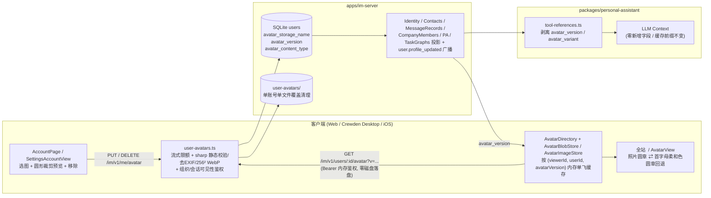
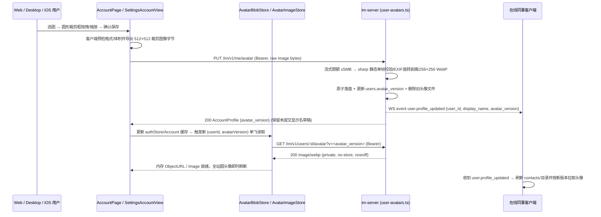

# feat-804: 真人用户自定义图片头像与全端统一展示 — 技术方案

> 对齐: spec.md v1

## Changelog

## 现状分析

### 涉及范围

- **`packages/product-contracts/src/chat.ts`**：定义跨包 `ChatActor`、`ChatMessage`、`MessageReceipt` 等契约，当前仅声明 Agent 专用的 `avatar_variant?: number`，无真人自定义头像版本字段。
- **`apps/im-server/src/{schema.sql,db.ts,user-avatars.ts(新增),server.ts,identity.ts,identity-routes.ts,contacts.ts,message-records.ts,messaging.ts,personal-agent.ts,task-graphs.ts}`**：
  - `users` 表无头像列；`Identity.user` / `publicUser`、`identity-routes.ts`（`GET/PATCH /im/v1/me`、`GET /im/v1/company/members`）、`contacts.ts`、`message-records.ts`（`chatActor`、`senderView` 回执、`threadSummary` 话题参与者、`projectMessage` 引用快照）、`personal-agent.ts`（屏蔽联系人与隐私风险事件）及 `task-graphs.ts`（任务身份解析）均未投影真人头像版本。
- **`packages/personal-assistant/src/tool-references.ts`**：将 IM 消息、参与者与任务图结果投影为模型可见的紧凑短引用；当前 `projectSender` 与 `projectParticipant` 直接展开 `ChatActor` 字段，若新增展示字段需显式剥离以免污染模型上下文。
- **`src/IM/frontend/src/`（Web IM 与 Crewden Desktop 共享前端）**：
  - `features/chat/components/avatar.tsx` + `app/providers.tsx`：统一通过 `IdentityDirectory` 按身份 ID 解析头像，但真人分支固定渲染 `AVATAR_PALETTE` 首字母圆章；
  - `features/settings/account/account-page.tsx` + `features/settings/im-settings-api.ts` + `features/settings/mock-settings-api.ts`：仅支持编辑 `display_name`，无头像上传、裁剪预览或移除入口；
  - `features/me/me-page.tsx`：移动端 `/me` 顶部身份卡仍硬编码紫色首字母圆块，未接入共享 `<Avatar>`；
  - `features/settings/company/company-members-page.tsx`、`features/personal-agent/{personal-agent-blocked-contacts,personal-agent-incidents}.tsx`、`features/tasks/task-wait.tsx`、`features/chat/components/actor-profile-popover.tsx`：局部 `<AvatarIdentities source="names">` 需透传 `avatar_version` 以覆盖不在活跃通讯录内的待审/停用或历史真人条目。
- **`src/IM/ios/NanoIM/`（原生 iOS 客户端）**：
  - `Client/{CommonModels,IMClient,Session}.swift`、`Features/Me/{MeView,SettingsModels,SettingsCompanyView}.swift`、`Features/Chat/ChatStore.swift`、`App/NanoIMApp.swift`、`UI/{AvatarIdentity,AssistantPortrait}.swift`：当前 `AvatarFace.person(String)` 仅按显示名绘制首字母圆章，`SettingsAccountView` 无相册选图、裁剪与移除能力。

### 既有约束

- **跨包依赖边界**（`AGENTS.md` / `SPEC.md`）：IM 与 PA 不得导入 DSH；前端与 iOS 仅消费 IM HTTP/WebSocket 契约，跨包共享类型集中在 `@nano/product-contracts`。
- **令牌与受保护媒体边界**（[`docs/specs/im/auth-tenancy.md`](../../specs/im/auth-tenancy.md)、[`docs/specs/im/ios-client.md`](../../specs/im/ios-client.md)）：
  - Web 与 Desktop 的 `access_token` 仅驻留内存并通过 `Authorization: Bearer` 发送，严禁把会话令牌拼入图片 URL 查询参数（防止日志、Referer 或外链泄漏）；Desktop 可连接远端或私网不同源 `im_origin`，不能依赖同源 Cookie 裸 ``。
  - iOS 契约明确规定「本地 SHALL NOT 保存受保护媒体的字节」，退出登录、切换账号或切换服务地址时必须立即停止展示并清空旧会话状态与内存缓存。
- **人机视觉区分与低干扰原则**（[`docs/product/web-im-principles.md`](../../product/web-im-principles.md)）：PA（有机轮廓剪影）与专业数字员工（几何轮廓剪影）保留既有 24 款 `AssistantPortrait`；真人保持圆形照片或柔和色首字母圆章，禁止动态 GIF 头像干扰阅读，也不在注册或首次引导流程增加前置步骤。
- **Agent Context 零污染原则**（[`docs/development/agent-context-engineering.md`](../../development/agent-context-engineering.md)）：纯前端/客户端视觉字段不得进入模型提示词或工具返回 JSON，不得破坏既有上下文缓存前缀。

### 可复用能力

- **`sharp` 图像安全解码与重编码**（`apps/im-server/src/personal-images.ts`）：**复用 `sharp` 依赖并独立封装 `normalizeUserAvatar`**。沿用 `limitInputPixels: 4096 * 4096` 与 `(metadata.pages ?? 1) === 1` 静态单帧校验，增加 EXIF 方向自动矫正（`.rotate()`）与强制居中裁剪缩放为 `256×256` 静态 WebP（默认剥离 EXIF/GPS 元数据）；不直接调用 `decodePersonalImages`（后者面向多图原始尺寸审核，不做正方形收敛与重编码）。
- **流式二进制上传模式**（`apps/im-server/src/media.ts`）：**参考同一作用域 `removeAllContentTypeParsers` + 有界流读取模式**实现独立 `user-avatars.ts` 插件；**不复用** `message_images` / `attachment_storage` 表，因为真人头像是每账号至多一份的覆盖式资料资产（约 10–25 KB），与不可变会话附件及会话级鉴权、公司附件配额语义不同。
- **Web 身份目录与受保护图片加载**（`avatar.tsx`、`providers.tsx`、`message-image.tsx`、`auth-fetch.ts`）：**扩展复用**。在全局 `IdentityDirectory` 的 `Actor` 上携带 `avatar_version`，新增账号作用域的单飞内存 `AvatarBlobStore`（基于 `authFetch` + `URL.createObjectURL`），使全站所有 `<Avatar id={...} />` 零签名改动即可渲染照片并在加载/离线时回退首字母圆章。
- **iOS 身份目录与受保护资源请求**（`AvatarIdentity.swift`、`AssistantPortrait.swift`、`IMClient.protectedResource`、`NanoIMApp.swift`）：**扩展复用**。在 `AvatarFace.person` 携带可选 `UserAvatarRef(userID, version)`，通过 `RootTabs` 注入按 `(baseURL, user.id)` 隔离的纯内存 `AvatarImageStore`，保持全仓 15 处 `AvatarView` 调用点签名不变。

### 相关历史

- **`feat-540` / `d41ec8939` / `1a7edfcbd`**：建立 Web 与原生 iOS 统一的 `AvatarDirectory` 身份解析目录、24 款 Agent/PA 剪影以及 `src/IM/shared/avatar-palette.json` 真人柔和色板，奠定了本次「只扩充身份数据与底层 `<Avatar>` / `AvatarView` 渲染器即可覆盖全站」的结构基础。
- **`feat-795`**：新增一级「同事（`/people`）」目录、聊天侧栏同事筛选/搜索及群内 `PersonPopover` 个人名片，全部统一调用 `<Avatar id={user_id} />`。
- **`feat-790` / `feat-799`**：落地 Crewden Desktop 多服务切换、按服务/账号隔离及一屏化注册与首次引导；本次设计保持引导零新增步骤，并通过 `authFetch` 天然兼容 Desktop 任意 `im_origin`。

## 架构总览

修改前，真人账号无持久头像资产，服务端身份投影不含真人头像信息，Web/Desktop 与 iOS 固定将真人渲染为首字母圆章；修改后，`im-server` 管理每真人账号单槽位的 `256×256` 静态 WebP 文件与不透明 `avatar_version` 版本令牌，向已授权身份视图投影 `avatar_version` 并推送实时更新，PA 工具投影层剥离该字段，三端通过各自认证通道单飞拉取并仅在当前会话内存中缓存渲染。



## 关键决策

1. **服务端将上传图片统一重编码为单槽位 `256×256` 静态 WebP 并生成 12 位随机十六进制 `avatar_version`，独立于会话附件存储表**
   - **理由**：重编码为 `256×256` WebP（质量 `86`，自动应用 EXIF 旋转后剥离全部 EXIF/GPS/ICC 隐私元数据并彻底消除多帧动图与畸形 chunk）可将每用户磁盘占用稳定收敛在约 `8–25 KB`，同时保留透明通道；使用每次更新重新生成的 12 位随机 hex `avatar_version`（而非纯内容哈希）可确保「A → B → A」切回原图时版本严格递增变化，避免客户端或中间层复旧；独立存放于 `${dirname(ctx.dbPath)}/user-avatars/` 避免污染 `/im/v1/attachments/capacity` 会话附件容量统计，且替换/删除时可直接原子清理旧文件。
   - **拒绝备选**：直接原样存储用户上传原图（存在 5 MB 大图反复拉取拖慢列表首屏、保留拍摄地 GPS 隐私及畸形文件风险）；复用 `message_images` 表（该表强绑定 `conversation_id` 与会话写权限）。
   - **风险与缓释**：WebP 在老旧系统解码兼容性？现代浏览器、Electron/Tauri WebView 与 iOS 17+ `UIImage(data:)`（ImageIO）均原生支持静态 WebP（包含透明通道，客户端圆章底层在图片就绪后切换为纯色表面底衬防止透明头像透出首字母文字）。

2. **协议层仅传递 `avatar_version?: string | null`，客户端统一经 `authFetch` / `IMClient` 按 `(viewerId, userId, avatarVersion)` 单飞内存缓存加载**
   - **理由**：① 严守「不在 URL 查询串传递 token」安全边界；② 天然兼容 Crewden Desktop 跨源 `im_origin` 与 iOS 自定义 `baseURL`；③ 严格满足 `docs/specs/im/ios-client.md`「本地 SHALL NOT 保存受保护媒体的字节」契约；④ 同一聊天屏出现同一人 30 条消息时仅发起 **1 次**网络请求并共享同一个内存 `objectUrl` / `SwiftUI.Image`，加载完成前或弱网失败时零闪烁保留底层首字母圆章。
   - **拒绝备选**：签名短期公网 URL（URL 易被复制外泄、过期后长开页面裂图、增加服务端签名复杂度）；依赖同源 Cookie 的裸 ``（iOS 原生端与 Desktop 跨源模式不携带浏览器同源 Cookie）。
   - **风险与缓释**：会话内同时展示大量不同真人头像的内存占用。单张 `256×256` 图像压缩态仅 ~15 KB，客户端内存缓存设 LRU 上限（例如 256 个条目，超出回收最久未用非在途条目），退出登录或切服时全量 `revokeObjectURL` / 清空字典并 `abort` 在途请求。

3. **头像读取鉴权采用「本人 ∨ 双方有效团队成员 ∨ 有效公司管理员查看准入成员 ∨ 共享可读会话」，对未授权或不存在统一返回 `404`，并对外部影子发送者显式剥离 `avatar_version`**
   - **理由**：纯个人空间用户（`membership_status = 'none'`）不应跨租户枚举团队成员头像，已停用账号（`!accountEnabled(viewer)`）除本人外不得继续读取公司成员或历史会话同事头像；同时公司管理员在 `/settings/company` 审批 `pending` / `suspended` 成员、或有效用户在仍可读的历史会话中查看已离职/停用前同事消息时，又确实需要正常展示其头像。未认证返回 `401`、其余不可见或未设置统一返回 `404` 可消除用户存在性与头像状态预言机。对于飞书/微信等外部渠道同步消息（`sender_source_id != null` 或 `avatar_id` 为 `external:*`），在服务端投影与客户端解析两侧同时禁止绑定镜像拥有者的 `avatar_version`，防止外部联系人误顶用内部主人照片。
   - **拒绝备选**：所有登录用户可读任意 `user_id` 头像（违反个人空间与公司准入隔离契约）。

4. **账号资料页采用「裁剪确认即上传生效、移除即刻生效」，与显示名/语言表单草稿完全正交**
   - **理由**：选图 → 圆形取景框拖拽缩放 → 点击「保存头像」本身已是一次完整确认闭环；若要求关闭弹窗后再点底部「保存账号」提交两阶段草稿，用户极易漏点底部保存或因放弃显示名修改误丢刚裁好的头像。独立提交 `PUT / DELETE /im/v1/me/avatar` 后只定向更新查询缓存与 `authStore` 的 `avatar_version`，保留 `AccountPage` / `SettingsAccountView` 本地未提交的 `display_name`、`default_entry_node_id` 与 `locale` 草稿不变。
   - **拒绝备选**：将裁剪后的 Blob 挂在表单草稿上随 `PATCH /im/v1/me` 一起提交（增加混合表单复杂度，且「放弃显示名修改」与「更换头像」耦合反直觉）。

5. **在 `packages/personal-assistant/src/tool-references.ts` 统一剥离 `avatar_version` 与 `avatar_variant`，保证零模型上下文影响**
   - **理由**：模型推理只需要参与者与发送者的短引用 ID、显示名、类型与角色，不需要 UI 头像版本号。在 `tool-references.ts` 的身份投影出口统一剔除视觉字段，确保 `inbox`、`conversations`、`read_messages` 与 `task_graph` 工具输出完全不变。

6. **保持单里程碑 `M1-human-user-avatars` 交付**
   - **理由**：服务端接口、共享契约、PA 过滤、Web/Desktop 与 iOS 端消费同一 `avatar_version` 与 `GET /im/v1/users/:user_id/avatar` 契约，改动面内聚，按层横切会产生半成品中间态；单 M1 可在一次隔离验收中完整闭环。

## 接口与数据流

### 1. 数据库 Schema 与存储布局（`apps/im-server`）

- **`apps/im-server/src/schema.sql` & `db.ts` 幂等迁移**：
  在 `users` 表新增三个可空列（`db.ts` 启动时按 `PRAGMA table_info(users)` 逐列幂等补齐，旧库升级零手工干预，已有用户默认为 `NULL`）：
  ```sql
  avatar_storage_name TEXT,
  avatar_version TEXT,
  avatar_content_type TEXT
  ```
- **磁盘目录**：`${dirname(ctx.dbPath)}/user-avatars/`（权限 `0o700`，文件权限 `0o600`）。
  - 启动时清理目录下遗留的 `.*.tmp` 临时中断文件。
  - 上传写入流程：流式写入 `.${storageName}.tmp`（硬上限 `5 * 1024 * 1024` 字节，超出立即中断返回 `413 avatar_too_large`）→ 校验非空与文件魔数仅允许 `image/png`、`image/jpeg`、`image/webp`（`image/gif`、SVG 或伪造头返回 `415 avatar_image_unsupported`）→ 调用 `normalizeUserAvatar(rawBytes)`：
    ```ts
    const decoder = sharp(rawBytes, { animated: true, limitInputPixels: 4096 * 4096 });
    const meta = await decoder.metadata();
    if (!meta.format || !['png', 'jpeg', 'webp'].includes(meta.format) || (meta.pages ?? 1) !== 1 || !meta.width || !meta.height || meta.width > 4096 || meta.height > 4096) {
      fail(422, 'avatar_image_unsupported');
    }
    const webpBytes = await sharp(rawBytes, { limitInputPixels: 4096 * 4096 })
      .rotate() // 按 EXIF 自动摆正方向，默认不保留 EXIF/GPS 元数据
      .resize(256, 256, { fit: 'cover', position: 'centre' })
      .webp({ quality: 86 })
      .toBuffer();
    ```
  - 将 `webpBytes` 写入 `.${storageName}.tmp` 并 `renameSync` 为 `${storageName}` → 在 SQLite 事务中读取当前用户的旧 `avatar_storage_name`（拒绝 `system`、`agent:*`、`shadow:*` 非真人身份），更新 `avatar_storage_name = storageName, avatar_version = randomBytes(6).toString('hex'), avatar_content_type = 'image/webp'` → 事务提交后最佳努力 `unlinkSync` 旧文件。

### 2. HTTP 与实时事件契约

| 方法与路径 | 鉴权与限流 | 请求 / 响应契约 | 错误码 |
|---|---|---|---|
| `PUT /im/v1/me/avatar` | `identity.authenticateRequest(req)`（须真人有效账号）；限流 `avatar:write:<user_id>` 15 次/60s，并发槽位 `<= 2` | 请求体为原始图片二进制流（`Content-Type: image/png \| image/jpeg \| image/webp`，`<= 5 MiB`）；`200 OK` 返回更新后的完整 `account(user)` JSON（含新 `avatar_version: string`），并向可见在线真人广播 `user.profile_updated` | `400 empty_avatar`、`401`、`403`、`413 avatar_too_large`、`415 avatar_image_unsupported`、`422 avatar_image_unsupported \| avatar_image_decode_failed`、`429` |
| `DELETE /im/v1/me/avatar` | `identity.authenticateRequest(req)`；限流 `avatar:write:<user_id>` 15 次/60s | 无请求体（或忽略空 JSON）；清除 `users` 表三列、删除旧磁盘文件，幂等返回 `200 OK` 与 `account(user)`（`avatar_version: null`），广播 `user.profile_updated` | `401`、`403`、`429` |
| `GET /im/v1/users/:user_id/avatar` | `identity.authenticateRequest(req, false)`（仅允许真人 Bearer 会话，拒绝未登录与 Gateway 令牌） | 可选查询参数 `?v=<avatar_version>`（供客户端区分缓存键；服务端始终校验可见性并返回当前已存头像字节）；成功返回 `200 OK`，`Content-Type: image/webp`，`Cache-Control: private, no-store`，`X-Content-Type-Options: nosniff`，`Content-Security-Policy: default-src 'none'` | 未认证/机器凭据 `401`；目标不存在、保留运行身份、无头像或当前查看者无可见权限统一 `404 avatar not found` |

- **可见性判定函数 `canReadUserAvatar(db, viewer, target)`**：
  1. `target` 必须存在且为真人账号（`!target.username.startsWith('agent:') && !target.username.startsWith('shadow:') && target.username !== 'system'`）；
  2. 若 `viewer.id === target.id`：允许（覆盖尚未获批团队但已登录查看自身账号区的真人）；
  3. 若 `viewer.id !== target.id`：首先要求 `accountEnabled(viewer)` 为真（已停用且无个人空间的账号不得读取任何他人头像），随后满足以下任一条件即允许：
     - **同处有效团队**：`viewer.membership_status === 'active' && target.membership_status === 'active'`；
     - **公司管理员准入视图**：`viewer.membership_status === 'active' && viewer.is_company_admin && target.membership_status !== 'none'`（支持 `/settings/company` 展示 `pending` / `suspended` 成员头像）；
     - **共享可读会话**：存在会话 `c` 使 `target.id` 为 `conversation_participants` 成员或 `messages` 中 `sender_source_id IS NULL` 的历史内部发言人，且 `conversationAccess(db, c.id, viewer.id)` 允许读取（`is_member || is_observer`）。

- **全量身份投影面与实时同步**：
  - `@nano/product-contracts`：`ChatActor` 增加可选字段 `avatar_version?: string | null`。
  - `Identity.user` / `Identity.publicUser`（覆盖 `/im/v1/auth/{register,login,refresh,me}`、`/im/v1/company/join`、`/im/v1/company/members/:id/:action`）：输出 `avatar_version: row.avatar_version ?? null`。
  - `identity-routes.ts`：`account(user)`（覆盖 `GET/PATCH /im/v1/me`、`PUT/DELETE /im/v1/me/avatar`）与 `GET /im/v1/company/members` 每项成员输出 `avatar_version: row.avatar_version ?? null`；`PATCH /im/v1/me` 修改 `display_name` 时一并广播 `user.profile_updated`。
  - `contacts.ts`：`candidates` 查询 `u.avatar_version`，`visible` 在 `row.kind === 'human'` 分支输出 `...(row.avatar_version ? { avatar_version: row.avatar_version } : {})`。
  - `message-records.ts` & `messaging.ts`：
    - `chatActor(user, profile)`：当 `!agent && typeof user.avatar_version === 'string' && user.avatar_version` 时输出 `avatar_version`；
    - `senderView`（已读回执 `receipts[].recipient`）与 `threadSummary`（话题参与者 `thread.participants[].actor`）SQL 联表补充 `u.avatar_version`；
    - **外部影子发送者防串号**：`projectMessage` 中当 `m.sender_source_id` 非空时、以及 `threadSummary` 中当 `row.sender_source_id` 非空时，显式删除 `avatar_version`（连同 `avatar_id = externalAvatarId(...)`）；
    - **历史引用回复实时对齐**：`projectMessage` 解析非空 `m.reply_to_json` 时，若 `reply_to.sender?.type === 'user'` 且 `!reply_to.sender.avatar_id?.startsWith('external:')`，按 `reply_to.sender.user_id ?? reply_to.sender.id` 同步当前 `users.avatar_version`（用户移除或更换头像后，历史被引用气泡不再指向旧版本）。
  - `personal-agent.ts`（`blockedContacts` 与 `incidents`）及 `task-graphs.ts`（`identity(ref)`）：对内部真人 `actor_id` / `ref.id` 补充 `u.avatar_version`。
  - **实时广播事件**：`PUT /im/v1/me/avatar`、`DELETE /im/v1/me/avatar` 与 `PATCH /im/v1/me` 完成后，计算当前在线且满足 `canReadUserAvatar` 的真人 `viewerIds`，调用 `ctx.gateway.broadcast(viewerIds, { op: 'event', event_type: 'user.profile_updated', data: { user_id: updated.id, display_name: updated.display_name, avatar_version: updated.avatar_version ?? null } })`。



### 3. Web / Crewden Desktop 与 iOS 客户端实现流

- **Web / Desktop（`src/IM/frontend`）**：
  - `AvatarBlobStore`（新建 `features/chat/components/avatar-blob-store.ts`）：按 `viewerUserId` 作用域维护内存缓存 `Map<"${userId}:${avatarVersion}", Entry>`（LRU 上限 256 条）。同一键并发订阅合并为单次 `authFetch("/im/v1/users/" + encodeURIComponent(userId) + "/avatar?v=" + encodeURIComponent(avatarVersion), { cache: "no-store", redirect: "error" })`；成功转为 `URL.createObjectURL(blob)` 通知 `useSyncExternalStore` 订阅者，失败标记 `failed` 保持首字母圆章回退（下次 `avatarVersion` 变化或重新挂载可重试）。在 `AppProviders` 的用户切换/退出订阅（`providers.tsx:49`）中调用 `clearAvatarBlobStore()` 立即 `abort` 全部在途请求并 `URL.revokeObjectURL` 释放所有对象 URL。
  - `<Avatar>`（`avatar.tsx`）：对非 Agent 且 `!id.startsWith("external:")` 的真人，若解析到的 `actor.avatar_version` 非空，向 `AvatarBlobStore` 订阅 `blobUrl`；`blobUrl` 未就绪或加载失败时保持现有 `AVATAR_PALETTE` 首字母圆章，就绪后渲染 ``（圆章底衬切换为 `var(--im-surface)` 以兼容透明 PNG/WebP 图标）。
  - 全站目录接线：`providers.tsx`（`AccountAvatarDirectory` 把 `contact.avatar_version` 与 `user.avatar_version` 注入最高优先级 `contacts` 源）、`company-members-page.tsx`、`personal-agent-blocked-contacts.tsx`、`personal-agent-incidents.tsx`、`task-wait.tsx`、`actor-profile-popover.tsx` 同步透传 `avatar_version`；修复 `me-page.tsx` 使用 `<Avatar id={user.id} size={62} />`；`chat-workspace-page.tsx` 收到 `user.profile_updated` 事件时使 `["contacts"]`、`["chat", "conversations"]` 与 `["company", "members"]` 查询失效（若 `user_id === self.id` 同步更新 `authStore`）。
  - `AccountPage` + `AvatarCropDialog`（`features/settings/account/`）：在个人身份区提供可点击的 `64px` 头像触发器（右下角相机角标）、`上传头像 / 更换头像` 按钮及仅在 `profile.avatar_version` 非空时显示的 `移除` 按钮；前置拦截非静态 PNG/JPEG/WebP 或 `> 5 MiB` 文件并原位提示；裁剪弹窗提供 `232×232` 圆形蒙版拖拽平移（边界钳制确保图片始终填满取景圆）、`1×–2.8×` 缩放滑杆与鼠标滚轮缩放、`40px/24px` 实时聊天尺寸预览及 `重新选图…` 入口，导出 `512×512` 裁剪 Blob 调用 `PUT /im/v1/me/avatar`，全程不动 `AccountPage` 的 `draft` 状态。
- **原生 iOS（`src/IM/ios/NanoIM`）**：
  - `CommonModels.swift` / `SettingsModels.swift`：`AuthUser`、`Contact`、`ActorRef`、`SettingsAccount`、`SettingsMember` 增加 `var avatar_version: String?`。
  - `AvatarIdentity.swift`：`AvatarFace.person(String, avatar: UserAvatarRef? = nil)`（其中 `UserAvatarRef` 含 `userID` 与 `version`；当 `actor.avatar_id != nil` 即 `external:*` 时强制 `avatar = nil`）。
  - `AvatarImageStore`（纯内存 `@MainActor @Observable final class`，注入 `@Environment(\.avatarImageStore)`）：内部持有 `client: IMClient?`、`viewerID: String`、LRU 内存图像表 `[String: Image]`（上限 256）与单飞任务表 `[String: Task<Void, Never>]`，调用 `client.protectedResource("/im/v1/users/\(uid)/avatar?v=\(ver)")`（`Session.makeRequest` 显式设置 `cachePolicy = .reloadIgnoringLocalCacheData` 确保 `URLCache` 绝不落盘受保护头像字节）。`NanoIMApp.clearChat()` / 退出 / 切账号 / 切服务时调用 `avatarImageStore.clear()` 取消在途任务并清空内存字典。
  - `MeView.swift` / `SettingsAccountView` / `SettingsCompanyView`：`SettingsAccountView` 资料分组顶部加入 `64pt` `AvatarView`、`PhotosPicker`（静态图片读取 + 原生 `AvatarCropSheet` 圆形遮罩拖拽与双指/滑杆缩放裁剪导出 `512×512` PNG/JPEG 数据 → `PUT /im/v1/me/avatar`）及 `移除头像` 按钮，保持 `name`、`defaultNode`、`locale` 草稿独立不变；`SettingsCompanyView` 成员行补齐 `AvatarView`；`ChatStore` 处理 `user.profile_updated` 事件触发联系人与会话参与者刷新。

### 4. Agent Context 影响评估

- **Consumer**：Global Agent、Personal Assistant、`single_thread` Agent 及披露审核 `ReviewSession`（经 `packages/personal-assistant` 消费 IM 消息与会话参与者）。
- **Context Lifecycle**：在 `packages/personal-assistant/src/tool-references.ts` 的 `projectSender`、`projectParticipant` 与任务图身份投影出口显式删除 `avatar_version` 与 `avatar_variant`。
- **Before / After**：模型可见的 `inbox`、`conversations(action="info")`、`read_messages`、`task_graph` 返回字段与字节序列在真人上传、更换或移除头像前后 **100% 保持一致**（无新增键、无裸 UUID URL、不触发配置或缓存边界）。
- **Interactions & Validation**：通过 `packages/personal-assistant` 单元测试断言含 `avatar_version` 的真人 `sender` / `participants` 经 `ToolReferences` 投影后不包含 `avatar_version` 或 `/im/v1/users/` 路径。

## 前端原型

- **要通过原型判断的设计决定**：
  1. 账号页（`/settings/account`）中新增的头像上传、更换、移除控件与原有「显示名称」表单及底部「放弃修改 / 保存账号」操作栏之间的视觉主次关系，确认无需长篇解释即可自然表达「头像即时独立生效、不覆盖显示名草稿」；
  2. 圆形裁剪预览弹窗（`AvatarCropDialog`）在桌面与窄屏下的构图遮罩、缩放控制与聊天小尺寸预览布局；
  3. 群聊混合场景中「真人圆形照片头像 + 未设置真人首字母柔和色圆章 + PA 有机剪影 + 数字员工几何剪影」同屏出现时的辨识度与视觉和谐度。
- **原型入口**：[prototype.html](prototype.html)（支持 `?scene=account | crop | chat | mobile-me`、`?draft=1`、`?error=1`、`?fallback=1`、`?removed=1` 及隐藏顶部演示栏的 `?clean=1`；iOS 原生界面按规范跳过 HTML 原型，交互规格见上文 §3 与下方里程碑退出标准）。
- **用户目标与体验方案**：用户在账号页第一眼看到带相机角标的 `64px` 个人圆形头像与姓名/`@username`，右侧并列克制的次级按钮「上传头像 / 更换头像」与轻量文字危险按钮「移除」（无头像时隐藏），不抢占下方表单主提交按钮权重；选图后在居中圆形遮罩弹窗内直接拖拽与滑杆缩放，并对照 `40px / 24px` 实时圆形预览点击「保存头像」一次完成；群聊、引用、回执、名片、顶栏菜单与手机「我的」同步显示圆形照片。
- **用户需要判断的问题**：账号页操作层级是否自明清爽、裁剪弹窗是否直观好操作、人机混排聊天是否一眼分清真人同事与数字员工。
- **呈现方式与覆盖范围**：现有页面结构 + 可交互增量 + 跨入口连续状态联动（在原型账号页完成裁剪或移除后，切换到顶栏个人菜单、群聊消息流、个人名片与手机「我的」视图实时反映同一头像状态）。
- **交互边界**：顶栏深色演示控制条（标注 `仅演示控制`）提供场景快切、两套内置离线绘制人像样张切换、GIF/超限报错模拟与离线圆章回退模拟；下方产品区内支持真实选择本机静态图片、指针拖拽平移、缩放滑杆、确认保存、移除头像、编辑/放弃/保存显示名草稿、打开顶栏菜单与点击群成员头像展开 `PersonPopover`。

### 现有 UX grounding

| 当前产品入口 | 画面与操作基线 | 沿用或改善的体验及原因 | 本次设计 |
|---|---|---|---|
| `/settings/account`（[`account-page.tsx`](../../../src/IM/frontend/src/features/settings/account/account-page.tsx)、[`settings-surfaces.css`](../../../src/IM/frontend/src/features/settings/settings-surfaces.css)） | 左栏分组标题 + 右栏 `.settings-identity`（`52px` 首字母 `<Avatar>` + 姓名 + `@username`）+ 显示名输入框 + 底部独立保存栏 | 沿用双栏设置卡节奏与 `draft` 防后台刷新覆盖机制；改善原头像静态不可点、缺少个人形象定制的问题 | 身份行升级为可点击 `64px` 头像（右下角相机角标）+ 姓名/`@username` + 右侧「上传/更换头像」与条件显示的「移除」；错误反馈就近出现在头像区下方，不影响显示名 `draft` |
| `/me` 移动端身份卡（[`me-page.tsx`](../../../src/IM/frontend/src/features/me/me-page.tsx)） | 顶部白色通栏身份卡点击进入 `/settings/account`，但当前硬编码紫色圆块显示首字母 | 沿用整卡点击进入账号资料页的单手导航路径；修复硬编码色块导致的跨页头像不一致 | 替换为共享 `<Avatar id={user.id} size={62} />`，自动同步展示已上传圆形照片或统一色板圆章 |
| `/chat` 侧栏、消息流、回执与 `PersonPopover`（[`avatar.tsx`](../../../src/IM/frontend/src/features/chat/components/avatar.tsx)、[`person-popover.tsx`](../../../src/IM/frontend/src/features/chat/components/person-popover.tsx)） | 所有身份入口均消费 `<Avatar id={...} />`；PA 与数字员工渲染 `AssistantPortrait` 异形剪影，真人渲染首字母圆章 | 完整保留人机视觉形态边界（圆章 vs 异形角色剪影）与点击真人头像弹出 `发消息 / @提及` 名片的交互 | 真人 `<Avatar>` 在有 `avatar_version` 且内存图片就绪时渲染圆形照片，加载中/离线/未设置时零抖动回退原有首字母柔和色圆章 |
| iOS `MeView` 与 `SettingsAccountView`（[`MeView.swift`](../../../src/IM/ios/NanoIM/Features/Me/MeView.swift)） | `MeView` 顶部居中 `76pt` `AvatarView` +「编辑资料」胶囊推入 `SettingsAccountView` `Form` | 沿用原生 `Form` 分组、顶部导航栏「保存」与未保存离开保护；补齐相册选图裁剪与移除 | `SettingsAccountView` 个人资料分组顶部新增 `64pt` `AvatarView` + `PhotosPicker`（推入原生圆形裁剪 Sheet 确认即传）+ 条件显示的「移除头像」，独立于表单 `dirty` 状态 |

### 原型对齐契约

| 原型区域 / 状态 | 对齐级别 | 产品入口 | 必验 viewport / 状态 | 下游验收投影 |
|---|---|---|---|---|
| 账号页个人身份编辑行、即时反馈与显示名草稿正交行为 | `must-match` | Web & Desktop `/settings/account` | `1280×800` 桌面与 `390×844` 窄屏；覆盖未设头像、已设头像、选入非法/超限文件报错且保留未提交显示名草稿、移除恢复首字母圆章 | M1 `[reviewer]` #1, `[worker]` #3 |
| 圆形裁剪预览弹窗（拖拽边界钳制、缩放滑杆、实时小尺寸圆章预览、重新选图/取消/保存） | `must-match` | Web & Desktop `/settings/account` 裁剪弹窗 | `1280×800` 与 `390×844`；拖拽不露出空白黑边，确认后立即刷新页面与顶栏菜单头像 | M1 `[reviewer]` #1, `[worker]` #3 |
| 群聊与多入口人机身份混排（真人圆照片 + 未设真人首字母圆章 + PA/Agent 角色剪影 + 引用/回执/`PersonPopover` + 移动端 `/me`） | `must-match` | Web & Desktop `/chat`、`/people`、`/me`、`/settings/company` | `1280×800` 与 `390×844`；含加载失败/离线回退首字母圆章无破损图标 | M1 `[reviewer]` #2, #3, `[worker]` #3 |
| iOS 原生资料页 `PhotosPicker` + 圆形裁剪 Sheet + 全站 `AvatarView` 渲染 | `may-adapt` | iOS `MeView`、`SettingsAccountView`、`ConversationView` | iPhone 竖屏（如 iPhone 16 Simulator）；遵循 SwiftUI `Form` 与原生 Sheet 交互规范，保持与 Web 相同的即时生效、草稿独立与内存缓存清理语义 | M1 `[reviewer]` #1, #2, #3, `[worker]` #2, #4 |
| 顶部深色原型控制栏与内置 Canvas 示例人像切换 | `out-of-scope` | 仅存在于 `prototype.html` 演示外层 | 真实产品无此控制栏，直接调用系统文件/相册选择器与真实 `im-server` 接口 | N/A |

### 原型走查

- **实际渲染与走查范围**：使用 Chromium（2x Retina）实际加载 `prototype.html` 走查了 `1120×780`（账号页常态、圆形裁剪弹窗态、含未保存显示名草稿的非法文件报错态）、`1160×780`（混合群聊时间线、引用、已读回执簇与 `PersonPopover`）以及 `390×844` / `390×720`（手机端窄屏账号页与 `/me` 身份卡），所有页面 `pageerror` 为 0。
- **当前产品对照及代表性截图**：走查原图保存在会话暂存目录 `/Users/czj/.t3/userdata/providers/antigravity/ac0a3dfd6dddb20962cecff6ee5fe65e19d3923be20e52c5ab52ff877f7e4c32/antigravity-acp/brain/7f13d27b-b0b7-4e1a-b81b-20afc286b5c0/scratch/prototype-evidence/`（`01-account-desktop-1120x780.png` 至 `06-mobile-me-390x720.png` 及 `03b-chat-person-popover-1160x780.png`）。
- **体验判断与修正**：
  1. 初版走查发现 `.modal-backdrop` 与 `.workspace-grid` 的显式 `display: grid` 覆盖了浏览器 `[hidden]` 默认隐藏样式，导致非裁剪场景遮罩误显；已补 `[hidden] { display: none !important; }` 修复。
  2. 初版在裁剪弹窗内部放置了「暖阳人像 / 户外旅拍」演示图源按钮，既混入非产品控件又在窄按钮内折行；已将示例图切换移入顶部深色「仅演示控制」栏，弹窗底部仅保留真实产品的「重新选图… + 取消 / 保存头像」，视觉焦点集中在圆形构图与实时预览上。
  3. 初版在显示名输入框下方写了规则说明式长句（解释“更换头像不会冲掉草稿”），违反 *Let the UI speak for itself*；已精简恢复为真实产品的用途短提示，靠上方独立「更换头像 / 移除」动作与下方表单保存栏的自然分区自明表达。
  4. 初版 `390px` 窄屏顶栏导航文字发生单字竖排折行，且同事 `PersonPopover` 放了演示跳转按钮遮挡首条消息；已修正窄屏导航 `white-space: nowrap`，并将 `PersonPopover` 还原为真实产品的「发消息 + `@` 提及」且默认收起、点击头像按需弹出。
- **未验证项**：iOS 原生 `PhotosPicker` 与 `AvatarCropSheet` 手势在阶段 3 实施后通过 Xcode Simulator 实测验证。

## 本次审查安排

| 审查编组 | 必须回答的问题 / 对应目标 | 能力与使用阶段 | 证据方法、范围与共享定位 |
|---|---|---|---|
| 编组 1：代码、安全边界与 Context 审查 | 1. 头像上传流限额、`sharp` 单帧静态校验/EXIF 剥离、旧文件原子清理与 `canReadUserAvatar` 四分支鉴权（含停用账号拦截、未授权统一 404、外部 `shadow` 防串号）是否严密无漏；<br>2. 全量身份投影面与 `tool-references.ts` 剥离是否闭合且零 LLM Context 污染；<br>3. 最终实现是否与 `spec.md`、`design.md` 及 4 份 `specs/im/*` delta-spec 一致 | `change-code-review` + `agent-context-review`（实施审查阶段，同一独立审查者一次完成） | 审查 `M1` 完整 diff、`apps/im-server` 集成测试、`packages/personal-assistant` 工具投影单测、Web Vitest 与 iOS `xcodebuild test` 结果 |
| 编组 2：真实跨端体验与用户旅程验收 | 1. Web 在桌面与 `390px` 窄屏下选图裁剪、更换、移除、非法文件报错保草稿、群聊/名片/通讯录/回执/`/me` 同步展示与退出清理是否自明顺畅并兑现原型 `must-match`；<br>2. iOS 原生客户端在 Simulator 中「我的 → 个人资料与语言」选图裁剪上传、移除及会话头像展示/退出隔离是否自然可用 | `frontend-experience-review` + `product-journey-review`（实施审查阶段，同一独立审查者共享隔离真栈与 Simulator 现场） | 复用按 `Runbook for Reviewer` 启动的 worktree 隔离 IM 服务，在真实浏览器（桌面 + 手机视口）与 iOS Simulator 连续走查并留存文字结论与本地截图定位 |

## 契约层增量 (delta-spec)

- **IM 包入口**：[`specs/im/spec.md`](specs/im/spec.md)（更新 `Auth and Tenancy`、`Web Chat UX`、`iOS Client` 覆盖摘要，`Auth and Tenancy` Requirement 计数 `16 -> 17`）。
- **IM Auth and Tenancy**：[`specs/im/auth-tenancy.md`](specs/im/auth-tenancy.md)（`ADDED` 1 条真人受保护静态头像管理与可见性契约；`MODIFIED` 2 条账号页资料编辑与草稿保留契约）。
- **IM Web Chat UX**：[`specs/im/web-chat-ux.md`](specs/im/web-chat-ux.md)（`MODIFIED` `聊天身份与群聊选择信息清楚可辨`，纳入全站真人圆形照片头像内存单飞渲染、首字母圆章回退、人机视觉区分与退出释放）。
- **IM iOS Client**：[`specs/im/ios-client.md`](specs/im/ios-client.md)（`MODIFIED` `iOS 独立客户端保持 IM 业务与权限契约` 与 `本地聊天数据按服务与账号分区，并随访问变化清理`，纳入原生资料页选图裁剪/移除与受保护头像纯内存不落盘约束）。
- **IM Desktop Client / Conversations & Messages / Gateway**：`no spec delta`。依据：`docs/specs/im/desktop-client.md` 已规定主窗口完整承载 IM 账号与聊天能力并按服务/账号隔离受保护媒体；会话附件配额与消息结构语义未变；`packages/personal-assistant` 在工具投影层剥离 `avatar_version`，Gateway 与模型可见契约无变化。

## 风险与回退

- **畸形大图或并发上传冲击内存/磁盘**：服务端在进入 `sharp` 前先按 `5 MiB` 流式硬截断并限制每账号并发上传槽位 `<= 2`、写频率 `15 次/60s`，`sharp` 开启 `limitInputPixels: 4096 * 4096` 防像素炸弹；异常时 `finally` 块销毁流并删除 `.tmp` 文件。
- **旧客户端或离线环境兼容**：`avatar_version` 为可选增量字段，未升级客户端忽略该字段继续显示首字母圆章；弱网或图片请求报错时新客户端平滑回退同一首字母圆章，无空白或破损图标。
- **回退方案**：若需紧急回退，回滚本单元提交即可；`users` 表新增三列均可空、磁盘 `user-avatars/` 目录与核心消息库完全解耦，不影响既有登录、会话与消息数据。

## 一次性部署迁移

无（SQLite 新增可空列由 `apps/im-server/src/db.ts` 启动时幂等补齐，存量真人账号默认 `avatar_version = NULL` 自动保持首字母圆章展示，无需历史数据迁移脚本）。

## Runbook for Reviewer

| 服务 | 停止命令 | 启动命令 | 健康检查 |
|---|---|---|---|
| 隔离 IM + Web 前端栈（worktree） | `./scripts/e2e-down.sh` | `./scripts/e2e-up.sh` | `curl -fsS "http://127.0.0.1:$(jq -r .im_port .e2e-runtime/state.json)/healthz"` |

**Review 驱动方式**：
1. 窄测试与契约检查：`pnpm --filter @nano/product-contracts build && pnpm --filter @nano/im-server test && pnpm --filter @nano/personal-assistant test && npm --prefix src/IM/frontend test && npm --prefix src/IM/frontend run build && python3 scripts/docs_check.py`。
2. Web 真实旅程：启动隔离栈后创建/登录两个有效团队真人账号（如林夏、陈明）与一个未加入团队的纯个人空间账号，在桌面（`1280×800`）与手机视口（`390×844`）验证账号页选图圆形裁剪上传、保留未保存显示名草稿、选入 GIF/超限报错、更换与移除头像、群聊/私聊/引用/回执/`/people`/`PersonPopover`/`/me` 同步展示、跨租户 404 拒绝以及退出登录释放 `blob:` URL。
3. iOS 原生验证：运行 `xcodebuild test` 执行 `AvatarTests` 等单测，并在已启动的本地 iOS Simulator 连接隔离 IM 服务验证「我的 → 个人资料与语言」相册选图裁剪上传、移除恢复圆章及退出隔离。

**验收前置**：本机具备 Node.js 24+ / pnpm（见 `python3 scripts/dev_host.py check`）、Playwright Chromium 与 Xcode iOS Simulator（无需外部第三方凭据或真机签名）。

## Milestones

| ID | 标题 | 依赖 | 并行组 | 范围 | 退出标准 |
|---|---|---|---|---|---|
| `M1-human-user-avatars` | 真人自定义图片头像服务端、Web/Desktop 与 iOS 端到端实现 | 无 | G1 | `packages/product-contracts/src/chat.ts`, `apps/im-server/src/**`, `apps/im-server/tests/**`, `packages/personal-assistant/src/tool-references.ts`, `packages/personal-assistant/tests/**`, `src/IM/frontend/src/**`, `src/IM/ios/NanoIM/**`, `src/IM/ios/Tests/**` | - `[reviewer]` **#1 账号资料页上传裁剪与草稿正交**：Web/Desktop（桌面与 `390px` 窄屏）及 iOS 原生端可在账号资料页选图、圆形取景裁剪并立即保存生效，支持更换与移除恢复首字母圆章，非法/动图/超限文件给出清晰提示且保留原头像，所有头像操作均不覆盖未提交的显示名或偏好草稿；注册与首次引导无新增头像步骤。<br>- `[reviewer]` **#2 全站身份一致与人机视觉区分**：在会话列表、群聊/私聊消息、引用回复、话题参与者、已读回执、`@` 提及、搜索联系人、`/people` 同事目录、`PersonPopover` 个人名片、公司成员列表、PA 屏蔽/风险事件真人条目、顶栏菜单与 `/me` 中，已设头像真人一致显示圆形照片（在线对端实时或同步后刷新），未设真人及外部渠道未映射发送者显示首字母圆章，PA 与数字员工保持角色剪影。<br>- `[reviewer]` **#3 鉴权隔离、弱网回退与退出清理**：未登录请求返回 401，纯个人空间账号或已停用账号请求他人头像返回 404；加载中/离线/失败时稳定回退首字母圆章无破损图标；退出登录、切换账号或切换服务后立即释放内存头像缓存且本地磁盘不留存受保护头像字节。<br>- `[worker]` **#1 服务端与 Context 契约测试**：新增 `apps/im-server/tests/user-avatar.test.ts` 覆盖上传重编码（PNG/JPEG/WebP → `256×256` WebP、EXIF 剥离、动图/GIF/超限/伪造头拒绝、旧文件删除）、`canReadUserAvatar` 全部允许/拒绝分支、外部 `shadow` 防串号、`reply_to` 版本刷新与 `user.profile_updated` 广播；新增 `packages/personal-assistant` 测试验证 `ToolReferences` 剥离 `avatar_version`。<br>- `[worker]` **#2 双端单测与构建全绿**：Web 新增/更新 `AccountPage` 裁剪上传与 `person-avatar-consistency` 测试并通过 `npm --prefix src/IM/frontend test` 与 `build`；iOS 更新 `AvatarTests` 覆盖真人照片缓存、外部发送者隔离与退出清空并通过 `xcodebuild` 编译与单测；`pnpm typecheck` 与 `tests/contract/test_runtime_dependency_contract.py` 通过。<br>- `[worker]` **#3 Web 原型对照实测证据**：在隔离真栈上采集桌面与 `390px` 窄屏真实客户端截图/走查结论，逐项核对原型 `must-match` 行并记录于 `M1-human-user-avatars/evidence/`。<br>- `[worker]` **#4 iOS 原生实测证据**：在 iOS Simulator 连接隔离真栈验证 `MeView` / `SettingsAccountView` 选图裁剪上传、移除与聊天头像展示，将验证记录写入 `M1-human-user-avatars/evidence/`。 |
