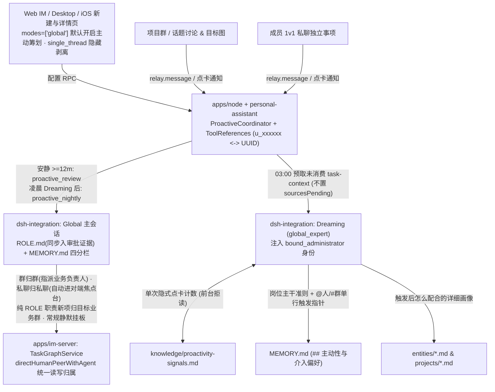
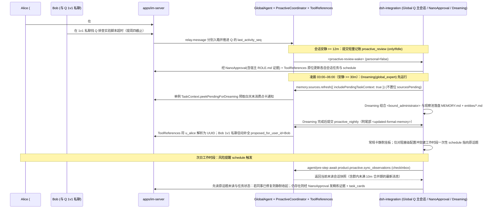

# feat-805: Global Agent 岗位主动性闭环与协作校准 — 技术方案

> 对齐: [spec.md](spec.md)

## Changelog

## 现状分析

### 涉及范围

| 落点 | 当前职责与本次改动 |
| --- | --- |
| `packages/product-contracts/src/{capabilities,node-rpc}.ts` 及单测 | 声明跨端共享 `FeatureDependency`、`NodeCapabilities`、`definitionsForRole`、`effectiveFeatures`、`effectiveCapabilityFeatures` 与 `changeCapability`。当前 `proactive_planning` 固定 `roles: ['personal']`，而 `'root'` 同时覆盖 `global` 与 `single_thread` 两种工作模式。本次在 `FeatureDependency` 与 `NodeCapabilities['features']` 新增可选 `modes?: ('global' \| 'single_thread')[]`，将 `proactive_planning` 调整为 `modes: ['global']`（对 `personal` 与 `global` 模式普通数字员工均默认开启且联动依赖 `task_graph`，对 `single_thread` 排除），并让 `definitionsForRole`、`catalogFeatures`、`effectiveCapabilityFeatures`、`effectiveSelectedTools`、`validateCapabilities` 全链路透传 `work_mode`（`single_thread` 显式传入 `proactive_planning: true` 时返回 `capability_unavailable` 拒绝） |
| `apps/node/src/{capabilities,configuration,main}.ts` | 节点能力投影、本地配置校验与启动守卫。本次：① `projectCapabilities(catalog, node, agent)` 在节点级共享查询（`agent === undefined`）时按 `'global'` 投影完整候选并保留 `modes: ['global']` 供新建页收窄，在单 Agent 查询时传入 `agent.mode`；同时将内置 `nano-proactive-care` 在 `!agent \|\| agent.mode === 'global'` 下标为 `default_on: true`（在 `agent && agent.mode !== 'global'` 下从单 Agent 技能候选过滤隐藏），确保 REST API 省略 `skills` 创建与 PA `agent_creation` 推荐列表默认包含该 Skill；② `configuration.ts` 与 `main.ts`（启动静态校验与能力占用检查）均按已归一化的 `agent.mode`（存量未写 `work_mode` 的本地记录维持 `'single_thread'`，绝不落入 `'global'` 默认值）调用 `definitionsForRole`；③ 存量显式关闭 `task_graph` 或工具白名单不含 `task_graph` 的 Global Agent 自动将缺省 `proactive_planning` 视为 `false` |
| `apps/im-server/src/{agent-creation,agent-settings,control,personal-agent-creation,task-graphs}.ts` 及单测 | IM 控制面能力透传、新建默认展开、配置校验与渐进式目标图读写/焦点聚合。本次：① `agent-creation.ts` 的 `featureOptions` 与 `agent-settings.ts` 的 `configurationDisplay` 保留 `modes` 与 `roles` 字段，按 `profile.work_mode` 过滤 `single_thread` 不适用的 `proactive_planning`；`createAgent` 在 `b.features === undefined` 时按 `c.work_mode` 过滤后的 `definitionsForRole` 初始化并展开默认特性（杜绝向新建 `single_thread` 注入 `proactive_planning: true`），且在 `b.skills === undefined && c.work_mode === 'single_thread'` 时从默认技能列表剔除 `nano-proactive-care`；`control.ts`、`personal-agent-creation.ts` 与 `task-graphs.ts`（占用校验）统一向 `definitionsForRole` / `validateCapabilities` 传入候选配置的 `work_mode`（杜绝 `single_thread` 关闭 `task_graph` 被 `proactive_planning` 死锁拦截）；② `TaskGraphService` 抽取统一辅助谓词 `directHumanPeerWithAgent(conversationId)`（校验 `type === 'direct'` 且有效参与者恰好为 1 名有效真人 `U` + 1 名 `agent:*`）：写入侧校验显式 `proposed_for_user_id` 为所属会话有效真人成员，并在该类 1v1 私聊中由 Agent 置入 `proposed` 且省略 `proposed_for_user_id` 时自动补全 `U`；读取侧 `focus(scope === 'mine')` 将 `U === user` 的 1v1 Agent 私聊与 `isPersonalChat` 一并纳入 `needs_you`、`stashed`、`active`、`goals` 与 `completed` |
| `packages/personal-assistant/src/{tool-references,inbox,task-context,proactive-coordinator,global-agent}.ts` 与 `assets/skills/{nano-proactive-care,nano-memory}/SKILL.md` | 节点侧 `<= 8` 位短引用编解码、任务上下文渲染、两阶段静默唤醒协调、收件箱摄取与内置方法论 Skill。本次：① 补齐 `ToolReferences` 对 `task_graph` 顶层与 `operations[]`（`add_task`、`update_task.patch`、`approve_task`、`set_assignee`）内人类用户 ID 字段（`proposed_for_user_id`、`assignee`［`type === 'user'`］、`assignee_id`［`assignee_type === 'user'`］、`wait.asked_user_id`，兼容可选 `user:` 前缀）的 `u_xxxxxx <-> UUID` 双向解析与响应投影；同步在 `InboxStore.systemContextEntry` 与 `TaskContext.peekPendingForDreaming` 中使用 `ToolReferences` 将面向模型渲染的任务事件文本（`conversation_id`、`actor.id`/`actor.user_id`、`human_control.actor` 及正文 `<mention target_id="..."/>`）统一投影为 `c_xxxxxx` / `u_xxxxxx`（保留内部原始 `messageId` 与 `conversationId` 供 `integratedTaskContextIds` 去重、PA `allowed` 过滤及 `Dreaming` `batch.conversations` 来源校验，并附加 `conversationRef` 供 `Dreaming.renderInput` 展示），确保 `Dreaming` 与主会话看到的点卡人身份与 `<bound_administrator>u_xxxxxx</bound_administrator>` 完全对齐；② 将 `ProactiveCoordinator` 与 `GlobalAgent.ingest` 活动水位扩展至所有 `config.mode === 'global'` 主体，按 `personal: boolean` 分支生成普通 Global 唤醒提示词；③ `GlobalAgent.execute('memory.sources.refresh')` 支持非 PA `mode === 'global'` 仅执行 `taskContext.peekPendingForDreaming` 而不触发 `pa.sources`；`syncProactiveObservations` 支持普通 Global 定时唤醒前刷新未读 `Inbox` 快照；④ 重构 `nano-proactive-care/SKILL.md` 与 `nano-memory/SKILL.md`，显式拆分共享底座与 `Bound PA` vs `Global Digital Employee` 专属章节及交接键名 |
| `packages/dsh-integration/src/{index,capability-state,capabilities,global-mode}.ts`、`src/features/task-graph-schema.ts`、`src/policy/{sources,codex,classifier}.ts` 与 `src/knowledge/{memory-documents,document-memory,dreaming,dreaming-agent,dreaming-prompts}.ts` | DSH 运行时特性门禁、工具与 Skill 可见性、工具 schema、自动工具审批证据、主会话常驻指引与 `Dreaming` 文档记忆维护。本次：① `capability-state.ts` 与 `index.ts`（`schedule` 唤醒首步前 `sync_observations`、关闭 `proactive_planning` 即时撤回队列/在途轮次、`proactive_*` 准入与 `Dreaming` 等待 + `<updated-formal-memory>` 注入）传入 `config.mode` 并扩展至 `mode === 'global'`；`capabilities.ts` 按有效 `proactive_planning` 状态控制内置 `nano-proactive-care` 可见性（`isWorkWorker \|\| config.mode !== 'global' \|\| !effectiveProactivePlanning` 时一律屏蔽；对未显式配置 `features.proactive_planning` 的存量 `explicit_allowlist` Global 主会话在开启状态下默认放行内置 `nano-proactive-care`，同时尊重 `explicit_denylist` 或显式白名单编辑后的用户禁用选择），并在 `global-mode.ts` 仅当 `nano-proactive-care` 当前有效可用时静态注入按需加载提示（杜绝悬空 Skill 引用且保持窗口内静态不变）；② 更新 `task-graph-schema.ts` 中 `proposed_for_user_id` 在共享群聊与 1v1 Agent 私聊的参数说明；③ 在 `policy/{sources,codex,classifier}.ts` 将宿主已校验生效的 `.nanoassistant/ROLE.md`（非空且 `<= 2,000` UTF-16 码元）作为可信 `role_agreement` 条目纳入审批 `<agent_instructions>`；④ 将文档记忆与 `Dreaming` 提示词升级为 `'personal' \| 'global_expert' \| 'single_thread_expert'` 三态：仅对 `personal` 置位 `documents.sourcesPending()`，对 `global_expert` 启用 `MEMORY.md` 四分栏常驻专区、`proactivity-signals.md` 观察池及 `<bound_administrator>` 注入（`Dreaming.renderInput` 展示 `conversationRef` 短引用），而 `single_thread_expert` 保持原纯粹专家提示词与目录门禁零改动 |
| `src/IM/frontend/src/features/settings/agents/{im-agent-config-api,capability-editor,agent-create-page,agent-detail-page}.tsx`、`src/IM/frontend/src/i18n/{en,zh}.json` 与 `src/IM/ios/NanoIM/Features/Agents/{AgentModels,CapabilitySelection,AgentsView,AgentConfigView}.swift` | Web IM（含 Tauri Desktop 客户端）与原生 iOS 的 Agent 新建页和详情配置页。本次在两端协议模型、能力编辑器、新建页与详情页完整接入 `modes: ['global']`：`personal \|\| work_mode === 'global'` 时展示 `proactive_planning` 开关与对应角色说明文案；新建页切换至 `single_thread` 时隐藏并剥离 `proactive_planning`，切回 `global` 时若用户未在 `global` 下显式关过该项且 `task_graph` 仍开启则恢复默认开启态；沿用统一乐观锁保存、依赖轻提示与节点离线只读锁 |

### 既有约束

- **跨包单向依赖与运行时红线（`AGENTS.md` / `SPEC.md`）**：仅 `packages/dsh-integration` 通过公开 exports 调用 `@deepseek-ai/*`；`packages/personal-assistant` 仅依赖 `product-contracts` 与 `channels`；`apps/im-server` 与 `src/IM/` 仅依赖 `product-contracts`；不新增后台轮询子会话、第二套 Agent Loop 或内核/节点 HTTP 服务端口（由 `tests/contract/test_runtime_dependency_contract.py` 守卫）。
- **正式记忆单写者与来源权限边界（`feat-676` / `feat-774`）**：`<workspace>/.nanoassistant/memory/` 仅由 `Dreaming` 写入并提交 Git；普通 Global 数字员工不具备 PA 的主人跨会话旁观（`pa.observations` / `pa.sources`）或代发（`send_user_message`）权限，仅在自身有权限参与或读取的会话、任务图与工作区内行动。
- **工具审批门禁与原子短 ID 红线（`tool-approval.md` / `global-agent.md`）**：不豁免 `task_graph(create/apply)`、`schedule_create/update/delete` 或非本人私聊 `send_message` 的 `NanoApproval` 自动审查；所有由模型读写的产品用户/会话/消息标识保持 `<= 8` 位短引用（如 `u_xxxxxx`、`c_xxxxxx`），由宿主 `ToolReferences` 负责与中心 UUID 双向映射。
- **上下文缓存前缀稳定（`NoSilentPrefixRewrite`）**：同一活跃会话窗口内不静默重写 `systemPrompt.section`、工具 schema 或窗口首轮 `MEMORY.md` / `ROLE.md` 快照；两阶段主动唤醒与夜间更新后的 `<updated-formal-memory>` 均通过会话尾部消息注入。
- **滚动升级零指纹漂移与存量配置兼容**：`canonicalAgentConfiguration` 不向未显式配置 `features.proactive_planning` 的存量记录补写默认键，保证 `agentConfigurationFingerprint` SHA-256 指纹不变；存量未写 `work_mode` 的本地节点记录继续按 `'single_thread'` 解析；存量未含 `## 主动性与介入偏好` 的 Global `MEMORY.md` 不在空闲无增量夜晚触发空跑 `Dreaming`。
- **界面范围边界**：Web IM / Desktop 与原生 iOS 仅在现有新建页特性区、`BehaviorCard` 与 `AgentConfigView` 运行特性区对 `work_mode === 'global'` 开放既有的单行 `proactive_planning` 开关与角色说明文案，无新布局、新弹窗或新视觉层级，按 `change-design-author` 原型判据无需制作独立 `prototype.html`。

### 可复用能力

| 既有能力 | 决策与理由 |
| --- | --- |
| `ProactiveCoordinator` 三水位防自激状态机 + 隔离逻辑时钟 `NANO_E2E_LOGICAL_CLOCK_SOCKET`（`feat-785`） | **用并小改**。`last_activity_seq` / `last_reviewed_seq` / `last_nightly_seq` 状态持久化、`03:00–06:00` 自然日槽位、等待当夜 `Dreaming` 完成（失败达 3 次或越过 `06:00` 自动降级放行）及 Unix Socket 逻辑时钟全部现成可用，只需放开 `config.mode === 'global'` 并按角色分支渲染唤醒提示词 |
| `ToolReferences` 持久双向短引用映射表（`feat-774`） | **用并补齐 `task_graph` 用户字段**。`userRef` / `resolveUserId` 已支持 `u_xxxxxx <-> UUID` 持久映射，补齐 `task_graph` 请求参数与返回节点的用户字段映射即可打通群聊指定拍板人 |
| `TaskContext.peekPendingForDreaming` + `DreamingOwner.integratedTaskContextIds`（`feat-793`） | **用并放开 Global 无状态预取**。`TaskContext.peekPendingForDreaming` 本身已支持 `config.mode === 'global'` 拉取 `task.context.sync` 并过滤已消费/已撤销项；对非 PA Global 跳过 PA 专属 `sourcesPending` 标志直接预取即可精确一次捕获白天面板纯点卡反馈 |
| `MemoryDocuments.consolidationIssues` AST 门禁 + `DocumentMemory` 工具守卫（`feat-793`） | **用并按三态角色隔离**。Markdown AST 四分栏校验、`proactivity-signals.md` 条数/长度门禁、相对死链校验、三次同会话自愈与 `rollbackBatch` 回滚，以及前台 `read`/`bash`/`grep`/`glob` 物理隔离守卫按 `'personal' \| 'global_expert' \| 'single_thread_expert'` 精确作用于前两者，保持 `single_thread_expert` 零侵入 |
| `NanoApproval` `<agent_instructions>` 独立指令证据通道 + `held_for_revalidation`（`feat-774` / `feat-798`） | **用并补齐宿主 `ROLE.md` 证据**。复用既有 `<agent_instructions>` 区承载宿主已校验 `.nanoassistant/ROLE.md` 长期职责约定，使 `Codex` 与 `CC` 自动审查在不放宽门禁的前提下准确评估职责内自发立卡与风险提醒；配合定时前未读核实与目标会话 `held_for_revalidation` 防止马后炮发言 |

### 相关历史

- **`feat-785`（PA 主动性闭环与渐进式目标图）**：建立全员统一凌晨 `03:00` `Dreaming` 锚点、九状态渐进式目标图、`proposed` 待拍板卡、聊天顶层 `task_cards` 活卡片及 PA 两阶段主会话主动性引擎，当时显式将普通 Global Agent 留作后续演进。
- **`feat-793`（PA 主动性记忆偏好校准与反馈演化闭环）**：建立 `MEMORY.md` `## 主动性与介入偏好` 四分栏常驻结构、`knowledge/proactivity-signals.md` 两次成规抗噪观察池、纯点卡梦前预取与 AST 落盘门禁；本单元将其扩展到多人多会话协作的 Global 数字员工，并解决多人作用域隔离与两层记忆分工。
- **`feat-774` / `feat-796`（话题一等 target、8 位短引用与协作范围档位）**：确立 `<chat_id>:<root_id>` 话题级收发复核、`u_xxxxxx` 短引用体系以及 `team` / `owner_only` 双向会话边界；本单元的原会话闭环与拍板人映射严格建立在该体系之上。

## 架构总览

下图展示普通 Global 数字员工在保持跨包单向依赖与单主会话模型下的完整主动性闭环（无新增常驻子进程或数据表）：



- **Before**：`proactive_planning` 仅对 `personal` 开放；普通 Global Agent 无安静后记账、无凌晨岗位推演、无常驻主动性校准分区与观察池，`ToolReferences` 未映射 `task_graph` 用户短引用 `u_xxxxxx`，且真人与 Global Agent 的 1 对 1 私聊中未显式填 `proposed_for_user_id` 的候选卡不进入对端真人「待你拍板」焦点台。
- **After**：所有满足 `task_graph` 前提的 `work_mode === 'global'` 数字员工默认开启 `proactive_planning`（`single_thread` 在新建页、详情页、IM 校验与 `Dreaming` 全链路零暴露零侵入）；平时安静后原位记账、凌晨 `Dreaming` 后围绕 `ROLE.md` 与原会话生成有界 `proposed` 卡（群归群、1v1 私聊归私聊并自动进入对端焦点台、纯职责新项经宿主 `ROLE.md` 审批证据校验后归目标业务群）；次日默认静默挂板不发早安刷屏，仅顺路并入已有周期汇报或对急需备料/时效风险发工作时段提醒；多人反馈按「首页岗位准则 + 局部单行触发指针」与「人物/项目详情页」分层沉淀且严格隔离作用域。

## 关键决策

1. **用 `FeatureDependency.modes: ['global']` 贯通契约、节点、IM 控制面与三端 UI，显式传齐 `work_mode` 确保存量零指纹漂移且 `single_thread` 零死锁。**
   - **理由**：在 `FeatureDependency` 与 `NodeCapabilities` 上增加声明式 `modes?: ('global' | 'single_thread')[]` 并由 `im-server`（`featureOptions`、`configurationDisplay`、`createAgent`、`validateConfigurationCandidate`）、`apps/node`（`projectCapabilities`、`configuration.ts`、`main.ts`）、`dsh-integration`（`capability-state.ts`、`index.ts`）及 Web/iOS 新建与详情编辑器全链路透传真实 `work_mode`（节点未写 `work_mode` 的历史记录维持 `'single_thread'`，新建 `single_thread` 不展开 `proactive_planning`，编辑 `single_thread` 关闭 `task_graph` 不受 `proactive_planning` 阻断）。`canonicalAgentConfiguration` 不补写缺省键，且 `effectiveFeatures` 对历史关闭 `task_graph` 的 Global Agent 自动将缺省 `proactive_planning` 降为 `false`。
   - **拒绝备选**：仅改前端展示过滤而漏传后端 `work_mode`（会导致 `single_thread` 在服务端默认落入 `'global'` 特性集，关闭 `task_graph` 报 `required_by_feature` 死锁，或通过 API 创建 `single_thread` 时写入非法 `proactive_planning: true`）。

2. **主动事项严格遵循「所属会话（`conversation_id`）原路闭环」，补齐 `ToolReferences` `task_graph` 短用户 ID 双向映射，并在 IM 读写两侧用同一谓词识别「真人 ↔ Agent 1v1 私聊」。**
   - **理由**：项目群目标延伸出的候选卡留在原群并指定业务负责人 `proposed_for_user_id`（由 `ToolReferences` 完成模型侧 `u_xxxxxx` 与 IM 侧 UUID 的双向映射）；1 对 1 私聊事项留在该私聊；无前序对话、纯由 `ROLE.md` 职责识别的新事项归属该职责服务的目标业务群（仅无关联群聊时落绑定管理者私聊）。在 `TaskGraphService` 中统一定义 `directHumanPeerWithAgent(conversationId)`（`type === 'direct'` 且有效参与者恰好为 1 名有效真人 `U` + 1 名 `agent:*`），同时驱动写入侧缺省 `proposed_for_user_id = U` 自动补全与读取侧 `focus(scope='mine')` 归属判定，既解决公司空间 1v1 Agent 私聊事项在焦点台隐身的问题，又保证真人间 1v1 私聊与多人项目群不发生跨人混入。
   - **拒绝备选**：把 Global Agent 的主动提议统一投递给绑定管理者私聊（破坏公开项目上下文并泄露同事私聊事项）。

3. **团队低噪触达策略：常规 `proposed` 卡默认静默挂板（零早安问候），有固定周期汇报则经按会话索引的 `[Pending Proactive Handoff]` 顺路合发，仅急需实质备料或时效风险才建工作时段一次性 `schedule`。**
   - **理由**：防止多位团队数字员工在清晨集中向项目群和成员私聊推送早报。非 PA Global Agent 在 `proactive_nightly` 中默认只将常规候选卡静默挂上原会话任务面板等待翻牌；若目标会话已有固定周期汇报 `schedule`，写入 `notes` 的 `[Pending Proactive Handoff: <target>]` 供该周期任务顺路同条发出；若无周期汇报，仅当产出了近期活跃任务急需的实质备料文件/结论、或发现职责内明确时效风险与阻塞时，才创建工作时段一次性 `schedule` 发往原会话（群聊优先回原话题 `<chat_id>:<root_id>`）。内置 `nano-proactive-care` 显式拆分 `Bound PA`（`[Pending Morning Brief]`）与 `Global Digital Employee`（`[Pending Proactive Handoff: <target>]`）两套分节，消除技能指引与唤醒提示冲突。
   - **拒绝备选**：每晚有 `proposed` 卡就发群早报（高噪刷屏）；完全禁止夜间安排次日主动消息（导致阻塞级配置冲突或急需备料无人知晓）。

4. **记忆整理提示词与文档门禁升级为 `'personal' | 'global_expert' | 'single_thread_expert'` 三态，实现「岗位常驻主干准则 + 单行局部触发指针 vs 人物/项目详情页」两层校准与多人作用域隔离。**
   - **理由**：`single_thread` 助手同样运行 `Dreaming` 但不应注入跨会话主动性章节或 `proactivity-signals.md`；升级为三态枚举后，`single_thread_expert` 保持原纯粹专家提示词与门禁零改动。对 `global_expert`，`MEMORY.md` 的 `## 主动性与介入偏好` 四分栏承载岗位通用准则，外加单行带 `@协作者` 或 `#会话` 限定条件的触发指针（附 `entities/` 或 `projects/` 相对链接），具体汇报习惯与负责模块全部下沉至二级页面按需读取；`Dreaming` 从 `<main_agent_background>` 获知 `<bound_administrator>` 投影身份，仅绑定管理者的岗位级要求（或跨事项/跨成员多次印证的普遍经验）沉淀为全局准则，单个普通协作者的显式边界或 `>= 2` 次点卡反馈（单次入 `proactivity-signals.md`）仅生成局部边界，不误关团队全局职责。
   - **拒绝备选**：沿用 `consolidationPrompt(personal: boolean)` 二分法（会导致 `single_thread` `Dreaming` 写入 `proactivity-signals.md` 后被 `consolidationIssues()` 拦截并回滚）。

5. **无状态打通非 PA Global 的梦前未消费点卡预取、定时唤醒前未读核实，并将宿主校验的 `.nanoassistant/ROLE.md` 纳入 `NanoApproval` 指令证据。**
   - **理由**：① 非 PA Global 没有 `pa.sources` 来源策略表，`Dreaming.refreshSources` 对 `!config.personal && config.mode === 'global'` 在不置位 `documents.sourcesPending` 的前提下调用 `peekPendingForDreaming`，既捕获白天纯点卡操作，又避免触发 `Source eligibility has not been refreshed.` 死锁；② `schedule` 唤醒首步前同步刷新未读 `Inbox` 快照，防马后炮提醒；③ 在不豁免任何写入/外发工具审批的前提下，把宿主读取并校验长度合规的 `.nanoassistant/ROLE.md` 作为可信 `role_agreement` 注入 `NanoApproval` 的 `<agent_instructions>`，使 `Codex` 与 `CC`（无本地 `read` 工具）在无人值守主动轮次与工作时段定时提醒中均能依据管理者确认的长期职责放行合规的业务群 `proposed` 立卡、`schedule_create` 与职责内风险提示。

## 接口与数据流

### 1. 模式感知 `proactive_planning` 能力契约与全链路透传

```ts
export interface FeatureDependency {
  key: string;
  roles?: ('root' | 'personal')[];
  modes?: ('global' | 'single_thread')[];
  default_on: boolean;
  requires: { features: string[]; tools: string[]; skills: string[] };
}

// featureDependencies 中更新 proactive_planning：
{
  key: 'proactive_planning',
  modes: ['global'],
  default_on: true,
  requires: { features: ['task_graph'], tools: ['task_graph'], skills: [] },
}

export function definitionsForRole(
  isPersonal = false,
  definitions = featureDependencies,
  workMode: 'global' | 'single_thread' = 'global',
): FeatureDependency[];
```

- **全链路 `work_mode` 求值契约**：
  - `packages/product-contracts/src/capabilities.ts`：`definitionsForRole` 同时校验 `roles` 与 `modes`；`catalogFeatures`、`effectiveCapabilityFeatures`、`effectiveSelectedTools` 按 `draft.personal_agent ? 'global' : (draft.work_mode === 'single_thread' ? 'single_thread' : 'global')` 解析适用特性集；`validateCapabilities` 对不适用于当前角色/模式却被显式置为 `true` 的特性（如 `single_thread` 提交 `features.proactive_planning = true`）返回 `capability_unavailable` 阻断；
  - `apps/im-server`：`agent-creation.ts` 的 `featureOptions` 与 `agent-settings.ts` 的 `configurationDisplay` 原样保留 `modes`/`roles` 并按 `work_mode` 过滤展示；`createAgent` 在省略 `features` 时仅对 `definitionsForRole(false, featureDependencies, workMode)` 展开默认值；`control.ts`、`personal-agent-creation.ts`、`task-graphs.ts` 校验候选配置时统一传入 `work_mode`；
  - `apps/node` 与 `packages/dsh-integration`：`projectCapabilities` 对节点级共享查询（`agent === undefined`）输出带 `modes: ['global']` 的完整目录，对单 Agent 查询及 `configuration.ts`、`main.ts`、`capability-state.ts`、`index.ts` 一律传入已归一化的 `agent.mode`（历史缺省 `work_mode` 本地记录保持 `'single_thread'`）；
  - **Web IM / Desktop 与 iOS 新建及编辑页**：`capability-editor.tsx` 与 `CapabilitySelection.swift` 按 `feature.modes` 过滤；`agent-detail-page.tsx` 与 `AgentConfigView.swift` 在 `personal || work_mode === 'global'` 时展示开关（区分 PA 与普通 Global 说明文案）；`agent-create-page.tsx` 与 `AgentsView.swift` 在 `global` 模式下默认显示开启的开关，切至 `single_thread` 时隐藏并从提交负载移除 `proactive_planning`，切回 `global` 时若用户未在 `global` 下显式关过该开关且 `task_graph` 仍开启则自动恢复 `proactive_planning: true`。

### 2. `ToolReferences` 短用户 ID 双向映射与 IM 1v1 Agent 私聊焦点归属

- **`ToolReferences` 补齐 `task_graph` 用户与会话引用映射（`packages/personal-assistant/src/tool-references.ts` & `packages/dsh-integration/src/features/task-graph-schema.ts`）**：
  - `arguments(agent, 'task_graph', args)`：除既有 `target` / `conversation_id` 与消息引用解析外，将顶层 `proposed_for_user_id`、`assignee`（当 `type === 'user'`）、`assignee_id`（当 `assignee_type === 'user'`）、`wait.asked_user_id` 以及 `operations[]`（`add_task`、`update_task.patch`、`approve_task`、`set_assignee`）内的同名人类用户字段通过 `resolveUserId`（兼容剥离可选 `user:` 前缀）还原为中心 36 位 UUID；
  - `result(agent, 'task_graph', value)`：递归将返回摘要、图详情与列表节点中的 `conversation_id` / `last_chat_id` 投影为 `conversationRef`，并将 `proposed_for_user_id`、`wait.asked_user_id`、`resume_request.actor_id` 以及 `type === 'user'` 的 `created_by` / `updated_by_actor` / `assignee` / `doing_wake.actor` 中的用户 ID 统一投影为 `u_xxxxxx`，确保模型在 `inbox`、`ROLE.md` 与 `task_graph` 间看到的同一真人始终是同一个 `<= 8` 位短 ID；
  - **任务上下文事件（`[task context]` 与 `pendingTaskContext`）短引用同源投影（`inbox.ts` & `task-context.ts` & `dreaming.ts`）**：`InboxStore.systemContextEntry` 在构造模型可见 `event` JSON 与 `human_control` 时，统一通过 `ToolReferences` 将 `event.conversation_id` 投影为 `c_xxxxxx`、将人类 `actor.id` / `actor.user_id`（含 `human_control.actor`）投影为 `u_xxxxxx`、并将 `event.content` 中的 `<mention type="user" target_id="..."/>` 投影为 `u_xxxxxx`（对升级前已处于 `prepared` 状态的在途条目，`commitSystemContext` 兼容比对新旧投影摘要防卡死）；同时保留条目外层内部元数据 `inputId`（原始 `messageId`）与 `conversationId`（原始 34 位会话 ID）不变，确保 `Dreaming` 的 `integratedTaskContextIds` / `batchTaskIds` 去重、PA `allowed.has(item.conversationId)` 来源过滤以及 `Dreaming` `batch.conversations`（只读 `conversations` 工具白名单）零回归；`PendingTaskContextItem` 额外携带 `conversationRef: c_xxxxxx` 供 `Dreaming.renderInput` 展示，彻底消除 36 位裸 UUID 暴露并与 `<bound_administrator>u_xxxxxx</bound_administrator>` 精确对齐；
  - `task-graph-schema.ts`：更新 `proposed_for_user_id` 描述，说明在多人共享群聊中填写目标拍板真人 ID（`u_xxxxxx`），而在 PA 私聊或真人与 Agent 的 1 对 1 私聊中可省略并自动归属对端真人。
- **IM 服务端统一 `directHumanPeerWithAgent` 谓词（`apps/im-server/src/task-graphs.ts`）**：
  - 定义 `directHumanPeerWithAgent(conversationId): string | null`：当且仅当会话 `type === 'direct'`，且有效参与者恰好为 1 名合格真人用户 `U` 与 1 名 `agent:*` 身份时返回 `U`，否则返回 `null`（真人与真人的 1v1 私聊以及多人 `group` 均返回 `null`）；
  - **写入侧（`executeTransaction`）**：对处于 `status === 'proposed'` 的节点，若显式提供了 `proposed_for_user_id`，校验其属于 `doc.conversation_id` 的有效真人参与者（否则报 `400 invalid_arguments`）；若未提供且 `actor.kind === 'agent'`，当 `directHumanPeerWithAgent(doc.conversation_id)` 返回 `U` 时自动补全 `n.proposed_for_user_id = U`；
  - **读取侧（`focus`，`scope === 'mine'`）**：令 `isOwnPrivateOrAgentDirect = isPersonalChat || directHumanPeerWithAgent(d.conversation_id) === user`，统一用于 `goals`、`needs_you`（含历史未填 `proposed_for_user_id` 的 `proposed` 及 `in_review`）、`stashed`、`active` 与 `completed`；多人 `group` 会话保持严格按 `proposed_for_user_id === user`、`assignee` 或目标发起人过滤。

### 3. Global Agent 多会话主动闭环与工具审批证据时序



- **`NanoApproval` 长期角色约定证据供给（`packages/dsh-integration/src/policy/{sources,codex,classifier}.ts`）**：
  - 保持现有工具审批边界不变：`task_graph(create/apply)`、`schedule_create/update/delete` 及向非绑定管理者私聊受众的 `send_message` 均继续经过 `CodexApproval` 或 `CcApproval`（`unattendedFallback` 默认 `'deny'` 不放宽）；
  - 当根会话所属工作区存在经宿主 `DocumentMemory.readRole(config)` 校验合法的 `.nanoassistant/ROLE.md`（常规文件、非空且 `<= 2,000` UTF-16 码元）时，宿主将其以结构化 `{ agent_instructions: { source: '.nanoassistant/ROLE.md', role_agreement: role.content } }` 注入审批器的 `<agent_instructions>` / 指令行（与 `AGENTS.md` 同级独立于不可信聊天文本），并在 `reviewSourceInstructions` 明确：宿主认证的 `.nanoassistant/ROLE.md` 代表主人或绑定管理者已确认的长期岗位职责约定，在 `Codex` 与 `CC` 规则下可作为职责范围内自发建立 `proposed` 候选卡、设置检查 `schedule` 或向约定目标业务群发送真实风险提示的长期职责依据，但绝不覆盖用户的明确禁止、不授权越界对外承诺或私密信息外发，且在 `DSH` 规则下仅作约束。

### 4. Agent Context、三态记忆校准与内置 Skill 分节契约

- **Consumers 与 Context Lifecycle**：
  1. **普通 Global 主会话（Root Session，`!config.personal && config.mode === 'global'`）**：
     - **窗口级稳定前缀层（零静默改写）**：
       - `nano-global-mode`（`global-mode.ts`）：补充简短静态英文指引，要求主会话遵守 `MEMORY.md` 中 `## 主动性与介入偏好` 的岗位准则与 `@协作者`/`#会话` 局部边界（命中链接按需 `read` `entities/` 或 `projects/`，严禁读取 `knowledge/proactivity-signals.md`），在固定周期汇报 `schedule` 触发时检查 `notes` 中对应会话的 `[Pending Proactive Handoff: <target>]` 并同条附带 `task_cards` 后清理；仅在当前 preset 配置的有效 `proactive_planning === true` 且 `nano-proactive-care` 未被用户禁用时静态包含“按需加载 `nano-proactive-care`”提示（窗口内完全静态不变，关闭主动筹划或禁用该 Skill 时不留悬空引用）；
       - `nano-document-memory`（`document-memory.ts`）：按三态分支生成说明——`personal` 与 `global_expert` 声明已确认主动性分寸位于 `MEMORY.md` 且 `proactivity-signals.md` 为离线观察池不可读取（工具守卫对 `proactiveCalibration === true` 的非 `Dreaming` 会话硬拦截 `read`/`bash` 并脱敏 `grep`/`glob`），`single_thread_expert` 维持现有专家说明不变；
       - 窗口内联 `MEMORY.md` 与 `.nanoassistant/ROLE.md` 维持窗口首轮快照不变，严格满足 `NoSilentPrefixRewrite`。
     - **尾部动态唤醒层**：
       - `<proactive-review-wake>`（`personal = false`）：仅将新增交流中已明确的事项进展或检查节点原位更新到**各自来源会话**的 `task_graph` 与 `schedule`，严守禁区，无约 1h 内紧急冲突不调用 `send_message`；
       - `<proactive-nightly-wake>`（`personal = false`）：首行按需内联 `<updated-formal-memory>`；围绕 `ROLE.md`、最新 `MEMORY.md` 四分栏与活跃目标图做只读核查准备，按原会话归属建立 `<= 3` 张高信噪比 `proposed` 卡（群归群设 `proposed_for_user_id`、1v1 私聊归该私聊、纯 `ROLE.md` 职责项归目标业务群且仅无关联群时落管理员私聊），执行低噪触达（有周期汇报记 `notes` `[Pending Proactive Handoff: <target>]`；无周期汇报常规卡静默挂板，仅急需备料或时效风险建工作时段一次性 `schedule`），夜间禁调 `send_message`；
       - `<schedule-observation-sync>`：`schedule` 首步前刷新未读 `Inbox` 列表并提示先核实最新消息与任务状态。
  2. **三态 `Dreaming` 提炼与整合会话（`'personal' | 'global_expert' | 'single_thread_expert'`）**：
     - **`Dreaming.refreshSources` 无死锁分流**：仅 `config.personal` 调用 `documents.sourcesPending(agentId)` 与 `refreshPersonalSources`；`!config.personal && config.mode === 'global'` 在 `includePendingTaskContext === true` 时直接调用 `peekPendingForDreaming`（不置位 `sourcesPending`），`single_thread` 直接返回 `[]`；
     - **Stage 1（`extractionPrompt(proactiveCalibration)`）**：仅当 `proactiveCalibration === true` 时附加提取人类协作者对主动跟进、候选提议与触达时机表态（保留发言人、会话/项目范围及针对内容 vs 时机区分），`single_thread_expert` 不附加；
     - **Stage 2（`consolidationPrompt(role)` + `MemoryDocuments`）**：
       - `personal`：保持现有 PA 四分栏与 `proactivity-signals.md` 规则；
       - `global_expert`：`<main_agent_background>` 注入 `<bound_administrator>u_xxxxxx</bound_administrator>`，`renderInput` 内联现有 `proactivity-signals.md` 与未消费 `task-context`；`MEMORY.md` 维护唯一 `## 主动性与介入偏好` 四分栏（主干写岗位通用准则，局部例外仅写一行带 `@人`/`#群` 限定条件 + `entities/` 或 `projects/` 相对链接，详细个人沟通习惯归入二级页），`consolidationIssues()` 校验四分栏、禁链与观察池上限；绑定管理者岗位级要求直通全局准则，单个普通协作者显式要求或 `seen >= 2` 次点卡仅形成局部边界；
       - `single_thread_expert`：不注入 `<bound_administrator>`、不内联或允许 `proactivity-signals.md`、不在提示词或 `consolidationIssues()` 中要求 `## 主动性与介入偏好`，100% 保持单会话助手现有 `Dreaming` 行为。
  3. **共享内置 Skill 默认可用性、状态联动与双角色分节契约（`apps/node/src/capabilities.ts`、`dsh-integration/src/capabilities.ts`、`nano-proactive-care/SKILL.md` & `nano-memory/SKILL.md`）**：
     - **全创建入口默认可用与开关联动**：`apps/node/src/capabilities.ts` 对 `!agent || agent.mode === 'global'` 将 `nano-proactive-care` 标为 `default_on: true`（对 `single_thread` 单 Agent 查询隐藏，且 `im-server/src/agent-creation.ts` 在省略 `skills` 创建 `single_thread` 时剔除该项），使 Web/iOS 新建、REST API 省略 `skills` 创建与 PA `agent_creation` 推荐默认均启用 `nano-proactive-care`；`dsh-integration/src/capabilities.ts` 在 `isWorkWorker || config.mode !== 'global' || !effectiveProactivePlanning` 时一律隐藏该 Skill，并对升级前未显式写 `features.proactive_planning` 的存量 `explicit_allowlist` Global 主会话默认放行内置 `nano-proactive-care`（保留用户显式禁用优先且零配置指纹变更）；
     - `nano-proactive-care/SKILL.md`：frontmatter 更新为适用于 `Bound Main PA` 与 `Global-Mode Digital Employees`（根主会话专用）；正文拆分为「共享核心纪律」（`MEMORY.md` 四分栏与禁读 `proactivity-signals.md`、阶段一原位轻量记账、定时发言前未读核实）与「按角色区分的夜间筹划与次日触达」（**Personal Assistant**：主人私聊闭环、`[Pending Morning Brief]`、无早间日程且有新干货/新 `proposed` 卡可建早报闹钟；**Global Digital Employee**：原 `conversation_id` 闭环 + 纯职责项归目标业务群、`[Pending Proactive Handoff: <target>]`、常规 `proposed` 卡静默挂板零早安问候且仅急需备料/时效风险建工作时段一次性 `schedule`）；
     - `nano-memory/SKILL.md`：将 `proactivity-signals.md` 前台禁读与 `MEMORY.md` 四分栏规范明确限定在全局模式主体（PA 与全局独立专家，单会话专家不适用），并写明全局独立专家的两层单源分工与绑定管理者 vs 普通协作者作用域护栏。

- **模型可见上下文 Before / After 关键对照（非 PA Global 主会话夜间唤醒）**：
  - *Before*：普通 Global Agent 无 `<proactive-review-wake>`、无 `<proactive-nightly-wake>`，`MEMORY.md` 无 `## 主动性与介入偏好` 常驻结构。
  - *After*（`<proactive-nightly-wake>` 尾部注入示意）：
    ```xml
    <proactive-nightly-wake local_time="2026-11-28T03:15:00+08:00" quiet_minutes="52" quiet_hours="true">
    <updated-formal-memory complete="true">
    # Expert memory
    ## 主动性与介入偏好
    ### 积极盯紧与提前备料
    - 登录鉴权链路改动主动核查回归覆盖并提醒 Alice（交付格式见 [Alice](entities/alice.md)）。
    ### 免打扰禁区
    - 未打提测标签的个人实验分支不主动建回归任务卡。
    - 与 Bob 私聊中的临时脚本排查：仅按问作答，不主动建待拍板卡（协作偏好见 [Bob](entities/bob.md)）。
    </updated-formal-memory>
    guidance: Nightly role-driven planning pass (once per night during quiet hours). 1) Honor ROLE.md and all four calibration buckets in "## 主动性与介入偏好" of the latest MEMORY.md—respecting both role-wide rules and collaborator/conversation-scoped boundaries, following relative links to entities/ or projects/ when preparing for that collaborator or project, and never reading knowledge/proactivity-signals.md; 2) Review today's new conversations across joined groups/threads and 1-on-1 DMs alongside active goal graphs, perform read-only verification within your standing authority, close resolved or stale proposed cards first, and create at most 1-3 high-signal status="proposed" candidate cards strictly in each matter's originating conversation_id (group goal -> that group/goal graph with proposed_for_user_id set to the goal/module owner u_xxxxxx; 1-on-1 DM -> that exact DM without leaking to groups; net-new ROLE.md duty with no prior chat -> its target business group, or your bound administrator's DM only if unassociated with any group; casual chat with no role gap -> 0 cards); 3) Low-noise team delivery: inspect schedule_list—if a target conversation already has a recurring report/check-in schedule, save prepared points/file paths and TaskCardRefs in notes under [Pending Proactive Handoff: <target>] instead of adding another schedule; otherwise leave routine proposed cards silent on the task board (0 morning greetings) and create a one-shot working-hours schedule to the originating conversation/thread ONLY for urgent substantive preparation needed tomorrow or a time-sensitive risk/blocker within your role. Quiet hours are active: do NOT call send_message; finish silently.
    </proactive-nightly-wake>
    ```

### 5. 隔离环境逻辑时钟跨天多角色 E2E 验证方案

复用隔离本地 Unix Socket 逻辑时钟通道（`NANO_E2E_LOGICAL_CLOCK_SOCKET`，仅在非公网隔离环境启用，零新增 HTTP 端口），新增自动化验收脚本 `scripts/verify_global_agent_proactivity_24h.py`，在默认开启 `NanoApproval` 的真实 `im-server` + `apps/node` + `dsh-integration` + 真实 LLM 下端到端验证全部核心场景：
1. **双会话原路闭环、短 ID 映射与焦点台隔离（场景一）**：「#发版群」（Alice 牵头目标图）与「Bob ↔ Global Agent Q 1v1 私聊」并行对话 → 推进 `+13m` 触发 `proactive_review` 静默原位记账（0 聊天消息）→ 推进至 `03:15` 先跑 `Dreaming` 再跑 `proactive_nightly` → 核验群候选卡挂在 `#发版群` 目标图且 `proposed_for_user_id` 经 `u_xxxxxx -> UUID` 准确落到 Alice `needs_you`、私聊候选卡留在 Bob 1v1 私聊且自动补全进入 Bob `needs_you`（不泄露到群或 Alice 视图），常规卡零早报闹钟；
2. **无前序聊天时基于 `ROLE.md` 长期职责自发归属目标业务群（场景二）**：为 Q 在 `.nanoassistant/ROLE.md` 设定监控「#研发群」对应工作区健康度的长期职责且不在「#研发群」发任何人类交办消息，在工作区制造可观测回归异常线索 → 夜间 `proactive_nightly` 在 `NanoApproval` 开启下凭宿主 `ROLE.md` 指令证据在「#研发群」（而非绑定管理者私聊）成功建立 `proposed` 提议卡（并由单测/集成测试同步覆盖无关联群聊 `owner_only` 数字员工回退绑定管理者私聊的分支）；
3. **时效风险定时前未读核实防马后炮（场景一续）**：在工作时段风险提醒触发前由同事在原群话题先行发布已修复消息 → 推进时钟触发 `schedule` → 核验 `<schedule-observation-sync>` 先读取未读并静默收起过时风险；
4. **多人分层记忆校准与作用域隔离（场景三）**：绑定管理者下达岗位全局规则（一次直通首页）+ Bob 在 1v1 私聊先单次点「不采纳」（`03:00` `Dreaming` 无状态预取 `pendingTaskContext` 记入 `proactivity-signals.md` `seen: 1` 不误杀）+ 次日二次点拒（晋升为 `MEMORY.md` 带 Bob 私聊范围限定的单行边界并更新 `entities/`，同时 `#发版群` 与对 Alice 的正向盯紧及按链接读详情保持正常），并核查 `llm_logs` 主会话前缀零静默改写。

## 本次审查安排

| 审查编组 | 必须回答的问题 / 对应目标 | 能力与使用阶段 | 证据方法、范围与共享定位 |
| --- | --- | --- | --- |
| G1：实现正确性与契约一致性审查 | 1) `modes: ['global']` 在契约、节点、IM 新建/校验/快照与 Web/iOS 新建及编辑页是否全链路闭环且 `single_thread` 无死锁、无脏字段、无 `Dreaming` 污染；2) `ToolReferences` `task_graph` 短用户 ID 双向映射与 `directHumanPeerWithAgent` 读写一致性是否严密无越权；3) 非 PA Global 的无 `sourcesPending` 梦前预取、宿主 `ROLE.md` 审批证据供给、定时前未读同步与关闭开关即时撤回是否正确 | `change-code-review`（实施完成后独立审查） | 审查 `product-contracts`、`im-server`、`node`、`personal-assistant`、`dsh-integration`、`IM/frontend`、`IM/ios` diff、对应单测/集成测试与 delta-spec 对照 |
| G2：模型上下文、缓存前缀与隔离真栈旅程联合审查 | 1) Global 主会话、三态 `Dreaming`、`NanoApproval` `<agent_instructions>` 与双角色 `nano-proactive-care`/`nano-memory` 实际可见上下文是否自洽、观察池物理隔离完备且满足 `NoSilentPrefixRewrite`；2) 真实隔离栈下场景一（群+1v1 私聊原路闭环与焦点台）、场景二（无前序聊天纯 `ROLE.md` 归属业务群）、场景三（多人分层记忆与作用域隔离）及场景四（Web IM 新建/编辑页 `global` vs `single_thread` 切换与保存联动）是否完整兑现 | `agent-context-review` + `product-journey-review`（共享同一隔离 E2E 运行现场与真实 LLM 日志轨迹） | 核查 `verify_global_agent_proactivity_24h.py` 隔离真栈产物、`.nanoassistant/memory/` Git 提交与页面快照、真实 `llm_logs` 前缀一致性，以及隔离 Web IM 新建页/配置页与任务焦点台实测 |

## 契约层增量 (delta-spec)

- `gateway/global-agent`: [specs/gateway/global-agent.md](specs/gateway/global-agent.md)（新增 `全局数字员工围绕岗位职责执行两阶段静默运转、原会话归属与低噪触达` Requirement，覆盖安静后原会话轻量记账、凌晨 `Dreaming` 后原路提议立卡、纯角色职责目标群归属、常规提议静默挂板与已有周期汇报合并、时效风险/急需备料工作时段触达及发言前未读核实）
- `gateway/agent-capabilities`: [specs/gateway/agent-capabilities.md](specs/gateway/agent-capabilities.md)（将 `PA 专属主动筹划 Feature 与任务图依赖联动` 重命名并扩展为 `全局模式主动筹划 Feature 与任务图依赖联动`；修改 `角色化文档记忆可及时消费且不扩大权限` 与 `Dreaming 按交流与任务经历组织记忆`，按全局模式 vs 单会话模式隔离启用 `MEMORY.md` 四分栏常驻专区、`proactivity-signals.md` 观察池、未消费 `task-context` 梦前预取、绑定管理者 vs 普通协作者两层演化及落盘门禁）
- `gateway/personal-agent`: [specs/gateway/personal-agent.md](specs/gateway/personal-agent.md)（修改 `系统维护 PA 默认服务指导与 Skill 协作` 与 `PA 主动筹划执行主会话平时轻量记账、夜间深度筹划、实质早报触达与唤醒前观察流同步`，移除对普通 Global Agent 的旧排他表述并对齐共享 `nano-proactive-care` 双角色分工）
- `gateway/tool-approval`: [specs/gateway/tool-approval.md](specs/gateway/tool-approval.md)（修改 `Auto默认采用Codex规则且可配置为CC或DSH规则` 与 `Codex Auto 按风险与授权进行独立、有界的审查`，明确宿主已校验生效的 `.nanoassistant/ROLE.md` 随指令区提供给 `Codex`/`CC` 审查作为职责范围内行动的长期职责依据，不改变工具审批门禁与 `DSH` 仅作约束语义）
- `gateway/spec`: [specs/gateway/spec.md](specs/gateway/spec.md)（同步更新 `Global Agent` Requirement 计数 `23 -> 24` 及 `Global Agent`、`Agent Capabilities` 的覆盖摘要）
- `im/task-graphs`: [specs/im/task-graphs.md](specs/im/task-graphs.md)（修改 `每个拆分层级提供结构与完成情况视图`，明确「与我有关」焦点台同步覆盖真人与 Agent 的 1 对 1 `direct` 私聊事项，并在该类私聊自动补全缺省 `proposed_for_user_id` 及校验会话真人成员身份）
- `im/agents-nodes`: [specs/im/agents-nodes.md](specs/im/agents-nodes.md)（修改 `Web 与 iOS SHALL 使用一致的 Feature 依赖联动与轻提示`，新增全局模式数字员工在新建与编辑页默认开启并独立启停 `proactive_planning`、新建页往返切换 `single_thread` 自动剥离与恢复默认、以及离线只读保护的场景）
- `im/personal-agent`: [specs/im/personal-agent.md](specs/im/personal-agent.md)（修改 `独立启停 PA 主动筹划并与运行特性统一保存联动`，移除“不对普通团队数字员工展示”的旧排他限制并指向共享特性联动契约）
- `im/spec`: [specs/im/spec.md](specs/im/spec.md)（同步更新 `Agents and Nodes` 的覆盖摘要，各 area Requirement 计数不变）
- `channels`、`product-contracts`: `no spec delta`（`channels` 未涉及改动；`product-contracts` 无独立 `docs/specs/` 目录，共享能力契约由 `gateway/agent-capabilities` 与 `im/agents-nodes` 完整表达）

## 风险与回退

- **团队多数字员工并发唤醒噪音风险**：若多个 Global Agent 同时在早晨发群消息会干扰协作。设计已在唤醒提示词与 `nano-proactive-care` 双重收紧“无固定周期汇报时常规 `proposed` 卡一律静默挂板（0 早安消息），仅急需备料或明确时效风险才建工作时段一次性 `schedule`”，且管理者可随时在配置页一键关闭单个 Global Agent 的 `proactive_planning`。
- **存量 Global / Single-Thread Agent 升级兼容性风险**：存量未写 `work_mode` 的本地节点记录保持按 `'single_thread'` 求值；存量显式关闭 `task_graph` 的 Global Agent 由 `effectiveFeatures` 自动将缺省 `proactive_planning` 降为 `false`；`single_thread` 的 `Dreaming` 走独立 `'single_thread_expert'` 分支零改动；存量旧 Global `MEMORY.md` 由 `repositoryIssues()` 与 `consolidationIssues()` 分离保证无新活动夜晚零空跑，下次有真实增量的 `Dreaming` 原地补齐章节，极端失败由 `rollbackBatch` 回滚起始 Git 提交。
- **回退方案**：本单元无数据库破坏性 schema 变更、无配置文件迁移；如需紧急回退，直接还原提交即可，已生成的 `proposed` 任务卡与 `.nanoassistant/memory/` Markdown 文档在旧版中仍完全合法可读。

## 一次性部署迁移

无。存量节点配置指纹保持不变，新建 Global Agent 工作区初始化即带 `## 主动性与介入偏好` 骨架，存量 Global Agent 工作区在下一次正常增量 `Dreaming` 中自动原地补齐，无需停机或一次性历史迁移脚本。

## Runbook for Reviewer

| 服务 | 停止命令 | 启动命令 | 健康检查 |
| --- | --- | --- | --- |
| 隔离 E2E 全栈（IM Server + Node Gateway + DSH Runtime） | `./scripts/e2e-down.sh` | `./scripts/e2e-up.sh --profile daily` | `curl -fsS "http://127.0.0.1:$(jq -r .im_port .e2e-daily.json)/health"` |

**Review 驱动方式**:
1. 运行窄范围确定性单测与契约测试（`packages/product-contracts`、`apps/im-server`、`apps/node`、`packages/personal-assistant`、`packages/dsh-integration`、`src/IM/frontend`、`tests/contract/test_runtime_dependency_contract.py`、`./scripts/docs-check`）；iOS 改动在 macOS 可用时通过 `xcodebuild` 编译校验；
2. 运行隔离逻辑时钟跨天验收脚本 `python3 scripts/verify_global_agent_proactivity_24h.py`（自动拉起并回收专属隔离栈与逻辑时钟 Socket），核验真实 LLM 与开启 `NanoApproval` 下的双会话原路闭环、无前序聊天纯 `ROLE.md` 归属目标业务群、1v1 私聊焦点台归属、低噪触达防马后炮、多人分层记忆校准与主会话前缀缓存不变性；并在隔离 Web IM 核验新建/编辑页 `global` vs `single_thread` 的配置开关表现。

**验收前置**: 本机已通过 `python3 scripts/dev_host.py check`（本地模型代理与 `llm_logs` 可用）。

## Milestones

| ID | 标题 | 依赖 | 并行组 | 范围 | 退出标准 |
| --- | --- | --- | --- | --- | --- |
| M1 | Global Agent 岗位主动性闭环、1v1 焦点归属与两层协作记忆校准 | 无 | G1 | `packages/product-contracts/src/{capabilities,node-rpc}.ts`, `apps/node/src/{capabilities,configuration,main}.ts`, `apps/im-server/src/{agent-creation,agent-settings,control,personal-agent-creation,task-graphs}.ts`, `packages/personal-assistant/src/{tool-references,inbox,task-context,proactive-coordinator,global-agent}.ts`, `packages/personal-assistant/assets/skills/{nano-proactive-care,nano-memory}/SKILL.md`, `packages/dsh-integration/src/{index,capability-state,capabilities,global-mode}.ts`, `packages/dsh-integration/src/features/task-graph-schema.ts`, `packages/dsh-integration/src/policy/{sources,codex,classifier}.ts`, `packages/dsh-integration/src/knowledge/{memory-documents,document-memory,dreaming,dreaming-agent,dreaming-prompts}.ts`, `src/IM/frontend/src/{features/settings/agents/im-agent-config-api.ts,features/settings/agents/capability-editor.tsx,features/settings/agents/agent-create-page.tsx,features/settings/agents/agent-detail-page.tsx,i18n/en.json,i18n/zh.json}`, `src/IM/ios/NanoIM/Features/Agents/{AgentModels,CapabilitySelection,AgentsView,AgentConfigView}.swift`, `scripts/verify_global_agent_proactivity_24h.py` 及对应测试 | `[reviewer]` 完整兑现 `spec.md` 全部 4 项 Requirement：1) 全局模式数字员工在对话安静后静默原位更新对应会话事项，凌晨 `Dreaming` 后围绕 `ROLE.md` 与原会话生成有界 `proposed` 卡（群目标归原群并成功指向负责人拍板、1v1 私聊事项严格留在该私聊并自动进入对端成员「待你拍板」焦点台、无前序对话纯职责项在开启审批下归目标业务群且仅无关联群时落绑定管理者私聊、无新增动态零唤醒）；2) 无周期汇报时常规 `proposed` 卡静默挂板不发早安消息，有周期汇报经 `[Pending Proactive Handoff]` 顺路合发，仅急需实质备料或时效风险在工作时段发往原会话/话题，且发言前核实最新未读防马后炮，未获批前不越权执行；3) 绑定管理者岗位级规矩沉淀为 `MEMORY.md` 四分栏常驻准则，单个协作者点拒（单次入后台观察池抗噪，满 2 次或显式表态成规）仅生成带协作者/会话范围限定的单行边界并更新人物详情页，不封杀对团队其他人的正常主动性，正向触发后按链接读取人物/项目页交付习惯；4) Web IM、Desktop 与 iOS 新建页及配置页对满足任务图前提的 `global` 数字员工默认开启并支持独立启停「主动筹划」（关闭即刻停止待执行主动唤醒且保留任务/记忆/角色/显式定时），`single_thread` 不显示、不注入且可正常关闭 `task_graph`（新建页往返切换 `global <-> single_thread` 正确剥离与恢复默认），节点离线保持只读保护。<br>`[worker]` 1) 单元与集成测试完整覆盖：`modes: ['global']` 全链路能力透传、新建 `single_thread` 不注入 `proactive_planning`、`single_thread` 关闭 `task_graph` 不报依赖冲突、存量缺省 `work_mode` 本地记录维持 `'single_thread'`、`task_graph: false` Global 平滑降级，以及 REST API / PA `agent_creation` / 存量白名单 Global 的 `nano-proactive-care` 默认可用性与关闭 `proactive_planning` 时的联动屏蔽（无悬空提示）；`ToolReferences` `task_graph` 顶层与 `operations[]` 用户短引用双向映射，以及 `[task context]` / `pendingTaskContext` 模型可见文本的 `u_xxxxxx`·`c_xxxxxx` 短引用投影（与 `<bound_administrator>` 对齐且保持内部 `messageId`/`conversationId` 去重与来源白名单完好）；IM `directHumanPeerWithAgent` 读写统一（1v1 Agent 私聊补全与 `focus('mine')` 覆盖，真人间 1v1 与多人项目群不混入）；非 PA Global 活动水位与防自激、无 `sourcesPending` 死锁的梦前 `peekPendingForDreaming` 预取与跨夜去重、宿主 `ROLE.md` 纳入 `Codex`/`CC` `<agent_instructions>` 审批证据（不豁免门禁）、定时前 `sync_observations` 未读核实、关闭特性即时清理队列；三态 `Dreaming`（`personal` / `global_expert` / `single_thread_expert` 互不污染，确保 `single_thread` `Dreaming` 零回滚）、前台 `DocumentMemory` 拦截/脱敏 `proactivity-signals.md`；Web 新建页与详情页 `global <-> single_thread` 切换及依赖联动单测（及可用环境下的 iOS 构建检查）；2) `scripts/verify_global_agent_proactivity_24h.py` 在隔离真栈 + 逻辑时钟 + 真实 LLM 下跑通场景一、场景二、场景三并留存记忆仓 Git 证据与 `llm_logs` 前缀不变性核查，临时资源完整回收；3) `tests/contract/test_runtime_dependency_contract.py` 与 `./scripts/docs-check` 全绿。 |
